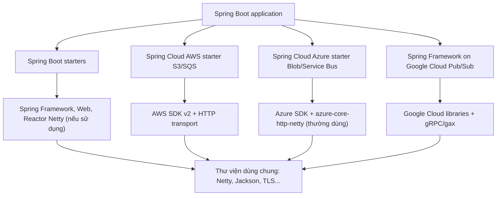
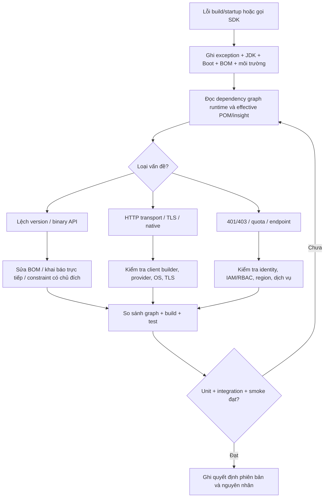

# Phân tích dependency tree và xử lý xung đột SDK, HTTP client, Netty

> **Chương:** Khởi tạo dự án  
> **Học phần:** SPRING_CLOUD_PROVIDER_INTEGRATION — tích hợp Spring Boot với dịch vụ managed của AWS, Azure và Google Cloud qua những thư viện Spring Cloud tương ứng.

Khi xây dựng ứng dụng Spring Boot sử dụng Amazon S3, Azure Service Bus và Google Cloud Pub/Sub, chỉ vài starter có thể kéo theo hàng trăm artifact. Ứng dụng biên dịch thành công không bảo đảm nó có thể khởi động hoặc gọi cloud đúng cách: một BOM có thể chọn phiên bản khác kỳ vọng, một SDK có thể yêu cầu API đã bị thay đổi, và nhiều HTTP transport có thể cùng xuất hiện trên classpath.

Bài này hướng dẫn **quan sát dependency graph trước khi sửa cấu hình**. Trọng tâm là truy vết dependency bắc cầu, xác định phiên bản được chọn ở runtime, phân biệt việc tồn tại nhiều HTTP client với xung đột thực sự, và đưa ra thay đổi nhỏ nhất có thể kiểm chứng.

## 1. Mục tiêu học tập

Sau khi học, bạn có thể:

1. Phân biệt dependency **trực tiếp**, **bắc cầu** (*transitive*), **được quản lý bởi BOM**, **bị loại** và **được chọn cuối cùng**.
2. Đọc `mvn dependency:tree`, Maven effective POM, Gradle `dependencies` và `dependencyInsight` để biết một module đến từ đâu.
3. Nhận diện họ thư viện AWS SDK v2, Azure SDK for Java, Google Cloud Java libraries, các HTTP client và Netty.
4. Phân loại `NoSuchMethodError`, `NoClassDefFoundError`, lỗi linkage, HTTP transport, TLS và lỗi IAM thay vì sửa tất cả bằng cách tăng version.
5. Chọn cách giải quyết phù hợp: cập nhật BOM, sửa khai báo trực tiếp, bỏ override sai, điều chỉnh transport hoặc exclusion có kiểm chứng.
6. Thiết lập kiểm thử để xác nhận ứng dụng vẫn truy cập đúng storage, messaging, dữ liệu và secret sau khi thay dependency.

## 2. Tại sao Spring Cloud Provider Integration dễ gặp xung đột?

Một starter không chỉ thêm một JAR. Ví dụ, starter S3 có thể mang AWS SDK v2; một Azure starter có thể dùng `azure-core` cùng transport Netty; một Google Cloud starter có thể sử dụng `gax`, gRPC và các thư viện protobuf. Spring Boot còn quản lý các thư viện HTTP, JSON, logging, security và reactive stack.



Sơ đồ mang tính định hướng. **Không phải mọi starter đều kéo tất cả module đã liệt kê.** Ví dụ, AWS SDK v2 **đồng bộ** và **bất đồng bộ** có thể sử dụng HTTP transport khác nhau; nếu chỉ dùng `S3Client` đồng bộ thì không được mặc định rằng AWS đã kéo `netty-nio-client`.

Các nhóm artifact cần nhận diện:

| Vai trò | Tọa độ/cụm thư viện thường gặp | Cần xem điều gì? |
|---|---|---|
| Spring Boot / Spring Framework | `org.springframework.boot:*`, `org.springframework:*` | Có đang cùng thế hệ Boot/Framework không? |
| Spring Cloud release train | `org.springframework.cloud:*` | Các module thuộc train tương thích với Boot không? |
| Spring Cloud AWS | `io.awspring.cloud:*` | BOM AWSpring và starter có khớp nhánh không? |
| AWS SDK v2 | `software.amazon.awssdk:*` | SDK module có đồng bộ, có trộn SDK v1 `com.amazonaws:*` ngoài ý muốn không? |
| Spring Cloud Azure | `com.azure.spring:*` | BOM Spring Cloud Azure và adapter dùng đúng thế hệ không? |
| Azure SDK | `com.azure:*` | `azure-core`, transport và thư viện cụ thể có nằm trong tập phù hợp không? |
| Spring Framework on Google Cloud | `com.google.cloud:spring-cloud-gcp-*` | BOM provider, starter và Google libraries có tương thích không? |
| Google Cloud libraries | `com.google.cloud:*`, `com.google.api:gax-*`, `io.grpc:*`, `com.google.protobuf:*` | Có thay đổi gRPC/protobuf/gax xuyên nhiều thư viện không? |
| Reactor Netty | `io.projectreactor.netty:*` | Phiên bản Reactor Netty tương thích Boot và Netty chưa? |
| Netty lõi | `io.netty:netty-*` | Các module Netty được chọn thành tập tương thích không? |
| HTTP client khác | Apache HttpComponents, OkHttp, JDK HttpClient | Client nào **thực sự được xây dựng và sử dụng**? |

Tên groupId của một thư viện cho biết xuất xứ, **không chứng minh nó gây lỗi**. Hai HTTP client cùng nằm trên classpath là một tín hiệu cần quan sát, nhưng không tự động là xung đột.

## 3. Năm khái niệm phải phân biệt trước khi đọc cây

| Khái niệm | Ý nghĩa | Ví dụ |
|---|---|---|
| **Direct dependency** | Ứng dụng khai báo trực tiếp | `spring-cloud-aws-starter-s3` |
| **Transitive dependency** | Một dependency khác kéo vào | `software.amazon.awssdk:s3` hoặc `azure-core-http-netty` |
| **Managed/constraint version** | POM parent/BOM/Gradle platform gợi ý hoặc quản lý phiên bản | `spring-cloud-aws-dependencies`, `spring-boot-dependencies` |
| **Requested version** | Version một node trong đồ thị yêu cầu | Provider A yêu cầu thư viện X phiên bản 1.2 |
| **Selected/resolved version** | Version build tool cuối cùng đặt trong một configuration | Có thể là X 1.3 sau conflict resolution |

**Một dependency tree bình thường đã là kết quả của resolution.** Cây đơn giản có thể không hiển thị đầy đủ các version từng bị loại; Maven có chế độ verbose và Gradle có `dependencyInsight` để giải thích. Với một ứng dụng, hãy kiểm tra ít nhất `runtimeClasspath`; `compileClasspath` hay `testRuntimeClasspath` có thể khác nhau.

### Ví dụ minh họa hoàn toàn giả định

Giả sử hai starter cùng yêu cầu `example.http:core`:

```text
application
+- cloud-starter-a:1.0
|  \- example.http:core:2.3
\- cloud-starter-b:1.0
   \- example.http:core:2.5

Sau resolution, classpath có thể chỉ chọn một version:
example.http:core:2.5
```

Kết quả phụ thuộc vào cách quản lý dependency. Maven có cơ chế **dependency management** và **nearest definition** (khi cùng độ sâu thì thứ tự khai báo ảnh hưởng kết quả); Gradle thường xem các yêu cầu và constraints trong toàn đồ thị rồi chọn phiên bản phù hợp. Không lấy kết quả giả định trên làm quy tắc chung cho mọi dự án.

## 4. Kiểm tra nền dự án trước khi tìm xung đột

Ghi ra một bản chụp của hệ thống:

| Hạng mục | Giá trị cần ghi |
|---|---|
| Java | `java -version`, nhà phân phối JDK, image Docker/CI |
| Build | Maven/Gradle wrapper và version thực chạy |
| Spring | Boot, Spring Framework, release train Spring Cloud nếu dùng |
| Provider | AWSpring, Spring Cloud Azure, Spring Framework on Google Cloud và version BOM |
| Dịch vụ | S3/SQS, Blob/Service Bus, Cloud Storage/Pub/Sub/Secret Manager... |
| Runtime | JVM, OS, container architecture, native library/TLS provider |
| Lỗi | Exception đầy đủ, thời điểm xuất hiện, điều kiện tái hiện, version trước và sau thay đổi |

Tra ma trận tương thích chính thức trước khi thử nâng lẻ:

- [Spring Cloud releases và tương thích Boot](https://spring.io/projects/spring-cloud/).
- [Spring Cloud AWS](https://github.com/awspring/spring-cloud-aws).
- [Spring Cloud Azure: Spring Versions Mapping](https://github.com/Azure/azure-sdk-for-java/wiki/Spring-Versions-Mapping).
- [Spring Framework on Google Cloud: Getting Started](https://googlecloudplatform.github.io/spring-cloud-gcp/8.2.4/reference/html/getting-started.html).

Một project dùng Boot 4 cần **nhánh provider đã công bố hỗ trợ Boot 4**. Nếu cây cho thấy sự pha trộn module từ nhánh dành cho Boot 3, ưu tiên sửa BOM/starter trước khi xử lý từng lỗi `NoSuchMethodError` riêng lẻ.

## 5. Đọc dependency tree trong Maven

Các lệnh dưới đây dành cho **thư mục dự án thực tế**. Bài học trình bày quy trình, không tự chạy lệnh lên repository khác.

### 5.1. Lệnh cơ bản

```bash
./mvnw -version
./mvnw dependency:tree
./mvnw help:effective-pom
```

Trên Windows PowerShell dùng `.\mvnw.cmd` thay `./mvnw`. Maven wrapper bảo đảm đội phát triển/CI sử dụng bộ công cụ thống nhất nếu wrapper được cấu hình và commit đúng cách.

- `dependency:tree` cho biết các nhánh dependency trong project; đọc từ **starter khai báo trực tiếp** tới SDK/HTTP library bên dưới.
- `help:effective-pom` phản ánh parent, profile đang kích hoạt và dependency management sau khi Maven hợp nhất cấu hình.
- Khi khác biệt giữa POM khai báo và cây cuối cùng, **effective POM** là nơi kiểm tra version nào được BOM hoặc parent quản lý.

### 5.2. Lọc đúng nhóm thay vì đọc cả nghìn dòng

```bash
# Nhóm AWS SDK v2
./mvnw dependency:tree -Dincludes=software.amazon.awssdk:*

# Azure SDK và transport
./mvnw dependency:tree -Dincludes=com.azure:*

# Netty lõi
./mvnw dependency:tree -Dincludes=io.netty:*

# Reactor Netty
./mvnw dependency:tree -Dincludes=io.projectreactor.netty:*

# Xem cả những node bị loại trong quá trình giải quyết (khi plugin hỗ trợ)
./mvnw dependency:tree -Dverbose
```

`-Dincludes` nhận bộ lọc nhóm/artifact theo Maven Dependency Plugin; với môi trường shell khác nhau có thể cần đặt chuỗi chứa `*` trong dấu nháy. Có thể thêm `-Dscope=runtime` để tập trung vào runtime, nhưng phải nhớ test và compile có configuration/scope riêng. Bản plugin hiện hành hỗ trợ tham số `verbose` để in các node đã bị omitted trong phiên bản tree được biểu diễn.

Nguồn: [Maven Dependency Plugin — dependency:tree](https://maven.apache.org/plugins/maven-dependency-plugin/tree-mojo.html).

### 5.3. Đọc một cây Maven mẫu

Kết quả **giả lập để học cách đọc**, version chỉ mang tính minh họa:

```text
[INFO] com.example:cloud-demo:jar:0.1
[INFO] +- com.azure.spring:spring-cloud-azure-starter-servicebus:jar:7.x:compile
[INFO] |  \- com.azure:azure-core-http-netty:jar:1.x:compile
[INFO] |     \- io.netty:netty-handler:jar:4.1.110.Final:compile
[INFO] \- software.amazon.awssdk:netty-nio-client:jar:2.x:compile
[INFO]    \- (io.netty:netty-handler:jar:4.1.100.Final:compile
[INFO]        - omitted for conflict with 4.1.110.Final)
```

Những điều **đọc được** từ ví dụ:

1. `netty-handler` đến từ ít nhất hai đường phụ thuộc.
2. Trong ví dụ, Maven đã chọn `4.1.110.Final` cho node runtime; `4.1.100.Final` bị bỏ qua.
3. `7.x`, `2.x` và `1.x` ở ví dụ là nhãn nhánh **không phải version POM hợp lệ để copy**.
4. Chưa có bằng chứng xung đột runtime chỉ từ hai version yêu cầu khác nhau. Cần kiểm tra cả các module Netty khác, API được gọi, BOM và test.

**Lưu ý:** Maven plain tree mặc định có thể không hiện các node `omitted for conflict`. Vì vậy cây được lọc chỉ cho biết một phần; hãy đọc `-Dverbose` và effective POM khi phân tích nguyên nhân.

### 5.4. Thứ tự và cơ chế chọn version của Maven

Maven dependency mediation thường ưu tiên dependency ở đường ngắn hơn (*nearest definition*). Khi nhiều nhánh có độ sâu bằng nhau, thứ tự khai báo có thể quyết định. Tuy nhiên, `dependencyManagement` ở POM hiện tại hoặc được kế thừa/import cũng tham gia quyết định và có thể ưu tiên version quản lý hơn version transitive được yêu cầu.

Trong một `dependencyManagement` import hai BOM cùng quản lý một tọa độ ở cùng mức, BOM import **trước** thường có ưu tiên cho tọa độ trùng, trừ khi POM hiện tại khai báo trực tiếp. Đây là quy tắc riêng của Maven, **không áp đặt** cho Gradle native platform.

Ví dụ:

```xml
<!-- Đoạn trong <dependencyManagement><dependencies> của một POM ví dụ -->
<dependency>
    <groupId>org.springframework.cloud</groupId>
    <artifactId>spring-cloud-dependencies</artifactId>
    <version>${spring-cloud.version}</version>
    <type>pom</type>
    <scope>import</scope>
</dependency>
<dependency>
    <groupId>io.awspring.cloud</groupId>
    <artifactId>spring-cloud-aws-dependencies</artifactId>
    <version>${spring-cloud-aws.version}</version>
    <type>pom</type>
    <scope>import</scope>
</dependency>
```

Trong đoạn này, hai thuộc tính phải được khai báo bằng **phiên bản có thật, đã xác nhận tương thích** tại phần `<properties>` của dự án. Nó chỉ minh họa ranh giới BOM; muốn dùng AWS S3 vẫn phải khai báo `spring-cloud-aws-starter-s3` bên trong `<dependencies>`. Nếu ứng dụng không dùng các dự án thuộc Spring Cloud release train, BOM `spring-cloud-dependencies` có thể không cần.

Nguồn: [Maven — Introduction to the Dependency Mechanism](https://maven.apache.org/guides/introduction/introduction-to-dependency-mechanism.html).

## 6. Đọc dependency graph trong Gradle

Gradle có nhiều configuration: `compileClasspath`, `runtimeClasspath`, `testRuntimeClasspath` và các configuration do plugin tự tạo. Đối với lỗi chỉ xuất hiện khi gọi SDK ở production, **runtimeClasspath** thường là điểm bắt đầu.

### 6.1. Lệnh xem toàn bộ graph

```bash
./gradlew --version
./gradlew dependencies --configuration runtimeClasspath
./gradlew dependencies --configuration testRuntimeClasspath
```

Gradle dùng ký hiệu riêng trong báo cáo:

| Ký hiệu | Ý nghĩa thường gặp |
|---|---|
| `group:name:1.0 -> 1.2` | Module được yêu cầu phiên bản 1.0 nhưng đã chọn 1.2. |
| `(*)` | Nhánh dependency lặp lại, được rút gọn trong báo cáo. |
| `(c)` | Dependency constraint; bản thân constraint không kéo thêm module. |
| `(n)` | Node chưa được resolve trong ngữ cảnh trình bày. |

Ví dụ:

```text
runtimeClasspath
+--- io.netty:netty-handler:4.1.100.Final -> 4.1.110.Final
+--- io.netty:netty-handler:4.1.110.Final (c)
\--- com.example:adapter:1.0
     \--- io.netty:netty-handler:4.1.100.Final (*)
```

Đây là dữ liệu **giả lập**; trong dự án thật, đọc lý do chọn version bằng `dependencyInsight`.

### 6.2. Lệnh cần nhớ: `dependencyInsight`

```bash
./gradlew dependencyInsight --dependency netty-handler --configuration runtimeClasspath
./gradlew dependencyInsight --dependency io.netty:netty-common --configuration runtimeClasspath
./gradlew dependencyInsight --dependency azure-core-http-netty --configuration runtimeClasspath
./gradlew dependencyInsight --dependency grpc-netty-shaded --configuration runtimeClasspath
```

Với ứng dụng nhiều module, thêm đường dẫn project:

```bash
./gradlew :api:dependencyInsight --dependency netty-handler --configuration runtimeClasspath
```

Tên `:api` ở đây là **ví dụ**, phải thay bằng module thực tế.

Trong báo cáo `dependencyInsight`, hãy tìm:

- **Selection reason: By conflict resolution:** các nhánh yêu cầu version khác nhau và Gradle chọn phiên bản.
- **By constraint:** một platform/BOM hoặc `constraints` ảnh hưởng đến lựa chọn.
- **Forced:** có enforced platform hoặc resolution rule đang cưỡng bức version.
- **Selected by rule:** build logic can thiệp vào resolution; cần kiểm tra lý do.
- **Requested/selected paths:** đường đi từ starter hoặc dependency trực tiếp đến thư viện đang nghi vấn.

Một báo cáo thường có nhiều đường dẫn tới cùng module. Xem tất cả đường đi quan trọng trước khi xóa/exclude. Gradle native `platform()` tham gia vào conflict resolution bằng constraints; không thể áp quy tắc “BOM đầu tiên thắng” của Maven cho nó.

Nguồn: [Gradle — Viewing and Debugging Dependencies](https://docs.gradle.org/current/userguide/viewing_debugging_dependencies.html), [Gradle — Dependency Constraints](https://docs.gradle.org/current/userguide/dependency_constraints.html).

## 7. Phân loại xung đột: phiên bản, module và transport

Trong dự án cloud, ba tình huống thường bị gom nhầm thành “dependency conflict”:

| Nhóm | Biểu hiện | Ví dụ | Cách đánh giá |
|---|---|---|---|
| **Version conflict** | Cùng tọa độ `group:name` được yêu cầu nhiều version | Hai nhánh yêu cầu `io.netty:netty-handler` khác nhau | Xem version được resolve, BOM và API/runtime test. |
| **API/binary incompatibility** | Liên kết thất bại khi nạp/chạy class | `NoSuchMethodError`, `AbstractMethodError`, `IncompatibleClassChangeError` | Xem class/SDK đang thực sự dùng và migration guide. |
| **Capability / duplicate implementation** | Hai JAR cùng cung cấp một chức năng hoặc provider, đôi khi có tranh chấp ServiceLoader | Nhiều logging bindings, HTTP providers | Xác định implementation nào được chọn và cách thư viện chọn transport. |
| **Transport configuration** | Cấu hình HTTP client khác với kỳ vọng | Azure chọn Netty thay vì JDK client | Không coi là lỗi nếu hoạt động đúng; kiểm tra builder/client wiring. |
| **Native/TLS issue** | Lỗi nạp native library hoặc handshake | Netty native transport, OpenSSL/tcnative, truststore/proxy | Kiểm tra OS/architecture, TLS, chứng chỉ, dependency native. |
| **Cloud authentication/authorization** | SDK gọi được endpoint nhưng trả 401/403 | Thiếu IAM role hoặc scope | Kiểm tra identity, policy, RBAC, resource, không sửa Netty tùy tiện. |

Một version conflict trong graph **có thể hoàn toàn bình thường** vì build tool được thiết kế để hợp nhất các yêu cầu. Ngược lại, một lỗi runtime có thể đến từ **hai artifact khác tọa độ nhưng chứa class/API không tương thích**, dù không hề có version conflict theo định nghĩa `group:name`.

## 8. AWS SDK v2: đồng bộ và bất đồng bộ không dùng cùng HTTP stack mặc định

AWS SDK for Java 2.x tách lựa chọn transport theo kiểu client:

| Client | HTTP transport phổ biến | Khi cần chú ý |
|---|---|---|
| `S3Client` hoặc client **sync** | Apache HttpClient hoặc URLConnection; cũng có lựa chọn AWS CRT | Startup, pool, proxy, socket timeout, TLS |
| `S3AsyncClient` và client **async** | `software.amazon.awssdk:netty-nio-client` hoặc lựa chọn CRT | Event loop, Netty, TLS, connection acquisition, concurrency |
| SDK cho dịch vụ khác | Tùy API sync/async và cấu hình builder | Không suy đoán chỉ từ tên starter |

Tài liệu hiện hành của AWS còn mô tả lựa chọn HTTP client dựa trên Apache 5 cho sync, URLConnection và AWS CRT; với async có Netty và AWS CRT. **Chi tiết mặc định có thể thay đổi theo nhánh SDK và cách Spring auto-config tạo client**; luôn xác nhận version resolved và client bean đã thực sự được xây dựng.

Nguồn: [AWS SDK for Java 2.x — Configure HTTP clients](https://docs.aws.amazon.com/sdk-for-java/latest/developer-guide/http-configuration.html).

### Kiểm tra khi nghi AWS SDK gây xung đột

```bash
# Maven: AWS SDK v2 và Netty transport
./mvnw dependency:tree -Dincludes=software.amazon.awssdk:*
./mvnw dependency:tree -Dincludes=io.netty:*
```

Không tự thêm `netty-nio-client` chỉ vì thấy SDK v2; với client sync, có thể không cần module này. Nếu chuyển sang async, hãy kiểm tra Spring Cloud AWS phiên bản đang dùng hỗ trợ cách tạo client nào, pool/event loop ra sao và đưa transport tương ứng vào đúng chỗ theo tài liệu SDK.

**Tình huống:** sau khi thêm SQS async, graph xuất hiện `software.amazon.awssdk:netty-nio-client` cùng `azure-core-http-netty`. Đây có thể là hai SDK cùng dùng Netty, chưa đủ kết luận lỗi. Kiểm tra phiên bản Netty cuối cùng và chạy cả hai đường gửi/nhận thông điệp.

## 9. Azure SDK: Netty thường là HTTP transport mặc định

Azure SDK for Java cung cấp giao diện `com.azure.core.http.HttpClient` và các implementation khác nhau. Theo tài liệu Microsoft, nhiều thư viện Azure SDK phụ thuộc `azure-core-http-netty` nên **Netty là HTTP client mặc định**. Ngoài Netty còn có triển khai dựa trên OkHttp và JDK HttpClient; việc thay transport phải phù hợp thư viện và phiên bản SDK đang dùng.

| Mục | Tọa độ thường gặp | Lưu ý |
|---|---|---|
| Azure HTTP abstraction | `com.azure:azure-core` | Là interface/pipeline, không phải Netty trực tiếp. |
| Netty transport | `com.azure:azure-core-http-netty` | Mang các module `io.netty:*` và có thể liên quan native TLS. |
| OkHttp transport | `com.azure:azure-core-http-okhttp` | Là implementation thay thế khi được cấu hình đúng. |
| JDK transport | `com.azure:azure-core-http-jdk-httpclient` | Cần JDK/phạm vi API được thư viện hỗ trợ. |

Nếu muốn thay Netty bằng HTTP client khác, **không chỉ exclude `azure-core-http-netty` rồi dừng lại**. Cần cung cấp implementation thay thế, cấu hình/builder chọn đúng transport, kiểm tra khả năng auto-configuration của Spring Cloud Azure, và chạy integration test. Nếu loại transport mặc định mà không có provider phù hợp, ứng dụng có thể lỗi khi xây dựng client.

Nguồn: [Microsoft Learn — HTTP Clients and Pipelines in Azure SDK for Java](https://learn.microsoft.com/azure/developer/java/sdk/http-client-pipeline).

### Trường hợp ngoại lệ: lỗi native TLS không đồng nghĩa conflict phiên bản

Netty có thể sử dụng JDK SSL hoặc native implementation tùy cấu hình và môi trường. Lỗi khi nạp `netty-tcnative` hoặc OpenSSL có thể liên quan kiến trúc CPU, thư viện native và classifier; không nên giải quyết bằng cách nâng một mình `netty-handler`. Kiểm tra stack trace, OS/architecture, hệ thống truststore và hướng dẫn chính thức của Azure/Netty.

## 10. Google Cloud Java libraries: chú ý gRPC, GAX và protobuf

Nhiều client Google Cloud dùng gRPC hoặc HTTP/JSON tùy dịch vụ và loại client. Với Pub/Sub, graph có thể chứa:

- `com.google.cloud:google-cloud-pubsub`.
- `com.google.api:gax`, `com.google.api:gax-grpc`.
- `io.grpc:*` và `com.google.protobuf:*`.
- `io.grpc:grpc-netty-shaded` nếu dùng gRPC transport shaded.

### Vì sao `grpc-netty-shaded` cần được đọc khác?

`grpc-netty-shaded` gói các class Netty theo namespace **được relocate** để tránh một số va chạm classpath với `io.netty:*` không shaded. Vì thế, nhìn thấy cả `grpc-netty-shaded` và `io.netty:netty-handler` **không có nghĩa hai artifact là phiên bản trùng lặp cùng tọa độ**.

Tuy nhiên, `grpc-netty-shaded` vẫn phải tương thích với gRPC/GAX/protobuf của phần còn lại; không đổi lẻ version gRPC chỉ vì một thành phần báo CVE nếu chưa đọc security advisory và dependency resolution. Với client Google Cloud có cấu hình transport khác, cần kiểm tra tài liệu của **đúng dịch vụ và version** thay vì áp dụng một quy tắc cho mọi client.

Lệnh điều tra:

```bash
./mvnw dependency:tree -Dincludes=io.grpc:*
./mvnw dependency:tree -Dincludes=com.google.api:*
./mvnw dependency:tree -Dincludes=com.google.protobuf:*
```

Với Gradle, dùng `dependencyInsight` cho `grpc-core`, `grpc-netty-shaded`, `gax-grpc` hoặc `protobuf-java` trong `runtimeClasspath`. Các module ở cùng một hệ gRPC/Google libraries thường cần được nâng **theo BOM/khuyến nghị của provider**, kiểm thử serialization và các đường publish/subscription.

Nguồn: [Spring Framework on Google Cloud reference](https://googlecloudplatform.github.io/spring-cloud-gcp/8.2.4/reference/html/), [Google Cloud Java libraries BOM](https://cloud.google.com/java/docs/bom).

## 11. Netty và Reactor Netty: cùng họ nhưng không đồng nhất

Netty là thư viện networking bất đồng bộ; Reactor Netty cung cấp API dựa trên Reactor ở phía trên Netty. Trong ứng dụng Spring Boot, Reactor Netty có thể xuất hiện khi dùng Spring WebFlux/WebClient hoặc adapter reactive; Azure SDK và AWS async SDK có thể dùng Netty theo cách riêng. Ứng dụng chỉ dùng Spring MVC với server servlet không nhất thiết dùng Reactor Netty làm HTTP server.

| Thư viện | Hình thức | Điều cần giữ tương thích |
|---|---|---|
| `io.netty:netty-common`, `netty-buffer`, `netty-transport`, `netty-handler`... | Các module Netty lõi | Chúng nên được chọn thành tập phiên bản đã được kiểm thử tương thích. |
| `io.projectreactor.netty:reactor-netty-http` | Adapter Reactor Netty HTTP | Tương thích Reactor, Spring Boot và Netty lõi. |
| `com.azure:azure-core-http-netty` | HTTP transport Azure SDK | Tương thích Azure core/SDK và các module Netty được resolve. |
| `software.amazon.awssdk:netty-nio-client` | HTTP transport async của AWS SDK v2 | Tương thích AWS SDK core và Netty. |
| `io.grpc:grpc-netty-shaded` | gRPC Netty implementation đóng gói/relocate | Tương thích gRPC/GAX; không thể đánh giá chỉ bằng `io.netty:*` trực tiếp. |
| `io.netty:netty-tcnative-*` | Native SSL/TLS bridge theo runtime/architecture | Không dùng quy tắc “cùng version” với `netty-handler`; kiểm tra version/classifier riêng. |

### Dấu hiệu Netty bị trộn phiên bản

Giả sử tree cho thấy:

```text
io.netty:netty-common:4.1.110.Final
io.netty:netty-buffer:4.1.110.Final
io.netty:netty-handler:4.1.100.Final
io.netty:netty-transport:4.1.110.Final
```

Đây là **ảnh chụp giả định**. Việc `netty-handler` khác ba module còn lại cần điều tra vì bộ module Netty có thể sử dụng API nội bộ thay đổi giữa các patch. Nhưng **không sửa bằng cách pin `netty-handler` lên version mới nhất một cách cô lập**. Kiểm tra BOM Spring Boot/provider, release notes Netty và lý do resolution, sau đó đưa toàn bộ nhóm liên quan về một bộ được xác nhận.

Nếu các module Netty đã khớp nhưng vẫn báo `UnsatisfiedLinkError` hoặc `SSLHandshakeException`, cần điều tra native library, TLS, proxy, chứng chỉ hoặc môi trường deploy. Dependency graph chỉ là một phần của kết quả chẩn đoán.

## 12. Quy trình điều tra xung đột từng bước



### Bước 1 — Tái hiện và thu thập thông tin

Ghi:

1. Lỗi xảy ra **khi build**, **khi startup**, **khi tạo client**, hay **sau request thật**?
2. Tên class, phương thức và artifact từ stack trace; class nào định gọi phương thức, class nào không còn phương thức đó?
3. JDK thực chạy trong container, dependency graph runtime và các BOM đang import.
4. Thay đổi ngay trước lỗi: thêm starter? Đổi Boot minor? Nâng SDK để xử lý CVE? Chuyển Netty sang OkHttp?
5. Kết quả cùng bộ artifact trên môi trường test so với production.

Xóa secret, access token, private key, chữ ký request và dữ liệu cá nhân trước khi chia sẻ log. Ghi request ID/region nếu được phép và có ích cho việc truy vết.

### Bước 2 — Truy ngược từ class hoặc tọa độ lỗi

Nếu stack trace liên quan `io.netty.handler.ssl`, bắt đầu với `io.netty:netty-handler` và `netty-tcnative`; nếu từ `software.amazon.awssdk`, lọc AWS SDK; nếu từ `com.azure.core`, lọc Azure SDK/transport; nếu từ `io.grpc`, lọc gRPC/GAX/protobuf.

Không chỉ grep từ “netty” trong tên dependency: class có thể được đóng gói lại (shaded), hoặc lỗi từ TLS/provider dù phiên bản Netty không có vấn đề.

### Bước 3 — Xác định ai quản lý version cuối

Phân biệt:

- Phiên bản do **Spring Boot BOM/parent** quản lý.
- Phiên bản do **provider BOM** quản lý.
- Phiên bản **khai báo trực tiếp**, `resolutionStrategy` hoặc Gradle constraint/lockfile.
- Phiên bản bị **dependency mediation** hoặc **conflict resolution** thay đổi.

Nếu thêm một version trực tiếp có khả năng ghi đè BOM, phải chỉ ra lý do rõ ràng. Với nhiều BOM, không có lời khuyên “luôn đổi thứ tự” áp dụng được cho cả Maven và Gradle.

### Bước 4 — Ưu tiên giải pháp có phạm vi phù hợp

| Phương án | Dùng khi nào | Điều cần kiểm tra |
|---|---|---|
| **Nâng BOM provider đúng nhánh** | Nhà cung cấp đã có bộ SDK mới tương thích và sửa lỗi | Ma trận Boot/provider, release notes, graph đầy đủ |
| **Nâng Boot/Spring Cloud train đồng bộ** | Nguồn lỗi nằm ở stack Spring hoặc provider yêu cầu thế hệ mới | Ma trận của **mọi** provider, migration, startup test |
| **Bỏ version override không cần thiết** | Một module bị pin lệch với BOM | Không còn consumer yêu cầu API của version override |
| **Pin/constraint có chú thích và thời hạn** | Cần vá CVE hoặc workaround đã chứng minh | Rủi ro tương thích, scope, ngày xem xét lại, regression test |
| **Thay HTTP transport** | Lỗi hoặc yêu cầu cụ thể liên quan Netty/OkHttp/JDK client | Loại đúng transport cũ, tạo đúng transport mới, timeout/proxy/TLS |
| **Exclude dependency** | Có module dư thừa và thay thế rõ ràng | Không làm mất provider/client; kiểm tra runtime và ServiceLoader |
| **Tách adapter/service** | Hai stack không thể thống nhất hợp lý hoặc cần vòng đời khác nhau | Độ phức tạp giao tiếp, vận hành, nhất quán dữ liệu và chi phí |

Không sử dụng `force`, `enforcedPlatform` hoặc `exclude` như thao tác đầu tiên. Chúng có thể khiến báo cáo dependency trông “sạch” trong khi ứng dụng vẫn lỗi do API lệch.

## 13. Sửa dependency trong Maven: từ BOM tới exclusion có chủ đích

### 13.1. Ưu tiên BOM đã được công bố tương thích

Ví dụ một ứng dụng Boot có AWS S3 và Azure Service Bus:

```xml
<!-- Trích đoạn minh họa bên trong <dependencyManagement><dependencies> -->
<dependency>
    <groupId>io.awspring.cloud</groupId>
    <artifactId>spring-cloud-aws-dependencies</artifactId>
    <version>${spring-cloud-aws.version}</version>
    <type>pom</type>
    <scope>import</scope>
</dependency>
<dependency>
    <groupId>com.azure.spring</groupId>
    <artifactId>spring-cloud-azure-dependencies</artifactId>
    <version>${spring-cloud-azure.version}</version>
    <type>pom</type>
    <scope>import</scope>
</dependency>

<!-- Trích đoạn khác đặt bên trong <dependencies> -->
<dependency>
    <groupId>io.awspring.cloud</groupId>
    <artifactId>spring-cloud-aws-starter-s3</artifactId>
</dependency>
<dependency>
    <groupId>com.azure.spring</groupId>
    <artifactId>spring-cloud-azure-starter-servicebus</artifactId>
</dependency>
```

**Đây không phải POM chạy độc lập.** `spring-cloud-aws.version` và `spring-cloud-azure.version` phải được định nghĩa trong `<properties>`, chọn bản thực tế phù hợp với Spring Boot và với nhau, đồng thời Spring Boot parent/BOM phải có trong POM. Hai BOM **không cam kết** tương thích chéo; kiểm tra hiệu lực management của từng artifact trùng.

### 13.2. Ví dụ exclusion có kiểm chứng

Nếu đã xác nhận **một dependency cụ thể** kéo một implementation HTTP không dùng và đã bổ sung transport thay thế, cú pháp Maven exclusion là:

```xml
<!-- Ví dụ cú pháp: chỉ áp dụng sau khi tree xác nhận đường phụ thuộc này -->
<dependency>
    <groupId>com.example</groupId>
    <artifactId>legacy-adapter</artifactId>
    <version>1.0.0</version>
    <exclusions>
        <exclusion>
            <groupId>com.example.http</groupId>
            <artifactId>unused-transport</artifactId>
        </exclusion>
    </exclusions>
</dependency>
```

Đây là artifact **giả định**, minh họa cách giới hạn exclusion ở dependency **đúng nhánh gây ra vấn đề**. Với Azure SDK thật, hãy sử dụng hướng dẫn chính thức khi chuyển từ Netty sang OkHttp/JDK client. Nếu một transport được kéo từ nhiều nhánh, exclude ở một đường chưa chắc đã loại khỏi runtime.

Sau thay đổi:

```bash
./mvnw help:effective-pom
./mvnw dependency:tree
./mvnw clean verify
```

### 13.3. Dùng Maven Enforcer để phát hiện sớm

Maven Enforcer Plugin có các rule như `dependencyConvergence` và `requireUpperBoundDeps` để cảnh báo graph có nhiều đường version không nhất quán. Chúng là **công cụ phát hiện**, không phải lời giải tự động: dự án dùng nhiều BOM có thể có các yêu cầu transitive khác nhau nhưng vẫn chạy đúng, và rule quá chặt có thể báo lỗi cho trường hợp đã được nhà cung cấp kiểm thử.

Ví dụ cấu hình rule ở dạng trích đoạn:

```xml
<!-- Bên trong <build><plugins> của Maven POM;
     chọn version plugin đã được tổ chức phê duyệt -->
<plugin>
    <groupId>org.apache.maven.plugins</groupId>
    <artifactId>maven-enforcer-plugin</artifactId>
    <executions>
        <execution>
            <id>enforce-upper-bounds</id>
            <goals>
                <goal>enforce</goal>
            </goals>
            <configuration>
                <rules>
                    <requireUpperBoundDeps/>
                </rules>
            </configuration>
        </execution>
    </executions>
</plugin>
```

Muốn dùng cấu hình thật, chốt version plugin, xem parent/plugin management và chạy `./mvnw validate`. Nếu rule fail, đọc tọa độ và version được yêu cầu; không thêm exemption rộng để CI thành công mà không điều tra. Nguồn: [Maven Enforcer — Require Upper Bound Dependencies](https://maven.apache.org/enforcer/enforcer-rules/requireUpperBoundDeps.html).

## 14. Sửa dependency trong Gradle: constraints có chủ đích

### 14.1. Giữ nguyên BOM trong đường đi bình thường

Ví dụ **Kotlin DSL**, một project dùng Spring Boot Gradle plugin và Gradle native platforms:

```kotlin
dependencies {
    implementation(platform(
        org.springframework.boot.gradle.plugin.SpringBootPlugin.BOM_COORDINATES
    ))
    implementation(platform(
        "io.awspring.cloud:spring-cloud-aws-dependencies:4.1.0"
    ))

    implementation("io.awspring.cloud:spring-cloud-aws-starter-s3")
}
```

Đây là **đoạn trong `build.gradle.kts`**, giả sử Spring Boot plugin và repositories đã cấu hình. Version provider là **ví dụ cần đối chiếu lại** với Boot đang dùng. Nếu dùng plugin `io.spring.dependency-management`, cách import BOM khác và không nên trộn hai cơ chế thiếu chủ đích.

### 14.2. Khi thật sự cần constraint riêng

```kotlin
dependencies {
    constraints {
        implementation("com.example:shared-client:2.5.0") {
            because("Version 2.4.x có lỗi đã tái hiện; 2.5.0 đã qua regression test")
        }
    }
}
```

`com.example:shared-client` là dependency giả định. Constraint thông thường **không tự thêm** module vào runtime; nó ảnh hưởng version nếu module được yêu cầu từ nhánh khác. Với `strictly` hoặc `enforcedPlatform()`, Gradle có thể thất bại nếu các yêu cầu không tương thích. Không dùng `force` một cách âm thầm.

Đối với các họ thư viện như Netty, gRPC, AWS SDK, ưu tiên cập nhật BOM phù hợp và **cả nhóm tương ứng**. Pin một mình `netty-handler` hoặc `grpc-core` có thể đổi phần nổi mà để phần khác ở phiên bản cũ.

### 14.3. Kiểm tra lại đúng cấu hình

```bash
./gradlew dependencies --configuration runtimeClasspath
./gradlew dependencyInsight --dependency netty-handler --configuration runtimeClasspath
./gradlew dependencyInsight --dependency azure-core-http-netty --configuration runtimeClasspath
./gradlew build
```

Nếu dùng Gradle dependency locking, hãy cập nhật lockfile theo quy trình của dự án khi đổi BOM/constraint. Lockfile cũ có thể giữ version không còn phù hợp; không chỉnh sửa tùy tiện để ép pass. Nguồn: [Gradle Dependency Constraints](https://docs.gradle.org/current/userguide/dependency_constraints.html), [Gradle Locking Versions](https://docs.gradle.org/current/userguide/dependency_locking.html).

## 15. Ba ca chẩn đoán theo tình huống thực hành

### Ca A — Sau khi thêm Azure Service Bus, WebClient xuất hiện `NoSuchMethodError`

**Bối cảnh:** Ứng dụng dùng Spring WebFlux và một Azure starter. Trước khi thêm Azure, các API WebClient hoạt động; sau khi thêm, một phương thức Netty bị báo không tồn tại.

**Cách chẩn đoán:**

1. Lấy full stack trace, xác định module đang **gọi phương thức** và module **định nghĩa class**.
2. Xem `runtimeClasspath` cho `io.netty:*`, `io.projectreactor.netty:*` và `com.azure:azure-core-http-netty`.
3. Kiểm tra Spring Boot BOM và Spring Cloud Azure BOM đã chọn; so sánh các module Netty cuối cùng và release notes.
4. Nếu có override/version constraint tự thêm, thử loại bỏ nó trong nhánh thử nghiệm rồi kiểm tra graph lại.
5. Chọn bộ BOM/provider phù hợp, khởi tạo WebClient và Azure client, chạy test cả hai đường request.

**Không kết luận ngay** rằng Azure Netty gây ra lỗi chỉ vì lỗi xuất hiện sau khi thêm starter. Có thể một constraint của dự án hoặc thư viện khác đã chọn version khác.

### Ca B — Google Pub/Sub chạy được local nhưng lỗi gRPC ở container

**Bối cảnh:** Máy phát triển publish được, container báo `UnsatisfiedLinkError` hoặc lỗi TLS khi tạo gRPC channel.

**Cách chẩn đoán:**

1. Kiểm tra JDK, kiến trúc container, libc/native libraries, certificate store và biến cấu hình TLS/proxy.
2. Xem `gax-grpc`, `grpc-core`, `grpc-netty-shaded`, `protobuf-java` có lệch khỏi BOM provider không.
3. Xác định lỗi native hay Java linkage: exception là `UnsatisfiedLinkError` khác `NoSuchMethodError`.
4. Nếu phải đổi transport hoặc TLS provider, theo hướng dẫn client cụ thể, test trong image **giống production**.
5. Sau khi kết nối, xác minh ADC/IAM để phân biệt lỗi thư viện với `PERMISSION_DENIED`.

**Kết luận điều tra chỉ được chốt sau khi có bằng chứng**: một graph có `grpc-netty-shaded` không tự chứng minh lỗi Netty thường.

### Ca C — Sau khi thêm AWS SQS async, số kết nối tăng và timeout

**Bối cảnh:** SQS listener xử lý nhiều message, log cho thấy timeout chờ kết nối, queue backlog tăng. Graph có `netty-nio-client`.

**Cách chẩn đoán:**

1. Phân biệt lỗi hiệu năng/connection pool với lỗi binary compatibility. Nếu không có linkage exception, tập trung vào timeout, pool, event loop, tải và backpressure.
2. Xác định `SqsAsyncClient` được Spring Cloud AWS tạo và transport thực sự đang dùng; kiểm tra cấu hình concurrency/acknowledgement của listener.
3. Đọc version AWS SDK modules và Netty, nhưng chỉ nâng BOM nếu có lý do tương thích/bug/security rõ ràng.
4. Đo latency và số connection trong điều kiện tải mô phỏng; kiểm tra idempotency, retry, DLQ và quyền SQS.
5. So sánh trước/sau bằng số liệu; không coi thay Netty lên phiên bản mới nhất là cách tăng throughput mặc định.

## 16. Kiểm thử sau khi sửa dependency

Một cây dependency “đẹp” chưa chứng minh ứng dụng dùng được. Thiết kế kiểm thử theo mức:

| Lớp kiểm thử | Mục tiêu | Ví dụ |
|---|---|---|
| **Build/compile** | Phát hiện lỗi biên dịch, plugin và API được tham chiếu | `./mvnw verify` hoặc `./gradlew build` |
| **Spring context** | Auto-configuration, bean/client wiring, profile, class loading | Test khởi tạo Spring context với cấu hình test hợp lệ |
| **Unit test adapter** | Gọi đúng bucket/queue/topic, mapping message, xử lý exception | Mock SDK client hoặc interface ứng dụng |
| **Integration test cục bộ** | Protocol/serialization/retry trên thành phần mô phỏng | LocalStack cho tính năng AWS được hỗ trợ, Azurite cho Blob, emulator có sẵn của Google Cloud |
| **Integration cloud test** | IAM/RBAC, TLS, network, region, quota, endpoint, policy | Bucket/queue/topic riêng cho test, credential ngắn hạn |
| **Load/soak test** | Pool, event loop, timeout, retry và rò rỉ kết nối | Publish/consume nhiều message, upload nhiều object, theo dõi tài nguyên |

### Phân biệt các chỉ số cần theo dõi

- **HTTP:** số kết nối active/idle, thời gian chờ lấy connection, request timeout, retry count, SSL handshake failure.
- **Messaging:** throughput, consumer lag/backlog, số lần delivery, retry/dead-letter, tỷ lệ ack thành công.
- **Storage:** latency upload/download, lỗi 429/503, kích thước object, timeout, kết quả ghi đè/idempotency.
- **Security:** lỗi lấy credential, 401/403, token refresh, quyền truy cập tài nguyên; không log raw secret/token.

Khi kiểm thử emulator, hiểu giới hạn: emulator có thể không tái hiện toàn bộ IAM/RBAC, TLS, routing và hành vi managed service thật. Một **smoke test cloud trên môi trường thử nghiệm tách biệt** thường cần thiết trước khi duyệt production.

## 17. Quy tắc làm việc nhóm và phòng ngừa tái phát

Đưa thông tin dependency vào review, không chỉ lưu một lần ở máy người sửa:

1. **Phiên bản:** pin Spring Boot/Cloud/provider BOM theo ma trận chính thức; không sử dụng version động như `latest.release` trong build production nếu không có quy trình kiểm soát.
2. **Nguồn gốc:** ghi version JDK, build wrapper, BOM và mọi override đặc biệt; giải thích vì sao override tồn tại.
3. **Thay đổi có kiểm chứng:** kèm graph trước/sau ở các module quan trọng, log test, release notes và đường rollback.
4. **Vulnerability response:** phân tích advisory xem module có được nạp và có bị ảnh hưởng không; ưu tiên nâng **BOM/vendor-supported patch**, test nếu phải backport/override.
5. **Giám sát:** lưu cảnh báo timeout/TLS/connection pool, tỷ lệ lỗi cloud và tình trạng memory/native transport sau deploy.
6. **Trách nhiệm:** lỗi Spring Boot/Cloud do dự án tương ứng; AWSpring/Azure/GCP starters có maintainer riêng; HTTP/SDK/netty gốc có kênh phát hành riêng; đội ứng dụng chịu trách nhiệm tích hợp, IAM và triển khai.

Khi một phụ thuộc có CVE, **không nâng một mình mọi artifact có tên Netty**. Xác định module/version bị ảnh hưởng, tập dependency được nạp, hướng dẫn từ Spring/provider/Netty và mức ảnh hưởng lên ứng dụng; sau đó cập nhật nhóm thư viện có chủ đích và chạy regression.

## 18. Bài tập thực hành

**Bối cảnh:** Dịch vụ tiếp nhận hóa đơn sử dụng Spring Boot. File được lưu lên AWS S3; sự kiện gửi qua Azure Service Bus; một consumer Google Pub/Sub xử lý thông tin downstream. Trong quá trình tích hợp, một module `io.netty:*` được yêu cầu bởi hơn một starter.

### Nhiệm vụ 1 — Vẽ dependency graph có giải thích

1. Chọn Java, Spring Boot và các BOM cloud **đúng ma trận tương thích**, ghi nguồn và ngày kiểm tra.
2. Tạo ứng dụng Maven **hoặc** Gradle, khai báo đúng các starter cần thiết; tránh thêm cả starter tổng hợp khi không dùng.
3. In dependency graph `runtimeClasspath`/runtime và phân nhóm AWS SDK, Azure SDK, Google Cloud/gRPC, Reactor Netty và `io.netty:*`.
4. Chọn một module chung, ghi **requested version**, **selected version**, đường đi từ starter và BOM/rule đã can thiệp.
5. Mô tả vì sao có hoặc không có xung đột cần sửa.

### Nhiệm vụ 2 — Tạo tình huống xung đột có kiểm soát

Sử dụng **project thử nghiệm**, thêm một constraint hoặc direct dependency giả định/được chọn cẩn thận để tạo yêu cầu version khác cho cùng module. Quan sát:

- Maven `dependency:tree -Dverbose` và `help:effective-pom`, hoặc
- Gradle `dependencies` và `dependencyInsight`.

Giải thích điểm khác biệt của resolver. Sau đó hoàn tác thay đổi thí nghiệm, khôi phục tổ hợp được công bố tương thích và ghi lại kết quả.

### Nhiệm vụ 3 — Chứng minh sửa xong không làm hỏng tích hợp

Viết test adapter S3 upload, Azure Service Bus publish và Google Pub/Sub publish/consume (có thể mock cho unit test). Thực hiện integration test với môi trường phù hợp; so sánh trước/sau về startup, timeout, TLS, quyền cloud, retry và ack/message delivery. Đưa kết quả vào bảng:

| Thành phần | Version/BOM trước | Version/BOM sau | Nguyên nhân sửa | Bằng chứng |
|---|---|---|---|---|
| Spring Boot | ... | ... | ... | Context test |
| AWS SDK | ... | ... | ... | S3 integration test |
| Azure SDK/transport | ... | ... | ... | Service Bus integration test |
| gRPC/GAX | ... | ... | ... | Pub/Sub test |
| Netty | ... | ... | ... | Dependency graph + tải/TLS |

**Tiêu chí đạt:** Nói rõ được **ai kéo dependency vào**, **ai quyết định version cuối**, **đâu là lỗi thực sự**, **vì sao giải pháp phù hợp** và **test nào chứng minh thay đổi an toàn**.

## 19. Checklist trước khi merge thay đổi dependency

- [ ] Đã đọc stack trace và phân biệt binary/API conflict với lỗi TLS, IAM và network.
- [ ] Đã đối chiếu Java, Spring Boot, Spring Cloud và từng provider BOM theo ma trận hỗ trợ.
- [ ] Đã xem runtime dependency graph của đúng module; có requested/selected version và đường đi từ starter.
- [ ] Đã xác định Maven dependency management/mediation hoặc Gradle constraints/rules gây ra lựa chọn.
- [ ] Đã xem Netty lõi, Reactor Netty, AWS async transport, Azure HTTP transport và gRPC shaded theo **đúng vai trò**.
- [ ] Không pin đơn lẻ một module Netty/gRPC/SDK nếu chưa hiểu tác động lên cả nhóm.
- [ ] Mọi exclusion và override đều có nguyên nhân, tài liệu nguồn và kế hoạch xem xét lại.
- [ ] Đã chạy build, Spring context test và các unit/integration/smoke test liên quan.
- [ ] Đã kiểm tra credential/IAM/RBAC, region, endpoint, TLS và timeout trên môi trường test.
- [ ] Đã ghi lại graph trước/sau, rủi ro còn lại và phương án rollback.

## Tài liệu tham khảo

1. [Maven Dependency Plugin — dependency:tree](https://maven.apache.org/plugins/maven-dependency-plugin/tree-mojo.html) — lọc dependency và hiển thị node bị lược bỏ.
2. [Maven — Introduction to the Dependency Mechanism](https://maven.apache.org/guides/introduction/introduction-to-dependency-mechanism.html) — dependency management và mediation.
3. [Gradle — Viewing and Debugging Dependencies](https://docs.gradle.org/current/userguide/viewing_debugging_dependencies.html) — dependency reports và `dependencyInsight`.
4. [Gradle — Dependency Constraints](https://docs.gradle.org/current/userguide/dependency_constraints.html) — cách platform/constraint ảnh hưởng version.
5. [Gradle — Dependency Conflict Resolution](https://docs.gradle.org/current/userguide/dependency_constraints_conflicts.html) — xung đột version và capability.
6. [Maven Enforcer Plugin — Require Upper Bound Dependencies](https://maven.apache.org/enforcer/enforcer-rules/requireUpperBoundDeps.html) — rule cảnh báo version không đồng nhất.
7. [AWS SDK for Java v2 — Configure HTTP clients](https://docs.aws.amazon.com/sdk-for-java/latest/developer-guide/http-configuration.html) — đồng bộ, bất đồng bộ, Apache, Netty, CRT.
8. [Azure SDK for Java — HTTP clients and pipelines](https://learn.microsoft.com/azure/developer/java/sdk/http-client-pipeline) — Netty mặc định và HTTP implementation thay thế.
9. [Google Cloud — Java libraries BOM](https://cloud.google.com/java/docs/bom) — quản lý đồng bộ thư viện Google Cloud.
10. [Spring Cloud AWS](https://docs.awspring.io/spring-cloud-aws/docs/4.1.0/reference/html/index.html), [Spring Cloud Azure](https://github.com/Azure/azure-sdk-for-java/wiki/Spring-Versions-Mapping), [Spring Framework on Google Cloud](https://googlecloudplatform.github.io/spring-cloud-gcp/8.2.4/reference/html/getting-started.html) — ma trận và dependency của từng provider.

> **Ghi nhớ:** Xung đột dependency là vấn đề của **đồ thị phiên bản đã được phân giải và hành vi runtime**, không phải cứ thấy hai SDK dùng Netty là sai. Hãy truy nguồn dependency, xác định cơ chế chọn version, sửa ở mức BOM/transport thích hợp và chứng minh bằng kiểm thử trên đường tích hợp cloud thật.
