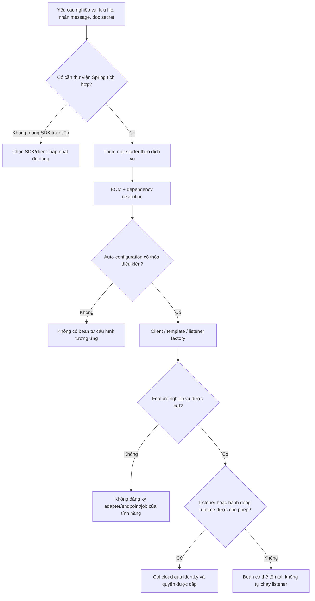

# Thêm đúng starter và giới hạn các tích hợp được kích hoạt

> **Chương:** Khởi tạo dự án  
> **Học phần:** SPRING_CLOUD_PROVIDER_INTEGRATION — thực hành tích hợp Spring Boot với các dịch vụ managed của AWS, Azure và Google Cloud thông qua các thư viện Spring Cloud tương ứng.

Một ứng dụng chỉ cần tải tệp lên Amazon S3 nhưng lại thêm starter S3, SQS, Secrets Manager và một gói “cloud starter” lớn sẽ phải quản lý nhiều SDK, bean, cấu hình, quyền và đường kết nối hơn mức nghiệp vụ cần. Ở môi trường phát triển hoặc kiểm thử, một listener tự khởi động có thể bắt đầu nhận thông điệp từ queue thật; một cấu hình nạp secret có thể cố gọi cloud ngay trước khi Spring khởi tạo các bean ứng dụng.

Bài học này trình bày cách **chỉ thêm những starter cần thiết**, hiểu điều kiện kích hoạt auto-configuration, và giới hạn chính xác **client, adapter, listener, nguồn cấu hình và thao tác cloud** ở từng môi trường. Đây là bước quan trọng khi khởi tạo dự án tích hợp storage, messaging, dữ liệu và secret của AWS, Azure và Google Cloud.

## 1. Kết quả cần đạt

Sau bài này, bạn có thể:

1. Phân biệt BOM, starter, thư viện SDK và một tích hợp đã thực sự được khởi tạo.
2. Chọn đúng starter theo **dịch vụ và thao tác cần dùng**, không thêm toàn bộ dịch vụ của một cloud provider.
3. Giải thích cách `@SpringBootApplication`, classpath, `@ConditionalOnClass`, `@ConditionalOnProperty` và `@ConditionalOnMissingBean` quyết định auto-configuration.
4. Sử dụng các property để bật/tắt tích hợp S3, SQS, Azure Blob Storage, Azure Service Bus, Google Cloud Storage và Pub/Sub trong những nhánh thư viện đã kiểm tra.
5. Tách việc **tạo client**, **đăng ký adapter nghiệp vụ**, **khởi chạy listener** và **nạp cấu hình từ cloud** thành các quyết định khác nhau.
6. Kiểm thử rằng môi trường không bật tính năng sẽ không tạo bean hoặc thực hiện thao tác ngoài ý muốn, trong khi môi trường được bật vẫn đáp ứng IAM, secret, timeout và retry.

## 2. Một tích hợp cloud có nhiều lớp kích hoạt

Không thể đánh giá một tích hợp là “đang bật” chỉ bằng việc thấy JAR trong file build. Hãy xét bốn lớp:

| Lớp | Quyết định gì? | Công cụ kiểm soát |
|---|---|---|
| **1. Build/classpath** | Có mang các class và SDK của dịch vụ vào ứng dụng không? | `pom.xml` / `build.gradle.kts`, BOM, starter, dependency tree |
| **2. Spring auto-configuration** | Spring có tự tạo client, template, factory và những bean liên quan không? | Điều kiện trên classpath/bean/property; cờ `*.enabled`; cấu hình exclude khi thật sự cần |
| **3. Adapter/nghiệp vụ** | Service/REST endpoint/job nào sử dụng tích hợp đó? | `@ConditionalOnProperty`, cấu trúc module, interface/adapter, profile và dependency injection |
| **4. Hoạt động runtime** | Listener có bắt đầu polling, scheduler có chạy, app có gửi request cloud không? | Auto-startup/lifecycle, feature flag, scheduler, endpoint, IAM và kiểm thử |

Ngoài bốn lớp trên, **nạp cấu hình** từ secret store qua `spring.config.import` thường xảy ra trong giai đoạn Spring Boot chuẩn bị Environment, **trước** auto-configuration thông thường. Vì thế tắt một starter bằng `*.enabled=false` không phải lúc nào cũng ngăn việc đọc secret từ cấu hình nếu nguồn này vẫn được khai báo.



**Ba kết luận quan trọng:**

- **Import BOM** chỉ quản lý phiên bản; nó không thêm client hoặc starter vào classpath.
- **Thêm starter** thường kích hoạt *khả năng* auto-configure theo điều kiện, nhưng không bảo đảm có bean hoặc có quyền gọi cloud.
- **Tắt auto-configuration** không tự xóa những client tự tạo bằng `@Bean`, job lập lịch, hay nguồn secret được nạp độc lập ở giai đoạn cấu hình.

## 3. Chọn starter theo một nhu cầu rõ ràng

Đầu tiên, viết nhu cầu dưới dạng **hành động + dịch vụ managed + chiều dữ liệu**. “Tích hợp AWS” quá rộng; “upload đối tượng lên S3” đủ cụ thể để chọn starter.

| Nghiệp vụ | AWS | Azure | Google Cloud |
|---|---|---|---|
| Lưu/đọc object | S3: `io.awspring.cloud:spring-cloud-aws-starter-s3` | Blob Storage: `com.azure.spring:spring-cloud-azure-starter-storage-blob` | Cloud Storage: `com.google.cloud:spring-cloud-gcp-starter-storage` |
| Gửi/nhận thông điệp | SQS: `io.awspring.cloud:spring-cloud-aws-starter-sqs` | Service Bus: `com.azure.spring:spring-cloud-azure-starter-servicebus` | Pub/Sub: `com.google.cloud:spring-cloud-gcp-starter-pubsub` |
| Đọc secret | Secrets Manager: `io.awspring.cloud:spring-cloud-aws-starter-secrets-manager` | Key Vault Secrets: `com.azure.spring:spring-cloud-azure-starter-keyvault-secrets` | Secret Manager: `com.google.cloud:spring-cloud-gcp-starter-secretmanager` |
| Dữ liệu managed (ví dụ) | DynamoDB: `io.awspring.cloud:spring-cloud-aws-starter-dynamodb` | Cosmos DB: `com.azure.spring:spring-cloud-azure-starter-cosmos` | Cloud SQL PostgreSQL: `com.google.cloud:spring-cloud-gcp-starter-sql-postgresql` |

Bảng mô tả **tọa độ định hướng** của các dòng tích hợp hiện đại. Kiểm tra tài liệu của **đúng major/version provider** và khả năng hỗ trợ từng service trước khi chép dependency. Với ứng dụng chỉ cần S3, hãy bắt đầu bằng **starter S3**. Khi xuất hiện yêu cầu nhận sự kiện bằng SQS, mới thêm **starter SQS** và thiết kế riêng listener.

### Starter, SDK và abstraction khác nhau ra sao?

- **Starter:** thêm những module cần thiết và đăng ký auto-configuration theo quy ước Spring Boot.
- **SDK trực tiếp:** API cấp thấp của provider, hữu ích khi cần tính năng chưa có abstraction Spring hoặc khi muốn tự xây dựng client/lifecycle.
- **Spring abstraction:** template, resource loader, listener annotation hoặc repository giúp giảm boilerplate, nhưng không thay thế toàn bộ tính năng và semantics của dịch vụ.

Chẳng hạn, SQS là queue với visibility timeout; Pub/Sub tổ chức topic/subscription; Azure Service Bus có queue/topic/subscription và cơ chế lock/settlement riêng. Không thể đổi starter giữa ba bên rồi mặc định retry, acknowledgement và dead-letter hoạt động hệt nhau.

### Câu hỏi ra quyết định trước khi thêm dependency

1. Tính năng nào thực sự dùng dịch vụ này ở production?
2. App cần **gửi**, **nhận**, **đọc**, **ghi** hay **quản trị** tài nguyên? Ví dụ publisher không nhất thiết cần consumer listener.
3. Tính năng có cần kích hoạt ở laptop, CI, staging và production như nhau?
4. Spring starter có hỗ trợ API cần dùng ở phiên bản đang chọn không, hay cần SDK trực tiếp?
5. Starter thêm những SDK/HTTP client nào, có xung đột với BOM hiện có không?
6. Đã có danh tính IAM/RBAC và môi trường test riêng để thử kết nối chưa?

## 4. Chọn phiên bản và khai báo starter trong Maven

Ví dụ dưới đây minh họa dự án dùng **Spring Boot 4.0.x** và **Spring Cloud AWS 4.x** phù hợp. Số phiên bản cụ thể phải được chốt từ bảng compatibility của provider tại thời điểm triển khai; đoạn POM sử dụng property `spring-cloud-aws.version` đã được định nghĩa trong dự án.

**Maven — phần import BOM trong `dependencyManagement`:**

```xml
<dependencyManagement>
    <dependencies>
        <dependency>
            <groupId>io.awspring.cloud</groupId>
            <artifactId>spring-cloud-aws-dependencies</artifactId>
            <version>${spring-cloud-aws.version}</version>
            <type>pom</type>
            <scope>import</scope>
        </dependency>
    </dependencies>
</dependencyManagement>
```

**Maven — chỉ thêm S3 khi tính năng là upload object:**

```xml
<dependencies>
    <dependency>
        <groupId>io.awspring.cloud</groupId>
        <artifactId>spring-cloud-aws-starter-s3</artifactId>
    </dependency>
</dependencies>
```

Những đoạn trên được đặt vào **vị trí tương ứng của POM đang có Spring Boot parent/BOM**, không phải hai POM độc lập. Nếu `spring-cloud-aws-dependencies` quản lý starter, không khai báo `<version>` riêng cho starter. Nếu ứng dụng còn dùng Spring Cloud Config, Gateway hoặc Stream, cần đánh giá và import thêm BOM `org.springframework.cloud:spring-cloud-dependencies` tương thích. Tên “Spring Cloud AWS” **không** có nghĩa ứng dụng S3 tự động cần Spring Cloud release-train BOM.

Khi thật sự cần SQS:

```xml
<!-- Bổ sung vào <dependencies>, giữ starter S3 nếu vẫn sử dụng S3. -->
<dependency>
    <groupId>io.awspring.cloud</groupId>
    <artifactId>spring-cloud-aws-starter-sqs</artifactId>
</dependency>
```

Không nên cài starter SQS “để dành” nếu không có kế hoạch sử dụng. Nếu binary bắt buộc chứa SQS dù chưa sử dụng, cần thêm cấu hình kích hoạt rõ ràng ở môi trường thực tế.

### Đổi sang Azure hoặc Google Cloud

**Azure Blob Storage — trích đoạn BOM và starter:**

```xml
<!-- Trong <dependencyManagement><dependencies> -->
<dependency>
    <groupId>com.azure.spring</groupId>
    <artifactId>spring-cloud-azure-dependencies</artifactId>
    <version>${spring-cloud-azure.version}</version>
    <type>pom</type>
    <scope>import</scope>
</dependency>

<!-- Trong <dependencies> -->
<dependency>
    <groupId>com.azure.spring</groupId>
    <artifactId>spring-cloud-azure-starter-storage-blob</artifactId>
</dependency>
```

**Google Cloud Pub/Sub — trích đoạn BOM và starter:**

```xml
<!-- Trong <dependencyManagement><dependencies> -->
<dependency>
    <groupId>com.google.cloud</groupId>
    <artifactId>spring-cloud-gcp-dependencies</artifactId>
    <version>${spring-cloud-gcp.version}</version>
    <type>pom</type>
    <scope>import</scope>
</dependency>

<!-- Trong <dependencies> -->
<dependency>
    <groupId>com.google.cloud</groupId>
    <artifactId>spring-cloud-gcp-starter-pubsub</artifactId>
</dependency>
```

Các property phiên bản phải được khai báo tại `<properties>` theo **ma trận Boot ↔ provider** và release notes của provider. Nếu chỉ tích hợp Azure Blob, không cần cả ba provider BOM. Nếu dự án dùng đồng thời nhiều cloud, kiểm tra graph thực tế vì việc import các BOM riêng **không chứng minh** chúng được kiểm thử chéo.

## 5. Gradle: import BOM và chỉ khai báo các starter cần dùng

Với Gradle native platform, ứng dụng dùng Spring Boot Gradle plugin có thể viết:

```kotlin
plugins {
    java
    id("org.springframework.boot") version "<BOOT_VERSION_DA_XAC_NHAN>"
}

repositories {
    mavenCentral()
}

dependencies {
    implementation(platform(
        org.springframework.boot.gradle.plugin.SpringBootPlugin.BOM_COORDINATES
    ))
    implementation(platform(
        "io.awspring.cloud:spring-cloud-aws-dependencies:<AWSPRING_VERSION>"
    ))

    // Chỉ S3 được yêu cầu bởi nghiệp vụ hiện tại:
    implementation("io.awspring.cloud:spring-cloud-aws-starter-s3")

    // Bổ sung khi có use case SQS:
    // implementation("io.awspring.cloud:spring-cloud-aws-starter-sqs")
}
```

**Đây là snippet mô tả cấu trúc**, không phải script chạy ngay: hai placeholder `<BOOT_VERSION_DA_XAC_NHAN>` và `<AWSPRING_VERSION>` phải được thay bằng **phiên bản thực** đã đối chiếu compatibility. Cấu hình Java toolchain, repository, test và build plugin đầy đủ cần được thiết lập theo dự án.

Với Azure hoặc GCP, thay platform và starter theo BOM/service của provider:

```kotlin
// Azure Blob Storage:
implementation(platform(
    "com.azure.spring:spring-cloud-azure-dependencies:<AZURE_VERSION>"
))
implementation("com.azure.spring:spring-cloud-azure-starter-storage-blob")

// Google Cloud Pub/Sub (phương án khác):
implementation(platform(
    "com.google.cloud:spring-cloud-gcp-dependencies:<GCP_VERSION>"
))
implementation("com.google.cloud:spring-cloud-gcp-starter-pubsub")
```

Không chép đồng thời tất cả đoạn trên nếu ứng dụng không dùng cả ba cloud. Trong Gradle, một cách khác là plugin `io.spring.dependency-management` để import BOM qua `mavenBom(...)`; khi dùng plugin này với Spring Boot Gradle plugin, cơ chế quản lý Spring Boot BOM khác native platform. Nên chọn một chiến lược rõ ràng cho dự án và kiểm tra `runtimeClasspath` sau khi khai báo.

**Lệnh kiểm tra dependency:**

```bash
# Maven
./mvnw dependency:tree
./mvnw help:effective-pom

# Gradle
./gradlew dependencies --configuration runtimeClasspath
./gradlew dependencyInsight --dependency spring-cloud-aws-starter-s3 \
    --configuration runtimeClasspath
```

Trên Windows, dùng `.\mvnw.cmd` hoặc `.\gradlew.bat`. Lệnh Gradle được xuống dòng bằng `\` theo shell Unix; trong PowerShell, viết thành một dòng hoặc dùng cú pháp xuống dòng riêng của PowerShell.

## 6. Auto-configuration của Spring Boot được kích hoạt thế nào?

Ứng dụng có `@SpringBootApplication` mặc định bật cơ chế auto-configuration. Framework tải danh sách lớp auto-configuration do các thư viện khai báo, sau đó kiểm tra các điều kiện như:

| Điều kiện | Câu hỏi | Ví dụ tác động |
|---|---|---|
| `@ConditionalOnClass` | Class SDK cần thiết có tồn tại trên classpath không? | Không có `S3Client` thì một auto-configuration S3 có thể không thỏa. |
| `@ConditionalOnMissingBean` | Ứng dụng đã tự khai báo bean tương ứng chưa? | Provider có thể lùi lại nếu app đã khai báo client riêng. |
| `@ConditionalOnProperty` | Property bật/tắt tính năng có giá trị phù hợp không? | `spring.cloud.aws.s3.enabled=false` ngăn auto-config S3 của nhánh đã hỗ trợ cờ này. |
| `@ConditionalOnBean` | Bean nền tảng cần thiết đã tồn tại chưa? | Một adapter phụ có thể chỉ bật khi client gốc được cấu hình. |
| `@Profile` | Đang chạy profile được yêu cầu không? | Bean thử nghiệm chỉ nạp ở profile `local`. |

Các điều kiện phối hợp với nhau. **Có classpath đủ không đồng nghĩa bean sẽ tồn tại**, và có bean không đồng nghĩa đã thực hiện request mạng. Một số client tạo đối tượng cục bộ lúc startup rồi chỉ kết nối khi dùng; listener hoặc Config Data importer lại có thể thực hiện request sớm hơn.

### Khi nào Spring “lùi lại” trước bean do ứng dụng cung cấp?

Nếu auto-configuration dùng `@ConditionalOnMissingBean` và người phát triển khai báo bean cùng loại, framework thường không tạo bean mặc định thứ hai. Đây là cơ chế tùy biến hợp lệ, nhưng **không phải cờ tắt tích hợp**: bean tự khai báo vẫn hoạt động và có thể kết nối cloud.

Ví dụ muốn kiểm tra endpoint giả lập, bạn có thể tự cấu hình `S3Client` phù hợp thay vì dùng client mặc định. Khi đó hãy test cả đường tạo bean, vì **hai bean cùng loại** hoặc **bean bị thay thế khác kỳ vọng** có thể gây `NoUniqueBeanDefinitionException` hoặc khiến app sử dụng sai endpoint.

## 7. Các công tắc kích hoạt dịch vụ đã được tài liệu hóa

Những property dưới đây được tài liệu hóa cho các nhánh AWSpring 4.x, Spring Cloud Azure hiện đại và Spring Framework on Google Cloud 8.x. Khi dùng nhánh khác, phải tra appendix/configuration reference đúng bản.

| Provider/tính năng | Property | Ý nghĩa khi đặt `false` |
|---|---|---|
| AWS S3 | `spring.cloud.aws.s3.enabled` | Không chạy auto-configuration tích hợp S3 tương ứng. |
| AWS SQS | `spring.cloud.aws.sqs.enabled` | Không bật auto-configuration SQS tương ứng. |
| Azure Blob Storage | `spring.cloud.azure.storage.blob.enabled` | Không bật auto-configuration Blob Storage tương ứng. |
| Azure Service Bus | `spring.cloud.azure.servicebus.enabled` | Không bật auto-configuration Service Bus tương ứng. |
| Google Cloud Storage | `spring.cloud.gcp.storage.enabled` | Không bật auto-configuration Cloud Storage tương ứng. |
| Google Cloud Pub/Sub | `spring.cloud.gcp.pubsub.enabled` | Không bật auto-configuration Pub/Sub tương ứng. |

**Các cờ này không loại JAR khỏi binary.** Chúng cũng không ngăn một bean SDK **được ứng dụng tự viết**, một job dùng SDK trực tiếp hoặc một nguồn cấu hình import cloud độc lập. Muốn bảo đảm không có phụ thuộc, loại starter ra khỏi file build; muốn kiểm soát thao tác mạng, xác minh runtime và các đường gọi thực tế.

Nguồn chính thức:

- [AWSpring 4.1.x — Common application properties](https://docs.awspring.io/spring-cloud-aws/docs/4.1.1/reference/html/appendix.html).
- [Azure — Storage configuration properties](https://learn.microsoft.com/azure/developer/java/spring-framework/configuration-properties-azure-storage) và [Azure Service Bus configuration](https://learn.microsoft.com/azure/developer/java/spring-framework/spring-messaging-service-bus-support).
- [Google Cloud — Storage](https://googlecloudplatform.github.io/spring-cloud-gcp/8.2.4/reference/html/storage.html) và [Pub/Sub](https://googlecloudplatform.github.io/spring-cloud-gcp/8.2.4/reference/html/pubsub.html).

### Ví dụ 1 — Chỉ kích hoạt S3 trong một ứng dụng AWS

```yaml
# src/main/resources/application.yml
spring:
  cloud:
    aws:
      region:
        static: ${AWS_REGION:ap-southeast-1}
      s3:
        enabled: ${APP_S3_ENABLED:false}
      sqs:
        enabled: false

app:
  integrations:
    s3:
      enabled: ${APP_S3_ENABLED:false}
  storage:
    s3:
      bucket: ${APP_S3_BUCKET:}
```

Tại môi trường **không dùng S3**, `APP_S3_ENABLED` mặc định là `false` nên không bật auto-config S3 và cũng không đăng ký adapter nghiệp vụ có điều kiện (xem phần sau). Tại môi trường có dùng S3, đặt `APP_S3_ENABLED=true`, `APP_S3_BUCKET` và IAM role/credential phù hợp. Đừng coi giá trị `ap-southeast-1` là region hợp lệ cho mọi bucket: region phải đúng với tài nguyên đã tạo.

`spring.cloud.aws.sqs.enabled=false` chỉ thật sự có ý nghĩa nếu module SQS có trên classpath; nếu không thêm starter SQS, đó không phải lý do để thêm nó. Ở cấu hình cuối cùng của ứng dụng chỉ dùng S3, bạn có thể bỏ cả nhóm cấu hình SQS.

### Ví dụ 2 — Chọn một dịch vụ Azure

```yaml
spring:
  cloud:
    azure:
      storage:
        blob:
          enabled: ${APP_AZURE_BLOB_ENABLED:false}
      servicebus:
        enabled: ${APP_AZURE_SERVICEBUS_ENABLED:false}
```

Khi app chỉ làm việc với Azure Blob, thêm starter Blob và bật `APP_AZURE_BLOB_ENABLED` ở môi trường liên quan. **Không thêm starter Service Bus** nếu chưa có chức năng messaging. Nếu cần cả hai, phải quản lý quyền dữ liệu và endpoint cho từng dịch vụ; token có thể hợp lệ để truy cập Blob nhưng vẫn không đủ role gửi message tới Service Bus.

### Ví dụ 3 — Chọn một dịch vụ Google Cloud

```yaml
spring:
  cloud:
    gcp:
      project-id: ${GCP_PROJECT_ID:}
      storage:
        enabled: ${APP_GCP_STORAGE_ENABLED:false}
      pubsub:
        enabled: ${APP_GCP_PUBSUB_ENABLED:false}
```

Chỉ đưa starter Storage hoặc Pub/Sub theo nhu cầu. Dù một integration không được bật, các module GCP core khác vẫn có thể tồn tại nếu được starter khác cần đến; **không suy ra mọi GCP bean đều vắng mặt**. Project ID và Application Default Credentials phải được thiết lập cho môi trường thực sự gọi Google Cloud.

## 8. Phân biệt tắt client và dừng listener

Với ứng dụng messaging, có ba ý định khác nhau:

| Ý định | Cách làm chính | Điều cần biết |
|---|---|---|
| **Không tích hợp SQS** | Bỏ starter SQS; hoặc đặt `spring.cloud.aws.sqs.enabled=false` nếu phải giữ dependency | Tránh tạo auto-config/bean của SQS; kiểm tra custom bean và nguồn config riêng. |
| **Cần gửi SQS nhưng chưa được tiêu thụ** | Giữ SQS client/template; đặt `spring.cloud.aws.sqs.listener.auto-startup=false` nếu listener container tương ứng hỗ trợ | Client gửi message có thể vẫn hoạt động; listener đã đăng ký nhưng không tự khởi chạy. |
| **Muốn nhận SQS tự động** | Bật SQS integration, cho phép listener startup và cấu hình queue/ack/retry | Startup có thể tra queue URL/attributes và polling; phải dùng môi trường/queue đúng. |

Ví dụ môi trường thử nghiệm chỉ muốn kiểm tra publisher, chưa được lấy message từ queue:

```yaml
spring:
  cloud:
    aws:
      sqs:
        enabled: true
        listener:
          auto-startup: false
```

**Điểm phân biệt:** `listener.auto-startup=false` không phải `sqs.enabled=false`. Nó nhằm quản lý **lifecycle của listener container**, không loại bỏ SQS client và không chặn mọi thao tác SQS do code khác tự gọi. Cờ auto-startup cần được kiểm tra với nhánh AWSpring đang dùng và các container được tự tạo; nếu ứng dụng tự xây listener container, phải cấu hình lifecycle của container đó.

Tài liệu: [AWSpring SQS — auto-configuration và listener container lifecycle](https://docs.awspring.io/spring-cloud-aws/docs/4.1.1/reference/html/index.html).

### Với Azure Service Bus và Google Pub/Sub

Đừng áp `spring.cloud.aws.sqs.listener.auto-startup` sang Azure Service Bus hoặc Google Pub/Sub: chúng dùng API và vòng đời consumer khác. Nếu chỉ publish message, chọn starter/client thích hợp, **không đăng ký subscriber/listener** khi không có nhu cầu. Nếu có listener được bật có điều kiện, kiểm thử rằng cấu hình không bật sẽ không tạo hoặc không khởi chạy listener tương ứng. Kiểm tra tài liệu container/binder của **đúng nhánh** trước khi chọn property lifecycle, vì một service có thể có nhiều cách tiêu thụ: native SDK, Spring Messaging hoặc Spring Cloud Stream binder.

### Listener khác Config Data importer

Một listener thường bắt đầu khi Spring context đang chạy. Nguồn `spring.config.import` có thể được xử lý **trước khi context hình thành**. Ví dụ nếu một profile nhập secret từ cloud, đừng kỳ vọng cờ tắt listener hoặc client sẽ vô hiệu hóa việc đọc secret. Phải bỏ/chỉnh nguồn import ở chính profile/môi trường cần tắt.

## 9. Giới hạn cả bean nghiệp vụ bằng feature flag

Giả sử ứng dụng có khả năng lưu hóa đơn lên S3, nhưng trên laptop của người phát triển hoặc trong CI ta muốn chạy phần nghiệp vụ khác mà không tạo adapter upload.

**Chỉ đặt `spring.cloud.aws.s3.enabled=false` là chưa đủ** nếu vẫn có service phụ thuộc bắt buộc vào `S3Client`. Service đó có thể khiến ứng dụng không khởi động do thiếu bean. Hãy bật/tắt **cùng một ranh giới nghiệp vụ**.

### Bước 1 — Định nghĩa hợp đồng lưu trữ

```java
package com.example.providerdemo.storage;

public interface InvoiceStore {
    void put(String objectKey, byte[] bytes);
}
```

### Bước 2 — Viết adapter S3 độc lập

```java
package com.example.providerdemo.storage;

import software.amazon.awssdk.core.sync.RequestBody;
import software.amazon.awssdk.services.s3.S3Client;
import software.amazon.awssdk.services.s3.model.PutObjectRequest;

public final class S3InvoiceStore implements InvoiceStore {
    private final S3Client client;
    private final String bucket;

    public S3InvoiceStore(S3Client client, String bucket) {
        this.client = client;
        this.bucket = bucket;
    }

    @Override
    public void put(String objectKey, byte[] bytes) {
        var request = PutObjectRequest.builder()
                .bucket(bucket)
                .key(objectKey)
                .build();
        client.putObject(request, RequestBody.fromBytes(bytes));
    }
}
```

Ví dụ tập trung vào **cơ chế kích hoạt**, chưa bổ sung kiểm soát kích thước file, content type, object key validation, timeout và retry. Đây là những yêu cầu phải hoàn thiện trước khi đưa adapter lên production.

### Bước 3 — Chỉ đăng ký adapter nếu tính năng bật

```java
package com.example.providerdemo.storage;

import org.springframework.beans.factory.annotation.Value;
import org.springframework.boot.autoconfigure.condition.ConditionalOnProperty;
import org.springframework.context.annotation.Bean;
import org.springframework.context.annotation.Configuration;
import software.amazon.awssdk.services.s3.S3Client;

@Configuration(proxyBeanMethods = false)
public class InvoiceStorageConfiguration {

    @Bean
    @ConditionalOnProperty(
            prefix = "app.integrations.s3",
            name = "enabled",
            havingValue = "true"
    )
    InvoiceStore invoiceStore(
            S3Client s3Client,
            @Value("${app.storage.s3.bucket}") String bucket) {
        return new S3InvoiceStore(s3Client, bucket);
    }
}
```

Ở đây `app.integrations.s3.enabled` là **feature flag do ứng dụng sở hữu**. Nó độc lập với `spring.cloud.aws.s3.enabled` của AWSpring. Ví dụ `application.yml` ở phần 7 dùng **cùng biến môi trường** `APP_S3_ENABLED` cho cả hai cờ để tránh trường hợp một cờ bật và cờ còn lại tắt.

Nếu **adapter bật nhưng auto-config S3 tắt**, Spring có thể lỗi do thiếu `S3Client`. Lỗi startup rõ ràng thường tốt hơn một adapter hoạt động nửa chừng; vẫn cần kiểm tra điều kiện trong CI. Nếu ứng dụng dùng một client `S3Client` tự cấu hình, cần thiết kế khác và không thể dựa vào property AWSpring để chặn client tự tạo.

### Bước 4 — Giới hạn REST endpoint hoặc job dùng adapter

Ví dụ REST controller chỉ đăng ký khi tính năng được bật:

```java
package com.example.providerdemo.storage;

import org.springframework.boot.autoconfigure.condition.ConditionalOnProperty;
import org.springframework.http.ResponseEntity;
import org.springframework.web.bind.annotation.PostMapping;
import org.springframework.web.bind.annotation.RequestBody;
import org.springframework.web.bind.annotation.RequestParam;
import org.springframework.web.bind.annotation.RestController;

@RestController
@ConditionalOnProperty(
        prefix = "app.integrations.s3",
        name = "enabled",
        havingValue = "true"
)
public class InvoiceUploadController {
    private final InvoiceStore store;

    public InvoiceUploadController(InvoiceStore store) {
        this.store = store;
    }

    @PostMapping("/internal/invoices/upload")
    public ResponseEntity<Void> upload(
            @RequestParam String key,
            @RequestBody byte[] content) {
        store.put(key, content);
        return ResponseEntity.noContent().build();
    }
}
```

Đây là endpoint **minh họa về registration**, chưa có xác thực, giới hạn upload, kiểm soát object key hay phân quyền HTTP. **Không để endpoint ghi S3 như trên công khai**. Trong thực tế, chỉ đăng ký controller này sau khi có cơ chế authorization, validation và policy lưu trữ đúng yêu cầu.

Khi `APP_S3_ENABLED=false`, cả `InvoiceStore` lẫn controller được điều kiện hóa sẽ không được đăng ký. Khi bật, cả adapter, client và endpoint cần có đủ cấu hình. Nếu một bean nghiệp vụ **luôn được tạo** mà lại tiêm `InvoiceStore` bắt buộc, phải thiết kế nó thành bean có điều kiện hoặc có implementation khác cho môi trường không sử dụng S3; đừng giải quyết bằng `@Autowired(required=false)` rồi bỏ qua lỗi âm thầm.

## 10. Cấu hình môi trường: bật rõ ràng, không kết nối ngoài ý muốn

Một hệ thống có thể cần các khả năng khác nhau:

| Môi trường | Storage | Messaging consumer | Secret/managed data | Kiểm thử |
|---|---|---|---|---|
| Laptop không kết nối cloud | Adapter thật tắt; có thể thay bằng fake test/local storage | Không tự polling queue thật | Không import secret thật | Unit test và khởi động context offline |
| CI unit test | Cấu hình feature tắt; fake/mock client | Listener auto-startup tắt hoặc không có listener | Không nạp secret từ cloud | Context test và unit test tái lập được |
| Integration test cục bộ | Adapter kết nối emulator hoặc local service được hỗ trợ | Consumer kết nối test queue/emulator | Dùng fake/test secret | Test đường protocol, mapping, retry |
| Staging | Bật đúng integration được dùng, IAM tối thiểu | Chỉ queue/subscription staging | Secret/data staging | Smoke/integration test trong tài khoản riêng |
| Production | Bật feature được duyệt và có metric/cảnh báo | Listener chạy với cấu hình concurrency, DLQ, retry | Workload identity, secret manager | Giám sát và rollback |

**Không dựa duy nhất vào profile để phân quyền.** Profile quyết định cấu hình ứng dụng; tài khoản cloud/IAM mới quyết định danh tính được phép làm gì. Ngay cả khi feature bị tắt, đừng cấp quyền rộng không cần thiết cho workload.

### Cấu trúc `application.yml` và profile riêng

Ví dụ trong `application.yml`, để các tính năng có tác dụng phụ **mặc định tắt**:

```yaml
app:
  integrations:
    s3:
      enabled: ${APP_S3_ENABLED:false}

spring:
  cloud:
    aws:
      s3:
        enabled: ${APP_S3_ENABLED:false}
      sqs:
        enabled: ${APP_SQS_ENABLED:false}
        listener:
          auto-startup: ${APP_SQS_LISTENER_ENABLED:false}
```

Trong staging/production, triển khai biến môi trường rõ ràng:

```text
APP_S3_ENABLED=true
APP_SQS_ENABLED=true
APP_SQS_LISTENER_ENABLED=true
APP_S3_BUCKET=<ten-bucket-da-tao>
AWS_REGION=<region-that>
```

Đoạn này là **mẫu biến môi trường**, `<...>` phải được thay bằng thông tin môi trường. Đừng đưa access key/secret key vào file. Với AWS, sử dụng credential chain và IAM role/workload identity phù hợp; với Azure dùng Microsoft Entra ID/managed identity, với Google Cloud dùng ADC/workload identity.

### Khi dùng `spring.config.import` với secret

Một ứng dụng có thể nạp cấu hình từ AWS Secrets Manager, Azure Key Vault hoặc Google Secret Manager trước khi khởi tạo client nghiệp vụ. Nếu profile `local` không được phép gọi secret store, hãy **loại nguồn import khỏi cấu hình local**, dùng giá trị thử nghiệm trong môi trường cô lập. Không chỉ bật `optional:` rồi cho rằng importer sẽ không chạy: `optional` thường chỉ làm một số trường hợp thiếu nguồn không gây lỗi, **không có nghĩa bỏ qua network request**.

Nguyên tắc chung: **starter dùng cho logic runtime**, **Config Data import dùng cho giai đoạn chuẩn bị Environment**, và **IAM/RBAC quyết định quyền**. Kiểm tra cả ba khi mục tiêu là “khởi động offline”.

## 11. Khi nào dùng auto-configuration exclusion?

Spring Boot hỗ trợ loại một auto-configuration cụ thể qua `@SpringBootApplication(exclude=...)`, `excludeName` hoặc `spring.autoconfigure.exclude`. Cách này dành cho tình huống **đã xác định chính xác auto-configuration class cần chặn**. Không nên sao chép class name của Spring Boot 3 sang Boot 4 hoặc từ phiên bản provider khác vì package/tên class có thể thay đổi.

Đối với một dịch vụ có property `*.enabled` rõ ràng, thường nên bắt đầu bằng **property của dịch vụ**. Nếu cần loại bỏ toàn bộ khả năng tích hợp, giải pháp rõ nhất thường là **không thêm starter**. Chỉ dùng exclude khi các lựa chọn trên không đáp ứng nhu cầu và đã kiểm tra chính xác class trong artifact đang dùng.

Một số ngộ nhận thường gặp:

| Cách làm | Có thể đạt được | Không bảo đảm |
|---|---|---|
| Bỏ `spring-cloud-aws-starter-sqs` khỏi build | Không còn dependency được khai báo từ starter đó | Module SQS không bị thư viện khác kéo gián tiếp |
| `spring.cloud.aws.sqs.enabled=false` | Chặn auto-configuration SQS tương ứng | Code tự tạo `SqsAsyncClient` sẽ không chạy |
| `spring.cloud.aws.sqs.listener.auto-startup=false` | Ngăn listener tự khởi chạy theo cơ chế được hỗ trợ | Không có SQS client/template hoặc không có request do code khác |
| `@ConditionalOnProperty` trên adapter | Không đăng ký bean ứng dụng khi flag không thỏa | Bản thân provider starter không tạo bean nền tảng |
| `spring.autoconfigure.exclude` | Chặn auto-config class được nêu | Dịch vụ khác, custom config hoặc Config Data import không chạy |
| IAM role chỉ đọc | Hạn chế quyền ghi theo policy thực tế | Ngăn client được tạo hoặc ngăn ứng dụng thử gọi API |

## 12. Kiểm chứng chỉ các tích hợp mong đợi được kích hoạt

Đừng đánh giá bằng cách “ứng dụng khởi động không lỗi” là đủ. Cần kiểm tra **sự tồn tại của bean**, **nguồn auto-config**, **listener lifecycle**, **hành vi mạng** và **quyền cloud**.

### 12.1. Condition Evaluation Report

Spring Boot có thể in báo cáo điều kiện khi chạy với:

```bash
./mvnw spring-boot:run -Dspring-boot.run.arguments=--debug
```

Hoặc khi chạy JAR:

```bash
java -jar target/provider-demo.jar --debug
```

Tên file JAR chỉ là ví dụ. **Condition Evaluation Report** thể hiện positive/negative matches và lý do auto-configuration được áp dụng hoặc bị bỏ qua. Trong môi trường phát triển có Spring Boot Actuator, endpoint `/actuator/conditions` có thể hỗ trợ xem kết quả, nhưng không nên bật công khai endpoint chẩn đoán ở production; hạn chế exposure và bảo vệ bằng cơ chế phù hợp.

Nguồn: [Spring Boot — Auto-configuration](https://docs.spring.io/spring-boot/reference/using/auto-configuration.html).

### 12.2. Unit test cho adapter có điều kiện

Ví dụ dùng `ApplicationContextRunner` để kiểm tra `InvoiceStorageConfiguration` ở phần 9. Test này **không gọi AWS**:

```java
package com.example.providerdemo.storage;

import org.junit.jupiter.api.Test;
import org.springframework.boot.test.context.runner.ApplicationContextRunner;
import software.amazon.awssdk.services.s3.S3Client;

import static org.assertj.core.api.Assertions.assertThat;
import static org.mockito.Mockito.mock;

class InvoiceStorageConfigurationTest {

    private final ApplicationContextRunner runner = new ApplicationContextRunner()
            .withUserConfiguration(InvoiceStorageConfiguration.class)
            .withBean(S3Client.class, () -> mock(S3Client.class));

    @Test
    void doesNotRegisterAdapterWhenDisabled() {
        runner.withPropertyValues("app.integrations.s3.enabled=false")
                .run(context -> assertThat(context)
                        .doesNotHaveBean(InvoiceStore.class));
    }

    @Test
    void registersAdapterWhenEnabled() {
        runner.withPropertyValues(
                        "app.integrations.s3.enabled=true",
                        "app.storage.s3.bucket=test-invoices")
                .run(context -> assertThat(context)
                        .hasSingleBean(InvoiceStore.class));
    }
}
```

`ApplicationContextRunner` đến từ các thư viện test của Spring Boot, `mock` đến từ Mockito. Project cần có `spring-boot-starter-test` và thư viện SDK/starter S3 đúng nhánh. Test này xác nhận **bean ứng dụng** được điều kiện hóa; nó chưa chứng minh `S3Client` do provider tự tạo cũng bị tắt.

### 12.3. Kiểm tra cờ auto-config provider

Nếu muốn test chính lớp auto-config S3 của AWSpring 4.x, có thể xây context riêng bằng `AutoConfigurations` và cờ tắt:

```java
package com.example.providerdemo.storage;

import io.awspring.cloud.autoconfigure.s3.S3AutoConfiguration;
import org.junit.jupiter.api.Test;
import org.springframework.boot.autoconfigure.AutoConfigurations;
import org.springframework.boot.test.context.runner.ApplicationContextRunner;
import software.amazon.awssdk.services.s3.S3Client;

import static org.assertj.core.api.Assertions.assertThat;

class S3AutoConfigurationDisabledTest {

    @Test
    void disabledPropertyPreventsAutoConfiguredClient() {
        new ApplicationContextRunner()
                .withConfiguration(
                        AutoConfigurations.of(S3AutoConfiguration.class))
                .withPropertyValues("spring.cloud.aws.s3.enabled=false")
                .run(context -> assertThat(context)
                        .doesNotHaveBean(S3Client.class));
    }
}
```

Đây là kiểm thử **có chủ đích gắn với package/class của AWSpring nhánh 4.x**. Nếu đổi major/version và package auto-config thay đổi, điều chỉnh test theo artifact đang dùng. Nó chỉ xác nhận **auto-config được nạp vào test runner đã bị bỏ qua**; nó không kiểm chứng toàn bộ ứng dụng không còn custom client hoặc request mạng từ phần khác.

### 12.4. Test môi trường hoạt động và không hoạt động

| Kịch bản | Kỳ vọng | Cách chứng minh |
|---|---|---|
| S3 flag false | Không có `InvoiceStore`/REST endpoint có điều kiện; không có S3 auto bean từ starter | ContextRunner, condition report, controller mapping |
| S3 flag true | Có đúng một adapter và client; upload đúng bucket/key | Context test, unit test SDK mock, integration test S3 |
| SQS bật nhưng listener auto-startup false | Publisher có thể sử dụng client, listener không tự poll | Kiểm tra container lifecycle và không có request ReceiveMessage |
| Azure Blob tắt | Bean auto-config Blob không được tạo theo property của nhánh dùng | Context test + condition report |
| Pub/Sub tắt | Không tự tạo integration Pub/Sub tương ứng; không đăng ký subscriber nghiệp vụ | Condition report + startup/behavioral test |
| Profile local không dùng secret | Không fetch secret ngoài ý muốn khi khởi động | Kiểm tra `spring.config.import` và network/test logs |
| Production đúng feature | Danh tính truy cập đúng tài nguyên, retry/timeout hợp lý | Smoke test với quyền tối thiểu và tài nguyên riêng |

Emulator hữu ích cho local integration test nhưng không xác nhận hoàn toàn IAM/RBAC, TLS, quota và hành vi managed service. Một smoke test trên môi trường staging riêng giúp xác minh lớp hạ tầng. Các test này phải chạy với chính phiên bản JDK, Spring Boot và provider BOM được dự định triển khai.

## 13. Giới hạn tích hợp để giảm rủi ro bảo mật và vận hành

Giảm starter không chỉ làm cây dependency đơn giản hơn. Nó giúp giảm số API được gọi, đường cấu hình cần duy trì, credential chain phải kiểm tra và các thư viện có thể cần bản vá.

### Danh tính và quyền tối thiểu

| Nhu cầu | Quyền cần xem xét | Không nên cấp mặc định |
|---|---|---|
| AWS S3 upload | `s3:PutObject` trên prefix/bucket được phép; thêm KMS permissions nếu dùng SSE-KMS | Quyền `s3:*` trên mọi bucket |
| AWS SQS gửi | `sqs:SendMessage` trên queue cụ thể | Quyền receive/delete/administration nếu chỉ publish |
| Azure Blob upload | Role dữ liệu phù hợp, ví dụ Storage Blob Data Contributor trong scope cần thiết | Owner/Contributor ở subscription chỉ để đọc/ghi blob |
| Azure Service Bus gửi | Role ví dụ Azure Service Bus Data Sender với scope đúng | Data Receiver/Owner nếu không tiêu thụ/quản trị |
| Google Cloud Storage ghi | Role IAM đủ cho thao tác object trong bucket, theo chính sách tổ chức | Project Editor rộng |
| Google Cloud Pub/Sub publish | Quyền publish trên topic tương ứng | Pub/Sub Admin nếu ứng dụng không quản trị topic |

Đừng hard-code AWS access key, Azure connection string hoặc Google service account JSON key trong `application.yml`. Ưu tiên role/managed identity/workload identity và nguồn secret phù hợp. Phân biệt **authentication** (đã xác thực là ai) với **authorization** (có quyền trên tài nguyên nào).

### Không đánh đồng “tắt feature” với “không phát sinh chi phí”

Nếu SQS listener đã chạy, nó có thể poll queue kể cả không có message; một job upload định kỳ có thể gọi S3; một nguồn Config Data có thể truy cập secret store khi startup. Do đó, kiểm soát chi phí/kết nối phải xem **listener auto-startup**, **scheduler**, **retry**, **health check** và **import secret** ở runtime, không chỉ đếm starter.

## 14. Lỗi thường gặp và cách sửa

| Triệu chứng | Giải thích có thể | Hướng chẩn đoán |
|---|---|---|
| Thêm BOM nhưng không có `S3Client` | BOM chỉ quản lý version; chưa thêm starter hoặc điều kiện không thỏa | Kiểm tra `dependencies`, classpath, condition report |
| `NoSuchBeanDefinitionException` cho `S3Client` | S3 auto-config tắt hoặc không có class; adapter vẫn bật | Đồng bộ feature flag app và provider, kiểm tra SDK/starter |
| Có bean cloud dù đặt `*.enabled=false` | Bean do app tự tạo, starter khác hoặc cấu hình riêng | Xem bean definition origin, auto-config report và `@Bean` |
| CI cố gọi cloud ngay startup | Listener auto-startup, startup runner hoặc Config Data import | Kiểm tra listener/`@PostConstruct`/`ApplicationRunner`/`spring.config.import` |
| SQS vẫn gửi được dù tắt listener startup | Cờ listener chỉ dừng consumer; client publisher vẫn tồn tại | Đây có thể là hành vi mong muốn, kiểm tra yêu cầu nghiệp vụ |
| Azure Blob không tạo client | Sai prefix property, thiếu starter, thiếu điều kiện hoặc version không phù hợp | Đối chiếu appendix nhánh Azure, debug condition |
| Pub/Sub báo `PERMISSION_DENIED` | Client hoạt động nhưng ADC/service account thiếu quyền | Kiểm tra project ID, principal, topic/subscription IAM |
| S3 báo 403 | IAM/bucket policy/KMS, không hẳn do starter | Kiểm tra đúng role, action và ARN resource |
| Auto-config loại bỏ một bean nhưng integration test fail | Test cần chính bean đó; không có adapter thay thế | Chia profile/feature hoặc dùng fake adapter đúng hợp đồng |
| Cấu hình `optional:` vẫn gọi secret store | `optional` không đồng nghĩa “disable importer” | Chỉ khai báo import trong môi trường cần secret thật |
| Startup được nhưng listener không nhận message | Listener auto-startup=false, queue/subscription sai, thiếu quyền hoặc sai ack | Xem lifecycle, endpoint, IAM và consumer logs |
| Khởi động chậm, Netty/SDK khác version | Nhiều starter hoặc BOM xung đột | Xem Maven dependency tree / Gradle dependencyInsight; dùng BOM tương thích |

Không thêm một `@Bean` client thứ hai hoặc xóa toàn bộ dependency như phản ứng đầu tiên khi lỗi. Xác định ranh giới đang sai: **thiếu starter, điều kiện không thỏa, thiếu bean nghiệp vụ, listener chưa chạy, hay quyền cloud không đủ**.

## 15. Bài tập thực hành: ứng dụng một binary cho hai vai trò

**Bối cảnh:** Một ứng dụng quản lý chứng từ sử dụng S3 để lưu file, SQS để phát/nhận sự kiện, và có khả năng thay S3 bằng Azure Blob hoặc Google Cloud Storage trong tương lai. Đội ngũ muốn chạy cùng một codebase trên laptop, CI và production nhưng chỉ mở những tích hợp cần dùng.

### Phần A — Thiết kế starter tối thiểu

1. Với vai trò **uploader only**, chọn BOM AWSpring và starter S3, không thêm SQS nếu ứng dụng không gửi/nhận message.
2. Với vai trò **publisher/consumer**, thêm starter SQS; xác định cách đăng ký publisher, listener và quyền IAM của từng vai trò.
3. Phác thảo hai phương án thay thế Azure Blob và Google Cloud Storage, chỉ ra starter/BOM phải đổi, identity và quyền phải thiết lập.
4. Ghi bảng dependency tree có các SDK/HTTP client chính; giải thích vì sao một starter khác không cần thiết sẽ làm tăng classpath.

### Phần B — Giới hạn theo môi trường

Tạo cấu hình:

- `local`: tất cả adapter cloud tắt, không import secret thật, không poll queue.
- `ci`: chỉ dùng fake/mock client và context test; không dùng credential production.
- `staging`: S3 upload bật, SQS publisher bật nhưng listener không tự chạy ở một job chỉ gửi message.
- `production`: bật đúng vai trò cần dùng, kiểm tra IAM và consumer lifecycle.

Viết `InvoiceStore`, `S3InvoiceStore` và configuration có `@ConditionalOnProperty`. Khi không bật S3, ứng dụng không tạo adapter và không đăng ký route upload thực tế.

### Phần C — Kiểm chứng

Thực hiện ít nhất các test:

1. `APP_S3_ENABLED=false` → context không có `InvoiceStore` và route upload.
2. `APP_S3_ENABLED=true` → context có `InvoiceStore` và đúng bucket cấu hình.
3. SQS client bật, `listener.auto-startup=false` → không tự phát sinh polling.
4. Staging với credential đúng → upload object test thành công; quyền thiếu → lỗi được xử lý rõ ràng.
5. Không có `spring.config.import` chỉ tới secret thật trong profile offline.

**Bảng kết quả mẫu:**

| Vai trò/môi trường | Starter có mặt | Auto-config được bật | Bean nghiệp vụ | Listener chạy | Bằng chứng |
|---|---|---|---|---|---|
| CI offline | S3 có thể có để compile | S3=false | Không | Không | Context test |
| Uploader staging | S3 | S3=true | `InvoiceStore` | Không có SQS listener | Upload integration test |
| SQS publisher staging | SQS | SQS=true | Publisher bean | false | Lifecycle test |
| SQS consumer production | SQS | SQS=true | Consumer bean | true | Queue test + metric |

**Tiêu chí hoàn thành:** Giải thích được **vì sao starter đó cần thiết**, **bean nào được tạo**, **dịch vụ nào được phép gọi**, **listener nào chạy**, và **test nào xác nhận tính năng không hoạt động khi bị tắt**.

## 16. Checklist trước khi khởi tạo dự án hoặc merge tính năng

- [ ] Có danh sách nghiệp vụ cần storage, messaging, data, secret và API/chiều truy cập tương ứng.
- [ ] Chỉ thêm starter thực sự dùng; BOM provider phù hợp Java/Spring Boot/release train.
- [ ] Đã kiểm tra dependency tree và các SDK/HTTP client được starter kéo theo.
- [ ] Đã đối chiếu các property `*.enabled` với reference guide của đúng phiên bản.
- [ ] Feature flag nghiệp vụ và cờ provider được phối hợp nhất quán.
- [ ] Với messaging, tách **client publisher**, **subscriber/listener** và **auto-startup**.
- [ ] Đã xem mọi `spring.config.import`, scheduler, startup runner và custom `@Bean` có thể gọi cloud.
- [ ] Môi trường offline/CI không tự gọi dịch vụ managed thật hoặc lấy secret production.
- [ ] Staging/production có workload identity, IAM/RBAC tối thiểu, endpoint/region/project đúng.
- [ ] Có kiểm thử cho hai trường hợp bật/tắt, kiểm tra Spring context và test tích hợp thực tế.
- [ ] Mọi auto-config exclusion có lý do, được giới hạn và kiểm tra lại khi nâng dependency.

## Tài liệu tham khảo

1. [Spring Boot — Auto-configuration](https://docs.spring.io/spring-boot/reference/using/auto-configuration.html): cơ chế điều kiện, `--debug` và loại auto-configuration có chủ đích.
2. [Spring Cloud AWS 4.1.1 — Reference Guide](https://docs.awspring.io/spring-cloud-aws/docs/4.1.1/reference/html/index.html): starter S3/SQS và cấu hình lifecycle.
3. [Spring Cloud AWS 4.1.1 — Common Application Properties](https://docs.awspring.io/spring-cloud-aws/docs/4.1.1/reference/html/appendix.html): `spring.cloud.aws.s3.enabled` và `spring.cloud.aws.sqs.enabled`.
4. [Spring Cloud Azure — Configuration](https://learn.microsoft.com/azure/developer/java/spring-framework/configuration): prefix property của từng dịch vụ.
5. [Spring Cloud Azure — Blob Storage configuration](https://learn.microsoft.com/azure/developer/java/spring-framework/resource-handling): starter và `storage.blob.enabled`.
6. [Spring Cloud Azure — Service Bus](https://learn.microsoft.com/azure/developer/java/spring-framework/spring-messaging-service-bus-support): cơ chế messaging và `servicebus.enabled`.
7. [Spring Framework on Google Cloud — Getting Started 8.2.4](https://googlecloudplatform.github.io/spring-cloud-gcp/8.2.4/reference/html/getting-started.html): starter Storage, Pub/Sub và BOM.
8. [Spring Framework on Google Cloud — Pub/Sub 8.2.4](https://googlecloudplatform.github.io/spring-cloud-gcp/8.2.4/reference/html/pubsub.html): cờ Pub/Sub và cách kết nối emulator.
9. [Spring Framework on Google Cloud — Storage 8.2.4](https://googlecloudplatform.github.io/spring-cloud-gcp/8.2.4/reference/html/storage.html): cờ Storage và cấu hình.
10. [Maven — Dependency mechanism](https://maven.apache.org/guides/introduction/introduction-to-dependency-mechanism.html), [Gradle — Viewing dependencies](https://docs.gradle.org/current/userguide/viewing_debugging_dependencies.html): kiểm tra dependency thực tế.

> **Ghi nhớ:** Phạm vi tích hợp được quyết định ở nhiều lớp: **starter có mặt**, **auto-configuration có chạy**, **adapter nghiệp vụ có được đăng ký**, **listener có tự khởi động** và **request cloud có được phép thực hiện**. Thiết kế rõ ranh giới ở từng lớp giúp ứng dụng Spring Boot khởi động có chủ đích, giảm xung đột dependency và hạn chế thao tác cloud ngoài mong đợi.
