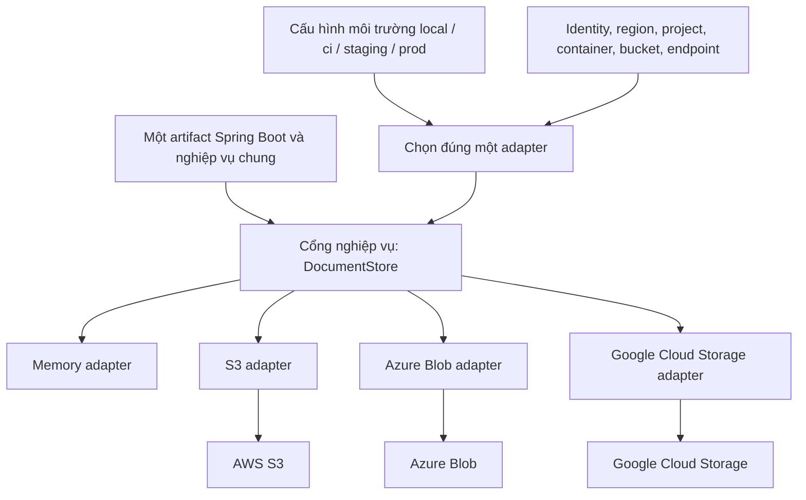

# Tổ chức cấu hình và adapter theo từng môi trường

> **Chương:** Khởi tạo dự án  
> **Học phần:** SPRING_CLOUD_PROVIDER_INTEGRATION — thực hành tích hợp Spring Boot với dịch vụ managed của AWS, Azure và Google Cloud thông qua các thư viện Spring Cloud tương ứng.

Một dịch vụ quản lý chứng từ có thể sử dụng bộ nhớ giả lập khi chạy trên laptop, lưu file lên Amazon S3 ở staging và triển khai một biến thể sử dụng Azure Blob Storage hoặc Google Cloud Storage cho khách hàng khác. Nếu logic nghiệp vụ gọi trực tiếp SDK và đọc biến môi trường rải rác ở mọi lớp, mỗi thay đổi cloud sẽ kéo theo thay đổi nghiệp vụ, cấu hình khó kiểm soát và các bài kiểm thử có thể vô tình gọi tài nguyên production.

Giải pháp là **tách môi trường triển khai khỏi lựa chọn nhà cung cấp**, cấu hình các thông số bên ngoài ứng dụng và dùng adapter hiện thực một **cổng nghiệp vụ ổn định**. Cùng một đường xử lý có thể dùng implementation local, S3, Blob Storage hay Cloud Storage, trong khi mỗi môi trường chỉ kích hoạt adapter và tài nguyên được phép sử dụng.

## 1. Mục tiêu học tập

Sau bài này, bạn có thể:

1. Phân biệt **môi trường** (`local`, `ci`, `staging`, `prod`), **provider** (AWS, Azure, Google Cloud) và **tính năng** (storage, messaging, dữ liệu, secret).
2. Sắp xếp `application.yml` và các file profile theo quy tắc cấu hình của Spring Boot; giải thích nguồn property nào được ưu tiên.
3. Đọc cấu hình có kiểu bằng `@ConfigurationProperties`, kiểm tra giá trị cần thiết và giới hạn các adapter theo `@Profile` hoặc `@ConditionalOnProperty`.
4. Thiết kế cổng `DocumentStore` với adapter memory, S3, Azure Blob và Google Cloud Storage mà không để nghiệp vụ phụ thuộc trực tiếp cloud SDK.
5. Chọn cơ chế danh tính an toàn, tách secret khỏi mã nguồn và tránh kết nối cloud không mong đợi trong môi trường offline hoặc CI.
6. Kiểm thử từng tổ hợp cấu hình: đúng adapter, đúng tài nguyên, không có hai implementation cùng được tiêm và không có request ngoài ý muốn.

## 2. Tách ba chiều cấu hình thường bị trộn lẫn

| Chiều | Câu hỏi | Ví dụ | Đơn vị thay đổi |
|---|---|---|---|
| **Môi trường (environment)** | Ứng dụng đang chạy ở đâu, có chính sách triển khai nào? | `local`, `ci`, `staging`, `prod` | Pipeline/deployment |
| **Nhà cung cấp (provider)** | Adapter nào thực hiện một năng lực? | `memory`, `s3`, `azure-blob`, `gcs` | Kiến trúc và cấu hình deployment |
| **Năng lực/tính năng (capability)** | Chức năng nào cần bật? | Lưu file, publish/consume message, đọc secret, kết nối database | Nhu cầu nghiệp vụ và quyền |

Không nên mặc định `prod = AWS`, `staging = Azure` hay `local = không có provider`. Ví dụ, staging nên thử **cùng loại storage** với production khi mục tiêu là kiểm chứng hành vi thật; local có thể dùng bộ nhớ hoặc emulator; nhiều khách hàng production có thể triển khai trên cloud khác nhau.

Một cách mô tả mối quan hệ:



**Quy tắc quan trọng:** cùng một cổng ứng dụng nên có **đúng một implementation được chọn** nếu nghiệp vụ tiêm một bean duy nhất. Nếu hai adapter cùng được tạo, Spring có thể báo `NoUniqueBeanDefinitionException`; nếu không adapter nào được tạo mà nghiệp vụ bắt buộc cần nó, Spring có thể báo `NoSuchBeanDefinitionException`. Trong một deployment production, fail lúc khởi động vì cấu hình không đầy đủ thường dễ xử lý hơn việc âm thầm chuyển sang bộ nhớ tạm và mất dữ liệu.

## 3. Thiết kế lớp code trước khi viết YAML

Nên chia các package/module theo **trách nhiệm**:

```text
com.example.providerdemo
├── ProviderDemoApplication.java
├── document
│   ├── DocumentStore.java              # Cổng nghiệp vụ
│   └── DocumentService.java            # Logic nghiệp vụ, chỉ biết cổng
├── config
│   └── StorageSettings.java            # Cấu hình có kiểu
├── adapter
│   ├── memory
│   │   ├── MemoryDocumentStore.java
│   │   └── MemoryStorageConfiguration.java
│   ├── aws
│   │   ├── S3DocumentStore.java
│   │   └── S3StorageConfiguration.java
│   ├── azure
│   │   ├── AzureBlobDocumentStore.java
│   │   └── AzureBlobStorageConfiguration.java
│   └── gcp
│       ├── GcsDocumentStore.java
│       └── GcsStorageConfiguration.java
└── resources
    ├── application.yml
    ├── application-local.yml
    ├── application-ci.yml
    ├── application-staging.yml
    └── application-prod.yml
```

Đây là **cấu trúc đề xuất**, không phải những file cần tạo ngoài bài học. Nếu mỗi provider ở một module Gradle/Maven riêng, module nghiệp vụ nên phụ thuộc vào `DocumentStore`; các module adapter phụ thuộc hướng vào module cổng, không theo chiều ngược lại. Một binary không cần tất cả provider thì chỉ package module/starter được sử dụng. Nếu phải hỗ trợ nhiều provider trong cùng binary, cấu hình bean và dependency phải được kiểm tra cho tất cả nhánh.

### Ranh giới ổn định: cổng nghiệp vụ

```java
package com.example.providerdemo.document;

public interface DocumentStore {
    void save(String objectKey, byte[] content);
}
```

Ứng dụng gọi cổng, không gọi SDK:

```java
package com.example.providerdemo.document;

import org.springframework.stereotype.Service;

@Service
public class DocumentService {
    private final DocumentStore store;

    public DocumentService(DocumentStore store) {
        this.store = store;
    }

    public void saveInvoice(String invoiceId, byte[] bytes) {
        if (invoiceId == null || invoiceId.isBlank()) {
            throw new IllegalArgumentException("invoiceId is required");
        }
        String key = "invoices/" + invoiceId + ".pdf";
        store.save(key, bytes);
    }
}
```

Ví dụ tập trung vào việc chọn adapter. Trong ứng dụng thật, `invoiceId` cần được kiểm tra/chuẩn hóa để không tạo object key nguy hiểm; giới hạn kích thước và loại file, bảo vệ quyền gọi API, xử lý idempotency, checksum, metadata và streaming cho file lớn. `byte[]` chỉ thích hợp cho ví dụ hoặc file nhỏ; tránh giữ file rất lớn nguyên vẹn trong RAM.

## 4. Hiểu thứ tự ưu tiên cấu hình của Spring Boot

Spring Boot cho phép lấy cấu hình từ file YAML/properties trong JAR, file bên ngoài, biến môi trường, system properties, tham số dòng lệnh và nguồn Config Data bổ sung. Khi cùng một key được khai báo ở nhiều nơi, **nguồn có độ ưu tiên cao hơn** quyết định giá trị cuối.

Một mô hình hữu ích cho các nguồn phổ biến, từ mức ưu tiên thấp lên cao:

| Nguồn | Ví dụ | Ghi chú |
|---|---|---|
| Cấu hình chung đóng gói trong JAR | `application.yml` | Giá trị mặc định phi bí mật, áp dụng chung |
| Cấu hình profile đóng gói trong JAR | `application-prod.yml` | Ghi đè cấu hình chung cùng vị trí |
| Cấu hình bên ngoài JAR | `./config/application.yml` và bản theo profile | Có thể ghi đè cấu hình đóng gói; thứ tự chi tiết phụ thuộc vị trí/nhóm location |
| Biến môi trường OS | `APP_STORAGE_BACKEND=s3` | Phù hợp cho deployment, có thể ghi đè giá trị trong file |
| Java system property | `-Dapp.storage.backend=s3` | Thường có ưu tiên cao hơn biến môi trường |
| Tham số dòng lệnh | `--app.storage.backend=s3` | Thường có ưu tiên cao hơn những nguồn trên |
| Thuộc tính test | `@SpringBootTest(properties=...)`, `@TestPropertySource` | Có quy tắc ưu tiên riêng dành cho kiểm thử |

Đây là phần rút gọn **phục vụ quyết định thông thường**. Spring Boot còn xử lý JNDI, `SPRING_APPLICATION_JSON`, `@DynamicPropertySource`, Devtools và các nhóm location. Khi có xung đột, xem [Externalized Configuration của Spring Boot](https://docs.spring.io/spring-boot/4.0/reference/features/external-config.html) thay vì suy từ vị trí một dòng YAML.

Nếu kích hoạt nhiều profile, các file `application-{profile}.yml` liên quan đều có thể được đọc; trong cùng nhóm vị trí, **profile được xử lý sau có thể ghi đè profile trước**. Ví dụ `--spring.profiles.active=staging,metrics` có thể cho `metrics` quyền ghi đè một số key từ `staging`. Vì vậy hạn chế khai báo cùng key ở nhiều profile và phải test tổ hợp thực tế.

### Hai cú pháp profile phổ biến

**Cách 1: mỗi profile một file.** Spring Boot tự tìm `application-local.yml` khi chạy `--spring.profiles.active=local`.

**Cách 2: một file YAML nhiều document:**

```yaml
app:
  feature:
    audit-enabled: false
---
spring:
  config:
    activate:
      on-profile: "staging | prod"
app:
  feature:
    audit-enabled: true
```

Document thứ hai chỉ được áp dụng khi biểu thức profile khớp; những document sau có thể ghi đè key của document trước. **Không đặt `spring.profiles.active` hoặc `spring.profiles.include` bên trong `application-prod.yml` hoặc document có `spring.config.activate.on-profile`**. Cấu hình kích hoạt profile phải nằm ở nguồn không bị điều kiện hóa (ví dụ biến môi trường `SPRING_PROFILES_ACTIVE` hoặc tham số dòng lệnh). Nguồn: [Spring Boot Profiles](https://docs.spring.io/spring-boot/4.0/reference/features/profiles.html).

### Vì sao không đưa mọi thông số vào profile?

Profile nên chứa khác biệt ổn định thuộc môi trường: bật mock, mức log phù hợp, chính sách auto-startup. Những giá trị thay theo deployment như bucket, endpoint, project ID, region, tên queue, account và instance thường phù hợp hơn với **biến môi trường hoặc config bên ngoài JAR**. Credentials, token và private key cần kênh cung cấp secret riêng, không commit vào YAML.

## 5. Bộ cấu hình mẫu cho local, CI, staging và production

Ví dụ chọn **mặc định không có adapter cloud**, bật rõ ràng từ môi trường. Mục đích của cấu hình dưới đây là minh họa kiến trúc; property phía dưới `app.*` do **ứng dụng tự định nghĩa**, trong khi `spring.cloud.*` do từng starter/provider định nghĩa.

### 5.1. `application.yml` — cấu hình chung, an toàn khi chưa chọn môi trường

```yaml
spring:
  application:
    name: provider-integration-demo
  cloud:
    aws:
      s3:
        enabled: ${APP_AWS_S3_ENABLED:false}
      sqs:
        enabled: ${APP_AWS_SQS_ENABLED:false}
    azure:
      storage:
        blob:
          enabled: ${APP_AZURE_BLOB_ENABLED:false}
    gcp:
      storage:
        enabled: ${APP_GCP_STORAGE_ENABLED:false}
      pubsub:
        enabled: ${APP_GCP_PUBSUB_ENABLED:false}

app:
  storage:
    backend: ${APP_STORAGE_BACKEND:none}
    bucket: ${APP_STORAGE_BUCKET:}
    container: ${APP_STORAGE_CONTAINER:}
```

- `app.storage.backend` là **khóa lựa chọn adapter của ứng dụng**; chấp nhận `memory`, `s3`, `azure-blob`, `gcs` và giá trị `none` trong ví dụ.
- `spring.cloud.aws.s3.enabled`, `spring.cloud.azure.storage.blob.enabled` và `spring.cloud.gcp.storage.enabled` quản lý **auto-configuration của provider** ở những nhánh có hỗ trợ các cờ này.
- Nếu `backend=s3` nhưng `APP_AWS_S3_ENABLED=false`, adapter S3 sẽ thiếu bean SDK auto-configured trừ khi ứng dụng tự cấu hình client; nên phát hiện cấu hình mâu thuẫn khi startup.
- `APP_STORAGE_BUCKET` dùng cho S3 hoặc GCS, `APP_STORAGE_CONTAINER` dùng cho Azure Blob; dự án lớn có thể chia thành nhóm property riêng từng provider để tránh đặt tên dễ nhầm.
- Bật `*.enabled=false` **không tự ngăn** các client custom `@Bean`, `ApplicationRunner`, listener tạo thủ công hoặc nguồn secret import qua `spring.config.import`.

Các cờ trên phải được đối chiếu với **reference guide của đúng nhánh AWSpring, Spring Cloud Azure và Spring Framework on Google Cloud** đang sử dụng. Không suy từ tên cờ của một provider sang provider khác.

### 5.2. `application-local.yml` — bản chạy offline

```yaml
app:
  storage:
    backend: memory
```

Ở local, chỉ bật adapter bộ nhớ. Các cờ provider trong file chung mặc định `false` và nên giữ như vậy; nếu đã có các biến môi trường `APP_AWS_S3_ENABLED` từ phiên làm việc khác, hãy gỡ hoặc ghi đè một cách rõ ràng. **Profile local không phải tường lửa**: biến môi trường ưu tiên cao hơn và các đoạn code tự gọi cloud vẫn có thể hoạt động.

### 5.3. `application-ci.yml` — test có thể tái lập

```yaml
app:
  storage:
    backend: memory
```

CI nên chạy unit/context test mà không cần credential thật. Nếu có integration test yêu cầu LocalStack, Azurite hoặc emulator Pub/Sub, hãy tạo profile/test configuration **riêng với endpoint local**, có timeout và danh tính mô phỏng thích hợp. Không dùng quyền production trong CI chỉ để các test “dễ chạy”.

### 5.4. `application-staging.yml` và `application-prod.yml` — yêu cầu chọn backend tường minh

**`application-staging.yml`:**

```yaml
app:
  storage:
    backend: ${APP_STORAGE_BACKEND}
```

**`application-prod.yml`:**

```yaml
app:
  storage:
    backend: ${APP_STORAGE_BACKEND}
```

Đây là các file tối thiểu: deployment bắt buộc cung cấp backend và thông tin tài nguyên, không “rơi về memory” khi thiếu biến môi trường. Cần bổ sung **validation cấu hình khởi động** để từ chối `none`, `memory` hoặc tổ hợp sai trong staging/prod nếu dữ liệu thật cần lưu bền vững. `${APP_STORAGE_BACKEND}` là placeholder Spring Boot, không phải Java expression. Khi không có giá trị mặc định, cấu hình được bind/sử dụng sẽ lỗi nếu biến không được cung cấp.

Ví dụ **một deployment staging chọn AWS S3**:

```text
SPRING_PROFILES_ACTIVE=staging
APP_STORAGE_BACKEND=s3
APP_STORAGE_BUCKET=invoice-staging-bucket
APP_AWS_S3_ENABLED=true
AWS_REGION=ap-southeast-1
```

Các dòng là tên/giá trị minh họa, **chưa phải script shell hoàn chỉnh**; bucket phải tồn tại và đúng region. Một deployment **Azure Blob** sẽ sử dụng `APP_STORAGE_BACKEND=azure-blob`, `APP_AZURE_BLOB_ENABLED=true`, `APP_STORAGE_CONTAINER` và cấu hình storage account/endpoint cho Azure. Một deployment **GCS** sẽ sử dụng `APP_STORAGE_BACKEND=gcs`, `APP_GCP_STORAGE_ENABLED=true`, `APP_STORAGE_BUCKET` và project ID/ADC thích hợp. Không bật đồng thời tất cả starter khi chỉ một adapter được sử dụng.

### 5.5. Biến môi trường và cấu hình Spring tương ứng

| Biến/thuộc tính | Ý nghĩa | Giá trị minh họa |
|---|---|---|
| `SPRING_PROFILES_ACTIVE` | Chọn môi trường | `staging` |
| `APP_STORAGE_BACKEND` | Chọn adapter nghiệp vụ | `s3`, `azure-blob`, `gcs` |
| `APP_STORAGE_BUCKET` | Bucket của S3/GCS | `invoice-staging-bucket` |
| `APP_STORAGE_CONTAINER` | Blob container của Azure | `invoice-staging` |
| `APP_AWS_S3_ENABLED` | Bật auto-config S3 | `true` nếu chọn S3 |
| `APP_AZURE_BLOB_ENABLED` | Bật auto-config Azure Blob | `true` nếu chọn Azure |
| `APP_GCP_STORAGE_ENABLED` | Bật auto-config GCS | `true` nếu chọn GCS |
| `spring.cloud.aws.region.static` | Region AWS khi cần cấu hình tường minh | `ap-southeast-1` |
| `spring.cloud.azure.storage.blob.account-name` / `endpoint` | Storage account và endpoint Azure | Lấy từ deployment, không giả định theo bucket |
| `spring.cloud.gcp.project-id` | Dự án Google Cloud | ID project môi trường |

Một lỗi thường gặp là set `AWS_REGION` và cho rằng nó **tự động** trở thành `spring.cloud.aws.region.static` trong mọi phiên bản AWSpring. Hãy dùng default region provider chain **hoặc** đặt property Spring phù hợp, và kiểm tra tài liệu nhánh đang dùng; hai cơ chế không nên bị đánh đồng. Tương tự, `GCP_PROJECT_ID` là biến do nhóm quy ước trong ví dụ, cần được bind vào `spring.cloud.gcp.project-id` hoặc dựa trên cơ chế discovery được provider công bố.

## 6. Đọc cấu hình qua `@ConfigurationProperties`

Rải `@Value` trên nhiều service khiến việc kiểm tra cấu hình khó bao quát. Spring Boot hỗ trợ binding từ `app.storage.*` sang một object có kiểu:

```java
package com.example.providerdemo.config;

import org.springframework.boot.context.properties.ConfigurationProperties;

@ConfigurationProperties(prefix = "app.storage")
public record StorageSettings(
        String backend,
        String bucket,
        String container
) {
}
```

Đăng ký scan trong ứng dụng:

```java
package com.example.providerdemo;

import org.springframework.boot.SpringApplication;
import org.springframework.boot.autoconfigure.SpringBootApplication;
import org.springframework.boot.context.properties.ConfigurationPropertiesScan;

@SpringBootApplication
@ConfigurationPropertiesScan
public class ProviderDemoApplication {
    public static void main(String[] args) {
        SpringApplication.run(ProviderDemoApplication.class, args);
    }
}
```

**Phạm vi minh họa:** `StorageSettings` giữ các giá trị chọn backend và tên tài nguyên; chưa có ràng buộc đầy đủ. Trong hệ thống thật, dùng `@Validated` và Jakarta Bean Validation cho các trường luôn bắt buộc, thêm **quy tắc kiểm tra theo backend** (S3/GCS phải có bucket, Azure phải có container), và từ chối `memory`/`none` ở production. Với Spring Boot 4, kiểm tra starter/dependency validation cần thiết nếu áp dụng các annotation `jakarta.validation.*`.

### Tại sao không đặt credential trong `StorageSettings`?

Port và adapter nên nhận **client đã được cấu hình danh tính bởi SDK/provider**, còn cấu hình ứng dụng chứa tên bucket, container hoặc timeout. Không lưu một bản copy access token/secret key trong object cấu hình để truyền qua các lớp. Nếu nghiệp vụ cần một **secret**, hãy định nghĩa một port riêng để lấy secret khi cần, có caching/rotation và quyền hạn phù hợp; không phát tán secret qua log hoặc endpoint `/actuator/env`.

## 7. Adapter bộ nhớ: local và CI không cần gọi cloud

`DocumentStore` có một implementation chạy hoàn toàn trong tiến trình:

```java
package com.example.providerdemo.adapter.memory;

import com.example.providerdemo.document.DocumentStore;
import java.util.Arrays;
import java.util.concurrent.ConcurrentHashMap;

public final class MemoryDocumentStore implements DocumentStore {
    private final ConcurrentHashMap<String, byte[]> objects =
            new ConcurrentHashMap<>();

    @Override
    public void save(String objectKey, byte[] content) {
        objects.put(objectKey, Arrays.copyOf(content, content.length));
    }

    public byte[] get(String objectKey) {
        byte[] value = objects.get(objectKey);
        return value == null ? null : Arrays.copyOf(value, value.length);
    }
}
```

Đăng ký bean **chỉ trong local hoặc CI** và khi backend là `memory`:

```java
package com.example.providerdemo.adapter.memory;

import com.example.providerdemo.document.DocumentStore;
import org.springframework.boot.autoconfigure.condition.ConditionalOnProperty;
import org.springframework.context.annotation.Bean;
import org.springframework.context.annotation.Configuration;
import org.springframework.context.annotation.Profile;

@Configuration(proxyBeanMethods = false)
@Profile("local | ci")
@ConditionalOnProperty(
        prefix = "app.storage",
        name = "backend",
        havingValue = "memory"
)
public class MemoryStorageConfiguration {
    @Bean
    DocumentStore memoryDocumentStore() {
        return new MemoryDocumentStore();
    }
}
```

`@Profile("local | ci")` sử dụng biểu thức profile của Spring. Cấu hình này giúp **memory bean không được tạo khi chỉ kích hoạt staging/prod**, nhưng không ngăn các bean khác do mã ứng dụng đăng ký; cần kiểm tra deployment thực tế. Bộ nhớ trong tiến trình **không bền vững**, không chia sẻ giữa các instance và không mô phỏng đầy đủ ACL/versioning/consistency của object storage.

## 8. Adapter AWS S3: cấu hình theo backend, danh tính theo môi trường

Chọn đúng BOM/starter Spring Cloud AWS tương thích Spring Boot đang dùng. Ví dụ tọa độ starter:

```xml
<dependency>
    <groupId>io.awspring.cloud</groupId>
    <artifactId>spring-cloud-aws-starter-s3</artifactId>
</dependency>
```

Giả sử provider starter đã đăng ký bean `software.amazon.awssdk.services.s3.S3Client`:

```java
package com.example.providerdemo.adapter.aws;

import com.example.providerdemo.document.DocumentStore;
import software.amazon.awssdk.core.sync.RequestBody;
import software.amazon.awssdk.services.s3.S3Client;
import software.amazon.awssdk.services.s3.model.PutObjectRequest;

public final class S3DocumentStore implements DocumentStore {
    private final S3Client client;
    private final String bucket;

    public S3DocumentStore(S3Client client, String bucket) {
        this.client = client;
        this.bucket = bucket;
    }

    @Override
    public void save(String objectKey, byte[] content) {
        var request = PutObjectRequest.builder()
                .bucket(bucket)
                .key(objectKey)
                .build();
        client.putObject(request, RequestBody.fromBytes(content));
    }
}
```

Cấu hình adapter tách khỏi nghiệp vụ:

```java
package com.example.providerdemo.adapter.aws;

import com.example.providerdemo.config.StorageSettings;
import com.example.providerdemo.document.DocumentStore;
import org.springframework.boot.autoconfigure.condition.ConditionalOnClass;
import org.springframework.boot.autoconfigure.condition.ConditionalOnProperty;
import org.springframework.context.annotation.Bean;
import org.springframework.context.annotation.Configuration;
import org.springframework.util.StringUtils;
import software.amazon.awssdk.services.s3.S3Client;

@Configuration(proxyBeanMethods = false)
@ConditionalOnClass(S3Client.class)
@ConditionalOnProperty(
        prefix = "app.storage",
        name = "backend",
        havingValue = "s3"
)
public class S3StorageConfiguration {
    @Bean
    DocumentStore s3DocumentStore(
            S3Client client, StorageSettings settings) {
        if (!StringUtils.hasText(settings.bucket())) {
            throw new IllegalStateException(
                    "app.storage.bucket is required for s3");
        }
        return new S3DocumentStore(client, settings.bucket());
    }
}
```

`@ConditionalOnClass` ở mức class giúp Spring đánh giá điều kiện trước khi phải cấu hình SDK cụ thể; tuy nhiên **source code vẫn phải được biên dịch với SDK tương ứng**. Nếu muốn một binary không chứa AWS SDK, tách class adapter sang module chỉ được include khi cần.

Ở local có thể dùng AWS CLI profile/SSO khi muốn thử S3 thật; tại workload production ưu tiên IAM role/workload identity và giới hạn `s3:PutObject` theo bucket/prefix. Đừng hard-code access key hoặc gọi `DefaultCredentialsProvider` trực tiếp từ `DocumentService`. Cấu hình region, retry, timeout nên được quản lý ở lớp client, đồng thời có integration test với bucket thử nghiệm.

## 9. Adapter Azure Blob Storage: giữ hợp đồng, đổi client và quyền

Spring Cloud Azure có starter `com.azure.spring:spring-cloud-azure-starter-storage-blob`. Với các nhánh hỗ trợ, có thể tiêm `com.azure.storage.blob.BlobServiceClient` do starter tạo. Việc tạo client thực tế còn phụ thuộc classpath, property, account và danh tính.

```java
package com.example.providerdemo.adapter.azure;

import com.azure.storage.blob.BlobServiceClient;
import com.example.providerdemo.document.DocumentStore;
import java.io.ByteArrayInputStream;

public final class AzureBlobDocumentStore implements DocumentStore {
    private final BlobServiceClient client;
    private final String container;

    public AzureBlobDocumentStore(
            BlobServiceClient client, String container) {
        this.client = client;
        this.container = container;
    }

    @Override
    public void save(String objectKey, byte[] content) {
        client.getBlobContainerClient(container)
                .getBlobClient(objectKey)
                .upload(
                        new ByteArrayInputStream(content),
                        content.length,
                        true);
    }
}
```

Factory bean tương ứng:

```java
package com.example.providerdemo.adapter.azure;

import com.azure.storage.blob.BlobServiceClient;
import com.example.providerdemo.config.StorageSettings;
import com.example.providerdemo.document.DocumentStore;
import org.springframework.boot.autoconfigure.condition.ConditionalOnClass;
import org.springframework.boot.autoconfigure.condition.ConditionalOnProperty;
import org.springframework.context.annotation.Bean;
import org.springframework.context.annotation.Configuration;
import org.springframework.util.StringUtils;

@Configuration(proxyBeanMethods = false)
@ConditionalOnClass(BlobServiceClient.class)
@ConditionalOnProperty(
        prefix = "app.storage",
        name = "backend",
        havingValue = "azure-blob"
)
public class AzureBlobStorageConfiguration {
    @Bean
    DocumentStore azureDocumentStore(
            BlobServiceClient client, StorageSettings settings) {
        if (!StringUtils.hasText(settings.container())) {
            throw new IllegalStateException(
                    "app.storage.container is required for azure-blob");
        }
        return new AzureBlobDocumentStore(client, settings.container());
    }
}
```

Đoạn `upload(..., true)` minh họa **ghi đè nếu blob đã tồn tại**. Trong sản phẩm thật, cần quyết định rõ yêu cầu idempotency và concurrency, không tự động bật overwrite nếu chính sách kinh doanh cấm. Container phải tồn tại trước; đừng tạo container với quyền quản trị chỉ để đơn giản hóa API ứng dụng.

Ở laptop, SDK có thể sử dụng `DefaultAzureCredential` và đăng nhập Azure CLI/IDE phù hợp; tại Azure production ưu tiên managed identity/Workload Identity với role dữ liệu, ví dụ `Storage Blob Data Contributor` ở scope cần thiết. `Storage Account Contributor`/`Contributor` ở tầng resource không tự động tương đương quyền dữ liệu blob. Endpoint hoặc account name cần được khai báo theo nhánh Spring Cloud Azure đang dùng.

## 10. Adapter Google Cloud Storage: cùng một port, Google client

Với Spring Framework on Google Cloud 8.x, starter `com.google.cloud:spring-cloud-gcp-starter-storage` cung cấp cơ chế auto-config bean `com.google.cloud.storage.Storage`.

```java
package com.example.providerdemo.adapter.gcp;

import com.example.providerdemo.document.DocumentStore;
import com.google.cloud.storage.BlobId;
import com.google.cloud.storage.BlobInfo;
import com.google.cloud.storage.Storage;

public final class GcsDocumentStore implements DocumentStore {
    private final Storage client;
    private final String bucket;

    public GcsDocumentStore(Storage client, String bucket) {
        this.client = client;
        this.bucket = bucket;
    }

    @Override
    public void save(String objectKey, byte[] content) {
        var blobId = BlobId.of(bucket, objectKey);
        var blobInfo = BlobInfo.newBuilder(blobId).build();
        client.create(blobInfo, content);
    }
}
```

Factory bean:

```java
package com.example.providerdemo.adapter.gcp;

import com.example.providerdemo.config.StorageSettings;
import com.example.providerdemo.document.DocumentStore;
import com.google.cloud.storage.Storage;
import org.springframework.boot.autoconfigure.condition.ConditionalOnClass;
import org.springframework.boot.autoconfigure.condition.ConditionalOnProperty;
import org.springframework.context.annotation.Bean;
import org.springframework.context.annotation.Configuration;
import org.springframework.util.StringUtils;

@Configuration(proxyBeanMethods = false)
@ConditionalOnClass(Storage.class)
@ConditionalOnProperty(
        prefix = "app.storage",
        name = "backend",
        havingValue = "gcs"
)
public class GcsStorageConfiguration {
    @Bean
    DocumentStore gcsDocumentStore(
            Storage client, StorageSettings settings) {
        if (!StringUtils.hasText(settings.bucket())) {
            throw new IllegalStateException(
                    "app.storage.bucket is required for gcs");
        }
        return new GcsDocumentStore(client, settings.bucket());
    }
}
```

Tại local có thể dùng `gcloud auth application-default login` cho ADC nếu thử cloud thật; lệnh `gcloud auth login` không hoàn toàn thay thế ADC. Tại production dùng service account/workload identity đúng quyền, tránh commit file khóa JSON của service account. Với Google Cloud Storage, cần xác định chính sách overwrite và điều kiện generation/precondition khi nghiệp vụ không cho phép ghi đè. Bộ mã trên là ví dụ tối thiểu, chưa xử lý generation preconditions.

### Tại sao các class adapter nên nằm riêng?

Đặt tất cả `S3Client`, `BlobServiceClient`, `Storage` trong **một** lớp `@Configuration` có các method `@Bean` điều kiện có thể làm class loading/introspection phức tạp khi một số SDK không có trong classpath. Tách `@Configuration` theo provider, dùng `@ConditionalOnClass` ở mức class và tách module build khi cần sẽ rõ ràng hơn. Cần kiểm tra đúng starter và BOM cho từng provider; không có một BOM chung đảm bảo mọi SDK tương thích chéo.

## 11. Cấu hình adapter khác với quản lý danh tính và secret

Mỗi adapter có cùng cổng nghiệp vụ nhưng quyền và credential riêng:

| Môi trường | AWS | Azure | Google Cloud |
|---|---|---|---|
| Local thử cloud thật | AWS CLI profile/SSO hoặc credential chain được cho phép | Azure CLI/IDE qua `DefaultAzureCredential` | Application Default Credentials (ADC) |
| CI offline | Không cần cloud credential | Không cần cloud credential | Không cần cloud credential |
| Integration test cloud | Role/principal test với bucket/queue riêng | Managed identity/service principal test có RBAC tối thiểu | Service account test với IAM tối thiểu |
| Production | IAM role/workload identity gắn workload | Managed identity/Workload Identity | Service account/workload identity |

**Danh tính (authentication)** khác **quyền (authorization)**. Một client lấy được credential nhưng bị `403` khi ghi file có thể là do bucket policy, Azure RBAC, Google IAM, KMS hoặc scope; đó không tự động là lỗi binding cấu hình hay BOM.

### Secret có thể được lấy ở một pha khác

Nếu một ứng dụng nạp secret từ AWS Secrets Manager, Azure Key Vault hoặc Google Secret Manager qua Spring Config Data (`spring.config.import`), việc lấy secret có thể xảy ra **trước khi adapter nghiệp vụ được tạo**. Muốn CI/local thật sự offline, phải chắc chắn profile đó **không khai báo nguồn import cloud** và không có nguồn import chung luôn hoạt động. Prefix và cú pháp `spring.config.import` phụ thuộc integration/nhánh provider; không chép nguyên cấu hình từ cloud khác.

Không nên coi `optional:` là cờ “bỏ qua việc kết nối”: `optional` thường chỉ điều chỉnh hành vi khi nguồn không tìm thấy hoặc không truy cập được theo semantics của resolver, trong khi yêu cầu network vẫn có thể xảy ra.

**Quy tắc an toàn:** mã nguồn chỉ chứa **tên tài nguyên và cấu hình không nhạy cảm**; danh tính từ credential chain/workload identity, secret từ secret store hoặc cơ chế inject bí mật được tổ chức phê duyệt. Tránh log ``Environment`` đầy đủ, biến môi trường, access token, connection string có khóa hay cấu hình secret.

## 12. Áp dụng mô hình tương tự cho messaging, dữ liệu và secret

Storage chỉ là ví dụ; cùng cách tổ chức còn áp dụng cho:

| Năng lực | Port do ứng dụng định nghĩa | Adapter/provider | Quyết định riêng |
|---|---|---|---|
| Publish event | `DomainEventPublisher.publish(event)` | AWS SQS, Azure Service Bus, Google Pub/Sub | Topic/queue, retry, định danh event, idempotency |
| Receive event | `DomainEventHandler.handle(event)` | SQS listener, Service Bus processor, Pub/Sub subscriber | Concurrency, ack/settlement, DLQ, auto-startup |
| Dữ liệu | `InvoiceRepository` | DynamoDB, Cosmos DB, Cloud SQL/JPA | Mô hình dữ liệu, transaction, pool/connection, consistency |
| Secret | `SecretReader.read(key)` | Secrets Manager, Key Vault, Secret Manager | TTL/cache, rotation, quyền đọc và audit |

Không cố tạo “API đa cloud thống nhất” quá lớn nếu dịch vụ không có semantics giống nhau. Ví dụ:

- **SQS** thường xử lý visibility timeout và delete/ack; **Pub/Sub** dùng topic/subscription và ack deadline; **Service Bus** có message lock và settlement.
- **DynamoDB**, **Cosmos DB** và **Cloud SQL** không tương đương về truy vấn, transaction, indexing và giới hạn dữ liệu.
- **Secret Manager/Key Vault/Secrets Manager** khác về versioning, rotation, IAM và phí truy cập.

Port nên biểu diễn **hành vi nghiệp vụ thực sự cần**, còn adapter chịu trách nhiệm chuyển đổi API và các lỗi provider thành lỗi ở biên giới ứng dụng. Không vô tình che khuất retryable/non-retryable error; với messaging, thiết kế idempotency và DLQ từ đầu.

### Tách consumer khỏi publisher

Ví dụ một deployment chỉ cần **phát** message: đăng ký `DomainEventPublisher` nhưng không đăng ký listener xử lý. Trong môi trường test, có thể dùng `InMemoryEventPublisher`. Với SQS, property listener auto-startup của AWSpring có thể tách việc tạo client với polling tự động; Azure và Google có cơ chế listener/container riêng. Phải tra đúng tài liệu provider, không lấy tên cờ của SQS áp sang Pub/Sub/Service Bus.

## 13. Kiểm thử lựa chọn adapter mà không gọi dịch vụ cloud

Cần kiểm tra hai thứ **khác nhau**:

1. **Bean selection:** Với `backend=memory`, chỉ `MemoryDocumentStore` được tạo; với backend cloud, chỉ một adapter cloud được đăng ký và không có adapter memory.
2. **Cloud behavior:** Với adapter được bật, client gửi đúng bucket/container/object key và chỉ thực hiện request trong môi trường test được phép.

### 13.1. Context test nhanh bằng `ApplicationContextRunner`

Test chỉ nạp cấu hình memory, không cần SDK AWS/Azure/GCP:

```java
package com.example.providerdemo.adapter.memory;

import com.example.providerdemo.document.DocumentStore;
import org.junit.jupiter.api.Test;
import org.springframework.boot.test.context.runner.ApplicationContextRunner;

import static org.assertj.core.api.Assertions.assertThat;

class MemoryStorageConfigurationTest {
    private final ApplicationContextRunner runner =
            new ApplicationContextRunner()
                    .withInitializer(context ->
                            context.getEnvironment()
                                    .setActiveProfiles("local"))
                    .withUserConfiguration(MemoryStorageConfiguration.class);

    @Test
    void createsMemoryStoreWhenConfigured() {
        runner.withPropertyValues("app.storage.backend=memory")
                .run(context -> assertThat(context)
                        .hasSingleBean(DocumentStore.class));
    }

    @Test
    void doesNotCreateMemoryStoreForCloudBackend() {
        runner.withPropertyValues("app.storage.backend=s3")
                .run(context -> assertThat(context)
                        .doesNotHaveBean(DocumentStore.class));
    }
}
```

Điều này chứng minh **cấu hình memory riêng lẻ** tôn trọng điều kiện. Để đảm bảo toàn bộ ứng dụng chọn đúng bean, cần chạy **full-context test** với starter/provider thực sự được package vào binary, nhưng tắt kết nối mạng hoặc inject mock client khi thích hợp.

### 13.2. Unit test adapter S3 bằng mock

```java
package com.example.providerdemo.adapter.aws;

import static org.mockito.ArgumentMatchers.any;
import static org.mockito.Mockito.mock;
import static org.mockito.Mockito.verify;
import static org.junit.jupiter.api.Assertions.assertEquals;

import org.junit.jupiter.api.Test;
import org.mockito.ArgumentCaptor;
import software.amazon.awssdk.core.sync.RequestBody;
import software.amazon.awssdk.services.s3.S3Client;
import software.amazon.awssdk.services.s3.model.PutObjectRequest;

class S3DocumentStoreTest {
    @Test
    void writesToConfiguredBucketAndKey() {
        var client = mock(S3Client.class);
        var store = new S3DocumentStore(client, "invoice-test-bucket");
        store.save("invoices/42.pdf", new byte[] {1, 2, 3});

        var request = ArgumentCaptor.forClass(PutObjectRequest.class);
        verify(client).putObject(request.capture(), any(RequestBody.class));
        assertEquals("invoice-test-bucket", request.getValue().bucket());
        assertEquals("invoices/42.pdf", request.getValue().key());
    }
}
```

Unit test không chứng minh credential, TLS, bucket policy hay network. Cần integration test riêng cho các điều đó. Với Azure/GCP, test tương tự kiểm tra container/bucket và object key, nhưng mock API của đúng SDK; tránh test lớp nghiệp vụ bằng cách so khớp implementation detail không cần thiết.

### 13.3. Ma trận kiểm thử theo môi trường

| Kịch bản | Kỳ vọng | Kiểm chứng |
|---|---|---|
| `local` + `memory` | Một `MemoryDocumentStore`, không gọi cloud | Context test, test hành vi và kiểm soát network |
| `ci` + `memory` | Test không cần credential thật | CI chạy không có cloud secrets, request ra ngoài bị chặn |
| `staging` + `s3` | Đúng `S3DocumentStore`, upload bucket staging | Context test + AWS integration test |
| `staging` + `azure-blob` | Đúng Azure adapter, account/container staging | Context test + Azure integration test |
| `staging` + `gcs` | Đúng GCS adapter, đúng project và bucket | Context test + Google Cloud integration test |
| `prod` + backend `memory` | Bị từ chối theo chính sách deployment | Cấu hình validation và startup/deployment test |
| `s3` + `APP_AWS_S3_ENABLED=false` | Cấu hình mâu thuẫn bị phát hiện | Context startup fail hoặc kiểm tra cấu hình rõ ràng |
| Thiếu bucket/container | Báo lỗi có tên key cần bổ sung, không lộ secret | Startup test |
| Có hai adapter cùng thỏa điều kiện | Không được âm thầm chọn sai provider | Full-context test bean count |
| CI có `spring.config.import` tới secret thật | Không đạt yêu cầu offline | Kiểm tra Config Data và network logs |

### 13.4. Integration test phù hợp với managed service

- AWS: LocalStack có thể hỗ trợ một phần S3/SQS; khi mục tiêu là xác nhận IAM/region/policy, dùng tài khoản AWS test.
- Azure: Azurite có thể mô phỏng Blob Storage ở mức nhất định; RBAC/managed identity của Azure thật cần test riêng.
- Google Cloud: có Pub/Sub emulator cho messaging và các cách test storage tùy SDK; không mặc định một emulator thay thế mọi tính năng Cloud Storage.
- Database managed: dùng Testcontainers/DB tương ứng khi phù hợp, rồi smoke test quyền và kết nối với tài nguyên staging.

Emulator giúp kiểm tra giao thức và logic, nhưng **không tái hiện đầy đủ** IAM, TLS, quota, routing hoặc behavior managed service. Tách tài nguyên test khỏi production; đánh nhãn, đặt thời hạn dọn và kiểm soát chi phí.

## 14. Kiểm tra cấu hình có hiệu lực lúc chạy

Khi ứng dụng lấy sai bucket, sai endpoint hoặc tạo nhầm adapter, kiểm tra theo thứ tự:

1. In **tên profile đang active** và **backend đã chọn**, nhưng không in secret, token hoặc toàn bộ environment.
2. Kiểm tra nguồn cấu hình có ưu tiên cao hơn: OS env vars, CLI flags, system properties, external YAML, `spring.config.import`.
3. Dùng Spring Boot Condition Evaluation Report (`--debug`) để xem auto-configuration nào match và điều kiện nào thất bại.
4. Với Actuator (nếu được bật), `/actuator/conditions`, `/actuator/configprops` và `/actuator/env` có ích khi debug nhưng cần hạn chế exposure, bật cơ chế bảo vệ và xử lý nhạy cảm.
5. Xác nhận bean thực tế bằng context test, tránh chỉ dựa vào YAML trên đĩa.
6. Nếu client đã được tạo nhưng request fail, phân biệt `403` IAM/RBAC, region/project/endpoint sai, firewall/proxy, TLS hoặc quota với lỗi Spring configuration.

### Bẫy khi profile và environment cùng khai báo một key

Nếu `application-ci.yml` ghi `app.storage.backend=memory` nhưng job CI vô tình có biến môi trường `APP_STORAGE_BACKEND=s3`, OS environment có thể ghi đè giá trị trong file. Bởi vậy **CI phải loại bỏ credential và cấu hình cloud production** trong runner, đồng thời viết test/assertion về backend mong đợi. Profile là cơ chế chọn cấu hình, không phải ranh giới bảo mật.

### Bẫy khi chỉ đổi backend mà không đổi auto-config

Nếu chọn `backend=azure-blob` nhưng vẫn đặt `APP_AWS_S3_ENABLED=true` trong image, AWS S3 bean vẫn có thể được auto-configured dù nghiệp vụ không dùng; starter vẫn ở classpath và tăng độ phức tạp. Cần bảo đảm chỉ bật các integration được phép, đồng thời không tạo client/thao tác riêng ở những class không chịu điều kiện.

## 15. Quy tắc triển khai và vận hành

Một thiết kế dùng được trong production nên có:

| Quy tắc | Vì sao cần | Cách áp dụng |
|---|---|---|
| **Cùng artifact, khác cấu hình** | Dễ so sánh staging/prod và rollback | Không build lại JAR cho mỗi bucket; truyền cấu hình deployment |
| **Một lựa chọn provider rõ ràng** | Tránh tiêm nhầm bean | `app.storage.backend` + kiểm tra startup |
| **Không dùng memory làm fallback âm thầm ở prod** | Tránh mất dữ liệu | Chỉ cho phép `MemoryDocumentStore` ở `local/ci` |
| **Secret qua kênh được quản lý** | Giảm rò rỉ khóa | Workload identity/secret manager, không commit credentials |
| **Quyền tối thiểu theo từng dịch vụ** | Giảm tác động nếu bị lộ danh tính | S3 PutObject, Blob Data role, Storage object permissions đúng scope |
| **Cấu hình có kiểu và validation** | Lỗi sớm, dễ truy vết | `@ConfigurationProperties` và kiểm tra theo backend |
| **Timeout, retry, idempotency theo adapter** | API cloud khác nhau | Không thiết kế mọi provider giống nhau một cách mù quáng |
| **Giám sát ở biên giới adapter** | Xác định provider gây lỗi | Metric success/failure, latency, request ID được phép lưu |
| **Test cả bật và tắt** | Ngăn kết nối cloud ngoài ý muốn | Context tests, denied egress, integration/smoke |

Khi nâng phiên bản Spring Boot/Spring Cloud AWS/Azure/GCP, kiểm tra ma trận tương thích từng provider và dependency tree. Một adapter dùng chung port **không đảm bảo** AWS SDK, Azure SDK và Google Cloud libraries có thể cùng tồn tại an toàn nếu import nhiều BOM; vẫn phải kiểm tra compile/runtime và các đường tích hợp thực tế.

## 16. Những lỗi thường gặp và cách sửa

| Triệu chứng | Nguyên nhân có thể | Hướng xử lý |
|---|---|---|
| `NoUniqueBeanDefinitionException` cho `DocumentStore` | Hai adapter cùng được đăng ký | Kiểm tra `@Profile`, `@ConditionalOnProperty` và backend cuối cùng |
| `NoSuchBeanDefinitionException` cho `DocumentStore` | Backend `none`, thiếu starter hoặc điều kiện không thỏa | Chọn backend hợp lệ, kiểm tra config nguồn/bean report |
| Adapter S3 bật nhưng không có `S3Client` | S3 auto-config đang tắt hoặc thiếu starter | Đồng bộ `APP_STORAGE_BACKEND` với `APP_AWS_S3_ENABLED`, kiểm tra dependency |
| Local/CI vẫn gọi cloud | Env var cũ, custom client/listener, Config Data import hoặc startup runner | Gỡ cấu hình không cần, chặn egress và test không có request |
| Production lưu file nhưng restart mất | Vô tình chọn `memory` | Chặn memory adapter ngoài local/CI; bắt buộc storage bền vững |
| Azure bị `403` dù đăng nhập thành công | Thiếu role dữ liệu/sai scope | Kiểm tra managed identity, Blob Data role và container |
| GCS báo project hoặc credential lỗi | Project ID/ADC không đúng hoặc quyền thiếu | Kiểm tra `spring.cloud.gcp.project-id`, identity và IAM |
| Spring profile không nhận override | Khai báo ở nguồn ưu tiên thấp hoặc thứ tự profile khác dự kiến | Dò PropertySource, CLI/env, external config và thứ tự profile |
| Cấu hình `spring.profiles.active` trong `application-prod.yml` gây lỗi | Spring Boot không cho khai báo active profile trong profile-specific document | Đưa active profile ra biến môi trường/CLI hoặc file không điều kiện |
| Secret importer chạy dù adapter bị tắt | `spring.config.import` hoạt động trong giai đoạn chuẩn bị Environment | Tách import khỏi profile không cần secret |
| Cấu hình chứa mật khẩu trong repo | Quy trình cấp phát secret sai | Thu hồi/rotate khóa đã lộ, chuyển sang secret store/identity |

## 17. Bài tập thực hành: một nghiệp vụ, bốn môi trường, ba provider

**Bối cảnh:** Một dịch vụ tiếp nhận chứng từ vận hành như sau: laptop và CI không được gọi cloud; staging dùng AWS S3; hệ thống production dự kiến triển khai cho ba khách hàng, lần lượt dùng S3, Azure Blob hoặc GCS. Ứng dụng còn có khả năng phát sự kiện và lấy secret qua dịch vụ managed riêng.

### Phần A — Thiết kế

1. Đề xuất cổng `DocumentStore` và một sơ đồ phụ thuộc sao cho `DocumentService` không import SDK của bất kỳ provider nào.
2. Liệt kê những starter/BOM phải có theo từng binary/deployment. Giải thích trường hợp một binary chứa nhiều adapter và trường hợp tách module build.
3. Chọn tên các property do ứng dụng sở hữu (`app.storage.*`) và property của nhà cung cấp (`spring.cloud.*`). Ghi rõ backend mặc định `none` và cơ chế chặn bộ nhớ trong production.
4. Thiết kế cổng `DomainEventPublisher` và `SecretReader` mà không trộn semantics SQS, Service Bus và Pub/Sub.

### Phần B — Thực hành cấu hình

1. Tạo `application.yml`, `application-local.yml`, `application-ci.yml`, `application-staging.yml` và `application-prod.yml` theo ví dụ.
2. Viết `StorageSettings`, `MemoryDocumentStore`, `S3DocumentStore` và ít nhất một adapter Azure hoặc GCS.
3. Cấu hình `@ConditionalOnProperty` để chỉ có một `DocumentStore`. Bổ sung validation từ chối backend `none/memory` khi dữ liệu production phải bền vững.
4. Chạy thử local không có credential cloud; xác nhận context không tạo adapter cloud hoặc gọi endpoint secret ngoài ý muốn.

### Phần C — Kiểm thử và đánh giá

1. Viết unit test cổng/adapter, context test cho mỗi backend và tình huống thiếu bucket/container.
2. Chạy integration test tối thiểu cho storage staging; xác minh identity, quyền, region/project/account và xử lý lỗi mạng.
3. Chỉ ra hai kịch bản sai: `APP_STORAGE_BACKEND=s3` nhưng S3 auto-config tắt; `APP_STORAGE_BACKEND=memory` xuất hiện ở prod. Chứng minh ứng dụng phát hiện lỗi sớm.
4. Lập bảng ai chịu trách nhiệm cấp quyền, quản lý secret, thay đổi cấu hình và theo dõi lỗi.

**Mẫu báo cáo:**

| Deployment | Backend | Starter/SDK có mặt | Adapter được tạo | Danh tính | Bằng chứng |
|---|---|---|---|---|---|
| Local | Memory | Không bắt buộc cloud SDK | `MemoryDocumentStore` | Không cần | Context test offline |
| CI | Memory | Có thể compile adapter nhưng không sử dụng | `MemoryDocumentStore` | Không cần | No-network test |
| Staging AWS | S3 | AWSpring S3 | `S3DocumentStore` | IAM role test | Upload/download test |
| Prod Azure | Azure Blob | Spring Cloud Azure Blob | `AzureBlobDocumentStore` | Managed identity | Smoke test Blob |
| Prod Google | GCS | Spring Framework on Google Cloud Storage | `GcsDocumentStore` | Workload identity/ADC | Smoke test Storage |

**Tiêu chí đạt:** Một artifact/đường nghiệp vụ có thể vận hành trên nhiều môi trường thông qua cấu hình; mỗi deployment tạo đúng adapter; local/CI chạy offline; sản xuất không dùng memory fallback; secret và danh tính được quản lý riêng, và mọi giả định được kiểm chứng bằng test.

## 18. Checklist trước khi merge

- [ ] Đã phân biệt rõ **environment**, **provider** và **feature**; không gán cứng cloud theo profile chỉ vì thuận tiện.
- [ ] Các class nghiệp vụ phụ thuộc vào port, không gọi trực tiếp SDK ở mọi nơi.
- [ ] Có cấu hình chung và profile-specific đúng quy tắc Spring Boot, không đặt `spring.profiles.active` trong document theo profile.
- [ ] Giá trị deployment (bucket/container/project/endpoint/region) đến từ cấu hình bên ngoài; không commit credential.
- [ ] Có `@ConfigurationProperties` và kiểm tra cấu hình bắt buộc theo backend.
- [ ] Mỗi provider adapter có điều kiện kích hoạt rõ ràng, tách riêng class/module để quản lý SDK.
- [ ] Môi trường local/CI không tự gọi dịch vụ managed thật hoặc import secret thật.
- [ ] Production không âm thầm chuyển về memory/no-op khi thiếu cloud config.
- [ ] Đã kiểm tra IAM/RBAC, danh tính, timeout/retry và các khác biệt semantics giữa provider.
- [ ] Đã chạy test lựa chọn bean, test adapter và integration/smoke test ở tài nguyên riêng.
- [ ] Đã xem dependency tree và compatibility matrix khi thêm provider hoặc nâng Spring Boot.

## Tài liệu tham khảo chính thức

1. [Spring Boot 4.0 — Externalized Configuration](https://docs.spring.io/spring-boot/4.0/reference/features/external-config.html): PropertySource order, profile-specific files, import và variable binding.
2. [Spring Boot 4.0 — Profiles](https://docs.spring.io/spring-boot/4.0/reference/features/profiles.html): `@Profile`, `spring.profiles.active`, profile group và giới hạn profile-specific document.
3. [Spring Boot — Type-safe Configuration Properties](https://docs.spring.io/spring-boot/reference/features/external-config.html#features.external-config.typesafe-configuration-properties): `@ConfigurationProperties` và binding theo cấu trúc.
4. [Spring Boot — Testing auto-configuration](https://docs.spring.io/spring-boot/reference/features/developing-auto-configuration.html#features.developing-auto-configuration.testing): `ApplicationContextRunner`.
5. [Spring Cloud AWS 4.1.1 — S3](https://docs.awspring.io/spring-cloud-aws/docs/4.1.1/reference/html/index.html): S3 client, cấu hình region và tích hợp với Spring.
6. [Spring Cloud Azure — Blob Storage với Spring Boot](https://learn.microsoft.com/azure/developer/java/spring-framework/configure-spring-boot-starter-java-app-with-azure-storage): BOM, starter, account/endpoint và DefaultAzureCredential.
7. [Azure — Passwordless connection / managed identity](https://learn.microsoft.com/azure/storage/common/multiple-identity-scenarios): phân quyền và SDK clients.
8. [Spring Framework on Google Cloud 8.2.4 — Getting Started](https://googlecloudplatform.github.io/spring-cloud-gcp/8.2.4/reference/html/getting-started.html): BOM/starter và tương thích với Spring Boot.
9. [Spring Framework on Google Cloud — Cloud Storage](https://googlecloudplatform.github.io/spring-cloud-gcp/reference/html/): `Storage` bean, cấu hình và Spring Resource abstraction.
10. [Google Cloud — Application Default Credentials](https://cloud.google.com/docs/authentication/application-default-credentials): danh tính local và workload.

> **Ghi nhớ:** Cấu hình môi trường quyết định **chạy ở đâu và với quyền nào**; cấu hình backend quyết định **adapter nào thực thi cổng nghiệp vụ**. Giữ hai quyết định này tách biệt, chặn fallback nguy hiểm, không đưa secret vào mã nguồn và kiểm thử cả đường **được bật** lẫn **bị tắt** để hệ thống Spring Boot hoạt động có thể dự đoán ở AWS, Azure và Google Cloud.
