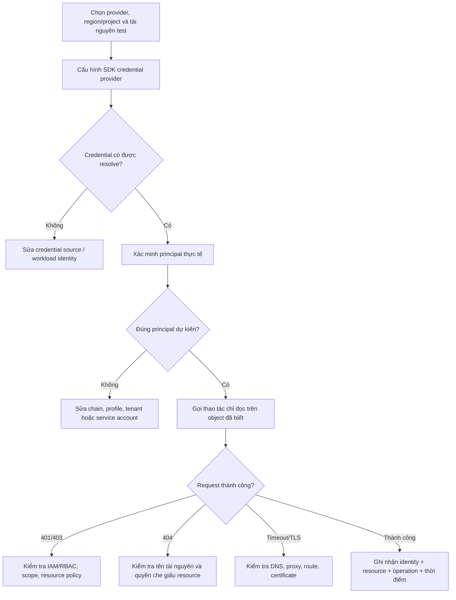

# Thực hiện kết nối tối thiểu và xác minh danh tính đang sử dụng

> **Chương:** Khởi tạo dự án  
> **Học phần:** SPRING_CLOUD_PROVIDER_INTEGRATION — thực hành tích hợp Spring Boot với dịch vụ managed của AWS, Azure và Google Cloud qua các thư viện Spring Cloud tương ứng.

Một ứng dụng đã khởi động thành công chưa chắc đã kết nối được cloud. SDK có thể chưa tìm thấy credential, credential có thể thuộc một tài khoản khác với dự kiến, hoặc danh tính đã xác thực nhưng thiếu quyền trên bucket/container. Khi thử kết nối bằng máy cá nhân, lệnh CLI có thể dùng tài khoản khác với credential chain mà ứng dụng Java chọn.

Bài học này hướng dẫn một quy trình nhỏ, có thể lặp lại: **cấu hình một client tối thiểu, xác định danh tính thực sự được SDK sử dụng, gọi một thao tác chỉ đọc trên tài nguyên thử nghiệm và diễn giải kết quả**. Ví dụ áp dụng cho S3, Azure Blob Storage và Google Cloud Storage; cùng nguyên tắc được dùng khi kết nối messaging, database hoặc secret manager.

## 1. Mục tiêu học tập

Sau bài này, bạn có thể:

1. Phân biệt kết nối mạng, xác thực danh tính (*authentication*) và kiểm tra quyền (*authorization*).
2. Cấu hình client tối thiểu cho AWS, Azure hoặc Google Cloud bằng cơ chế credential chain/identity được SDK hỗ trợ.
3. Xác minh principal đang được ứng dụng sử dụng, thay vì chỉ xem tài khoản đăng nhập của CLI.
4. Thực hiện một thao tác đọc trên object thử nghiệm với quyền tối thiểu cần thiết.
5. Nhận biết các lỗi thiếu credential, sai identity, thiếu quyền, sai region/project/endpoint và lỗi mạng/TLS.
6. Thiết kế smoke test không để lộ token, secret, connection string hoặc thông tin nhạy cảm trong log.

## 2. Phân biệt ba câu hỏi khi kiểm tra kết nối

| Câu hỏi | Nội dung | Ví dụ bằng chứng |
|---|---|---|
| **Có kết nối được không?** | DNS, routing, proxy, TLS, endpoint và cổng mạng hoạt động | Request đến endpoint và nhận phản hồi HTTP/gRPC |
| **Ứng dụng là ai?** | Credential chain đã chọn principal nào? | AWS STS trả ARN/account; Azure sign-in/resource logs ghi principal; Google Cloud Audit Logs ghi principalEmail |
| **Danh tính có quyền gì?** | Principal có được phép thực hiện thao tác trên tài nguyên cụ thể? | S3 HeadObject, Blob getProperties, GCS đọc metadata của object thử nghiệm |

Ba câu hỏi có quan hệ nhưng không thay thế nhau:

- DNS và TLS thành công không chứng minh ứng dụng đã xác thực.
- Có access token hợp lệ không chứng minh principal có quyền đọc object.
- CLI chạy được không chứng minh ứng dụng Java đang dùng cùng credential.
- Một thao tác đọc thành công chứng minh quyền đối với **thao tác và tài nguyên đó** ở thời điểm kiểm tra; không chứng minh quyền upload, delete hoặc truy cập mọi bucket/container.



## 3. Chuẩn bị trước khi gọi dịch vụ

Chọn **một** provider và một thao tác tối thiểu mà ứng dụng thật sự cần:

| Provider | Tài nguyên thử nghiệm | Thao tác đọc | Quyền dữ liệu điển hình |
|---|---|---|---|
| AWS | Object marker đã tồn tại trong bucket test | S3 HeadObject | s3:GetObject trên object/prefix đó |
| Azure | Blob marker đã tồn tại trong container test | Blob getProperties() | Data-plane read phù hợp, ví dụ Storage Blob Data Reader |
| Google Cloud | Object marker đã tồn tại trong bucket test | Storage.get(BlobId) | storage.objects.get trên object tương ứng |

Không dùng thao tác liệt kê toàn bộ bucket/container chỉ để thử credential nếu ứng dụng không cần quyền list. **Thử đúng hành vi nghiệp vụ** giúp kiểm chứng quyền tối thiểu và giảm việc cấp thêm IAM/RBAC rộng. Object marker nên có tên cố định trong prefix test, không chứa dữ liệu cá nhân và được tạo trước bởi quy trình chuẩn bị môi trường.

Ghi lại các thông số không nhạy cảm:

- AWS: account dự kiến, role/role session dự kiến, region, bucket và object key.
- Azure: tenant, subscription/resource group nếu cần quản trị, storage account, container, blob và loại identity dự kiến.
- Google Cloud: project ID, bucket, object và service account hoặc principal workload dự kiến.

Không đưa access key, secret key, bearer token, private key, SAS token hoặc connection string có credential vào source code, YAML commit lên Git, ticket hay log.

## 4. Chọn credential source theo môi trường

| Môi trường | AWS | Azure | Google Cloud |
|---|---|---|---|
| Máy phát triển | AWS IAM Identity Center/SSO hoặc profile được cấp | Azure CLI/IDE credential qua Azure Identity | ADC được tạo bằng gcloud auth application-default login |
| CI | OIDC/workload identity federation nếu nền tảng hỗ trợ | Workload identity federation hoặc service principal theo chính sách | Workload Identity Federation hoặc credential ngắn hạn |
| Workload production | IAM role gắn workload (ECS task role, EC2 instance profile, EKS IRSA/pod identity tùy kiến trúc) | Managed identity hoặc workload identity | Service account gắn workload hoặc Workload Identity Federation |

Tránh tạo static key chỉ để “cho chạy được”. Nếu phải dùng credential dài hạn do giới hạn hệ thống cũ, cần có quy trình lưu trữ bí mật, luân chuyển, thu hồi và audit riêng; không biến nó thành mặc định của bài thực hành.

### Credential chain không phải một tài khoản duy nhất

- AWS SDK v2 DefaultCredentialsProvider tìm credential theo chuỗi nguồn hỗ trợ, có thể gồm system properties, environment variables, web identity, profile, container credentials hoặc instance metadata. Một biến môi trường cũ có thể làm SDK chọn identity khác với profile mà người phát triển đang xem.
- Azure DefaultAzureCredential thử các credential source được hỗ trợ theo phiên bản Azure Identity và môi trường; local có thể chọn Azure CLI/IDE, workload có thể chọn managed identity hoặc workload identity.
- Google Application Default Credentials (ADC) có thể lấy từ GOOGLE_APPLICATION_CREDENTIALS, file ADC local hoặc service account gắn với workload/metadata server, tùy môi trường và thứ tự được SDK hỗ trợ.

**Không giả định** aws configure list, az account show hoặc gcloud auth list luôn mô tả credential mà ứng dụng Java đã chọn. Các lệnh đó giúp kiểm tra CLI context; chúng chỉ tương ứng với ứng dụng khi biết chắc SDK đang sử dụng chính credential source đó.

## 5. AWS: dùng cùng một credential provider để gọi S3 và xác minh STS

### 5.1. Dependency và cấu hình tối thiểu

Trong dự án Maven đã import AWSpring BOM tương thích với Spring Boot, thêm starter S3 và module STS do AWS SDK v2 quản lý phiên bản:

```xml
<!-- Trong <dependencies> của POM hiện có -->
<dependency>
    <groupId>io.awspring.cloud</groupId>
    <artifactId>spring-cloud-aws-starter-s3</artifactId>
</dependency>
<dependency>
    <groupId>software.amazon.awssdk</groupId>
    <artifactId>sts</artifactId>
</dependency>
```

Không thêm version riêng nếu BOM AWSpring đang quản lý AWS SDK v2. Kiểm tra dependency tree để xác nhận s3 và sts thuộc cùng bộ SDK tương thích. Ví dụ dưới đây cấu hình rõ hai client dùng **chung một AwsCredentialsProvider**; nếu dự án đã sử dụng client auto-configured của AWSpring, cần cấu hình/tiêm provider theo đúng cơ chế của phiên bản đó và tránh tạo hai client cạnh tranh.

```yaml
# application-staging.yml
app:
  cloud:
    aws:
      region: ${AWS_REGION}
      bucket: ${APP_S3_BUCKET}
      probe-key: ${APP_S3_PROBE_KEY}
```

Region, bucket và object key không phải secret. Không khai báo access key/secret key ở đây.

### 5.2. Tạo provider và client dùng chung

```java
package com.example.providerdemo.aws;

import org.springframework.beans.factory.annotation.Value;
import org.springframework.context.annotation.Bean;
import org.springframework.context.annotation.Configuration;
import software.amazon.awssdk.auth.credentials.AwsCredentialsProvider;
import software.amazon.awssdk.auth.credentials.DefaultCredentialsProvider;
import software.amazon.awssdk.regions.Region;
import software.amazon.awssdk.services.s3.S3Client;
import software.amazon.awssdk.services.sts.StsClient;

@Configuration(proxyBeanMethods = false)
public class AwsProbeConfiguration {

    @Bean
    AwsCredentialsProvider awsCredentialsProvider() {
        return DefaultCredentialsProvider.create();
    }

    @Bean
    Region awsRegion(@Value("${app.cloud.aws.region}") String region) {
        return Region.of(region);
    }

    @Bean
    S3Client s3Client(
            AwsCredentialsProvider credentials,
            Region region) {
        return S3Client.builder()
                .region(region)
                .credentialsProvider(credentials)
                .build();
    }

    @Bean
    StsClient stsClient(
            AwsCredentialsProvider credentials,
            Region region) {
        return StsClient.builder()
                .region(region)
                .credentialsProvider(credentials)
                .build();
    }
}
```

Ở ví dụ này STS và S3 sử dụng cùng provider, nên kết quả GetCallerIdentity phản ánh credential provider mà S3 client cũng sử dụng. Trong một ứng dụng đã có AWSpring auto-configuration, không nên copy nguyên cấu hình trên mà không kiểm tra bean hiện có. Có thể dùng một cách quản lý thống nhất: để Spring Cloud AWS tạo client theo cấu hình của nó và xác minh cùng credential source; hoặc tự cấu hình cả hai client với provider dùng chung như trên.

### 5.3. Xác minh danh tính bằng STS

```java
package com.example.providerdemo.aws;

import org.springframework.stereotype.Component;
import software.amazon.awssdk.services.sts.StsClient;
import software.amazon.awssdk.services.sts.model.GetCallerIdentityResponse;

@Component
public class AwsIdentityProbe {
    private final StsClient sts;

    public AwsIdentityProbe(StsClient sts) {
        this.sts = sts;
    }

    public GetCallerIdentityResponse currentIdentity() {
        return sts.getCallerIdentity();
    }
}
```

GetCallerIdentity trả về các trường như account, ARN và user ID của principal đang ký request. AWS ghi rõ thao tác này không cần cấp quyền IAM riêng cho principal để gọi API xác minh danh tính. ARN dạng assumed-role thường cho biết role session đang sử dụng; nó không phải ARN của access key bí mật.

Ở startup hoặc smoke test, ghi một phần thông tin đã được tổ chức cho phép audit, ví dụ account và ARN; tránh ghi credential hoặc nội dung request ký. Không gọi probe liên tục trên mỗi request nghiệp vụ; identity thường chỉ cần xác minh ở startup, health diagnostic được bảo vệ hoặc bước smoke test.

### 5.4. Kiểm tra quyền đọc object thử nghiệm

```java
package com.example.providerdemo.aws;

import org.springframework.beans.factory.annotation.Value;
import org.springframework.stereotype.Component;
import software.amazon.awssdk.services.s3.S3Client;
import software.amazon.awssdk.services.s3.model.HeadObjectRequest;
import software.amazon.awssdk.services.s3.model.HeadObjectResponse;

@Component
public class S3ConnectionProbe {
    private final S3Client s3;
    private final String bucket;
    private final String key;

    public S3ConnectionProbe(
            S3Client s3,
            @Value("${app.cloud.aws.bucket}") String bucket,
            @Value("${app.cloud.aws.probe-key}") String key) {
        this.s3 = s3;
        this.bucket = bucket;
        this.key = key;
    }

    public HeadObjectResponse checkReadAccess() {
        return s3.headObject(HeadObjectRequest.builder()
                .bucket(bucket)
                .key(key)
                .build());
    }
}
```

Object phải tồn tại từ trước. HeadObject kiểm tra metadata của object và yêu cầu quyền đọc phù hợp (s3:GetObject) trên object đó; policy bucket, object ownership, encryption và resource policy cũng có thể ảnh hưởng kết quả. Nếu ứng dụng cần upload, hãy kiểm tra riêng trên prefix test với quyền s3:PutObject; không cấp quyền ghi chỉ để một health check đọc metadata hoạt động.

**CLI sanity check:** aws sts get-caller-identity hữu ích để kiểm tra AWS CLI. Tuy nhiên, nếu Java dùng web identity hoặc container role còn CLI dùng profile, hai kết quả có thể khác nhau. Bằng chứng quyết định cho ứng dụng là STS call từ chính process với cùng provider mà client nghiệp vụ sử dụng.

## 6. Azure: xác định credential được chọn và kiểm tra Blob Storage

### 6.1. Cấu hình TokenCredential và BlobServiceClient

Dependency starter trong dự án Maven đã import Spring Cloud Azure BOM tương thích:

```xml
<!-- Trong <dependencies> -->
<dependency>
    <groupId>com.azure.spring</groupId>
    <artifactId>spring-cloud-azure-starter-storage-blob</artifactId>
</dependency>
```

Ví dụ dưới đây dùng Azure Identity DefaultAzureCredential trực tiếp để minh họa rõ credential được truyền vào client. Nếu sử dụng BlobServiceClient auto-configured bởi Spring Cloud Azure, hãy kiểm tra credential chain mà cấu hình của starter đang dùng; không tạo thêm một client thủ công với identity khác.

```yaml
# application-staging.yml
app:
  cloud:
    azure:
      blob-endpoint: ${APP_AZURE_BLOB_ENDPOINT}
      container: ${APP_AZURE_BLOB_CONTAINER}
      probe-name: ${APP_AZURE_BLOB_PROBE_NAME}
```

Endpoint thường có dạng https://<storage-account>.blob.core.windows.net; lấy từ deployment/resource thay vì hard-code vào logic.

```java
package com.example.providerdemo.azure;

import com.azure.identity.DefaultAzureCredentialBuilder;
import com.azure.core.credential.TokenCredential;
import com.azure.storage.blob.BlobServiceClient;
import com.azure.storage.blob.BlobServiceClientBuilder;
import org.springframework.beans.factory.annotation.Value;
import org.springframework.context.annotation.Bean;
import org.springframework.context.annotation.Configuration;

@Configuration(proxyBeanMethods = false)
public class AzureProbeConfiguration {

    @Bean
    TokenCredential azureTokenCredential() {
        return new DefaultAzureCredentialBuilder().build();
    }

    @Bean
    BlobServiceClient blobServiceClient(
            TokenCredential credential,
            @Value("${app.cloud.azure.blob-endpoint}") String endpoint) {
        return new BlobServiceClientBuilder()
                .endpoint(endpoint)
                .credential(credential)
                .buildClient();
    }
}
```

DefaultAzureCredential là một chuỗi credential. Thành phần thực tế được chọn phụ thuộc version Azure Identity, biến môi trường và môi trường chạy. Local có thể dùng Azure CLI/IDE; production có thể dùng managed identity hoặc workload identity. Đừng ghi token ra log để xác định credential.

### 6.2. Xác minh principal đang sử dụng

Azure không có một lời gọi tương đương STS GetCallerIdentity đơn giản trên BlobServiceClient để trả về principal của mọi loại credential. Quy trình thực tế:

1. Chọn identity dự kiến cho môi trường: ví dụ user đăng nhập Azure CLI ở local, user-assigned managed identity ở staging, hoặc workload identity ở production.
2. Khi dùng DefaultAzureCredential, bật diagnostic logging phù hợp của Azure Identity ở môi trường kiểm thử để biết **credential source nào đã được chọn**. Không bật log token hoặc HTTP body chứa dữ liệu nhạy cảm.
3. Gửi một request đọc Blob bằng chính BlobServiceClient trong ứng dụng.
4. Bật Azure Storage diagnostic/resource logs và Entra sign-in/audit logs theo chính sách tổ chức; đối chiếu thông tin caller như tenant, application/object identity (nếu log schema và loại authentication cung cấp) với identity dự kiến.
5. Ghi nhận kết quả, không ghi bearer token.

Lệnh az account show hiển thị tài khoản của Azure CLI hiện hành. Nó chỉ là bằng chứng phù hợp cho ứng dụng nếu DefaultAzureCredential thực sự chọn AzureCliCredential; nếu SDK chọn environment credential hoặc managed identity, CLI context không đại diện cho principal của app.

Khi yêu cầu kiểm soát danh tính chặt chẽ, có thể chọn credential **tường minh theo môi trường** (ví dụ ManagedIdentityCredential với client ID đã xác định cho workload, hoặc AzureCliCredential cho local) thay vì để chuỗi DefaultAzureCredential tự chọn. Cách này làm cấu hình rõ hơn nhưng giảm tính linh hoạt; chỉ dùng khi phiên bản SDK và môi trường đã được xác nhận hỗ trợ.

### 6.3. Kiểm tra quyền đọc Blob

```java
package com.example.providerdemo.azure;

import com.azure.storage.blob.BlobServiceClient;
import com.azure.storage.blob.models.BlobProperties;
import org.springframework.beans.factory.annotation.Value;
import org.springframework.stereotype.Component;

@Component
public class AzureBlobConnectionProbe {
    private final BlobServiceClient client;
    private final String container;
    private final String blobName;

    public AzureBlobConnectionProbe(
            BlobServiceClient client,
            @Value("${app.cloud.azure.container}") String container,
            @Value("${app.cloud.azure.probe-name}") String blobName) {
        this.client = client;
        this.container = container;
        this.blobName = blobName;
    }

    public BlobProperties checkReadAccess() {
        return client.getBlobContainerClient(container)
                .getBlobClient(blobName)
                .getProperties();
    }
}
```

Blob marker phải tồn tại. Thao tác getProperties() kiểm tra quyền đọc trên blob cụ thể; một role dữ liệu như Storage Blob Data Reader có thể phù hợp cho probe chỉ đọc, tùy scope và policy. Nếu ứng dụng phải upload, kiểm tra quyền ghi trên container/prefix test và role dữ liệu tương ứng. Role quản trị resource không mặc nhiên tương đương quyền đọc/ghi dữ liệu blob.

## 7. Google Cloud: ADC, Storage client và principal trong Audit Logs

### 7.1. Cấu hình client từ Application Default Credentials

Thêm starter Cloud Storage theo BOM Spring Framework on Google Cloud:

```xml
<!-- Trong <dependencies> -->
<dependency>
    <groupId>com.google.cloud</groupId>
    <artifactId>spring-cloud-gcp-starter-storage</artifactId>
</dependency>
```

Ví dụ dùng SDK Storage trực tiếp để thấy rõ credential nào được truyền vào:

```yaml
# application-staging.yml
app:
  cloud:
    gcp:
      project-id: ${GCP_PROJECT_ID}
      bucket: ${APP_GCS_BUCKET}
      probe-object: ${APP_GCS_PROBE_OBJECT}
```

```java
package com.example.providerdemo.gcp;

import com.google.auth.oauth2.GoogleCredentials;
import com.google.cloud.storage.Storage;
import com.google.cloud.storage.StorageOptions;
import java.io.IOException;
import java.util.List;
import org.springframework.beans.factory.annotation.Value;
import org.springframework.context.annotation.Bean;
import org.springframework.context.annotation.Configuration;

@Configuration(proxyBeanMethods = false)
public class GcpProbeConfiguration {

    @Bean
    GoogleCredentials googleCredentials() throws IOException {
        return GoogleCredentials.getApplicationDefault()
                .createScoped(List.of(
                        "https://www.googleapis.com/auth/cloud-platform"));
    }

    @Bean
    Storage googleCloudStorage(
            GoogleCredentials credentials,
            @Value("${app.cloud.gcp.project-id}") String projectId) {
        return StorageOptions.newBuilder()
                .setProjectId(projectId)
                .setCredentials(credentials)
                .build()
                .getService();
    }
}
```

Ví dụ thể hiện ADC trong SDK Google Auth. Khi sử dụng starter auto-configuration của Spring Framework on Google Cloud, cần kiểm tra cách starter tạo Storage bean và tránh tạo thêm client khác với credential source hoặc project ID không giống nhau. Với một số môi trường workload, credential đã có scope/được cấp theo cơ chế riêng; hãy tuân thủ hướng dẫn của SDK/provider version thay vì tùy tiện thêm scope.

### 7.2. ADC lấy danh tính từ đâu?

ADC có thể sử dụng:

- File được chỉ ra bởi GOOGLE_APPLICATION_CREDENTIALS (có thể là external account configuration cho Workload Identity Federation; không mặc định phải là private-key JSON).
- File ADC local được tạo bởi gcloud auth application-default login.
- Credential của service account/workload gắn với môi trường chạy thông qua metadata server hoặc cơ chế federation.

gcloud auth list hiển thị tài khoản của Google Cloud CLI, **không đảm bảo** đó là principal trong ADC mà Java SDK dùng. gcloud auth application-default login tạo bộ credential ADC riêng cho ứng dụng local; đây là luồng khác với gcloud auth login.

Để xác minh principal trong production:

1. Xác nhận service account hoặc workload identity được gắn vào workload trong cấu hình triển khai.
2. Thực hiện request Storage từ ứng dụng bằng client ADC.
3. Bật/tra Cloud Audit Logs **Data Access** cho Cloud Storage theo chính sách của tổ chức (Data Access logs có thể cần được bật/configure; không mặc định luôn có).
4. Đối chiếu principalEmail hoặc thông tin principal tương ứng trong log entry với service account/workload dự kiến.

Không in access token hoặc file ADC. Nếu GOOGLE_APPLICATION_CREDENTIALS trỏ đến một file cũ, nó có thể làm SDK dùng identity khác với service account gắn trên workload; cần kiểm tra nguồn ADC thực tế.

### 7.3. Kiểm tra quyền đọc object

```java
package com.example.providerdemo.gcp;

import com.google.cloud.storage.Blob;
import com.google.cloud.storage.BlobId;
import com.google.cloud.storage.Storage;
import org.springframework.beans.factory.annotation.Value;
import org.springframework.stereotype.Component;

@Component
public class GcsConnectionProbe {
    private final Storage storage;
    private final String bucket;
    private final String objectName;

    public GcsConnectionProbe(
            Storage storage,
            @Value("${app.cloud.gcp.bucket}") String bucket,
            @Value("${app.cloud.gcp.probe-object}") String objectName) {
        this.storage = storage;
        this.bucket = bucket;
        this.objectName = objectName;
    }

    public Blob checkReadAccess() {
        return storage.get(BlobId.of(bucket, objectName));
    }
}
```

storage.get(BlobId) đọc metadata object. Nếu object không tồn tại, SDK có thể trả null; nếu bị từ chối, request có thể trả lỗi quyền. Permission điển hình là storage.objects.get trên object đó. Không cấp Storage Admin hoặc Project Editor chỉ để probe đọc hoạt động.

## 8. Xác minh danh tính: lệnh CLI chỉ là bằng chứng phụ

| Provider | Lệnh sanity check | Nó chứng minh điều gì? | Giới hạn |
|---|---|---|---|
| AWS | aws sts get-caller-identity | Principal mà AWS CLI đang sử dụng | Có thể khác credential chain của Java process |
| Azure | az account show | Tenant/subscription và account CLI hiện hành | Không chứng minh app dùng Azure CLI credential; app có thể dùng managed identity |
| Google Cloud | gcloud auth list | Tài khoản CLI được kích hoạt | Không chứng minh ADC của Java app dùng tài khoản đó |

Muốn chứng minh danh tính của **ứng dụng**, ưu tiên:

- AWS: gọi STS từ process bằng cùng AwsCredentialsProvider với service client.
- Azure: xác định credential source của Azure Identity, sau đó đối chiếu sign-in/resource diagnostic logs của request do app gửi.
- Google Cloud: gửi request bằng ADC trong app và đối chiếu principal trong Cloud Audit Logs Data Access đã bật.

Không chia sẻ output chứa token, secret, đường dẫn file credential nhạy cảm hoặc toàn bộ biến môi trường. ARN, principal ID và tên service account cũng nên được xử lý theo chính sách log của tổ chức.

## 9. Kiểm tra quyền theo thao tác, không theo vai trò quá rộng

| Nhu cầu của ứng dụng | AWS | Azure | Google Cloud |
|---|---|---|---|
| Đọc object marker | s3:GetObject | Role dữ liệu đọc Blob thích hợp | storage.objects.get |
| Upload object | s3:PutObject | Role dữ liệu ghi Blob thích hợp | storage.objects.create |
| Xóa object | s3:DeleteObject | Role dữ liệu có quyền delete phù hợp | storage.objects.delete |
| Đọc danh sách object | s3:ListBucket (scope bucket/prefix theo policy) | Quyền list container/blob phù hợp | storage.objects.list |
| Đọc secret | Action Secrets Manager cần thiết, ví dụ secretsmanager:GetSecretValue | Key Vault Secrets User hoặc role phù hợp | secretmanager.versions.access |

Tên permission/role ở bảng là gợi ý để phân tích, không phải policy hoàn chỉnh. Cần tính cả KMS encryption, resource policy, deny rules, scope, condition, firewall và access boundary. Ví dụ S3 HeadObject cần quyền đọc object; nếu bucket policy hoặc KMS key policy từ chối, việc chỉ có IAM identity policy vẫn chưa đủ.

**Không giải quyết lỗi 403 bằng cách cấp Owner/Administrator ngay lập tức.** Hãy xác định principal, resource, operation, policy evaluation và scope bị thiếu; cấp quyền tối thiểu rồi lặp lại chính thao tác thử nghiệm.

## 10. Diễn giải lỗi kết nối

| Triệu chứng | Nhóm nguyên nhân | Hành động đầu tiên |
|---|---|---|
| AWS Unable to load credentials | Không có credential hợp lệ trong provider chain | Kiểm tra nguồn credential trong chính Java process, profile, web identity, container/instance role |
| Azure CredentialUnavailableException | Các credential source trong chain không khả dụng | Xác nhận identity local/workload và version Azure Identity |
| Azure AuthenticationFailedException / HTTP 401 | Token không hợp lệ, tenant/audience/scope hoặc token hết hạn | Kiểm tra tenant, credential source, thời gian hệ thống và sign-in logs |
| Google IOException/credential exception khi lấy ADC | Không resolve được ADC hoặc metadata credential | Kiểm tra GOOGLE_APPLICATION_CREDENTIALS, ADC local hoặc workload identity |
| HTTP 401 | Request thiếu/không hợp lệ về authentication | Kiểm tra token/credential source, audience, clock skew |
| HTTP 403 / AccessDenied / PERMISSION_DENIED | Principal đã xác thực nhưng không có quyền hoặc policy từ chối | Đối chiếu principal, operation, resource, scope và audit log |
| HTTP 404 hoặc object không tồn tại | Sai bucket/container/key hoặc service cố che giấu resource không được phép xem | Kiểm tra resource name và quyền đọc |
| DNS/connection timeout | Endpoint, DNS, routing, proxy, firewall hoặc service outage | Kiểm tra từ cùng container/network namespace |
| SSLHandshakeException | Truststore, certificate chain, TLS inspection, proxy hoặc thời gian hệ thống | Kiểm tra chứng chỉ và TLS; không tắt xác minh hostname |
| NoSuchMethodError / NoClassDefFoundError | Dependency/API mismatch | Xem dependency tree và BOM; không sửa IAM |
| Thao tác đọc thành công nhưng upload thất bại | Quyền read có nhưng thiếu write hoặc điều kiện encryption | Kiểm tra quyền ghi, KMS/key, policy và quota |

Một số dịch vụ cố ý trả 404 hoặc 403 tùy policy để không tiết lộ tài nguyên tồn tại. Không kết luận duy nhất từ status code; kết hợp request ID, log phía provider và thao tác cụ thể.

## 11. Quy trình smoke test tối thiểu có thể lặp lại

### Bước 1 — Xác định mục tiêu

Ghi rõ: provider, môi trường, principal dự kiến, region/project/tenant, tài nguyên thử nghiệm và một thao tác đọc/ghi tối thiểu. Ví dụ: staging AWS, assumed role provider-demo-staging, bucket test và object marker probes/identity.txt.

### Bước 2 — Kiểm tra cấu hình không nhạy cảm

Kiểm tra profile, endpoint, region, project ID, bucket/container và tên object. Không dump Environment, credential chain hoặc file secret ra log. Nếu dùng profile local, xác nhận tên profile trong chính process hoặc cấu hình rõ ràng.

### Bước 3 — Xác minh principal

- AWS: STS GetCallerIdentity bằng provider dùng cho S3.
- Azure: xác định credential source, đối chiếu Azure sign-in/resource logs.
- GCP: đối chiếu principal trong Cloud Audit Logs Data Access của request từ ADC.

So sánh với principal dự kiến trước khi gọi tài nguyên. Nếu khác, dừng smoke test; không tiếp tục ghi dữ liệu vào tài nguyên của identity ngoài ý muốn.

### Bước 4 — Thực hiện thao tác chỉ đọc

Gọi HeadObject, BlobClient.getProperties() hoặc Storage.get(BlobId) trên object marker đã biết. Thao tác này giúp kiểm tra client, endpoint, identity và quyền đọc trên một tài nguyên cụ thể.

### Bước 5 — Ghi kết quả có thể audit

Ví dụ bản ghi smoke test:

| Trường | Giá trị mẫu |
|---|---|
| Timestamp | UTC timestamp |
| Application | provider-integration-demo |
| Environment | staging |
| Provider | aws |
| Principal | ARN đã được phép ghi log |
| Region | ap-southeast-1 |
| Resource | Bucket và object marker test |
| Operation | HeadObject |
| Result | SUCCESS |
| Request ID | ID phản hồi provider nếu có |

Không ghi access token, secret key, SAS token, private key hoặc toàn bộ HTTP Authorization header. Bản ghi nên cho biết **ai đã gọi thao tác nào lên tài nguyên nào và khi nào**, không sao chép credential.

### Bước 6 — Chỉ kiểm tra ghi khi nghiệp vụ cần

Nếu ứng dụng phải upload, tạo một object riêng trong prefix thử nghiệm bằng dữ liệu vô hại. Quy định trước cách cleanup và quyền delete; không dùng tài nguyên production thật để thử ngẫu nhiên. Kiểm tra checksum/metadata sau khi ghi, và kiểm tra khả năng xóa nếu nghiệp vụ yêu cầu.

## 12. Kiểm tra cùng một identity trong Spring Boot

Một ứng dụng có thể tạo nhiều client với credential source khác nhau. Ví dụ S3 client dùng credential provider tùy chỉnh, còn STS probe vô tình dùng default chain khác. Để tránh kết luận sai:

1. Dùng cùng một provider instance/configuration khi xây dựng client nghiệp vụ và client xác minh identity nếu SDK cho phép.
2. Nếu sử dụng auto-configuration của Spring Cloud provider, kiểm tra cách starter tạo credential/client và tránh tạo một probe độc lập dùng credential khác.
3. Nếu credential được refresh tự động (role session, managed identity, ADC), không cache access token thủ công lâu hơn thời hạn; dùng provider SDK để refresh.
4. Khi đổi profile hoặc workload identity, khởi động lại/refresh đúng thành phần theo thiết kế và xác minh lại principal.
5. Không expose endpoint public /identity trả ARN, tenant, principal hoặc project; nếu cần diagnostic endpoint, bảo vệ quyền truy cập và giới hạn dữ liệu trả về.

### Health check khác smoke test

| Loại | Mục tiêu | Tần suất phù hợp |
|---|---|---|
| Liveness | JVM/process có còn hoạt động? | Thường xuyên, không gọi cloud |
| Readiness | Ứng dụng có thể nhận traffic theo điều kiện vận hành? | Theo chính sách; tránh gọi nhiều cloud API mỗi lần probe |
| Startup check | Cấu hình/client cần thiết có thể khởi tạo? | Khi khởi động hoặc kiểm tra deployment |
| Identity smoke test | Principal thực tế có đúng dự kiến? | Khi triển khai, đổi identity hoặc theo lịch audit |
| Permission smoke test | Một thao tác nghiệp vụ tối thiểu có thành công? | Khi triển khai hoặc kiểm thử định kỳ có kiểm soát |

Nếu readiness gọi S3/Blob/GCS trên mỗi chu kỳ vài giây, sự cố cloud tạm thời có thể khiến toàn bộ instance bị đánh dấu không sẵn sàng, gây hiệu ứng dây chuyền. Chọn cách đánh giá readiness theo SLO và dependency criticality; không mặc định mọi dịch vụ managed phải nằm trong liveness.

## 13. Mở rộng cùng nguyên tắc sang messaging, database và secret

| Dịch vụ | Kiểm tra danh tính | Probe phù hợp | Điều không nên làm |
|---|---|---|---|
| SQS | STS từ cùng AWS credential provider | Gửi/nhận message test trên queue riêng tùy quyền nghiệp vụ | Poll queue production chỉ để xem credential |
| Azure Service Bus | Credential source + Entra/resource logs | Send/receive trên queue test | Cấp Data Owner nếu chỉ cần Data Sender |
| Pub/Sub | ADC principal trong Audit Logs | Publish vào topic test; subscribe chỉ khi ứng dụng thực sự consume | Tạo subscription/consumer production tùy tiện |
| Database managed | Identity token/certificate/user được driver dùng | Mở connection và chạy query read-only phù hợp | Dùng tài khoản DB admin cho health check |
| Secret Manager / Key Vault | Principal được ghi nhận trong audit log | Đọc một secret test đã tạo, hoặc kiểm tra metadata nếu quyền cho phép | Log secret value hoặc đọc toàn bộ secrets |

Với messaging, “kết nối thành công” cần phân biệt producer và consumer. Publisher chỉ cần quyền gửi; consumer cần quyền nhận/ack và cấu hình listener. Một probe có thể làm thay đổi queue/subscription, do đó phải dùng tài nguyên thử nghiệm và có cleanup rõ ràng.

Với database, probe SELECT 1 xác nhận connection và khả năng query cơ bản nhưng không chứng minh quyền đọc/ghi các bảng nghiệp vụ. Với secret manager, đọc một secret marker không chứng minh ứng dụng được phép truy cập tất cả secret; cũng không cần ghi giá trị secret vào kết quả kiểm tra.

## 14. Checklist xử lý credential an toàn

- [ ] Chỉ dùng credential source được phê duyệt cho môi trường; production ưu tiên workload identity/managed identity.
- [ ] Đã xác định credential provider/chain thực sự được SDK chọn, không chỉ nhìn CLI account.
- [ ] Probe identity và client nghiệp vụ dùng cùng credential source hoặc có bằng chứng tương đương.
- [ ] Không lưu static access key, private key hoặc bearer token trong Git/YAML/container image.
- [ ] Không ghi token, secret, connection string hoặc Authorization header vào log.
- [ ] Principal đã được so sánh với danh tính dự kiến trước khi gọi tài nguyên.
- [ ] Quyền chỉ cấp theo operation/resource cần dùng; read probe không đòi quyền write/admin.
- [ ] Đã kiểm tra region/project/tenant/endpoint và tên object marker.
- [ ] Có request ID/audit log để truy vết mà không cần lưu credential.
- [ ] Có quy trình thu hồi/rotation khi credential bị lộ hoặc workload chuyển môi trường.

## 15. Bài tập thực hành

**Bối cảnh:** Một ứng dụng Spring Boot cần đọc metadata của tài liệu trong storage. Staging sử dụng AWS S3; một triển khai khác sử dụng Azure Blob; một khách hàng khác sử dụng Google Cloud Storage. Mỗi môi trường phải chứng minh danh tính thực tế và quyền đọc trên một object thử nghiệm.

### Phần A — Chọn identity

1. Với AWS, xác định role dự kiến của workload và cấu hình Java SDK sử dụng credential chain phù hợp. Gọi STS GetCallerIdentity.
2. Với Azure, xác định tenant và managed identity/workload identity dự kiến. Dùng DefaultAzureCredential hoặc credential tường minh; xác minh nguồn credential và đối chiếu resource logs.
3. Với GCP, xác định service account/workload identity và cấu hình ADC. Đối chiếu principal trong Cloud Audit Logs Data Access.
4. Giải thích vì sao aws sts get-caller-identity, az account show và gcloud auth list có thể khác danh tính của ứng dụng.

### Phần B — Thực hiện probe chỉ đọc

1. Tạo một object marker vô hại trong bucket/container test.
2. Thực hiện HeadObject trên S3, getProperties() trên Azure Blob hoặc Storage.get(BlobId) trên GCS.
3. Cấp quyền tối thiểu cho thao tác đọc; ghi lại trường hợp thiếu quyền và kết quả lỗi.
4. Không in token/secret; ghi timestamp, principal, resource, operation, result và request ID.

### Phần C — Phân tích lỗi

Mô phỏng ít nhất ba tình huống:

- Credential source không tồn tại hoặc bị vô hiệu hóa.
- Principal đúng nhưng thiếu quyền đọc object.
- Endpoint/region/project sai hoặc network/TLS không kết nối được.

Đối chiếu lỗi SDK/HTTP với audit logs và đề xuất cách sửa. Không tăng quyền lên Administrator/Owner như giải pháp mặc định.

**Mẫu kết quả:**

| Provider | Principal dự kiến | Principal thực tế | Operation | Kết quả | Quyền cần có |
|---|---|---|---|---|---|
| AWS | Role staging | ARN từ STS | S3 HeadObject | SUCCESS/403 | s3:GetObject trên object test |
| Azure | Managed identity | Caller trong resource logs | Blob getProperties | SUCCESS/401/403 | Blob data read role |
| GCP | Service account | principalEmail trong Audit Logs | Storage object metadata read | SUCCESS/403 | storage.objects.get |

**Tiêu chí đạt:** Xác định được danh tính mà ứng dụng thật sự sử dụng, phân biệt authentication và authorization, thực hiện probe trên đúng tài nguyên và giải thích được cách xử lý từng nhóm lỗi mà không làm lộ credential.

## 16. Tài liệu tham khảo chính thức

1. [AWS SDK for Java 2.x — Default credentials provider chain](https://docs.aws.amazon.com/sdk-for-java/latest/developer-guide/credentials-chain.html): nguồn credential và thứ tự provider.
2. [AWS SDK for Java 2.x — Configure credentials](https://docs.aws.amazon.com/sdk-for-java/latest/developer-guide/credentials.html): cấu hình provider cho client.
3. [AWS STS — GetCallerIdentity](https://docs.aws.amazon.com/STS/latest/APIReference/API_GetCallerIdentity.html): xác minh account, ARN và user ID.
4. [Amazon S3 — HeadObject](https://docs.aws.amazon.com/AmazonS3/latest/API/API_HeadObject.html): kiểm tra metadata object và quyền.
5. [Azure Identity — DefaultAzureCredential](https://learn.microsoft.com/azure/developer/java/sdk/authentication/credential-chains): credential chain cho local và workload.
6. [Azure SDK for Java — Authenticate with Azure services](https://learn.microsoft.com/azure/developer/java/sdk/authentication/): cơ chế xác thực và workload identity.
7. [Azure Storage — Authorize access to blobs using Microsoft Entra ID](https://learn.microsoft.com/azure/storage/blobs/authorize-access-azure-active-directory): data-plane RBAC cho Blob Storage.
8. [Google Cloud — Application Default Credentials](https://cloud.google.com/docs/authentication/application-default-credentials): ADC local, môi trường production và credential source.
9. [Google Cloud — Audit logging](https://cloud.google.com/logging/docs/audit): principal và log của request tới tài nguyên.
10. [Google Cloud Storage — IAM permissions](https://cloud.google.com/storage/docs/access-control/iam-permissions): quyền thao tác object/bucket.

> **Ghi nhớ:** Đừng chỉ kiểm tra “CLI đã đăng nhập” hoặc “ứng dụng đã khởi động”. Hãy chứng minh **SDK đang dùng principal nào**, sau đó gọi **đúng một thao tác trên đúng tài nguyên thử nghiệm** với quyền tối thiểu. Ghi kết quả đủ để audit nhưng tuyệt đối không ghi credential.
