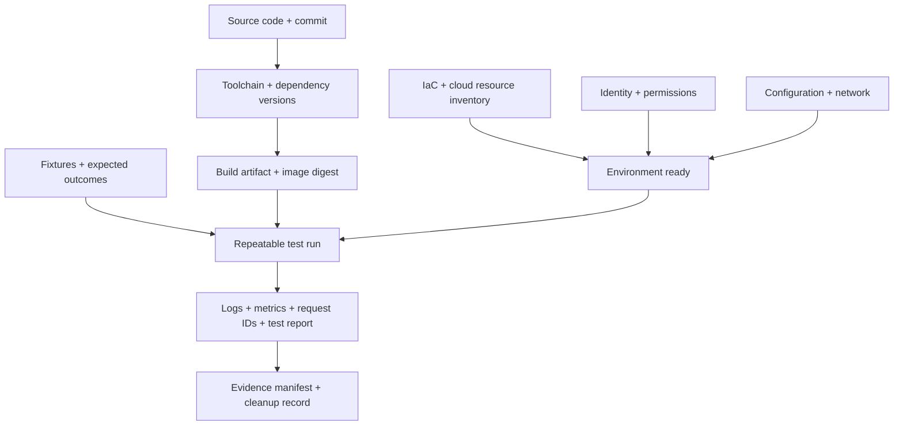

# Ghi lại phiên bản, tài nguyên và điều kiện chạy ví dụ có thể tái lập

> **Chương:** Khởi tạo dự án  
> **Học phần:** SPRING_CLOUD_PROVIDER_INTEGRATION — thực hành tích hợp Spring Boot với dịch vụ managed của AWS, Azure và Google Cloud qua các thư viện Spring Cloud tương ứng.

Một ví dụ upload file lên S3 có thể chạy trên máy của người viết nhưng thất bại trên máy của đồng nghiệp. Ví dụ Azure Blob Storage có thể trả kết quả khác khi role dữ liệu thay đổi; ví dụ Pub/Sub có thể không tái hiện được nếu topic, subscription hoặc message đã bị xóa. Nguyên nhân thường không chỉ nằm ở source code: phiên bản JDK, Spring Boot, SDK, container image, tài nguyên cloud, danh tính, quyền, dữ liệu mẫu và biến môi trường đều ảnh hưởng kết quả.

Muốn người khác chạy lại một ví dụ và kiểm chứng cùng hành vi, cần ghi lại **đủ thông tin để tái tạo điều kiện chạy**, đồng thời cung cấp quy trình chuẩn bị, thực thi, xác minh và dọn tài nguyên. Bài học này hướng dẫn tạo hồ sơ chạy có thể kiểm tra cho ứng dụng Spring Boot tích hợp AWS, Azure hoặc Google Cloud.

## 1. Mục tiêu học tập

Sau bài này, bạn có thể:

1. Phân biệt tính tái lập của build, môi trường chạy và hành vi cloud; hiểu giới hạn khi dịch vụ managed thay đổi theo thời gian.
2. Ghi chính xác phiên bản Java, build tool, Spring Boot, Spring Cloud release train, provider BOM, SDK và container image.
3. Lập danh mục tài nguyên cloud gồm region/project/account, bucket/container, queue/topic, identity, quyền và cấu hình bảo mật.
4. Mô tả dữ liệu mẫu, fixture, checksum, điều kiện đầu vào và kết quả mong đợi để test có thể chạy lặp lại.
5. Dùng Infrastructure as Code (IaC), lockfile, dependency report và manifest không chứa secret để tái tạo môi trường.
6. Viết runbook từ bước chuẩn bị đến kiểm thử và cleanup; lưu bằng chứng đủ để phân tích sai khác giữa hai lần chạy.

## 2. “Có thể chạy lại” nghĩa là gì?

Một hướng dẫn có thể chạy được một lần chưa chắc đã tái lập được. Hãy tách bốn mức:

| Mức | Câu hỏi | Ví dụ bằng chứng |
|---|---|---|
| **Build reproducibility** | Cùng source và toolchain có tạo ra dependency graph/artifact tương đương không? | Commit SHA, wrapper, BOM, lockfile, checksum JAR |
| **Runtime reproducibility** | Ứng dụng có chạy trong cùng runtime/configuration không? | JDK distribution, OS/architecture, image digest, biến môi trường |
| **Environment reproducibility** | Tài nguyên cloud, network, identity và quyền có thể được chuẩn bị tương tự không? | IaC, region, resource inventory, IAM/RBAC, endpoint |
| **Behavioral reproducibility** | Cùng đầu vào có cho kết quả và trạng thái có thể kiểm tra tương ứng không? | Fixture, checksum, message ID, expected result, test report |

Với dịch vụ managed, ta không thể đóng băng hoàn toàn mọi yếu tố của nhà cung cấp: control plane, firmware, quota, network routing, chính sách bảo mật của tổ chức và trạng thái dịch vụ có thể thay đổi. Mục tiêu thực tế là **tái tạo cấu hình do ứng dụng và đội triển khai kiểm soát, ghi nhận các yếu tố bên ngoài, và xác định rõ giới hạn**.



## 3. Hồ sơ chạy: ghi điều gì và ghi ở đâu?

Không nên dựa vào trí nhớ hoặc một file YAML chứa tất cả mọi thứ. Tổ chức hồ sơ theo nhóm:

| Nhóm | Nội dung cần ghi | Nguồn có thể kiểm chứng |
|---|---|---|
| Source | Repository, commit SHA, branch/tag, trạng thái working tree | Git |
| Build toolchain | JDK vendor/version, Maven/Gradle wrapper, OS, architecture | java -version, wrapper version, CI image |
| Framework/dependency | Boot, Spring Cloud train nếu dùng, AWSpring/Azure/GCP BOM, resolved SDK | POM/effective POM, Gradle dependency reports, SBOM |
| Artifact | JAR/WAR checksum, OCI image reference và digest | SHA-256, registry |
| IaC | Terraform/Bicep/CloudFormation version, module/provider version, lockfile, commit | IaC repository, plan/apply output |
| Cloud resources | Account/subscription/project, region, resource IDs, bucket/queue/topic/container | IaC outputs, console/CLI metadata |
| Identity/permissions | Principal dự kiến và thực tế, role/policy, scope, cách cấp credential | IAM/RBAC config, audit logs |
| Configuration | Profile, endpoint, region, feature flags, timeout, retry, proxy | Manifest và deployment variables |
| Data/test fixture | Tên object/message, schema version, checksum, seed script | Test resources, fixture files |
| Run evidence | Thời điểm, người/CI run, request ID, kết quả, test report | Log đã lọc secret, CI artifact |
| Cleanup | Tài nguyên đã xóa/giữ lại, lý do và thời hạn | Teardown report, resource inventory |

**Phân biệt giá trị cấu hình và bí mật:** có thể ghi region, bucket name, project ID, image digest, principal ARN và phiên bản SDK theo chính sách tổ chức. Không ghi access key, private key, bearer token, SAS token, connection string có secret, file ADC chứa khóa riêng hoặc giá trị secret manager.

### Một thư mục hồ sơ tham khảo

```text
reproducibility/
├── run-manifest.yml
├── resources.yml
├── fixtures/
│   ├── invoice-small.pdf
│   └── expected-checksums.txt
├── iac/
│   ├── main.tf
│   ├── variables.tf
│   └── .terraform.lock.hcl
├── reports/
│   ├── dependency-tree.txt
│   ├── sbom.json
│   └── integration-test.xml
└── evidence/
    ├── identity-check.txt
    ├── smoke-test.json
    └── cleanup-report.txt
```

Đây là bố cục gợi ý, không phải yêu cầu mọi dự án phải tạo đúng thư mục này. Manifest và report nên được lưu cùng phiên bản tài liệu/hướng dẫn; log và state chứa thông tin nhạy cảm phải được lưu ở kho có quyền truy cập phù hợp.

## 4. Ghi lại phiên bản source, JDK và build tool

### 4.1. Source code

Ghi commit SHA đầy đủ thay vì chỉ ghi tên branch như main hoặc develop, vì branch có thể di chuyển:

```bash
git rev-parse HEAD
git status --short
git describe --tags --always
```

Nếu working tree có thay đổi chưa commit, ghi rõ patch/diff đã được phê duyệt hoặc commit thay đổi trước khi phát hành ví dụ. Một hướng dẫn ghi commit rút gọn nhưng không xác định repository và commit đầy đủ sẽ khó tái tạo sau vài tháng.

### 4.2. JDK

Không chỉ ghi “Java 21”. Ghi:

- Vendor/distribution (Temurin, Corretto, Microsoft Build of OpenJDK, Oracle JDK hoặc bản phân phối tổ chức phê duyệt).
- Phiên bản đầy đủ và build number nếu cần.
- Hệ điều hành, kiến trúc CPU và cách JDK được cài (toolchain, container image, CI runner).
- Kết quả lệnh version của Java và build tool.

```bash
java -version
./mvnw -version
./gradlew --version
```

Chỉ chạy lệnh wrapper tương ứng với build tool dự án sử dụng. Nếu máy có nhiều JDK, ghi JAVA_HOME/toolchain thực sự được build process dùng; giá trị java -version trong terminal có thể khác JDK của IDE hoặc CI.

### 4.3. Maven Wrapper và Gradle Wrapper

Commit wrapper vào repository để người khác sử dụng đúng phiên bản build tool:

| Công cụ | File cần lưu | Điều cần kiểm tra |
|---|---|---|
| Maven Wrapper | .mvn/wrapper/maven-wrapper.properties, script mvnw/mvnw.cmd và wrapper JAR/script theo cấu hình | distributionUrl, checksum nếu hỗ trợ, Maven version |
| Gradle Wrapper | gradle/wrapper/gradle-wrapper.properties, gradlew/gradlew.bat, wrapper JAR | distributionUrl, distributionSha256Sum, Gradle version |

Gradle Wrapper hỗ trợ xác minh checksum distribution qua distributionSha256Sum. Maven Wrapper có thể cấu hình checksum cho distribution ở những phiên bản wrapper hỗ trợ. Không chỉ ghi “Maven 3” hoặc “Gradle 8”; phải pin phiên bản cụ thể và kiểm tra tài liệu wrapper của bản đang dùng.

Nguồn: [Maven Wrapper](https://maven.apache.org/wrapper/), [Gradle Wrapper](https://docs.gradle.org/current/userguide/gradle_wrapper.html).

## 5. Ghi lại Spring và dependency đã được phân giải

Một file build có thể khai báo BOM nhưng version runtime cuối cùng còn phụ thuộc parent, nhiều BOM, dependency constraint, exclusion, lockfile và dependency bắc cầu. Hồ sơ cần ghi **cả version được khai báo lẫn version thực tế đã resolve**.

### 5.1. Bộ phiên bản Spring

| Thành phần | Ví dụ cách ghi | Vì sao cần |
|---|---|---|
| Spring Boot | Nhánh 4.0.x và patch cụ thể | Quản lý auto-configuration, starter, framework dependencies |
| Spring Cloud release train | Tên train + patch nếu dự án dùng Config/Gateway/Stream | Đồng bộ các module Spring Cloud |
| AWSpring | BOM io.awspring.cloud:spring-cloud-aws-dependencies và patch | Quản lý AWSpring starters/SDK |
| Spring Cloud Azure | BOM com.azure.spring:spring-cloud-azure-dependencies và patch | Quản lý Azure Spring starters/SDK |
| Spring Framework on Google Cloud | BOM com.google.cloud:spring-cloud-gcp-dependencies và patch | Quản lý Google Cloud integration libraries |
| Java SDKs | Resolved AWS SDK v2, Azure SDK, Google Cloud libraries | Chẩn đoán API/transport thực tế |

Không mặc định mọi ứng dụng cần cả ba provider BOM. Chỉ ghi BOM được sử dụng; nếu không dùng Spring Cloud release train, ghi not used thay vì tự thêm BOM chỉ vì tên provider có chữ “Spring Cloud”.

Trước khi chốt version, kiểm tra ma trận Boot ↔ Cloud train ↔ provider. Một BOM có thể resolve thành công nhưng vẫn không có nghĩa mọi provider được hỗ trợ trong cùng một tiến trình.

### 5.2. Maven: lưu effective POM và dependency tree

```bash
./mvnw help:effective-pom -Doutput=reports/effective-pom.xml
./mvnw dependency:tree -DoutputFile=reports/dependency-tree.txt
./mvnw clean verify
```

Các đường dẫn reports/... là ví dụ; tạo thư mục trước hoặc điều chỉnh theo quy trình build. Đọc cây dependency để ghi version AWS SDK v2, Azure Core/transport, Google GAX/gRPC/protobuf và Netty đã resolve. Effective POM cho thấy quản lý dependency sau khi kế thừa parent và import BOM.

Maven không có lockfile dependency graph tiêu chuẩn tương đương Gradle Dependency Locking trong cấu hình thông thường. Để tăng khả năng tái lập, pin BOM/parent/plugin, lưu effective POM/tree, dùng repository ổn định và có thể phát hành SBOM.

### 5.3. Gradle: dependency locking và version catalog

Gradle hỗ trợ lock version đã resolve:

```kotlin
dependencyLocking {
    lockAllConfigurations()
}
```

Tạo/cập nhật lock state bằng quy trình có chủ đích:

```bash
./gradlew dependencies --write-locks
./gradlew build
```

Commit lockfile theo chính sách dự án. Khi nâng BOM, cập nhật lock state trong cùng thay đổi và xem xét diff. Version catalog (libs.versions.toml) giúp quản lý alias và version khai báo tập trung; nó không tự thay thế BOM hoặc khóa mọi version transitive.

### 5.4. SBOM và checksum artifact

Một SBOM (Software Bill of Materials) ghi danh sách component của artifact, version và metadata nhận diện. Nó hỗ trợ rà soát dependency, license và vulnerability, nhưng không thay thế build manifest hoặc lockfile.

Lưu checksum JAR:

```bash
# Linux/macOS
sha256sum target/provider-demo.jar

# Windows PowerShell
Get-FileHash .\target\provider-demo.jar -Algorithm SHA256
```

Ghi tên file, SHA-256, commit source và lệnh build. Nếu dùng container, ghi image **digest** (sha256:...), không chỉ ghi tag như latest hoặc 4.0. Tag có thể trỏ sang image khác theo thời gian; digest nhận diện nội dung image cụ thể.

Nguồn: [Gradle Dependency Locking](https://docs.gradle.org/current/userguide/dependency_locking.html), [Docker image digests](https://docs.docker.com/dhi/core-concepts/digests/).

## 6. Ghi lại runtime và cấu hình ứng dụng

Một ví dụ chỉ nên có cấu hình không nhạy cảm trong file manifest. Giá trị bí mật được inject lúc chạy từ secret manager hoặc cơ chế được tổ chức phê duyệt.

Các thông tin nên ghi:

- Profile đang active (local, ci, staging, prod).
- Java runtime, OS/architecture, container base image và image digest.
- Region, endpoint, project ID, account/subscription và tên tài nguyên.
- Timeout, retry, concurrency, listener auto-startup, batch size và feature flags.
- Proxy, private endpoint, DNS, TLS truststore/certificate policy và network path ở mức mô tả.
- Múi giờ, locale và định dạng dữ liệu nếu ảnh hưởng kết quả.

Không đưa vào manifest: access key, client secret, SAS token, OAuth refresh token, private key, file ADC có private key, connection string có credential hoặc giá trị secret được đọc từ vault.

### Ví dụ cấu hình có thể ghi nhận

```yaml
application:
  name: provider-integration-demo
  profile: staging
  artifact:
    version: 1.2.0
    sha256: "sha256-of-the-built-jar"
runtime:
  java:
    vendor: "Eclipse Adoptium"
    version: "21.0.x+build"
  os: "linux"
  architecture: "amd64"
  timezone: "UTC"
spring:
  boot: "4.0.x"
  cloudTrain: "2025.1.x"
provider:
  type: "aws"
  region: "ap-southeast-1"
  storage:
    bucket: "invoice-staging-example"
    prefix: "repro/run-001/"
configuration:
  storageBackend: "s3"
  s3Enabled: true
  s3ListenerEnabled: false
identity:
  method: "workload-role"
  expectedPrincipal: "arn:aws:iam::000000000000:role/provider-demo-staging"
secrets:
  source: "aws-secrets-manager"
  reference: "staging/provider-demo"
  valuesIncluded: false
```

Đây là manifest minh họa, không phải version hay ARN để triển khai thật. sha256-of-the-built-jar và account ID mẫu phải thay bằng giá trị thực. Nếu tổ chức coi principal ARN, bucket name hoặc project ID là dữ liệu nội bộ, lưu manifest ở vị trí có quyền truy cập phù hợp.

## 7. Ghi lại tài nguyên cloud

Mỗi ví dụ nên có inventory nêu tài nguyên được tạo trước, tài nguyên được ứng dụng sử dụng, tài nguyên chỉ dành cho test và tài nguyên phải cleanup. Tránh ghi chung chung “đã tạo bucket” mà không có region, account hoặc tên thực tế.

### 7.1. AWS

| Tài nguyên | Thuộc tính nên ghi | Lưu ý |
|---|---|---|
| Account | Account ID, partition nếu cần | Không nhầm account CLI với account của workload |
| Region | Region đầy đủ | Bucket, queue và client phải nhất quán với thiết kế |
| S3 bucket | Bucket name, region, encryption, versioning, public access block, lifecycle | Ghi object prefix dùng trong bài |
| IAM role | Role ARN, trust relationship mô tả, policy version/revision | Không lưu access key/secret |
| SQS queue | Queue URL/ARN, region, visibility timeout, retention, DLQ | Queue name và policy ảnh hưởng hành vi consumer |
| Secrets Manager | Secret ARN/reference, version stage nếu cần | Không lưu secret value |

Ví dụ danh mục:

```yaml
aws:
  accountId: "000000000000"
  region: "ap-southeast-1"
  resources:
    s3:
      bucket: "invoice-staging-example"
      objectPrefix: "repro/run-001/"
      encryption: "SSE-S3"
      versioning: true
    sqs:
      queueName: "invoice-events-staging"
      deadLetterQueue: "invoice-events-staging-dlq"
  identity:
    roleArn: "arn:aws:iam::000000000000:role/provider-demo-staging"
```

Không copy account ID hoặc role ARN giả vào cấu hình thật. Nếu dùng SSE-KMS, ghi KMS key ARN/alias và policy reference phù hợp; không ghi key material. S3 bucket name có tính toàn cục trong partition, nên tên ví dụ có thể đã được người khác sử dụng; tạo tên theo quy ước unique của tổ chức.

### 7.2. Azure

Ghi tenant ID, subscription ID, resource group, region, storage account, Blob container, Service Bus namespace/queue/topic/subscription, Key Vault reference và identity được gán role.

Ví dụ:

```yaml
azure:
  tenantId: "00000000-0000-0000-0000-000000000000"
  subscriptionId: "00000000-0000-0000-0000-000000000000"
  resourceGroup: "rg-provider-demo-staging"
  region: "southeastasia"
  resources:
    storage:
      accountName: "providerdemostg"
      container: "invoices"
    serviceBus:
      namespace: "provider-demo-staging"
      queue: "invoice-events"
  identity:
    type: "managed-identity"
    principalId: "00000000-0000-0000-0000-000000000000"
```

Các ID/tên là placeholder minh họa. Storage account name có quy tắc ký tự/độ dài và tính duy nhất; Service Bus namespace cũng có phạm vi tên riêng. Ghi cả data-plane role assignment và scope, không chỉ ghi subscription Contributor. Nếu sử dụng private endpoint, ghi network/subnet/private DNS reference.

### 7.3. Google Cloud

Ghi organization/folder nếu cần, project ID, region/multi-region, bucket, topic, subscription, Secret Manager secret reference, service account hoặc workload identity principal và IAM binding.

```yaml
gcp:
  projectId: "provider-demo-staging"
  region: "asia-southeast1"
  resources:
    storage:
      bucket: "provider-demo-staging-invoices"
      objectPrefix: "repro/run-001/"
    pubsub:
      topic: "invoice-events"
      subscription: "invoice-worker-staging"
    secretManager:
      secretReference: "provider-demo-config"
  identity:
    serviceAccount: "provider-demo-runtime@provider-demo-staging.iam.gserviceaccount.com"
```

Ví dụ project ID, bucket và service account phải thay bằng tài nguyên thực. Ghi bucket location (region/dual-region/multi-region) thay vì chỉ ghi một region chung nếu bucket có location khác. Ghi subscription acknowledgment deadline, retention và dead-letter policy khi bài dùng Pub/Sub consumer.

### 7.4. Tài nguyên và cấu hình dùng chung

Cho cả ba provider, inventory nên ghi:

- Tên và định danh đầy đủ của tài nguyên (ARN, resource ID, project/resource path).
- Region/zone, endpoint public/private, account/project/subscription.
- Encryption at rest, versioning/retention, lifecycle, public access policy.
- IAM/RBAC policy hoặc binding, principal, scope và ngày áp dụng.
- Quota/rate limit quan trọng, retry/timeout và các giới hạn kích thước.
- IaC module/version, commit, plan/apply run ID và output đã được làm sạch.
- Chủ sở hữu, mục đích, TTL và cách dọn tài nguyên.

## 8. Infrastructure as Code để tái tạo tài nguyên

IaC giúp khai báo tài nguyên dưới dạng có thể review và chạy lại. Có thể dùng Terraform, AWS CloudFormation/CDK, Azure Bicep hoặc Google Cloud Terraform modules. Chọn công cụ phù hợp tổ chức; không cần dùng cả bốn cho một bài.

### 8.1. Những gì cần pin trong IaC

| Thành phần | Cách kiểm soát |
|---|---|
| IaC CLI | Pin phiên bản Terraform/CLI trong toolchain hoặc CI image |
| Provider plugin | Khai báo version constraint và commit lockfile (.terraform.lock.hcl) |
| Remote module | Pin version/tag/commit cụ thể; không chỉ ghi branch thay đổi liên tục |
| Input variables | Lưu giá trị không nhạy cảm; secret cấp qua cơ chế riêng |
| State | Dùng backend có access control, encryption, locking và backup |
| Plan/apply | Lưu run ID, commit, môi trường và output đã lọc |

Terraform lockfile khóa provider plugin và checksum đã chọn; nó không tự pin mọi remote module. Module cần có version hoặc source ref cụ thể. Không commit Terraform state chứa secret hoặc giá trị nhạy cảm vào repository công khai; state phải được bảo vệ như dữ liệu nhạy cảm.

### 8.2. Quy trình Terraform tham khảo

```bash
terraform version
terraform init
terraform validate
terraform plan -out=tfplan
terraform apply tfplan
```

Trong CI cần cân nhắc terraform init -lockfile=readonly để không tự thay lockfile. tfplan và state có thể chứa giá trị nhạy cảm; chỉ lưu ở artifact store có kiểm soát và xóa theo retention. Không dùng lệnh apply trên account production khi bài thực hành chỉ cần tài nguyên test.

### 8.3. Ví dụ HCL tối thiểu cho S3 test bucket

Đoạn sau minh họa một phần resource trong Terraform. Version provider phải được chốt trong required_providers và .terraform.lock.hcl của dự án thực:

```hcl
resource "aws_s3_bucket" "example" {
  bucket = var.bucket_name
  tags = {
    Application = "provider-integration-demo"
    Environment = var.environment
    ManagedBy   = "terraform"
  }
}

resource "aws_s3_bucket_versioning" "example" {
  bucket = aws_s3_bucket.example.id
  versioning_configuration {
    status = "Enabled"
  }
}

resource "aws_s3_bucket_public_access_block" "example" {
  bucket                  = aws_s3_bucket.example.id
  block_public_acls       = true
  block_public_policy     = true
  ignore_public_acls      = true
  restrict_public_buckets = true
}
```

Đây chưa phải cấu hình production hoàn chỉnh. Cần bổ sung encryption, lifecycle, logging, bucket policy, IAM role/policy, region và naming/retention theo yêu cầu tổ chức. Không bật public access để làm ví dụ upload dễ hơn.

### 8.4. Ánh xạ công cụ theo provider

| Provider | IaC thường dùng | Cần ghi thêm |
|---|---|---|
| AWS | Terraform, CloudFormation, CDK | Account/region, IAM role/trust, S3/SQS/KMS policy |
| Azure | Terraform, Bicep, ARM | Tenant/subscription, resource group, managed identity, RBAC assignment |
| Google Cloud | Terraform, Config Connector | Project, service account, IAM binding, bucket/topic/subscription |

IaC không tự tái tạo mọi thứ nếu thiếu quyền tổ chức, quota, API enablement, private DNS, peering hoặc approval. Manifest cần ghi **điều kiện tiên quyết bên ngoài IaC** và cách xin/kiểm tra chúng.

## 9. Ghi lại identity, quyền và credential source

Credential không nên được đóng gói cùng ví dụ. Thay vào đó, ghi **phương thức cấp danh tính**, principal dự kiến, scope quyền và cách xác minh principal.

| Provider | Identity source nên ghi | Quyền/định danh nên ghi |
|---|---|---|
| AWS | IAM Identity Center, profile, web identity, ECS/EC2/EKS role | Account ID, role ARN, trust relationship, policy scope |
| Azure | Azure CLI/IDE local, service principal hoặc managed/workload identity | Tenant, client/principal ID, role assignment và scope |
| Google Cloud | ADC local, service account, Workload Identity Federation | Project, service account/principal, IAM bindings |

Không lưu token, client secret hoặc private key. Nếu một ví dụ yêu cầu người học đăng nhập:

1. Nêu trước CLI/tool cần có và lệnh đăng nhập đúng provider.
2. Nêu cách xác minh CLI identity.
3. Nêu cách xác minh identity của Java SDK, vì hai danh tính có thể khác nhau.
4. Nêu quyền tối thiểu cho đúng thao tác (read, write, publish, consume).
5. Nêu cách thu hồi/đăng xuất sau khi thực hành.

Ví dụ kiểm tra:

```bash
aws sts get-caller-identity
az account show
gcloud auth list
gcloud auth application-default login
```

Các lệnh trên kiểm tra CLI/ADC theo ngữ cảnh tương ứng; chúng không tự chứng minh ứng dụng Java dùng cùng principal. AWS có thể gọi STS từ cùng AwsCredentialsProvider; Azure cần xác định credential source và đối chiếu diagnostic logs; GCP có thể kiểm tra Cloud Audit Logs principal của request từ ADC.

## 10. Điều kiện mạng và runtime cũng phải được ghi

Hai người dùng cùng version SDK và cùng role vẫn có thể nhận kết quả khác nếu môi trường mạng khác nhau. Hồ sơ nên mô tả:

- DNS resolver và endpoint (public/private).
- Proxy HTTP/HTTPS, NO_PROXY và nơi cấu hình proxy cho SDK.
- Firewall egress, VPC/VNet, subnet, NAT, private endpoint, private DNS.
- TLS version, truststore/certificate chain, certificate inspection nếu có.
- JVM options, memory limit, CPU request/limit, container architecture.
- Clock synchronization và timezone; token validation phụ thuộc thời gian.
- Timeout, retry policy, connection pool, concurrency và rate limit.

Không lưu private key hoặc truststore password trong manifest. Có thể ghi tham chiếu đến secret/certificate trong vault, tên truststore profile và fingerprint certificate được phép công bố.

### Khác biệt local emulator và cloud thật

Emulator hữu ích để tái lập request/response, serialization và một phần hành vi service. Tuy nhiên:

- LocalStack không mô phỏng hoàn toàn mọi AWS API, IAM evaluation, KMS và network behavior.
- Azurite không thay thế đầy đủ Azure RBAC, managed identity, private endpoint hoặc mọi tính năng Blob.
- Pub/Sub emulator không chứng minh IAM, Audit Logs, quota và mọi hành vi managed Pub/Sub; Cloud Storage không có emulator tương đương đầy đủ trong mọi workflow.

Ghi rõ test nào chạy bằng emulator và test nào chạy trên tài khoản cloud thật. Không ghi “integration test passed” mà không nêu backend, version emulator và giới hạn của nó.

## 11. Chuẩn hóa dữ liệu mẫu và điều kiện đầu vào

Một ví dụ tái lập phải chỉ rõ dữ liệu được tạo ra như thế nào. Với storage:

- Tên object key cố định hoặc có run ID.
- Nội dung fixture được lưu trong repository hoặc tải từ nguồn bất biến có checksum.
- Kích thước, content type, encoding, metadata và checksum mong đợi.
- Trạng thái object trước khi chạy: tồn tại/chưa tồn tại, versioning, encryption.

Với messaging:

- Schema/version của message, payload mẫu, message ID/correlation ID.
- Queue/topic/subscription, ack deadline/visibility timeout, retry và DLQ.
- Trạng thái consumer group/subscription trước khi test.
- Expected delivery count, ack/settlement và cách xử lý duplicate.

Với database:

- Schema migration version, seed data, transaction isolation và query đầu vào.
- Dataset có thể tái tạo, thứ tự insert và cleanup.
- Không sử dụng dữ liệu production thật trong ví dụ.

### Fixture có checksum

Ví dụ file expected-checksums.txt:

```text
sha256  fixtures/invoice-small.pdf  <SHA256_DA_TINH>
content-type  application/pdf
object-key  repro/run-001/invoice-small.pdf
expected-size-bytes  <KICH_THUOC_BYTE>
```

Thay placeholder bằng checksum/kích thước thực khi tạo fixture. Trên PowerShell có thể dùng:

```powershell
Get-FileHash .\fixtures\invoice-small.pdf -Algorithm SHA256
```

Trên Linux/macOS:

```bash
sha256sum fixtures/invoice-small.pdf
```

Sau khi upload, tải lại object hoặc đọc metadata/checksum theo cách dịch vụ hỗ trợ và so sánh. Không mặc định ETag của S3 luôn là MD5; multipart upload và encryption có thể khiến ETag không tương đương checksum file. Nếu cần checksum toàn vẹn, dùng checksum API/metadata phù hợp với dịch vụ và SDK version.

### Idempotency và run ID

Một test chạy nhiều lần không nên tạo tài nguyên trùng không kiểm soát. Dùng runId riêng cho mỗi lần chạy, ví dụ repro-20261124-001, làm prefix object hoặc correlation ID. Nếu cần tái lập chính xác cùng key, quy định rõ overwrite/versioning và cleanup. Với messaging, tránh gửi lại cùng message vào queue production; dùng queue/topic test riêng.

## 12. Tạo manifest chạy có thể tái lập

Một manifest không cần ghi tất cả log. Nó là **bản tóm tắt có liên kết tới bằng chứng**.

Ví dụ run-manifest.yml:

```yaml
schemaVersion: 1
run:
  id: "repro-20261124-001"
  purpose: "Verify object metadata read from S3"
  createdAt: "2026-11-24T09:00:00Z"
  owner: "team-provider-integration"
source:
  repository: "https://example.invalid/provider-integration"
  commit: "FULL_GIT_COMMIT_SHA"
  workingTreeClean: true
build:
  java:
    vendor: "Eclipse Adoptium"
    version: "21.0.x+build"
  buildTool:
    name: "Maven"
    version: "PINNED_WRAPPER_VERSION"
  springBoot: "4.0.x"
  springCloudTrain: "2025.1.x"
  providerBom:
    awspring: "4.x"
  artifact:
    path: "target/provider-demo.jar"
    sha256: "ACTUAL_SHA256"
runtime:
  os: "linux"
  architecture: "amd64"
  containerImage: "registry.example/provider-demo@sha256:IMAGE_DIGEST"
  activeProfiles:
    - "staging"
cloud:
  provider: "aws"
  accountId: "000000000000"
  region: "ap-southeast-1"
  resources:
    bucket: "invoice-staging-example"
    probeObject: "repro/run-001/marker.txt"
identity:
  method: "workload-role"
  expectedPrincipal: "arn:aws:iam::000000000000:role/provider-demo-staging"
  secretValuesRecorded: false
test:
  fixture: "fixtures/marker.txt"
  fixtureSha256: "ACTUAL_FIXTURE_SHA256"
  operation: "HeadObject"
  expectedResult: "SUCCESS"
evidence:
  dependencyTree: "reports/dependency-tree.txt"
  sbom: "reports/sbom.json"
  testReport: "reports/integration-test.xml"
  identityCheck: "evidence/identity-check.txt"
cleanup:
  required: true
  retentionHours: 24
```

Các chuỗi FULL_GIT_COMMIT_SHA, ACTUAL_SHA256 và IMAGE_DIGEST là placeholder cần thay bằng giá trị thật. Không để placeholder trong manifest được công bố như một lần chạy hoàn chỉnh. Nếu repo hoặc tài nguyên cloud là nội bộ, dùng URL/ID nội bộ và quyền truy cập phù hợp.

### Không đưa secret vào manifest

Ghi tham chiếu, không ghi giá trị:

```yaml
secrets:
  source: "aws-secrets-manager"
  reference: "staging/provider-demo"
  versionStage: "AWSCURRENT"
  valueIncluded: false
```

Với Azure Key Vault hoặc Google Secret Manager, ghi tên vault/secret reference và version ID nếu chính sách cho phép. Không ghi secret value, access token, connection string hoặc credential file. Manifest có thể vẫn chứa principal ARN, resource name hoặc account ID; phân loại chúng theo chính sách nội bộ.

## 13. Runbook: từ máy mới đến kết quả kiểm chứng

Một runbook tốt ghi **lệnh cụ thể, thư mục chạy, điều kiện trước và kết quả mong đợi**. Không yêu cầu người học tự đoán bước tiếp theo.

### Bước 1 — Lấy source đúng phiên bản

```bash
git clone <REPOSITORY_URL>
cd <PROJECT_DIRECTORY>
git checkout <COMMIT_OR_TAG>
git rev-parse HEAD
```

Thay placeholder bằng repository/commit của ví dụ. Nếu repo đã có sẵn, xác minh git status --short và không ghi đè thay đổi cục bộ chưa được lưu.

### Bước 2 — Xác nhận toolchain

```bash
java -version
./mvnw -version
./mvnw clean verify
```

Nếu dự án dùng Gradle, chạy ./gradlew --version và ./gradlew clean build. Trên Windows dùng script wrapper .cmd/.bat. Ghi version thực tế và test report.

### Bước 3 — Kiểm tra dependency

```bash
./mvnw help:effective-pom
./mvnw dependency:tree
```

Hoặc Gradle:

```bash
./gradlew dependencies --configuration runtimeClasspath
./gradlew dependencyInsight --dependency software.amazon.awssdk:s3 --configuration runtimeClasspath
```

Đối chiếu BOM và SDK với manifest; nếu graph khác, dừng trước khi gọi cloud và tìm nguyên nhân lockfile, repository mirror, profile build hoặc dependency override.

### Bước 4 — Chuẩn bị tài nguyên

1. Kiểm tra account/subscription/project và region đúng môi trường.
2. Chạy IaC plan, review quyền/tài nguyên sẽ tạo.
3. Apply ở tài khoản test đã được cấp quyền.
4. Lưu resource IDs và outputs đã lọc secret.
5. Tạo object marker/queue/topic/subscription và fixture đúng phiên bản.

### Bước 5 — Xác minh identity

- AWS: aws sts get-caller-identity để kiểm tra CLI, sau đó gọi STS từ Java với cùng credential provider của client.
- Azure: az account show để kiểm tra CLI, xác minh credential source được Azure SDK chọn và đối chiếu resource logs.
- GCP: gcloud auth list để kiểm tra CLI, xác minh ADC và principal trong Audit Logs của request từ app.

Nếu principal thực tế khác manifest, dừng run. Không tiếp tục thao tác ghi trên tài nguyên trước khi xác định đúng identity.

### Bước 6 — Chạy smoke/integration test

Thực hiện thao tác tối thiểu đã ghi: đọc metadata object, upload fixture vào prefix test, publish message vào topic/queue test hoặc đọc secret marker. Lưu timestamp, request ID, kết quả, test report và checksum. Không lưu credential.

### Bước 7 — Cleanup và lưu bằng chứng

Xóa tài nguyên test theo inventory/IaC destroy khi được phép; giữ lại những tài nguyên dùng chung theo TTL đã công bố. Lưu cleanup report, manifest cuối cùng và trạng thái resource. Nếu có tài nguyên cần giữ để người khác kiểm tra, ghi rõ owner, mục đích, chi phí và ngày hết hạn.

## 14. Ví dụ danh mục tài nguyên theo provider

Một inventory thống nhất có thể được tổ chức như sau:

| Trường | AWS | Azure | Google Cloud |
|---|---|---|---|
| Tenant/account/project | AWS account ID | Tenant + subscription | Project ID |
| Region | ap-southeast-1 | southeastasia | asia-southeast1 |
| Storage | Bucket + prefix | Storage account + container | Bucket + prefix |
| Messaging | SQS queue + DLQ | Service Bus namespace + queue/topic | Pub/Sub topic + subscription |
| Secret | Secrets Manager ARN/reference | Key Vault + secret reference | Secret Manager secret reference |
| Identity | IAM role ARN | Managed identity principal/client ID | Service account/workload principal |
| Permissions | IAM policy + resource policy | RBAC role + scope | IAM role/binding + scope |
| Network | VPC/subnet/endpoint | VNet/subnet/private endpoint | VPC/subnet/private service access |
| IaC | Terraform/CloudFormation | Terraform/Bicep | Terraform |

Không cần tạo tất cả loại tài nguyên trong một ví dụ. Chỉ ghi những dịch vụ được dùng. Nếu bài chỉ kiểm tra S3 metadata read, không cần tạo SQS, RDS, Azure Service Bus hoặc Pub/Sub.

## 15. Kiểm tra tính ổn định của ví dụ

Một lần chạy đạt chưa đủ để kết luận có thể tái lập. Chạy lại với điều kiện đã ghi và so sánh:

| Thành phần | Điều so sánh | Khác biệt cần điều tra |
|---|---|---|
| Source | Commit, working tree | Commit khác hoặc file sửa chưa ghi |
| Build | Wrapper/JDK/BOM/resolved graph | Version SDK, plugin hoặc repository khác |
| Artifact | JAR/image digest | Build khác hoặc base image tag thay đổi |
| Resources | Resource IDs, region, policy, versioning | IaC drift, quota, role binding thay đổi |
| Identity | Principal và credential source | CLI/app dùng identity khác |
| Data | Fixture checksum, object/message state | Seed không idempotent, dữ liệu còn từ lần trước |
| Runtime | Profile, env vars, endpoint, timeout | Property ưu tiên cao ghi đè profile |
| Result | HTTP status, request ID, checksum, test report | Service behavior hoặc policy thay đổi |

### Đồng hồ và thời gian

Một số ví dụ phụ thuộc token expiry, timestamp, retention hoặc message visibility. Ghi UTC time, timezone, clock sync và thời điểm chạy. Không dùng thời gian local không rõ timezone làm điều kiện kiểm thử. Khi unit test logic thời gian, có thể inject Clock để cố định thời điểm; integration test token/managed service vẫn cần clock của môi trường đồng bộ.

### Retry và tính không xác định

Managed service có thể retry do throttling, network transient hoặc at-least-once delivery. Nếu ví dụ không kiểm soát idempotency, chạy lại có thể tạo duplicate message/object/version. Ghi retry policy, backoff, timeout và expected duplicate handling. Không tuyên bố output luôn giống từng byte nếu hệ thống có timestamp, generated ID hoặc metadata động; hãy định nghĩa phần nào phải giống và phần nào được phép khác.

## 16. Lưu bằng chứng mà không rò rỉ thông tin

Một gói bằng chứng có ích gồm:

- Manifest đã điền giá trị thực, không chứa secret.
- Git commit và checksum artifact.
- Wrapper/JDK version, effective POM/dependency tree hoặc Gradle dependency report.
- SBOM và test report nếu quy trình yêu cầu.
- IaC commit/lockfile, plan/apply run ID và resource inventory đã lọc.
- Principal đã xác minh, thao tác, tài nguyên, request ID và kết quả.
- Fixture checksum, expected result, timestamp UTC.
- Cleanup report và danh sách tài nguyên còn tồn tại.

Trước khi lưu hoặc chia sẻ log, loại bỏ:

- Authorization header, bearer token, refresh token, cookies.
- AWS secret access key, session token, Azure client secret, SAS token.
- Private key hoặc JSON credential chứa private key.
- Secret value từ Secrets Manager, Key Vault, Secret Manager.
- Terraform state/plan, environment dump hoặc debug output có thể chứa secret.

Nếu credential đã bị ghi vào log/repository, xóa file khỏi nơi công khai không đủ: phải thu hồi/rotate credential và xử lý lịch sử lưu trữ theo quy trình incident của tổ chức.

## 17. Những lỗi thường gặp khi tái lập ví dụ

| Triệu chứng | Nguyên nhân có thể | Cách xử lý |
|---|---|---|
| Build trên máy A thành công, CI thất bại | JDK/Wrapper/BOM hoặc repository mirror khác | Pin wrapper, JDK, BOM; lưu version output |
| Cùng version BOM nhưng SDK khác | Override, dependency mediation, lockfile hoặc profile build | Xem effective POM/dependency tree/Gradle insight |
| JAR giống nhau nhưng container khác hành vi | Base image tag thay đổi, architecture hoặc runtime flags khác | Pin image digest, ghi OS/architecture/JVM options |
| CLI có quyền nhưng ứng dụng 403 | Java SDK chọn principal khác | Xác minh identity từ process và đối chiếu audit log |
| Object test đã tồn tại trước khi chạy | Lần trước không cleanup hoặc dùng chung prefix | Dùng run ID, seed script và teardown |
| Pub/Sub/SQS test nhận message trùng | At-least-once delivery, visibility/ack hoặc consumer retry | Thiết kế idempotency, ghi delivery policy và DLQ |
| Azure Blob trả 403 dù subscription Contributor | Thiếu data-plane RBAC | Cấp role dữ liệu đúng scope, chờ propagation và kiểm thử lại |
| GCS không ghi được dù ADC resolve thành công | IAM binding thiếu hoặc project/bucket sai | Đối chiếu principal, resource và storage.objects.create |
| IaC plan khác lần trước | Provider/module version, state drift hoặc input thay đổi | Khóa provider/module, review plan và state |
| Emulator pass nhưng cloud thật fail | Emulator không mô phỏng IAM/network/quota đầy đủ | Smoke test trên tài nguyên staging |
| Không thể chạy sau vài tháng | Region/API/service version hoặc dependency đã EOL/thay đổi | Ghi ngày kiểm tra, lifecycle và kế hoạch cập nhật ví dụ |
| Cleanup không xóa được tài nguyên | Resource protection, retention, dependency hoặc thiếu quyền | Ghi owner, policy và cleanup procedure từ đầu |

## 18. Bài tập thực hành

**Bối cảnh:** Xây một ứng dụng Spring Boot lưu tài liệu và phát sự kiện. Lớp storage có thể dùng AWS S3, Azure Blob Storage hoặc Google Cloud Storage; messaging có thể dùng SQS, Service Bus hoặc Pub/Sub. Mục tiêu là để một thành viên khác có thể lấy đúng source, dựng tài nguyên test và chạy lại smoke test.

### Phần A — Lập manifest

1. Chọn một provider và một môi trường test.
2. Ghi commit SHA, JDK vendor/version, Maven/Gradle wrapper, Spring Boot, Spring Cloud train (nếu dùng), provider BOM và resolved SDK versions.
3. Ghi image digest nếu chạy bằng container; ghi OS/architecture và JVM options.
4. Ghi account/project/subscription, region, bucket/container, queue/topic và identity dự kiến.
5. Ghi fixture, checksum, object key/message ID, expected result và cleanup TTL.

### Phần B — Khai báo tài nguyên

1. Tạo IaC cho tối thiểu một bucket/container và identity/role cần thiết.
2. Pin IaC CLI, provider plugin và remote module; commit lockfile.
3. Chạy validate/plan, review trước khi apply.
4. Lưu resource inventory và outputs đã lọc secret.

### Phần C — Chạy và tái chạy

1. Thành viên thứ hai làm theo runbook trên một môi trường sạch.
2. Xác minh identity trong chính ứng dụng, không chỉ từ CLI.
3. Chạy thao tác đọc/ghi hoặc publish/consume trên tài nguyên test.
4. So sánh manifest, dependency report, checksum và test result giữa hai lần chạy.
5. Dọn tài nguyên và ghi cleanup report; nếu giữ lại, ghi owner và thời hạn.

**Mẫu bảng đánh giá:**

| Hạng mục | Run 1 | Run 2 | Kết quả |
|---|---|---|---|
| Source commit | ... | ... | Giống/khác |
| JDK + wrapper | ... | ... | Giống/khác |
| Dependency graph | ... | ... | Giống/khác |
| Image digest | ... | ... | Giống/khác |
| Cloud resource + region | ... | ... | Giống/khác |
| Principal | ... | ... | Giống/khác |
| Fixture checksum | ... | ... | Giống/khác |
| Expected result | ... | ... | PASS/FAIL |
| Cleanup | ... | ... | Đủ/thiếu |

**Tiêu chí đạt:** Người khác có thể xác định đúng source/toolchain, tạo hoặc nhận diện đúng tài nguyên, dùng đúng principal, chạy đúng thao tác và so sánh kết quả. Mọi khác biệt không kiểm soát được của managed service được ghi thành giới hạn rõ ràng.

## 19. Checklist trước khi công bố ví dụ

- [ ] Có commit/tag source cụ thể và trạng thái working tree được ghi.
- [ ] JDK vendor/version, OS/architecture và Maven/Gradle wrapper đã pin.
- [ ] Spring Boot, Cloud train và từng provider BOM có version đầy đủ và nguồn tương thích.
- [ ] Dependency graph/effective POM/lockfile và artifact checksum được lưu phù hợp.
- [ ] Container image dùng digest nếu chạy bằng image.
- [ ] Tài nguyên cloud có account/project/subscription, region, resource ID, policy và owner.
- [ ] Identity source, principal và quyền tối thiểu được ghi; không có credential trong manifest.
- [ ] Endpoint/network/TLS, profile, timeout/retry và feature flags được mô tả.
- [ ] Fixture có checksum, seed procedure, expected result và run ID.
- [ ] IaC/provider/module version và lockfile được kiểm soát; state được bảo vệ.
- [ ] Runbook có lệnh chuẩn bị, chạy test, xác minh và cleanup.
- [ ] Đã ghi giới hạn emulator/managed service, quota, lifecycle và ngày kiểm tra.
- [ ] Evidence đã được lọc secret; resource còn tồn tại có owner/TTL.

## Tài liệu tham khảo chính thức

1. [Maven Wrapper](https://maven.apache.org/wrapper/): cố định phiên bản Maven cho dự án.
2. [Gradle Wrapper](https://docs.gradle.org/current/userguide/gradle_wrapper.html): wrapper distribution và checksum.
3. [Gradle Dependency Locking](https://docs.gradle.org/current/userguide/dependency_locking.html): khóa phiên bản đã resolve.
4. [Spring Boot Externalized Configuration](https://docs.spring.io/spring-boot/4.0/reference/features/external-config.html): nguồn cấu hình và profile.
5. [Docker Image Digests](https://docs.docker.com/dhi/core-concepts/digests/): định danh image bất biến theo nội dung.
6. [Terraform Dependency Lock File](https://developer.hashicorp.com/terraform/language/files/dependency-lock): khóa provider plugin và checksum.
7. [Terraform State](https://developer.hashicorp.com/terraform/language/state): quản lý và bảo vệ state.
8. [AWS CloudFormation](https://docs.aws.amazon.com/AWSCloudFormation/latest/UserGuide/Welcome.html): mô tả và quản lý hạ tầng AWS.
9. [Azure Bicep](https://learn.microsoft.com/azure/azure-resource-manager/bicep/overview): IaC cho Azure.
10. [Google Cloud Infrastructure as Code](https://cloud.google.com/docs/terraform): quản lý tài nguyên Google Cloud bằng Terraform.
11. [AWS SDK for Java 2.x Credentials](https://docs.aws.amazon.com/sdk-for-java/latest/developer-guide/credentials.html): credential provider chain.
12. [Azure Identity for Java](https://learn.microsoft.com/azure/developer/java/sdk/authentication/): credential source và workload identity.
13. [Google Application Default Credentials](https://cloud.google.com/docs/authentication/application-default-credentials): ADC cho local và workload.

> **Ghi nhớ:** Một ví dụ có thể tái lập cần hơn một file source. Hãy khóa và ghi lại **phiên bản**, mô tả **tài nguyên và identity**, chuẩn hóa **dữ liệu đầu vào**, lưu **bằng chứng kết quả** và cung cấp quy trình **cleanup**. Với những yếu tố managed service không thể đóng băng, hãy ghi rõ giới hạn và cách xác minh lại.
