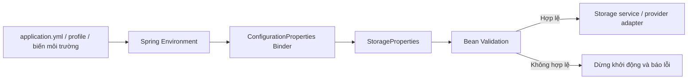

# Binding cấu hình dịch vụ bằng `@ConfigurationProperties`

Khi một ứng dụng Spring Boot sử dụng Amazon S3, Azure Blob Storage hoặc Google Cloud Storage, phần mã xử lý nghiệp vụ cần biết **dịch vụ nào đang được chọn**, **bucket/container đích là gì** và **chính sách vận hành của ứng dụng ra sao**. Các giá trị này thay đổi theo môi trường triển khai, không nên nằm cứng trong Java. `@ConfigurationProperties` của Spring Boot gom các giá trị liên quan thành một đối tượng có kiểu dữ liệu rõ ràng, hỗ trợ kiểm tra đầu vào trước khi ứng dụng phục vụ request.

Bài học xây dựng một mô hình cấu hình dùng chung cho ba cloud provider. Trọng tâm là **binding và sử dụng cấu hình**; việc cấp danh tính/quyền và khởi tạo client của từng provider được đặt đúng trách nhiệm của thư viện Spring Cloud tương ứng.

## 1. `@ConfigurationProperties` giải quyết vấn đề gì?

Giả sử nhiều lớp trong ứng dụng đang đọc các giá trị độc lập:

```java
@Value("${app.storage.target}")
private String target;

@Value("${app.storage.retry.max-attempts:3}")
private int maxAttempts;
```

`@Value` thích hợp với một giá trị đơn lẻ, nhưng khi nhóm cấu hình lớn dần, cách này gây khó khăn khi kiểm tra ràng buộc, phát hiện thiếu giá trị, xem tổng thể cấu hình và thay đổi tên thuộc tính.

| Tiêu chí | Nhiều `@Value` riêng lẻ | `@ConfigurationProperties` |
| --- | --- | --- |
| Tổ chức | Rải rác ở nhiều lớp | Một nhóm có cùng tiền tố (`prefix`) |
| Kiểu dữ liệu | Chuyển đổi từng giá trị | Binding thành `enum`, `Duration`, lớp lồng nhau, collection… |
| Kiểm tra hợp lệ | Tự kiểm tra ở nơi sử dụng | Dùng Bean Validation ngay khi khởi tạo bean |
| Bảo trì | Dễ lặp tên property/default | Một hợp đồng cấu hình tập trung, dễ kiểm thử |
| Phụ thuộc trong mã | Phụ thuộc vào chuỗi property | Tiêm đối tượng cấu hình có kiểu rõ ràng |

Quy trình diễn ra khi ứng dụng khởi động:



**Phân biệt hai nhóm cấu hình:** `app.storage.*` do **ứng dụng tự định nghĩa** để biểu diễn nhu cầu nghiệp vụ; các key như `spring.cloud.aws.*`, `spring.cloud.azure.*`, `spring.cloud.gcp.*` do **starter của cloud provider** định nghĩa để tự cấu hình SDK/client. Spring Boot không tự chuyển `app.storage.target` thành bucket cho S3/Blob/GCS; mã tích hợp phải chủ động dùng giá trị này.

## 2. Thiết kế hợp đồng cấu hình chung cho nhiều provider

Ví dụ một ứng dụng chỉ kích hoạt một backend object storage trong mỗi môi trường:

| Property | Kiểu | Ý nghĩa | Ràng buộc |
| --- | --- | --- | --- |
| `app.storage.provider` | `AWS`, `AZURE`, `GCP` | Provider được chọn | Bắt buộc |
| `app.storage.target` | `String` | S3/GCS **bucket** hoặc Azure Blob **container** | Không rỗng |
| `app.storage.operation-timeout` | `Duration` | Thời gian giới hạn dự kiến của ứng dụng | Mặc định `10s` |
| `app.storage.retry.max-attempts` | `int` | Số lần thử tối đa theo chính sách ứng dụng | Mặc định `3`, từ 1 đến 10 |
| `app.storage.retry.initial-delay` | `Duration` | Khoảng chờ ban đầu giữa các lần thử | Mặc định `200ms` |

Tên `target` là cách đặt tên **trung lập provider**. Ở tầng tích hợp, adapter AWS/GCP hiểu đây là tên bucket; adapter Azure hiểu đây là tên container. Không nhầm nó với tên account Azure hay project ID của GCP.

### Khai báo đối tượng cấu hình

Ví dụ sử dụng **Spring Boot 3.x và Java 17+**, với record để tránh việc thay đổi cấu hình tùy ý sau khi binding:

```java
package example.cloud.config;

import jakarta.validation.Valid;
import jakarta.validation.constraints.Max;
import jakarta.validation.constraints.Min;
import jakarta.validation.constraints.NotBlank;
import jakarta.validation.constraints.NotNull;
import org.springframework.boot.context.properties.ConfigurationProperties;
import org.springframework.boot.context.properties.bind.DefaultValue;
import org.springframework.validation.annotation.Validated;

import java.time.Duration;

@Validated
@ConfigurationProperties(prefix = "app.storage", ignoreUnknownFields = false)
public record StorageProperties(
        @NotNull Provider provider,
        @NotBlank String target,
        @DefaultValue("10s") Duration operationTimeout,
        @Valid @DefaultValue Retry retry
) {
    public enum Provider { AWS, AZURE, GCP }

    public record Retry(
            @Min(1) @Max(10) @DefaultValue("3") int maxAttempts,
            @DefaultValue("200ms") Duration initialDelay
    ) {}
}
```

Những điểm cần hiểu trong ví dụ:

1. `prefix = "app.storage"` yêu cầu binder tìm các property bên dưới namespace này.
2. `Provider` là `enum`; giá trị cấu hình `aws`, `azure`, `gcp` có thể được binding thành các hằng `AWS`, `AZURE`, `GCP`.
3. `Duration` cho phép viết `10s`, `200ms`, `2m` thay vì một số không có đơn vị dễ gây hiểu nhầm.
4. `@DefaultValue` đặt giá trị mặc định khi key không có. `@DefaultValue` **không có tham số** trên `retry` yêu cầu binder tạo đối tượng lồng nhau ngay cả khi không cung cấp nhóm `retry`.
5. `@Validated`, `@NotNull`, `@NotBlank`, `@Min`, `@Max` và `@Valid` kiểm tra cả nhóm chính lẫn nhóm lồng nhau. Nếu cấu hình không hợp lệ, ứng dụng thất bại khi tạo bean thay vì lỗi muộn lúc nhận request.
6. `ignoreUnknownFields = false` giúp phát hiện property viết sai *bên trong* `app.storage`, chẳng hạn `max-atempt` thay vì `max-attempts`.

Với Bean Validation trên Spring Boot 3, cần có `spring-boot-starter-validation` trong dependencies (các annotation dùng namespace `jakarta.validation.*`). Chọn version của Spring Cloud AWS, Azure và GCP qua BOM tương thích với phiên bản Spring Boot đang chạy; không trộn tùy tiện các thế hệ starter.

### Đăng ký binding bean

Đặt `StorageProperties` trong package được quét và bật cấu hình trên lớp khởi động:

```java
package example.cloud;

import org.springframework.boot.SpringApplication;
import org.springframework.boot.autoconfigure.SpringBootApplication;
import org.springframework.boot.context.properties.ConfigurationPropertiesScan;

@SpringBootApplication
@ConfigurationPropertiesScan
public class ProviderIntegrationApplication {
    public static void main(String[] args) {
        SpringApplication.run(ProviderIntegrationApplication.class, args);
    }
}
```

Nếu không muốn quét toàn package, có thể sử dụng `@EnableConfigurationProperties(StorageProperties.class)` trên một lớp `@Configuration` thay cho `@ConfigurationPropertiesScan`. Với record một constructor như trên, Spring Boot 3 tự thực hiện constructor binding; không cần thêm `@Component` hay `@ConstructorBinding`.

## 3. Khai báo YAML và nạp cấu hình theo môi trường

Định nghĩa phần chung trong `application.yml`:

```yaml
app:
  storage:
    target: ${STORAGE_TARGET}
    operation-timeout: 8s
    retry:
      max-attempts: 4
      initial-delay: 300ms
```

Biến môi trường `STORAGE_TARGET` là giá trị bắt buộc của deployment, ví dụ `training-documents` nếu là S3/GCS bucket hoặc `uploads` nếu là Azure Blob container. Việc không đặt default ở đây giúp tránh vô tình ghi dữ liệu vào một nơi không mong muốn.

Mỗi profile quyết định provider và những thuộc tính chỉ có ý nghĩa đối với starter tương ứng. Ví dụ sau giả định ứng dụng có đúng starter và SDK của provider được chọn.

**AWS — `application-aws.yml`:**

```yaml
app:
  storage:
    provider: aws

spring:
  cloud:
    aws:
      region:
        static: ${AWS_REGION}
```

**Azure — `application-azure.yml`:**

```yaml
app:
  storage:
    provider: azure

spring:
  cloud:
    azure:
      storage:
        blob:
          account-name: ${AZURE_STORAGE_ACCOUNT}
```

**Google Cloud — `application-gcp.yml`:**

```yaml
app:
  storage:
    provider: gcp

spring:
  cloud:
    gcp:
      project-id: ${GOOGLE_CLOUD_PROJECT}
```

Kích hoạt **một** profile, chẳng hạn `SPRING_PROFILES_ACTIVE=aws`, và đặt `STORAGE_TARGET` cùng biến môi trường được profile yêu cầu. Với profile `azure`, `STORAGE_TARGET` là tên container; với `gcp` hoặc `aws`, nó là tên bucket. Nếu chạy thiếu profile, `provider` không tồn tại và kiểm tra `@NotNull` sẽ chặn startup.

Các namespace và cách tự cấu hình credentials/client thuộc về từng **phiên bản** Spring Cloud. Đối chiếu tài liệu của starter thực tế trước khi triển khai: Spring Cloud AWS thường cung cấp tích hợp S3, Spring Cloud Azure cung cấp tích hợp Blob Storage, còn Spring Cloud GCP cung cấp tích hợp Cloud Storage. Các ví dụ trên chủ yếu cho thấy **ranh giới giữa cấu hình ứng dụng và cấu hình starter**, không có nghĩa chỉ cần YAML là đã cài dependency hoặc có đủ quyền truy cập cloud.

### Relaxed binding và độ ưu tiên của nguồn cấu hình

Binder chấp nhận một số cách viết tương ứng, ví dụ `operation-timeout` trong YAML được binding vào Java component `operationTimeout`; `max-attempts` thành `maxAttempts`. Spring Boot cũng đọc environment variables và các property trong profile, command-line arguments, v.v. Nguồn có độ ưu tiên cao hơn có thể ghi đè nguồn thấp hơn.

Nếu muốn đặt key `app.storage.retry.max-attempts` **trực tiếp bằng biến môi trường** theo quy tắc chuyển đổi tên chính thức của Spring Boot, dùng `APP_STORAGE_RETRY_MAXATTEMPTS` (thay dấu chấm bằng `_`, **bỏ dấu `-`**, rồi viết hoa). Cách đơn giản và rõ nhất cho môi trường triển khai vẫn là đặt placeholder `${STORAGE_TARGET}` trong YAML như ví dụ.

## 4. Tiêm `StorageProperties` vào tầng tích hợp

Bean cấu hình được truyền bằng **constructor injection**; mã nghiệp vụ không cần biết property đến từ YAML, environment variable hay hệ thống cấu hình khác.

Ví dụ một hợp đồng do **ứng dụng tự định nghĩa**, không phải API có sẵn của Spring Cloud:

```java
package example.cloud.storage;

public interface ObjectStorageGateway {
    void put(String objectKey, byte[] bytes);
}
```

Adapter dành cho AWS minh họa cách dùng `target` sau khi binding (khi đã thêm starter AWS S3 tương thích và starter cung cấp `S3Client`):

```java
package example.cloud.storage;

import example.cloud.config.StorageProperties;
import org.springframework.boot.autoconfigure.condition.ConditionalOnProperty;
import org.springframework.stereotype.Component;
import software.amazon.awssdk.core.sync.RequestBody;
import software.amazon.awssdk.services.s3.S3Client;
import software.amazon.awssdk.services.s3.model.PutObjectRequest;

@Component
@ConditionalOnProperty(
        prefix = "app.storage",
        name = "provider",
        havingValue = "aws"
)
public class AwsObjectStorageGateway implements ObjectStorageGateway {
    private final S3Client s3Client;
    private final StorageProperties properties;

    public AwsObjectStorageGateway(S3Client s3Client,
                                   StorageProperties properties) {
        this.s3Client = s3Client;
        this.properties = properties;
    }

    @Override
    public void put(String objectKey, byte[] bytes) {
        PutObjectRequest request = PutObjectRequest.builder()
                .bucket(properties.target())
                .key(objectKey)
                .build();
        s3Client.putObject(request, RequestBody.fromBytes(bytes));
    }
}
```

`@ConditionalOnProperty` bảo đảm adapter AWS chỉ được đăng ký khi `provider=aws`. Các adapter cho Azure và GCP có thể dùng cùng `StorageProperties` và cùng interface, nhưng ánh xạ sang SDK riêng:

| Adapter | Client của provider | Cách sử dụng `properties.target()` |
| --- | --- | --- |
| AWS | AWS SDK v2 `S3Client` | Giá trị `.bucket(...)` trong `PutObjectRequest` |
| Azure | Azure SDK `BlobServiceClient` | Chọn `getBlobContainerClient(target)` rồi thao tác blob |
| GCP | Google Cloud Storage `Storage` | Tên bucket khi tạo `BlobInfo`/ghi đối tượng |

Lưu ý: `operationTimeout` và `retry` trong mô hình trên **mới là dữ liệu chính sách của ứng dụng**. Chúng không tự điều khiển timeout hay retry của SDK. Nếu triển khai chính sách này, adapter phải áp dụng nó bằng API timeout/retry phù hợp từng provider, đồng thời cân nhắc hành vi retry có sẵn của SDK để tránh retry lồng nhau và nhân số request. Không giả định các SDK có cùng semantics.

Trong một ứng dụng thực tế còn có thể tạo từng bean thông qua `@Bean` kết hợp `@ConditionalOnProperty`, sử dụng interface chung hoặc chiến lược chọn adapter tại runtime. Nếu đóng gói cả ba starter cùng lúc, cần kiểm tra cách tắt/bật auto-configuration của từng cloud để tránh tạo client không dùng tới hoặc yêu cầu cấu hình/credentials của provider khác.

## 5. Kiểm tra lỗi cấu hình trước khi gọi cloud

Một số lỗi có thể được phát hiện **mà không cần tài khoản AWS/Azure/GCP**:

| Cấu hình lỗi | Điều gì xảy ra | Cách xử lý |
| --- | --- | --- |
| Thiếu `app.storage.provider` | `@NotNull` thất bại khi binding/validation | Kích hoạt đúng profile hoặc khai báo provider |
| `provider: alibaba` | Không đổi được chuỗi thành enum `Provider` | Chọn `aws`, `azure` hoặc `gcp` |
| `target: ""` | `@NotBlank` không thỏa | Cung cấp bucket/container hợp lệ |
| `max-attempts: 0` | `@Min(1)` không thỏa | Sử dụng 1–10 |
| `operation-timeout: someday` | Không chuyển đổi được thành `Duration` | Dùng cú pháp như `500ms`, `8s`, `2m` |
| Viết sai `app.storage.retry.max-atempt` | Có thể bị từ chối vì `ignoreUnknownFields=false` | Sửa key thành `max-attempts` |
| Chưa đăng ký `StorageProperties` | Không có bean để inject | Thêm `@ConfigurationPropertiesScan` hoặc `@EnableConfigurationProperties` |
| Validation không chạy | Có thể thiếu provider Bean Validation | Bổ sung `spring-boot-starter-validation` và `@Validated` |

Các lỗi cấu hình được phát hiện ở startup **khác** lỗi tương tác với cloud. Ví dụ, target không rỗng nhưng bucket chưa tồn tại, IAM không đủ quyền, sai project/account hay network bị chặn vẫn chỉ bộc lộ khi adapter/client thực sự gọi dịch vụ (hoặc khi có health check thích hợp).

### Unit test cho binding và validation

`ApplicationContextRunner` (thuộc `spring-boot-test`) cho phép tạo Spring context nhỏ, chỉ kiểm tra hợp đồng cấu hình mà không khởi tạo client cloud. Ví dụ sử dụng JUnit 5 và AssertJ, cùng dependency validation:

```java
package example.cloud.config;

import org.junit.jupiter.api.Test;
import org.springframework.boot.context.properties.EnableConfigurationProperties;
import org.springframework.boot.test.context.runner.ApplicationContextRunner;
import org.springframework.context.annotation.Configuration;

import static org.assertj.core.api.Assertions.assertThat;

class StoragePropertiesTest {
    private final ApplicationContextRunner runner =
            new ApplicationContextRunner()
                    .withUserConfiguration(TestConfig.class);

    @Test
    void bindDuocCauHinhHopLe() {
        runner.withPropertyValues(
                "app.storage.provider=gcp",
                "app.storage.target=example-documents",
                "app.storage.operation-timeout=6s",
                "app.storage.retry.max-attempts=5"
        ).run(context -> {
            assertThat(context).hasNotFailed();
            StorageProperties config = context.getBean(StorageProperties.class);
            assertThat(config.provider()).isEqualTo(StorageProperties.Provider.GCP);
            assertThat(config.target()).isEqualTo("example-documents");
            assertThat(config.operationTimeout().getSeconds()).isEqualTo(6);
            assertThat(config.retry().maxAttempts()).isEqualTo(5);
        });
    }

    @Test
    void tuChoiRetryKhongHopLe() {
        runner.withPropertyValues(
                "app.storage.provider=aws",
                "app.storage.target=example-documents",
                "app.storage.retry.max-attempts=0"
        ).run(context -> assertThat(context).hasFailed());
    }

    @Test
    void tuChoiTargetRong() {
        runner.withPropertyValues(
                "app.storage.provider=azure",
                "app.storage.target="
        ).run(context -> assertThat(context).hasFailed());
    }

    @Configuration(proxyBeanMethods = false)
    @EnableConfigurationProperties(StorageProperties.class)
    static class TestConfig {}
}
```

Vì `ApplicationContextRunner` chỉ tạo một context nhỏ, đây là kiểm thử binding/validation. Để xác nhận adapter thao tác đúng bucket/container, cần kiểm thử tích hợp riêng với emulator (nếu phù hợp) hoặc một môi trường cloud test có quyền giới hạn, dữ liệu thử và cơ chế dọn dẹp.

## 6. Quản lý danh tính, quyền và secret khi binding cấu hình

`@ConfigurationProperties` không cấp quyền truy cập cloud. Phân biệt **giá trị cấu hình không bí mật** (provider, project, region, target, timeout) với **danh tính và credential** cần được cloud SDK hoặc hệ thống quản lý secret xử lý.

| Cloud | Danh tính khuyến nghị khi chạy trên cloud | Quyền tối thiểu cần xét |
| --- | --- | --- |
| AWS | IAM Role / workload identity được SDK credential chain nhận diện | Quyền `s3:PutObject` trên bucket/prefix cần ghi |
| Azure | Managed Identity hoặc workload identity qua Azure Identity | Vai trò dữ liệu phù hợp trên container/account, ví dụ Storage Blob Data Contributor khi cần ghi |
| GCP | Application Default Credentials qua service account / Workload Identity | Quyền ghi object trong bucket, chẳng hạn role phù hợp tại phạm vi bucket |

Không hardcode access key, client secret, private key vào `application.yml`, commit Git hoặc in toàn bộ cấu hình ra log. Nếu dùng secret manager, chỉ đưa tham chiếu cần thiết vào cấu hình rồi để cơ chế tích hợp tương ứng truy xuất secret. Khi bật Actuator `/env` hay `/configprops`, giữ chính sách che giá trị nhạy cảm; không mở chế độ hiển thị toàn bộ giá trị trên môi trường production.

**Phạm vi của validation:** `@NotBlank` chỉ chứng minh tên target đã được cung cấp; nó không chứng minh object storage tồn tại hay credential có quyền. Kiểm tra quyền và kết nối qua integration test/health check riêng, với cảnh giác về chi phí và side effect của việc ghi đối tượng thử.

## 7. Bài thực hành đề xuất

1. Tạo `StorageProperties` và đăng ký scan như phần 2. Chạy unit test ở phần 5 để xác nhận binder chuyển `gcp` thành `Provider.GCP`, `6s` thành `Duration` và từ chối retry bằng 0.
2. Tạo `application.yml` và ba profile `aws`, `azure`, `gcp` như phần 3. Đặt `STORAGE_TARGET` và các environment variable tương ứng; thử bỏ profile để quan sát lỗi bắt buộc `provider`.
3. Tạo `ObjectStorageGateway` và adapter AWS như phần 4. Sau đó thay profile và viết adapter Azure/GCP; xác định chính xác nơi `target` trở thành tên bucket/container của SDK.
4. Chạy thử với credential được cấp theo nguyên tắc quyền tối thiểu. Đối chiếu ba nhóm lỗi: **sai cú pháp binding**, **thiếu quyền**, **resource không tồn tại**. Mỗi nhóm lỗi phải có cách chẩn đoán khác nhau.
5. Khi thêm policy timeout/retry, kiểm tra xem SDK đã tự retry hay chưa. Ghi lại chính sách cuối cùng ở nơi dựng client hoặc adapter và thêm integration test cho tình huống lỗi tạm thời nếu môi trường test cho phép.

**Kết quả mong đợi:** mỗi môi trường chọn provider bằng profile; Spring Boot tạo và kiểm tra một `StorageProperties` có kiểu rõ ràng; mã tích hợp nhận cấu hình qua constructor; credential và quyền do cơ chế danh tính của provider đảm trách. Phần cấu hình ứng dụng có thể kiểm thử độc lập trước khi thực hiện bất kỳ lời gọi cloud nào.
