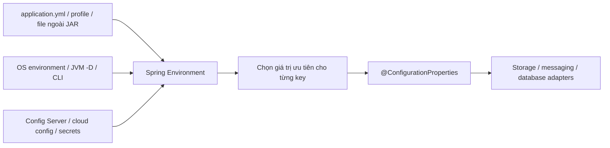

# Thứ tự ưu tiên giữa tệp cấu hình, biến môi trường và nguồn từ xa

Trong dự án Spring Boot tích hợp các dịch vụ managed của AWS, Azure và Google Cloud, cùng một thuộc tính có thể xuất hiện ở nhiều nơi: `application.yml` của dự án, `application-prod.yml`, tệp cấu hình bên ngoài gói JAR, biến môi trường do hệ thống triển khai cấp và dịch vụ cấu hình hoặc quản lý secret từ xa. Nếu không xác định nguồn nào thắng, ứng dụng có thể kết nối sai bucket, gửi message vào sai topic hoặc dùng cấu hình thử nghiệm trong production.

Bài học này giải thích **quy tắc ưu tiên cấu hình của Spring Boot**, cách profile và `spring.config.import` ảnh hưởng đến kết quả, những điểm riêng của Spring Cloud Config và các nguồn cloud từ xa, cùng cách kiểm tra giá trị cuối cùng mà ứng dụng thực sự sử dụng.

## 1. Hiểu “ưu tiên cấu hình” ở cấp từng property

Spring Boot tập hợp các nguồn cấu hình thành một `Environment`. Mỗi nguồn cung cấp các cặp khóa/giá trị; khi ứng dụng đọc một khóa, **giá trị từ nguồn có độ ưu tiên cao nhất đang định nghĩa khóa đó** được sử dụng. Những khóa không trùng vẫn có thể đến từ các nguồn khác nhau.

Ví dụ, ứng dụng có hai khóa:

- `integration.storage.bucket`: tên bucket/container lưu tài liệu.
- `integration.messaging.topic`: tên topic hoặc destination mà adapter messaging sử dụng.

Nếu `application.yml` khai báo cả hai khóa, còn biến môi trường chỉ ghi đè bucket, thì bucket lấy từ biến môi trường và topic vẫn lấy từ file. Không có quy tắc “chọn toàn bộ file hoặc toàn bộ environment” cho cả nhóm cấu hình.

`@ConfigurationProperties` được binding **sau khi `Environment` đã có danh sách nguồn cấu hình**, nên bean cấu hình nhận những giá trị hiệu lực theo thứ tự ưu tiên. Annotation này không tự đổi thứ tự của các nguồn.



**Phân biệt hai câu hỏi:** *Nguồn nào được nạp?* phụ thuộc profile, location, dependency, importer và quyền truy cập. *Giữa các nguồn đã nạp, giá trị nào thắng?* phụ thuộc thứ tự ưu tiên do Spring Boot hoặc thư viện tích hợp quy định.

## 2. Thứ tự nguồn cấu hình mặc định trong ứng dụng Spring Boot

Với ứng dụng Spring Boot chạy độc lập, không có cơ chế tùy chỉnh thứ tự nguồn, có thể nhớ các nguồn phổ biến sau đây **từ ưu tiên thấp đến cao**:

| Mức | Nguồn cấu hình | Ví dụ |
| --- | --- | --- |
| Thấp | Default properties do ứng dụng tự đặt | `SpringApplication.setDefaultProperties(...)` |
| | `@PropertySource` trên cấu hình Java | Tệp bổ sung được khai báo qua annotation |
| | **Config Data**: YAML/properties trong và ngoài JAR, cấu hình được `spring.config.import` nạp | `application.yml`, `application-prod.yml` |
| | Biến môi trường hệ điều hành | `INTEGRATION_STORAGE_BUCKET=prod-bucket` |
| | JVM system properties | `-Dintegration.storage.bucket=jvm-bucket` |
| | `SPRING_APPLICATION_JSON` | Chuỗi JSON truyền qua env/system property |
| Cao | Command-line arguments | `--integration.storage.bucket=cli-bucket` |

Bảng trên là **các mức thường gặp**, không phải danh sách đầy đủ mọi `PropertySource`: ứng dụng web, JNDI, test framework và công cụ phát triển còn có các nguồn riêng. Khi chạy test, chẳng hạn `@TestPropertySource` và `@DynamicPropertySource` có thứ tự riêng và có thể vượt qua các nguồn được liệt kê. Bảng cũng không thay thế quy tắc của một tích hợp cấu hình từ xa có cơ chế `bootstrap` đặc biệt.

Ví dụ một key xuất hiện đồng thời ở các nguồn mặc định trên thì command-line argument thắng JVM system property, JVM system property thắng OS environment, và OS environment thắng Config Data. Một giá trị được khai báo nhưng là chuỗi rỗng vẫn có thể che khuất giá trị hợp lệ ở nguồn thấp hơn; hãy kiểm tra bằng validation thay vì mặc nhiên coi rỗng là “không tồn tại”.

### Thứ tự bên trong nhóm Config Data

Trong điều kiện sử dụng các vị trí tìm kiếm cấu hình mặc định của Spring Boot, các loại tệp sau tăng dần mức ưu tiên:

1. `application.yml` hoặc `application.properties` **đóng trong JAR**.
2. `application-{profile}.yml` hoặc `application-{profile}.properties` **đóng trong JAR**.
3. `application.yml` hoặc `application.properties` **bên ngoài JAR**.
4. `application-{profile}.yml` hoặc `application-{profile}.properties` **bên ngoài JAR**.

Ví dụ, `./config/application-prod.yml` bên cạnh JAR có thể ghi đè `application-prod.yml` ở trong JAR. Nếu cùng vị trí có cả `application.properties` và `application.yml`, Spring Boot ưu tiên định dạng `.properties`; nên dùng thống nhất một định dạng để tránh khó truy vết.

Khi một tài liệu khai báo `spring.config.import`, **Config Data được import có độ ưu tiên cao hơn tài liệu đã khai báo import**. Các import được nạp như những tài liệu cấu hình bổ sung; nếu có nhiều import thì import khai báo sau có thể ghi đè import trước khi cùng định nghĩa một key. Thứ tự và vị trí cụ thể còn phụ thuộc cấu hình `spring.config.location`, `spring.config.additional-location` và cơ chế import của thư viện liên quan.

**Lưu ý về nhiều profile:** khi kích hoạt nhiều profile cùng lúc, thứ tự profile có thể quyết định cấu hình profile nào thắng khi key trùng nhau. Đừng dựa vào thứ tự ngẫu nhiên của file trong thư mục; hãy khai báo và kiểm thử tổ hợp profile được phép dùng.

## 3. Ví dụ đầy đủ: một giá trị xuất hiện tại nhiều nguồn

Xét ứng dụng `provider-integration`. Trong `src/main/resources/application.yml`:

```yaml
integration:
  storage:
    bucket: documents-default
    timeout: 10s
  messaging:
    topic: documents-created
```

Trong `src/main/resources/application-prod.yml`:

```yaml
integration:
  storage:
    bucket: documents-prod-file
    timeout: 8s
```

Khi triển khai production, đặt các biến môi trường:

```text
SPRING_PROFILES_ACTIVE=prod
INTEGRATION_STORAGE_BUCKET=documents-prod-env
INTEGRATION_STORAGE_TIMEOUT=5s
```

`INTEGRATION_STORAGE_BUCKET` tương ứng với `integration.storage.bucket` nhờ **relaxed binding** của Spring Boot; `INTEGRATION_STORAGE_TIMEOUT` tương ứng với `integration.storage.timeout`. Với tên có dấu gạch ngang, quy tắc biểu diễn thành environment variable phổ biến là thay `.` bằng `_`, bỏ `-` và viết hoa. Ví dụ `integration.storage.operation-timeout` thành `INTEGRATION_STORAGE_OPERATIONTIMEOUT`.

Chạy ứng dụng và ghi đè thêm timeout bằng JVM system property, bucket bằng argument:

```bash
java -Dintegration.storage.timeout=4s -jar provider-integration.jar --integration.storage.bucket=documents-prod-cli
```

Lệnh này minh họa cú pháp; trong Windows PowerShell, có thể đặt dấu nháy quanh đối số `-D...` nếu shell cần phân biệt ký tự đặc biệt.

**Kết quả hiệu lực:**

| Key | File cơ sở | Profile `prod` | OS environment | JVM `-D` | CLI | Giá trị cuối |
| --- | --- | --- | --- | --- | --- | --- |
| `integration.storage.bucket` | `documents-default` | `documents-prod-file` | `documents-prod-env` | — | `documents-prod-cli` | **`documents-prod-cli`** |
| `integration.storage.timeout` | `10s` | `8s` | `5s` | `4s` | — | **`4s`** |
| `integration.messaging.topic` | `documents-created` | — | — | — | — | **`documents-created`** |

Nếu bỏ argument `--integration.storage.bucket=...`, bucket cuối cùng chuyển thành `documents-prod-env`. Nếu bỏ cả biến môi trường tương ứng, nó chuyển thành `documents-prod-file`. Điều này cho thấy nguồn ưu tiên chỉ tác động tới **key có khai báo**, không làm mất những key khác.

**Quy tắc vận hành:** cấu hình chung nên ở file mặc định; khác biệt môi trường ở file profile; giá trị gắn với từng deployment có thể do orchestrator cấp qua environment hoặc mount file. Hạn chế sử dụng argument để “chữa cháy” lâu dài vì dễ tạo cấu hình khó tái hiện.

## 4. File bên ngoài JAR và đường dẫn cấu hình

Spring Boot hỗ trợ cấu hình bên ngoài package để triển khai cùng một artifact qua nhiều môi trường:

```bash
java -jar provider-integration.jar --spring.config.additional-location=optional:file:./deployment-config/
```

`spring.config.additional-location` **bổ sung** nơi tìm config bên cạnh các vị trí mặc định; `spring.config.location` **thay thế** tập vị trí mặc định (trừ khi khai báo lại). Các vị trí bổ sung khai báo sau có thể ghi đè vị trí trước theo quy tắc Config Data. Với đường dẫn thư mục, giữ dấu `/` cuối; `optional:` cho phép ứng dụng khởi động khi vị trí đó không tồn tại.

Trong `./deployment-config/application-prod.yml`:

```yaml
integration:
  storage:
    bucket: documents-prod-external
```

Nếu profile `prod` được kích hoạt, giá trị external trên thắng file đã đóng gói **khi không có nguồn ưu tiên cao hơn ghi đè key đó**. Nếu `INTEGRATION_STORAGE_BUCKET` vẫn đang đặt thì giá trị env vẫn thắng như ví dụ ở phần 3.

Đừng nhầm `spring.config.additional-location` với `spring.config.import`: additional-location mở rộng vị trí tìm file theo quy ước tên `application[-profile]`; import chỉ rõ tài nguyên cần nạp, có thể là tệp cụ thể hoặc hệ thống cấu hình được starter hỗ trợ.

## 5. Khi có nguồn từ xa: điều gì thay đổi?

Trong mô hình tích hợp nhiều cloud, “nguồn từ xa” có thể là:

| Nguồn | Mục đích phổ biến | Cách ứng dụng nhìn thấy cấu hình |
| --- | --- | --- |
| Spring Cloud Config Server | Quản lý tập trung property theo application/profile | Spring Cloud Config Client tải vào `Environment` qua cơ chế tích hợp |
| AWS Secrets Manager / Parameter Store | Secret hoặc tham số vận hành trên AWS | Tích hợp Spring Cloud AWS tải/ánh xạ vào property source theo starter và version |
| Azure Key Vault / App Configuration | Secret và application configuration trên Azure | Tích hợp Spring Cloud Azure nạp qua property source hoặc cơ chế configuration riêng |
| Google Cloud Secret Manager | Secret cho workload trên GCP | Tích hợp Spring Cloud GCP hoặc SDK cung cấp giá trị cho ứng dụng |
| Kubernetes ConfigMap / Secret | Cấu hình do cluster quản lý | Có thể được mount thành file hoặc expose làm environment variable; ưu tiên theo **cách nạp** |

**Không có một quy tắc phổ quát “remote luôn thắng local” hoặc “env luôn thắng remote” áp dụng cho mọi thư viện và mọi chế độ nạp.** Cần xác định bản Spring Boot/Spring Cloud, adapter, import mode và các tùy chọn override.

### 5.1. Spring Cloud Config Server với Config Data API

Với Spring Boot 2.4+ và Spring Cloud Config Client tương thích, một cách thường dùng là:

```yaml
spring:
  application:
    name: provider-integration
  config:
    import: "configserver:https://config.internal.example"
```

Ứng dụng cần dependency `spring-cloud-starter-config` và phiên bản Spring Cloud tương thích với Spring Boot. Khi khởi động, client truy vấn Config Server dựa trên `spring.application.name`, profile đang hoạt động và các thông tin nhãn/version nếu được thiết lập. Repository của Config Server có thể chứa, chẳng hạn:

```yaml
# provider-integration-prod.yml trong repository cấu hình của Config Server
integration:
  messaging:
    topic: documents-created-prod
  storage:
    timeout: 7s
```

`spring.config.import` đưa tài nguyên Config Server vào quy trình xử lý Config Data. Dữ liệu import được ưu tiên hơn tài liệu khai báo import theo quy tắc Config Data, còn environment/command-line và các thiết lập override khác vẫn phải được xét theo cơ chế thực tế của client. Không nên suy ra mức ưu tiên từ việc file nằm “ở server”.

Khi URL được viết thành `optional:configserver:https://config.internal.example`, việc thiếu nguồn có thể được cho phép theo cơ chế optional; với cấu hình bắt buộc trong production, cân nhắc **fail fast** để không vô tình chạy bằng giá trị local cũ hoặc thiếu cấu hình. Phần xác thực tới Config Server phải được bảo vệ riêng, thường qua danh tính hoặc secret do môi trường triển khai cấp.

### 5.2. Vì sao có tài liệu nói remote không thể bị local override?

Một số hệ thống Spring Cloud dùng **legacy bootstrap context** để đưa remote property sources vào `Environment` ở vị trí ưu tiên cao. Trong mô hình đó, remote property có thể không cho local ghi đè, trừ khi **nguồn remote** cấp quyền override:

- `spring.cloud.config.allowOverride=true`: cho phép thực hiện override theo chính sách.
- `spring.cloud.config.overrideNone=true`: khi đã cho override, cho phép các nguồn local ghi đè rộng hơn.
- `spring.cloud.config.overrideSystemProperties=false`: khi đã cho override, cho phép system properties, environment variables và command-line ghi đè, nhưng không phải file cấu hình local thông thường.

Các thuộc tính trên mô tả hành vi của **mô hình remote/bootstrap có hỗ trợ chúng**, không phải công thức thay thế thứ tự Config Data ở mọi Spring Cloud release. Đặt `allowOverride` chỉ trong file local không đủ nếu phía remote phải cấp quyền. Khi chuyển từ bootstrap cũ sang `spring.config.import=configserver:...`, hãy kiểm chứng trực tiếp ưu tiên trên phiên bản đang dùng.

### 5.3. Dịch vụ quản lý secret trên từng cloud

Với AWS, Azure và GCP, thư viện tích hợp có thể đưa secret vào `Environment`, hoặc code chủ động lấy secret qua SDK. Hai cách này khác nhau:

- **Nạp như property source:** secret tham gia vào cơ chế resolve property; mức ưu tiên phụ thuộc property source được starter chèn vào, vị trí import và các cấu hình của adapter.
- **Gọi SDK theo yêu cầu:** ứng dụng nhận dữ liệu từ client trong lúc chạy; đó không tự động là một Spring property và không tuân thứ tự override của `Environment`.

Không giả định key của dịch vụ secret sẽ tự ánh xạ thành `spring.datasource.password` hoặc `integration.messaging.password`. Phải cấu hình mapping theo đúng starter/version hoặc xử lý chủ động trong một bean phù hợp. Tránh tạo mặc định cho credential nhạy cảm nhằm “cho ứng dụng chạy bằng mọi giá”.

**Danh tính truy cập nguồn từ xa:** ưu tiên IAM Role/Workload Identity trên AWS, Managed Identity/Workload Identity trên Azure và Application Default Credentials/Workload Identity trên GCP. Chỉ cấp quyền đọc các secret/parameter cần thiết, tách môi trường staging và production, không nhúng access key hoặc client secret vào Git.

## 6. Sau khi resolved, `@ConfigurationProperties` nhận giá trị nào?

Giả sử định nghĩa một cấu hình storage riêng của ứng dụng:

```java
package example.cloud.config;

import jakarta.validation.constraints.NotBlank;
import jakarta.validation.constraints.NotNull;
import org.springframework.boot.context.properties.ConfigurationProperties;
import org.springframework.validation.annotation.Validated;

import java.time.Duration;

@Validated
@ConfigurationProperties(prefix = "integration.storage")
public record StorageProperties(
        @NotBlank String bucket,
        @NotNull Duration timeout
) {}
```

Đăng ký bean bằng `@ConfigurationPropertiesScan` trên lớp ứng dụng hoặc `@EnableConfigurationProperties(StorageProperties.class)` trong cấu hình Java, cùng `spring-boot-starter-validation` để bật Bean Validation.

Khi chạy ví dụ phần 3, bean `StorageProperties` nhận:

```text
bucket  = documents-prod-cli
timeout = PT4S  (Duration 4 giây)
```

Spring Boot áp dụng conversion cho `Duration` và relaxed binding tên property. `@NotBlank`/`@NotNull` chặn một số lỗi trước khi gọi S3, Azure Blob hay Google Cloud Storage. **Validation chỉ xác nhận dữ liệu cấu hình đúng dạng**; nó không chứng minh bucket tồn tại, account đúng hay credential có quyền.

Một service có thể phụ thuộc vào cấu hình được bind qua constructor:

```java
package example.cloud.storage;

import example.cloud.config.StorageProperties;
import org.springframework.stereotype.Service;

@Service
public class StorageTargetResolver {
    private final StorageProperties properties;

    public StorageTargetResolver(StorageProperties properties) {
        this.properties = properties;
    }

    public String targetName() {
        return properties.bucket();
    }
}
```

Đây là tên ứng dụng đặt cho nhóm cấu hình, **không phải** namespace tự động được AWS/Azure/GCP starter hiểu. Adapter dành cho S3/GCS dùng tên này làm bucket, trong khi adapter Azure có thể diễn giải nó là container nếu hợp đồng ứng dụng quy định như vậy.

## 7. Kiểm chứng nguồn cấu hình trong môi trường thực tế

Cách chắc chắn nhất để giải thích giá trị cuối là tái hiện nguồn đã nạp và tra vị trí của key.

### Bước 1 — Kiểm tra key và profile

Đối chiếu đúng tên property `integration.storage.bucket`, profile được chọn và biến `SPRING_PROFILES_ACTIVE`. Kiểm tra sự khác biệt giữa `application.yml`, `application-prod.yml` và external location. Xác nhận rằng key trong environment dùng relaxed binding đúng cách; nếu cần, thử override bằng argument để loại trừ lỗi tên biến.

### Bước 2 — Truy vết nguồn, không in secret

Với Spring Boot Actuator và endpoint `/actuator/env` được bảo vệ, thông tin **nguồn và origin** của property có thể giúp xác định tệp hoặc property source cung cấp giá trị. Endpoint `/actuator/configprops` cho biết cấu hình được bind vào bean. Nội dung được hiển thị hoặc che giấu phụ thuộc thiết lập bảo mật và phiên bản Spring Boot.

Không mở công khai các endpoint này trong production; hạn chế truy cập và giữ cấu hình che giá trị nhạy cảm. Với secret, ghi log **tên nguồn, profile, trạng thái kết nối và tên key** khi cần chẩn đoán; không log nội dung token, access key, password hoặc secret đã giải mã.

### Bước 3 — Smoke test có kiểm soát

Chạy cùng JAR nhiều lần trong một môi trường test, ghi lại giá trị cuối của property **không nhạy cảm**:

| Lần chạy | Nguồn được thêm vào | Bucket kỳ vọng |
| --- | --- | --- |
| A | Không profile, không override | `documents-default` |
| B | Kích hoạt `prod` | `documents-prod-file` |
| C | Thêm `INTEGRATION_STORAGE_BUCKET=documents-prod-env` | `documents-prod-env` |
| D | Thêm `--integration.storage.bucket=documents-prod-cli` | `documents-prod-cli` |
| E | Bỏ CLI và env; thêm file ngoài JAR chứa `documents-prod-external` | `documents-prod-external` |

Bài test phải kiểm soát các biến môi trường, system properties, file ngoài và import từ xa còn tồn tại; nếu không, kết quả dễ bị tác động bởi trạng thái máy chạy. Nếu chạy test với `@SpringBootTest(properties=...)` hoặc `@TestPropertySource`, nhớ rằng đây là **nguồn dành cho test có độ ưu tiên riêng**, nên kết quả không đại diện hoàn toàn cho startup production.

### Bước 4 — Xác minh remote và chính sách lỗi

Khi thêm Config Server hoặc cloud secret store, lần lượt thử: nguồn truy cập được; nguồn không thể truy cập; khóa thiếu; khóa từ local và remote cùng tồn tại. Ghi nhận ứng dụng **dừng khởi động hay dùng fallback** và **nguồn nào thắng**. Nếu cấu hình kết nối cloud, secret hoặc policy bảo mật là bắt buộc, ưu tiên thất bại rõ ràng trước khi nhận traffic.

Để tự động hóa, có thể dùng test integration với Config Server test được kiểm soát hoặc property sources giả lập; test cần kiểm tra **giá trị effective**, không chỉ việc YAML parse thành công.

## 8. Các nhầm lẫn phổ biến và cách xử lý

| Hiện tượng | Nguyên nhân thường gặp | Cách chẩn đoán |
| --- | --- | --- |
| Đã sửa `application.yml` nhưng ứng dụng không đổi | Profile/external file/env/CLI đang ghi đè | Xem active profiles và origin của property |
| Đã đặt biến môi trường nhưng vẫn dùng giá trị khác | Tên env sai; JVM `-D` hoặc CLI có ưu tiên cao hơn | Kiểm tra tên biến, argument và system properties |
| Profile production chạy với bucket dev | Không kích hoạt profile đúng; key đã được nguồn ưu tiên cao ghi đè | Kiểm tra `SPRING_PROFILES_ACTIVE` và cả các location |
| Thêm `spring.config.import` nhưng không thấy remote | Thiếu dependency, sai URL, thiếu quyền hoặc import bị đánh dấu optional | Kiểm tra startup log và trạng thái kết nối |
| Ứng dụng khởi động dù remote không sẵn sàng | Cấu hình `optional:` hoặc cơ chế fallback được phép | Xác định yêu cầu fail fast và kiểm thử nguồn mất kết nối |
| Secret đã xoay vòng nhưng ứng dụng vẫn dùng giá trị cũ | Bean đã binding tại startup và chưa có cơ chế refresh | Xác định chính sách refresh/restart của thư viện và bean |
| Giá trị trong `@ConfigurationProperties` khác kỳ vọng | Mismatch prefix, relaxed binding, type conversion hoặc bean được tạo trước nguồn tùy chỉnh | Kiểm tra registration, property origin và lỗi binding |
| Cài hai hoặc ba cloud starter cùng lúc phát sinh lỗi startup | Auto-configuration của provider chưa dùng vẫn cố tạo client | Phân tách dependency theo deployment hoặc cấu hình enable/disable cho từng starter |

**Đặc biệt về thay đổi runtime:** cập nhật tệp, biến môi trường hoặc secret trên server **không bảo đảm bean đã binding tự đổi ngay**. Phần lớn cấu hình được nạp trong startup; muốn cập nhật động phải có cơ chế refresh rõ ràng (ví dụ các thành phần Spring Cloud hỗ trợ refresh, `@RefreshScope` khi thích hợp) hoặc restart/rollout. Không xem `@ConfigurationProperties` là hệ thống theo dõi secret theo thời gian thực.

## 9. Bài tập tình huống: cùng một artifact chạy trên ba cloud

Một nhóm triển khai cùng ứng dụng upload tài liệu lên AWS S3, Azure Blob Storage và Google Cloud Storage. Các môi trường dùng một số nhóm cấu hình:

- `integration.storage.bucket`: tên bucket hoặc container do adapter diễn giải.
- `integration.messaging.destination`: tên SQS queue, Azure Service Bus entity hoặc Pub/Sub topic do adapter quyết định.
- `integration.storage.timeout`: timeout thuộc policy của ứng dụng.
- Credential và secret kết nối được cấp theo danh tính workload hoặc secret store của cloud.

Áp dụng kế hoạch sau:

1. Khai báo những default **không nhạy cảm** trong `application.yml`, cấu hình khác biệt theo profile `aws`, `azure`, `gcp` và, nếu cần, `prod`. Tách rõ cách chọn provider với các property do starter cloud dùng.
2. Để deployment cung cấp tên tài nguyên cụ thể bằng environment hoặc tệp ngoài JAR. Hãy chứng minh tên bucket từ env thắng file profile, trong khi timeout có thể tiếp tục lấy từ file.
3. Nạp một tham số không nhạy cảm từ remote config. Khi key bị trùng, quan sát thứ tự ưu tiên thực tế trên phiên bản Spring Cloud đang dùng; ghi lại loại import và chính sách override.
4. Thiết lập quyền đọc secret theo danh tính workload. Tắt kết nối tới secret store trong môi trường test để xác minh ứng dụng dừng hay fallback theo chính sách đã chọn.
5. Cập nhật remote config khi ứng dụng đang chạy để xác định phải restart hay dùng cơ chế refresh. Với các secret được xoay vòng, kiểm tra cả SDK/client đang sử dụng credential cũ.

**Tiêu chí hoàn thành:** người học có thể chỉ ra nguồn cung cấp *từng* property, dự đoán khi nào local/profile/env/CLI thắng nhau, giải thích vì sao remote source phải kiểm chứng theo cơ chế tích hợp, và tránh rò rỉ hoặc dùng cấu hình sai trong triển khai đa cloud.

## 10. Tổng kết những quy tắc cần ghi nhớ

- Spring Boot lấy **giá trị của từng key** từ property source có độ ưu tiên cao nhất đang cung cấp key đó.
- Trong ứng dụng độc lập thông thường, **CLI > JVM system properties > OS environment > Config Data**. Trong Config Data, file profile bên ngoài JAR thường ghi đè file profile đóng gói.
- `spring.config.import` thêm nguồn vào Config Data với quy tắc ưu tiên của import; cloud config/secret source có thể có cơ chế riêng. **Không tự kết luận tất cả remote sources có cùng độ ưu tiên.**
- `@ConfigurationProperties` chỉ binding kết quả đã resolve; kiểm tra Bean Validation giúp phát hiện sai cấu hình nhưng không thay thế việc kiểm tra quyền truy cập và kết nối cloud.
- Để kiểm tra cấu hình production, ưu tiên quan sát **origin của key, profile, cơ chế import và policy fail fast**, đồng thời che thông tin nhạy cảm và kiểm thử hành vi refresh/restart.
