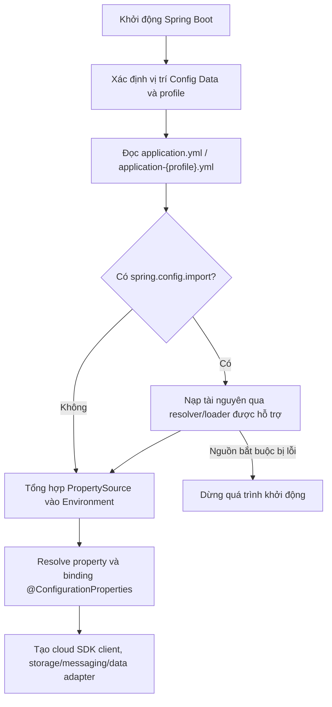
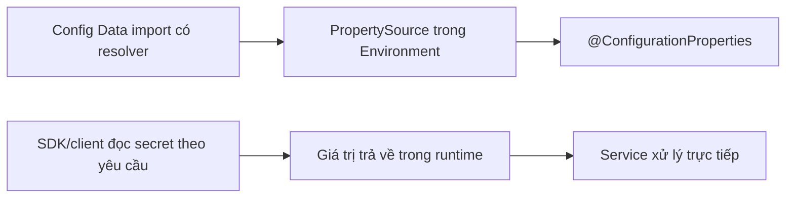

# Nạp cấu hình bằng Config Data và `spring.config.import` khi được hỗ trợ

Khi xây dựng ứng dụng Spring Boot tích hợp dịch vụ managed của **AWS, Azure và Google Cloud**, cấu hình thường đến từ nhiều nơi: tệp YAML đi cùng ứng dụng, tệp gắn ngoài container, Config Server, kho tham số hoặc dịch vụ quản lý secret. Ứng dụng cần nạp các giá trị này **đủ sớm khi khởi động**, trước khi tạo các bean kết nối S3, Azure Blob Storage, Google Cloud Storage, messaging hay cơ sở dữ liệu.

Từ **Spring Boot 2.4**, cơ chế **Config Data** giúp khai báo rõ tài nguyên cấu hình cần nạp. Thuộc tính `spring.config.import` cho phép nhập thêm tệp cục bộ, *configuration tree* hoặc nguồn từ xa **nếu có thư viện cung cấp bộ nạp tương ứng**. Đây là chủ đề của bài học; mục tiêu là sử dụng đúng cơ chế, kiểm tra cấu hình hiệu lực và xử lý việc nguồn cấu hình không sẵn sàng.

## 1. Config Data khác gì với đọc YAML thông thường?

Trước khi tạo các bean ứng dụng, Spring Boot chuẩn bị `Environment` từ các `PropertySource`. Các tệp `application.properties`, `application.yml`, tệp theo profile và những tài nguyên được khai báo qua `spring.config.import` tham gia vào giai đoạn **Config Data**.



Một số khái niệm cần phân biệt:

| Khái niệm | Vai trò |
| --- | --- |
| `Config Data` | Cơ chế tìm, nạp và xử lý các tài liệu cấu hình ở giai đoạn khởi động |
| `spring.config.import` | Khai báo thêm vị trí cấu hình cần nạp từ tài liệu cấu hình |
| `PropertySource` | Tập các cặp khóa/giá trị mà `Environment` tra cứu |
| `spring.profiles.active` / `spring.config.activate.on-profile` | Xác định cấu hình được kích hoạt theo môi trường |
| `@ConfigurationProperties` | Binding các giá trị hiệu lực từ `Environment` thành bean Java có kiểu |
| `ConfigDataLocationResolver` / `ConfigDataLoader` | Điểm mở rộng mà thư viện có thể cung cấp để hiểu các loại import đặc biệt |

**Điểm mấu chốt:** Spring Boot hiểu sẵn những vị trí cục bộ cơ bản; việc chỉ viết `spring.config.import: "aws-secretsmanager:..."` hoặc `"configserver:..."` **không tự cài** thư viện hỗ trợ chúng. Một scheme nhập cấu hình chỉ hoạt động nếu bộ nạp phù hợp có trên classpath, phiên bản tương thích và có đủ điều kiện kết nối.

## 2. Cú pháp và các loại import cơ bản

Có thể khai báo một import hoặc một danh sách import trong `application.yml`:

```yaml
spring:
  config:
    import:
      - "classpath:/integration/storage-defaults.yml"
      - "optional:file:./runtime/storage-overrides.yml"
```

Hoặc trong `application.properties`:

```properties
spring.config.import=classpath:/integration/storage-defaults.yml,optional:file:./runtime/storage-overrides.yml
```

Cách hiểu các tiền tố thường gặp:

| Cú pháp | Nguồn cần nạp | Điều kiện |
| --- | --- | --- |
| `classpath:/integration/storage-defaults.yml` | Tệp trong classpath, thường đóng trong JAR | Tệp tồn tại và có định dạng hỗ trợ |
| `file:./runtime/storage-overrides.yml` | Tệp trong hệ thống file, tương đối theo thư mục chạy | Tệp tồn tại |
| `optional:file:./runtime/storage-overrides.yml` | Tệp ngoài có thể vắng mặt | Thiếu vị trí thì được bỏ qua |
| `configtree:/run/secrets/` | Thư mục chứa các file, mỗi file biểu diễn một property | Thư mục hợp lệ |
| `configserver:...` | Dữ liệu từ Spring Cloud Config Server | Có Spring Cloud Config Client hỗ trợ |
| Scheme riêng của AWS/Azure/GCP | Dữ liệu từ secret/config service của từng cloud | Chỉ khi **starter và phiên bản** đã cài hỗ trợ scheme đó |

`optional:` là **tiền tố của vị trí import**, không phải nội dung của tên file. Khi thiếu một Config Data location bắt buộc, Spring Boot thường dừng khởi động với lỗi thuộc nhóm `ConfigDataLocationNotFoundException`. `optional:` cho phép bỏ qua trường hợp vị trí không tồn tại; nó **không đảm bảo** bỏ qua mọi lỗi khác như YAML sai cú pháp, không đủ quyền hoặc lỗi xác thực mạng. Mức độ xử lý lỗi từ dịch vụ từ xa còn phụ thuộc resolver/loader của thư viện.

Một số lưu ý thực hành:

- Đường dẫn `classpath:` được đóng gói cùng build, còn `file:` được giải quyết theo filesystem của tiến trình khi chạy; trong Docker, thư mục làm việc và volume mount quyết định đường dẫn thực tế.
- Import nên trỏ tới một tài nguyên rõ ràng. Khi muốn thêm **vị trí tìm `application[-profile]` theo quy ước**, cân nhắc `spring.config.additional-location` thay vì dùng import cho mọi file.
- Không nên đặt hai tài liệu không kiểm soát cùng khai báo một key mà không có lý do rõ ràng. Import phải dễ truy vết để người vận hành biết giá trị nào đang được dùng.
- Nếu có nhiều vị trí trong danh sách import, những vị trí đứng sau có thể ghi đè key trùng ở vị trí trước. Một tài nguyên import trùng lặp thường chỉ được nạp một lần theo xử lý của Config Data.

## 3. Ví dụ chạy được: chia cấu hình mặc định và cấu hình triển khai

Giả sử ứng dụng cung cấp adapter cho S3, Azure Blob và GCS. Ta tự định nghĩa namespace `app.storage`; đây **không phải** các key tự động cấu hình của SDK cloud.

Cấu trúc ví dụ:

```text
src/main/resources/
├── application.yml
└── integration/
    └── storage-defaults.yml

runtime/
└── storage-overrides.yml   # tùy chọn, bên ngoài JAR
```

**Tệp `src/main/resources/application.yml`:**

```yaml
spring:
  application:
    name: provider-integration
  config:
    import:
      - "classpath:/integration/storage-defaults.yml"
      - "optional:file:./runtime/storage-overrides.yml"

app:
  storage:
    provider: aws
    target: archive-default
    operation-timeout: 10s
```

**Tệp `src/main/resources/integration/storage-defaults.yml`:**

```yaml
app:
  storage:
    operation-timeout: 8s
    retry:
      max-attempts: 3
```

**Tệp `./runtime/storage-overrides.yml` trên máy/container đang chạy:**

```yaml
app:
  storage:
    target: archive-deployment
    operation-timeout: 6s
```

Trong ví dụ này, tài liệu được import có ưu tiên cao hơn tài liệu khai báo `spring.config.import`. Import ở vị trí sau trong danh sách cũng có thể ghi đè các giá trị trùng từ import trước.

Khi khởi động **mà không có nguồn khác ghi đè**, các giá trị nhận được là:

| Property | Giá trị hiệu lực | Vì sao? |
| --- | --- | --- |
| `app.storage.provider` | `aws` | Chỉ có trong `application.yml` |
| `app.storage.target` | `archive-deployment` | Tệp `runtime/storage-overrides.yml` được import |
| `app.storage.operation-timeout` | `6s` | Import thứ hai ghi đè `8s` của import thứ nhất và `10s` của file gốc |
| `app.storage.retry.max-attempts` | `3` | Import mặc định có khóa này, import thứ hai không ghi đè |

Nếu xóa tệp `runtime/storage-overrides.yml`, ứng dụng vẫn khởi động vì đã sử dụng `optional:file:...`. Khi đó `target` trở về `archive-default`, `operation-timeout` lấy `8s` từ import mặc định.

Nếu deployment đặt biến môi trường `APP_STORAGE_TARGET=archive-env`, thì trong cơ chế Spring Boot thông thường biến môi trường sẽ ưu tiên hơn giá trị trong nhóm Config Data: `target` trở thành `archive-env`. Nếu chạy thêm với `--app.storage.target=archive-cli`, command-line argument tiếp tục ghi đè thành `archive-cli`.

Với bài thực hành, nên thử từng thay đổi riêng lẻ để hiểu nguồn giá trị; không nên mở một lúc nhiều nguồn rồi suy đoán nguồn nào thắng.

## 4. Phối hợp `spring.config.import` với profile

Một profile có thể chọn cấu hình riêng cho môi trường production. Đối với tệp cấu hình định nghĩa một hoặc nhiều tài liệu YAML, có thể ràng buộc import với profile:

```yaml
# src/main/resources/application.yml
spring:
  application:
    name: provider-integration
  config:
    import: "classpath:/integration/storage-defaults.yml"

app:
  storage:
    target: archive-local

---
spring:
  config:
    activate:
      on-profile: prod
    import: "optional:file:./runtime/prod-storage.yml"
```

Trong ví dụ này:

1. Import `storage-defaults.yml` được nạp khi ứng dụng đọc tài liệu cơ sở.
2. Khi profile `prod` được kích hoạt, tài liệu thứ hai trở nên hợp lệ và khai báo import tệp ngoài `prod-storage.yml`.
3. Khi không có profile `prod`, import chỉ có ở tài liệu đó không áp dụng.

Có thể kích hoạt profile bằng environment variable `SPRING_PROFILES_ACTIVE=prod` hoặc argument `--spring.profiles.active=prod`. Với Config Data, Spring Boot cũng xét các biến thể tệp theo profile (ví dụ `application-prod.yml`, hoặc tệp profile tương ứng với một tài nguyên import khi hỗ trợ).

Các điểm thường gây lỗi:

- `spring.config.activate.on-profile` dùng để **kích hoạt một tài liệu theo profile**; đây không phải nơi phù hợp để khai báo `spring.profiles.active`. Không đặt `spring.profiles.active` trong tài liệu đã bị điều kiện profile chi phối.
- Có thể bật nhiều profile, nhưng thứ tự profile có thể ảnh hưởng key trùng. Hãy kiểm tra tổ hợp `prod` + `aws` / `azure` / `gcp` thật sự được phép dùng.
- Nếu một import phụ thuộc profile, phải kiểm tra log khởi động và `Environment` **khi đúng profile**; thử nghiệm khi profile chưa kích hoạt không chứng minh nguồn đó có lỗi.
- Các key dành riêng cho provider (chẳng hạn region AWS, account Azure, project GCP) nên tách khỏi namespace chung của ứng dụng; bật đúng adapter/cloud starter theo deployment.

## 5. Nạp secret dạng `configtree` từ file mount

Trong Docker hoặc Kubernetes, secret và config có thể được mount thành **một thư mục chứa nhiều file**. Cơ chế `configtree:` của Spring Boot đọc tên file làm key và nội dung file làm giá trị; không cần đưa secret trực tiếp vào YAML hoặc biến môi trường.

Ví dụ thư mục mount:

```text
/run/secrets/integration/
├── app.storage.target
├── app.storage.operation-timeout
└── app.messaging.api-token
```

Nội dung các file lần lượt có thể là `archive-prod`, `7s` và một token bí mật (không được in trong log). Trong `application.yml`:

```yaml
spring:
  config:
    import: "configtree:/run/secrets/integration/"
```

Ứng dụng sẽ có các key như `app.storage.target`, `app.storage.operation-timeout` và `app.messaging.api-token` trong `Environment`. Cấu hình `@ConfigurationProperties(prefix = "app.storage")` có thể nhận hai giá trị đầu tiên. Với khóa nhạy cảm, nên để tầng tích hợp nhận qua cơ chế an toàn và hạn chế xuất hiện trong endpoint Actuator.

**Lưu ý:**

- `configtree:` trỏ đến **thư mục**, nên giữ dấu `/` cuối; mount file riêng lẻ không tương đương cấu hình một tree.
- Dùng `optional:configtree:/run/secrets/integration/` chỉ khi thư mục thực sự có thể vắng mặt. Với production phải có secret, nên để vị trí là bắt buộc để startup thất bại rõ ràng.
- Kubernetes có thể cấp cấu hình bằng ConfigMap/Secret dưới dạng environment variables hoặc volume file. **Hai cách nạp có độ ưu tiên khác nhau**: env tuân thứ tự environment property source; volume configtree tham gia nhóm Config Data.
- File secret được cập nhật sau khi ứng dụng khởi động **không tự làm các bean đã binding thay đổi ngay**. Cần cơ chế reload/refresh rõ ràng hoặc rolling restart.

## 6. Tích hợp nguồn từ xa: chỉ khi có bộ nạp tương ứng

Đây là phần quan trọng nhất khi học Spring Cloud Provider Integration. Spring Boot cung cấp **giao diện mở rộng Config Data**; từng thư viện cloud quyết định có đăng ký scheme import hay chỉ cung cấp SDK/API để đọc cấu hình theo cách khác.

### 6.1. Spring Cloud Config Server

Với Spring Boot 2.4+ và **Spring Cloud Config Client tương thích**, thêm dependency `spring-cloud-starter-config`. Một cấu hình điển hình:

```yaml
spring:
  application:
    name: provider-integration
  config:
    import: "configserver:http://localhost:8888"
```

Trong môi trường phát triển, nếu Config Server chỉ là nguồn bổ sung, có thể khai báo:

```yaml
spring:
  config:
    import: "optional:configserver:http://localhost:8888"
```

Khi khởi động, Config Client truy vấn server theo `spring.application.name`, profile và cấu hình label nếu có, sau đó tham gia nạp các property tương ứng. Nếu server mang cấu hình cho profile `prod`, cần thử startup với `SPRING_PROFILES_ACTIVE=prod` để biết dữ liệu đó được nạp đúng hay chưa.

Khi cấu hình remote là **bắt buộc**, đừng dùng `optional:` một cách mặc định: việc không kết nối được phải được ghi nhận rõ, tránh vô tình chạy với cấu hình cũ. Với môi trường thật, dùng HTTPS, authentication phù hợp và đặt thông tin kết nối/credential tại nguồn khả dụng **trước khi** Config Server được gọi.

**Về độ ưu tiên:** trong cơ chế Config Data, tài nguyên import thường được xét theo quy tắc import; tuy nhiên Config Server và những triển khai có **legacy bootstrap context** hoặc chính sách remote override có thể xử lý thứ tự khác nhau. Không kết luận “remote luôn thắng local” hay “env luôn thắng remote” mà không kiểm tra phiên bản, cơ chế và cấu hình thực tế.

### 6.2. AWS Secrets Manager và AWS Systems Manager Parameter Store

Một số dòng **Spring Cloud AWS** cung cấp tích hợp Config Data cho AWS Secrets Manager và Parameter Store. Với dòng hỗ trợ scheme này, cấu hình có thể có dạng:

```yaml
spring:
  config:
    import:
      - "aws-secretsmanager:/secrets/provider-integration"
      - "aws-parameterstore:/config/provider-integration/"
```

**Điều kiện bắt buộc để áp dụng ví dụ:** đúng phiên bản Spring Cloud AWS hỗ trợ `aws-secretsmanager:` và `aws-parameterstore:`, có các module/starter liên quan trong classpath, region được xác định và danh tính AWS đủ quyền. Không phải mọi phiên bản Spring Cloud AWS dùng cùng module, starter hoặc import syntax; đối chiếu tài liệu của phiên bản đang sử dụng.

Trong quá trình nạp:

- AWS SDK credential chain có thể nhận IAM Role/workload identity, hoặc credentials dành riêng cho môi trường phát triển.
- Identity phải có quyền đọc secret/parameter cần thiết, chẳng hạn quyền `secretsmanager:GetSecretValue` hoặc `ssm:GetParameter(s)` tương ứng; parameter được mã hóa có thể cần quyền KMS bổ sung.
- Secret JSON chỉ ánh xạ thành nhiều property nếu cơ chế tích hợp và định dạng của phiên bản hỗ trợ; một chuỗi secret thuần không mặc nhiên biến thành hàng loạt key YAML.
- Thiếu quyền và sai region là **lỗi khác** với thiếu property; cần chẩn đoán theo phản hồi cloud service thay vì “chữa” bằng default token giả.

Không dùng `optional:` cho production secret bắt buộc trừ khi nghiệp vụ thực sự có nhánh hoạt động an toàn khi secret vắng mặt.

### 6.3. Azure App Configuration, Key Vault và Google Cloud Secret Manager

Với Azure và GCP, không nên sao chép cú pháp `aws-secretsmanager:` rồi thay tên provider. Cơ chế của mỗi thư viện không đồng nhất:

| Dịch vụ | Mục đích | Điểm cần xác minh trước khi dùng import |
| --- | --- | --- |
| Azure App Configuration | Quản lý key/value theo ứng dụng, môi trường, label | Starter Spring Cloud Azure tương thích đang nạp bằng Config Data hay bằng cơ chế cấu hình riêng? Scheme và cách chọn store/label nào được hỗ trợ? |
| Azure Key Vault | Quản lý secret, certificate, key | Starter có đưa secret vào `PropertySource` không? Có yêu cầu cấu hình endpoint/credential trước startup không? |
| Google Cloud Secret Manager | Lưu secret cho ứng dụng chạy trên GCP | Phiên bản Spring Cloud GCP có hỗ trợ import trực tiếp, placeholder secret hay phải đọc bằng SDK? |
| Google Cloud Runtime Config/nguồn khác | Cấu hình vận hành, nếu dự án thực sự có sử dụng | Nguồn đó có được hỗ trợ và còn phù hợp trong phiên bản hiện tại không? Không tự giả định có Config Data resolver. |

Các thư viện có thể cung cấp **property source**, **placeholder resolver** hoặc **client API**, nhưng chỉ trường hợp đã cung cấp integration Config Data tương ứng mới dùng được `spring.config.import` theo scheme riêng. Có hai luồng khác nhau:



Ở luồng SDK runtime, giá trị nhận về **không tự trở thành** một Spring property. Nếu thư viện chỉ hỗ trợ truy cập SDK, hãy thiết kế bean chuyên trách với cache, timeout, retry và cơ chế refresh phù hợp; không tự tạo scheme `spring.config.import` chưa được hỗ trợ.

Khi chạy trên cloud, ưu tiên **IAM Role/Workload Identity** (AWS), **Managed Identity/Workload Identity** (Azure), **Application Default Credentials/Workload Identity** (GCP). Danh tính để đọc remote config/secret phải có **trước lúc import**, nên không thể phụ thuộc vào một secret chỉ có thể lấy được **sau khi đã import thành công**.

## 7. `Config Data` liên hệ thế nào với ưu tiên cấu hình?

Khi nhiều nguồn cùng cung cấp một key, `Environment` sẽ chọn key theo thứ tự ưu tiên. Trong mô hình Spring Boot phổ biến, có thể hình dung:

```text
Command-line arguments
    > JVM system properties (-D...)
    > OS environment variables
    > Config Data (application.yml, profile, import...)
    > application default properties
```

Đây là thứ tự tham khảo cho **những nguồn phổ biến**; test framework, legacy bootstrap, các property source do thư viện bổ sung và cơ chế override remote có thể làm tình huống thực tế khác đi.

Bên trong nhóm Config Data:

1. Tệp config theo profile có thể ưu tiên hơn tệp chung trong cùng nhóm vị trí tìm kiếm.
2. Các vị trí cấu hình ngoài JAR thường có ưu tiên cao hơn vị trí mặc định bên trong JAR.
3. Tài nguyên import có ưu tiên hơn **tài liệu khai báo import**; giữa nhiều import cùng một tài liệu, import sau có thể ghi đè import trước.
4. Tài liệu chỉ được kích hoạt theo profile sẽ tham gia khi profile phù hợp; tài liệu không kích hoạt sẽ không cung cấp key.

Do đó, để biết tại sao `app.storage.target` nhận `archive-deployment`, chỉ nhìn `application.yml` là chưa đủ; cần biết profile, import, external config, env, CLI và các thư viện cấu hình đã đăng ký.

### Tránh trộn `spring.config.import` và `spring.config.location` một cách tùy tiện

| Thuộc tính | Ý nghĩa chính | Khi nên dùng |
| --- | --- | --- |
| `spring.config.import` | Nhập tài nguyên rõ ràng được khai báo **trong một tài liệu cấu hình** | Tệp chung, configtree, Config Server, remote resolver được hỗ trợ |
| `spring.config.additional-location` | Bổ sung vị trí tìm kiếm `application[-profile]` | Thêm thư mục external config cho deployment |
| `spring.config.location` | Thay đổi/thay thế các vị trí tìm kiếm mặc định | Có yêu cầu kiểm soát hoàn toàn layout cấu hình |
| `spring.config.name` | Đổi tên cơ sở của tệp ứng dụng cần tìm | Khi sử dụng tên thay cho `application` |

`spring.config.location`, `spring.config.additional-location` và `spring.config.name` phải được cung cấp đủ sớm (thường qua environment variable, system property hoặc command-line), vì Spring Boot cần chúng trước khi tìm Config Data. Đặt chúng trong một tài liệu chỉ được tìm thấy nhờ chính chúng có thể tạo vòng phụ thuộc.

## 8. Binding giá trị đã nạp và bảo vệ ứng dụng khỏi cấu hình sai

Một object cấu hình giúp kiểm tra giá trị nhập vào từ bất kỳ nguồn nào, kể cả remote:

```java
package example.cloud.config;

import jakarta.validation.constraints.NotBlank;
import jakarta.validation.constraints.NotNull;
import org.springframework.boot.context.properties.ConfigurationProperties;
import org.springframework.validation.annotation.Validated;

import java.time.Duration;

@Validated
@ConfigurationProperties(prefix = "app.storage")
public record StorageProperties(
        @NotBlank String target,
        @NotNull Duration operationTimeout
) {}
```

Trong Spring Boot 3.x, có thể đăng ký record này bằng `@ConfigurationPropertiesScan` trên lớp ứng dụng hoặc `@EnableConfigurationProperties(StorageProperties.class)` trong cấu hình Java. Để Bean Validation hoạt động, cần dependency `spring-boot-starter-validation` (namespace `jakarta.validation`).

Khi import của phần 3 thành công, bean nhận `target = "archive-deployment"` và `operationTimeout = Duration.ofSeconds(6)`. Nếu thiếu `app.storage.target` hoặc để trống, validation phát hiện trước khi adapter gọi storage provider. Với enum provider, có thể bổ sung ràng buộc để tránh cấu hình trỏ sai backend.

**Giới hạn của validation:** tên bucket/container hợp lệ về mặt chuỗi không chứng minh resource tồn tại, IAM/RBAC đúng hoặc endpoint cloud truy cập được. Phải có integration test hoặc phép kiểm tra kết nối riêng với quyền tối thiểu. Cũng cần nhớ `operationTimeout` trong bean là **chính sách ứng dụng**; nó không tự trở thành timeout của AWS/Azure/GCP SDK nếu adapter chưa áp dụng.

## 9. Chẩn đoán lỗi nạp Config Data

Các lỗi Config Data thường xuất hiện **trong startup**, trước khi controller hoặc service sẵn sàng. Việc phân biệt loại lỗi sẽ giúp khoanh vùng nhanh:

| Triệu chứng | Khả năng chính | Cách xử lý |
| --- | --- | --- |
| `ConfigDataLocationNotFoundException` | Tệp/thư mục import bắt buộc không tồn tại | Kiểm tra đường dẫn thực tế trong container, mount và có cần `optional:` hay không |
| Tệp YAML có nhưng parse lỗi | YAML sai cú pháp hoặc sai dạng dữ liệu | Kiểm tra indent, key trùng, định dạng `application.yml` |
| Scheme như `configserver:` hoặc `aws-secretsmanager:` không được nhận diện | Thiếu starter hoặc version không có resolver | Xác nhận dependency, BOM và tài liệu version |
| Import chỉ hoạt động ở dev, không hoạt động ở prod | Profile, import activation hoặc location khác | Kiểm tra `spring.profiles.active`, `spring.config.activate.on-profile` |
| Remote không kết nối | DNS/TLS/endpoint, mạng, timeout, server không sẵn sàng | Kiểm tra startup log, endpoint, connectivity, retry/fail-fast |
| Remote trả về lỗi quyền | IAM/RBAC/credential/region/project sai | Xác thực danh tính workload và quyền đọc tối thiểu |
| Bean nhận giá trị cũ dù file đã cập nhật | Không có cơ chế refresh, instance chưa restart | Kiểm tra release/restart và hỗ trợ refresh của phiên bản |
| Bean nhận giá trị khác mong đợi | Nguồn ưu tiên cao khác đang override | Đối chiếu origin, env, CLI, profile, import |
| Lộ secret qua endpoint vận hành | Actuator `env`/`configprops` hoặc log thiếu bảo vệ | Bật che giá trị, hạn chế truy cập, loại bỏ log nhạy cảm |

Để xác định nguồn cung cấp key, có thể dùng Spring Boot Actuator ``/actuator/env`` và ``/actuator/configprops`` **trong phạm vi có kiểm soát**. Các endpoint có thể tiết lộ tên nguồn và origin, nhưng hành vi hiển thị giá trị phụ thuộc cài đặt bảo mật, phiên bản và chính sách sanitize. Không mở các endpoint này công khai hoặc đặt chế độ hiện toàn bộ secret trên production.

Với một property **không nhạy cảm**, có thể kiểm tra:

```text
1. Giá trị được ghi trong application.yml.
2. Giá trị từ tệp import.
3. Giá trị từ file theo profile hoặc external location.
4. Giá trị từ OS environment, JVM -D và CLI.
5. Giá trị hiệu lực trong Environment / @ConfigurationProperties.
```

Đối với secret, chỉ kiểm tra **có/không**, nguồn và quyền truy cập; không in nguyên giá trị để phục vụ chẩn đoán.

## 10. Kiểm thử luồng nạp cấu hình

Để kiểm thử **Config Data thực sự**, cần chạy một Spring context có bước khởi tạo Config Data được kích hoạt. Một bài unit test chỉ gọi `Binder` với các property được đặt thủ công có thể kiểm tra type conversion/validation nhưng **không chứng minh rằng `spring.config.import` đã được xử lý**.

Đề xuất bộ tình huống kiểm thử:

| Tình huống | Thiết lập | Kết quả cần xác nhận |
| --- | --- | --- |
| Import nội bộ | Import `classpath:/integration/storage-defaults.yml` | Key được nạp và ghi đè tài liệu khai báo |
| Optional file không tồn tại | `optional:file:./runtime/missing.yml` | Startup thành công và dùng default phù hợp |
| File bắt buộc không tồn tại | `file:./runtime/missing.yml` | Startup thất bại rõ ràng |
| Import có profile | Import chỉ trong tài liệu `on-profile: prod` | Chỉ nạp khi bật `prod` |
| Mount configtree | Thư mục test chứa file có tên property | Các key đúng được đọc từ nội dung file |
| Remote có quyền | Config server/secret store test có credential | Lấy được giá trị, không log secret |
| Remote thiếu quyền | Workload identity không có quyền read | Phát hiện lỗi quyền, không fallback sai quy định |
| Ghi đè bằng env/CLI | Đặt key không nhạy cảm trùng import | Giá trị hiệu lực theo chính sách đã kiểm chứng |

Nên dùng môi trường test riêng hoặc emulator phù hợp cho phần từ xa; tách kiểm thử Config Data với kiểm thử thao tác thật lên S3, Blob, GCS, SQS, Service Bus hoặc Pub/Sub. Nếu tự động hóa, assert **giá trị cuối cùng và lỗi kỳ vọng**, không chỉ assert “ứng dụng đã start”.

### Bài thực hành có hướng dẫn

1. Tạo `application.yml` và `integration/storage-defaults.yml` như phần 3; khởi động và kiểm tra `app.storage.operation-timeout` bằng một bean `StorageProperties`.
2. Thêm `runtime/storage-overrides.yml`, thử sửa `target` và `operation-timeout`. Xóa tệp để quan sát khác biệt giữa import `optional:` và bắt buộc.
3. Thêm profile `prod` để chỉ import một tệp external riêng cho production; kiểm tra giá trị ở cả profile mặc định và `prod`.
4. Tạo một thư mục configtree test với file `app.storage.target` và import bằng `configtree:`. So sánh với cách đặt biến môi trường.
5. Nếu dự án có Config Server hoặc starter AWS/Azure/GCP hỗ trợ Config Data, thử import từ xa với **một property không bí mật**, ghi lại scheme, dependency, quyền và giá trị hiệu lực. Tắt kết nối nguồn từ xa để quan sát chính sách lỗi.
6. Đổi secret ở nguồn remote khi ứng dụng đang chạy. Kiểm tra xem cơ chế hiện có có tự refresh không; nếu không, thực hiện restart/rollout có kiểm soát rồi xác nhận credential mới.

**Tiêu chí hoàn thành:** người học giải thích được lý do import hoạt động hoặc thất bại, phân biệt import với các location mặc định, dự đoán giá trị sau binding, và biết rằng nguồn từ xa chỉ có thể dùng qua `spring.config.import` khi starter/phiên bản thực sự cung cấp cơ chế đó.

## 11. Ghi nhớ

- **Config Data** nạp cấu hình trong giai đoạn startup, trước khi phần lớn bean ứng dụng được tạo. `spring.config.import` khai báo những tài nguyên cần nhập thêm.
- Spring Boot hỗ trợ import tệp local và `configtree`; với Config Server hay dịch vụ cloud, cần **resolver/loader hoặc integration tương thích** chứ không thể tự đặt scheme.
- `optional:` chỉ nên dùng cho nguồn có thể vắng mặt theo thiết kế. Secret hoặc cấu hình production bắt buộc nên có chính sách fail-fast rõ ràng.
- Nguồn import được tổng hợp cùng các `PropertySource` khác. Hãy kiểm chứng thứ tự ưu tiên theo version, profile và cơ chế remote; `@ConfigurationProperties` nhận **giá trị đã được resolve**.
- Giữ secret ngoài Git/log, dùng danh tính workload và quyền tối thiểu, đồng thời có bài test kiểm chứng hành vi mất kết nối, lỗi quyền và refresh/restart.
