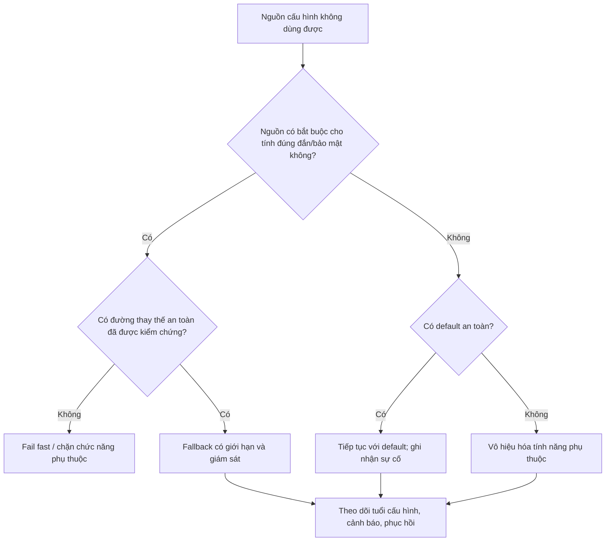

# Chọn hành vi khi nguồn cấu hình bắt buộc hoặc tùy chọn bị lỗi

Trong ứng dụng Spring Boot kết nối các dịch vụ managed của **AWS, Azure và Google Cloud**, không phải mọi nguồn cấu hình đều quan trọng như nhau. Thiếu một file điều chỉnh mức lấy mẫu telemetry có thể chỉ khiến ứng dụng dùng giá trị mặc định; ngược lại, không đọc được credential bắt buộc hoặc không biết bucket production cần ghi có thể làm ứng dụng xử lý sai dữ liệu hoặc không thể phục vụ yêu cầu.

Quyết định cần đưa ra trước khi triển khai là: **nguồn nào bắt buộc phải có, nguồn nào được phép vắng mặt, và hành vi nào an toàn khi nguồn lỗi**. Bài này trình bày cách thiết kế chính sách *fail fast*, *fallback* và *degraded mode*, sau đó áp dụng bằng Config Data, `spring.config.import`, validation, kiểm thử và giám sát trong dự án Spring Cloud Provider Integration.

## 1. Phân biệt nguồn “bắt buộc” và “tùy chọn” theo chức năng

Một nguồn cấu hình được coi là **bắt buộc** khi thiếu nó thì ứng dụng không thể bảo đảm hành vi đúng, an toàn hoặc tuân thủ ràng buộc nghiệp vụ. Nguồn **tùy chọn** là nguồn có thể vắng mặt vì ứng dụng đã định nghĩa một giá trị mặc định hoặc hành vi suy giảm **thực sự an toàn và đã được kiểm thử**.

Cùng một hệ thống cấu hình có thể là bắt buộc với dịch vụ này nhưng tùy chọn với dịch vụ khác. Ví dụ, endpoint observability bổ sung không nhất thiết cản trở dịch vụ upload, còn khóa dùng để xác minh chữ ký webhook lại không được phép thiếu nếu ứng dụng vẫn tiếp nhận webhook.

| Dữ liệu/nguồn | Vai trò | Chính sách thường phù hợp | Lý do |
| --- | --- | --- | --- |
| Tên bucket/container nơi ghi tài liệu production | Định danh đích ghi dữ liệu | **Bắt buộc** | Tránh ghi nhầm môi trường hoặc tài nguyên |
| Secret để xác thực API thanh toán | Credential bảo vệ giao dịch | **Bắt buộc** cho luồng thanh toán | Thiếu secret không thể xác thực an toàn |
| Cấu hình policy bắt buộc cho xử lý dữ liệu nhạy cảm | Kiểm soát bảo mật và tuân thủ | **Bắt buộc** | Không được tự hạ chuẩn bảo vệ |
| Tùy chọn exporter metrics ngoài luồng | Quan sát bổ sung | **Tùy chọn**, có mặc định rõ ràng | Lỗi exporter không nhất thiết chặn nghiệp vụ chính |
| Banner hoặc thông điệp giao diện | Hiển thị phi trọng yếu | **Tùy chọn** | Có thể dùng giá trị mặc định hợp lệ |
| Tên queue/topic cho cơ chế phát sự kiện cần bảo đảm | Định danh đích messaging | **Bắt buộc** nếu phát sự kiện là điều kiện nghiệp vụ | Bỏ qua sự kiện có thể mất dữ liệu |
| Feature flag của một tính năng mới | Điều khiển chức năng | **Tùy chọn nếu có mặc định an toàn**, ví dụ tắt tính năng | Tránh vô tình bật logic chưa được cấp phép |
| Cấu hình audit log bắt buộc | Bằng chứng hoạt động | **Bắt buộc** hoặc chặn các thao tác cần audit | Không che giấu việc mất audit |

**Bắt buộc hay tùy chọn là quyết định nghiệp vụ và rủi ro**, không phải tính chất cố định của YAML, AWS Secrets Manager, Azure App Configuration, Google Cloud Secret Manager hay Spring Cloud Config Server. Không nên đánh dấu tất cả import là `optional:` chỉ để ứng dụng “luôn khởi động được”.

### Cách xác định chính sách cho từng nguồn

Trước khi chọn cú pháp, hãy trả lời bốn câu hỏi:

1. **Hệ quả nếu thiếu nguồn?** Ứng dụng sẽ từ chối thao tác, dùng giá trị cũ, gửi tới sai nơi hay có thể hoạt động bình thường?
2. **Có mặc định an toàn, rõ ràng và đã kiểm thử không?** Không có mặc định thì nguồn phải bắt buộc, dù chỉ chứa một key.
3. **Có được phép dùng giá trị cũ không?** Nếu có, trong bao lâu và ai quyết định thời điểm hết hạn? Với quyền hoặc chính sách đã bị thu hồi, giá trị cũ có thể không an toàn.
4. **Lỗi ảnh hưởng phạm vi nào?** Toàn bộ tiến trình, một adapter cloud, một endpoint hay một tác vụ nền?

Từ đó, thiết kế hành vi **startup** và hành vi **runtime** riêng. Một nguồn chỉ cần đọc lúc khởi động khác với một secret/feature flag được làm mới định kỳ.

## 2. Các loại lỗi cần phân biệt trước khi chọn fallback

“Không tải được cấu hình” có nhiều nguyên nhân. Cú pháp cấu hình tùy chọn không nhất thiết giải quyết tất cả:

| Loại lỗi | Ví dụ | Phản ứng thích hợp cần cân nhắc |
| --- | --- | --- |
| **Không tồn tại vị trí** | Thiếu `./runtime/telemetry.yml` | Với nguồn tùy chọn: bỏ qua và dùng default; với nguồn bắt buộc: dừng |
| **Không có key bắt buộc** | Thư mục secret tồn tại nhưng thiếu file `partner.api-key` | Dừng qua validation/kiểm tra bean bắt buộc |
| **Sai định dạng/kiểu** | YAML lỗi indent, timeout là `abc` | Dừng và báo lỗi cấu hình; không âm thầm “sửa” dữ liệu |
| **Không kết nối được nguồn từ xa** | Config Server timeout, DNS/TLS lỗi | Retry giới hạn; sau đó dừng hoặc degrade theo chính sách |
| **Thiếu quyền** | IAM/RBAC từ chối đọc secret | Dừng chức năng phụ thuộc; điều tra quyền, không tự chọn secret giả |
| **Giá trị không hợp lệ về nghiệp vụ** | Bucket trống, region không hợp lệ, retry âm | Dừng hoặc vô hiệu hóa tính năng tùy mức bắt buộc |
| **Cấu hình đã lỗi thời** | Remote lưu phiên bản policy cũ | Dựa vào version/TTL và quy định dùng last-known-good |
| **Lỗi khi refresh** | Token/secret được xoay vòng nhưng client không cập nhật | Giữ hay loại bỏ giá trị cũ theo chính sách; báo tình trạng |
| **Lỗi provider trong lúc gọi API** | Storage trả `AccessDenied` sau khi startup | Đây là lỗi vận hành/permission, không tự động là lỗi import |

Ví dụ, nếu `optional:file:./runtime/telemetry.yml` được khai báo và file không có, ứng dụng có thể tiếp tục. Nhưng nếu file **có mặt mà YAML sai**, parser vẫn có thể làm startup thất bại. Tương tự, thư mục `configtree:` hiện hữu không bảo đảm rằng từng secret bắt buộc trong đó đã tồn tại; cần thêm validation cho **key**.

Điều quan trọng là phân biệt **nguồn bị thiếu**, **giá trị bắt buộc bị thiếu**, và **nguồn có mặt nhưng không đáng tin hoặc không thể sử dụng**.

## 3. Ba chính sách hành vi: fail fast, fallback, degraded mode

### 3.1. Fail fast — dừng trước khi nhận traffic

Chọn *fail fast* nếu ứng dụng không có đủ thông tin để đảm bảo an toàn, tính nhất quán hoặc tính đúng đắn.

Ví dụ:

- Không có tên bucket production và không có quy tắc chọn đích an toàn.
- Không đọc được mật khẩu database trong một hệ thống bắt buộc dùng xác thực bằng password.
- Không có secret xác minh chữ ký webhook nhưng API vẫn dự định nhận webhook.
- Không nạp được policy giới hạn quyền hoặc cấu hình mã hóa bắt buộc.

Hành vi mong đợi: **startup thất bại với lỗi có thể chẩn đoán, chưa đánh dấu instance ready**. Orchestrator có thể giữ instance cũ phục vụ khi rollout, còn instance mới không nhận request. Không nên dùng secret hoặc bucket “dự phòng” không được phê duyệt.

### 3.2. Fallback — dùng giá trị mặc định an toàn

Chọn *fallback* khi hệ thống có một giá trị thay thế đã được xác định trước và việc thay thế **không làm sai dữ liệu hoặc hạ mức bảo mật**.

Ví dụ:

- Thiếu cấu hình mức lấy mẫu metrics → lấy mẫu bằng mặc định đã quy định.
- Thiếu file cấu hình banner → dùng tiêu đề nội bộ có sẵn.
- Remote feature flag tạm thời không đọc được → giữ tính năng mới ở trạng thái **tắt** nếu đó là lựa chọn an toàn và đã kiểm thử.

Fallback phải có **chủ sở hữu, quy tắc, giới hạn và quan sát**. Mặc định `true` cho một kiểm tra bảo mật không phải fallback an toàn nếu `true` đồng nghĩa bỏ qua kiểm tra.

### 3.3. Degraded mode — chỉ tắt chức năng phụ thuộc

Không phải lỗi cấu hình nào cũng phải dừng **toàn bộ ứng dụng**. Với một module phụ độc lập, có thể giữ các chức năng chính và tạm thời vô hiệu hóa module đó.

Ví dụ, ứng dụng vẫn cho phép đọc tài liệu lưu sẵn trong khi tạm dừng một dashboard phân tích phụ thuộc nguồn remote không sẵn sàng. Tuy nhiên, nếu hệ thống được yêu cầu **phải phát sự kiện cho mọi giao dịch**, mất cấu hình SQS/Service Bus/Pub/Sub không có nghĩa có thể âm thầm bỏ sự kiện; cần chặn giao dịch hoặc dùng một cơ chế bền vững như transactional outbox đã được thiết kế sẵn.



Không đánh đồng **degraded mode** với **thành công hoàn toàn**. Cần thể hiện rõ trạng thái trong metrics, health/readiness phù hợp và tài liệu vận hành.

## 4. Áp dụng `optional:` trong Spring Boot Config Data

Từ Spring Boot 2.4, có thể nạp cấu hình bằng `spring.config.import`. Ví dụ:

```yaml
spring:
  config:
    import:
      - "optional:file:./runtime/telemetry.yml"
      - "configtree:/run/secrets/provider-integration/"
```

Hai dòng này có chủ đích khác nhau:

- `optional:file:./runtime/telemetry.yml`: nếu vị trí không có, có thể bỏ qua; ứng dụng vẫn dùng các giá trị mặc định của cấu hình telemetry.
- `configtree:/run/secrets/provider-integration/`: vị trí chứa secret **bắt buộc** trong ví dụ này; khi thư mục thiếu, Config Data báo lỗi trong startup. Khi thư mục có mặt nhưng thiếu một key thiết yếu, cần thêm kiểm tra giá trị.

Cú pháp `optional:` chỉ được dùng với một vị trí mà cơ chế Config Data hiểu. Với đường dẫn trong container, lưu ý thư mục làm việc hiện tại, mount volume và quyền đọc file.

### Giới hạn của `optional:`

**`optional:` chủ yếu xử lý tình huống Config Data location không tồn tại** theo cách importer hỗ trợ. Nó không phải `try/catch` cho mọi lỗi:

- File tồn tại nhưng YAML lỗi → ứng dụng vẫn có thể dừng.
- File chứa giá trị sai kiểu, ví dụ `timeout: "never"` → binding có thể thất bại.
- Thư mục secret tồn tại nhưng key bắt buộc trống → phải dùng validation để từ chối.
- Remote service trả lỗi xác thực, chính sách hoặc hỏng dữ liệu → hành vi tùy thư viện; không suy ra rằng `optional:` luôn bỏ qua.
- Trường hợp thiếu nguồn gây ra property placeholder chưa resolve → bean phụ thuộc vẫn có thể làm startup thất bại.

Spring Boot còn có tùy chọn rộng `spring.config.on-not-found=ignore` để bỏ qua lỗi thiếu vị trí Config Data. Không nên dùng tùy chọn toàn cục để “che” lỗi ở production, vì nó có thể làm **mọi** import bị thiếu được chấp nhận thay vì chỉ những nguồn chủ động đánh dấu tùy chọn.

### Sự khác nhau giữa nguồn tùy chọn và key có mặc định

Một file có thể tùy chọn, nhưng một key trong file vẫn bắt buộc đối với chức năng đã bật.

Ví dụ:

```yaml
spring:
  config:
    import: "optional:file:./runtime/partner.yml"

app:
  partner:
    enabled: false
```

Nếu `app.partner.enabled=false`, có thể không cần các property để gọi API bên thứ ba. Nhưng khi một deployment đặt `app.partner.enabled=true`, ứng dụng phải kiểm tra endpoint, danh tính và credential bắt buộc cho tính năng. Việc file `partner.yml` là optional **không cấp phép chạy một integration thiếu credential**.

Ngược lại, một file bắt buộc chỉ bảo đảm **vị trí của file được tìm thấy**. Tất cả key cần dùng vẫn phải được kiểm tra với ràng buộc phù hợp.

## 5. Ví dụ hoàn chỉnh: nguồn tùy chọn cho telemetry, nguồn bắt buộc cho secret

Giả sử ứng dụng nhận request upload lên S3, Azure Blob hoặc GCS và đồng thời có thể gửi telemetry bổ sung. Một tích hợp API đối tác cũng yêu cầu key trong production.

### 5.1. File cấu hình chung

```yaml
# src/main/resources/application.yml
spring:
  application:
    name: provider-integration
  config:
    import:
      - "optional:file:./runtime/telemetry.yml"
      - "configtree:/run/secrets/provider-integration/"

app:
  integration:
    storage-target: ${STORAGE_TARGET}
    telemetry-enabled: false
    max-concurrent-uploads: 4
```

Giả sử deployment mount file `/run/secrets/provider-integration/partner.api-key` và file chứa **giá trị bí mật** hợp lệ. Import kiểu `configtree:` sẽ đưa key `partner.api-key` vào `Environment`. Tệp `runtime/telemetry.yml` có thể vắng mặt mà không cản trở nghiệp vụ storage.

Tệp telemetry tùy chọn, nếu có, ví dụ:

```yaml
# ./runtime/telemetry.yml
app:
  integration:
    telemetry-enabled: true
```

Giá trị `false` trong file chung là **mặc định an toàn** cho telemetry bổ sung. Việc thay file telemetry không tự cập nhật bean đã binding tại startup, trừ khi có cơ chế refresh riêng hoặc restart.

### 5.2. Kiểm tra cấu hình nghiệp vụ bằng `@ConfigurationProperties`

Ví dụ dùng Spring Boot 3.x, Java 17+ và Bean Validation:

```java
package example.cloud.config;

import jakarta.validation.constraints.Max;
import jakarta.validation.constraints.Min;
import jakarta.validation.constraints.NotBlank;
import org.springframework.boot.context.properties.ConfigurationProperties;
import org.springframework.boot.context.properties.bind.DefaultValue;
import org.springframework.validation.annotation.Validated;

@Validated
@ConfigurationProperties(prefix = "app.integration")
public record IntegrationSettings(
        @NotBlank String storageTarget,
        @DefaultValue("false") boolean telemetryEnabled,
        @Min(1) @Max(32) @DefaultValue("4") int maxConcurrentUploads
) {}
```

Đăng ký bean với `@ConfigurationPropertiesScan` trên lớp khởi động hoặc `@EnableConfigurationProperties(IntegrationSettings.class)` trong cấu hình Java, đồng thời thêm `spring-boot-starter-validation`.

Ở ví dụ này:

- Không có `STORAGE_TARGET` hợp lệ: ứng dụng không thể chọn đúng nơi ghi dữ liệu và phải dừng khi cấu hình cần thiết được resolve/validated.
- Không có file telemetry: `telemetryEnabled=false` và ứng dụng vẫn làm việc bình thường.
- `max-concurrent-uploads=0` hoặc `100`: validation từ chối vì vượt giới hạn cho phép.

**Lưu ý:** `@DefaultValue("false")` chỉ là default ở lớp binding; nó không thay thế một policy nghiệp vụ bắt buộc. Nếu policy quyết định bật/tắt một kiểm tra bảo mật, không được chọn giá trị mặc định chỉ để tránh lỗi.

### 5.3. Kiểm tra secret bắt buộc

File `configtree:` bắt buộc **không đủ để chứng minh secret có trong thư mục**. Cần ràng buộc key `partner.api-key`. Tránh đưa secret vào Java `record` rồi vô tình log `toString()` của record chứa plaintext.

Một bean có setter và chỉ kiểm tra tính hiện diện:

```java
package example.cloud.config;

import jakarta.validation.constraints.NotBlank;
import org.springframework.boot.context.properties.ConfigurationProperties;
import org.springframework.validation.annotation.Validated;

@Validated
@ConfigurationProperties(prefix = "partner")
public class PartnerSecretProperties {
    @NotBlank
    private String apiKey;

    public String getApiKey() {
        return apiKey;
    }

    public void setApiKey(String apiKey) {
        this.apiKey = apiKey;
    }

    @Override
    public String toString() {
        return "PartnerSecretProperties[apiKey=<redacted>]";
    }
}
```

Đăng ký class này cùng các configuration-properties bean khác. Nếu thư mục mount có mặt nhưng thiếu file `partner.api-key`, `@NotBlank` làm việc tạo bean thất bại. Nếu giá trị chỉ chứa dấu cách, validation cũng từ chối.

Không log `getApiKey()`, không trả giá trị này trong API, không đưa vào exception hay telemetry. `toString()` được che ở đây chỉ là một lớp bảo vệ; cấu hình Actuator, debugger, memory dump và các đường truyền dữ liệu khác vẫn cần kiểm soát.

**Trong ứng dụng thực tế:** nếu partner integration chỉ bật ở một số deployment, có thể đăng ký bean cấu hình/adapter tương ứng theo điều kiện bật tính năng và chỉ kiểm tra secret khi tính năng được bật. Thiết kế phải bảo đảm tính năng **không hoạt động** khi credential bắt buộc không có.

## 6. Nguồn từ xa: Config Server và dịch vụ của AWS, Azure, GCP

Config Data có thể nạp nguồn từ xa **khi thư viện tương ứng cung cấp resolver/loader**. Cách diễn giải “bắt buộc” và “optional” phải kiểm chứng trên starter cùng phiên bản, nhất là khi có lỗi mạng hay xác thực.

### 6.1. Spring Cloud Config Server

Với Spring Cloud Config Client tương thích và dependency `spring-cloud-starter-config`, một cấu hình phổ biến:

```yaml
spring:
  application:
    name: provider-integration
  config:
    import: "configserver:https://config.example.internal"
```

Nếu cấu hình remote là nguồn bổ sung **được phép vắng mặt**, có thể dùng:

```yaml
spring:
  config:
    import: "optional:configserver:https://config.example.internal"
```

Ở các phiên bản có hỗ trợ Config Data import, tiền tố `optional:` cho phép client xử lý một số trường hợp Config Server không có sẵn theo chính sách tương ứng. Hành vi chính xác khi server lỗi kết nối, authentication, retry và fail-fast còn chịu ảnh hưởng của **phiên bản Spring Cloud Config, tùy chọn client và cách bootstrap**.

Không tự kết luận mọi lỗi HTTP đều được bỏ qua. Với cấu hình production bắt buộc, đặt chính sách dừng khởi động, timeout và retry hữu hạn; đối chiếu các tùy chọn như `spring.cloud.config.fail-fast` và cơ chế retry của **phiên bản đang dùng**, nhất là khi hệ thống sử dụng legacy bootstrap thay vì Config Data.

### 6.2. Các dịch vụ cloud

| Cloud | Nguồn từ xa thường gặp | Ví dụ bắt buộc | Ví dụ có thể tùy chọn |
| --- | --- | --- | --- |
| **AWS** | Secrets Manager, Systems Manager Parameter Store | Secret API quan trọng, cấu hình kết nối có tính an toàn | Flag telemetry hoặc tham số tối ưu hóa với default hợp lệ |
| **Azure** | Key Vault, App Configuration | Credential bắt buộc cho tích hợp, policy truy cập | Feature flag của giao diện phụ nếu mặc định tắt an toàn |
| **GCP** | Secret Manager, nguồn config được platform/runtime cung cấp | Secret để xác thực dịch vụ bên thứ ba | Tùy chỉnh mức ghi metrics khi có default |

Lưu ý:

- Một số phiên bản **Spring Cloud AWS** hỗ trợ các scheme Config Data như `aws-secretsmanager:` hoặc `aws-parameterstore:`. Cú pháp, dependency và cách xử lý optional phụ thuộc phiên bản; không nên sao chép ví dụ từ bản khác mà không xác minh.
- Với **Spring Cloud Azure**, Key Vault hoặc App Configuration có thể được cung cấp bằng property sources hay cơ chế riêng của starter. Phải kiểm tra các tùy chọn **fail-fast/connection timeout/refresh** có sẵn, thay vì giả định dùng được một scheme import giống AWS.
- Với **Spring Cloud GCP**, Secret Manager có thể được dùng qua tích hợp của thư viện hoặc SDK. Một lời gọi SDK theo yêu cầu là **lỗi runtime**, khác với lỗi Config Data lúc khởi động.
- IAM Role, Azure Managed Identity và GCP Workload Identity/ADC giúp workload xác thực để đọc nguồn remote; nếu danh tính chưa sẵn sàng hoặc bị từ chối quyền, không nên fallback sang credential plaintext tự nghĩ ra.

### 6.3. Giới hạn retry khi đọc cấu hình từ xa

Với nguồn thực sự bắt buộc, retry ngắn có thể giúp vượt qua sự cố mạng nhất thời trong startup. Nhưng retry vô hạn khiến deployment treo, khó quan sát và dễ tạo **retry storm** khi nhiều instance cùng khởi động lại.

Chính sách vận hành nên có:

1. **Timeout kết nối và đọc** được quy định rõ, tính cả DNS/TLS.
2. **Giới hạn số lần thử và tổng thời gian chờ**, có backoff và jitter nếu thư viện hỗ trợ.
3. **Phân biệt lỗi tạm thời và lỗi vĩnh viễn:** lỗi quyền hoặc cú pháp thường không nên được retry như timeout mạng.
4. **Quy tắc rõ sau khi hết ngân sách retry:** fail fast nếu nguồn bắt buộc; fallback/degrade nếu đã được phê duyệt.
5. **Metrics và alert** cho số lần lỗi, thời gian nạp và trạng thái cấu hình hiệu lực.

Không cần áp dụng cùng timeout/retry cho mọi provider: SDK, starter và chính sách dịch vụ khác nhau.

## 7. Khác biệt giữa startup, refresh và lỗi trong lúc chạy

Việc đọc cấu hình ban đầu và làm mới cấu hình là hai bài toán khác nhau.

| Thời điểm | Tình huống | Cách xử lý phù hợp |
| --- | --- | --- |
| **Startup** | Thiếu secret cần xác thực | Không cho instance ready |
| **Startup** | Thiếu telemetry tùy chọn | Dùng default được phép và ghi nhận fallback |
| **Runtime** | Nguồn flag từ xa tạm gián đoạn | Giữ last-known-good có thời hạn hoặc chuyển sang default an toàn |
| **Runtime** | Secret bị thu hồi hoặc token hết hạn | Không tiếp tục dùng credential bị vô hiệu; làm mới hoặc chặn thao tác |
| **Runtime** | Không đọc được cấu hình bắt buộc sau khi cache hết hạn | Chặn chức năng phụ thuộc; không âm thầm chạy vô thời hạn với cấu hình cũ |
| **Runtime** | SDK storage mất quyền ghi | Báo lỗi nghiệp vụ/đích ghi và xem xét readiness theo phạm vi ảnh hưởng |

Một file YAML đổi nội dung hoặc secret trong secret manager được rotate **không khiến mọi bean Spring Boot tự thay đổi lập tức**. Cần chủ động lựa chọn restart/rolling deployment, integration refresh hỗ trợ của starter hoặc cập nhật bean/client theo cơ chế riêng.

### Last-known-good có thể dùng khi nào?

*Last-known-good* là bản cấu hình **đã được chấp nhận trước đó** được lưu để dùng tạm khi remote không phản hồi. Chỉ nên dùng nếu có chính sách:

- **Nguồn và phiên bản:** biết cấu hình đến từ đâu, version/etag nào, được xác minh bằng cách nào.
- **Thời hạn sử dụng:** TTL hoặc thời điểm hết hiệu lực được thống nhất.
- **Loại thông tin:** cấu hình hiệu năng có thể dùng cũ trong chốc lát; policy bảo mật đã bị thu hồi hoặc token hết hạn **không** nên dùng cũ.
- **Cảnh báo:** phát hiện khi hệ thống đã vào fallback, tuổi cấu hình tăng và thời điểm vượt ngưỡng.
- **Phục hồi:** biết khi nào dùng lại dữ liệu remote và cách xử lý giá trị mới không hợp lệ.

Không xem cache cấu hình là cách né tránh kiểm tra IAM, RBAC hoặc phân quyền. Cache cũng là dữ liệu cần được bảo vệ, nhất là khi chứa secret.

### Readiness và liveness trong môi trường orchestration

- **Readiness:** ứng dụng có đủ điều kiện nhận lưu lượng cho chức năng bắt buộc không? Với cấu hình storage chính bị thiếu, không nên đánh dấu ready.
- **Liveness:** tiến trình còn sống và có khả năng hồi phục không? Không nên khiến liveness phụ thuộc trực tiếp vào mọi dịch vụ từ xa tùy chọn; lỗi chập chờn có thể tạo vòng restart.
- **Health của tính năng phụ:** có thể phản ánh trạng thái `DEGRADED` hoặc cảnh báo riêng tùy kiến trúc mà không nhất thiết đánh toàn bộ tiến trình là dead.

Nếu deploy trên Kubernetes, hãy phối hợp readiness/liveness/startup probe với cách Spring Boot Actuator hoặc health indicator được cấu hình, không dùng liveness để che lỗi dữ liệu hoặc ép restart liên tục vì Config Server đang lỗi.

## 8. Kiểm thử chính sách lỗi: không chỉ kiểm tra startup thành công

Kiểm thử phải xác nhận **giá trị cấu hình hiệu lực và hành vi được phép** trong từng tình huống.

| Tình huống | Thiết lập kiểm thử | Kết quả kỳ vọng |
| --- | --- | --- |
| Optional file không tồn tại | Xóa `runtime/telemetry.yml` | Startup thành công; `telemetryEnabled=false` |
| Optional file có nội dung hợp lệ | Đặt `telemetry-enabled=true` | Bean nhận `true`; các chức năng khác không đổi |
| Optional file sai YAML | Cố ý làm hỏng cấu trúc | Startup báo lỗi parse; không giả định được bỏ qua |
| Required configtree không tồn tại | Không mount `/run/secrets/provider-integration/` | Startup thất bại |
| Configtree tồn tại nhưng thiếu secret | Mount thư mục rỗng hoặc thiếu `partner.api-key` | Bean Validation thất bại |
| Secret trống | File `partner.api-key` chỉ chứa khoảng trắng | Validation từ chối |
| Thiếu `STORAGE_TARGET` | Không khai báo biến môi trường | Lỗi placeholder/binding hoặc validation, không ghi nhầm đích |
| Giá trị giới hạn sai | `max-concurrent-uploads=0` | Startup thất bại do validation |
| Remote config trả 403 | Workload identity thiếu quyền đọc | Chẩn đoán AccessDenied/Forbidden; không dùng secret giả |
| Remote không trả lời | Mô phỏng timeout | Retry giới hạn, sau đó fail fast hoặc fallback theo chính sách |
| Flag tùy chọn mất khi runtime | Ngắt nguồn refresh | Giữ giá trị cũ trong TTL hoặc default an toàn theo thiết kế |
| Secret bị rotate/revoke | Thay phiên bản secret | Client refresh/restart đúng; không tiếp tục dùng credential hết hạn |
| Provider storage từ chối quyền | Cấu hình hợp lệ nhưng IAM/RBAC sai | API thất bại rõ; không nhầm với lỗi Config Data |

**Hai cấp độ test khác nhau:**

1. **Unit test binding/validation:** dùng `ApplicationContextRunner` với property values giả lập để xác nhận kiểu và ràng buộc của `@ConfigurationProperties`. Test này không tự chứng minh importer từ `spring.config.import` đã chạy.
2. **Integration test Config Data/remote:** khởi động Spring Boot qua quy trình Config Data thật, cung cấp file mount/temp directory hoặc Config Server/secret service kiểm soát, sau đó đo hành vi startup và lỗi. Không chạy với secret production.

Ví dụ unit test cho giá trị nghiệp vụ bắt buộc:

```java
package example.cloud.config;

import org.junit.jupiter.api.Test;
import org.springframework.boot.context.properties.EnableConfigurationProperties;
import org.springframework.boot.test.context.runner.ApplicationContextRunner;
import org.springframework.context.annotation.Configuration;

import static org.assertj.core.api.Assertions.assertThat;

class IntegrationSettingsTest {
    private final ApplicationContextRunner runner =
            new ApplicationContextRunner()
                    .withUserConfiguration(TestConfig.class);

    @Test
    void acceptsValidTargetAndSafeDefaults() {
        runner.withPropertyValues("app.integration.storage-target=docs-test")
                .run(context -> {
                    assertThat(context).hasNotFailed();
                    IntegrationSettings settings =
                            context.getBean(IntegrationSettings.class);
                    assertThat(settings.storageTarget()).isEqualTo("docs-test");
                    assertThat(settings.telemetryEnabled()).isFalse();
                    assertThat(settings.maxConcurrentUploads()).isEqualTo(4);
                });
    }

    @Test
    void rejectsMissingTarget() {
        runner.run(context -> assertThat(context).hasFailed());
    }

    @Test
    void rejectsInvalidConcurrency() {
        runner.withPropertyValues(
                "app.integration.storage-target=docs-test",
                "app.integration.max-concurrent-uploads=0"
        ).run(context -> assertThat(context).hasFailed());
    }

    @Configuration(proxyBeanMethods = false)
    @EnableConfigurationProperties(IntegrationSettings.class)
    static class TestConfig {}
}
```

Với unit test secret, dùng dữ liệu giả. Khi kiểm thử integration thực tế, giới hạn resource thử nghiệm, không thực hiện upload hoặc publish message đến production.

## 9. Ghi log và cảnh báo sao cho biết rõ lỗi, không lộ secret

Thông tin cần có trong sự kiện lỗi/fallback:

- **Nguồn:** tên hệ thống hoặc alias như `aws-secrets-manager`, `azure-app-configuration`, `gcp-secret-manager`, `configserver`.
- **Loại lỗi:** `NOT_FOUND`, `UNAVAILABLE`, `ACCESS_DENIED`, `INVALID_CONTENT`, `EXPIRED`, `VALIDATION_FAILED`.
- **Chính sách áp dụng:** `FAIL_FAST`, `SAFE_DEFAULT`, `DISABLED_FEATURE`, `LAST_KNOWN_GOOD`.
- **Phạm vi tác động:** startup, endpoint, worker hoặc adapter cloud.
- **Thời gian:** lúc bắt đầu lỗi, số lần thử, độ tuổi cấu hình và thời điểm phục hồi.

Không ghi token, private key, password, SAS URL hay nguyên connection string vào log, trace hoặc exception. Với các endpoint `/actuator/env` và `/actuator/configprops`, cần hạn chế truy cập và giữ cấu hình che nội dung nhạy cảm.

Một thông báo ví dụ:

```text
configuration_source_error
source=secret-manager
scope=partner-api
failure=ACCESS_DENIED
policy=FAIL_FAST
required=true
credential_value=<redacted>
```

Log nên kèm correlation ID hoặc request ID **không nhạy cảm** nếu có, đủ để đối chiếu cloud audit logs khi điều tra quyền. Việc bật fallback phải quan sát được qua metrics/cảnh báo, bởi một hệ thống đang hoạt động ở chế độ suy giảm có thể cần can thiệp vận hành dù không có HTTP 5xx.

## 10. Bài tập tình huống đa cloud

Một ứng dụng Spring Boot có ba adapter lưu trữ tài liệu: AWS S3, Azure Blob Storage và GCS. Mỗi deployment chọn một adapter. Ngoài ra, ứng dụng gửi sự kiện đến SQS, Service Bus hoặc Pub/Sub và dùng một API đối tác yêu cầu secret.

**Yêu cầu triển khai:**

1. **Phân loại nguồn.** Tên storage target và destination gửi sự kiện quan trọng là bắt buộc; file telemetry có thể tùy chọn nếu đã có default an toàn; secret đối tác là bắt buộc khi tính năng đối tác bật.
2. **Khai báo Config Data.** Dùng `optional:file:` cho telemetry và import bắt buộc cho các secret được mount. Nếu lấy secret trực tiếp từ AWS/Azure/GCP, đối chiếu cách cấu hình fail-fast/optional của starter/version.
3. **Validation ở startup.** Dùng `@ConfigurationProperties` để từ chối tên target rỗng, retry ngoài giới hạn và thiếu cấu hình bắt buộc của tính năng đang bật. Không cho bean chứa credential sinh log plaintext.
4. **Giới hạn retry remote.** Cấu hình timeout, backoff và ngân sách retry hợp lý; kiểm thử khi Config Server hoặc secret store không có sẵn.
5. **Không làm mất message.** Nếu cấu hình messaging bắt buộc bị lỗi, không tự bỏ qua sự kiện; dùng cơ chế bền vững đã thiết kế hoặc chặn chức năng tương ứng.
6. **Kiểm tra khi runtime.** Xoay vòng secret và ngắt nguồn refresh; xác định có cần restart, TTL last-known-good và tình trạng readiness.
7. **Ghi nhận bằng chứng.** Với mỗi test, lưu loại lỗi, nguồn, chính sách, kết quả startup/ready và giá trị cấu hình hiệu lực **không nhạy cảm**.

Bảng quyết định mẫu cho nhóm vận hành:

| Sự cố | AWS | Azure | GCP | Hành vi đã chọn |
| --- | --- | --- | --- | --- |
| Thiếu tên bucket/container | Thiếu S3 bucket | Thiếu Blob container | Thiếu GCS bucket | Fail fast |
| Không đọc được credential API đối tác | Secrets Manager lỗi hoặc workload thiếu quyền | Key Vault lỗi hoặc Managed Identity thiếu quyền | Secret Manager lỗi hoặc service account thiếu quyền | Fail fast cho integration bắt buộc |
| File telemetry không có | Mọi môi trường | Mọi môi trường | Mọi môi trường | Safe default; ghi nhận fallback |
| Không truy cập config cho dashboard phụ | Config remote lỗi | App Configuration lỗi | Config service tương ứng lỗi | Disable dashboard phụ nếu đã kiểm thử |
| Messaging không xác định destination | SQS queue URL thiếu | Service Bus entity thiếu | Pub/Sub topic thiếu | Chặn publish/giao dịch phụ thuộc, không mất message |

Đây là các **quyết định minh họa**; trong hệ thống thật, cần thống nhất quy định nghiệp vụ, độ quan trọng của dữ liệu và yêu cầu an toàn trước khi đưa vào vận hành.

## 11. Ghi nhớ

- **Bắt buộc** nghĩa là thiếu nguồn/giá trị khiến ứng dụng không còn đảm bảo đúng hoặc an toàn; **tùy chọn** nghĩa là đã có cách thay thế được chấp thuận.
- `optional:` của Config Data xử lý trường hợp thiếu vị trí theo khả năng của importer; nó **không thay thế** validation, IAM/RBAC, kiểm tra cú pháp hay chính sách xử lý lỗi từ xa.
- Dùng **fail fast** cho secret, policy và định danh tài nguyên thiết yếu; dùng **safe default** hoặc **degraded mode** cho chức năng phụ thật sự có thể vắng mặt mà không làm sai nghiệp vụ.
- Phân biệt lỗi **startup**, lỗi **refresh** và lỗi **API runtime**; quy định timeout, retry, TTL, restart và điều kiện readiness tương ứng.
- Kiểm thử cả nguồn thiếu, giá trị thiếu, sai kiểu, quyền bị từ chối, mạng không sẵn sàng và secret rotation; quan sát fallback mà không làm lộ thông tin nhạy cảm.
