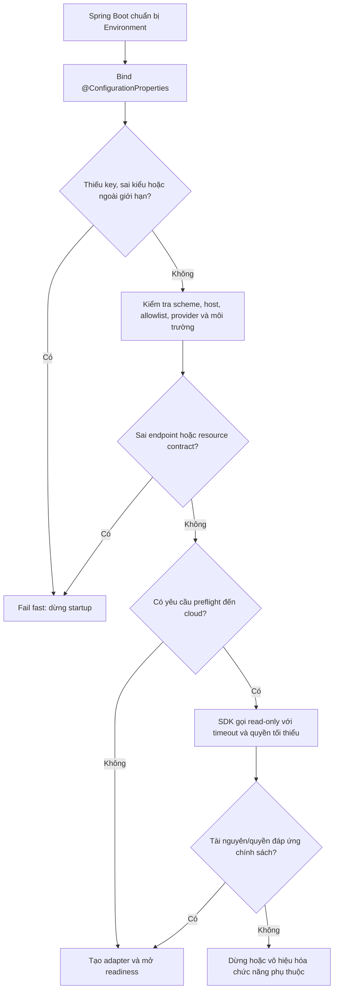

# Kiểm tra giá trị cấu hình và phát hiện sai endpoint từ lúc khởi động

Một ứng dụng Spring Boot có thể khởi động thành công nhưng đang hướng tới **bucket thử nghiệm**, **Azure Storage account của môi trường khác** hoặc **Pub/Sub project không đúng**. Những lỗi này nguy hiểm hơn một lỗi cú pháp rõ ràng: kết nối HTTPS vẫn có thể thành công và SDK vẫn được cấp quyền, nhưng dữ liệu bị đọc/ghi sai vị trí.

Trong mô-đun `SPRING_CLOUD_PROVIDER_INTEGRATION`, khi tích hợp dịch vụ managed của **AWS, Azure và Google Cloud**, cần kiểm tra cấu hình ở **giai đoạn khởi động** trước khi adapter storage, messaging hoặc dữ liệu nhận traffic. Bài học tập trung vào việc kiểm tra **giá trị cấu hình, endpoint, tên tài nguyên, môi trường và danh tính triển khai**; đồng thời phân biệt kiểm tra tĩnh với phép thử kết nối thật đến cloud.

## 1. Endpoint đúng cú pháp chưa chắc đúng đích

Cùng một lỗi cấu hình có thể xuất hiện ở nhiều lớp:

| Lớp kiểm tra | Câu hỏi | Ví dụ lỗi | Phát hiện sớm bằng |
| --- | --- | --- | --- |
| **Tồn tại** | Đã cung cấp giá trị bắt buộc chưa? | Thiếu `STORAGE_TARGET` | Placeholder bắt buộc, `@NotBlank` |
| **Kiểu/ràng buộc** | Có parse được và nằm trong giới hạn? | `connect-timeout=forever` hoặc `-2s` | Binder + Bean Validation |
| **Cú pháp endpoint** | Có phải URI phù hợp? | `ht!tp://...`, thiếu host | `URI` binding và custom validation |
| **Chính sách bảo mật** | Scheme, host, port, đường dẫn có được cho phép? | `http://` trong production, host lạ | Kiểm tra HTTPS, allowlist, port |
| **Khớp provider** | Endpoint có thuộc dịch vụ được chọn không? | Chọn Azure nhưng cấu hình endpoint S3 | Kiểm tra ngữ nghĩa theo provider |
| **Khớp môi trường** | Đúng account/project/region/bucket/topic được cấp? | Ứng dụng prod trỏ vào staging | Đối chiếu với deployment contract/IaC |
| **Tồn tại và quyền truy cập** | Resource có thực và principal có đủ quyền không? | Bucket không tồn tại, IAM trả 403 | Preflight bằng SDK có giới hạn |
| **Đúng nghiệp vụ** | Ghi vào resource này có đúng mục đích? | Bucket hợp lệ nhưng thuộc hệ thống khác | Contract triển khai, kiểm tra owner/labels nếu phù hợp |

**Phải phân biệt ba kết quả:** (1) URI hợp lệ; (2) endpoint có thể kết nối; (3) endpoint trỏ đúng tài nguyên được phép sử dụng. Chỉ kiểm tra `https://...` hoặc nhận HTTP 200 **không chứng minh điều thứ ba**.

Ví dụ:

- `https://storage.googleapis.com` có thể là endpoint hợp lệ của Google Cloud Storage, nhưng tên bucket được cấu hình vẫn có thể thuộc project hoặc môi trường sai.
- `https://myaccount.blob.core.windows.net` là endpoint có dạng quen thuộc của Azure Blob Storage, nhưng `myaccount` có thể là account phát triển thay vì production.
- `https://s3.ap-southeast-1.amazonaws.com` là dạng endpoint S3 thông dụng, nhưng một bucket có thể nằm ở region khác hoặc không cho principal hiện tại truy cập.

Thư viện SDK có thể **tự tìm endpoint** dựa trên region, account, project hoặc metadata. Trong nhiều triển khai production, để SDK chọn endpoint chính thức là đơn giản và ít sai sót hơn việc tự ghi `endpoint-override`. Cấu hình override nên là ngoại lệ có lý do, chẳng hạn emulator, cloud riêng hoặc endpoint đặc thù.

## 2. Tổ chức các bước xác minh từ rẻ đến đắt

Không phải phép kiểm tra nào cũng cần gọi API cloud. Nên ưu tiên xác minh không phát sinh request, sau đó mới cân nhắc kết nối thật.



| Giai đoạn | Khi nào chạy | Có cần credential/mạng? | Khả năng phát hiện |
| --- | --- | --- | --- |
| Bind từ Spring `Environment` | Lúc tạo configuration properties bean | Không | Thiếu key, sai kiểu, default |
| Bean Validation và kiểm tra chéo | Ngay sau binding | Không | Rỗng, sai range, URI/host/provider không hợp lệ |
| Kiểm tra deployment contract | Startup, trước khi ready | Thường không nếu contract có sẵn | Sai environment/account/project/region/target đã biết |
| Preflight qua SDK | Startup nếu được bật | Có | DNS/TLS, resource có tồn tại, quyền đọc cụ thể |
| Integration test ghi/đọc | Trong môi trường thử nghiệm | Có | Quyền thao tác và mapping thực tế |
| Monitoring/health định kỳ | Runtime | Có thể | Thay đổi quyền, network, secret/endpoint sau startup |

**Chính sách quan trọng:** với endpoint hoặc resource bắt buộc, lỗi validation phải dừng khởi động hoặc chặn chức năng phụ thuộc. Đối với một dịch vụ phụ tùy chọn, có thể vào chế độ suy giảm đã được thiết kế rõ. Đừng cố cho toàn bộ ứng dụng ready bằng cách mặc định sang bucket/topic khác.

## 3. Thiết kế hợp đồng cấu hình cho endpoint

Ví dụ ứng dụng có ba adapter lưu trữ: AWS S3, Azure Blob và GCS. Dùng namespace riêng `app.cloud.storage` để biểu diễn **ý định của ứng dụng**, khác với thuộc tính tự động cấu hình do từng Spring Cloud starter cung cấp.

### 3.1. File cấu hình cơ sở

```yaml
# src/main/resources/application.yml
app:
  cloud:
    storage:
      provider: ${CLOUD_PROVIDER}
      target: ${STORAGE_TARGET}
      connect-timeout: 3s
```

- `provider` chọn adapter `AWS`, `AZURE` hoặc `GCP`.
- `target` là **tên bucket** trên AWS/GCP hoặc **tên container** trên Azure. Nó không phải API credential.
- `connect-timeout` là giá trị policy của ứng dụng; SDK **không tự nhận** timeout này trừ khi adapter truyền nó vào cấu hình client.
- Không đặt một giá trị mặc định như `bucket-dev` cho `STORAGE_TARGET` ở production; thiếu biến cần hiện thành lỗi sớm.

Đối với backend sử dụng endpoint mặc định của SDK, **không khai báo override**. Nếu cần endpoint override vì lý do rõ ràng, deployment phải cung cấp cả tên host được phép:

```yaml
# Ví dụ trong profile gcp-prod, chỉ khi thực sự cần override
app:
  cloud:
    storage:
      endpoint-override: https://storage.googleapis.com
      approved-endpoint-host: storage.googleapis.com
```

`approved-endpoint-host` nên lấy từ **deployment contract đã được phê duyệt**, không tự suy diễn từ chính `endpoint-override`. Nếu một người thay đồng thời cả endpoint lẫn approved host bằng cùng một host sai, phép so sánh đơn thuần không thể phát hiện; hãy kiểm soát nguồn cấu hình allowlist bằng IaC, quyền review và môi trường triển khai.

### 3.2. Bean có kiểu và ràng buộc kiểm tra chéo

Ví dụ dưới đây dùng **Spring Boot 3.x, Java 17+ và Jakarta Bean Validation**:

```java
package example.cloud.config;

import jakarta.validation.constraints.AssertTrue;
import jakarta.validation.constraints.NotBlank;
import jakarta.validation.constraints.NotNull;
import org.springframework.boot.context.properties.ConfigurationProperties;
import org.springframework.boot.context.properties.bind.DefaultValue;
import org.springframework.validation.annotation.Validated;

import java.net.URI;
import java.time.Duration;

@Validated
@ConfigurationProperties(prefix = "app.cloud.storage")
public record StorageEndpointProperties(
        @NotNull Provider provider,
        @NotBlank String target,
        @DefaultValue("3s") Duration connectTimeout,
        URI endpointOverride,
        String approvedEndpointHost
) {
    public enum Provider { AWS, AZURE, GCP }

    @AssertTrue(message = "connect-timeout phải lớn hơn 0 và không quá 30s")
    public boolean isConnectTimeoutValid() {
        return connectTimeout != null
                && connectTimeout.compareTo(Duration.ZERO) > 0
                && connectTimeout.compareTo(Duration.ofSeconds(30)) <= 0;
    }

    @AssertTrue(message = "endpoint override không đáp ứng chính sách HTTPS/host")
    public boolean isEndpointOverrideTrusted() {
        if (endpointOverride == null) {
            return true; // Để SDK dùng endpoint mặc định
        }

        String actualHost = endpointOverride.getHost();
        String expectedHost = approvedEndpointHost;

        return "https".equalsIgnoreCase(endpointOverride.getScheme())
                && actualHost != null
                && expectedHost != null
                && !expectedHost.isBlank()
                && actualHost.equalsIgnoreCase(expectedHost.trim())
                && endpointOverride.getRawUserInfo() == null
                && endpointOverride.getRawQuery() == null
                && endpointOverride.getRawFragment() == null
                && (endpointOverride.getRawPath() == null
                    || endpointOverride.getRawPath().isEmpty()
                    || "/".equals(endpointOverride.getRawPath()))
                && (endpointOverride.getPort() == -1
                    || endpointOverride.getPort() == 443);
    }
}
```

Đăng ký bean:

```java
package example.cloud;

import org.springframework.boot.SpringApplication;
import org.springframework.boot.autoconfigure.SpringBootApplication;
import org.springframework.boot.context.properties.ConfigurationPropertiesScan;

@SpringBootApplication
@ConfigurationPropertiesScan
public class ProviderIntegrationApplication {
    public static void main(String[] args) {
        SpringApplication.run(ProviderIntegrationApplication.class, args);
    }
}
```

Cần thêm `spring-boot-starter-validation`. `@ConfigurationPropertiesScan` giúp Spring Boot đăng ký record cấu hình; với record một constructor trên Spring Boot 3, không cần gắn `@Component` hay thêm constructor binding thủ công.

**Ý nghĩa của validation trong ví dụ:**

1. `@NotNull` không cho thiếu `provider`; sai tên enum như `provider: alibabacloud` cũng gây lỗi convert.
2. `@NotBlank` không cho phép tên tài nguyên rỗng.
3. `Duration` đọc `3s`, `250ms`; hàm `isConnectTimeoutValid` chặn giá trị âm, bằng 0 hoặc lớn hơn 30 giây.
4. `URI` giúp nhận ra các địa chỉ không thể parse. Hàm `isEndpointOverrideTrusted` chặn HTTP, host khác allowlist, thông tin user/password nhúng trong URL, query/fragment và cổng không nằm trong chính sách.
5. Khi `endpointOverride == null`, adapter dùng endpoint do cloud SDK chọn theo cấu hình provider đã có; việc thiếu override **không phải lỗi**.
6. **Các hàm `@AssertTrue` là Bean Validation cấp property**; lỗi khiến tạo bean thất bại. Không phải chờ request đầu tiên mới kiểm tra.

Giới hạn: đây là một **chính sách HTTPS nghiêm ngặt cho endpoint override của môi trường production**, chưa phải bộ kiểm tra URL phổ quát. Nó từ chối endpoint `http://localhost:4566` dùng cho emulator. Nếu cần LocalStack/Azurite/fake GCS server trong development, nên có một profile hoặc bộ validator **được giới hạn rõ cho test**, đồng thời bảo đảm không thể kích hoạt quy tắc cho phép HTTP đó ở production.

Hơn nữa, allowlist host không thay thế kiểm tra DNS, chứng chỉ TLS, quyền IAM/RBAC, resource existence hoặc xác minh rằng host chính là endpoint cloud đã được phê duyệt.

## 4. Kiểm tra chéo provider, account, project, region và resource

Phần lớn lỗi “sai endpoint” không nằm ở cú pháp URI. Chúng xảy ra khi một cặp giá trị **hợp lệ riêng lẻ nhưng không nhất quán với nhau**.

| Provider | Cần kiểm tra trước khi ready | Vì sao |
| --- | --- | --- |
| **AWS S3** | Region, tên bucket, mục tiêu IAM role/account, endpoint mặc định hoặc override, môi trường | Region không đúng có thể gây redirect hoặc lỗi ký request; bucket vẫn có thể thuộc môi trường khác |
| **AWS SQS/SNS** | Region, queue URL / queue ARN / topic ARN, account ID, quyền thao tác | Queue URL là endpoint của resource cụ thể; queue name trùng ở account khác vẫn hợp lệ |
| **Azure Blob** | Storage account name, container name, endpoint suffix theo loại Azure cloud, tenant/subscription/resource group dự kiến | `https://<account>.blob.core.windows.net` có thể hợp lệ nhưng là account khác |
| **Azure Service Bus** | Namespace, queue/topic/subscription, tenant/managed identity và endpoint | Namespace hoặc entity có thể thuộc môi trường khác |
| **Google Cloud Storage** | Bucket name, project mà deployment mong đợi, endpoint của SDK, quyền truy cập | Endpoint `storage.googleapis.com` không mã hóa project/bucket nên chỉ nhìn URI không biết đích đúng hay sai |
| **Google Cloud Pub/Sub** | Project ID, topic/subscription resource name và principal | `projects/dev/topics/orders` và `projects/prod/topics/orders` đều có dạng hợp lệ |

### Phân biệt endpoint và định danh resource

- **AWS:** endpoint dịch vụ S3 và `bucket` là hai thông tin khác nhau. AWS SQS còn có **queue URL** gắn với queue cụ thể; URL này phải khớp account/region được chấp nhận.
- **Azure:** host `<account>.blob.core.windows.net` chứa account, còn container nằm trong đường dẫn thao tác. Azure Private Link có thể khiến DNS công khai của resource phân giải tới địa chỉ riêng; không mặc nhiên kết luận “địa chỉ IP nội bộ = endpoint sai”.
- **GCP:** endpoint chung cho GCS và Pub/Sub không đồng nghĩa project đúng; project ID thường nằm trong định danh tài nguyên hoặc cấu hình client.

Đừng viết một regex hostname duy nhất cho cả ba cloud. Những môi trường sovereign cloud, FIPS, dual-stack, Private Link, regional endpoint hoặc domain riêng có quy tắc khác nhau. Hãy lấy danh sách endpoint và domain cho phép từ **thiết kế hạ tầng được phê duyệt** và đối chiếu tài liệu SDK/starter đúng phiên bản.

### Ví dụ phát hiện nhầm môi trường

Giả sử deployment production có hợp đồng:

```yaml
# Các giá trị phi bí mật do deployment contract cung cấp
deployment:
  environment: prod
  aws:
    account-id: "123456789012"   # Ví dụ minh họa
    region: ap-southeast-1
  storage:
    expected-target: documents-prod
```

Một file profile khác vô tình đặt `app.cloud.storage.target=documents-staging`. Cả hai tên bucket đều hợp lệ về mặt cú pháp. Để phát hiện sai, cần so sánh target thực tế với **expected-target** do kênh cấu hình đáng tin cậy cung cấp, hoặc so sánh định danh resource với manifest/IaC đã phê duyệt.

Điều này chỉ có ý nghĩa nếu **giá trị kỳ vọng độc lập với giá trị được kiểm tra**. Đặt `expected-target: ${STORAGE_TARGET}` rồi so với `STORAGE_TARGET` là phép so sánh vòng tròn: hai giá trị có thể sai cùng lúc.

**Ghi chú bảo mật:** Account ID, project ID và tên bucket thường là định danh, không phải secret; tuy vậy chúng có thể tiết lộ topology. Cần tuân thủ giới hạn log và quyền đọc của tổ chức.

## 5. Phát hiện endpoint giả mạo và URI nguy hiểm

Ngay cả khi endpoint được cung cấp qua biến môi trường hoặc config service nội bộ, ứng dụng vẫn nên chống lỗi nhập liệu và ghi đè nhầm.

Một số chuỗi dễ gây hiểu nhầm:

| URI được nhập | Vấn đề | Quy tắc phòng ngừa |
| --- | --- | --- |
| `http://storage.example.com` | Không dùng TLS trong production | Chỉ chấp nhận `https` trừ profile thử nghiệm được cách ly |
| `https://storage.googleapis.com.evil.example` | Có tên domain thật như một phần chuỗi nhưng host là domain khác | So sánh host chính xác hoặc theo suffix kèm ranh giới domain |
| `https://good.example@evil.example` | `good.example` nằm ở userinfo, host thực là `evil.example` | Dùng parser URI, từ chối userinfo |
| `https://approved.example/path?token=...` | URL chứa token/query hoặc đường dẫn ngoài phạm vi endpoint gốc | Từ chối query/fragment/path nếu API không cần chúng |
| `https://127.0.0.1:9443` | Có thể hướng vào service không mong muốn | Không cho phép loopback/IP nếu không thuộc cấu hình test rõ ràng |
| `https://account.blob.core.windows.net` | Đúng mẫu Azure Blob nhưng có thể sai account | Đối chiếu account với deployment contract |
| `https://storage.googleapis.com` | Endpoint GCS chung hợp lệ nhưng có thể gửi tới bucket sai | Kiểm tra tên bucket/project/principal riêng |

Không dùng biểu thức kiểu `host.contains("amazonaws.com")` hoặc `host.endsWith("amazonaws.com")` để làm allowlist: `badamazonaws.com` có thể vượt qua cách kiểm tra hậu tố ngây thơ. Nếu bắt buộc hỗ trợ nhiều subdomain, cần kiểm tra `host.equals(base)` hoặc `host.endsWith("." + base)` cùng chính sách chặt về scheme/port.

**Điểm giới hạn:** URI/hostname validation không chứng minh DNS đang trỏ tới hạ tầng đúng, không loại bỏ mọi kiểu tấn công mạng và không thay thế TLS certificate validation. Nếu cho phép custom endpoint lấy từ nguồn kém tin cậy, cần thêm các ràng buộc chống SSRF, kiểm soát redirect, mạng egress và chính sách resolution phù hợp. Không nên tắt kiểm tra chứng chỉ TLS để chữa lỗi kết nối.

## 6. Kiểm tra bằng network preflight qua SDK: lợi ích và chi phí

Sau khi mọi giá trị đã hợp lệ, hệ thống vẫn có thể gặp lỗi tài nguyên không tồn tại, endpoint không kết nối được hoặc principal thiếu quyền. Có thể thực hiện **preflight không ghi dữ liệu** trước khi đánh dấu ready, nhưng đây là lựa chọn kiến trúc, không phải bước bắt buộc cho mọi ứng dụng.

| Provider | Phép thử read-only điển hình | Cần lưu ý |
| --- | --- | --- |
| AWS S3 | `S3Client.headBucket(...)` trên bucket đã cấu hình | Có thể cần quyền `s3:ListBucket`; 403 và 404 không phải lúc nào phân biệt được theo phản hồi tổng quát |
| Azure Blob | `BlobContainerClient.exists()` hoặc đọc thuộc tính container | Cần quyền đọc metadata tương ứng; 403 phải được xem như lỗi quyền |
| GCS | `Storage.get(bucketName)` hoặc đọc metadata bucket | Cần quyền như `storage.buckets.get`; thiếu quyền không chứng minh bucket không tồn tại |
| AWS SQS | Đọc attributes/kiểm tra queue URL bằng API phù hợp | Cần quyền đọc queue attributes; không dùng URL từ môi trường khác |
| Azure Service Bus | Management client đọc metadata entity | Quyền quản lý/đọc metadata có thể khác quyền send/receive |
| GCP Pub/Sub | Admin client đọc metadata topic/subscription | Cần quyền get; không đồng nghĩa có quyền publish/subscribe |

**Preflight chỉ chứng minh operation đã thực hiện tại thời điểm đó thành công.** Một HEAD bucket thành công không chứng minh ứng dụng có quyền `PutObject`, không chứng minh đúng tên object prefix và cũng không bảo đảm quyền sẽ không bị thu hồi sau đó.

Các đánh đổi cần quyết định:

- **Startup latency:** gọi mạng làm tăng thời gian ready; timeout phải hữu hạn.
- **IAM least privilege:** một phép read-only metadata có thể yêu cầu quyền bổ sung mà luồng ghi bình thường không cần. Không tự cấp quyền rộng chỉ để health check qua được.
- **Hiệu ứng đám đông:** hàng trăm instance khởi động đồng thời có thể tăng tải dịch vụ. Nên giới hạn retry và dùng backoff.
- **Chi phí và giới hạn API:** metadata call có thể bị tính phí hoặc rate limit tùy provider.
- **Kiểm tra phụ thuộc:** nếu cloud bắt buộc nhưng đang tạm thời unavailable, startup có thể fail theo chính sách; với tích hợp tùy chọn, tránh ngăn toàn bộ ứng dụng nhận traffic.

Nếu preflight cần thực hiện thật, nên đặt trong một startup component có timeout/exception handling và **phạm vi rõ ràng**, ví dụ `ApplicationRunner` cho phép fail startup khi resource bắt buộc không đáp ứng. Với hệ thống phải sẵn sàng cho nhiều loại traffic, có thể phản ánh trạng thái bằng `HealthIndicator`/readiness chi tiết thay vì buộc mọi dịch vụ phụ vào liveness.

### Pseudocode chính sách startup preflight

```java
// Phác thảo quy trình; các hàm adapter và policy do ứng dụng định nghĩa.
// Không phải một API sẵn có của Spring Cloud.
void verifyBeforeAcceptingTraffic(StorageAdapter adapter,
                                  StorageEndpointProperties config,
                                  PreflightPolicy policy) {
    verifyLocalConfigurationAndDeploymentContract(config);

    if (!policy.isRemoteCheckRequired()) {
        return;
    }

    // Adapter dùng SDK và timeout giới hạn để đọc metadata, không ghi object.
    CheckResult result = adapter.checkTargetMetadata();

    if (!result.isAcceptableFor(policy)) {
        throw new IllegalStateException(
                "Storage endpoint preflight failed: "
                + result.getSafeFailureCode()
        );
    }
}
```

Không log credential, chuỗi kết nối có token hoặc toàn bộ endpoint chứa thông tin nhạy cảm trong exception. Cần phân biệt `NOT_FOUND`, `ACCESS_DENIED`, `TLS_ERROR`, `TIMEOUT` và `WRONG_ENVIRONMENT` trong kết quả an toàn để vận hành chẩn đoán.

## 7. Test binding và endpoint policy mà không cần cloud account

Có thể phát hiện phần lớn lỗi cấu hình bằng một Spring context tối giản, không khởi tạo SDK client. Ví dụ JUnit 5, AssertJ và `ApplicationContextRunner` (thuộc `spring-boot-test`):

```java
package example.cloud.config;

import org.junit.jupiter.api.Test;
import org.springframework.boot.context.properties.EnableConfigurationProperties;
import org.springframework.boot.test.context.runner.ApplicationContextRunner;
import org.springframework.context.annotation.Configuration;

import static org.assertj.core.api.Assertions.assertThat;

class StorageEndpointPropertiesTest {
    private final ApplicationContextRunner runner =
            new ApplicationContextRunner()
                    .withUserConfiguration(TestConfig.class);

    @Test
    void acceptsSecureApprovedEndpoint() {
        runner.withPropertyValues(
                "app.cloud.storage.provider=gcp",
                "app.cloud.storage.target=documents-test",
                "app.cloud.storage.connect-timeout=4s",
                "app.cloud.storage.endpoint-override=https://storage.googleapis.com",
                "app.cloud.storage.approved-endpoint-host=storage.googleapis.com"
        ).run(context -> {
            assertThat(context).hasNotFailed();
            StorageEndpointProperties p =
                    context.getBean(StorageEndpointProperties.class);
            assertThat(p.provider())
                    .isEqualTo(StorageEndpointProperties.Provider.GCP);
            assertThat(p.connectTimeout().getSeconds()).isEqualTo(4);
        });
    }

    @Test
    void rejectsUnexpectedHostname() {
        runner.withPropertyValues(
                "app.cloud.storage.provider=gcp",
                "app.cloud.storage.target=documents-test",
                "app.cloud.storage.endpoint-override=https://storage.googleapis.com.evil.example",
                "app.cloud.storage.approved-endpoint-host=storage.googleapis.com"
        ).run(context -> assertThat(context).hasFailed());
    }

    @Test
    void rejectsHttpEndpointInProductionPolicy() {
        runner.withPropertyValues(
                "app.cloud.storage.provider=aws",
                "app.cloud.storage.target=documents-test",
                "app.cloud.storage.endpoint-override=http://localhost:4566",
                "app.cloud.storage.approved-endpoint-host=localhost"
        ).run(context -> assertThat(context).hasFailed());
    }

    @Test
    void rejectsMissingResourceName() {
        runner.withPropertyValues("app.cloud.storage.provider=azure")
                .run(context -> assertThat(context).hasFailed());
    }

    @Test
    void rejectsInvalidTimeout() {
        runner.withPropertyValues(
                "app.cloud.storage.provider=aws",
                "app.cloud.storage.target=documents-test",
                "app.cloud.storage.connect-timeout=0s"
        ).run(context -> assertThat(context).hasFailed());
    }

    @Configuration(proxyBeanMethods = false)
    @EnableConfigurationProperties(StorageEndpointProperties.class)
    static class TestConfig {}
}
```

Những test này kiểm tra **binding và Bean Validation**; chúng không chứng minh SDK đã kết nối đúng endpoint, không xác nhận bucket/container có thật và không kiểm tra quyền IAM/RBAC. Để xác nhận Config Data profile/`spring.config.import` thật sự được nạp, cần có integration test khởi động qua quy trình Config Data tương ứng, thay vì chỉ dùng property values giả lập.

### Ma trận kiểm thử endpoint theo từng môi trường

| Trường hợp | Kiểm thử tại đâu | Kết quả kỳ vọng |
| --- | --- | --- |
| Thiếu `STORAGE_TARGET` | Unit/context test | Không tạo bean hợp lệ; startup fail |
| `provider: unknown` | Unit/context test | Binding enum thất bại |
| Timeout bằng 0 hoặc quá 30s | Unit/context test | Bean Validation thất bại |
| Endpoint override dùng HTTP trong production | Unit/context test | Không qua chính sách HTTPS |
| Endpoint có host tương tự allowlist nhưng thực tế khác | Unit/context test | Bị từ chối |
| Endpoint có `userinfo` hoặc query token | Unit/context test | Bị từ chối |
| Profile AWS nhưng resource contract thuộc Azure/GCP | Cross-field/deployment test | Không đánh dấu ready |
| Production target trỏ vào bucket staging hợp lệ | Deployment contract test | Phát hiện sai target dù URL hợp lệ |
| DNS/TLS endpoint không hoạt động | Integration test có mạng | Phân loại lỗi kết nối |
| Bucket tồn tại nhưng principal không có quyền đọc metadata | Integration test có quyền giới hạn | Phát hiện `ACCESS_DENIED`, không báo nhầm `NOT_FOUND` |
| Preflight đọc metadata thành công nhưng không có quyền ghi | Integration test thao tác thực trong sandbox | Xác nhận metadata check không thay thế kiểm tra quyền ghi |
| Endpoint được thay đổi sau startup | Test refresh/rollout | Xác định khi nào bean/client nhận endpoint mới |

Không dùng resource production để thử ghi/xóa. Đối với test thao tác thật, tạo bucket/container/topic thử nghiệm trong tài khoản hoặc project test, cấp quyền tối thiểu, đặt TTL/dọn dẹp và tách dữ liệu khỏi hệ thống thật.

## 8. Chẩn đoán sai endpoint khi ứng dụng không qua startup

Gợi ý phân nhóm lỗi theo thời điểm:

| Triệu chứng | Nguyên nhân thường gặp | Hành động |
| --- | --- | --- |
| `BindException` / lỗi convert property | Sai tên key, enum, URI hoặc `Duration` | Xem property origin và cú pháp |
| Bean Validation báo `endpointOverrideTrusted=false` | Scheme/host/port/path không hợp lệ | Kiểm tra hostname thật, allowlist và profile |
| Cấu hình AWS region khác bucket region | Sai region hoặc deployment contract | So sánh region đã duyệt và SDK region resolver |
| Azure kết nối đúng host nhưng sai account | Tên storage account của môi trường khác | So sánh account/name với IaC output |
| GCP dùng đúng `storage.googleapis.com` nhưng sai bucket | Target/project bị ghi đè | Kiểm tra `STORAGE_TARGET`, project và principal |
| DNS không resolve | Network, VPC/Private DNS hoặc endpoint sai | Kiểm tra DNS tại môi trường chạy |
| TLS handshake thất bại | Sai hostname/certificate/trust store | Kiểm tra hostname và chuỗi chứng chỉ, không tắt TLS verification |
| `403 AccessDenied/Forbidden` | Thiếu quyền hoặc principal sai | Đối chiếu workload identity và IAM/RBAC |
| `404 NotFound` | Sai resource, region hoặc quyền có thể che giấu thông tin | Kiểm chứng theo đặc điểm API và quyền provider |
| Health/preflight làm mọi instance khởi động chậm | Timeout/retry quá lớn hoặc provider đang có sự cố | Giới hạn ngân sách retry, phân loại mức bắt buộc |
| Config đúng trên laptop, sai trên cluster | External file/env/CLI/Config Server ghi đè | Xem active profile và origin của property |

Dùng Spring Boot Actuator `/actuator/env` hoặc `/actuator/configprops` trong môi trường có **xác thực và phân quyền** để xem property sources và origin khi phù hợp. Không công khai các endpoint này, không bật hiển thị toàn bộ secret và không log cấu hình nguyên vẹn. Một `endpoint` có token nhúng hoặc signed URL phải được xem như secret khi ghi log.

Một thông điệp lỗi phù hợp hơn việc in cả object cấu hình:

```text
endpoint_preflight_failed
provider=azure
operation=BlobContainerMetadataCheck
resourceAlias=documents-archive
category=WRONG_ENVIRONMENT
expectedDeployment=prod
requestId=<safe-correlation-id>
```

Nếu giá trị endpoint hoặc identifier bản thân được tổ chức xem là nhạy cảm, dùng `resourceAlias` thay cho tên đầy đủ; với lỗi quyền, giữ request ID của cloud (nếu an toàn) để đối chiếu audit log.

## 9. Bài thực hành tích hợp ba provider

Giả sử cùng một ứng dụng phát hành chứng từ chạy trên AWS S3, Azure Blob và GCS. Mỗi deployment dùng profile riêng và resource được tạo qua IaC.

1. **Định nghĩa contract.** Chọn `provider`, `storage.target`, region/account/project dự kiến, timeout và quy tắc endpoint. Phân biệt endpoint service với định danh bucket/container.
2. **Viết `@ConfigurationProperties`.** Dùng record như phần 3, thêm kiểm tra bắt buộc, kiểu dữ liệu và chính sách endpoint override; bật validation tại startup.
3. **Thử cấu hình sai.** Thiếu target, region/account không tương thích, host HTTPS sai, HTTP emulator trong profile production và URI chứa `userinfo`.
4. **Ràng buộc đúng môi trường.** Đưa expected target/account/project từ deployment manifest hoặc IaC output tin cậy; kiểm tra không có cấu hình staging ghi đè production.
5. **Tạo adapter riêng.** AWS adapter dùng SDK S3, Azure adapter dùng Blob client, GCP adapter dùng Storage client. Mỗi adapter thực hiện phép kiểm tra ngữ nghĩa riêng cho target và endpoint do starter cung cấp.
6. **Thêm preflight có kiểm soát** nếu quy trình vận hành yêu cầu: đọc metadata resource bằng credential của workload, đặt timeout/retry hữu hạn, báo lỗi an toàn; lưu ý quyền read metadata khác quyền write.
7. **Kiểm thử tích hợp trong sandbox.** Thử resource sai, quyền thiếu, endpoint unavailable, sửa DNS/profile; ghi nhận startup/readiness, mã lỗi và thời gian phục hồi.
8. **Đánh giá khi thay cloud.** Chỉ ra những ràng buộc dùng chung (cú pháp, TLS, allowlist, timeout) và những kiểm tra phải thay theo provider (AWS region, Azure account/namespace, GCP project/topic).

**Tiêu chí hoàn thành:** ứng dụng từ chối giá trị cấu hình thiếu hoặc nguy hiểm trước khi phục vụ request; hợp đồng triển khai phát hiện đích hợp lệ nhưng sai môi trường; preflight, nếu được bật, chỉ đưa ra kết luận đúng với operation được kiểm tra; log và health hỗ trợ chẩn đoán mà không làm lộ credentials.

## 10. Ghi nhớ

- **Endpoint đúng cú pháp chưa đủ**: phải kiểm tra scheme, hostname, port, provider và **resource/environment đích**.
- `@ConfigurationProperties` kết hợp `@Validated` và Bean Validation phát hiện sớm sai kiểu, thiếu giá trị, timeout bất thường và endpoint override không được cho phép.
- **Allowlist là chính sách độc lập**; so sánh hai biến cùng lấy từ một nguồn sai không bảo đảm phát hiện nhầm production/staging.
- **SDK endpoint mặc định thường nên được ưu tiên** nếu không có yêu cầu override. Endpoint, region, account, project và tên bucket/topic/container là những yếu tố liên quan nhưng khác nhau.
- **Preflight qua cloud SDK là tùy chọn có đánh đổi**: cần mạng, credential, quyền metadata, timeout và chi phí; thành công của một phép read-only không chứng minh quyền thao tác nghiệp vụ đầy đủ.
- Kết hợp **validation tĩnh, deployment contract, integration test và giám sát runtime** để giảm rủi ro kết nối sai cloud provider hoặc ghi dữ liệu vào nhầm tài nguyên.
