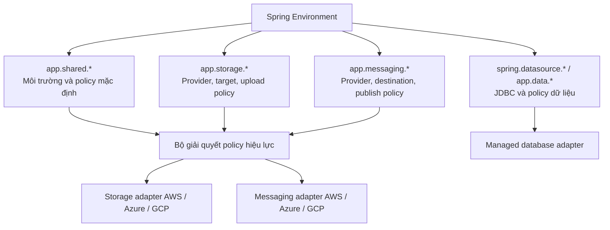

# Tách cấu hình toàn cục với cấu hình riêng của từng dịch vụ

Một ứng dụng Spring Boot có thể cùng lúc ghi tài liệu lên **Amazon S3**, phát sự kiện qua **Google Cloud Pub/Sub** và đọc dữ liệu từ một database managed trên **Azure**. Các tích hợp này có thể chia sẻ thông tin về môi trường triển khai, mức timeout mặc định hoặc nhãn quan sát. Tuy nhiên, mỗi dịch vụ cần **định danh tài nguyên, quyền truy cập, thông số kết nối và chính sách lỗi** của riêng mình.

Nếu gom mọi giá trị vào các key mơ hồ như `cloud.region`, `cloud.endpoint` hoặc `app.retry`, một thay đổi nhỏ cho storage có thể làm messaging hoạt động khác dự định. Ngược lại, nếu sao chép tất cả default vào từng adapter, cấu hình dễ bị lệch qua thời gian. Giải pháp là **tách hợp đồng cấu hình dùng chung khỏi hợp đồng cấu hình từng dịch vụ**, chỉ cho phép dùng chung những thông tin thực sự có ý nghĩa chung.

Bài này thuộc phần **Cấu hình ứng dụng** của mô-đun `SPRING_CLOUD_PROVIDER_INTEGRATION`: thực hành tích hợp Spring Boot với các dịch vụ managed AWS, Azure và Google Cloud, bao gồm storage, messaging, dữ liệu, danh tính, quyền, bảo vệ secret và kiểm thử.

## 1. Thế nào là cấu hình toàn cục, thế nào là cấu hình dịch vụ?

**Cấu hình toàn cục** (*shared/application-wide configuration*) áp dụng như một chính sách chung được các thành phần chủ động sử dụng. Nó có thể gồm tên môi trường triển khai, nhãn ứng dụng, timeout mặc định được phê duyệt hoặc cờ quan sát áp dụng toàn hệ thống.

**Cấu hình riêng của dịch vụ** (*service-specific configuration*) mô tả một tích hợp cụ thể, chẳng hạn S3 bucket, Azure Blob container, Pub/Sub topic, JDBC URL, credential source và cách retry của adapter.

| Thuộc tính | Phạm vi phù hợp | Lý do |
| --- | --- | --- |
| `app.shared.environment` | Toàn ứng dụng | Cùng một instance cần biết mình thuộc dev/staging/prod |
| `app.shared.default-timeout` | Mặc định chung, sử dụng có chủ đích | Cho phép service không có override kế thừa thông qua logic do ứng dụng viết |
| `app.shared.default-max-attempts` | Giá trị gợi ý chung | Chỉ áp dụng cho adapter đã đồng ý dùng chính sách này |
| `app.storage.provider` | Riêng storage | Storage có thể dùng AWS trong khi messaging dùng GCP |
| `app.storage.target` | Riêng storage | S3/GCS bucket hoặc Azure Blob container |
| `app.storage.operation-timeout` | Riêng storage | Upload/download có đặc điểm khác thao tác messaging |
| `app.messaging.provider` | Riêng messaging | Không nhất thiết giống storage |
| `app.messaging.destination` | Riêng messaging | Queue URL, tên entity hay Pub/Sub resource name tùy adapter |
| `app.messaging.publish-timeout` | Riêng messaging | Publish và xác nhận nhận message có semantics riêng |
| `spring.datasource.url` | Riêng datasource/JDBC | Là thuộc tính của Spring Boot datasource auto-configuration |
| `spring.cloud.aws.*`, `spring.cloud.azure.*`, `spring.cloud.gcp.*` | Riêng starter/provider | Do thư viện tích hợp quy định, không phải namespace nghiệp vụ |

Ba quy tắc thiết kế:

1. **Dùng chung khi cùng một định nghĩa.** `environment=prod` có cùng ý nghĩa với mọi adapter. Trái lại, `region=ap-southeast-1` có thể là AWS region nhưng không biểu diễn đúng Azure region hoặc GCP location trong mọi trường hợp.
2. **Đặt quyền sở hữu cạnh nơi sử dụng.** Tên bucket thuộc storage; tên topic thuộc messaging; connection pool thuộc datasource. Đừng để cấu hình của một dịch vụ đổi ý nghĩa khi provider khác được chọn.
3. **Không coi key có chung tên là có chung semantics.** `retry.max-attempts=3` của S3 không tự tương đương `max-attempts=3` của consumer Pub/Sub: một bên có thể retry request idempotent, bên kia làm phát lại thông điệp.



Sơ đồ thể hiện **logic ứng dụng tự xây dựng**. Spring Boot không tự kết hợp `app.shared.default-timeout` với `app.storage.operation-timeout` nếu lập trình viên chưa viết quy tắc kết hợp.

## 2. Cấu trúc namespace rõ ràng cho nhiều tích hợp

Một cấu trúc đơn giản, dễ tìm và dễ kiểm thử:

```text
app
├── shared
│   ├── environment
│   ├── default-timeout
│   └── default-max-attempts
├── storage
│   ├── enabled
│   ├── provider
│   ├── target
│   ├── operation-timeout
│   └── max-attempts
├── messaging
│   ├── enabled
│   ├── provider
│   ├── destination
│   └── publish-timeout
└── data
    ├── enabled
    └── query-timeout
```

Trong đó:

- **`app.shared.*`** chứa những giá trị của ứng dụng, không chứa tài nguyên riêng của S3 hoặc Pub/Sub.
- **`app.storage.*`, `app.messaging.*`, `app.data.*`** là hợp đồng nghiệp vụ do đội phát triển định nghĩa. Mỗi adapter biết mình cần key nào.
- **`spring.datasource.*`** và các **`spring.cloud.<provider>.*`** là cấu hình do Spring Boot/starter sở hữu; tên và mức hỗ trợ phụ thuộc dependency cùng phiên bản tương thích.

Ví dụ `application.yml`:

```yaml
app:
  shared:
    environment: ${APP_ENVIRONMENT}
    default-timeout: 5s
    default-max-attempts: 3

  storage:
    enabled: true
    provider: aws
    target: ${STORAGE_TARGET}
    operation-timeout: 12s
    # Không khai báo max-attempts: dùng default chung nếu adapter hỗ trợ.

  messaging:
    enabled: true
    provider: gcp
    destination: ${MESSAGING_DESTINATION}
    # Không khai báo publish-timeout: policy ứng dụng sẽ chọn 5s.

  data:
    enabled: false
```

Với ví dụ trên, storage dùng AWS S3 còn messaging dùng GCP Pub/Sub. Không có trường `app.shared.provider`, vì **mỗi dịch vụ có thể chọn một cloud khác nhau**. `APP_ENVIRONMENT` là biến triển khai bắt buộc để tránh khởi động trong production với nhãn môi trường mặc định không mong muốn.

Nội dung `app.data.*` minh họa namespace dành cho chính sách dữ liệu **do ứng dụng sở hữu**. Nếu dùng Spring Boot JDBC auto-configuration, các thông tin như URL, username và cách dựng datasource tiếp tục dùng `spring.datasource.*` hoặc API cấu hình datasource tương ứng. Không khai báo `app.data.query-timeout` rồi giả định Spring sẽ tự áp dụng timeout đó cho mọi câu SQL.

### Bảng nguồn sở hữu và trách nhiệm

| Vùng cấu hình | Ai định nghĩa key? | Ai đọc key? | Ai áp dụng nó? |
| --- | --- | --- | --- |
| `app.shared.*` | Đội phát triển ứng dụng | `SharedProperties` | Service/adapter có lựa chọn dùng policy chung |
| `app.storage.*` | Đội phát triển ứng dụng | `StorageProperties` | Storage adapter và policy storage |
| `app.messaging.*` | Đội phát triển ứng dụng | `MessagingProperties` | Messaging adapter và policy messaging |
| `spring.datasource.*` | Spring Boot / thư viện datasource | Auto-configuration hoặc bean datasource | Connection pool/driver |
| `spring.cloud.aws.*` | Spring Cloud AWS | AWS auto-configuration | AWS SDK client và adapter |
| `spring.cloud.azure.*` | Spring Cloud Azure | Azure auto-configuration | Azure SDK client và adapter |
| `spring.cloud.gcp.*` | Spring Cloud GCP | GCP auto-configuration | Google Cloud SDK client và adapter |

Các prefix nêu trên là **nhóm điển hình**, không có nghĩa mọi property con đều tồn tại ở mọi version. Khi triển khai, chọn đúng BOM/starter tương thích và đối chiếu property metadata thực tế của phiên bản.

## 3. Không có cơ chế “tự kế thừa” giữa hai namespace

Trong Spring Boot, `app.storage.operation-timeout` và `app.shared.default-timeout` là **hai key độc lập**. Chúng không có quan hệ cha/con hay kế thừa do tên property.

Vì vậy cần định nghĩa **quy tắc giải quyết giá trị hiệu lực**:

```text
effectiveStorageTimeout =
    storage.operationTimeout nếu đã khai báo
    ngược lại dùng shared.defaultTimeout

effectiveMessagingPublishTimeout =
    messaging.publishTimeout nếu đã khai báo
    ngược lại dùng shared.defaultTimeout
```

Nếu một service cần policy hoàn toàn khác (ví dụ timeout tối đa 2 giây để tránh chậm hàng đợi), nó có thể đặt override bắt buộc và **không dùng default chung**.

| Shared default | Storage override | Messaging override | Storage hiệu lực | Messaging hiệu lực |
| --- | --- | --- | --- | --- |
| `5s` | `12s` | Không đặt | **`12s`** | **`5s`** |
| `5s` | Không đặt | `2s` | **`5s`** | **`2s`** |
| `8s` | `12s` | Không đặt | **`12s`** | **`8s`** |

Một thay đổi ở cấu hình toàn cục chỉ ảnh hưởng những dịch vụ **đang sử dụng fallback đó**. Đây là một quan hệ phụ thuộc nên được thể hiện trong code, tài liệu triển khai và test, thay vì ngầm hiểu từ YAML.

### Phân biệt fallback ứng dụng với thứ tự ưu tiên property source

Khi cùng một key `app.storage.operation-timeout` xuất hiện trong file YAML, environment và command-line, Spring Boot trước hết chọn **giá trị thắng theo độ ưu tiên nguồn**. Sau đó code ứng dụng mới quyết định dùng key đã resolve hay chuyển sang `app.shared.default-timeout`.

Ví dụ:

```text
app.shared.default-timeout=5s        (application.yml)
app.storage.operation-timeout=12s    (application.yml)
APP_STORAGE_OPERATIONTIMEOUT=7s      (OS environment)
--app.storage.operation-timeout=4s   (command line)
```

Kết quả `app.storage.operation-timeout` là `4s` và storage dùng `4s`; global `5s` không tham gia vì storage đã có giá trị cụ thể. Nếu xóa mọi khai báo `app.storage.operation-timeout`, service mới dùng `5s` theo logic fallback.

**Không nhầm “ưu tiên giữa nguồn config” với “ưu tiên giữa policy chung và policy riêng”.** Đó là hai bước giải quyết khác nhau.

## 4. Binding thành bean có kiểu bằng `@ConfigurationProperties`

Ví dụ dùng **Spring Boot 3.x và Java 17+**, với `spring-boot-starter-validation` để kiểm tra dữ liệu cấu hình. Ta định nghĩa các bean độc lập theo namespace.

### 4.1. Enum dùng chung về cloud provider

Nếu cùng một tập giá trị provider được sử dụng giữa các adapter, có thể dùng enum:

```java
package example.cloud.config;

public enum CloudProvider {
    AWS, AZURE, GCP
}
```

Enum ở đây giúp kiểm tra giá trị đầu vào; nó **không buộc** mọi dịch vụ dùng cùng một provider. Mỗi `StorageProperties` và `MessagingProperties` vẫn có field `provider` riêng.

### 4.2. Bean cấu hình toàn cục

```java
package example.cloud.config;

import jakarta.validation.constraints.AssertTrue;
import jakarta.validation.constraints.Max;
import jakarta.validation.constraints.Min;
import jakarta.validation.constraints.NotBlank;
import org.springframework.boot.context.properties.ConfigurationProperties;
import org.springframework.boot.context.properties.bind.DefaultValue;
import org.springframework.validation.annotation.Validated;

import java.time.Duration;

@Validated
@ConfigurationProperties(prefix = "app.shared")
public record SharedProperties(
        @NotBlank String environment,
        @DefaultValue("5s") Duration defaultTimeout,
        @Min(1) @Max(10) @DefaultValue("3") int defaultMaxAttempts
) {
    @AssertTrue(message = "app.shared.default-timeout phải > 0")
    public boolean isDefaultTimeoutValid() {
        return defaultTimeout != null
                && defaultTimeout.compareTo(Duration.ZERO) > 0;
    }
}
```

Ở đây, `Duration` nhận các chuỗi như `5s`, `500ms`. `@DefaultValue` của record định nghĩa default khi property không được cung cấp. `@NotBlank` buộc deployment cung cấp môi trường, còn `@Min`/`@Max` ngăn giới hạn retry không hợp lý.

**Cần phân biệt:** `defaultMaxAttempts` là ý định ứng dụng. Nó không tự cấu hình retry của AWS SDK, Azure SDK, Google Cloud SDK hoặc message consumer. Các SDK thường có chính sách retry riêng, nên adapter phải giải thích cách áp dụng để tránh retry chồng lớp hoặc xử lý lại thông điệp ngoài dự kiến.

### 4.3. Bean dành riêng cho storage

```java
package example.cloud.config;

import jakarta.validation.constraints.AssertTrue;
import jakarta.validation.constraints.Max;
import jakarta.validation.constraints.Min;
import org.springframework.boot.context.properties.ConfigurationProperties;
import org.springframework.boot.context.properties.bind.DefaultValue;
import org.springframework.validation.annotation.Validated;

import java.time.Duration;

@Validated
@ConfigurationProperties(prefix = "app.storage")
public record StorageProperties(
        @DefaultValue("false") boolean enabled,
        CloudProvider provider,
        String target,
        Duration operationTimeout,
        @Min(1) @Max(10) Integer maxAttempts
) {
    @AssertTrue(message = "storage bật phải có provider và target")
    public boolean isRequiredWhenEnabled() {
        return !enabled
                || (provider != null && target != null && !target.isBlank());
    }

    @AssertTrue(message = "storage operation-timeout phải > 0")
    public boolean isOperationTimeoutValid() {
        return operationTimeout == null
                || operationTimeout.compareTo(Duration.ZERO) > 0;
    }
}
```

`Integer maxAttempts` được dùng thay cho `int` để biểu diễn rõ trường hợp **không đặt override** (`null`). Nếu dùng kiểu nguyên thủy `int` với mặc định 0, việc phân biệt “người dùng chọn 0” và “không có key” khó hơn.

`enabled=false` cho phép tắt một tích hợp khi môi trường không sử dụng nó. Khi bật, validator kiểm tra `provider` và `target`. **Lưu ý:** validation khi tắt không tự vô hiệu hóa auto-configuration của cloud starter; cần kiểm soát việc tạo adapter/client riêng.

### 4.4. Bean dành riêng cho messaging

```java
package example.cloud.config;

import jakarta.validation.constraints.AssertTrue;
import org.springframework.boot.context.properties.ConfigurationProperties;
import org.springframework.boot.context.properties.bind.DefaultValue;
import org.springframework.validation.annotation.Validated;

import java.time.Duration;

@Validated
@ConfigurationProperties(prefix = "app.messaging")
public record MessagingProperties(
        @DefaultValue("false") boolean enabled,
        CloudProvider provider,
        String destination,
        Duration publishTimeout
) {
    @AssertTrue(message = "messaging bật phải có provider và destination")
    public boolean isRequiredWhenEnabled() {
        return !enabled
                || (provider != null
                    && destination != null
                    && !destination.isBlank());
    }

    @AssertTrue(message = "messaging publish-timeout phải > 0")
    public boolean isPublishTimeoutValid() {
        return publishTimeout == null
                || publishTimeout.compareTo(Duration.ZERO) > 0;
    }
}
```

Chính sách messaging có thể bổ sung các trường **riêng của nó** như batch size, timeout publish hoặc idempotency key. Không nên tái sử dụng một record `Retry` của storage cho consumer messaging nếu hai luồng xử lý không có cùng quy tắc nhận lại thông điệp.

### 4.5. Đăng ký các configuration-properties bean

```java
package example.cloud;

import org.springframework.boot.SpringApplication;
import org.springframework.boot.autoconfigure.SpringBootApplication;
import org.springframework.boot.context.properties.ConfigurationPropertiesScan;

@SpringBootApplication
@ConfigurationPropertiesScan("example.cloud.config")
public class ProviderIntegrationApplication {
    public static void main(String[] args) {
        SpringApplication.run(ProviderIntegrationApplication.class, args);
    }
}
```

Có thể dùng `@EnableConfigurationProperties({SharedProperties.class, StorageProperties.class, MessagingProperties.class})` trên một lớp `@Configuration` thay thế scan. Với record một constructor của Spring Boot 3, không cần gắn `@Component` trên configuration-properties class.

## 5. Giải quyết policy dùng chung và override bằng code rõ ràng

Một lớp độc lập xử lý precedence giữa policy chung và policy storage:

```java
package example.cloud.storage;

import example.cloud.config.SharedProperties;
import example.cloud.config.StorageProperties;
import org.springframework.stereotype.Component;

import java.time.Duration;

@Component
public final class StoragePolicy {
    private final SharedProperties shared;
    private final StorageProperties storage;

    public StoragePolicy(SharedProperties shared, StorageProperties storage) {
        this.shared = shared;
        this.storage = storage;
    }

    public Duration effectiveTimeout() {
        return storage.operationTimeout() != null
                ? storage.operationTimeout()
                : shared.defaultTimeout();
    }

    public int effectiveMaxAttempts() {
        return storage.maxAttempts() != null
                ? storage.maxAttempts()
                : shared.defaultMaxAttempts();
    }
}
```

Đây là **quy tắc của ứng dụng**, không phải hành vi tự động của `@ConfigurationProperties`. Khi adapter cần timeout, nó gọi `StoragePolicy.effectiveTimeout()` rồi chuyển giá trị này sang cấu hình client hoặc lời gọi SDK **theo API cụ thể của provider**.

Với messaging, có thể định nghĩa `MessagingPolicy.effectivePublishTimeout()` tương tự, nhưng nên quyết định riêng liệu timeout mặc định có áp dụng được cho publish không. Nếu adapter không có khả năng thực hiện timeout theo cách đã thiết kế, cần nói rõ policy nào chỉ là thông tin và policy nào thực sự được thi hành.

Đặc biệt, `maxAttempts` có thể **không** phù hợp để áp dụng nguyên xi cho SQS consumer, Azure Service Bus processor hay Pub/Sub subscriber. Các hệ thống messaging còn có nhận lại thông điệp, dead-letter policy, ack deadline, lock duration và idempotency. Tách cấu hình giúp tránh mang cơ chế retry của storage sang messaging một cách vô ý.

## 6. Tách cấu hình theo profile và từng cloud provider

Profile có thể chọn adapter và tài nguyên cho từng deployment, nhưng **không buộc tất cả service sử dụng cùng cloud**.

Giả sử ứng dụng hỗ trợ ba kiểu triển khai, với các file `application-aws.yml`, `application-azure.yml`, `application-gcp.yml`.

### AWS — storage S3 và messaging SQS

```yaml
# application-aws.yml
app:
  storage:
    enabled: true
    provider: aws
    target: ${S3_BUCKET}
  messaging:
    enabled: true
    provider: aws
    destination: ${SQS_QUEUE_URL}

spring:
  cloud:
    aws:
      region:
        static: ${AWS_REGION}
```

`S3_BUCKET` là tên bucket; `SQS_QUEUE_URL` là URL queue. Chúng khác loại định danh dù cùng provider. Từng adapter phải kiểm tra rằng tài nguyên thuộc account/region được phê duyệt.

### Azure — Blob Storage và Service Bus

```yaml
# application-azure.yml
app:
  storage:
    enabled: true
    provider: azure
    target: ${AZURE_BLOB_CONTAINER}
  messaging:
    enabled: true
    provider: azure
    destination: ${SERVICE_BUS_ENTITY}

spring:
  cloud:
    azure:
      storage:
        blob:
          account-name: ${AZURE_STORAGE_ACCOUNT}
```

`AZURE_BLOB_CONTAINER` là tên **container**, `AZURE_STORAGE_ACCOUNT` là **storage account**, còn `SERVICE_BUS_ENTITY` là tên **queue hoặc topic** trong namespace Service Bus do adapter hoặc starter cấu hình. Một số starter Azure yêu cầu thêm namespace, endpoint hoặc các thuộc tính khác; cần đối chiếu tài liệu đúng phiên bản.

### Google Cloud — GCS và Pub/Sub

```yaml
# application-gcp.yml
app:
  storage:
    enabled: true
    provider: gcp
    target: ${GCS_BUCKET}
  messaging:
    enabled: true
    provider: gcp
    destination: projects/${GOOGLE_CLOUD_PROJECT}/topics/${PUBSUB_TOPIC_ID}

spring:
  cloud:
    gcp:
      project-id: ${GOOGLE_CLOUD_PROJECT}
```

`GCS_BUCKET` là bucket, còn `projects/{project}/topics/{topic}` là định danh topic Pub/Sub. Các namespace ví dụ như `spring.cloud.gcp.project-id` phụ thuộc thế hệ Spring Cloud GCP và starter đã cài.

**Điều quan trọng:** các ví dụ trên mô tả hợp đồng cấu hình ứng dụng và một vài key starter thường gặp; chúng **không tự cài dependency** hoặc bảo đảm mọi client sẽ được tạo. Chọn version Spring Boot/Spring Cloud/starter tương thích qua BOM, cấu hình danh tính, quyền và client theo tài liệu provider đang dùng.

### Trộn provider trong cùng deployment

Một instance có thể chạy:

```yaml
app:
  storage:
    enabled: true
    provider: aws
    target: ${S3_BUCKET}
  messaging:
    enabled: true
    provider: gcp
    destination: projects/${GOOGLE_CLOUD_PROJECT}/topics/${PUBSUB_TOPIC_ID}
```

Trong trường hợp này:

- AWS S3 client nhận **AWS region/credential chain và IAM permissions** phù hợp bucket.
- GCP Pub/Sub client nhận **project/credential nguồn GCP**, ví dụ Application Default Credentials hoặc Workload Identity.
- Không có lý do để dùng một key `app.shared.region` hay một access key “toàn ứng dụng” cho cả hai.
- Nếu cài cả hai starter, cần bảo đảm auto-configuration nào được bật, client nào cần được tạo và credentials nào sẵn có trong môi trường.

Các môi trường chỉ triển khai một provider có thể dùng profile chung cho đơn giản, nhưng cấu trúc cấu hình vẫn nên cho phép tách dịch vụ khi kiến trúc yêu cầu.

## 7. Điều khiển bean theo cấu hình dịch vụ

Một adapter AWS chỉ nên được chọn nếu storage **đang bật** và `provider=aws`. Một cách rõ ràng để kiểm tra đồng thời hai thuộc tính, độc lập với khả năng lặp `@ConditionalOnProperty` của từng phiên bản, là định nghĩa `Condition` riêng:

```java
package example.cloud.storage;

import org.springframework.context.annotation.Condition;
import org.springframework.context.annotation.ConditionContext;
import org.springframework.core.type.AnnotatedTypeMetadata;

public final class AwsStorageEnabledCondition implements Condition {
    @Override
    public boolean matches(ConditionContext context,
                           AnnotatedTypeMetadata metadata) {
        var env = context.getEnvironment();
        return "true".equalsIgnoreCase(
                    env.getProperty("app.storage.enabled"))
                && "aws".equalsIgnoreCase(
                    env.getProperty("app.storage.provider"));
    }
}
```

Rồi dùng:

```java
@Component
@org.springframework.context.annotation.Conditional(
    AwsStorageEnabledCondition.class
)
public class AwsStorageAdapter {
    // Constructor injection của S3Client, StorageProperties, StoragePolicy...
}
```

Chọn cách điều kiện phù hợp với version sử dụng và kiểm thử cả `enabled=false`, `enabled=true/provider=aws` và `provider` khác. Phương thức `matches` chỉ quyết định đăng ký **bean adapter này**, không bảo đảm cloud starter không tự tạo bean khác; cần rà soát từng auto-configuration.

Đừng để bean thuộc một adapter cố inject client của cloud khác nếu deployment không cấp dependency/credentials cho provider đó. Khi một service bị tắt, các bean của nó nên được loại khỏi luồng hoạt động và endpoint/readiness tương ứng cũng phản ánh đúng trạng thái.

## 8. Cấu hình database không nên bị ép vào cùng cấu trúc với object storage

Tầng dữ liệu managed thường có những thuộc tính dành riêng cho JDBC hoặc driver:

```yaml
spring:
  datasource:
    url: ${DB_JDBC_URL}
    username: ${DB_USERNAME}
    # Nếu DB bắt buộc dùng password, cấp từ secret store/mount an toàn.
    # password: ${DB_PASSWORD}

app:
  data:
    enabled: true
    query-timeout: 3s
```

`spring.datasource.url` thuộc hợp đồng auto-configuration của Spring Boot, còn `app.data.query-timeout` là **chính sách ứng dụng tự định nghĩa**, cần được tầng repository/driver áp dụng nếu muốn có hiệu lực.

Một database managed trên AWS, Azure hoặc Google Cloud có thể hỗ trợ IAM/identity authentication hoặc cách cấp credential riêng tùy engine, driver và service. Không giả định cùng một `app.shared.api-key` có thể kết nối mọi database.

Nếu ứng dụng kết nối hai datasource, mỗi datasource phải có **hợp đồng riêng về URL, credential, pool, transaction manager và migration**. Không đặt một `app.shared.database-url` rồi để nhiều repository tự đoán database nào được dùng. Hạn chế chia sẻ pool/tài khoản DB khi quyền và mục đích truy cập khác nhau.

## 9. Tách cấu hình và bảo vệ secret/identity

“Dùng chung cấu hình” không đồng nghĩa “dùng chung credential”. Trong hệ thống đa cloud, nên phân tách rõ:

| Đầu vào | Phạm vi | Cách quản lý |
| --- | --- | --- |
| Tên môi trường, timeout mặc định | Toàn ứng dụng | Cấu hình không nhạy cảm có kiểm soát |
| S3 bucket, Azure container, GCS bucket | Từng adapter storage | Configuration theo deployment |
| SQS queue URL, Service Bus entity, Pub/Sub topic | Từng adapter messaging | Configuration theo deployment |
| AWS IAM Role/credential chain | Những workload/client AWS được cấp quyền | AWS IAM và credential provider |
| Azure Managed Identity | Những client Azure được cấp quyền | Microsoft Entra ID và Azure Identity |
| GCP Workload Identity/ADC | Những client GCP được cấp quyền | Google IAM và ADC |
| Password/token bên thứ ba | Chỉ tích hợp cần xác thực | Secret manager hoặc cơ chế cấp secret an toàn |

Không commit access key, client secret, private key hoặc token vào `application.yml` hay profile. URI của secret trong AWS Secrets Manager, Azure Key Vault hoặc Google Secret Manager là **tham chiếu**, không phải giá trị credential; việc nạp tham chiếu đó còn phụ thuộc starter/version, quyền đọc và cơ chế refresh.

Nếu một secret được sử dụng bởi nhiều service, phải có lý do quản trị rõ ràng và quyền được kiểm soát. Mỗi khi có thể, hãy tách principal/role theo nghiệp vụ để một adapter bị lộ credential không đương nhiên mở quyền truy cập mọi hệ thống cloud.

Một lưu ý Java: record cấu hình tự sinh `toString()`. Không nên đưa plaintext secret vào record rồi ghi log toàn bộ object. Các endpoint Actuator như `/actuator/env` và `/actuator/configprops` cần được bảo vệ và che giá trị nhạy cảm.

## 10. Kiểm thử cấu hình chung và cấu hình riêng

Để kiểm tra việc binding, validation và fallback hoạt động đúng, có thể sử dụng `ApplicationContextRunner` của `spring-boot-test`. Ví dụ JUnit 5/AssertJ, không khởi tạo SDK cloud:

```java
package example.cloud.config;

import example.cloud.storage.StoragePolicy;
import org.junit.jupiter.api.Test;
import org.springframework.boot.context.properties.EnableConfigurationProperties;
import org.springframework.boot.test.context.runner.ApplicationContextRunner;
import org.springframework.context.annotation.Configuration;
import org.springframework.context.annotation.Import;

import static org.assertj.core.api.Assertions.assertThat;

class StoragePolicyTest {
    private final ApplicationContextRunner runner =
            new ApplicationContextRunner()
                    .withUserConfiguration(TestConfig.class);

    @Test
    void storageOverrideThangDefaultChung() {
        runner.withPropertyValues(
                "app.shared.environment=prod",
                "app.shared.default-timeout=5s",
                "app.storage.enabled=true",
                "app.storage.provider=aws",
                "app.storage.target=documents-prod",
                "app.storage.operation-timeout=12s"
        ).run(context -> {
            assertThat(context).hasNotFailed();
            assertThat(context.getBean(StoragePolicy.class)
                    .effectiveTimeout().getSeconds()).isEqualTo(12);
        });
    }

    @Test
    void khongOverrideThiDungDefaultChung() {
        runner.withPropertyValues(
                "app.shared.environment=test",
                "app.shared.default-timeout=5s",
                "app.storage.enabled=true",
                "app.storage.provider=gcp",
                "app.storage.target=documents-test"
        ).run(context -> {
            assertThat(context).hasNotFailed();
            assertThat(context.getBean(StoragePolicy.class)
                    .effectiveTimeout().getSeconds()).isEqualTo(5);
        });
    }

    @Test
    void storageBatNhungThieuTargetThiThatBai() {
        runner.withPropertyValues(
                "app.shared.environment=prod",
                "app.storage.enabled=true",
                "app.storage.provider=azure"
        ).run(context -> assertThat(context).hasFailed());
    }

    @Test
    void storageTatKhongCanTarget() {
        runner.withPropertyValues(
                "app.shared.environment=prod",
                "app.storage.enabled=false"
        ).run(context -> assertThat(context).hasNotFailed());
    }

    @Configuration(proxyBeanMethods = false)
    @EnableConfigurationProperties({
        SharedProperties.class, StorageProperties.class
    })
    @Import(StoragePolicy.class)
    static class TestConfig {}
}
```

Bộ test trên kiểm tra **hợp đồng ứng dụng**, không chứng minh Spring Cloud AWS/Azure/GCP starter đã dựng client đúng, không xác nhận S3 bucket tồn tại và không kiểm tra IAM/RBAC.

Bổ sung các trường hợp cần kiểm thử:

| Trường hợp | Kỳ vọng |
| --- | --- |
| `app.shared.environment` không có | Startup fail do validation |
| `app.shared.default-timeout=0s` | Startup fail; default chung không hợp lệ |
| `app.storage.max-attempts=0` | Startup fail, dù giá trị có thể chỉ là override |
| `app.storage.enabled=false` | Không yêu cầu target/provider; adapter tắt |
| Storage AWS, messaging GCP | Mỗi service đọc provider và resource riêng |
| Messaging `publish-timeout` có override | Chỉ messaging bị thay đổi |
| Thay `app.shared.default-timeout` từ 5s sang 7s | Chỉ các service sử dụng fallback đổi timeout |
| File profile đặt sai S3 bucket/Service Bus namespace | Phát hiện bằng deployment contract/integration test |
| Không có credential của một provider đang tắt | Không tạo adapter phụ thuộc provider đó; kiểm tra auto-configuration |
| Secret không có quyền truy cập | Integration test báo lỗi quyền, không fallback sang credential mặc định |
| SDK thực thi retry khác ý định | Integration test/xem cấu hình client cho chính service |

## 11. Cấu hình theo môi trường và cách tránh “nhiễm chéo”

Khi cùng một key được khai báo ở nhiều nơi, Spring Boot chọn giá trị theo **thứ tự ưu tiên của `PropertySource`**. Với các nguồn phổ biến, command-line thường ưu tiên hơn JVM system property, OS environment và Config Data. File theo profile và import có quy tắc riêng trong nhóm Config Data; nguồn remote có thể có chính sách override phụ thuộc starter/version.

Nhưng dù key đến từ nguồn nào, cần giữ **ranh giới trách nhiệm**:

- `APP_SHARED_DEFAULT_TIMEOUT` sẽ không tự thành `APP_STORAGE_OPERATIONTIMEOUT`. Nếu dùng key custom, application logic phải giải quyết fallback.
- Biến `APP_STORAGE_TARGET` chỉ nên ảnh hưởng storage; không nên tái sử dụng nó để điền messaging destination.
- Các key account/region/project phải thuộc cấu hình của provider/client tương ứng; không nên lấy giá trị AWS region để điền GCP location.
- Secret từ xa nên được truy cập qua workload identity/secret provider phù hợp; không đặt một `cloud.secret` chung cho mọi adapter rồi dùng như password duy nhất.

### Khi chuyển từ một provider sang nhiều provider

Đội phát triển đôi khi bắt đầu bằng các key chung:

```yaml
cloud:
  provider: aws
  endpoint: https://example.invalid
  timeout: 5s
```

Khi thêm Azure/GCP, các tên trên trở nên không rõ: `endpoint` của storage hay messaging? `timeout` áp dụng cho upload hay publish? Để chuyển đổi an toàn:

1. Liệt kê tất cả nơi đang đọc `cloud.*` và xác định **chủ sở hữu** của từng key.
2. Đưa những giá trị thực sự chung vào `app.shared.*`; đưa endpoint/target/credentials theo từng service vào namespace thích hợp.
3. Viết logic giải quyết default/override theo từng service và unit test trước khi thay file triển khai.
4. Cập nhật dần các biến môi trường, Config Data imports, secret references và manifest triển khai.
5. Nếu phải hỗ trợ key cũ trong giai đoạn chuyển tiếp, tạo cơ chế ánh xạ **tường minh**, ưu tiên key mới, ghi cảnh báo không chứa secret; sau đó xóa đường cũ khi hết thời hạn. Spring Boot không mặc nhiên coi `cloud.timeout` là alias của `app.shared.default-timeout`.
6. Kiểm thử với các tổ hợp AWS/Azure/GCP, gồm trường hợp storage và messaging nằm trên các provider khác nhau.

Không nên để cả key cũ và key mới cùng tham gia cấu hình mà thiếu quy tắc precedence; deployment có thể chạy khác nhau tùy cách profile và environment được nạp.

## 12. Bài thực hành thiết kế cấu hình đa cloud

Xây dựng ứng dụng demo “lưu hóa đơn và phát sự kiện” với hai adapter:

- **Storage:** chọn S3, Azure Blob hoặc GCS.
- **Messaging:** chọn SQS, Azure Service Bus hoặc GCP Pub/Sub.
- **Data:** một datasource managed nếu kịch bản cần lưu metadata, dùng cấu hình riêng và danh tính phù hợp.

Tiến hành:

1. Tạo `SharedProperties`, `StorageProperties` và `MessagingProperties`. Thêm validation cần thiết và một enum `CloudProvider`.
2. Viết `application.yml` với `app.shared.default-timeout=5s`, storage override `12s` và messaging không đặt override. Dùng `StoragePolicy` và policy messaging để xác minh giá trị hiệu lực.
3. Tạo ba profile triển khai AWS/Azure/GCP. Với profile AWS, dùng S3 bucket và SQS queue URL; với Azure, tách storage account, Blob container và Service Bus entity; với GCP, dùng GCS bucket và Pub/Sub resource name.
4. Thử cấu hình **storage AWS + messaging GCP** trong cùng một instance. Xác nhận không có một `region` hoặc `credential` toàn cục được dùng sai cho cả hai.
5. Thử `storage.enabled=false` và `messaging.enabled=true`. Xác minh adapter storage không được khởi tạo; nếu starter tự dựng client, cấu hình điều kiện/auto-configuration cho đúng deployment.
6. Chạy unit test cho fallback và validation; sau đó chạy integration test với cloud test/emulator phù hợp để xác nhận endpoint, IAM/RBAC và resource mapping. Không dùng secret hoặc tài nguyên production trong bài thử.
7. Thay default chung từ `5s` thành `7s`. Ghi lại thành phần nào thực sự đổi policy. Kiểm tra log, Actuator và manifest deployment không làm lộ credential.

**Tiêu chí hoàn thành:** người học giải thích được **vì sao một key thuộc phạm vi chung hay riêng**, chỉ ra service nào sở hữu và áp dụng key đó, chứng minh fallback hoạt động bằng test, và triển khai phối hợp AWS/Azure/GCP mà không làm lẫn bucket, queue, database hay credential.

## 13. Ghi nhớ

- Cấu hình toàn cục chỉ chứa **những giá trị thực sự có cùng ý nghĩa** cho các thành phần sử dụng; tên tài nguyên, endpoint và semantics của retry thường thuộc cấu hình dịch vụ.
- `@ConfigurationProperties` nên có **một prefix rõ ràng cho từng nhóm trách nhiệm**. Dùng validation để phát hiện thiếu provider/target khi một service bật.
- **Không có kế thừa tự động** giữa `app.shared.default-timeout` và `app.storage.operation-timeout`; cần logic giải quyết giá trị hiệu lực tường minh.
- Tách **namespace ứng dụng (`app.*`)** khỏi **namespace framework/starter (`spring.datasource.*`, `spring.cloud.*`)**; một key do ứng dụng đặt không tự cấu hình SDK.
- Trong hệ thống đa cloud, storage và messaging có thể chọn **provider, region/project/account và workload identity khác nhau**. Không chia sẻ credential hoặc default theo thói quen.
- Kiểm thử cả **giá trị chung, override, service được tắt, profile triển khai và adapter thực tế**, đồng thời giữ secret ngoài Git/log và cấp IAM/RBAC theo quyền tối thiểu.
