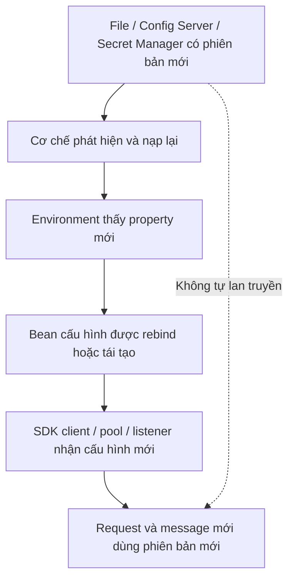
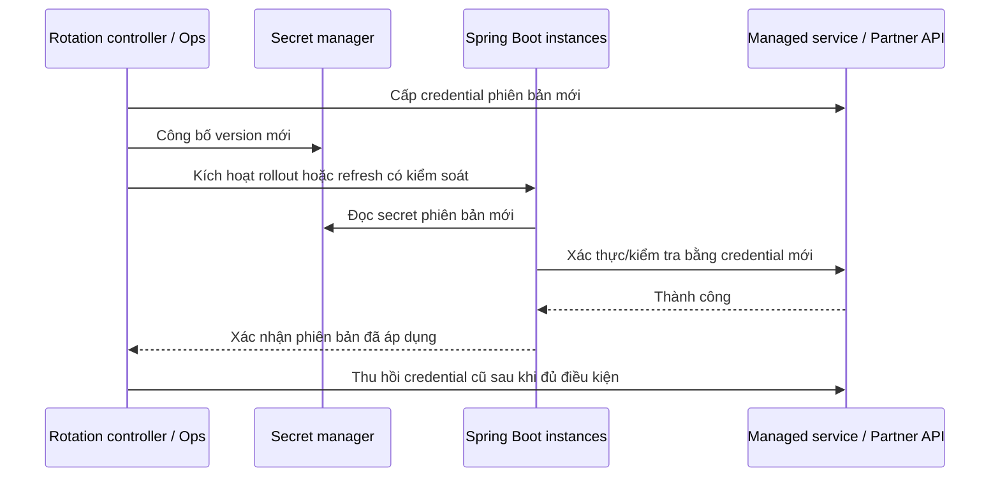

# Nạp lại cấu hình, xoay vòng bí mật và giới hạn cập nhật bean đang chạy

Một ứng dụng Spring Boot đang hoạt động có thể cần đổi tên bucket, điều chỉnh timeout, cập nhật endpoint messaging hoặc sử dụng credential mới sau khi secret được xoay vòng. Giá trị trong AWS Secrets Manager, Azure Key Vault, Google Cloud Secret Manager hay Spring Cloud Config Server có thể đã thay đổi, nhưng **bean và client đang chạy không nhất thiết nhận được thay đổi đó**.

Trong mô-đun **`SPRING_CLOUD_PROVIDER_INTEGRATION`**, ta thực hành tích hợp Spring Boot với dịch vụ managed của AWS, Azure và Google Cloud qua các thư viện Spring Cloud tương ứng. Bài này giải thích khi nào cấu hình chỉ được nạp lúc khởi động, khi nào có thể *refresh*, cách xoay vòng bí mật không làm gián đoạn nghiệp vụ và những giới hạn khi phải cập nhật các bean đang giữ kết nối storage, messaging hoặc database.

Mục tiêu là xây dựng một **hợp đồng cập nhật cấu hình rõ ràng**: nguồn nào thay đổi, ai phát hiện, bean nào phải được tạo lại, điều gì xảy ra với thao tác đang xử lý, và cách chứng minh cấu hình mới đã thực sự có hiệu lực.

## 1. Đừng đồng nhất “nguồn đã đổi” với “ứng dụng đã áp dụng”

Xét ứng dụng phát sự kiện qua Pub/Sub và ghi file lên S3:

```yaml
app:
  storage:
    target: ${STORAGE_TARGET}
  messaging:
    destination: ${MESSAGING_DESTINATION}
    publish-timeout: 3s
```

Tại thời điểm khởi động, Spring Boot đọc các nguồn cấu hình, giải quyết giá trị theo độ ưu tiên, rồi tạo các bean. Nếu sau đó `MESSAGING_DESTINATION` trong secret/config store bị thay đổi, có nhiều tầng cần xét:

1. **Nguồn cấu hình:** tệp, Config Server hoặc kho secret đã chứa phiên bản mới hay chưa?
2. **`Environment` của tiến trình:** property source trong instance hiện tại đã được nạp lại chưa?
3. **Bean chứa cấu hình:** đối tượng dùng `@Value` hoặc `@ConfigurationProperties` đã nhận giá trị mới chưa?
4. **Client/adapter:** SDK client, connection pool, producer hoặc listener có được tái cấu hình không?
5. **Thao tác đang chạy:** request và message đang xử lý dùng phiên bản cấu hình nào?

Có thể tầng 1 đã đổi nhưng tầng 2–5 vẫn giữ giá trị cũ. Một refresh có thể cập nhật `Environment` nhưng adapter đã sao chép `destination` vào một field `final` từ lúc khởi tạo vẫn không tự đổi.



**Nguyên tắc:** *config reload* là việc nguồn và `Environment` nạp lại giá trị; *bean refresh* là việc cập nhật hoặc tạo lại bean; *client rotation* là việc thay credential/kết nối bên dưới. Ba việc liên quan nhưng không tự động tương đương.

## 2. Ba chiến lược cập nhật thường gặp

| Chiến lược | Cách hoạt động | Phù hợp khi | Giới hạn |
| --- | --- | --- | --- |
| **Restart/rolling deployment** | Tạo instance mới, nạp lại Config Data, dựng lại bean/client | Đổi endpoint, resource, datasource, policy quan trọng | Có thời gian rollout và cần phối hợp traffic |
| **Refresh có kiểm soát** | Cơ chế Spring Cloud hoặc ứng dụng phát hiện thay đổi và refresh bean thích hợp | Giá trị động với phạm vi ảnh hưởng đã biết | Chỉ những thành phần hỗ trợ refresh mới đổi; có rủi ro cập nhật một phần |
| **Đọc động tại thời điểm dùng** | Client truy vấn cấu hình/secret hoặc cache theo TTL khi thao tác | Một số feature flag, credential có thời hạn | Thêm latency, rủi ro nguồn từ xa không sẵn sàng, cần cache và chính sách fallback |

**Khuyến nghị mặc định cho thay đổi cấu trúc lớn:** chọn rolling restart. Cách này tạo một tập bean/client đồng nhất từ cùng bộ cấu hình, dễ kiểm thử và rollback hơn việc sửa nhiều singleton đang chạy.

Refresh động chỉ thích hợp khi đã biết rõ những bean nào cần đổi, cách quản lý vòng đời của kết nối và cách quan sát giá trị hiệu lực sau chuyển đổi.

### Bảng quyết định theo loại thay đổi

| Thay đổi | Cách ưu tiên cân nhắc | Điều cần xác minh |
| --- | --- | --- |
| Mức lấy mẫu metrics hoặc flag phụ | Refresh hoặc đọc động | Mặc định an toàn, thread-safety |
| Timeout của một API client | Tạo lại client/adapter hoặc rollout | Timeout mới được SDK áp dụng, request cũ xử lý ra sao |
| Tên S3/GCS bucket hoặc Azure container | Rollout hoặc chuyển adapter có kiểm soát | Không ghi lệch giữa hai đích, quyền trên đích mới |
| SQS queue, Service Bus entity, Pub/Sub subscription | Quiesce listener rồi tái tạo hoặc rollout | Ack/lock/offset, thông điệp chưa xử lý, tránh duplicate ngoài chính sách |
| Database URL hoặc password | Tạo pool mới rồi chuyển kết nối hoặc rollout | Transaction đang mở, thời gian sống connection |
| Secret API bên thứ ba | Rotation có giai đoạn chồng lấn, thay client | Credential mới hoạt động trước khi thu hồi cũ |
| IAM Role/Managed Identity/Workload Identity | Thường dựa trên cơ chế cấp danh tính của hạ tầng và SDK | Provider chain có nhận token mới; quyền IAM/RBAC cập nhật |

## 3. Config Data của Spring Boot thường xử lý lúc khởi động

Spring Boot (từ 2.4) hỗ trợ `spring.config.import` để nhập file, `configtree` và các nguồn remote có resolver/loader tương ứng. Ví dụ:

```yaml
spring:
  application:
    name: provider-integration
  config:
    import:
      - "optional:file:./runtime/feature-flags.yml"
      - "configtree:/run/secrets/provider-integration/"
```

Với ứng dụng Spring Boot thông thường:

- `application.yml` và tài nguyên `spring.config.import` được xử lý trong giai đoạn khởi động.
- `@ConfigurationProperties` bind giá trị từ `Environment` vào bean.
- Thay đổi file sau đó **không tự động kích hoạt** vòng nạp lại Config Data và toàn bộ bean.
- `optional:` điều khiển cách xử lý vị trí thiếu theo khả năng importer, **không phải** tùy chọn “theo dõi thay đổi file”.

Trường hợp Kubernetes:

- **Biến môi trường** của container đã chạy không tự thay giá trị khi Secret/ConfigMap bên ngoài được cập nhật. Thường cần tạo Pod mới/rollout.
- **Secret/ConfigMap dạng volume** có thể được Kubernetes cập nhật sau một khoảng trễ, tùy cách mount; nhưng Spring Boot không vì thế tự bind lại property.
- Volume mount qua **`subPath`** thường không nhận cập nhật tự động như volume mount thông thường; cần hiểu cách deployment mount dữ liệu.
- **Config Data `configtree:`** đọc file trong quá trình tải cấu hình; thay file dưới mount không đảm bảo bean nhận giá trị mới.

Một thư viện Spring Cloud có thể cung cấp cơ chế refresh riêng. Trước khi dựa vào nó, cần xác minh **dependency, phiên bản, phương thức kích hoạt và loại bean hỗ trợ**. Không coi `spring.config.import` là một dịch vụ đồng bộ cấu hình theo thời gian thực.

## 4. Hiểu chính xác `@Value`, `@ConfigurationProperties` và `@RefreshScope`

Ba cơ chế này có vai trò khác nhau:

| Cơ chế | Lúc ban đầu | Khi property source thay đổi | Muốn cập nhật giá trị hiệu lực |
| --- | --- | --- | --- |
| `@Value("${...}")` trên singleton | Inject giá trị lúc tạo bean | Field hiện tại thường không tự đổi | Tạo lại bean hoặc thiết kế truy cập động |
| `@ConfigurationProperties` | Bind nhóm property có kiểu | Spring Cloud Context có thể rebind khi có event thích hợp, phụ thuộc kiểu bean/version | Kiểm tra cơ chế rebind, đặc biệt với immutable object/record |
| `@RefreshScope` | Tạo bean phía sau proxy (thường khởi tạo lười) | Spring Cloud có thể xóa cache target khi refresh | Lần truy cập tiếp theo tạo target mới, nếu scope và proxy hỗ trợ |
| `Environment.getProperty(...)` mỗi lần dùng | Đọc từ `Environment` hiện tại | Chỉ thấy giá trị mới nếu `Environment` đã cập nhật | Cần cơ chế nạp lại nguồn, kiểm tra consistency |
| SDK client / connection pool đã khởi tạo | Thường chụp cấu hình khi dựng client | Không đảm bảo tự đổi endpoint/password | Reconfigure theo API hỗ trợ hoặc tạo client/pool mới |

### 4.1. Không suy ra refresh từ bản thân `@ConfigurationProperties`

Một record cấu hình immutable:

```java
package example.cloud.config;

import jakarta.validation.constraints.NotBlank;
import org.springframework.boot.context.properties.ConfigurationProperties;
import org.springframework.validation.annotation.Validated;

@Validated
@ConfigurationProperties(prefix = "app.messaging")
public record MessagingProperties(
        @NotBlank String destination
) {}
```

Record này rất hữu ích để **validation và tránh thay đổi tùy ý**. Nhưng sau khi đã inject bean vào adapter, **không được giả định record tự biến thành object khác khi Config Server đổi**. Rebind của Spring Cloud và refresh scope có giới hạn, đặc biệt với constructor binding, bean immutable và các loại bean không nằm trong phạm vi refresh được hỗ trợ.

Cần thiết kế kiểm thử trên đúng phiên bản Spring Boot/Spring Cloud, hoặc dùng restart nếu muốn bảo đảm mọi bean nhận bộ cấu hình nhất quán.

### 4.2. Minh họa bean được tạo lại qua `@RefreshScope`

Giả sử chỉ muốn làm mới **một đối tượng route nhẹ**, không giữ socket hoặc subscription. Nếu có Spring Cloud Context và cơ chế kích hoạt refresh phù hợp, có thể viết:

```java
package example.cloud.messaging;

public class MessagingRoute {
    private final String destination;

    public MessagingRoute(String destination) {
        if (destination == null || destination.isBlank()) {
            throw new IllegalArgumentException("Missing messaging destination");
        }
        this.destination = destination;
    }

    public String destination() {
        return destination;
    }
}
```

Bean factory:

```java
package example.cloud.messaging;

import org.springframework.cloud.context.config.annotation.RefreshScope;
import org.springframework.context.annotation.Bean;
import org.springframework.context.annotation.Configuration;
import org.springframework.core.env.Environment;

@Configuration(proxyBeanMethods = false)
public class MessagingRouteConfiguration {
    @Bean
    @RefreshScope
    public MessagingRoute messagingRoute(Environment environment) {
        String destination =
                environment.getRequiredProperty("app.messaging.destination");
        return new MessagingRoute(destination);
    }
}
```

**Cơ chế dự kiến:** một bean khác inject `MessagingRoute` qua proxy do `@RefreshScope` quản lý. Khi refresh scope bị làm mới, target cũ bị loại khỏi cache; lần truy cập sau, target mới được tạo bằng giá trị hiện có trong `Environment`.

Có các giới hạn bắt buộc hiểu rõ:

1. Phải có **cơ chế cập nhật `Environment`** và kích hoạt refresh; chỉ viết annotation không làm dữ liệu remote tự cập nhật.
2. Các nơi inject bean cần tiếp tục gọi qua **proxy**; code đã lấy giá trị `route.destination()` vào một field riêng vẫn giữ chuỗi cũ.
3. Bean đang thực hiện method có thể hoàn thành bằng target cũ; không hứa mọi request đang bay lập tức chuyển sang route mới.
4. Nếu tạo bean chứa connection hoặc tài nguyên cần đóng, phải có chính sách **đóng/swap/drain** rõ ràng, kiểm chứng lifecycle thực tế; annotation không giải quyết toàn bộ.
5. Các class `final`, record và cấu trúc proxy có thể tạo ràng buộc tùy chế độ proxy; ví dụ sử dụng class không `final` để dễ áp dụng scoped proxy.

**Ghi chú:** `MessagingRoute` là class do ứng dụng tự định nghĩa; đây không phải API sẵn có để thay destination của SQS, Service Bus hoặc Pub/Sub. Đổi route text không tự chuyển một listener đang đăng ký tại queue/subscription cũ.

### 4.3. Endpoint refresh không phải nút bấm an toàn mặc định

Khi tích hợp Spring Cloud Context và Actuator phù hợp, endpoint quản trị `POST /actuator/refresh` có thể được sử dụng để kích hoạt chu kỳ refresh. Việc endpoint có tồn tại và làm gì phụ thuộc dependency, version và cấu hình exposure.

Nếu ứng dụng cần expose endpoint này:

```yaml
management:
  endpoints:
    web:
      exposure:
        include: "health,info,refresh"
```

**Đây chỉ là ví dụ về exposure**, không phải cấu hình bảo mật đầy đủ. Cần chặn truy cập công khai, yêu cầu xác thực/phân quyền quản trị, kiểm soát mạng, audit thao tác và hạn chế ai được làm mới. Không bao giờ cho người dùng Internet tùy ý gọi refresh rồi làm thay đổi endpoint/credential của hệ thống.

Trong Spring Cloud Config, Config Server và các cơ chế khác có thể phát sinh tín hiệu refresh hoặc dùng bus/event để đồng bộ nhiều instance **nếu đã được cài đặt và cấu hình**. Một instance được refresh không có nghĩa mọi instance trong cluster đã cập nhật.

## 5. Xoay vòng secret là quá trình thay thế credential theo vòng đời

**Secret rotation** nghĩa là phát hành credential mới, chuyển các thành phần phụ thuộc sang credential đó, kiểm tra hoạt động và thu hồi credential cũ theo chính sách. Nó không chỉ là sửa một chuỗi trong secret manager.

Với secret có khả năng cùng tồn tại hai phiên bản, có thể triển khai theo trình tự:



Thứ tự này là mô hình **hai giai đoạn**: chuẩn bị credential mới, rồi chuyển ứng dụng. Nó giảm khả năng làm rơi request đang chạy khi backend cho phép hai credential hợp lệ trong một khoảng chuyển tiếp.

Nếu hệ thống chỉ hỗ trợ một credential tại một thời điểm, không được giả định có khoảng chồng lấn. Khi đó cần một quy trình do dịch vụ hỗ trợ: đồng bộ thay thế, retry có giới hạn, thời gian bảo trì hoặc cơ chế cấp token mới phù hợp.

### Phân biệt secret tĩnh và danh tính workload

| Cơ chế | Có secret dài hạn trong ứng dụng? | Ai làm mới credential? | Tác vụ đội phát triển cần kiểm tra |
| --- | --- | --- | --- |
| AWS IAM Role + AWS SDK credential provider chain | Thường không | Provider chain lấy credential tạm thời | Client dùng đúng provider và không cache credential tạm thành chuỗi cố định |
| Azure Managed Identity + Azure Identity | Thường không | Credential implementation lấy/làm mới access token | Quyền RBAC và client không tự giữ token cũ vượt thời hạn |
| GCP Workload Identity / ADC | Thường không | ADC/auth library làm mới credential theo hỗ trợ | Workload identity gắn đúng principal và quyền IAM |
| API key/password bên thứ ba | Thường có giá trị cần quản lý | Secret manager và cơ chế refresh của ứng dụng | Rotation, cache invalidation, rollout, revoke |
| Database password truyền thống | Có thể | DB/secret rotation workflow | Pool phải sử dụng credential mới; kết nối cũ cần xử lý |
| SAS token, signed URL mang quyền truy cập | Có quyền theo thời hạn | Thành phần tạo/cấp lại token | Không cache quá hạn, không log hoặc chia sẻ sai phạm vi |

**Ưu tiên workload identity** khi dịch vụ hỗ trợ, vì SDK có thể lấy credential ngắn hạn và tự refresh theo cơ chế của nó. Đừng xuất một access token tạm thời thành property tĩnh rồi buộc ứng dụng restart mỗi khi token hết hạn.

### Tham chiếu, version và giá trị bí mật

AWS Secrets Manager, Azure Key Vault và Google Cloud Secret Manager đều có khái niệm lưu trữ secret và quản lý phiên bản hoặc vòng đời tương ứng, nhưng **API chọn phiên bản và cơ chế tự nạp lại khác nhau**.

Cần phân biệt:

- **Secret reference:** tên/URI/resource ID của mục bí mật, thường là định danh.
- **Secret version:** phiên bản được ứng dụng đang dùng hoặc alias/version được triển khai chọn.
- **Secret value:** mật khẩu, token, private key hoặc chuỗi kết nối chứa quyền, phải giữ kín.
- **Client effective credential:** credential đang được thư viện SDK/connection pool dùng, có thể vẫn là phiên bản trước.

Một secret manager có phiên bản mới **không chứng minh client đã đổi credential**. Để xác minh, sử dụng metadata không nhạy cảm như version ID, timestamp hoặc fingerprint do quy trình quản trị tạo; không ghi plaintext, full token hay private key ra log.

## 6. Quản lý một lần chuyển đổi không làm mất thao tác đang xử lý

Khi một client hoặc adapter dùng endpoint/credential mới, cách thay thế phải phù hợp loại tải.

### 6.1. Request HTTP và object storage

Với upload/download, một request bắt đầu bằng cấu hình **version A** nên tiếp tục dùng client và đích đã chọn cho request đó. Sau khi khởi tạo client **version B** và kiểm tra kết nối, chuyển các request mới sang version B, rồi chỉ đóng client A khi request cũ đã kết thúc hoặc hết hạn xử lý.

Nếu thay bucket từ `documents-old` sang `documents-new`, việc đổi route không di chuyển object đã tồn tại. Đây là thay đổi **đích dữ liệu**, cần thêm kế hoạch migration, quyền đọc/ghi và rollback, không chỉ làm mới bean.

Một phương án kiến trúc:

```text
request mới ---> [ClientHolder: version B] ---> target mới
request đang chạy ---> [Client version A] ---> target cũ

Sau khi drain:
  đóng Client A
  ghi nhận version B có hiệu lực
```

`ClientHolder` là thành phần do ứng dụng tự định nghĩa; nếu cần, nó có thể sử dụng tham chiếu thay thế atomically hoặc một cơ chế reference counting/drain phù hợp. Không đổi hàng loạt field mutable của một client được nhiều thread sử dụng khi SDK không công bố hỗ trợ việc đó.

### 6.2. Messaging và consumer/listener

Đổi tên queue/topic/subscription có nhiều hệ quả hơn đổi một chuỗi:

- **Producer:** cần định nghĩa thời điểm publish chuyển sang đích mới, đồng thời xử lý message đang retry ở đích cũ.
- **Consumer/listener:** có thể đang giữ session, lock, ack deadline hoặc callback gắn với subscription cũ.
- **Đảm bảo giao hàng:** cần quản lý duplicate, out-of-order, dead-letter, transaction/outbox và số lần gửi lại.
- **Khi đổi đích:** có thể phải tạm dừng nhận message, chờ xử lý xong, ghi nhận checkpoint/ack, sau đó tạo listener mới.
- **Khi rollout nhiều instance:** nếu producer chuyển trước nhưng consumer mới chưa sẵn sàng, message có thể tồn đọng; cần kế hoạch thứ tự rollout.

SQS, Azure Service Bus và Pub/Sub có các semantics retry/ack/lease khác nhau. `@RefreshScope` trên một property bean **không tự tháo đăng ký listener cũ hoặc bảo đảm giao hàng đúng một lần**. Chỉ bật dynamic refresh khi đã kiểm thử vòng đời adapter.

### 6.3. Database và connection pool

Đối với database managed, `DataSource`/pool thường lưu URL, username và thông tin xác thực để tạo connection. Sau khi password thay đổi trong secret store:

1. Các **connection đang mở** có thể tiếp tục dùng phiên xác thực cũ trong một khoảng thời gian tùy database.
2. Các **connection mới** có thể thất bại nếu pool vẫn dùng password cũ.
3. Thay giá trị `spring.datasource.password` trong `Environment` không bảo đảm một pool đang chạy tự xây lại.
4. Cần cơ chế **đổi credential của pool nếu pool hỗ trợ** hoặc dựng pool mới, kiểm thử và drain pool cũ; rolling restart thường dễ kiểm soát hơn.
5. Transaction đang mở không nên bị cắt đột ngột nếu có thể tránh; quy trình rotation phải tính cả timeout transaction và lifespan connection.

Nếu dùng IAM database authentication hoặc cơ chế danh tính cloud chuyên biệt, cần xem **driver và integration** có hỗ trợ tự cấp token tại thời điểm tạo connection hay không. Không suy ra token tự refresh chỉ vì Spring Boot nạp credential một lần thành công.

## 7. Chính sách khi refresh thất bại: giữ an toàn và nhất quán

Một cập nhật remote có thể có giá trị không hợp lệ, thiếu quyền hoặc chỉ được một phần instance nhận thấy.

| Tình huống | Rủi ro | Hành vi cần thiết kế |
| --- | --- | --- |
| Secret phiên bản mới sai hoặc bị thu hồi | Client mới không xác thực được | Không chuyển traffic sang client mới; báo lỗi và giữ phương án được phép |
| Secret cũ sắp hết hạn | Last-known-good không còn hiệu lực | Hoàn tất migration trước hạn hoặc chặn chức năng phụ thuộc |
| Giá trị mới sai định dạng | Bean mới thất bại khi bind/validate | Chặn áp dụng, báo version lỗi; dùng rollout có khả năng rollback |
| Một instance dùng version A, instance khác version B | Hành vi không nhất quán | Theo dõi version từng instance, triển khai có thứ tự |
| Credential mới được chấp nhận nhưng endpoint sai môi trường | Ghi sai resource | Kiểm tra deployment contract và provider/resource trước cutover |
| Remote tạm mất kết nối | Không lấy được version mới | Retry hữu hạn; last-known-good theo TTL nếu được phê duyệt |
| Connection pool đang dùng secret cũ | Connection mới thất bại | Thay pool hoặc restart an toàn, theo dõi connection errors |
| Listener đổi subscription trong lúc còn message | Mất hoặc trùng message | Quiesce/drain và kiểm tra ack/checkpoint |

Không xem refresh như một thao tác transaction **atomic trên toàn bộ Spring context**. Một số bean có thể đọc config mới trong khi các bean khác chưa được tạo lại. Với các nhóm thuộc tính phải nhất quán (endpoint + region + credential + resource), nên:

1. **Chuẩn bị tập cấu hình mới** với cùng version/generation.
2. **Validate kiểu, policy và quan hệ chéo** trước khi đưa vào sử dụng.
3. **Tạo và kiểm tra client mới** bên cạnh client cũ nếu adapter hỗ trợ.
4. **Chuyển tham chiếu tới client mới một cách đồng bộ/atomic** cho request mới.
5. **Drain và đóng tài nguyên cũ**, chỉ thu hồi credential cũ sau khi không còn phụ thuộc.
6. **Quan sát và rollback** nếu error rate hoặc tín hiệu xác thực vượt ngưỡng.

Khi không thể bảo đảm các bước trên, rolling restart với readiness và deployment strategy phù hợp thường là lựa chọn dễ kiểm soát hơn.

### Last-known-good cần giới hạn

Bản secret/cấu hình gần nhất từng hoạt động chỉ là phương án dự phòng nếu chính sách cho phép:

- Dùng được trong bao lâu? Có TTL hoặc `notAfter` rõ ràng không?
- Secret có bị thu hồi chủ động vì rò rỉ không? Khi đó không được tiếp tục dùng.
- Credential cũ còn quyền tối thiểu và có hết hạn không?
- Có thể giữ cấu hình cũ mà không ghi sai target hoặc vi phạm chính sách không?
- Sự cố fallback có được cảnh báo và thể hiện trạng thái `DEGRADED` không?

**Không sử dụng last-known-good vô thời hạn cho secret bắt buộc** để che lỗi IAM/RBAC hoặc thiếu quyền đọc secret manager.

## 8. Tình huống cụ thể trên AWS, Azure và GCP

| Cloud/tích hợp | Nguồn hoặc danh tính | Điều thường có thể làm mới | Điều phải xác minh thêm |
| --- | --- | --- | --- |
| AWS S3 | IAM Role, AWS SDK provider chain | Credential tạm thời do provider chain quản lý | `S3Client` có giữ endpoint/region/bucket cũ không? |
| AWS SQS | IAM Role, SQS client/consumer | Credential theo provider chain | Queue URL, poller và in-flight message khi đổi đích |
| AWS Secrets Manager | Secret value/version | Lấy version mới khi gọi SDK hoặc qua integration hỗ trợ | Cache TTL, rebind, client tái tạo và revoke |
| Azure Blob | Managed Identity, Blob client | Access token do Azure Identity quản lý | Storage account/container và client instance |
| Azure Service Bus | Managed Identity hoặc SAS credentials | Token mới theo credential provider nếu hỗ trợ | Processor, link/session, lock và entity khi đổi namespace |
| Azure Key Vault/App Configuration | Secret/config từ xa | Theo cơ chế polling/refresh của starter phù hợp | Version, property source, beans và feature flags hỗ trợ refresh |
| GCP GCS | ADC/Workload Identity, Storage client | Access token do thư viện auth quản lý | Bucket, project và client/endpoint có thay đổi không |
| GCP Pub/Sub | ADC/Workload Identity, publisher/subscriber | Access token theo thư viện auth | Publisher batch, subscriber stream, ack deadline và subscription |
| GCP Secret Manager | Secret version | Đọc phiên bản mới bằng SDK hoặc integration | Cache, binding và client đang giữ secret cũ |

Các khả năng trên phụ thuộc **version Spring Boot, Spring Cloud và starter**. Một số Spring Cloud integration tải secret vào `Environment`, số khác chỉ cung cấp API đọc theo yêu cầu. Nên ghi rõ trong kiến trúc:

- Secret được đọc **ở startup** hay **lúc gọi API**?
- Client hỗ trợ **credential refresh tự động** hay phải tạo lại?
- Giá trị nào đã được **sao chép vào bean/field/client**?
- Adapter có **quy trình drain** hay không?
- Khi đổi region/account/project/target, ai kiểm tra quyền và tài nguyên mới?

Việc SDK tự làm mới **access token** không đồng nghĩa SDK tự đổi **region, bucket, topic, account hoặc project**.

## 9. Quan sát trạng thái cấu hình đang có hiệu lực

Một hệ thống có refresh phải cho phép vận hành xác định instance nào đang dùng version nào mà **không lộ secret**.

Nên có metadata như:

| Trường quan sát | Ý nghĩa |
| --- | --- |
| `config_generation` | Mã phiên bản hoặc revision của tập cấu hình |
| `config_loaded_at` | Thời điểm instance đã nạp cấu hình |
| `secret_version_alias` | Version/alias không nhạy cảm đang được client dùng, nếu được phép log |
| `refresh_result` | `APPLIED`, `REJECTED`, `PENDING` hoặc `ROLLBACK` |
| `refresh_failure_category` | `INVALID_CONFIG`, `ACCESS_DENIED`, `TIMEOUT`, `CLIENT_INIT_FAILED` |
| `active_adapter` | Provider và loại adapter đang phục vụ |
| `inflight_operations` | Số request/message còn dùng client cũ |
| `credential_expiry_remaining` | Thời gian còn hiệu lực khi API cung cấp được, không cần lộ token |

Tránh log mật khẩu, token, private key, SAS URL, connection string chứa credential hoặc toàn bộ object `@ConfigurationProperties` nếu nó chứa secret.

Spring Boot Actuator `/actuator/env` và `/actuator/configprops` có thể giúp chẩn đoán nguồn/giá trị cấu hình tùy version và quyền truy cập, nhưng phải hạn chế exposure và che giá trị nhạy cảm. Không dựa hoàn toàn vào màn hình này để khẳng định **SDK client thực tế** đã nhận config mới.

**Readiness và liveness:**

- **Readiness** có thể phản ánh adapter bắt buộc có thể phục vụ traffic bằng version hợp lệ hay không.
- **Liveness** phản ánh tiến trình còn hoạt động; không nên restart liên tục chỉ vì một nguồn config tùy chọn tạm thời mất kết nối.
- Một module phụ không refresh được có thể báo `DEGRADED` mà không kéo mọi endpoint xuống, nếu nghiệp vụ cho phép.

## 10. Kiểm thử cập nhật lúc chạy

Để xác nhận config mới thực sự hiệu lực, cần tách các lớp kiểm thử:

| Cấp độ | Mục tiêu | Bằng chứng cần lấy |
| --- | --- | --- |
| Unit test | Logic chọn version/fallback, kiểm tra timeout và secret metadata | Tập cấu hình sai bị từ chối, không lộ value |
| Spring context test | Bind/rebind/refresh scoped bean trên version cụ thể | Bean/proxy thấy version mới sau cơ chế refresh |
| Integration test client | Client mới dùng đúng credential và endpoint | Request test xác thực thành công |
| Messaging integration test | Đổi destination/consumer không làm mất message | Ack, duplicate policy, inflight và checkpoint |
| Database integration test | Pool mới dùng password/token mới | Connection mới thành công, transaction cũ kết thúc an toàn |
| Cluster rollout test | Nhiều instance cập nhật có thứ tự | Version đồng nhất, readiness và khả năng rollback |
| Security test | Chỉ người có quyền mới được refresh/đọc secret | Không lộ secret trong logs, metrics, Actuator |

### Ví dụ kiểm tra bean refresh scope

Ví dụ dưới đây cho thấy ý tưởng kiểm thử bằng Spring context có `RefreshScope`. Nó chỉ dành cho một route nhẹ; **không chứng minh** SDK producer/subscriber thực sự đã chuyển destination.

```java
package example.cloud.messaging;

import org.junit.jupiter.api.Test;
import org.springframework.cloud.context.scope.refresh.RefreshScope;
import org.springframework.context.annotation.AnnotationConfigApplicationContext;
import org.springframework.core.env.MapPropertySource;

import java.util.Map;

import static org.assertj.core.api.Assertions.assertThat;

class MessagingRouteRefreshTest {
    @Test
    void routeIsRecreatedAfterRefresh() {
        try (var context = new AnnotationConfigApplicationContext()) {
            var source = new MapPropertySource(
                "test-destination",
                new java.util.HashMap<String, Object>(
                    Map.of("app.messaging.destination", "orders-v1")
                )
            );
            context.getEnvironment()
                .getPropertySources()
                .addFirst(source);
            context.register(RefreshScope.class);
            context.register(MessagingRouteConfiguration.class);
            context.refresh();

            MessagingRoute route = context.getBean(MessagingRoute.class);
            assertThat(route.destination()).isEqualTo("orders-v1");

            source.getSource().put("app.messaging.destination", "orders-v2");
            context.getBean(RefreshScope.class).refreshAll();

            assertThat(route.destination()).isEqualTo("orders-v2");
        }
    }
}
```

Đây là test cơ chế scoped proxy trong Spring Cloud Context, với nguồn giả lập đã có giá trị mới. Nó **không kiểm thử Config Server hoặc cloud secret importer**, vì `MapPropertySource` đã được cập nhật trực tiếp. Khi kiểm thử production, bổ sung một test startup và refresh trên **đúng phiên bản/dependency đang dùng**.

### Ma trận tình huống xoay vòng secret

| Tình huống | Kết quả cần xác nhận |
| --- | --- |
| Secret mới hợp lệ, secret cũ còn thời hạn | Client mới xác thực thành công, request đang chạy hoàn tất |
| Secret mới sai nội dung | Không âm thầm áp dụng, báo lỗi version, giữ chính sách rollback |
| Secret cũ bị thu hồi ngay | Không cho request dùng lại credential cũ sau khi biết bị thu hồi |
| Secret manager trả `403` | Báo lỗi quyền, không dùng credential giả |
| Secret manager không sẵn sàng | Retry hữu hạn, fallback chỉ khi được phép và còn TTL |
| Rotation diễn ra giữa transaction DB | Transaction/pool được xử lý theo policy, không cắt tùy tiện |
| Đổi Pub/Sub subscription hoặc Service Bus queue | Listener cũ dừng/drain đúng, listener mới nhận message |
| Có 10 instance nhưng chỉ 7 instance refresh | Phát hiện version lệch và chặn hoàn tất thu hồi credential cũ |
| Giá trị config mới đổi bucket staging sang prod | Kiểm tra deployment contract trước khi chuyển dữ liệu |
| Secret mới được nạp vào `Environment` nhưng SDK vẫn dùng secret cũ | Phát hiện bằng kiểm thử xác thực/client, không kết luận chỉ từ `/actuator/env` |

### Bài thực hành ba cloud

1. Tạo ứng dụng demo có `app.messaging.destination` và bean `MessagingRoute` dạng `@RefreshScope` như phần 4. Ghi lại version đích trước/sau refresh trong test, chỉ dùng giá trị giả.
2. Dùng một property source kiểm soát được để thử refresh khi route đổi từ `orders-v1` sang `orders-v2`. Sau đó kiểm tra một singleton đã copy chuỗi route có tự đổi hay không.
3. Thêm adapter storage AWS S3, Azure Blob hoặc GCS bằng SDK client của provider, sử dụng workload identity phù hợp. So sánh **credential tự làm mới** với **endpoint/bucket không tự thay**.
4. Thiết kế rotation cho một API key giả lưu trong kho secret test. Phát hành version B, tạo client B, xác minh rồi mới thu hồi A. Thử cả tình huống B lỗi.
5. Với messaging, dùng queue/topic test để thay destination. Dừng nhận, chờ xử lý inflight và tạo listener mới; kiểm tra message được ack theo chính sách.
6. Với managed database test, thay password và quan sát connection pool; thiết kế rollout hoặc tạo pool mới để bảo đảm connection mới xác thực được.
7. Bật chỉ số config generation, refresh result, secret version metadata và readiness. Kiểm tra secret không hiện trong log, Actuator hoặc trace.
8. So sánh refresh động và rolling restart theo thời gian phục hồi, độ phức tạp, khả năng rollback, rủi ro dữ liệu và yêu cầu quyền.

**Tiêu chí hoàn thành:** người học chỉ ra được bước nào đã cập nhật `Environment`, bean và client; mô tả được cách chuyển credential trước khi thu hồi credential cũ; chứng minh không mất message/transaction trong test phù hợp; và giải thích được vì sao thay đổi remote config không tự lan tới mọi bean đang chạy.

## 11. Những sai lầm thường gặp

| Sai lầm | Vì sao sai | Cách xử lý |
| --- | --- | --- |
| “Đổi secret trên cloud thì Spring Boot nhận ngay” | Bean có thể giữ giá trị từ startup | Chọn refresh/rollout, kiểm tra effective credential |
| “`spring.config.import` là auto-reload” | Import chủ yếu phục vụ Config Data lúc khởi động | Dùng integration refresh được hỗ trợ hoặc restart |
| “Có `@RefreshScope` thì mọi SDK client đổi hết” | Chỉ bean trong scope/proxy phù hợp được tạo lại | Thiết kế lifecycle client, pool, listener |
| “`@Value` field tự cập nhật” | Singleton đã inject giá trị cũ | Tạo lại bean hoặc đọc động từ nguồn đã refresh |
| “Rebind thành công nghĩa là credential mới được sử dụng” | Client đã tạo vẫn có thể giữ credential cũ | Thử xác thực bằng client hiệu lực |
| “Cứ revoke credential cũ ngay khi ghi phiên bản mới” | Instance và request cũ có thể chưa chuyển | Chồng lấn hợp lệ và theo dõi tiến độ rollout |
| “Secret cũ luôn là fallback an toàn” | Có thể bị thu hồi hoặc hết hạn | TTL, policy và điều kiện chặn sử dụng |
| “HTTP 200 từ endpoint refresh nghĩa là mọi instance cập nhật” | Mỗi instance có thể có version khác nhau | Theo dõi generation và kết quả từng instance |
| “Chuyển topic chỉ cần đổi một property” | Listener còn ack/checkpoint/session ở đích cũ | Drain và khởi tạo listener theo lifecycle |
| “Thay `spring.datasource.password` tự cập nhật pool” | Pool giữ cấu hình kết nối đã dùng | Đổi pool hoặc rollout, kiểm tra connection mới |

## 12. Ghi nhớ

- **Nguồn đổi không đồng nghĩa bean đổi**: phải phân biệt Config Data, `Environment`, binding, refresh-scoped proxy và client/connection đang sống.
- `@RefreshScope` chỉ hỗ trợ những bean được quản lý phù hợp; nó **không phải cơ chế tự động cập nhật mọi tài nguyên cloud**. Bài toán endpoint, messaging consumer và datasource cần vòng đời riêng.
- **Secret rotation** gồm cấp credential mới, xác minh, chuyển ứng dụng và thu hồi bản cũ theo chính sách. Khi có thể, dùng **workload identity** để SDK tự làm mới token tạm thời.
- Với thay đổi phức tạp hoặc cần tính nhất quán nhiều bean, **rolling restart có readiness và rollback** thường dễ kiểm chứng hơn refresh tại chỗ.
- Theo dõi **config generation, secret version metadata, client hiệu lực, trạng thái refresh và thao tác inflight** mà không log giá trị bí mật.
- Kiểm thử cả **startup, refresh, rotation thất bại, quyền bị từ chối, kết nối DB, ack messaging và triển khai nhiều instance** trước khi dùng cập nhật động trong production.
