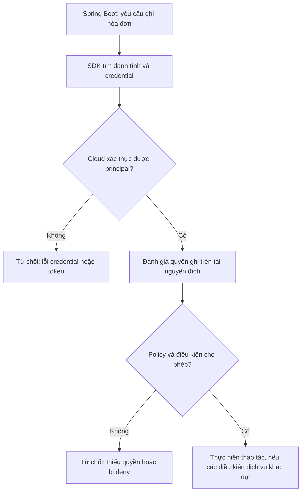

# Phân biệt xác thực ứng dụng và phân quyền truy cập tài nguyên

Khi ứng dụng Spring Boot gọi Amazon S3, Azure Blob Storage hoặc Google Cloud Storage, hai câu hỏi luôn xuất hiện: **dịch vụ cloud biết ứng dụng đang gọi là ai bằng cách nào?** Và **danh tính đó có được phép đọc, ghi hoặc xóa tài nguyên cụ thể hay không?** Câu hỏi thứ nhất thuộc về **xác thực** (*authentication*); câu hỏi thứ hai thuộc về **phân quyền** (*authorization*). Một ứng dụng có thể xác thực thành công nhưng vẫn không đủ quyền thực hiện thao tác.

Đây là nền tảng của phần **Danh tính và quyền** khi tích hợp Spring Boot với các dịch vụ managed của AWS, Azure và Google Cloud. Các thư viện Spring Cloud giúp tìm thông tin xác thực, tạo client và gọi API; chúng **không tự cấp quyền** cho danh tính đang chạy ứng dụng.

## 1. Kết quả học tập

Sau bài học, bạn có thể:

- Phân biệt danh tính của workload Spring Boot, thông tin dùng để xác thực và quyền trên tài nguyên cloud.
- Giải thích luồng xác thực và quyết định phân quyền của AWS IAM, Microsoft Entra ID/Azure RBAC và Google Cloud IAM.
- Nhận diện sự khác nhau giữa đăng nhập của người dùng vào API Spring Boot và danh tính của ứng dụng khi gọi dịch vụ cloud.
- Đọc một chính sách quyền tối thiểu, xác định nguyên nhân lỗi `AccessDenied`/`403` và thiết kế phép kiểm thử chấp nhận hoặc từ chối quyền.
- Lựa chọn cơ chế danh tính phù hợp cho môi trường local và môi trường chạy thật, hạn chế khóa bí mật dài hạn.

## 2. Hai lớp kiểm tra độc lập

**Xác thực ứng dụng (workload authentication)** là quá trình cloud xác định danh tính của tiến trình hoặc workload gọi API. Danh tính có thể là một IAM role của AWS, một managed identity/service principal trong Microsoft Entra ID hoặc một service account/workload identity trong Google Cloud. Ứng dụng chứng minh danh tính bằng cơ chế phù hợp: ký yêu cầu, sử dụng token truy cập hoặc trao đổi thông tin xác thực ngắn hạn.

**Phân quyền tài nguyên (resource authorization)** là việc dịch vụ cloud xét xem *danh tính đã xác thực* có được phép thực hiện *hành động cụ thể* trên *tài nguyên cụ thể* trong *ngữ cảnh hiện tại* hay không. Quyết định phụ thuộc vào chính sách IAM, RBAC, điều kiện, ranh giới tổ chức, chính sách tài nguyên và đôi khi những kiểm soát bổ sung như khóa mã hóa hay mạng.

| Thành phần | Xác thực (*authentication*) | Phân quyền (*authorization*) |
| --- | --- | --- |
| Câu hỏi | **Ai** đang gọi dịch vụ? | **Ai được làm gì, ở đâu, trong điều kiện nào?** |
| Đầu vào chủ yếu | Danh tính và bằng chứng xác thực: credential, chữ ký yêu cầu, access token | Principal, action/permission, resource, policy và điều kiện |
| Kết quả | Xác định được hoặc không xác định được principal | Cho phép hoặc từ chối một yêu cầu cụ thể |
| Ví dụ | Service nhận diện workload `invoice-service-prod` | Workload chỉ được tạo object trong bucket `invoices-prod` |
| Khi có lỗi | Không lấy được credential, credential sai/hết hạn, token sai audience | Credential hợp lệ nhưng thiếu quyền `PutObject`/`objects.create`, sai phạm vi hoặc bị deny |

> **Nhớ:** “Có credential” không đồng nghĩa “có quyền”. Credential cho biết bạn là ai; policy cho biết danh tính đó được làm gì.

Một yêu cầu tạo file hóa đơn có thể được hình dung như sau:



Sơ đồ tách hai quyết định để dễ học. Thực tế, một số provider kết hợp xác thực, phân quyền và các ràng buộc dịch vụ trong cùng luồng xử lý; không nên suy ra rằng mọi lỗi xác thực đều trả HTTP `401` và mọi lỗi phân quyền đều trả `403`. Ví dụ, AWS S3 thường trả `403 AccessDenied` cho nhiều tình huống khác nhau.

## 3. Ba loại danh tính dễ bị nhầm

Trong một hệ thống có API Spring Boot, ít nhất ba chủ thể có thể hiện diện:

1. **Người dùng cuối (end user):** đăng nhập ứng dụng, mang JWT hoặc session; Spring Security kiểm tra người dùng có được gọi endpoint như `POST /invoices` hay không.
2. **Ứng dụng/workload:** tiến trình Spring Boot triển khai trên EC2/EKS, Azure App Service/AKS hoặc GCE/GKE; danh tính workload dùng để truy cập storage, queue, database, secret manager.
3. **Tài nguyên đích:** bucket, blob container, queue, topic hoặc secret; chính sách trên tài nguyên và quyền của principal quyết định thao tác được phép.

Giả sử Alice có quyền “tạo hóa đơn” trong hệ thống. Spring Security chấp nhận yêu cầu của Alice **không có nghĩa** Alice hay ứng dụng mặc nhiên có quyền `s3:PutObject` trên bucket của doanh nghiệp. Dịch vụ cloud thường thấy danh tính của **workload Spring Boot**. Việc gọi tài nguyên cloud dưới danh tính của chính người dùng cần một cơ chế ủy quyền/delegation được thiết kế riêng (chẳng hạn luồng *on-behalf-of* khi được nền tảng hỗ trợ); SDK không tự động biến JWT của người dùng thành quyền IAM của workload.

Hai lớp kiểm soát nên đi cùng nhau: **phân quyền ở API nghiệp vụ** quyết định người dùng được làm gì trong ứng dụng, còn **phân quyền ở cloud** hạn chế những gì tiến trình ứng dụng có thể làm nếu một endpoint có lỗi hoặc bị khai thác.

## 4. Đối chiếu AWS, Azure và Google Cloud

Các cloud cung cấp giải pháp khác nhau về tên gọi và cách trao thông tin xác thực, nhưng mô hình cốt lõi đều là **principal → xác thực → policy/role → quyền trên resource**.

| Khía cạnh | AWS | Azure | Google Cloud |
| --- | --- | --- | --- |
| Danh tính workload thường dùng | IAM role gắn với môi trường chạy; có thể assume role qua AWS STS | Managed identity hoặc service principal trong Microsoft Entra ID | Service account hoặc danh tính workload được liên kết/ủy quyền |
| Cách SDK lấy credential | **Default credentials provider chain**, ví dụ role credentials ngắn hạn qua metadata/STS | **DefaultAzureCredential**, ví dụ token từ managed identity hoặc danh tính developer | **Application Default Credentials (ADC)**, ví dụ service account qua metadata hoặc Workload Identity Federation |
| Cách chứng minh khi gọi storage | AWS Signature Version 4 (SigV4) ký request bằng credential AWS; credential role thường là tạm thời | OAuth 2.0 bearer access token dành cho tài nguyên đích | OAuth 2.0 access token/credential do client library lấy từ ADC |
| Cơ chế cấp quyền chính | IAM identity policy; có thể có bucket policy, SCP, permission boundary và explicit deny | Azure RBAC role assignment trên scope; các cơ chế dữ liệu/điều kiện khác tùy dịch vụ | IAM role binding trên project, bucket hoặc tài nguyên hỗ trợ; IAM Conditions khi áp dụng |
| Ví dụ quyền ghi object | `s3:PutObject` trên ARN object | `Storage Blob Data Contributor` ở scope phù hợp, hoặc custom role có data action cần thiết | `storage.objects.create`, có thể qua `roles/storage.objectCreator` |
| Kiểm tra danh tính khi debug | Principal/role thực tế trong thông tin gọi và CloudTrail | Managed identity/service principal, tenant, audience của token và log Entra/Azure | Principal từ ADC, service account và Cloud Audit Logs |

### 4.1. AWS: credential của IAM role và quyền IAM là hai phần khác nhau

Trong AWS, ứng dụng chạy trên môi trường có IAM role phù hợp thường lấy **temporary credentials** thông qua chuỗi provider của SDK. Request đến S3 được ký bằng SigV4. S3 xác thực credential/chữ ký, rồi kiểm tra các policy liên quan để quyết định liệu principal có được `s3:PutObject` trên object đó không.

Ví dụ policy IAM **chỉ cho phép ghi** object có key bắt đầu bằng `invoices/` trong một bucket; ví dụ này cần được gắn với role dùng bởi ứng dụng:

```json
{
  "Version": "2012-10-17",
  "Statement": [
    {
      "Sid": "WriteInvoicesOnly",
      "Effect": "Allow",
      "Action": "s3:PutObject",
      "Resource": "arn:aws:s3:::invoices-prod/invoices/*"
    }
  ]
}
```

Policy trên **không** cấp quyền đọc, liệt kê hoặc xóa object; cũng **không** tạo credential cho ứng dụng. Quyền thực tế còn tùy các policy khác, explicit deny, kiểm soát cấp tổ chức, bucket policy và các yêu cầu bổ sung (ví dụ KMS khi dùng mã hóa bằng khóa do khách hàng quản lý). Ở môi trường production, nên cấp role cho compute workload; tránh đặt access key cố định trong `application.yml`.

### 4.2. Azure: lấy token Entra ID khác với gán vai trò data plane

Một Spring Boot service chạy trên Azure App Service có thể dùng **managed identity**. Azure SDK yêu cầu access token từ Microsoft Entra ID cho dịch vụ đích. Việc lấy được token chứng minh danh tính với đúng audience, nhưng **không bảo đảm** danh tính có quyền upload blob.

Ví dụ, để ghi blob bằng Microsoft Entra ID, cần role phù hợp với **dữ liệu**, như `Storage Blob Data Contributor`, được gán tại scope tài khoản storage hoặc container phù hợp. Role quản trị tài nguyên `Contributor` trong Azure Resource Manager **không mặc nhiên** trao quyền đọc/ghi nội dung blob qua Entra ID. Tương tự, quyền quản lý Key Vault và quyền đọc giá trị secret là những quyền riêng cần xét theo mô hình phân quyền đang dùng của vault.

Ngoài role assignment, ứng dụng còn cần trỏ đúng storage account, đúng tenant/identity và đáp ứng các ràng buộc mạng. Cấu hình managed identity chỉ giải quyết việc **lấy token**; role assignment giải quyết việc **được phép làm gì**.

### 4.3. Google Cloud: ADC tìm credential; IAM quyết định permission

Thư viện Google Cloud sử dụng **Application Default Credentials (ADC)** để tìm credential phù hợp với môi trường chạy. Trên Google Cloud, đó thường là danh tính gắn với workload (chẳng hạn service account của máy ảo hoặc danh tính được cấu hình cho GKE); ở local, ADC có thể lấy credential riêng do developer thiết lập.

Muốn upload một object mới lên Cloud Storage, principal cần quyền `storage.objects.create` trên bucket đích. Một binding `roles/storage.objectCreator` ở bucket là ví dụ dễ hiểu: role này cho phép tạo object, **không đồng nghĩa** có thể liệt kê, đọc hoặc xóa object. Nếu cần ghi đè object hiện có, có thể cần thêm quyền theo hành vi API và chính sách hiện hành; hãy kiểm tra permission thực sự của thao tác.

**Chú ý:** `gcloud auth login` (danh tính CLI) và **ADC** mà Java client library dùng là hai cơ chế lưu credential có thể khác nhau. Đăng nhập `gcloud` không chứng minh rằng ứng dụng Spring Boot đang dùng cùng principal.

## 5. Ví dụ Spring Boot: cùng bài toán, hai cấu hình độc lập

Giả sử `invoice-service` cần lưu nội dung hóa đơn dưới key `invoices/2026/INV-001.json`. Với từng cloud, ta cần hoàn thành **cả hai việc**:

1. Cung cấp **workload identity** để SDK có thể xác thực mà không nhúng secret vào mã nguồn.
2. Gán đúng **quyền tạo object** trên bucket/container của môi trường đang chạy.

Đoạn mã minh họa dưới đây dùng Java SDK tương ứng; nếu dùng starter Spring Cloud AWS, Spring Cloud Azure hoặc Spring Cloud GCP, phần tự cấu hình client có thể được starter thực hiện. Cần khai báo dependency SDK/starter tương ứng với phiên bản Spring Boot của dự án. Các ví dụ là những phương án tích hợp riêng, không phải ba client bắt buộc trong cùng một ứng dụng.

**AWS — SDK tự tìm credential; quyền nằm trong IAM:**

```java
@Configuration
class AwsStorageConfig {
    @Bean
    S3Client s3Client() {
        return S3Client.builder()
                .region(Region.AP_SOUTHEAST_1)
                .credentialsProvider(DefaultCredentialsProvider.create())
                .build();
    }
}

@Service
class AwsInvoiceStorage {
    private final S3Client s3;

    AwsInvoiceStorage(S3Client s3) {
        this.s3 = s3;
    }

    void save(String bucket, byte[] data) {
        s3.putObject(
                PutObjectRequest.builder()
                        .bucket(bucket)
                        .key("invoices/2026/INV-001.json")
                        .build(),
                RequestBody.fromBytes(data)
        );
    }
}
```

Trên EC2/EKS, hãy cấp IAM role đúng cho workload và policy `s3:PutObject` trên prefix cần dùng. Khi chạy local, `DefaultCredentialsProvider` có thể lấy profile hoặc môi trường của developer; cần kiểm tra principal đang được chọn. Đoạn code **không** tự thêm quyền ghi S3.

**Azure — Managed Identity/DefaultAzureCredential + data role:**

```java
@Configuration
class AzureStorageConfig {
    @Bean
    BlobServiceClient blobServiceClient() {
        return new BlobServiceClientBuilder()
                .endpoint("https://myaccount.blob.core.windows.net")
                .credential(new DefaultAzureCredentialBuilder().build())
                .buildClient();
    }
}

// Sử dụng client đã được Spring inject:
BlobClient blob = blobServiceClient
        .getBlobContainerClient("invoices")
        .getBlobClient("2026/INV-001.json");
blob.upload(BinaryData.fromBytes(data), true);
```

Với môi trường Azure, bật managed identity cho workload và gán quyền dữ liệu trên storage scope phù hợp. Nếu managed identity là **user-assigned**, cần chỉ rõ identity/client ID cho credential chain theo cấu hình SDK tương ứng. `true` trong `upload(..., true)` cho phép ghi đè; trong thực hành quyền tối thiểu, chỉ dùng khi bài toán thực sự cần ghi đè.

**Google Cloud — ADC + IAM bucket:**

```java
@Configuration
class GcpStorageConfig {
    @Bean
    Storage cloudStorage() {
        return StorageOptions.getDefaultInstance().getService();
    }
}

// Sử dụng client đã được Spring inject:
BlobInfo object = BlobInfo.newBuilder(
        BlobId.of("invoices-prod", "invoices/2026/INV-001.json"))
        .build();
cloudStorage.create(object, data);
```

Gán role/permission cho principal mà ADC thực sự sử dụng, ở bucket phù hợp. Workload chạy trong Google Cloud nên dùng danh tính gắn với môi trường chạy hoặc Workload Identity Federation phù hợp, hạn chế phát hành file khóa JSON của service account. Đối với cả ba cloud, trong ứng dụng thật hãy đưa tên account/bucket, region và key vào cấu hình theo môi trường thay vì cố định như ví dụ.

## 6. Minh họa: xác thực thành công nhưng vẫn bị từ chối

Xét service `invoice-service-prod` được triển khai đúng danh tính và muốn tạo object trong storage:

| Tình huống | Xác thực | Phân quyền | Kết quả mong đợi |
| --- | --- | --- | --- |
| Role AWS hợp lệ; ghi vào prefix `invoices/` được policy cho phép | Đạt | Cho phép `s3:PutObject` | Ghi được, nếu không vướng điều kiện khác |
| Cùng role ghi vào prefix `payroll/` không được cấp quyền | Đạt | Không có allow phù hợp | Bị từ chối, thường `AccessDenied` |
| Azure SDK lấy được token managed identity; identity chưa được gán data role | Đạt | Thiếu data-plane permission | Thường bị `403`, dù token hợp lệ |
| GCP ADC chọn được service account; bucket khác chưa được cấp `storage.objects.create` | Đạt | Thiếu permission ở bucket đích | Thường bị `403` |
| Credential không thể lấy hoặc bị sai/hết hiệu lực | Không đạt | Chưa có principal hợp lệ để xét quyền | Lỗi lấy credential hoặc lỗi xác thực khi gọi API |

Trong một quy trình nghiệp vụ, có thể xảy ra cả hai kiểu thiếu quyền:

- **Người dùng không được phép tạo hóa đơn:** API Spring Boot phải từ chối ở lớp Spring Security/nghiệp vụ dù workload có quyền ghi storage.
- **Người dùng được phép tạo hóa đơn, nhưng workload thiếu quyền ghi storage:** API có thể nhận yêu cầu hợp lệ rồi thất bại khi gọi cloud. Cần sửa quyền của workload hoặc cấu hình tài nguyên, không cấp thêm quyền nghiệp vụ cho người dùng.

## 7. Cách thiết kế quyền tối thiểu

Đặt quyền theo **workload – hành động – tài nguyên – môi trường**, thay vì dùng một credential quản trị chung:

| Workload | Cần làm | Phạm vi phù hợp | Không nên mặc nhiên cấp |
| --- | --- | --- | --- |
| `invoice-api` | Tạo hóa đơn trên storage | Bucket/container hóa đơn production và permission ghi cần thiết | Quyền đọc/xóa toàn bộ storage của tổ chức |
| `invoice-reader` | Đọc hóa đơn để tra cứu | Object/bucket/container được phép đọc | Quyền upload hoặc delete |
| `event-publisher` | Gửi thông điệp | SQS queue / Service Bus sender / Pub/Sub topic mục tiêu | Quyền quản trị toàn bộ messaging |
| `secret-consumer` | Đọc một số secret cần cho ứng dụng | Secret hoặc vault và quyền đọc giá trị phù hợp | Quyền tạo/xóa/quản trị secret toàn hệ thống |

Cách triển khai nên đi theo thứ tự:

1. **Xác định principal chạy thật:** IAM role, managed identity hoặc service account được SDK chọn trong từng môi trường.
2. **Liệt kê operation thực sự:** ví dụ tạo mới, đọc, liệt kê và xóa là các quyền khác nhau. Kiểm tra cả quyền phụ như KMS, publish message hoặc lấy secret nếu workflow sử dụng chúng.
3. **Giới hạn resource/scope:** ARN và prefix trên AWS khi khả dụng; account/container trên Azure; bucket/tài nguyên được hỗ trợ trên Google Cloud. Không giả định ba provider có cùng độ chi tiết khi cấp quyền.
4. **Gán role/policy nhỏ nhất đáp ứng bài toán:** cân nhắc role tùy chỉnh khi role có sẵn cấp quyền rộng hơn cần thiết; tách danh tính cho các workload có trách nhiệm khác nhau.
5. **Thử cả ca cho phép lẫn từ chối:** quyền ghi được vào đúng đích và bị từ chối ở đích ngoài phạm vi; triển khai role riêng cho dev, test và production.

**Không lưu** access key, client secret, token hoặc file khóa service account trong Git, image Docker hay `application.yml`. Có thể dùng profile đăng nhập developer ở local; trên cloud, ưu tiên role/managed identity/workload identity với credential ngắn hạn do nền tảng quản lý. Khi ứng dụng cần đọc secret manager, quyền đọc secret cũng phải được cấp độc lập; dùng secret manager không loại bỏ nhu cầu kiểm soát danh tính.

## 8. Chẩn đoán lỗi theo đúng lớp

Một lỗi API cloud không đủ để kết luận ngay rằng IAM sai. Dùng quy trình kiểm tra sau để tránh cấp quyền rộng quá mức:

| Câu hỏi kiểm tra | Dấu hiệu và hướng xử lý |
| --- | --- |
| **SDK đang dùng principal nào?** | Kiểm tra credential provider chain/ADC và cấu hình workload; phân biệt local profile với danh tính cloud runtime. Trong AWS, `aws sts get-caller-identity` hữu ích cho credential của chính phiên CLI đang kiểm tra, nhưng không tự chứng minh principal của Java process nếu hai bên dùng nguồn credential khác nhau. |
| **Credential có dùng được cho dịch vụ này?** | Xác minh credential/token được lấy thành công, còn hiệu lực, đúng tenant/audience/scope khi phù hợp; kiểm tra đồng hồ hệ thống nếu chữ ký request bị lệch thời gian. |
| **Action và resource có đúng không?** | Kiểm tra bucket/container/topic, object key, region, project/subscription và permission cho operation cụ thể. IAM allow một action không suy ra allow các action khác. |
| **Có policy khác từ chối không?** | Với AWS, xem explicit deny, bucket policy, SCP, permission boundary và KMS; với Azure, xem data role, scope, deny/condition; với Google Cloud, xem IAM binding, điều kiện và quyền của danh tính thực tế. |
| **Có ràng buộc ngoài IAM?** | Kiểm tra endpoint, network/firewall, private endpoint/VPC, cấu hình storage, khóa mã hóa hoặc chính sách tổ chức. Lỗi `403` có thể đến từ nhiều lớp. |
| **Thông tin kiểm toán nói gì?** | Tra AWS CloudTrail, Azure Activity/resource diagnostic logs và Google Cloud Audit Logs tùy dịch vụ và cấu hình thu log; đối chiếu principal, operation, tài nguyên và nguyên nhân từ chối. Không ghi token/secret vào log ứng dụng. |

Một số tín hiệu thường gặp:

- **Ứng dụng không khởi tạo được client hoặc lấy credential:** kiểm tra biến môi trường, local profile, metadata endpoint, service account binding hoặc managed identity trước khi sửa IAM.
- **AWS `AccessDenied` sau khi đã nhận diện đúng role:** kiểm tra IAM action, ARN object, prefix, bucket policy, explicit deny và quyền KMS nếu có.
- **Azure `403 AuthorizationPermissionMismatch` hoặc lỗi quyền tương tự:** xác định role có đúng *data plane* và scope hay không; role assignment có thể cần thời gian lan truyền. Kiểm tra thêm firewall/network.
- **Google Cloud `403 permission denied`:** xác minh ADC chọn đúng principal, bucket thuộc đúng project và principal có permission phù hợp với API thao tác.

Không xử lý lỗi bằng cách cấp tạm `AdministratorAccess`, `Owner` hoặc quyền `*` cho production rồi giữ nguyên. Quyền rộng có thể che đi lỗi cấu hình danh tính hoặc nhầm tài nguyên.

## 9. Thực hành kiểm chứng hai lớp

**Bài tập:** triển khai một Spring Boot service có endpoint lưu một chuỗi JSON thành object. Chọn **một** provider làm môi trường chính, sau đó đối chiếu cơ chế tương ứng ở hai provider còn lại theo bảng mục 4.

Chuẩn bị một identity của ứng dụng, một bucket/container được phép ghi và một bucket/container thứ hai không được cấp quyền. Giữ nguyên mã Java và cấu hình danh tính khi thực hiện các ca thử; chỉ thay tài nguyên đích hoặc role assignment/policy theo từng ca.

| Ca kiểm thử | Thao tác | Điều cần chứng minh |
| --- | --- | --- |
| A — Có danh tính và quyền | Upload object mới vào nơi đã cấp quyền | Credential hợp lệ **và** quyền phù hợp mới đủ điều kiện thành công |
| B — Có danh tính nhưng thiếu quyền | Upload vào đích không được cấp quyền | Cùng một principal xác thực thành công vẫn bị từ chối thao tác |
| C — Không có credential hợp lệ | Chạy bằng môi trường thử nghiệm không cấu hình được credential | Không thể vượt qua bước xác thực chỉ nhờ policy cho phép |
| D — Quyền tối thiểu | Thử list, read hoặc delete khi identity chỉ có quyền create | Quyền thực tế không rộng hơn nhu cầu bài toán |

Lưu ý sử dụng tài nguyên thử nghiệm, object mẫu và danh tính không có quyền quan trọng. Với ca C, có thể dùng test double hoặc môi trường cô lập để mô phỏng lỗi credential; không cần thu hồi quyền của workload production. Ghi lại **principal được chọn**, **resource**, **operation**, **loại lỗi/HTTP status** và **policy liên quan** cho từng ca. Kết quả sẽ cho thấy rõ lỗi xuất phát từ xác thực, phân quyền hay một điều kiện dịch vụ bổ sung.

## 10. Câu hỏi tự kiểm tra

1. Spring Boot xác thực thành công JWT của người dùng. Vì sao lời gọi từ ứng dụng đến S3 vẫn có thể bị `AccessDenied`?
2. Khi `DefaultAzureCredential` lấy được token, vì sao upload blob vẫn thất bại? Vai trò `Contributor` có thay thế được `Storage Blob Data Contributor` không?
3. ADC chọn đúng service account nhưng vẫn không tạo được object trong bucket khác. Bạn sẽ kiểm tra principal, permission và resource theo thứ tự nào?
4. Vì sao chính sách `s3:PutObject` trên `arn:aws:s3:::invoices-prod/invoices/*` không đồng nghĩa ứng dụng được đọc mọi object trong bucket?
5. Nếu service cần đọc secret, publish message và ghi storage, có nên cấp một role quản trị toàn bộ cloud để đơn giản hóa tích hợp không? Hãy đề xuất các quyền tối thiểu tương ứng.

**Điểm cốt lõi:** Spring Cloud và SDK giúp ứng dụng **mang đúng danh tính để gọi cloud**; IAM/RBAC quyết định **danh tính đó được phép thực hiện hành động nào trên tài nguyên nào**. Thiết kế an toàn cần kiểm soát và kiểm thử **cả hai** lớp ở từng môi trường triển khai.
