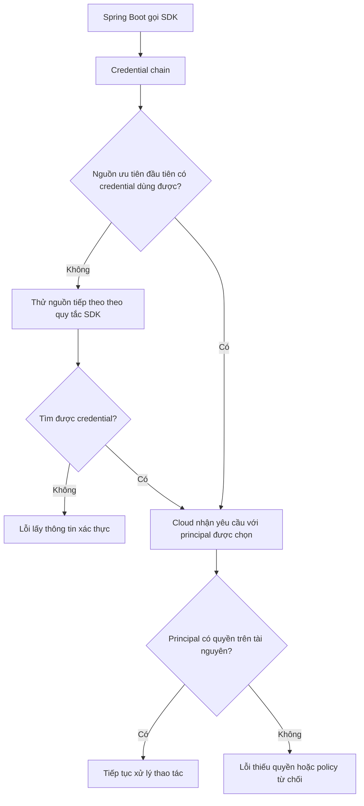
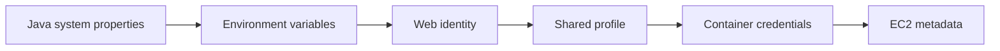
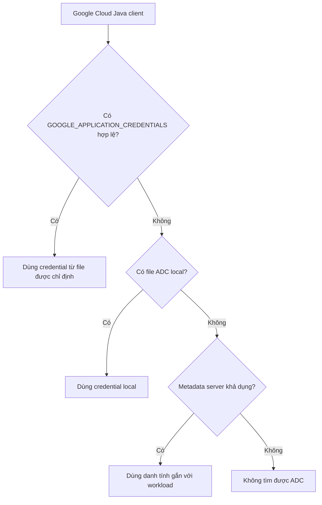

# Chuỗi tìm thông tin xác thực và thứ tự lựa chọn danh tính

Khi một ứng dụng Spring Boot gọi Amazon S3, Azure Blob Storage hay Google Cloud Storage, thư viện client cần tìm được **thông tin xác thực** (*credentials*) để đại diện cho ứng dụng. Lập trình viên thường chỉ viết một dòng tạo client và để SDK tự tìm thông tin xác thực. Cách làm này rất tiện, nhưng cũng đặt ra câu hỏi quan trọng: **nếu nhiều nguồn danh tính cùng tồn tại, SDK sẽ chọn nguồn nào?**

Trong module **SPRING_CLOUD_PROVIDER_INTEGRATION**, chúng ta thực hành tích hợp Spring Boot với các dịch vụ managed của AWS, Azure và Google Cloud thông qua thư viện Spring Cloud tương ứng. Hiểu *credential chain* giúp ứng dụng chạy nhất quán từ máy phát triển đến CI/CD và production, bảo vệ secret, kiểm thử tích hợp storage/messaging/dữ liệu và chẩn đoán lỗi khi SDK bất ngờ dùng sai danh tính.

## 1. Mục tiêu học tập

Sau bài này, bạn có thể:

- Giải thích *credential provider*, *credential chain*, *principal* và thứ tự ưu tiên tìm thông tin xác thực.
- Mô tả những nguồn credential phổ biến của **AWS SDK for Java 2.x**, **Azure Identity for Java** và **Google Cloud Application Default Credentials (ADC)**.
- Dự đoán danh tính được chọn khi biến môi trường, profile local và danh tính workload cùng được cấu hình.
- Phân biệt lỗi **không tìm được credential** với việc **đã dùng được credential nhưng thiếu quyền** trên tài nguyên cloud.
- Cấu hình và kiểm tra đường đi của credential trong ứng dụng Spring Boot mà không đưa access key, client secret hoặc access token vào mã nguồn và log.

## 2. Credential chain giải quyết vấn đề gì?

**Credential provider** là một thành phần biết cách lấy thông tin xác thực từ một nguồn cụ thể. Ví dụ: đọc biến môi trường, đọc file cấu hình cho developer, nhận token của workload, hoặc hỏi metadata service của máy đang chạy trên cloud.

**Credential provider chain** là một danh sách có thứ tự các provider. SDK thử các nguồn được hỗ trợ cho đến khi nhận được credential có thể sử dụng. Nhờ đó cùng một chương trình Java có thể hoạt động ở nhiều môi trường mà không phải lưu khóa bí mật trực tiếp trong ứng dụng.

**Principal** là danh tính mà dịch vụ cloud nhận biết từ credential: một IAM role/session ở AWS, một managed identity hoặc service principal ở Azure, hay một service account/người dùng được ủy quyền ở Google Cloud. Credential có thể là access key và secret key, token có hạn sử dụng, thông tin phiên tạm thời, hoặc một cấu hình để đổi lấy token; **không phải nguồn nào cũng chứa một khóa bí mật cố định**.



**Hai quy tắc cần nhớ:**

1. **Thứ tự chọn credential khác với phân quyền tài nguyên.** Một provider có thể trả về credential hoàn toàn hợp lệ của tài khoản *khác* hoặc một principal *thiếu quyền*. SDK thường **không thử provider tiếp theo chỉ vì dịch vụ đích trả `403` hoặc `AccessDenied`**.
2. **Thứ tự là đặc tính của thư viện và phiên bản.** Không nên giả định cả ba cloud dùng cùng một chuỗi, hoặc một sơ đồ thứ tự áp dụng mãi cho mọi bản phát hành. Azure đặc biệt có thể bổ sung hoặc thay đổi các nguồn credential của công cụ phát triển giữa các phiên bản.

Ví dụ: developer đã đăng nhập profile `team-dev`, nhưng terminal vô tình còn `AWS_ACCESS_KEY_ID` và `AWS_SECRET_ACCESS_KEY` của một tài khoản thử nghiệm. AWS SDK for Java 2.x mặc định ưu tiên biến môi trường so với profile. Ứng dụng vẫn có thể khởi chạy bình thường, nhưng các lời gọi S3 sẽ chạy dưới danh tính không như mong đợi.

## 3. Tổng quan ba cơ chế mặc định

| Tiêu chí | AWS | Azure | Google Cloud |
| --- | --- | --- | --- |
| Cơ chế thường gặp trong Java | `DefaultCredentialsProvider` của AWS SDK for Java 2.x | `DefaultAzureCredential` của thư viện `azure-identity` | **Application Default Credentials (ADC)**, ví dụ `GoogleCredentials.getApplicationDefault()` |
| Nguồn dành cho developer | System properties, environment variables, shared profile, IAM Identity Center/SSO tùy profile | Credential từ môi trường, công cụ IDE/CLI mà SDK hỗ trợ | File ADC local tạo bởi `gcloud auth application-default login` |
| Nguồn dành cho workload | Web identity, container credentials, EC2 instance profile | Workload identity, managed identity | Metadata server của compute hoặc cấu hình Workload Identity Federation |
| Đường cấp chứng thực | Access key/secret và session token, hoặc credential ngắn hạn qua role/STS | OAuth 2.0 access token lấy từ Microsoft Entra ID | OAuth 2.0 access token hoặc chứng thực được thư viện Google dùng để lấy token |
| Tham số cấu hình dễ gây chọn sai danh tính | `AWS_ACCESS_KEY_ID`, `AWS_PROFILE`, `AWS_ROLE_ARN` | `AZURE_CLIENT_ID`, `AZURE_TENANT_ID`, `AZURE_CLIENT_SECRET` | `GOOGLE_APPLICATION_CREDENTIALS` |
| Chế độ production nên ưu tiên | IAM role gắn với môi trường chạy | Managed identity hoặc workload identity | Service identity của workload hoặc Workload Identity Federation |

Các thư viện Spring Cloud AWS, Spring Cloud Azure và Spring Cloud GCP thường tích hợp hoặc tự cấu hình client dựa trên cơ chế credential nền tảng. **Tự cấu hình credential hoặc client bean trong Spring** có thể thay đổi cách SDK tìm danh tính. Vì vậy phải kiểm tra cả cấu hình Spring và credential provider thực tế được client sử dụng.

## 4. AWS: DefaultCredentialsProvider của SDK Java 2.x

Với **AWS SDK for Java 2.x**, `DefaultCredentialsProvider` xét các nguồn theo thứ tự khái quát dưới đây. Các profile được hỗ trợ có thể tự kích hoạt những cơ chế phức tạp hơn (IAM Identity Center/SSO, assume role, credential process, v.v.).

| Thứ tự | Provider/nguồn | Dấu hiệu cấu hình | Trường hợp thường gặp |
| --- | --- | --- | --- |
| 1 | Java system properties | `aws.accessKeyId`, `aws.secretAccessKey`, có thể có `aws.sessionToken` | Khởi chạy JVM với `-D...` |
| 2 | Environment variables | `AWS_ACCESS_KEY_ID`, `AWS_SECRET_ACCESS_KEY`, có thể có `AWS_SESSION_TOKEN` | Shell, container hoặc CI có biến môi trường |
| 3 | Web identity token | `AWS_WEB_IDENTITY_TOKEN_FILE`, `AWS_ROLE_ARN`, tùy trường hợp có `AWS_ROLE_SESSION_NAME` | EKS với IAM Roles for Service Accounts (IRSA), môi trường federation phù hợp |
| 4 | Shared AWS profile | `AWS_PROFILE` hoặc `aws.profile`, file `~/.aws/credentials` và `~/.aws/config` | Developer local; profile có thể dùng SSO hoặc assume role |
| 5 | Container credentials | Ví dụ `AWS_CONTAINER_CREDENTIALS_RELATIVE_URI` hoặc `AWS_CONTAINER_CREDENTIALS_FULL_URI` | ECS task role, EKS Pod Identity và môi trường container hỗ trợ endpoint credential |
| 6 | EC2 instance profile | Credential tạm thời từ **Instance Metadata Service (IMDS)** | EC2 có IAM role gắn với instance |

### 4.1. Cách suy luận thứ tự



Sơ đồ thể hiện **thứ tự tìm kiếm**, không phải dữ liệu phải đi qua tất cả các bước. Khi một nguồn cấp được credential, SDK thường dùng credential đó cho request. Khi một nguồn không cấp được credential, chain có thể xét nguồn kế tiếp theo xử lý lỗi của provider. Sau khi chọn được credential, các lời gọi API có thể tái sử dụng provider và tự làm mới credential tạm thời khi cần.

Ví dụ local:

```powershell
$env:AWS_PROFILE = "team-dev"
$env:AWS_ACCESS_KEY_ID = "..."
$env:AWS_SECRET_ACCESS_KEY = "..."
```

Với mặc định của AWS SDK for Java 2.x, **nhóm environment credentials sẽ được xét trước shared profile**. Do vậy `AWS_PROFILE=team-dev` không tự buộc ứng dụng phải dùng profile `team-dev` khi có bộ access key hợp lệ ở biến môi trường. Các dấu `...` chỉ là ký hiệu minh họa, không phải credential thực.

Đối với workload chạy trên EKS, cần phân biệt **IRSA** (web identity token) với **EKS Pod Identity** (credential được cấp qua container credential endpoint). Cả hai đều có thể cấp credential tạm thời cho IAM role, nhưng kích hoạt các phần khác nhau trong default chain. Trên ECS thường dùng task role; trên EC2 dùng instance profile. Không cần đặt IAM access key dài hạn vào Docker image để dùng các cơ chế này.

### 4.2. Tạo Spring Boot client dùng chuỗi mặc định

Ví dụ sử dụng AWS SDK for Java 2.x trong một ứng dụng Spring Boot; cần có dependency SDK tương ứng và cấu hình region của dịch vụ:

```java
@Configuration
public class AwsClientConfiguration {

    @Bean
    S3Client s3Client() {
        return S3Client.builder()
                .region(Region.AP_SOUTHEAST_1)
                .credentialsProvider(DefaultCredentialsProvider.create())
                .build();
    }
}
```

Không có access key trong code. Cùng một bean có thể dùng AWS profile local, IAM role của ECS/EKS hoặc instance profile của EC2 **tùy nguồn có mặt và thứ tự ưu tiên**. Nếu Spring Cloud AWS đã tự cấu hình `S3Client` thì chỉ cần cấu hình trực tiếp khi có lý do rõ ràng; một bean tùy chỉnh có thể thay thế đường cấu hình mặc định của starter.

Để kiểm tra principal AWS của credential **thực sự được sử dụng**, có thể gọi `GetCallerIdentity` qua STS với **cùng credential provider** của client:

```java
AwsCredentialsProvider provider = DefaultCredentialsProvider.create();

try (StsClient sts = StsClient.builder()
        .region(Region.AP_SOUTHEAST_1)
        .credentialsProvider(provider)
        .build()) {
    GetCallerIdentityResponse who = sts.getCallerIdentity();
    System.out.println("AWS principal ARN: " + who.arn());
    System.out.println("AWS account ID: " + who.account());
}
```

Trong ứng dụng thật, hãy inject **cùng provider bean** vào client cần kiểm tra thay vì tạo provider mới ở đường debug rồi mặc nhiên cho rằng hai client chọn cùng nguồn. ARN/account ID có thể được ghi vào log chẩn đoán có kiểm soát; **không bao giờ log `secretAccessKey`, session token hoặc token chứng thực**. `aws sts get-caller-identity` trên terminal cũng hữu ích, nhưng nó chỉ phản ánh credential của tiến trình CLI đó, không tự chứng minh danh tính của JVM chạy ở môi trường khác.

## 5. Azure: DefaultAzureCredential và nguồn danh tính cho workload

Trong Java, `DefaultAzureCredential` thuộc thư viện **Azure Identity** kết hợp nhiều cách lấy access token. Chuỗi này thường ưu tiên nguồn phù hợp với triển khai production trước, sau đó mới xét credential của công cụ phát triển. **Danh sách chi tiết và cách tiếp tục khi một provider báo lỗi phụ thuộc phiên bản `azure-identity`**, do vậy nên xem tài liệu của phiên bản dự án đang sử dụng khi chẩn đoán thứ tự chính xác.

Những nhóm nguồn quan trọng:

| Nhóm nguồn | Cấu hình hoặc hoàn cảnh | Danh tính được đại diện |
| --- | --- | --- |
| `EnvironmentCredential` | Ví dụ có đủ `AZURE_TENANT_ID`, `AZURE_CLIENT_ID`, `AZURE_CLIENT_SECRET` | Service principal trong Microsoft Entra ID |
| `WorkloadIdentityCredential` | Workload có token liên kết/federated token file, ví dụ AKS Workload Identity với `AZURE_FEDERATED_TOKEN_FILE` và thông tin tenant/client | Danh tính Entra được liên kết với workload |
| `ManagedIdentityCredential` | Workload ở dịch vụ Azure có managed identity như App Service hoặc VM | System-assigned hay user-assigned managed identity |
| Developer credentials | Tùy phiên bản và môi trường: Azure CLI, Azure Developer CLI, Azure PowerShell hoặc credential từ IDE | Danh tính developer đăng nhập vào công cụ tương ứng |

Không nên xem bảng này là cam kết về mọi vị trí nội bộ trong chain: một số thành phần developer xuất hiện hoặc vắng mặt tùy SDK, nền tảng và dependency đi kèm. `DefaultAzureCredential` cũng có thể dừng chuỗi sớm khi nguồn credential của workload đã được cấu hình nhưng không xác thực được, thay vì luôn thử sang một tài khoản developer khác.

### 5.1. Hai tình huống ưu tiên dễ nhầm

**Tình huống A — Azure App Service có managed identity nhưng còn biến môi trường service principal.** Nếu môi trường cung cấp đầy đủ biến của một service principal, `EnvironmentCredential` có thể lấy token trước khi chuỗi đi đến managed identity. Ứng dụng khi đó chạy với service principal trong environment, dù managed identity đã được bật trên App Service. Cần kiểm tra các biến `AZURE_*` đang được deploy và nguồn nào được SDK chọn.

**Tình huống B — AKS với Workload Identity.** Pod được cấu hình token liên kết do Kubernetes cung cấp; Azure Identity có thể đổi token đó lấy access token của danh tính liên kết trong Entra. Việc mount federated token file hoặc đặt một `AZURE_CLIENT_ID` riêng lẻ **không đủ** để kết luận toàn bộ chuỗi đã có cấu hình hợp lệ. Cần kiểm tra sự liên kết giữa service account của Pod, federated identity credential và client ID/tenant ID.

### 5.2. Spring Boot dùng DefaultAzureCredential

Ví dụ tách credential thành bean để tất cả client Azure sử dụng cùng nguồn được cấu hình:

```java
@Configuration
public class AzureClientConfiguration {

    @Bean
    TokenCredential azureTokenCredential() {
        return new DefaultAzureCredentialBuilder().build();
    }

    @Bean
    BlobServiceClient blobServiceClient(TokenCredential azureTokenCredential) {
        return new BlobServiceClientBuilder()
                .endpoint("https://myaccount.blob.core.windows.net")
                .credential(azureTokenCredential)
                .buildClient();
    }
}
```

Khi chạy trên Azure và muốn dùng **user-assigned managed identity**, phải chỉ rõ client ID theo cách được bản SDK hỗ trợ. Khi cần yêu cầu chặt chẽ rằng ứng dụng **chỉ** dùng managed identity, có thể tạo credential rõ ràng:

```java
TokenCredential managedIdentity = new ManagedIdentityCredentialBuilder()
        .clientId("<user-assigned-managed-identity-client-id>")
        .build();
```

Code này được dùng ở **môi trường Azure hỗ trợ managed identity**; nó không thay thế cách developer lấy credential ở local. Giá trị `<...>` là chỗ đặt cấu hình được truyền qua môi trường, không nên hardcode client ID vào thư viện dùng chung. Managed identity vẫn cần **Azure RBAC/data-plane role** thích hợp đối với storage, messaging hoặc Key Vault. Có token hợp lệ không đồng nghĩa có quyền truy cập tài nguyên.

Để biết `DefaultAzureCredential` đã chọn nguồn nào, bật logging chẩn đoán của **Azure Identity** trong môi trường thử nghiệm và đọc thông báo provider được chọn hoặc bị từ chối; lọc thông tin nhạy cảm trước khi lưu log. `az account show` cho biết đăng nhập của Azure CLI tại terminal, **không khẳng định** Java client đã dùng Azure CLI nếu chain chọn environment, workload identity hoặc managed identity trước.

## 6. Google Cloud: Application Default Credentials (ADC)

Các Google Cloud client library cho Java thường dùng **ADC** để tìm credential. Khác với chuỗi nhiều provider của AWS và Azure, quy tắc tìm kiếm ADC phổ biến có ba nhóm chính, theo đúng thứ tự:

1. **Biến môi trường `GOOGLE_APPLICATION_CREDENTIALS`:** đường dẫn đến một file cấu hình credential được Google Auth Library hỗ trợ. File có thể là cấu hình Workload Identity Federation hoặc thông tin service account; file khóa riêng JSON của service account là lựa chọn cần hạn chế vì có bí mật dài hạn.
2. **File ADC local:** credential được tạo bằng `gcloud auth application-default login` (thường đại diện cho tài khoản developer, hoặc cấu hình impersonation nếu sử dụng đúng cơ chế hỗ trợ).
3. **Metadata server của môi trường Google Cloud:** ví dụ service identity/service account gắn với Compute Engine, Cloud Run hoặc GKE. Trên GKE có thể cấu hình Workload Identity Federation để workload lấy danh tính phù hợp.



Không được hiểu sơ đồ là “SDK sẽ thử metadata khi credential ở file được chọn bị `PermissionDenied`”. Khi credential được chọn đủ để gửi request, lỗi thiếu IAM permission của request **không kích hoạt** chọn lại một danh tính khác.

### 6.1. Hai loại đăng nhập gcloud khác nhau

```bash
# Đăng nhập để gcloud CLI thực thi lệnh với tài khoản developer:
gcloud auth login

# Tạo/cập nhật Application Default Credentials cho ứng dụng dùng ADC:
gcloud auth application-default login
```

Hai lệnh phục vụ các kho credential khác nhau. `gcloud auth login` **không tự bảo đảm** thư viện Java đang dùng cùng principal. Khi `GOOGLE_APPLICATION_CREDENTIALS` đã được chỉ đến một credential file, file này được xét **trước** local ADC. Điều đó giải thích tại sao một developer đã đăng nhập ADC bằng tài khoản A nhưng ứng dụng lại truy cập tài nguyên dưới service account B.

`GOOGLE_CLOUD_PROJECT`, project ID cấu hình cho client và **principal của credential** cũng là các khái niệm riêng: chỉ đổi project đích không tự đổi service account hoặc danh tính dùng để gọi API.

### 6.2. Tạo Google Cloud Storage client trong Spring Boot

```java
@Configuration
public class GoogleStorageConfiguration {

    @Bean
    Storage storage(@Value("${app.gcp.project-id}") String projectId)
            throws IOException {
        GoogleCredentials credential = GoogleCredentials.getApplicationDefault();

        return StorageOptions.newBuilder()
                .setCredentials(credential)
                .setProjectId(projectId)
                .build()
                .getService();
    }
}
```

Ví dụ phân biệt rõ **credential được ADC tìm** với **project đích được ứng dụng khai báo**. Các Spring Cloud GCP starter có thể tự cấu hình client, credential và project ID bằng cơ chế riêng của starter; khi tạo bean thủ công, cần chắc rằng toàn bộ client cùng dùng cấu hình mong muốn. `IOException` ở ví dụ phản ánh trường hợp không nạp được ADC; một credential hợp lệ vẫn có thể bị Google Cloud IAM từ chối khi gọi storage.

Ở production, ưu tiên service identity gắn với workload hoặc Workload Identity Federation. Tránh copy file khóa service account từ local vào image/container. Nếu phải dùng credential configuration file cho federation, phân biệt **file cấu hình trao đổi danh tính** với **file khóa riêng**, và quản lý đường dẫn đúng cho môi trường chạy.

## 7. Credential nào được chọn trong từng môi trường?

Với cùng một đoạn code Spring Boot, danh tính thực tế có thể khác nhau theo hệ thống triển khai:

| Môi trường | AWS thường dùng | Azure thường dùng | Google Cloud thường dùng |
| --- | --- | --- | --- |
| Máy local của developer | Shared profile, IAM Identity Center hoặc credential thử nghiệm | Credential của Azure CLI/IDE hoặc nguồn developer tương ứng | Local ADC từ `gcloud auth application-default login` |
| CI/CD | Federation/OIDC để lấy role credentials; đôi khi nguồn cấu hình riêng | Federated service principal/workload identity | Workload Identity Federation từ hệ thống CI |
| Container/compute production | ECS task role, EKS IRSA/Pod Identity, EC2 role | AKS Workload Identity, App Service/VM managed identity | Service account/Workload Identity Federation qua metadata |

Bảng mô tả phương án **nên triển khai**; không khẳng định đây là danh tính sẽ được chọn nếu trước đó có system properties, environment variables hoặc credential file có độ ưu tiên cao hơn.

### 7.1. Nguyên tắc chọn danh tính theo môi trường

- **Local:** developer sử dụng danh tính có phạm vi hẹp trong môi trường dev; không chia sẻ chung access key. Có thể dùng profile hoặc đăng nhập CLI/ADC. Biến môi trường còn tồn dư từ dự án trước cần được kiểm tra.
- **CI/CD:** ưu tiên OIDC/workload federation để lấy token hoặc credential tạm thời, giới hạn theo repository, branch, workflow và môi trường được phép; chỉ dùng danh tính deploy có quyền cần thiết.
- **Production:** gắn role/managed identity/service identity vào chính runtime. Tránh biến bí mật dài hạn thành cấu hình mặc định vì chúng dễ bị lộ, khó xoay vòng và có thể vượt qua danh tính runtime mong muốn.
- **Mọi môi trường:** tách danh tính dev, staging và production. Quyền trên bucket, topic, queue, database và secret phải được xét riêng sau khi đã xác định đúng principal.

### 7.2. Khi nào dùng credential rõ ràng thay cho chain mặc định?

Chuỗi mặc định hữu ích khi một codebase cần chạy ở nhiều môi trường và mỗi môi trường được cấu hình nhất quán. Đổi lại, chuỗi mặc định có thể âm thầm chọn credential không mong muốn nếu máy chạy tồn tại nguồn ưu tiên cao hơn.

Có thể chọn provider cụ thể khi **yêu cầu hệ thống buộc phải dùng một nguồn duy nhất**. Ví dụ môi trường production Azure chỉ được dùng managed identity, AWS local chạy thử với một profile xác định, hoặc ứng dụng cần impersonation/service account delegation theo một luồng đã kiểm soát. Khi làm vậy, nên quyết định ngay trong lớp cấu hình client và có phép kiểm tra đi kèm; **không** hardcode khóa bí mật để đạt tính “rõ ràng”.

## 8. Các trường hợp sai danh tính thường gặp

| Hiện tượng | Nguyên nhân khả dĩ | Cách xác minh và khắc phục |
| --- | --- | --- |
| AWS ở local vẫn dùng tài khoản A dù `AWS_PROFILE` là B | Java system properties hoặc `AWS_ACCESS_KEY_ID`/`AWS_SECRET_ACCESS_KEY` đang tồn tại, được xét trước profile | Kiểm tra các nguồn ưu tiên cao hơn; dùng cùng provider để lấy `GetCallerIdentity` hoặc chọn `ProfileCredentialsProvider` cho ca local có kiểm soát |
| AWS ECS/EKS/EC2 dùng sai role | Credential tĩnh ở env hoặc system properties được chọn trước role runtime | Loại bỏ credential dài hạn khỏi runtime, xác minh nguồn token/endpoint tương ứng với cơ chế deploy |
| Azure App Service có managed identity nhưng lại dùng service principal | `EnvironmentCredential` được cấu hình đủ thông tin và được chọn trước | Kiểm tra env `AZURE_*`, log Azure Identity và cấu hình client; bỏ nguồn không chủ đích |
| Azure local không dùng được đăng nhập CLI | Nguồn workload được cấu hình lỗi, hoặc developer credential chưa sẵn sàng/không được hỗ trợ | Xem loại credential gây lỗi, chuỗi thực tế của phiên bản SDK và trạng thái đăng nhập công cụ |
| Google Cloud ứng dụng dùng service account lạ | `GOOGLE_APPLICATION_CREDENTIALS` chỉ tới file có độ ưu tiên cao hơn local ADC/metadata | Kiểm tra đường dẫn file cấu hình và thông tin principal trong audit log, sửa biến môi trường |
| GCP local CLI chạy được nhưng Java bị từ chối | `gcloud auth login` và ADC khác kho credential, hoặc Java chạy với identity khác | Kiểm tra `gcloud auth application-default` và nguồn thực tế của Java client |
| SDK tìm được credential nhưng gọi storage trả `403` | Principal thiếu permission, sai bucket/account/project hoặc bị policy khác chặn | Đối chiếu principal thực tế với resource, operation, IAM/RBAC và network/KMS nếu có; không thêm access key mới để “thử” |

**Phân biệt bốn kiểu lỗi:**

1. **Không tìm thấy credential:** chuỗi hết nguồn và không có thông tin xác thực dùng được. Kiểm tra provider chain, cấu hình local/runtime, metadata endpoint và workload binding.
2. **Nguồn được cấu hình nhưng không cấp được credential:** token hết hạn, federated token không hợp lệ, sai tenant/client ID, credential file bị lỗi hoặc không đủ quyền đọc. Một số SDK có thể dừng tại nguồn đã được cấu hình thay vì chuyển sang tài khoản khác.
3. **Credential đúng định dạng nhưng principal ngoài dự kiến:** SDK xác thực thành công với tài khoản/role khác; request có thể thành công trên tài nguyên sai hoặc bị từ chối trên tài nguyên đúng. Đây là lỗi nguy hiểm vì không phải lúc nào cũng có exception.
4. **Principal đúng nhưng thiếu quyền:** cần sửa policy/role/scope của workload hoặc tài nguyên; thay đổi thứ tự chain không giải quyết gốc rễ.

## 9. Chẩn đoán thứ tự credential trong ứng dụng Spring Boot

Khi ứng dụng trả `AccessDenied`, `Forbidden`, `permission denied` hoặc không khởi động được client, hãy lần theo **credential thực sự đã được chọn** trước khi nới quyền.

### Bước 1 — Ghi nhận môi trường chạy và các nguồn có mặt

Xác định ứng dụng đang chạy ở local, container CI, ECS/EKS/EC2, Azure App Service/AKS hay Cloud Run/GKE. Kiểm tra **sự có mặt của tên biến**, đường dẫn cấu hình, Java system properties, profile và metadata/workload binding. Không in giá trị access key, client secret, token, hoặc nội dung credential JSON ra terminal/log.

Các nhóm dễ kiểm tra:

```text
AWS:
  aws.accessKeyId (JVM system property)
  AWS_ACCESS_KEY_ID, AWS_SECRET_ACCESS_KEY, AWS_SESSION_TOKEN
  AWS_PROFILE, AWS_ROLE_ARN, AWS_WEB_IDENTITY_TOKEN_FILE
  AWS_CONTAINER_CREDENTIALS_RELATIVE_URI / FULL_URI

Azure:
  AZURE_TENANT_ID, AZURE_CLIENT_ID, AZURE_CLIENT_SECRET
  AZURE_FEDERATED_TOKEN_FILE
  Cấu hình managed identity và thông tin đăng nhập IDE/CLI

Google Cloud:
  GOOGLE_APPLICATION_CREDENTIALS
  File ADC local, metadata server, service account của runtime
  GOOGLE_CLOUD_PROJECT / project ID do client chỉ định
```

Chỉ từ **tên biến tồn tại** chưa thể khẳng định credential hợp lệ hay provider cuối cùng; ví dụ nhóm environment credential có thể thiếu một trường bắt buộc.

### Bước 2 — Xác minh provider/principal dùng trong JVM

- **AWS:** với cùng `AwsCredentialsProvider`, gọi STS `GetCallerIdentity` trong môi trường chẩn đoán hoặc đối chiếu request log/CloudTrail. Tránh tạo STS client riêng dùng một provider khác rồi kết luận thay cho S3 client.
- **Azure:** bật log chẩn đoán Azure Identity ở mức phù hợp trong môi trường an toàn để biết credential nguồn nào được thử và nguồn nào lấy token thành công. Đối chiếu client ID/tenant ID và log dịch vụ/Entra khi cần. Không log raw access token.
- **Google Cloud:** xác minh ADC đến từ env file, local ADC hay metadata; đối chiếu service account/principal trong Cloud Audit Logs. Với external account/federation, cần phân biệt principal gốc và danh tính đích được ủy quyền.

### Bước 3 — Kiểm tra quyền và resource sau khi biết đúng danh tính

So khớp **principal + operation + resource + scope/conditions**. Ví dụ, upload file mới cần quyền khác với list bucket, đọc object hoặc xóa object. Ở Azure, token có thể hợp lệ nhưng chưa được gán role cho *data plane* của Blob Storage. Ở AWS và Google Cloud, danh tính hợp lệ vẫn có thể bị deny hoặc thiếu permission ở bucket đích.

### Bước 4 — Cố định cấu hình cần thiết và kiểm thử lại

Loại bỏ nguồn credential có độ ưu tiên cao hơn nhưng không thuộc kế hoạch; chọn provider tường minh nếu có yêu cầu rõ ràng. Tái triển khai workload thử nghiệm, kiểm tra credential được chọn và thử **một hành động được phép** cùng **một hành động phải bị từ chối**. Chỉ sau đó áp dụng quy trình release cho production.

## 10. Bài thực hành: tìm nguyên nhân khi môi trường chọn nhầm identity

**Bối cảnh:** `invoice-service` là Spring Boot service lưu file vào storage và publish message sau khi ghi thành công. Nhóm dev sử dụng cùng code cho local và staging. Yêu cầu: mỗi môi trường phải dùng principal riêng, được cấp quyền tối thiểu đối với tài nguyên storage/messaging tương ứng.

Chọn **một cloud** làm bài thực hành chính; hai cloud còn lại dùng để đối chiếu bảng dưới đây. Thử nghiệm trên tài nguyên test, không sử dụng secret hoặc principal production.

| Ca | Thiết lập | Dự đoán | Điều cần xác minh |
| --- | --- | --- | --- |
| A — AWS local | Có profile `dev`, đồng thời có cặp `AWS_ACCESS_KEY_ID`/`AWS_SECRET_ACCESS_KEY` hợp lệ của identity test khác | Environment được xét trước profile | Principal của `GetCallerIdentity` có đúng với credential được chọn không? |
| B — AWS runtime | Gỡ các credential tĩnh, cung cấp IAM role qua compute/workload | SDK dùng role credential tương ứng sau khi các nguồn trước không cấp credential | ARN của principal và quyền trên tài nguyên test |
| C — Azure | Managed identity đã bật, đồng thời có bộ env service principal hoàn chỉnh | Environment credential có thể được chọn trước managed identity | Provider Azure Identity được chọn, tenant/client ID, quyền data-plane |
| D — Google Cloud local | Có `GOOGLE_APPLICATION_CREDENTIALS` trỏ tới credential config test và file ADC của developer | File được chỉ định bởi env được xét trước ADC local | Principal trong audit log, bucket/project đích |
| E — Bất kỳ cloud nào | Có credential hợp lệ nhưng cố gọi tài nguyên không được cấp quyền | Xác thực có thể đạt; thao tác bị từ chối vì quyền | Không có chuyện SDK tự tìm credential khác vì request bị `403` |

Ghi lại cho từng ca: **nguồn credential dự đoán**, **nguồn được quan sát**, **principal thực tế**, **resource**, **operation** và **kết quả API**. Nếu không có sẵn môi trường cloud, có thể phân tích cấu hình giả lập và kiểm tra khả năng dựng client; tuy nhiên chỉ có thử nghiệm với tài nguyên thực mới xác nhận được quyền IAM/RBAC ở phía dịch vụ.

### Câu hỏi phân tích

1. Nếu `AWS_PROFILE` trỏ đến profile `staging`, nhưng `AWS_ACCESS_KEY_ID`/`AWS_SECRET_ACCESS_KEY` đang tồn tại, provider nào của AWS SDK Java 2.x được xét trước? Vì sao?
2. Vì sao việc bật managed identity trên Azure App Service không đủ chứng minh ứng dụng đã dùng nó?
3. `gcloud auth login` và `gcloud auth application-default login` khác nhau thế nào trong quá trình chọn principal cho Java client?
4. Một request upload bị `403` sau khi SDK đã lấy được token: bạn cần kiểm tra credential chain hay policy trước, và vì sao phải xác nhận principal thực tế?
5. Bạn thiết kế CI/CD và production ra sao để giảm nguy cơ credential của developer hoặc môi trường cũ lấn át workload identity?

## 11. Ghi nhớ khi tích hợp các dịch vụ managed

**Credential chain quyết định ứng dụng sẽ dùng thông tin xác thực nào; IAM/RBAC quyết định principal đó được làm gì trên storage, queue, topic, database hoặc secret.** AWS, Azure và Google Cloud đều hỗ trợ cơ chế lấy credential tự động, nhưng nguồn và thứ tự tìm kiếm khác nhau. Mỗi khi chuyển môi trường, thêm starter Spring Cloud hoặc bổ sung biến cấu hình, hãy xác minh principal thực tế của client trước khi kiểm tra quyền tài nguyên. Ưu tiên credential tạm thời và workload identity, tách danh tính theo môi trường, giữ secret ngoài mã nguồn và chỉ cấp đúng quyền cần thiết.
