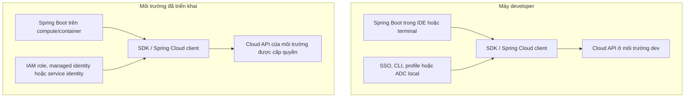
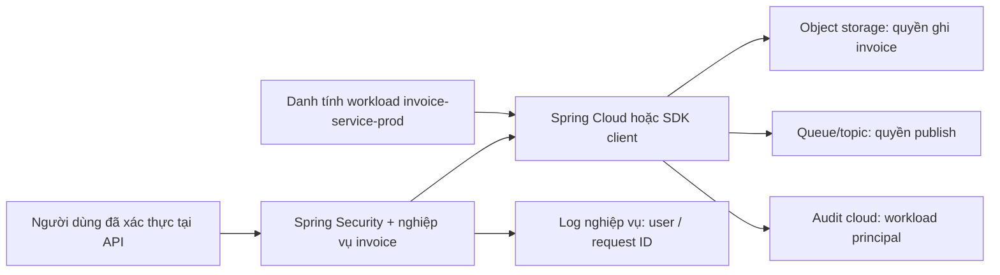

# Danh tính người phát triển tại máy cục bộ và danh tính ứng dụng khi triển khai

Một ứng dụng Spring Boot có thể đọc object từ Amazon S3 trên laptop của lập trình viên, nhưng nhận `AccessDenied` khi chạy trên Amazon ECS. Cùng ứng dụng đó có thể upload file lên Azure Blob Storage khi dùng `az login`, song thất bại sau khi triển khai lên Azure App Service. Trên Google Cloud, lệnh `gcloud` có thể chạy thành công nhưng Java client không tìm được credential. Những hiện tượng này thường xuất phát từ một sự khác biệt quan trọng: **danh tính của người phát triển trên máy cục bộ không phải danh tính của ứng dụng khi triển khai**.

Trong module **SPRING_CLOUD_PROVIDER_INTEGRATION**, mục tiêu là thực hành tích hợp Spring Boot với dịch vụ managed của AWS, Azure và Google Cloud thông qua thư viện Spring Cloud tương ứng: storage, messaging, dữ liệu và secret manager. Bài thuộc chương **Danh tính và quyền** này giải thích cách chọn, cấp quyền và kiểm tra danh tính ở local, CI/CD và runtime thật; từ đó giúp hạn chế việc dùng khóa bí mật dài hạn hoặc mang quyền của tài khoản cá nhân vào production.

## 1. Kết quả học tập

Sau bài học, bạn có thể:

- Phân biệt danh tính của developer, danh tính workload, danh tính pipeline CI/CD và danh tính người dùng cuối.
- Giải thích vì sao cùng một đoạn Java và cùng một SDK có thể dùng các principal khác nhau ở local và production.
- Thiết lập mô hình xác thực phù hợp cho AWS, Azure và Google Cloud mà không nhúng access key, client secret hoặc private key vào repository.
- Cấp quyền tối thiểu cho ứng dụng theo dịch vụ, thao tác và môi trường, thay vì sao chép quyền của developer.
- Xác minh **principal thực tế** khi Spring Boot gọi dịch vụ cloud và chẩn đoán tình huống “local chạy được, deploy lại lỗi”.
- Thiết kế kiểm thử tích hợp để phát hiện sai danh tính hoặc vượt phạm vi quyền trước khi release.

## 2. Bốn loại danh tính thường xuất hiện trong cùng hệ thống

Giả sử `invoice-service` là API Spring Boot nhận yêu cầu tạo hóa đơn, lưu JSON vào object storage rồi phát một thông điệp để hệ thống khác xử lý.

| Chủ thể | Xuất hiện ở đâu? | Mục đích | Quyền phù hợp |
| --- | --- | --- | --- |
| **Người phát triển (developer identity)** | Laptop, IDE, terminal, môi trường local | Thử API cloud, debug và chạy integration test ở dev | Chỉ tài nguyên dev/test cần thiết; thường đăng nhập qua SSO/CLI/ADC |
| **Ứng dụng đã triển khai (workload identity)** | ECS/EKS/EC2, App Service/AKS, Cloud Run/GKE/Compute Engine | Cho tiến trình Spring Boot truy cập tài nguyên cloud trong lúc phục vụ request | Đúng thao tác trên storage, queue, database, secret của môi trường chạy |
| **Pipeline triển khai (CI/CD identity)** | GitHub Actions, GitLab CI, Azure Pipelines hoặc runner khác | Build, test, đẩy image, triển khai hạ tầng/phần mềm | Quyền deploy và quyền kiểm thử được tách khỏi quyền runtime |
| **Người dùng cuối (end-user identity)** | Browser/mobile gọi API; Spring Security xử lý JWT/session | Kiểm soát người nào được tạo/xem hóa đơn trong nghiệp vụ | Quyền ứng dụng theo user/role/tenant; không tự biến thành IAM/RBAC của workload |

Một tài khoản developer có thể có quyền deploy và debug rộng để làm việc trên môi trường dev. Điều đó **không** có nghĩa `invoice-service` nên nhận các quyền tương tự khi chạy 24/7. Workload chỉ cần các quyền máy thực sự thực hiện: ghi object trong bucket nhất định, gửi message tới queue/topic cụ thể, đọc một số secret và kết nối đến nguồn dữ liệu được chỉ định.

**Authentication** trả lời “Ai đang gọi cloud API?”. **Authorization** trả lời “Principal đó được thực hiện operation nào trên resource nào?”. Danh tính hợp lệ không đồng nghĩa có đủ quyền; credential của developer dùng được tại local cũng không bảo đảm app runtime sẽ có cùng quyền.

## 3. Vì sao cùng mã nguồn lại có hai danh tính?

Đa số Java SDK và các starter Spring Cloud hỗ trợ **chuỗi tìm thông tin xác thực mặc định**. Khi tạo cloud client, thư viện tìm credential từ môi trường: biến môi trường, profile/credential file local, đăng nhập của công cụ developer hoặc endpoint nhận credential/token của workload.



Code có thể giữ nguyên, nhưng **nguồn credential** khác nhau. Ví dụ:

- Ở local, AWS SDK đọc profile mà developer đã đăng nhập qua IAM Identity Center; khi lên ECS, SDK có thể lấy temporary credentials của **task role**.
- Ở local, Azure SDK lấy token từ tài khoản đã `az login`; khi lên Azure App Service, SDK có thể lấy token từ **managed identity** đã bật cho ứng dụng.
- Ở local, Google Cloud client library đọc **Application Default Credentials (ADC)** do developer tạo; trên Cloud Run, thư viện có thể lấy credential của **service account gắn với service** qua môi trường runtime.

Điểm cần kiểm soát: việc “SDK tự chọn” chỉ đáng tin khi môi trường được cấu hình đúng. Một biến môi trường còn sót có thể được xét **trước** danh tính workload hoặc profile dự định dùng. Hơn nữa, đăng nhập thành công không chứng minh danh tính được chọn có quyền truy cập vào bucket/container/queue đích.

## 4. Danh tính người phát triển trên máy cục bộ

### 4.1. Vai trò và giới hạn

Ở máy local, developer phải chứng minh danh tính để kiểm tra luồng kết nối, đọc dữ liệu mẫu hoặc chạy integration test. Lựa chọn nên ưu tiên cơ chế đăng nhập tương tác, liên kết danh tính tổ chức và credential có thời hạn. Tránh yêu cầu từng developer lưu một access key, client secret hoặc service account JSON key sống nhiều tháng.

Quyền của developer cần tách theo môi trường: tài khoản/role dev hoặc sandbox phù hợp, hạn chế thao tác có thể xóa dữ liệu hoặc truy cập secret production. Một developer có quyền rộng để quản trị tài nguyên dev không nên chạy app local bằng quyền đó nếu test chỉ cần upload một object và publish một message.

### 4.2. AWS: profile và phiên đăng nhập developer

Một quy trình thường gặp là tạo profile của tổ chức dùng **AWS IAM Identity Center** (SSO), đăng nhập và chạy ứng dụng bằng profile đã chọn. Những lệnh minh họa sau giả định profile `team-dev` đã được cấu hình:

```bash
# Đăng nhập theo profile dành cho môi trường phát triển.
aws sso login --profile team-dev

# Xác minh principal của chính phiên AWS CLI này.
aws sts get-caller-identity --profile team-dev
```

Chạy Spring Boot với `AWS_PROFILE=team-dev` khi môi trường chạy không có credential ở nguồn ưu tiên cao hơn. Ví dụ trên PowerShell:

```powershell
$env:AWS_PROFILE = "team-dev"
.\mvnw.cmd spring-boot:run
```

**Bẫy quan trọng:** Trong AWS SDK for Java 2.x, Java system properties và các biến như `AWS_ACCESS_KEY_ID`/`AWS_SECRET_ACCESS_KEY` được xét trước shared profile trong `DefaultCredentialsProvider`. Vì vậy, chỉ đặt `AWS_PROFILE` **không bảo đảm** JVM dùng profile đó nếu terminal hoặc IDE đã có access key hợp lệ. `aws sts get-caller-identity --profile ...` cũng chỉ chứng minh principal của lệnh CLI đó; client Java có thể lấy credential từ nguồn khác. Muốn xác nhận danh tính JVM, cần kiểm tra provider được dùng và principal của chính ứng dụng.

### 4.3. Azure: credential từ tài khoản developer

Khi chạy local, developer có thể đăng nhập Azure CLI bằng tài khoản tổ chức:

```bash
az login
az account show --query "{name:name, id:id, tenantId:tenantId}" --output json
```

Trong môi trường được hỗ trợ, `DefaultAzureCredential` của Azure Identity có thể lấy token từ phiên đăng nhập Azure CLI hoặc công cụ developer khác. Tuy nhiên, **thứ tự và những provider có mặt phụ thuộc phiên bản SDK**; nếu có bộ biến môi trường service principal được cấu hình đầy đủ, chain có thể chọn nguồn đó trước tài khoản developer.

Đăng nhập CLI thành công chỉ chứng minh developer có phiên CLI phù hợp. Để truy cập Blob Storage bằng token Entra ID, principal được Java client chọn vẫn cần role **data plane** thích hợp như `Storage Blob Data Contributor` ở storage account/container phù hợp. Vai trò quản trị tài nguyên `Contributor` không tự cấp quyền truy cập dữ liệu blob theo Entra ID.

### 4.4. Google Cloud: ADC dành cho ứng dụng

Với Google Cloud, danh tính mà `gcloud` CLI dùng và credential mà Java client library dùng **không nhất thiết trùng nhau**. Khi cần local ADC:

```bash
# Phiên đăng nhập dành cho ứng dụng dùng Google Auth Library/ADC.
gcloud auth application-default login

# Khác với lệnh đăng nhập tài khoản cho gcloud CLI:
gcloud auth login
```

ADC tìm credential theo thứ tự phổ biến: file được trỏ bởi `GOOGLE_APPLICATION_CREDENTIALS`, sau đó file ADC local, cuối cùng credential qua metadata server của workload khi được hỗ trợ. Một biến `GOOGLE_APPLICATION_CREDENTIALS` còn tồn tại sẽ khiến Java client ưu tiên file đó thay vì phiên local ADC mới đăng nhập. Nếu file đó là khóa riêng của service account, nó còn tạo ra rủi ro lộ secret dài hạn; ưu tiên đăng nhập local hoặc federation phù hợp.

Developer chỉ nên có quyền trên project và bucket dành cho phát triển. `gcloud config set project` hoặc cấu hình project ID của client thay đổi **project đích**, không tự thay đổi principal của ADC.

## 5. Danh tính của ứng dụng khi triển khai

Production không có người ngồi đăng nhập tương tác mỗi khi container được khởi động lại. Thay vào đó, nền tảng cloud cấp credential ngắn hạn hoặc token cho **workload identity** được gắn với môi trường chạy; SDK nhận và làm mới chúng theo cơ chế được hỗ trợ.

| Cloud / nơi chạy | Danh tính workload điển hình | Cơ chế Java SDK lấy credential | Điểm cần thiết lập trước khi deploy |
| --- | --- | --- | --- |
| AWS ECS | **Task role** | ECS container credential endpoint | Gán task role và policy tối thiểu; phân biệt task role với execution role |
| AWS EC2 | **IAM role qua instance profile** | EC2 Instance Metadata Service (IMDS) | Gắn instance profile và IAM policy phù hợp |
| AWS EKS | **IAM Roles for Service Accounts (IRSA)** hoặc **EKS Pod Identity** | Web identity token/STS hoặc container credential endpoint tùy cơ chế | Liên kết Kubernetes service account/Pod với IAM role, trust policy và permission |
| Azure App Service/VM | **Managed identity** hệ thống hoặc do người dùng gán | Azure Identity lấy access token từ endpoint của môi trường | Bật/gán identity và role assignment trên tài nguyên đích |
| Azure AKS | **Microsoft Entra Workload ID** | Workload identity federation với token của Kubernetes | Cấu hình service account, federated identity credential và quyền của identity Entra |
| Google Cloud Run / Compute Engine | **Service account gắn với workload** | ADC thông qua metadata service của môi trường | Chọn service account và cấp IAM role trên đúng resource |
| Google Kubernetes Engine | **Workload Identity Federation for GKE** | Credential do cơ chế workload/metadata được cấu hình cấp | Cấu hình danh tính Pod/Kubernetes service account và IAM binding cần thiết |

Các cột mô tả **cơ chế danh tính phổ biến**, không đồng nghĩa SDK sẽ chắc chắn chọn chúng nếu trước đó có nguồn credential ưu tiên cao hơn. Trên AWS, một cặp access key trong env có thể lấn át role của ECS/EKS/EC2. Trên Azure, environment service principal có thể lấn át managed identity. Trên Google Cloud, `GOOGLE_APPLICATION_CREDENTIALS` có thể lấn át metadata credentials.

### 5.1. Tách quyền chạy ứng dụng và quyền triển khai

Ví dụ trên ECS:

- **ECS task execution role** cho tác vụ liên quan đến chuẩn bị và chạy container, ví dụ kéo image hoặc chuyển log theo cấu hình.
- **ECS task role** là principal mà ứng dụng trong container thường sử dụng khi gọi S3, SQS hoặc Secrets Manager.

Không nhầm hai role này: cấp `s3:PutObject` vào execution role trong khi app cần quyền trên task role sẽ không giải quyết việc Java SDK thiếu quyền ghi object. Tương tự, CI/CD identity có quyền cập nhật service hoặc deploy image không mặc nhiên là principal thực thi các lời gọi storage khi container đã chạy.

### 5.2. Vì sao nên dùng danh tính gắn với runtime?

- **Không cần phân phối khóa cố định:** SDK lấy credential/token từ nền tảng, giảm nguy cơ secret bị sao chép vào file cấu hình hoặc image.
- **Tự làm mới credential:** credential/tokens ngắn hạn được cấp lại theo cơ chế SDK và nền tảng; tránh thao tác xoay vòng bí mật thủ công cho từng instance.
- **Quyền tập trung, có thể kiểm toán:** thay đổi IAM/RBAC binding của workload mà không thay đổi source code; audit log chỉ ra principal gọi tài nguyên.
- **Tách môi trường:** production và staging dùng identity khác nhau, ngay cả khi image Docker chứa cùng mã Java.

Credential ngắn hạn **không tự bảo đảm** ứng dụng an toàn nếu IAM policy quá rộng, metadata endpoint có thể bị lạm dụng hoặc workload bị xâm nhập. Vẫn cần quyền tối thiểu, phân tách môi trường, cấu hình mạng và bảo vệ runtime.

## 6. Đối chiếu ba cloud qua tình huống `invoice-service`

`invoice-service` cần tạo file `invoices/2026/INV-001.json` và phát sự kiện `invoice.created`. Tài nguyên được đặt riêng cho `dev`, `staging`, `prod`.

| Môi trường và mục đích | AWS | Azure | Google Cloud |
| --- | --- | --- | --- |
| **Local dev** chạy thử upload | Developer đăng nhập IAM Identity Center, dùng profile chỉ có quyền ở bucket dev | Developer dùng tài khoản Entra qua Azure CLI/IDE, có data role trên blob container dev | Developer dùng ADC, có quyền Cloud Storage trong bucket dev |
| **CI** chạy integration test | Role tạm thời dành cho pipeline, qua OIDC/federation nếu được hỗ trợ | Federated workload/service principal CI với quyền test | Workload Identity Federation của CI trên project test |
| **Runtime prod** xử lý request thật | IAM task/Pod/instance role của `invoice-service-prod` | Managed identity/workload identity của `invoice-service-prod` | Service account/workload identity của `invoice-service-prod` |
| **Quyền ghi storage prod** | `s3:PutObject` trên object ARN và prefix đích | Data role hoặc custom data action cho blob trên scope phù hợp | `storage.objects.create` trên bucket đích, ví dụ role creator phù hợp |
| **Quyền publish event prod** | `sqs:SendMessage` tới queue hoặc quyền SNS publish nếu dùng SNS | Azure Service Bus Data Sender hoặc role phù hợp với dịch vụ dùng | `pubsub.topics.publish` trên topic, ví dụ Pub/Sub Publisher |

Storage và messaging có bộ permission khác nhau. Việc ứng dụng ghi được hóa đơn chưa chứng minh nó có quyền publish event. Quyền truy cập database và secret manager cũng là những quyền riêng; cần kiểm tra đúng chủ thể, hành động và tài nguyên trong từng môi trường.



Luồng trên thể hiện **hai danh tính độc lập**: Spring Security dùng identity của người dùng để xác định ai được tạo hóa đơn; cloud SDK dùng identity của ứng dụng để truy cập storage và messaging. Nếu không thiết kế riêng cơ chế *delegation/on-behalf-of*, JWT của người dùng **không tự động** trở thành quyền IAM của workload.

## 7. Tổ chức cấu hình Spring Boot để chuyển môi trường an toàn

Ưu tiên thiết kế client dựa trên **credential provider mặc định** đã được kiểm soát theo môi trường. Đường dẫn tài nguyên, region và project ID là cấu hình nghiệp vụ/triển khai; secret phải thuộc cơ chế credential hoặc secret manager được cấp quyền tương ứng.

Ví dụ cấu hình không chứa credential:

```yaml
app:
  invoice-storage:
    bucket: ${INVOICE_BUCKET}
    key-prefix: invoices/
  events:
    destination: ${INVOICE_EVENT_DESTINATION}
```

Trong production, hệ thống triển khai cấp `INVOICE_BUCKET` và `INVOICE_EVENT_DESTINATION` tương ứng với môi trường. **Tên bucket/topic không phải credential**; thay tên tài nguyên cũng không thay principal của SDK. Không đặt `AWS_SECRET_ACCESS_KEY`, `AZURE_CLIENT_SECRET` hoặc private key JSON vào YAML này.

### 7.1. AWS SDK for Java 2.x

Ví dụ bean Spring Boot dùng default credential chain thay vì hardcode access key:

```java
@Configuration
public class AwsStorageConfiguration {

    @Bean
    S3Client s3Client(@Value("${app.aws.region}") String region) {
        return S3Client.builder()
                .region(Region.of(region))
                .credentialsProvider(DefaultCredentialsProvider.create())
                .build();
    }
}
```

Với local, app có thể dùng profile đã đăng nhập nếu các nguồn ưu tiên cao hơn không được cấu hình. Trên ECS, bean tương tự có thể lấy task role credential. Ngoài đoạn code trên, ứng dụng cần cấu hình `app.aws.region`, thêm dependency AWS SDK tương ứng và gán IAM policy cho role chạy thực tế.

Nếu sử dụng **Spring Cloud AWS starter** đã tự cấu hình `S3Client` thì nên dùng cách tích hợp do phiên bản starter cung cấp; việc tạo thêm bean thủ công chỉ là minh họa về nguồn credential và cần kiểm soát tác động đến auto-configuration.

### 7.2. Azure Identity và Blob Storage

```java
@Configuration
public class AzureStorageConfiguration {

    @Bean
    TokenCredential azureCredential() {
        return new DefaultAzureCredentialBuilder().build();
    }

    @Bean
    BlobServiceClient blobServiceClient(
            TokenCredential azureCredential,
            @Value("${app.azure.storage-endpoint}") String endpoint) {
        return new BlobServiceClientBuilder()
                .endpoint(endpoint)
                .credential(azureCredential)
                .buildClient();
    }
}
```

Ở local, chain có thể dùng đăng nhập developer. Trên App Service, nếu bật managed identity và không có credential khác lấn át, nó có thể nhận token từ managed identity của workload. Với **user-assigned managed identity**, cần xác định client ID đúng và cấu hình Azure Identity tương ứng; không mặc định rằng runtime sẽ chọn chính xác identity mong muốn khi có nhiều identity gắn vào cùng môi trường.

Nếu dùng **Spring Cloud Azure starter**, có thể tận dụng client/credential auto-configuration của starter theo phiên bản tương ứng. Điều cần xác minh vẫn là **token thuộc principal nào** và principal đó có data role trên storage đích hay không.

### 7.3. Google Cloud ADC

```java
@Configuration
public class GoogleStorageConfiguration {

    @Bean
    Storage storage(@Value("${app.gcp.project-id}") String projectId)
            throws IOException {
        GoogleCredentials credentials = GoogleCredentials.getApplicationDefault();

        return StorageOptions.newBuilder()
                .setProjectId(projectId)
                .setCredentials(credentials)
                .build()
                .getService();
    }
}
```

Local ADC có thể đại diện cho developer; khi deploy Cloud Run, client có thể dùng credential từ metadata service gắn với service account chạy ứng dụng. Không đóng gói `GOOGLE_APPLICATION_CREDENTIALS` trỏ vào một service account key trong container image, vì điều này có thể khiến ADC bỏ qua identity runtime và làm lộ private key.

Nếu dùng **Spring Cloud GCP starter**, hãy xem quy tắc cấu hình credential/project ID của bản starter đang dùng. Ví dụ ở đây thể hiện nguyên tắc client Java lấy ADC, không phải yêu cầu tạo bean trùng với auto-configuration.

### 7.4. Khai báo theo môi trường nhưng tránh lẫn principal

Spring profiles như `dev`, `staging`, `prod` giúp chọn endpoint, project, region và resource riêng. Tuy nhiên, **Spring profile không tự đổi principal của cloud SDK**. Những biến sau có thể làm credential chain chọn danh tính khác:

| Cloud | Cấu hình có thể lấn át danh tính dự kiến | Hậu quả cần quan tâm |
| --- | --- | --- |
| AWS | `AWS_ACCESS_KEY_ID`, `AWS_SECRET_ACCESS_KEY`, JVM `aws.accessKeyId`; web identity/profile theo thứ tự provider | App ECS/EKS/EC2 có thể dùng key ở environment thay cho IAM role runtime |
| Azure | Bộ `AZURE_TENANT_ID`, `AZURE_CLIENT_ID`, `AZURE_CLIENT_SECRET` hoặc cấu hình workload identity | `DefaultAzureCredential` có thể dùng service principal khác với managed identity |
| Google Cloud | `GOOGLE_APPLICATION_CREDENTIALS` trỏ tới credential file | Java có thể dùng file đó thay cho local ADC hoặc service account của Cloud Run/GCE |

Không nên dùng biến môi trường chứa khóa dài hạn để “sửa nhanh” lỗi IAM. Trước hết phải xác định credential nào được chọn và role/policy nào đang thiếu trên tài nguyên đích.

## 8. Quản lý quyền theo môi trường và chức năng

Mục tiêu là cấp chính xác quyền cần thiết cho **danh tính thực thi tác vụ**, không dựa vào quyền đang có của người phát triển.

| Workload | Hành động thực tế | Quyền cần đánh giá | Quyền nên loại trừ nếu không cần |
| --- | --- | --- | --- |
| `invoice-service-dev` | Tạo object mẫu trong storage dev | AWS `s3:PutObject`; Azure blob data action/role tương ứng; GCP `storage.objects.create` | Quyền sửa hoặc xóa storage production |
| `invoice-service-prod` | Ghi hóa đơn vào đích production | Quyền tạo object ở đúng bucket/container và prefix/scope khi có thể | Quyền quản trị storage toàn tài khoản/project/subscription |
| `invoice-events-prod` | Publish event | `sqs:SendMessage` / Service Bus sender / `pubsub.topics.publish` theo dịch vụ | Quyền tiêu thụ, xóa queue/topic hoặc quản trị toàn messaging |
| `invoice-secrets-prod` | Đọc secret ứng dụng cần dùng | Secrets Manager/Key Vault/Secret Manager read hoặc access ở scope phù hợp | Quyền tạo, xóa, thay đổi mọi secret của tổ chức |

Tùy provider, một role tích hợp sẵn có thể cấp nhiều quyền hơn nhu cầu; khi đó cân nhắc custom role/policy và scope nhỏ hơn. Quyền cũng có thể bị ảnh hưởng bởi **explicit deny, điều kiện IAM/RBAC, network/firewall, mã hóa KMS, policy tổ chức hoặc giới hạn dịch vụ**. Việc có role ghi storage không bảo đảm thao tác thành công nếu các điều kiện khác không đáp ứng.

Lập kế hoạch theo ba nguyên tắc:

1. **Tách identity theo môi trường:** `dev`, `staging`, `prod` có principal riêng; không dùng tài khoản developer cá nhân làm danh tính runtime.
2. **Tách identity theo trách nhiệm khi có lợi:** một dịch vụ chỉ publish message không cần quyền đọc tất cả secret hoặc toàn bộ database.
3. **Giữ quan hệ cấp quyền trong hạ tầng được quản lý:** review IAM/RBAC cùng thay đổi dịch vụ, dùng quy trình cập nhật và thu hồi quyền có thể kiểm toán, hạn chế cấu hình thủ công khó truy vết.

## 9. Chẩn đoán lỗi “chạy local được, deploy bị lỗi”

Đừng bắt đầu bằng việc cấp quyền quản trị rộng cho production. Hãy xác minh từng giả thuyết theo đúng lớp.

| Triệu chứng | Nguyên nhân thường gặp | Hướng xác minh |
| --- | --- | --- |
| Local đọc S3 được; ECS bị `AccessDenied` | Developer profile có quyền, nhưng ECS **task role** không có `s3:GetObject` trên object đích | Kiểm tra principal của JVM trên ECS, task role policy, bucket policy và resource ARN |
| App trên EC2 bất ngờ dùng IAM user cũ | Cặp access key trong environment ưu tiên trước instance profile | Kiểm tra nguồn credential của process, bỏ credential tĩnh không chủ đích |
| Azure local upload được; App Service bị `403` | Local là developer được cấp data role; managed identity runtime chưa có role hoặc sai scope | Xác minh managed identity thực sự được chọn, role assignment và container/account |
| AKS không lấy được token | Cấu hình service account/federation/client ID/tenant ID của workload identity chưa đúng | Kiểm tra đường cấp token và binding của workload trước khi xem quyền blob/queue |
| Local chạy `gcloud` được; Java thất bại | CLI auth và **ADC** là hai nguồn có thể khác; ADC chưa thiết lập hoặc dùng principal khác | Kiểm tra local ADC và `GOOGLE_APPLICATION_CREDENTIALS`, đối chiếu IAM trên bucket |
| Cloud Run không truy cập được Cloud Storage | Service account runtime khác local developer hoặc thiếu IAM binding ở bucket | Xác minh service account gắn với service và quyền trên bucket/project đích |
| CI truy cập được secret nhưng ứng dụng không đọc được | Identity của pipeline khác identity của runtime | Kiểm tra hai principal riêng biệt và quyền của runtime trên secret |

### 9.1. Xác định principal trước khi thay đổi policy

**AWS:** Có thể dùng STS `GetCallerIdentity` trong JVM với chính `AwsCredentialsProvider` dùng bởi S3/SQS client:

```java
AwsCredentialsProvider provider = DefaultCredentialsProvider.create();

try (StsClient sts = StsClient.builder()
        .region(Region.AP_SOUTHEAST_1)
        .credentialsProvider(provider)
        .build()) {
    GetCallerIdentityResponse result = sts.getCallerIdentity();
    System.out.println("AWS principal ARN: " + result.arn());
    System.out.println("AWS account ID: " + result.account());
}
```

Trong ứng dụng thực, nên đưa **cùng provider bean** vào mọi client cần kiểm tra; tạo một provider mới chỉ để debug có thể làm lệch kết quả nếu cấu hình thay đổi. Không in secret access key hoặc session token. `aws sts get-caller-identity` ở terminal hữu ích, nhưng chỉ xác minh credential của phiên CLI đó nếu không chứng minh được JVM dùng cùng nguồn.

**Azure:** Bật log chẩn đoán có kiểm soát cho Azure Identity trong môi trường thử nghiệm để xác định provider lấy token. Đối chiếu tenant/client ID với managed identity hoặc service principal đã cấu hình; tra log dịch vụ và log Entra theo khả năng truy cập. `az account show` chỉ nêu tài khoản CLI, không tự phản ánh danh tính của Java client. Không log raw access token.

**Google Cloud:** Kiểm tra nguồn ADC thực sự có thể dùng (env file, local ADC, metadata) và đối chiếu principal trong Cloud Audit Logs với project/bucket của request. Service account gắn với Cloud Run/GKE không mặc nhiên là danh tính của Java nếu `GOOGLE_APPLICATION_CREDENTIALS` có độ ưu tiên cao hơn. Không in nội dung file credential JSON hoặc access token vào log.

### 9.2. Phân biệt lỗi theo nguyên nhân

1. **Không tìm được credential:** provider chain hết nguồn hoặc metadata/workload binding không sẵn sàng; cần sửa cấu hình danh tính.
2. **Lấy credential thất bại:** token federation sai, credential hết hạn, local chưa đăng nhập, client ID/tenant sai hoặc file không đọc được; cần sửa bước xác thực.
3. **Dùng nhầm principal:** request có thể nhận `403`, hoặc tệ hơn là thành công trên tài nguyên ngoài dự kiến nếu principal có quyền quá rộng. So sánh principal thực tế với danh tính được kỳ vọng trong deployment.
4. **Đúng principal nhưng thiếu quyền:** kiểm tra permission, resource, role assignment, điều kiện/deny và quyền phụ (ví dụ mã hóa KMS). Không đổi credential chỉ vì một API trả `403`.
5. **Vướng ràng buộc khác:** network policy, private endpoint, project/tenant/region, service configuration hoặc lỗi đường truyền cũng có thể khiến operation thất bại.

HTTP status và thông báo lỗi có thể khác nhau giữa AWS, Azure và Google Cloud; không nên phân loại nguyên nhân chỉ dựa vào một mã `403`.

## 10. Kiểm thử tích hợp với danh tính đúng môi trường

Unit test có thể mock cloud client, nhưng **không chứng minh** cấu hình credential, workload identity hay IAM/RBAC thực tế đúng. Đối với chức năng cần cấp quyền cloud, hãy bổ sung integration test trên môi trường thử nghiệm đã tách biệt.

| Ca kiểm thử | Cách thực hiện | Kết quả cần kiểm chứng |
| --- | --- | --- |
| **Local dev hợp lệ** | Developer đăng nhập bằng danh tính dev, upload object thử nghiệm | App dùng đúng principal local và ghi được vào tài nguyên dev |
| **Runtime test hợp lệ** | Deploy cùng artifact với workload identity của môi trường test | App dùng đúng principal runtime, không phụ thuộc local CLI credential |
| **Quyền tối thiểu** | Workload chỉ có quyền tạo object; thử read/list/delete khi chưa được cấp | Các operation ngoài quyền bị từ chối |
| **Tài nguyên ngoài phạm vi** | Cùng workload thử ghi vào bucket/container khác không được cấp quyền | Request bị từ chối; không tạo object ngoài phạm vi |
| **Credential không hợp lệ** | Chạy trong môi trường thử được cô lập, không có nguồn credential được hỗ trợ | SDK báo lỗi lấy credential/xác thực; không tự lấy credential production |
| **Hai identity khác nhau** | So sánh local principal và runtime principal từ log/audit phù hợp | Hai principal khác nhau theo thiết kế, cùng thực hiện được các thao tác hợp lệ trong môi trường riêng |

Nếu dùng **LocalStack, Azurite hoặc emulator** cho test storage/messaging, có thể kiểm tra serialization, retry và đường đi API cơ bản, nhưng **không nên coi emulator là bằng chứng IAM/RBAC của cloud thật hoạt động đúng**. Cần tối thiểu một phép kiểm thử tích hợp trên dịch vụ cloud thật với principal thử nghiệm và quyền giới hạn khi bài toán phụ thuộc cloud authorization.

Trong test và log, chỉ nên ghi **principal identifier**, resource đích, operation, request/trace ID và mã lỗi đã được loại thông tin nhạy cảm. Tránh ghi access token, refresh token, client secret, session token hoặc private key; dữ liệu thử nghiệm phải không chứa nội dung khách hàng thật.

## 11. Bài thực hành: cùng ứng dụng, hai danh tính

**Yêu cầu:** Tạo một Spring Boot endpoint đơn giản `POST /demo/invoices` nhận JSON và lưu thành object mới trong bucket/container test. Chọn **một provider chính** để triển khai end-to-end; dùng bảng mục 6 để giải thích cấu hình tương ứng ở hai provider còn lại.

**Chuẩn bị:**

- Một principal developer chỉ có quyền cần thiết trên tài nguyên `invoice-dev`.
- Một principal workload riêng cho môi trường `invoice-staging`; cấp quyền tạo object trên tài nguyên staging, chưa cấp quyền đọc/xóa.
- Hai bucket/container test tương ứng và một endpoint ứng dụng có log request ID để đối chiếu audit.

**Thực hiện:**

1. Chạy Spring Boot ở local bằng profile/công cụ đăng nhập của developer. Gọi endpoint, quan sát object được tạo và xác minh danh tính mà client thực sự dùng.
2. Deploy **chính artifact đó** lên runtime staging (ECS/EKS, App Service/AKS hoặc Cloud Run/GKE). Gắn workload identity vào runtime và loại bỏ các khóa dài hạn khỏi cấu hình container.
3. Gọi cùng endpoint, xác minh object staging được tạo và principal trong audit cloud là **danh tính runtime**, không phải tài khoản developer.
4. Thử một thao tác bị cấm như xóa object hoặc ghi vào tài nguyên khác; xác minh request bị từ chối. Không nâng role lên quyền quản trị để làm bài thử thành công.
5. So sánh cấu hình giữa hai môi trường: **mã Java**, **nguồn credential**, **principal**, **scope cấp quyền**, **tài nguyên đích** và **log kiểm toán**.

Gợi ý bảng ghi kết quả:

| Trường cần ghi | Local | Staging |
| --- | --- | --- |
| Ứng dụng/phiên bản artifact | `invoice-service` / build X | Cùng build X |
| Nguồn credential dự kiến | Developer profile/CLI/ADC | Workload identity của runtime |
| Principal xác minh được | Danh tính developer dev | Danh tính `invoice-service-staging` |
| Tài nguyên đích | `invoice-dev` | `invoice-staging` |
| Operation được cấp | Tạo object mới | Tạo object mới |
| Operation bị từ chối | Xóa/ghi ngoài phạm vi theo policy | Xóa/ghi ngoài phạm vi theo policy |

Kết quả “cùng một build, hai principal khác nhau, cả hai chỉ hoạt động trong phạm vi được cấp” thể hiện đúng mục tiêu thiết kế.

## 12. Câu hỏi tự kiểm tra

1. Tại sao login thành công ở AWS CLI, Azure CLI hoặc `gcloud` không đủ để kết luận Spring Boot đã dùng cùng principal?
2. Vì sao không nên đưa khóa AWS access key hoặc file JSON private key của Google service account vào Docker image của production?
3. ECS **task role** khác **task execution role** ở mục đích gì, và role nào thường cần quyền `s3:PutObject` cho Java app?
4. Azure App Service đã bật managed identity nhưng vẫn gọi Blob Storage bằng service principal khác: bạn sẽ kiểm tra cấu hình nào trước?
5. `GOOGLE_APPLICATION_CREDENTIALS` còn trỏ vào credential file từ local. Điều này có thể ảnh hưởng thế nào đến identity của Cloud Run service?
6. CI/CD deployment thành công nhưng runtime không đọc được secret: vì sao kiểm tra quyền của pipeline chưa đủ?
7. Hãy đề xuất chiến lược cấp quyền cho hai workload: một workload chỉ ghi hóa đơn, workload còn lại chỉ publish event. Bạn sẽ kiểm thử quyền bị từ chối thế nào?

## 13. Những nguyên tắc cần giữ khi chuyển từ local sang production

**Danh tính developer** phục vụ phát triển, debug và thử nghiệm trong phạm vi được cấp. **Danh tính ứng dụng đã triển khai** phục vụ các lời gọi cloud của workload trong môi trường chạy thực tế. Hai danh tính này nên khác nhau, được kiểm soát bằng quyền tối thiểu và không chia sẻ khóa bí mật cá nhân.

Spring Cloud và Java SDK có thể giữ mã nguồn tích hợp giống nhau giữa local và production vì chúng tìm credential từ các nguồn tương ứng. Tuy vậy, **cấu hình runtime và thứ tự credential provider quyết định principal thực tế**, còn IAM/RBAC quyết định principal ấy được làm gì. Luôn xác minh danh tính đang gọi API, tài nguyên đích và permission trước khi thay đổi quyền. Với storage, messaging, database hoặc secret manager, một môi trường triển khai đáng tin cậy là môi trường dùng đúng workload identity, có thể kiểm toán và chỉ được thực hiện những thao tác mà ứng dụng thực sự cần.
