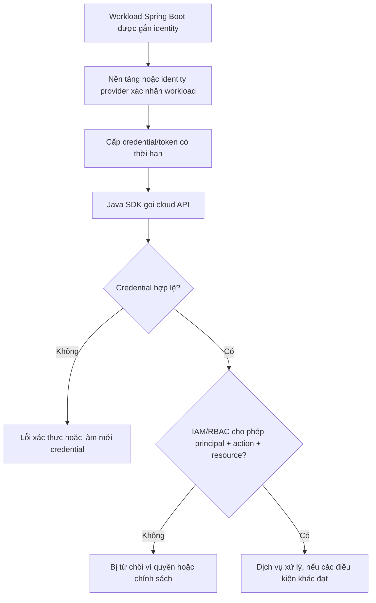
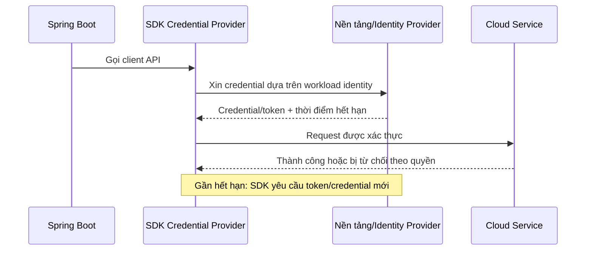
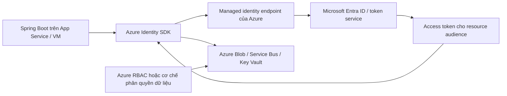
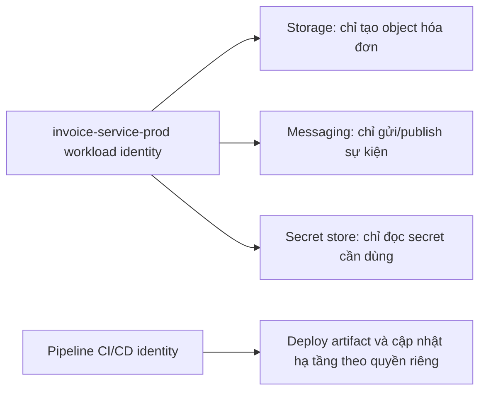

# Danh tính được quản lý, vai trò và token ngắn hạn

Khi một ứng dụng Spring Boot chạy trên AWS, Azure hoặc Google Cloud, cách đơn giản nhưng rủi ro là đưa access key, client secret hoặc file khóa tài khoản dịch vụ vào biến môi trường rồi dùng mãi. Cách tiếp cận phù hợp hơn cho workload hiện đại là **gắn danh tính với môi trường chạy**, để nền tảng cấp **thông tin xác thực có thời hạn** và để IAM/RBAC giới hạn quyền của danh tính đó. Ứng dụng có thể kết nối Amazon S3, Azure Blob Storage hoặc Google Cloud Storage mà không phải giữ khóa bí mật dài hạn trong mã nguồn.

Bài **Danh tính được quản lý, vai trò và token ngắn hạn** thuộc chương **Danh tính và quyền** của module **SPRING_CLOUD_PROVIDER_INTEGRATION**. Trong phạm vi thực hành tích hợp Spring Boot với dịch vụ managed của AWS, Azure và Google Cloud bằng Spring Cloud và Java SDK, chúng ta sẽ tìm hiểu cách IAM role, managed identity và service account liên hệ với token/temporary credentials, cách cấp quyền trên storage, messaging, dữ liệu và secret, cũng như cách kiểm chứng và xử lý lỗi khi triển khai.

## 1. Mục tiêu học tập

Sau bài học, bạn có thể:

- Phân biệt **danh tính lâu dài**, **vai trò/chính sách quyền**, **phiên danh tính** và **credential/token có thời hạn**.
- Mô tả cách workload nhận temporary credentials trên AWS, access token từ Microsoft Entra ID trên Azure và token của service account hoặc workload identity trên Google Cloud.
- Giải thích quan hệ **trust/ủy quyền nhận danh tính** và **quyền thực thi API**; không nhầm việc lấy được token với việc được phép ghi dữ liệu.
- Cấu hình Java SDK/Spring Boot để sử dụng credential tự động, tự làm mới và tránh lưu khóa tĩnh.
- Thiết kế quyền tối thiểu, tách danh tính theo môi trường, xử lý token hết hạn, theo dõi audit và kiểm thử cả hành động được phép lẫn bị từ chối.

## 2. Bốn khái niệm phải tách riêng

| Khái niệm | Vai trò | Ví dụ |
| --- | --- | --- |
| **Danh tính (identity/principal)** | Cho cloud biết ai đang thực hiện yêu cầu | AWS IAM role session, Azure managed identity, Google service account hoặc federated workload principal |
| **Vai trò và quyền (role/policy/permission)** | Xác định principal được làm gì trên resource và trong điều kiện nào | `s3:PutObject`; Azure `Storage Blob Data Contributor`; GCP `storage.objects.create` |
| **Sự tin cậy/ủy quyền (trust/federation)** | Quy định workload hoặc bên phát hành danh tính nào được phép nhận/đóng vai principal cloud | AWS role trust policy, Entra federated identity credential, GCP Workload Identity Federation |
| **Thông tin xác thực ngắn hạn (temporary credential/access token)** | Bằng chứng mà client dùng để xác thực yêu cầu trong một khoảng thời gian | Bộ credential AWS STS gồm access key, secret key, session token; OAuth 2.0 access token của Azure/GCP |

**Danh tính được quản lý** thường là danh tính do cloud tạo/gắn với workload và cấp credential qua cơ chế của nền tảng. Khái niệm này có tên gọi riêng ở từng cloud: AWS IAM role, **Azure managed identity**, Google Cloud service account và Workload Identity Federation. Không nên hiểu chúng giống hệt nhau về loại credential hay cách kiểm tra policy.

**Vai trò** không phải là token. Một IAM role có thể tồn tại lâu dài, trong khi phiên credential lấy qua AWS STS có hạn dùng. Một Azure managed identity có thể được gán role trên storage trong nhiều tháng, trong khi access token sử dụng để gọi storage hết hạn sớm hơn. Một Google service account vẫn tồn tại sau khi access token đã hết hạn.



Luồng trên khái quát hóa ba nền tảng. Trên thực tế, chữ ký SigV4 của AWS và OAuth bearer token của Azure/GCP hoạt động khác nhau. API có thể kiểm tra mạng, mã hóa, chính sách tổ chức hoặc các điều kiện dịch vụ ngoài IAM/RBAC.

## 3. Tại sao cần credential ngắn hạn?

Thông tin xác thực dài hạn có thể bị lộ từ Git, Docker image, file cấu hình, CI logs hoặc máy của developer. Nếu không được thu hồi, kẻ có credential có thể tiếp tục gọi dịch vụ dưới principal đó trong thời gian dài. **Temporary credentials** và **access tokens có hạn sử dụng** giúp thu hẹp cửa sổ khai thác khi bị lộ; kết hợp với quyền tối thiểu sẽ giảm phạm vi tài nguyên bị ảnh hưởng.

Vòng đời mong đợi:

1. **Gắn identity:** hạ tầng gán IAM role, managed identity hoặc service account cho workload.
2. **Xác nhận nguồn gọi:** nền tảng đảm bảo đúng workload có thể nhận credential, ví dụ metadata endpoint, workload token hoặc federated identity.
3. **Nhận credential:** SDK lấy thông tin xác thực có thời hạn, có thể từ dịch vụ token hoặc metadata của runtime.
4. **Dùng credential:** SDK ký request AWS hoặc gửi token phù hợp với dịch vụ đích.
5. **Làm mới:** khi credential sắp hết hạn, provider/SDK hỗ trợ refresh và cache theo quy tắc của thư viện.
6. **Thu hồi/giới hạn quyền:** khi cần, cập nhật IAM/RBAC, trust hoặc quyền gắn identity; lưu ý những token/phiên đã phát hành có thể còn hiệu lực đến khi hết hạn hoặc cho đến khi cơ chế vô hiệu hóa có tác dụng.



**Không có một thời gian sống mặc định chung** cho tất cả credential AWS, Azure, GCP: thời hạn phụ thuộc dịch vụ cấp, loại flow, cấu hình và giới hạn của từng provider. Không ghi cứng giả định “mọi token đều sống đúng một giờ”. Cũng không tự viết cơ chế refresh nếu SDK đã quản lý vòng đời này đúng cách.

### Ngắn hạn chưa đủ để an toàn

- Token bị lộ vẫn có thể bị dùng **trong thời gian còn hiệu lực**; bảo vệ log, memory dump, telemetry và metadata endpoint vẫn quan trọng.
- Workload bị chiếm quyền có thể tiếp tục xin token mới trong khi vẫn có khả năng truy cập nguồn cấp token.
- Một token ngắn hạn nhưng gắn quyền `Owner`, `AdministratorAccess` hoặc quyền trên mọi resource vẫn gây rủi ro lớn.
- Tách danh tính và giới hạn trust theo workload, môi trường, tài khoản/project/subscription sẽ hạn chế thiệt hại khi một dịch vụ bị lỗi.

## 4. AWS: IAM role, phiên STS và temporary credentials

### 4.1. IAM role khác với bộ credential của phiên role

Trong AWS, một **IAM role** chứa những thành phần chính: **trust policy** xác định ai/cơ chế nào được phép assume role, và **permission policy** (cùng các chính sách có liên quan) xác định principal dùng role được gọi những API nào. Khi workload nhận role, AWS thường cấp **temporary security credentials** cho một **role session** thông qua cơ chế STS hoặc credential delivery của nền tảng.

Bộ credential phiên AWS thường có ba giá trị:

```text
AccessKeyId        -> định danh access key tạm thời
SecretAccessKey    -> khóa bí mật để ký request
SessionToken       -> token phiên đi kèm credential tạm thời
Expiration         -> thời điểm hết hiệu lực (metadata/response)
```

AWS SDK sử dụng bộ giá trị này để ký request bằng **AWS Signature Version 4 (SigV4)**. Đây **không phải** OAuth bearer access token như Azure hoặc Google Cloud. Khi dùng IAM role trên runtime hỗ trợ, ứng dụng **không cần** tự phát hành hay lưu bộ giá trị trên.

### 4.2. Workload nhận role bằng cách nào?

| Môi trường | Danh tính ứng dụng dùng | Đường cấp credential phổ biến | Cần kiểm tra |
| --- | --- | --- | --- |
| EC2 | IAM role qua **instance profile** | EC2 Instance Metadata Service (IMDS), ưu tiên IMDSv2 theo chính sách triển khai | Instance profile, policy, khả năng truy cập metadata |
| ECS | **Task role** | Container credential endpoint do ECS cung cấp | Task role khác với task execution role |
| EKS với IRSA | IAM role liên kết Kubernetes service account | Web identity token → STS `AssumeRoleWithWebIdentity` | OIDC provider, subject/audience, role trust policy |
| EKS với Pod Identity | IAM role được liên kết với workload | Credential delivery qua Pod Identity agent/container provider; nền tảng xử lý STS phù hợp | Association, IAM role trust và quyền |
| CI/CD bên ngoài AWS | IAM role cho hệ thống CI được federate | OIDC token → STS `AssumeRoleWithWebIdentity` khi trust được thiết lập | Issuer, audience, subject, repository/branch/environment |

Trong ECS, **task execution role** thường dùng cho tác vụ hạ tầng như lấy image hoặc gửi log. **Task role** là role ứng dụng bên trong container thường nhận khi gọi S3, SQS và các dịch vụ AWS. Cấp quyền S3 cho execution role trong khi ứng dụng sử dụng task role sẽ không giải quyết lỗi phân quyền.

### 4.3. Trust policy và permission policy làm hai việc khác nhau

Ví dụ tối giản trust policy để **ECS tasks** được assume role (đây là cấu hình cho một tình huống ECS, không dùng nguyên mẫu này cho EC2/EKS):

```json
{
  "Version": "2012-10-17",
  "Statement": [
    {
      "Effect": "Allow",
      "Principal": { "Service": "ecs-tasks.amazonaws.com" },
      "Action": "sts:AssumeRole"
    }
  ]
}
```

Trong triển khai thực, cần ràng buộc phạm vi trust phù hợp, ví dụ các điều kiện `aws:SourceAccount` hoặc `aws:SourceArn` theo hướng dẫn áp dụng của dịch vụ để giảm nguy cơ confused deputy. Việc role cho phép ECS assume **không tự** cho role đó quyền ghi S3.

Ví dụ permission policy gắn với role cho phép tạo object trong một prefix của bucket hóa đơn:

```json
{
  "Version": "2012-10-17",
  "Statement": [
    {
      "Sid": "CreateInvoiceObjects",
      "Effect": "Allow",
      "Action": ["s3:PutObject"],
      "Resource": "arn:aws:s3:::invoice-prod/invoices/*"
    }
  ]
}
```

Policy ví dụ chỉ mô tả một phần yêu cầu; hiệu lực còn phụ thuộc bucket policy, explicit deny, permission boundary, SCP, quyền KMS nếu dùng SSE-KMS, điều kiện giao tiếp và các policy liên quan. Role cũng không được đọc/xóa mọi object chỉ vì được phép tạo object ở một prefix.

### 4.4. Spring Boot dùng credential role tự động

Ví dụ với **AWS SDK for Java 2.x** trong Spring Boot (lược bỏ `import`, thêm SDK dependency phù hợp):

```java
@Configuration
class AwsStorageConfiguration {
    @Bean
    S3Client s3Client(@Value("${app.aws.region}") String region) {
        return S3Client.builder()
                .region(Region.of(region))
                .credentialsProvider(DefaultCredentialsProvider.create())
                .build();
    }
}
```

`DefaultCredentialsProvider` tìm các nguồn credential theo quy tắc của AWS SDK. Trên ECS/EC2/EKS đã gắn role đúng, SDK có thể lấy credential tạm thời của workload và tự làm mới khi cần. **Lưu ý ưu tiên:** Java system properties, environment credentials, web identity hoặc profile hợp lệ có thể được xét trước metadata/container credential tùy thứ tự chain. Không để access key dài hạn tồn tại trong môi trường production rồi mặc nhiên cho rằng SDK chắc chắn sử dụng IAM role của runtime.

Để xác minh role session từ **chính provider ứng dụng sử dụng**, có thể gọi STS:

```java
AwsCredentialsProvider provider = DefaultCredentialsProvider.create();

try (StsClient sts = StsClient.builder()
        .region(Region.AP_SOUTHEAST_1)
        .credentialsProvider(provider)
        .build()) {
    GetCallerIdentityResponse who = sts.getCallerIdentity();
    System.out.println("AWS principal ARN: " + who.arn());
    System.out.println("AWS account: " + who.account());
}
```

Trong ứng dụng thực, cấu hình một **provider bean dùng chung** cho client sản xuất và client kiểm tra, để tránh vô tình chọn nguồn credential khác. Không log access key, secret key hay session token. `GetCallerIdentity` có thể thể hiện ARN của **assumed-role session**, khác cách viết ARN của chính IAM role; hãy đối chiếu cả tên role và account ID khi chẩn đoán.

## 5. Azure: Managed Identity, Microsoft Entra ID và OAuth token

### 5.1. Managed identity là gì?

**Managed identity** cho phép một tài nguyên/workload trên Azure có danh tính được quản lý trong **Microsoft Entra ID**. Ứng dụng lấy access token qua hạ tầng Azure Identity mà không giữ client secret hoặc certificate riêng. Hai dạng chính:

| Loại | Vòng đời | Khi nào phù hợp? |
| --- | --- | --- |
| **System-assigned managed identity** | Được tạo gắn với một Azure resource; khi resource bị xóa, danh tính đi kèm cũng bị xóa | Một ứng dụng/resource cần danh tính riêng, quan hệ một-một với runtime |
| **User-assigned managed identity** | Là tài nguyên Azure riêng; có thể gắn vào nhiều workload hỗ trợ và quản lý vòng đời độc lập | Cần tái sử dụng identity có kiểm soát hoặc giữ identity qua các lần thay thế runtime |

Cả hai loại identity đều cần quyền trên **tài nguyên đích**. Chỉ bật managed identity cho App Service/VM không tự cấp `Storage Blob Data Contributor`, quyền Service Bus, quyền đọc Key Vault hoặc kết nối dữ liệu.

Managed identity là một loại danh tính được Azure quản lý; **Azure Workload Identity trên AKS** là cơ chế federation giữa service account/Kubernetes token và danh tính Entra được cấu hình (có thể sử dụng user-assigned managed identity hoặc application identity). Không nên coi việc mount service account token trong Pod là tương đương với đã gán data role trên storage.

### 5.2. Đường đi từ workload đến access token



Access token có **audience** (tài nguyên đích) và thời hạn. Ví dụ scope được SDK yêu cầu cho từng dịch vụ có thể là:

| Dịch vụ đích | Scope thường gặp khi yêu cầu token Microsoft Entra |
| --- | --- |
| Azure Blob Storage | `https://storage.azure.com/.default` |
| Azure Service Bus | `https://servicebus.azure.net/.default` |
| Azure Key Vault | `https://vault.azure.net/.default` |

Không lấy access token của Azure Resource Manager (`https://management.azure.com/`) rồi mặc nhiên dùng nó để gọi data plane của Blob Storage. Chữ ký, token audience và vai trò trên resource phải đúng theo dịch vụ. Client library thường yêu cầu token đúng scope cho API đang sử dụng.

### 5.3. Quyền quản trị và quyền dữ liệu là hai phạm vi khác nhau

Ví dụ, một danh tính có Azure RBAC role `Contributor` ở resource group có thể quản lý cấu hình nhiều Azure resource, nhưng điều đó **không tự cấp** quyền truy cập blob qua Microsoft Entra ID. Để thao tác Blob Storage bằng token Entra, cần data role như `Storage Blob Data Contributor` hoặc một custom role với data action tương ứng ở scope phù hợp. Role dựng sẵn `Storage Blob Data Contributor` có phạm vi thao tác rộng hơn việc chỉ tạo object; nếu bài toán yêu cầu quyền tạo mới rất hẹp, cân nhắc custom role và điều kiện hỗ trợ.

Các quyền Key Vault cũng phụ thuộc chế độ permission model của vault; cần phân biệt quản lý resource với đọc **giá trị secret**. Với Service Bus, role gửi thông điệp ví dụ `Azure Service Bus Data Sender` khác role nhận thông điệp hoặc quản trị namespace.

### 5.4. Bean Spring Boot sử dụng ManagedIdentityCredential

Ví dụ một ứng dụng **triển khai trên Azure App Service/VM** dùng system-assigned managed identity:

```java
@Configuration
class AzureStorageConfiguration {
    @Bean
    TokenCredential tokenCredential() {
        return new ManagedIdentityCredentialBuilder().build();
    }

    @Bean
    BlobServiceClient blobServiceClient(
            TokenCredential tokenCredential,
            @Value("${app.azure.storage-endpoint}") String endpoint) {
        return new BlobServiceClientBuilder()
                .endpoint(endpoint)
                .credential(tokenCredential)
                .buildClient();
    }
}
```

Với user-assigned managed identity, có thể định rõ **client ID**:

```java
TokenCredential credential = new ManagedIdentityCredentialBuilder()
        .clientId(configuredClientId)
        .build();
```

Biến `configuredClientId` là ID danh tính được cấp qua cấu hình môi trường, **không phải client secret**. Nếu cần cùng mã chạy local và trên Azure, `DefaultAzureCredential` có thể sử dụng danh tính developer tại local và managed/workload identity ở runtime; cách này yêu cầu kiểm tra thứ tự nguồn credential thực tế của phiên bản `azure-identity` đang dùng. Nếu sử dụng Spring Cloud Azure starter, hãy ưu tiên cơ chế auto-configuration được starter hỗ trợ, tránh tạo client trùng không kiểm soát.

Khi app trả `403`, hãy xác minh credential đã chọn identity nào, token có đúng tenant/audience không và identity đó đã được gán **data role trên đúng scope** chưa. Role assignment có thể có độ trễ lan truyền; đừng khắc phục bằng cách phát hành client secret dài hạn nếu nguyên nhân là thiếu RBAC.

## 6. Google Cloud: service account, Workload Identity và access token

### 6.1. Service account là danh tính của workload

Trong Google Cloud, **service account** là danh tính thường được cấp cho ứng dụng hoặc workload. Với Cloud Run và Compute Engine, có thể **gắn service account cho runtime**. Google Cloud client library dùng **Application Default Credentials (ADC)** để lấy thông tin xác thực qua môi trường và metadata server mà không cần file JSON chứa private key.

Trong GKE, **Workload Identity Federation for GKE** cho phép workload Kubernetes có danh tính riêng để gọi dịch vụ Google Cloud. Tùy cách triển khai, có thể cấp quyền trực tiếp cho principal được federate hoặc thiết lập cơ chế mạo danh/impersonation một IAM service account được kiểm soát. Federation ở bên ngoài Google Cloud cũng cho phép đổi bằng chứng danh tính từ hệ thống tin cậy thành thông tin xác thực ngắn hạn, hạn chế việc tạo service account key.

### 6.2. Phân biệt service account, IAM role và access token

| Thành phần | Ví dụ | Ý nghĩa |
| --- | --- | --- |
| Service account | `invoice-runtime@my-project.iam.gserviceaccount.com` | Danh tính ứng dụng; địa chỉ là định danh, **không** phải secret |
| IAM role/binding | `roles/storage.objectCreator` trên bucket `invoice-prod` | Cho phép các permission tương ứng đối với principal được gán |
| Access token | Token OAuth 2.0 có hạn dùng được client library lấy từ ADC/metadata | Credential dùng để xác thực request của một phiên gọi API |
| Service account key JSON | File có private key nếu được phát hành | Credential dài hạn, cần tránh nếu có thể dùng identity runtime hoặc federation |

Để ghi một object mới vào Cloud Storage, permission thường cần là `storage.objects.create`. Role `roles/storage.objectCreator` là một ví dụ quyền tạo object trên bucket; nó **không mặc nhiên** cấp quyền đọc, liệt kê hoặc xóa object. Ghi đè một object đã tồn tại có thể cần thêm permission tùy kiểu thao tác. Nếu lưu secret trong Secret Manager, workload cần quyền truy cập phiên bản secret tương ứng, ví dụ qua role `roles/secretmanager.secretAccessor` trên scope phù hợp.

### 6.3. Spring Boot và ADC trên runtime

```java
@Configuration
class GcpStorageConfiguration {
    @Bean
    Storage storage(@Value("${app.gcp.project-id}") String projectId)
            throws IOException {
        GoogleCredentials credentials = GoogleCredentials.getApplicationDefault();

        return StorageOptions.newBuilder()
                .setProjectId(projectId)
                .setCredentials(credentials)
                .build()
                .getService();
    }
}
```

Ví dụ dùng Google Auth Library/Google Cloud Storage Java client; cần dependency tương ứng. Với service account gắn vào Cloud Run/GCE, ADC có thể lấy token qua metadata của runtime. Với GKE Workload Identity Federation, đường credential phụ thuộc cấu hình federation của Pod.

**Chú ý thứ tự ADC:** `GOOGLE_APPLICATION_CREDENTIALS` trỏ đến credential file được xét trước ADC local và metadata. Một file service account key còn sót trong image hoặc environment có thể khiến app sử dụng danh tính ngoài dự kiến, dù runtime đã gắn service account đúng. Ở local, `gcloud auth application-default login` thiết lập ADC cho thư viện; `gcloud auth login` dành cho CLI và không tự đảm bảo Java client dùng cùng credential.

Google Cloud token có hạn dùng; provider/client library hỗ trợ lấy lại token theo cơ chế của ADC. Không lưu access token vào `application.yml`, không ghi token vào log và không giả định project ID của client chính là danh tính đang gọi API.

## 7. So sánh vòng đời danh tính và cơ chế cấp token

| Khía cạnh | AWS | Azure | Google Cloud |
| --- | --- | --- | --- |
| Danh tính workload điển hình | IAM role được assume thành một role session | Managed identity trong Microsoft Entra ID; hoặc workload liên kết qua federation | Service account gắn runtime hoặc federated workload principal |
| Credential dùng khi gọi API | Access key, secret key và session token tạm thời; ký SigV4 | OAuth bearer access token của Microsoft Entra ID | OAuth access token/credential do Google Auth Library cung cấp |
| Nguồn credential runtime | ECS task credential, EC2 IMDS, EKS IRSA/Pod Identity | Managed identity endpoint hoặc token federation của AKS | ADC metadata server, GKE Workload Identity Federation, external WIF |
| Quyết định cho phép | IAM identity/resource policies, điều kiện và các giới hạn liên quan | Azure RBAC/data-plane permission cùng chính sách/điều kiện dịch vụ | Google Cloud IAM role bindings và permission trên resource |
| Thư viện Java điển hình | `DefaultCredentialsProvider` | `DefaultAzureCredential` hoặc `ManagedIdentityCredential` | `GoogleCredentials.getApplicationDefault()` |
| Điều cần kiểm chứng | STS caller identity, role session, account ID, policy | Tenant, principal/client ID, token audience, data role, scope | Service account/federated principal, ADC source, IAM binding, project/resource |

**Role được gắn** và **token đã được cấp** là hai việc riêng. Đổi role, xóa role binding hoặc chỉnh trust policy không nên được coi là cách lập tức vô hiệu hóa mọi token đang lưu trong cache của toàn bộ SDK. Cần tính đến thời gian hiệu lực của credential đã phát hành, chính sách làm mới và thời gian lan truyền quyền khi xây dựng quy trình ứng cứu hoặc thu hồi truy cập.

## 8. Gắn danh tính và quyền tối thiểu cho một dịch vụ Spring Boot

Ví dụ `invoice-service-prod` cần:

1. Tạo file JSON hóa đơn trong object storage.
2. Gửi sự kiện `invoice.created` vào queue/topic.
3. Đọc một secret cấu hình kết nối dịch vụ khác.

Không vì cần ba dịch vụ mà cấp cho workload quyền quản trị của cả tài khoản/subscription/project. Một sơ đồ quyền phù hợp:



| Nhu cầu | AWS | Azure | Google Cloud |
| --- | --- | --- | --- |
| Tạo object | `s3:PutObject` trên ARN object/prefix | Blob data action hoặc role có quyền ghi ở storage account/container phù hợp | `storage.objects.create` trên bucket thích hợp |
| Gửi message | `sqs:SendMessage` trên queue hoặc `sns:Publish` trên topic tùy dịch vụ | `Azure Service Bus Data Sender` ở namespace/entity phù hợp | `pubsub.topics.publish` trên topic, ví dụ Pub/Sub Publisher |
| Đọc secret | `secretsmanager:GetSecretValue` trên secret cần đọc; xét thêm KMS nếu áp dụng | Key Vault secret read theo RBAC/access policy model của vault | `secretmanager.versions.access` hoặc role `Secret Manager Secret Accessor` trên secret phù hợp |

Ở mỗi provider, cần xác nhận **đúng permission, resource scope, principal và điều kiện**. Tùy thao tác, SDK có thể yêu cầu thêm quyền phụ hoặc ràng buộc mạng/mã hóa. Ví dụ sử dụng khóa KMS của khách hàng cần quyền liên quan đến khóa ngoài IAM permission của storage. Vai trò dựng sẵn ở Azure/GCP đôi khi bao gồm nhiều quyền hơn một thao tác; đánh giá khả năng dùng custom role khi cần.

### Phân tách danh tính ở local, CI và production

- **Local:** developer đăng nhập tài khoản tổ chức qua AWS IAM Identity Center/profile, Azure CLI hoặc Google ADC; chỉ có quyền trên tài nguyên dev/test.
- **CI/CD:** dùng OIDC federation hoặc danh tính pipeline chuyên biệt để deploy/test, với quyền và điều kiện giới hạn theo repository, branch, môi trường và hệ thống thực thi.
- **Production:** workload tự nhận credential từ runtime identity; tránh gắn danh tính cá nhân của developer và tránh khóa tĩnh trong container.

CI có quyền triển khai ứng dụng **không đồng nghĩa** runtime được quyền đọc storage/secret. Ngược lại, việc workload có quyền gửi message **không** cho phép pipeline tạo/xóa tài nguyên messaging theo ý muốn. Hai principal nên được kiểm soát và kiểm toán độc lập.

## 9. Cơ chế refresh và những lỗi dễ gặp

### 9.1. Khi token hết hạn, điều gì xảy ra?

Một SDK/credential provider được sử dụng đúng thường cache credential, theo dõi hạn dùng và làm mới trước hoặc khi cần. Nếu refresh thất bại vì metadata service không khả dụng, federation bị sai hoặc identity bị ngắt liên kết, các request tiếp theo có thể thất bại dù trước đó ứng dụng hoạt động bình thường.

Ví dụ hành vi mong đợi:

```text
T0: Spring Boot khởi động, không có key/secret trong cấu hình.
T1: SDK lấy credential có hạn sử dụng từ runtime identity.
T2: Ứng dụng gửi request trong phạm vi IAM/RBAC cho phép.
T3: Credential sắp hết hạn; SDK/provider lấy credential mới.
T4: Ứng dụng tiếp tục gửi request với credential đã được làm mới.
```

Thời điểm refresh, cache và chính sách retry phụ thuộc SDK. Không nên tự đặt một access token lấy lúc khởi động vào biến `static` rồi dùng vô hạn. Nếu tạo client bằng cơ chế tự cấp token riêng, phải bảo đảm nó có khả năng refresh an toàn; dễ nhất là dùng provider chuẩn do thư viện cloud duy trì.

### 9.2. Bảng chẩn đoán

| Triệu chứng | Lớp gây lỗi có thể xảy ra | Kiểm tra trước |
| --- | --- | --- |
| AWS SDK không tìm được credential trên ECS/EC2 | Gắn role hoặc metadata/container endpoint chưa đúng | Task role/instance profile, provider chain, quyền truy cập metadata |
| AWS nhận `ExpiredToken` hoặc lỗi chữ ký | Credential phiên hết hạn, bị cache sai, hoặc vấn đề thời gian/chữ ký | Provider tự refresh, clock skew, endpoint, credential được JVM chọn |
| AWS nhận `AccessDenied` với assumed role đúng | Permission policy/bucket policy/deny/KMS | Role session thực tế, ARN, action, bucket và policy liên quan |
| Azure không lấy được token managed identity | Identity chưa bật, sai client ID, endpoint hoặc cấu hình federation | Loại identity, tenant/client ID, log Azure Identity, runtime support |
| Azure lấy được token nhưng Blob trả `403` | Thiếu data role, sai scope, token audience hoặc điều kiện dịch vụ | Principal được chọn, data-plane RBAC, endpoint/resource, firewall |
| Google ADC không tìm được credential | Metadata không sẵn hoặc `GOOGLE_APPLICATION_CREDENTIALS`/ADC sai | Credential source, GKE/Cloud Run service identity và file config |
| Google Cloud trả `403` dù access token còn hạn | Service account/federated principal thiếu IAM permission hoặc gọi sai resource | Identity thực tế, bucket/topic/secret, IAM binding, điều kiện |
| Ứng dụng hoạt động rồi thất bại sau một khoảng thời gian | Refresh bị lỗi, federation/metadata thay đổi hoặc phiên credential không tự làm mới | Log provider (không chứa token), hạn dùng và quá trình refresh |

**Điểm phân biệt:** `401`, `403`, `AccessDenied`, `PermissionDenied` và lỗi lấy credential không có ý nghĩa hoàn toàn giống nhau trên mọi dịch vụ. Dựa vào exception, log provider, principal và audit trail để xác định nguyên nhân; không suy luận duy nhất từ HTTP status.

### 9.3. Quan sát an toàn, không lộ credential

Nên ghi vào telemetry đã kiểm soát: môi trường, tên dịch vụ, account/subscription/project, **principal identifier** (khi phù hợp và được phép), resource và operation, request/trace ID, loại lỗi, thời điểm retry/refresh. Tuyệt đối không ghi vào log:

- Raw bearer access token, refresh token, AWS secret access key và session token.
- Nội dung file service account key JSON hoặc federated token file.
- Giá trị client secret, private key, Authorization header, signed request có bí mật hay URL có token/chữ ký nhạy cảm.

Đối chiếu AWS CloudTrail, Azure logs phù hợp và Google Cloud Audit Logs để thấy principal của lời gọi thực tế. Ở Azure, có thể bật logging chẩn đoán `azure-identity` với mức độ phù hợp để biết nguồn credential nào được sử dụng; cần lọc thông tin nhạy cảm khi thu thập và chia sẻ log.

## 10. Thực hành: Spring Boot không dùng secret tĩnh

**Bài toán:** triển khai `invoice-service` lên một runtime cloud, gắn danh tính workload và cho phép tạo object ở storage test. Không lưu access key, client secret hoặc private key trong Git, Docker image hoặc `application.yml`.

Chọn **một provider chính** để thực hành end-to-end; dùng bảng so sánh ở mục 7 để diễn giải triển khai tương đương trên hai provider còn lại. Chuẩn bị tài nguyên test và quyền cấp phát giới hạn; không cần sửa cấu hình production thật.

### Bước 1. Tạo hoặc chọn danh tính runtime

- **AWS:** chuẩn bị IAM role phù hợp với ECS task, EC2 instance profile hoặc workload EKS đang dùng; thiết lập trust policy đúng nguồn assume role.
- **Azure:** bật system-assigned managed identity hoặc tạo user-assigned identity gắn vào App Service/VM; với AKS, cấu hình workload identity federation đúng service account.
- **Google Cloud:** gắn service account cho Cloud Run/Compute Engine hoặc cấu hình Workload Identity Federation for GKE; không tạo JSON key chỉ để chạy thử.

### Bước 2. Cấp quyền nhỏ nhất trên tài nguyên test

Gán đúng quyền **tạo object** trong bucket/container của bài thực hành. Không cấp sẵn quyền đọc, liệt kê, xóa hay quản trị nếu không cần. Nếu quyền theo provider chỉ có thể được gán rộng hơn thao tác mong muốn, ghi nhận giới hạn đó và chọn role/condition phù hợp nếu dịch vụ hỗ trợ.

### Bước 3. Deploy ứng dụng bằng credential provider chuẩn

Với Spring Boot, truyền tên bucket/container, project/region/endpoint qua environment hoặc cấu hình deploy. Client dùng IAM role/managed identity/ADC bằng SDK hoặc starter tương ứng. Không gắn file key tĩnh, không sao chép credential local của developer vào container.

### Bước 4. Kiểm tra bốn tình huống

| Ca | Thao tác | Kết quả cần quan sát |
| --- | --- | --- |
| **A — Đúng identity, đúng quyền** | Tạo object mới trong bucket/container test đã cấp quyền | Thao tác thành công và audit ghi đúng principal runtime |
| **B — Đúng identity, ngoài phạm vi** | Thử tạo object trong resource không được cấp quyền | Thao tác bị từ chối; không tự đổi sang danh tính developer |
| **C — Thiếu quyền thao tác khác** | Thử xóa/đọc một object trong khi workload chỉ được phép tạo | Thao tác bị từ chối theo policy áp dụng |
| **D — Mất đường cấp credential** | Trong môi trường thử cô lập, cấu hình sai/mất workload token hoặc metadata endpoint | Provider phát sinh lỗi lấy/làm mới credential, giúp phân biệt với lỗi IAM |

Ca D nên thực hiện trên workload thử nghiệm độc lập, tránh cố ý ngắt identity của ứng dụng đang phục vụ production. Nếu thao tác với quyền chưa gán vẫn thành công, cần xem principal thực tế, quyền được kế thừa từ scope rộng hơn hoặc policy chồng lấn; **không kết luận test đã đúng chỉ vì chức năng hoạt động**.

### Bước 5. Ghi kết quả theo bằng chứng

| Trường | Ví dụ cần ghi lại |
| --- | --- |
| Runtime và identity | ECS task role / Azure managed identity / Google service account |
| Nguồn credential thực tế | Container metadata, managed identity endpoint, ADC metadata hoặc federation |
| Tài nguyên đích | Bucket/container test và region/project/subscription |
| Quyền được gán | Role/policy/permission và scope cụ thể |
| Kết quả thành công | API operation, object test, request ID và audit principal |
| Kết quả bị từ chối | Operation ngoài phạm vi, loại lỗi, policy/binding liên quan |
| Cơ chế làm mới | Provider/SDK có hỗ trợ refresh; lỗi khi nguồn token bị gián đoạn trong môi trường thử |

Nếu dùng emulator như LocalStack hoặc Azurite để kiểm thử đường đi API, hãy nhớ emulator **không đủ** để xác nhận IAM/RBAC, managed identity và vòng đời token thực tế trên cloud. Phần xác thực quyền và danh tính cần tối thiểu một integration test với dịch vụ thật trên tài nguyên thử nghiệm.

## 11. Câu hỏi tự kiểm tra

1. IAM role tồn tại lâu dài; vì sao access key, secret key và session token được cấp cho role session lại có hạn sử dụng?
2. Vì sao **trust policy cho phép ECS assume role** không có nghĩa role đó được `s3:PutObject` trên bucket bất kỳ?
3. Trên Azure, sự khác nhau về vòng đời giữa system-assigned và user-assigned managed identity là gì? Khi nào chọn từng loại?
4. Một Spring Boot service lấy được access token Microsoft Entra ID nhưng vẫn bị từ chối upload Azure Blob Storage. Bạn kiểm tra audience, principal và data role theo hướng nào?
5. Google Cloud service account được gắn vào Cloud Run nhưng Java client vẫn dùng file JSON khác. Cấu hình nào có thể làm ADC chọn file đó trước metadata?
6. Vì sao cần kiểm thử một thao tác bị từ chối bên cạnh thao tác thành công khi đánh giá IAM/RBAC quyền tối thiểu?
7. Khi token hết hạn và SDK không tự làm mới được, việc cấp quyền storage rộng hơn có giúp giải quyết lỗi không? Cần kiểm tra những thành phần nào?
8. Một hệ thống CI/CD có quyền deploy container. Có nên dùng danh tính đó làm danh tính runtime hay không? Hãy phân tích rủi ro và đề xuất cách tách quyền.

## 12. Ghi nhớ

**Danh tính được quản lý** giúp gắn quyền truy cập cloud với workload, thay vì phân phối khóa dài hạn đến từng ứng dụng. **Role/policy/IAM binding** kiểm soát những thao tác được phép; **temporary credentials hoặc access token** là bằng chứng xác thực có thời hạn mà SDK sử dụng để gọi API. AWS sử dụng IAM role sessions và credential STS để ký request, Azure sử dụng managed identity và Microsoft Entra access token, còn Google Cloud sử dụng service account hoặc workload identity với ADC và access token phù hợp.

Với Spring Boot và các thư viện Spring Cloud, hãy sử dụng credential provider chuẩn của môi trường, gán quyền tối thiểu trên đúng storage, queue/topic, database và secret cần truy cập, tách danh tính local/CI/production, kiểm tra principal thực tế và dựa vào SDK để quản lý refresh. **Token ngắn hạn giúp giảm rủi ro lộ credential, nhưng chỉ kết hợp cùng phân quyền chặt, bảo vệ runtime và kiểm toán mới tạo thành mô hình truy cập cloud đáng tin cậy.**
