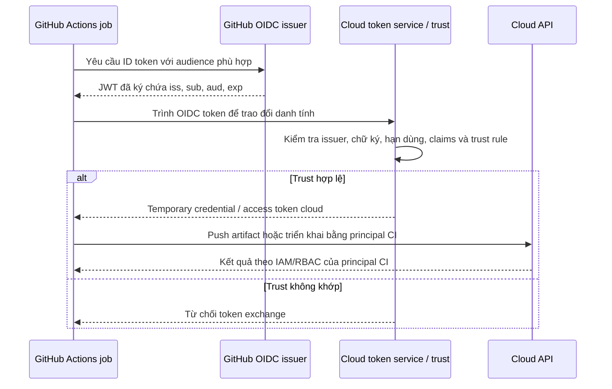

# Liên kết danh tính OIDC cho CI/CD và workload identity

Một pipeline CI/CD cần tải artifact lên cloud hoặc triển khai ứng dụng Spring Boot. Cách làm cũ thường lưu `AWS_ACCESS_KEY_ID`, client secret của Microsoft Entra hoặc file JSON chứa khóa riêng của Google service account trong kho bí mật của hệ thống CI. Các bí mật này có thể tồn tại rất lâu, phải xoay vòng thủ công và dễ bị lộ khi workflow hoặc dependency bị xâm nhập. **OpenID Connect (OIDC) federation** cho phép hệ thống CI hoặc workload chứng minh danh tính với cloud bằng một token được cấp cho đúng lần chạy, rồi nhận credential cloud có thời hạn mà không cần sao chép khóa tĩnh.

Bài thuộc chương **Danh tính và quyền** trong module **SPRING_CLOUD_PROVIDER_INTEGRATION**. Khi thực hành tích hợp Spring Boot với storage, messaging, cơ sở dữ liệu managed và secret manager trên AWS, Azure và Google Cloud, ta cần hiểu hai danh tính riêng: **danh tính của pipeline dùng để build/deploy/test** và **danh tính của ứng dụng dùng để gọi cloud API lúc chạy**. OIDC có thể giúp cả hai nhận credential ngắn hạn, nhưng cách gắn danh tính và quyền truy cập không giống nhau.

## 1. Kết quả học tập

Sau bài này, bạn có thể:

- Giải thích **OIDC issuer**, **ID token**, **JWT claims**, **audience**, **subject**, **trust relationship** và **token exchange**.
- Phân biệt OIDC identity token được CI/workload phát hành với AWS temporary credentials hoặc OAuth access token mà cloud SDK sử dụng.
- Thiết kế federation cho một GitHub Actions pipeline trên AWS, Azure và Google Cloud với điều kiện giới hạn theo repository, branch hoặc môi trường.
- Nhận biết điểm tương đồng và khác biệt giữa AWS EKS IRSA, Azure Workload Identity cho AKS và Workload Identity Federation for GKE.
- Gắn quyền tối thiểu vào danh tính của pipeline và danh tính Spring Boot runtime, tránh dùng một tài khoản quyền rộng cho mọi giai đoạn.
- Chẩn đoán lỗi **không đổi được token**, **đổi token thành công nhưng thiếu quyền**, và kiểm thử ranh giới quyền của workload.

## 2. OIDC federation hoạt động như thế nào?

OIDC là lớp danh tính xây trên OAuth 2.0. Trong federation, một nhà cung cấp danh tính đáng tin cậy (*identity provider*, viết tắt IdP) phát hành **ID token**, thường ở dạng JWT được ký. Cloud kiểm tra token này theo cấu hình liên kết tin cậy và cho phép token đó đổi lấy credential cloud phù hợp. Ví dụ IdP có thể là hệ thống CI/CD hoặc bộ phát hành token dành cho Kubernetes workload.

| Thuật ngữ | Ý nghĩa trong tích hợp cloud | Ví dụ |
| --- | --- | --- |
| **Issuer (`iss`)** | Ai phát hành token và cung cấp thông tin để xác minh chữ ký | `https://token.actions.githubusercontent.com` cho GitHub Actions |
| **Subject (`sub`)** | Danh tính cụ thể của công việc hoặc workload được khai báo trong token | `repo:example-org/invoice-service:ref:refs/heads/main` |
| **Audience (`aud`)** | Token này được tạo cho bên nhận/đích nào | `sts.amazonaws.com` trong ví dụ AWS, `api://AzureADTokenExchange` trong ví dụ Azure |
| **Expiration (`exp`)**, issued-at (`iat`) | Giới hạn thời gian token có thể được chấp nhận | Token chỉ hợp lệ trong khoảng thời gian do IdP công bố |
| **JWKS/chữ ký** | Cho cloud kiểm tra token do IdP tin cậy ký, không bị giả mạo | Khóa công khai được công bố qua metadata của issuer |
| **Trust/condition** | Quy tắc cloud dùng để quyết định token từ nguồn nào được nhận cho một identity | Chỉ branch `main` của đúng repository được assume role deploy |
| **Permission/IAM/RBAC** | Quyền của danh tính cloud sau khi nhận credential | Chỉ được upload artifact vào bucket riêng hoặc deploy service cụ thể |

Ví dụ JWT identity token có các claim mang tính minh họa:

```json
{
  "iss": "https://token.actions.githubusercontent.com",
  "sub": "repo:example-org/invoice-service:ref:refs/heads/main",
  "aud": "sts.amazonaws.com",
  "iat": 1764000000,
  "exp": 1764000300,
  "repository": "example-org/invoice-service",
  "ref": "refs/heads/main"
}
```

Đây là **payload minh họa**, không phải token hợp lệ để dùng thật và không phải mọi provider đều dựa trên cùng tập claim. Bên nhận phải **xác minh chữ ký, issuer, audience, thời hạn và các điều kiện được cấu hình**; chỉ giải mã chuỗi JWT rồi đọc `sub` là chưa đủ để xác thực token.

### 2.1. Không nhầm ba loại bằng chứng

1. **OIDC ID token của GitHub/Kubernetes** chứng minh nguồn gốc và ngữ cảnh của lần chạy. Nó thường được đem tới hệ thống nhận dạng cloud để đổi lấy thông tin xác thực phù hợp.
2. **AWS role session credentials** gồm access key tạm thời, secret key tạm thời và session token. AWS SDK ký request bằng SigV4; nó không dùng trực tiếp OIDC JWT như một bearer token để gọi mọi API AWS.
3. **Access token Microsoft Entra hoặc Google Cloud** thường được cloud SDK gửi dưới dạng OAuth bearer token đến dịch vụ đích. Token có audience/scope phù hợp và thời hạn riêng.

Đổi được identity token **không đồng nghĩa** được cấp mọi quyền trên cloud. Trước tiên phải qua lớp **trust/federation** để nhận danh tính cloud; sau đó request vẫn chịu **IAM/RBAC và chính sách tài nguyên**.

## 3. Luồng CI/CD dùng OIDC thay cho secret dài hạn

Giả sử một GitHub Actions workflow được phép triển khai `invoice-service` lên môi trường staging khi code đã được hợp nhất vào branch `main`.



Chuỗi thực hiện theo ý nghĩa:

1. Job chạy ở một repository, branch, workflow hoặc GitHub Environment nhất định.
2. Quyền lấy OIDC token được bật cho job; ví dụ trong GitHub Actions là quyền `id-token: write`. Quyền này cho phép workflow yêu cầu token, **không tự cấp quyền AWS/Azure/GCP**.
3. Job xin ID token dành cho audience mà cloud trust configuration chấp nhận.
4. Cloud xác minh nguồn token và điều kiện tin cậy, rồi ánh xạ hoặc cho phép lấy danh tính cloud được cấu hình.
5. Pipeline dùng credential ngắn hạn để thực hiện các thao tác của **CI principal**, ví dụ upload artifact, truy cập registry hoặc deploy.
6. Ứng dụng Spring Boot sau khi deploy chạy dưới **runtime/workload principal khác**; credential của job không cần được sao chép vào Docker image hay tiến trình ứng dụng.

Trong thực tế, job thường sử dụng action/SDK đăng nhập của provider để tự làm bước xin token và trao đổi. Hệ thống cần kiểm soát chặt các điều kiện tin cậy: có quyền yêu cầu OIDC token không có nghĩa bất kỳ nhánh hoặc pull request nào cũng nên được assume role deploy.

## 4. Thiết kế trust theo issuer, audience, subject và ngữ cảnh

Federation an toàn phụ thuộc vào **những gì cloud tin cậy**, không chỉ phụ thuộc vào việc bật OIDC. Xem ba tình huống:

| Trust rule | Hệ quả | Đánh giá |
| --- | --- | --- |
| Chấp nhận mọi subject từ issuer CI hợp lệ | Có thể cho nhiều repository/job cùng tiếp cận một identity | Quá rộng cho quyền deploy production |
| Chỉ tin `repo:example-org/invoice-service:ref:refs/heads/main` | Giới hạn theo repository và nhánh đã xác định | Phù hợp khi quyền sửa `main` được kiểm soát |
| Tin subject của GitHub Environment `production` và dùng cơ chế phê duyệt/bảo vệ environment | Liên kết việc nhận credential với luồng deploy đã kiểm soát | Hữu ích với production khi kết hợp branch restriction và reviewer protection |

**Claim `sub` phụ thuộc ngữ cảnh job.** Ví dụ một job GitHub dùng Environment có thể tạo subject dạng `repo:example-org/invoice-service:environment:production` thay vì dạng `ref:refs/heads/main`. Vì vậy cấu hình trust và workflow phải thống nhất về branch, environment và chính sách bảo vệ. Đừng copy ví dụ branch-based vào workflow dùng environment rồi mở rộng quyền bằng ký tự đại diện chỉ để tránh lỗi `sub` không khớp.

Các nguyên tắc quan trọng:

- **Issuer đúng:** chỉ tin OIDC issuer chính thức của hệ thống CI hoặc Kubernetes cluster đã được lựa chọn; không tin một JWT chỉ vì nó có trường `iss` mang đúng tên.
- **Audience cụ thể:** hạn chế token dùng lại cho bên nhận khác. Mỗi provider có quy tắc audience khác nhau.
- **Subject/attribute ràng buộc:** repository, branch, environment, namespace hoặc Kubernetes service account phải nằm trong phạm vi cho phép.
- **Quyền cloud tối thiểu:** trust cho phép nhận danh tính; policy/RBAC giới hạn thao tác sau khi nhận danh tính.
- **Phân tách môi trường:** role hoặc service principal dùng để deploy staging không nên mặc nhiên deploy được production.
- **Bảo vệ nguồn cấp token:** khóa branch, review thay đổi workflow, giới hạn quyền runner và tránh trao deploy identity cho code pull request chưa tin cậy.

## 5. AWS: GitHub Actions OIDC tới IAM role và STS

AWS thường sử dụng **IAM OIDC identity provider**, **IAM role trust policy** và **AWS STS `AssumeRoleWithWebIdentity`** để một job bên ngoài AWS nhận temporary role credentials. Workflow không cần lưu AWS access key dài hạn.

### 5.1. Cấu hình trust vào đúng job

Giả sử account AWS `123456789012` đã đăng ký IAM OIDC provider cho GitHub issuer `https://token.actions.githubusercontent.com`, và **audience** hợp lệ là `sts.amazonaws.com`. Ví dụ trust policy trên IAM role `invoice-staging-deployer`:

```json
{
  "Version": "2012-10-17",
  "Statement": [
    {
      "Effect": "Allow",
      "Principal": {
        "Federated": "arn:aws:iam::123456789012:oidc-provider/token.actions.githubusercontent.com"
      },
      "Action": "sts:AssumeRoleWithWebIdentity",
      "Condition": {
        "StringEquals": {
          "token.actions.githubusercontent.com:aud": "sts.amazonaws.com",
          "token.actions.githubusercontent.com:sub": "repo:example-org/invoice-service:ref:refs/heads/main"
        }
      }
    }
  ]
}
```

Đây là ví dụ để học, phải thay tên tổ chức/repository, account ID, role và điều kiện theo thực tế. `StringEquals` với subject cụ thể giúp hạn chế branch; nếu job dùng GitHub Environment, cần cập nhật subject đúng định dạng và kiểm soát branch/reviewer tại Environment. AWS cũng có những giới hạn đối với claim dùng trong IAM condition keys; chỉ sử dụng khóa được AWS hỗ trợ, không giả định có thể lọc tùy ý mọi claim JWT.

Trust policy trên **chỉ cho phép assume role**; nó không cấp quyền truy cập S3. Role `invoice-staging-deployer` phải có permission policy phù hợp với chính hành động của pipeline. Ví dụ job chỉ được ghi artifact trong prefix staging:

```json
{
  "Version": "2012-10-17",
  "Statement": [
    {
      "Effect": "Allow",
      "Action": "s3:PutObject",
      "Resource": "arn:aws:s3:::invoice-artifacts-staging/releases/*"
    }
  ]
}
```

Nếu job còn phải triển khai ECS/EKS/Lambda, cần bổ sung **các action triển khai thực sự cần** trên resource phù hợp, có thể bao gồm `iam:PassRole` được giới hạn rất chặt khi API deploy cần chuyển role cho dịch vụ. Không cấp `iam:PassRole` trên mọi role chỉ để workflow thuận tiện. Ngoài quyền cấp qua identity policy, request còn chịu ràng buộc của bucket policy, SCP, permission boundary, resource policy và điều kiện liên quan.

### 5.2. Ví dụ job GitHub Actions lấy role credentials

```yaml
name: Upload staging artifact
on:
  push:
    branches: [main]

permissions:
  id-token: write
  contents: read

jobs:
  upload:
    runs-on: ubuntu-latest
    steps:
      - uses: actions/checkout@v4
      - uses: aws-actions/configure-aws-credentials@v4
        with:
          role-to-assume: arn:aws:iam::123456789012:role/invoice-staging-deployer
          aws-region: ap-southeast-1
          role-session-name: invoice-staging-ci
      - name: Confirm assumed principal
        run: aws sts get-caller-identity
```

Ví dụ cho thấy các trường cấu hình quan trọng; khi dùng thật, hãy chọn và **pin action vào phiên bản/commit đã phê duyệt**, bảo vệ repository/runner và thêm bước build/upload phù hợp với pipeline. Lệnh `get-caller-identity` kiểm tra principal của CLI trong **chính job** sau khi action cấp credential. ID token và secret access key tạm thời không được xuất ra log.

### 5.3. OIDC cho EKS workload: IRSA và Pod Identity

Trên **EKS IRSA (IAM Roles for Service Accounts)**, OIDC issuer là issuer gắn với **EKS cluster**, không phải issuer của GitHub. Kubernetes service account dành cho ứng dụng có subject thường theo dạng:

```text
system:serviceaccount:invoices:invoice-api
```

Role trust policy cho IRSA cần chấp nhận OIDC issuer của cluster, audience `sts.amazonaws.com` và subject chính xác của Kubernetes service account đó. Khi Pod nhận projected service account token, SDK/STS có thể dùng `AssumeRoleWithWebIdentity` để lấy temporary AWS role credentials. IAM permission policy trên role mới quyết định có được `s3:PutObject`, `sqs:SendMessage` hoặc `secretsmanager:GetSecretValue` hay không.

**EKS Pod Identity là cơ chế khác**: dùng association giữa Kubernetes service account và IAM role, cùng Pod Identity agent/container credential endpoint. Không được mặc định rằng cấu hình IRSA và OIDC role trust của IRSA chính là cấu hình Pod Identity. Hai cơ chế đều hướng đến credential tạm thời của workload, nhưng khác đường cấp credential và trust setup.

## 6. Azure: federated identity credential và Microsoft Entra ID

Trên Azure, hệ thống CI hoặc Kubernetes workload có thể được tin cậy bởi một **app registration/service principal** hoặc **user-assigned managed identity** theo cơ chế được hỗ trợ. Microsoft Entra ID lưu **federated identity credential** mô tả issuer, subject và audience được phép trao đổi. Sau khi xác minh bằng chứng OIDC, ứng dụng có thể nhận **Microsoft Entra access token** cho tài nguyên mục tiêu.

### 6.1. Liên kết GitHub Actions với danh tính Entra

Ví dụ một federated identity credential cho job GitHub branch `main`:

```json
{
  "name": "github-invoice-staging",
  "issuer": "https://token.actions.githubusercontent.com",
  "subject": "repo:example-org/invoice-service:ref:refs/heads/main",
  "audiences": ["api://AzureADTokenExchange"]
}
```

Tài liệu JSON trên mô tả các trường liên kết chính; nó chưa bao gồm cách gán vào app registration/managed identity hay thông tin tenant cụ thể. Nếu dùng GitHub Environment như `staging`, subject có thể khác (`repo:example-org/invoice-service:environment:staging`) và trust phải khớp chính xác. Cấu hình issuer, subject, audience đúng mới cho phép token exchange; **Azure RBAC** vẫn phải được gán cho principal Entra được chọn trên scope của resource.

Ví dụ job đăng nhập Azure với OIDC, không dùng client secret:

```yaml
name: Azure staging login
on:
  workflow_dispatch:

permissions:
  id-token: write
  contents: read

jobs:
  login:
    runs-on: ubuntu-latest
    steps:
      - uses: azure/login@v2
        with:
          client-id: ${{ secrets.AZURE_CLIENT_ID }}
          tenant-id: ${{ secrets.AZURE_TENANT_ID }}
          subscription-id: ${{ secrets.AZURE_SUBSCRIPTION_ID }}
      - run: az account show --query "{name:name, id:id, tenantId:tenantId}"
```

Các giá trị **client ID**, **tenant ID**, **subscription ID** là định danh, không phải client secret; ở ví dụ này chúng được lưu dưới GitHub Secrets để tiện cấu hình, nhưng có thể quản lý bằng variables được bảo vệ theo quy trình của tổ chức. Dùng `workflow_dispatch` cần được bảo vệ bởi quyền repository và điều kiện tin cậy tương ứng. **Lưu ý:** JSON ở mục 6.1 chỉ tin job có subject của branch `main`; một job `workflow_dispatch` chạy ở nhánh khác có thể bị từ chối. Để bảo vệ staging/production, nên dùng GitHub Environment và giới hạn nhánh/approvals nhất quán với subject của federated credential.

Sau đăng nhập, `az account show` hiển thị subscription/tenant của ngữ cảnh CLI; để xác minh permission thật, thử đúng operation trên tài nguyên test. Ví dụ upload blob qua Entra ID cần data role phù hợp như `Storage Blob Data Contributor` tại đúng storage scope; role quản trị ARM `Contributor` không tự cho quyền dữ liệu blob.

### 6.2. Azure Workload Identity trên AKS

Với AKS, OIDC issuer là **issuer của cluster** khi tính năng OIDC được bật. Subject gắn với service account Kubernetes, chẳng hạn:

```text
system:serviceaccount:invoices:invoice-api
```

Federated identity credential trên danh tính Entra phải trỏ tới **issuer của cluster**, **subject đúng service account** và audience phù hợp (thường là `api://AzureADTokenExchange`). Azure Workload Identity webhook/thiết lập Pod cung cấp đường dẫn projected token và thông tin cần thiết để `WorkloadIdentityCredential` hoặc `DefaultAzureCredential` được cấu hình đúng có thể đổi token. Pod sẽ lấy access token cho dịch vụ Azure qua Entra; principal được cấp quyền data plane riêng ở Blob, Service Bus hoặc Key Vault.

Nếu cấu hình sai namespace, service account, client ID, tenant ID, issuer hoặc federated credential, token exchange có thể thất bại **trước khi** request đến storage. Cấp thêm role trên Blob Storage không sửa được mismatch này.

## 7. Google Cloud: Workload Identity Federation và IAM service account

Google Cloud hỗ trợ **Workload Identity Federation (WIF)** để tin token OIDC từ nguồn bên ngoài, ví dụ GitHub Actions. Thông thường, tổ chức tạo **workload identity pool**, **OIDC provider**, cấu hình **attribute mapping/condition**, rồi chọn một trong hai cách trao quyền: cấp IAM trực tiếp cho federated principal khi dịch vụ hỗ trợ, hoặc cho phép principal đó **impersonate một IAM service account**.

### 7.1. Cấu hình WIF cho GitHub Actions

Ví dụ các thông tin cần có:

| Thành phần | Giá trị minh họa | Mục đích |
| --- | --- | --- |
| Pool | `github-pool` | Gom nhóm danh tính liên kết của nguồn ngoài |
| Provider | `github-provider` | Tin issuer GitHub và điều kiện được khai báo |
| Issuer URI | `https://token.actions.githubusercontent.com` | Xác minh nguồn JWT |
| Mapping | `google.subject=assertion.sub` | Ánh xạ subject OIDC sang subject Google WIF |
| Mapping bổ sung | `attribute.repository=assertion.repository` | Cho IAM/policy phân biệt repository |
| Điều kiện | `assertion.repository=='example-org/invoice-service' && assertion.ref=='refs/heads/main'` | Chặn token ngoài repo và nhánh dự kiến |
| Service account đích | `invoice-staging-ci@my-project.iam.gserviceaccount.com` | Danh tính Google được CI impersonate nếu dùng mô hình này |

**Không chỉ dựa vào tên tổ chức/repository được in trong token.** Cần xác minh token qua issuer tin cậy, giới hạn provider/attribute condition và role binding của principal liên kết. Khi hệ thống nguồn cho phép xóa rồi tạo lại tổ chức/repository cùng tên, nên đánh giá thêm các **ID không thay đổi khi đổi tên** nếu IdP cung cấp để giảm nguy cơ nhầm danh tính.

Một member IAM đại diện cho các danh tính trong pool có attribute repository cụ thể có thể có dạng:

```text
principalSet://iam.googleapis.com/projects/PROJECT_NUMBER/locations/global/workloadIdentityPools/github-pool/attribute.repository/example-org/invoice-service
```

`PROJECT_NUMBER` là **số project** chứa pool, không phải project ID dạng chuỗi. Member này được dùng trên **policy của service account** khi cho phép nhóm principal được impersonate service account; trường hợp đó thường cần `roles/iam.workloadIdentityUser`. IAM binding cho impersonation và quyền của chính service account trên bucket/topic/secret là hai bước khác nhau.

Ví dụ cấu hình một job dùng action xác thực Google Cloud (các placeholder cần thay và nên pin action ở phiên bản/commit được phê duyệt):

```yaml
name: Google Cloud staging auth
on:
  push:
    branches: [main]

permissions:
  contents: read
  id-token: write

jobs:
  auth:
    runs-on: ubuntu-latest
    steps:
      - uses: actions/checkout@v4
      - uses: google-github-actions/auth@v2
        with:
          workload_identity_provider: projects/123456789012/locations/global/workloadIdentityPools/github-pool/providers/github-provider
          service_account: invoice-staging-ci@my-project.iam.gserviceaccount.com
```

Trong mô hình impersonation, provider chấp nhận token GitHub hợp lệ; IAM policy của service account cho phép federated principal nhận danh tính service account; sau đó **service account đích** phải có quyền thực hiện operation cloud. Ví dụ service account chỉ cần `roles/storage.objectCreator` trên bucket artifact test khi upload object mới, hoặc một custom role nhỏ hơn nếu có thể.

GCP WIF không bắt buộc phải dùng service account impersonation trong mọi tình huống. Có thể cấp quyền trực tiếp cho federated principal trên những tài nguyên hỗ trợ; cần chọn mô hình nhất quán với dịch vụ và yêu cầu IAM của tổ chức.

### 7.2. Workload Identity Federation for GKE

**GKE workload identity** dùng danh tính Kubernetes Pod/service account để truy cập Google Cloud mà không phát hành service account JSON key cho Pod. Với Workload Identity Federation for GKE, danh tính Kubernetes được ánh xạ thành principal của workload identity pool do GKE quản lý; tùy yêu cầu có thể cấp IAM trực tiếp cho principal đó hoặc cấu hình impersonation một IAM service account.

Nguồn gốc, trust và IAM binding của **GKE workload** cần được quản lý theo cluster, namespace và Kubernetes service account phù hợp. Không lấy nguyên OIDC issuer/subject dành cho GitHub Actions ở mục 7.1 để gán cho Pod GKE. Với GKE, hãy kiểm tra chế độ identity của cluster/node pool, Kubernetes service account của Pod và IAM binding của principal thực sự được Google client library chọn.

## 8. Bảng đối chiếu CI/CD federation và Kubernetes workload identity

| Nền tảng | CI/CD từ GitHub OIDC | Danh tính ứng dụng trên Kubernetes | Cloud credential sau khi trao đổi | Phân quyền khi gọi managed service |
| --- | --- | --- | --- | --- |
| **AWS** | IAM OIDC provider + role trust cho issuer/subject/audience GitHub; STS `AssumeRoleWithWebIdentity` | EKS IRSA qua cluster OIDC; hoặc EKS Pod Identity qua association/agent | AWS temporary role credentials; SDK ký SigV4 | IAM role policies, resource policies, các deny/condition |
| **Azure** | Entra federated credential trên app/service principal hoặc user-assigned managed identity | AKS OIDC issuer + Kubernetes service account + Azure Workload Identity | Microsoft Entra OAuth access token với audience/scope đích | Azure RBAC/data-plane role, scope, điều kiện dịch vụ |
| **Google Cloud** | WIF pool/provider, attribute mapping/condition; quyền trực tiếp hoặc IAM service account impersonation | Workload Identity Federation for GKE; IAM principal hoặc impersonation | Google OAuth access token / credentials do thư viện quản lý | Google Cloud IAM role bindings và permission của principal |

CI và runtime có thể cùng dùng nguyên lý **bằng chứng OIDC → liên kết tin cậy → danh tính cloud → credential ngắn hạn**, nhưng **issuer khác, subject khác, tài nguyên khác và policy khác**. Một workflow GitHub được phép assume role deploy không có lý do gì để tự động nhận quyền đọc secrets của workload đang chạy.

## 9. Spring Boot nên sử dụng danh tính nào sau khi deploy?

Sau khi CI hoàn tất deploy `invoice-service`, SDK trong ứng dụng phải lấy credential từ **runtime identity**, ví dụ ECS task role, Azure managed identity/AKS Workload Identity hoặc service identity của Cloud Run/GKE. Đừng đưa temporary credentials của pipeline vào `application.yml`, Secret trong cluster hoặc Docker image rồi gọi chúng là “workload identity”: chúng thuộc một phiên CI, hết hạn và có thể mang quyền deploy vượt nhu cầu runtime.

### 9.1. AWS — SDK tìm role credential của runtime

```java
@Configuration
class AwsStorageConfig {
    @Bean
    S3Client s3Client(@Value("${app.aws.region}") String region) {
        return S3Client.builder()
                .region(Region.of(region))
                .credentialsProvider(DefaultCredentialsProvider.create())
                .build();
    }
}
```

Trong ECS/EKS/EC2 đã cấu hình đúng, provider có thể tìm được credential của IAM role. Đường ưu tiên credential vẫn cần được kiểm soát: environment access keys hoặc profile trong container có thể khiến SDK chọn nguồn khác. Nếu dùng Spring Cloud AWS, hãy xét auto-configuration của starter theo phiên bản dự án trước khi tự tạo `S3Client` bean.

### 9.2. Azure — WorkloadIdentityCredential hoặc DefaultAzureCredential

```java
@Configuration
class AzureStorageConfig {
    @Bean
    TokenCredential tokenCredential() {
        return new DefaultAzureCredentialBuilder().build();
    }

    @Bean
    BlobServiceClient blobServiceClient(TokenCredential tokenCredential,
            @Value("${app.azure.storage-endpoint}") String endpoint) {
        return new BlobServiceClientBuilder()
                .endpoint(endpoint)
                .credential(tokenCredential)
                .buildClient();
    }
}
```

Trên AKS có Azure Workload Identity, `DefaultAzureCredential` có thể dùng federated token nếu cấu hình môi trường/phiên bản SDK được hỗ trợ. Nếu phải yêu cầu nguồn identity cụ thể, dùng `WorkloadIdentityCredential` với các tham số issuer/tenant/client/token-file do môi trường cấp theo tài liệu SDK. Trên App Service, thường dùng managed identity thay vì Kubernetes OIDC federation. Các Spring Cloud Azure starter có thể tự tạo credential và client; tránh cấu hình hai chuỗi độc lập mà không biết ứng dụng dùng chuỗi nào.

### 9.3. Google Cloud — ADC trong workload

```java
@Configuration
class GcpStorageConfig {
    @Bean
    Storage storage(@Value("${app.gcp.project-id}") String projectId)
            throws IOException {
        GoogleCredentials credentials = GoogleCredentials.getApplicationDefault();
        return StorageOptions.newBuilder()
                .setProjectId(projectId)
                .setCredentials(credentials)
                .build()
                .getService();
    }
}
```

Trên Cloud Run/GKE/Compute Engine, ADC có thể nhận credential từ service identity/workload federation mà không cần JSON private key. Nếu `GOOGLE_APPLICATION_CREDENTIALS` trỏ tới file credential tĩnh còn sót, ADC có thể chọn file trước metadata, khiến principal ngoài mong đợi được sử dụng. Với Spring Cloud GCP starter, kiểm tra các property và client auto-configuration của phiên bản cụ thể.

**Nguyên tắc chung:** cấu hình bucket/container, region, project và tên queue/topic là dữ liệu triển khai; **nguồn danh tính** và **chính sách cấp quyền** được quản lý ở hạ tầng IAM/workload. Dù kết nối storage thành công, ứng dụng vẫn cần quyền riêng khi publish message, truy cập database hoặc đọc secret.

## 10. Tách quyền CI, runtime và người dùng cuối

Xem ba principal cho cùng hệ thống:

| Principal | Công việc được phép | Không nên mặc định có |
| --- | --- | --- |
| `invoice-staging-deployer` (CI) | Upload artifact, cập nhật service/hạ tầng staging trong phạm vi phê duyệt | Quyền đọc mọi secret hoặc dữ liệu khách hàng production |
| `invoice-service-staging` (runtime) | Ghi object hóa đơn vào bucket staging, publish event staging, đọc secret cần thiết | Quyền deploy hạ tầng hoặc assume tất cả các role trong tài khoản |
| User gọi `POST /invoices` | Thao tác nghiệp vụ theo Spring Security/JWT/tenant | Quyền trực tiếp trên IAM role hay bucket nếu không có delegation được thiết kế |

Ví dụ ánh xạ quyền của runtime trên ba cloud:

| Nhu cầu | AWS | Azure | Google Cloud |
| --- | --- | --- | --- |
| Tạo object hóa đơn | `s3:PutObject` trên ARN object/prefix | Quyền ghi blob data plane ở scope storage/container phù hợp | `storage.objects.create` trên bucket |
| Gửi sự kiện | `sqs:SendMessage` hoặc `sns:Publish` tùy dịch vụ | `Azure Service Bus Data Sender` ở namespace/entity phù hợp | `pubsub.topics.publish` trên topic |
| Đọc secret | `secretsmanager:GetSecretValue` trên secret, quyền KMS bổ sung nếu cần | Secret read theo Azure Key Vault RBAC/access-policy model | `secretmanager.versions.access` trên secret phù hợp |

Nếu CI đã lấy được token cloud nhưng khi upload artifact bị `403`, lỗi có thể nằm ở **IAM của CI principal**. Nếu CI deploy thành công nhưng Java app không đọc được secret, cần kiểm tra **runtime principal**. Cấp thêm quyền cho pipeline không giúp runtime đọc secret khi hai danh tính đã được tách đúng.

## 11. Các rủi ro cần kiểm soát khi bật federation

### 11.1. Trust rule quá rộng

Chỉ giới hạn issuer nhưng không giới hạn subject/audience có thể mở đường cho workflow không mong muốn. Với production, cần kiểm soát nhánh được deploy, workflow có quyền, GitHub Environment/protected branch, phê duyệt và người có quyền sửa workflow. Nếu dùng wildcard trong trust, phải đánh giá chính xác những subject nào wildcard sẽ chấp nhận.

### 11.2. Runner thực thi code không tin cậy

Một pull request từ fork hoặc dependency có script độc hại có thể cố lấy token hoặc cloud credential nếu chạy trong job có quyền cao. Hạn chế quyền `id-token: write` vào đúng job cần federation, tránh phát credential production cho job chạy code PR chưa tin cậy, kiểm soát action bên thứ ba và pin dependency/action đáng tin cậy. **OIDC không tự ngăn mã độc trong một job đã được cloud trust chấp nhận sử dụng credential của job đó.**

### 11.3. Nhầm danh tính CI và workload

Không copy temporary AWS credentials hoặc access token do job vừa nhận vào image/service environment để Spring Boot dùng lâu dài. Chúng hết hạn, khó truy vết quyền và thường không có phạm vi đúng cho runtime. Khi build xong, deploy **mô tả danh tính runtime**, còn ứng dụng nhận credential mới từ chính runtime lúc chạy.

### 11.4. Thiếu ranh giới và điều kiện theo môi trường

Production nên có role/identity và trust riêng, điều kiện cho đúng branch/environment, tài nguyên IAM hạn chế và quyền review deployment. Những token được cấp từ issuer tin cậy nhưng cho nhánh dev hoặc namespace test không nên đổi được thành credential production.

### 11.5. Nhầm thời hạn với thu hồi ngay lập tức

OIDC token có thời hạn ngắn làm giảm cửa sổ rủi ro khi lộ, nhưng cloud credentials đã cấp có thời hạn và cơ chế vô hiệu hóa riêng. Việc xóa trust rule có thể chặn **lần trao đổi mới**, song không nên giả định mọi credential đã phát hành sẽ bị hủy ngay lập tức. Khi ứng cứu cần phối hợp thu hồi/cắt quyền IAM, vô hiệu hóa workload hoặc runner, và kiểm tra audit.

## 12. Chẩn đoán lỗi OIDC và quyền cloud

Chẩn đoán theo thứ tự: **job có token không → cloud có tin token không → đã nhận đúng principal chưa → principal có quyền trên resource không**.

| Triệu chứng | Nguyên nhân có thể | Cách xác minh |
| --- | --- | --- |
| GitHub job không lấy được OIDC token | Thiếu `id-token: write`, job không hỗ trợ cơ chế token hoặc cấu hình workflow sai | Kiểm tra job permissions, context và quyền của workflow |
| AWS `AssumeRoleWithWebIdentity` bị từ chối | OIDC provider/trust policy sai issuer, audience hoặc `sub`; job thuộc nhánh/environment khác | Đối chiếu issuer và điều kiện IAM role trust với claims được phát hành theo cơ chế an toàn |
| AWS assume role thành công nhưng upload S3 lỗi | Role session thiếu `s3:PutObject`, sai ARN/prefix hoặc bị bucket/SCP/KMS policy từ chối | Xem `GetCallerIdentity`, identity policy, resource policy, API và key đích |
| Azure token exchange bị từ chối | Federated credential sai issuer/subject/audience, sai tenant/client ID hoặc thiết lập chưa lan truyền | Đối chiếu cấu hình Entra với token OIDC thực tế và log đăng nhập/token service |
| Azure đăng nhập xong nhưng Blob trả `403` | Principal thiếu Azure data-plane role hoặc scope không đúng | Kiểm tra principal Entra, `Storage Blob Data Contributor`/custom data role và storage account/container |
| GCP WIF không nhận được credential | Provider issuer/attribute mapping/condition sai, principal không được phép impersonate SA | Kiểm tra pool/provider, claim mapping, `roles/iam.workloadIdentityUser` khi impersonation và điều kiện truy cập |
| GCP xác thực được nhưng Cloud Storage báo `PermissionDenied` | IAM binding trên bucket thiếu `storage.objects.create`, resource đích sai | Đối chiếu federated principal hoặc service account thực tế, operation và bucket |
| Kubernetes Pod không lấy được credential | Sai service account, namespace, OIDC issuer, workload annotation/binding hoặc agent | Kiểm tra cơ chế EKS IRSA/Pod Identity, AKS WIF hay GKE WIF tương ứng |
| CI deploy thành công nhưng Spring Boot lỗi quyền | CI principal khác runtime principal, runtime chưa được cấp quyền | Xác minh principal của JVM trong workload và IAM/RBAC trên resource đích |

### 12.1. Đối chiếu bằng chứng mà không log token

**Có thể ghi**: run ID, repository, branch/environment, subject hoặc principal identifier được kiểm soát, cloud account/project/subscription, role/identity, resource, API operation, request ID, loại lỗi và timestamp.

**Không ghi**: raw ID token, access token, refresh token, AWS secret access key/session token, client secret, private key, Authorization header hoặc URL chứa token/chữ ký. Có thể đối chiếu các claim trong môi trường debug an toàn bằng công cụ đã kiểm soát, nhưng **không** đưa toàn bộ JWT vào issue tracker hoặc CI log công khai.

Đối với AWS, `aws sts get-caller-identity` sau khi assume role giúp nhận diện role session của job. Với Azure và GCP, sử dụng log identity/token exchange và audit log của dịch vụ cloud phù hợp. Các thao tác kiểm tra trên CLI phải chạy **trong cùng ngữ cảnh credential** với đối tượng cần kiểm tra, tránh kết luận từ phiên đăng nhập developer ở một terminal khác.

## 13. Bài thực hành: một CI role và một workload role riêng biệt

**Bối cảnh:** repository `example-org/invoice-service` có pipeline staging; ứng dụng Spring Boot cần lưu một JSON hóa đơn trong object storage và phát sự kiện sau khi được triển khai. Mục tiêu là cấu hình OIDC cho pipeline mà không lưu cloud key dài hạn, đồng thời dùng runtime identity riêng để ứng dụng gọi dịch vụ managed.

Chọn **một provider** để thực hành triển khai thật trên tài nguyên thử nghiệm. Với hai provider còn lại, đối chiếu issuer, trust mapping và role theo mục 8. Không dùng môi trường hay dữ liệu production thật.

### Bước 1 — Thiết kế hai danh tính và phạm vi quyền

| Danh tính | Nguồn tin cậy | Phạm vi thao tác |
| --- | --- | --- |
| `invoice-staging-deployer` | CI OIDC issuer; repo `example-org/invoice-service`; branch `main` hoặc Environment staging bảo vệ | Upload artifact/deploy **staging** |
| `invoice-service-staging` | ECS/EKS runtime, Azure App Service/AKS hoặc Cloud Run/GKE | Chỉ tạo object ở storage staging và publish message test |

Nếu pipeline phải đọc một secret triển khai, cấp cho **CI identity** quyền đọc đúng secret deploy đó. Nếu ứng dụng cần secret runtime, cấp cho **runtime identity** quyền trên secret khác theo thiết kế. Không chia sẻ một role quyền rộng cho cả hai.

### Bước 2 — Tạo liên kết OIDC và trust

- **AWS:** đăng ký GitHub OIDC provider; tạo IAM role trust giới hạn `iss`, `aud` và `sub`; gắn IAM policy chỉ cho phép các operation staging cần thiết.
- **Azure:** tạo federated identity credential trên app registration hoặc user-assigned managed identity; cấu hình issuer/subject/audience; gán Azure RBAC trên tài nguyên staging.
- **Google Cloud:** tạo WIF pool/provider, attribute mapping/condition cho repo/nhánh; gán quyền trực tiếp cho federated principal hoặc quyền impersonation trên IAM service account; cấp service account quyền staging cần thiết.

### Bước 3 — Chạy workflow và nhận diện principal CI

Bật `id-token: write` ở job cần token, thực hiện provider login/exchange bằng action/SDK phù hợp, xác minh danh tính cloud được chọn. Chạy một operation **được phép** trên artifact staging; đối chiếu audit log. Sau đó dùng một job test hoặc thay điều kiện thử trong môi trường cô lập để kiểm tra branch/repo không đúng bị từ chối token exchange.

### Bước 4 — Deploy Spring Boot với identity runtime

Deploy ứng dụng có cấu hình storage và messaging staging, gắn danh tính runtime riêng. SDK/Spring Cloud phải tự nhận credential từ runtime. Nếu là Kubernetes, cấu hình đúng service account, namespace và cơ chế federation/association của provider. Không chuyển credential CI vào container hoặc Secret chứa khóa tĩnh.

### Bước 5 — Chạy test cho phép/từ chối

| Ca | Thao tác | Kết quả mong đợi |
| --- | --- | --- |
| A — CI hợp lệ | Workflow đúng repo/nhánh lấy cloud credential và upload artifact staging | Thành công với **CI principal** |
| B — CI ngoài trust | Workflow từ nhánh/repository không được tin yêu cầu cloud credential | Token exchange bị từ chối |
| C — Runtime hợp lệ | Spring Boot tạo object và publish event staging | Thành công với **runtime principal** |
| D — Runtime vượt quyền | App thử ghi vào storage production hoặc xóa object khi chưa cấp quyền | Bị từ chối bởi IAM/RBAC |
| E — CI không có quyền runtime | Job dùng CI principal thử đọc secret chỉ dành cho workload | Bị từ chối nếu role được tách đúng |
| F — Sai cấu hình federation | Trong sandbox, cố tình dùng sai audience/subject/namespace | Lỗi ở giai đoạn exchange, phân biệt với lỗi quyền resource |

Ghi lại **nguồn token**, **issuer/audience/subject mong đợi**, **principal nhận được**, **resource/operation**, **kết quả**, **audit request ID** và **quyền thực tế**. Hạn chế thực hiện test âm tính trong production; sử dụng resource test và workflow được kiểm soát. Emulator như LocalStack/Azurite có ích cho test API nghiệp vụ nhưng không chứng minh trust OIDC và IAM/RBAC cloud thật đã đúng.

## 14. Câu hỏi tự kiểm tra

1. `id-token: write` trong GitHub Actions cấp quyền gì? Vì sao chỉ có quyền đó không giúp job truy cập S3, Blob Storage hay Cloud Storage?
2. Trust policy AWS cho GitHub branch `main` khác trust policy IRSA cho Kubernetes service account ở điểm nào?
3. Vì sao `sub` của job GitHub dùng Environment có thể khác `sub` dựa trên branch? Cần điều chỉnh cấu hình trust như thế nào mà vẫn giữ quyền hẹp?
4. Một Azure pipeline đăng nhập qua federated credential thành công nhưng upload Blob trả `403`. Bạn phân biệt lỗi token exchange với lỗi data-plane RBAC ra sao?
5. Trong GCP WIF dùng service account impersonation, tại sao cần vừa `roles/iam.workloadIdentityUser` ở service account, vừa IAM permission trên bucket/topic đích?
6. Tại sao không nên dùng role deploy CI làm runtime role của Spring Boot sau khi deploy?
7. Khi OIDC token đã hết hạn, hệ thống nên xử lý ra sao? Vì sao xóa trust ngay sau một sự cố không bảo đảm mọi temporary credential cũ tức thì mất hiệu lực?
8. Nếu workflow từ pull request không tin cậy có thể nhận production cloud credential, bạn sẽ thay đổi claim conditions, branch/environment protection và job permissions ra sao?

## 15. Ghi nhớ

**OIDC federation là cách thiết lập sự tin cậy giữa nguồn danh tính của CI/Kubernetes và danh tính cloud.** ID token chứa các claim như `iss`, `sub`, `aud` và thời hạn; cloud xác minh chúng trước khi cấp temporary credentials hoặc access token. Sau đó **IAM/RBAC** vẫn là nơi quyết định principal được thực hiện hành động nào trên tài nguyên nào.

Trong thực hành Spring Boot với AWS, Azure và Google Cloud, hãy tách **CI identity** khỏi **workload runtime identity**, dùng trust rule ràng buộc đúng repository/branch/environment hoặc Kubernetes service account, ưu tiên token có thời hạn, cấp quyền tối thiểu cho storage/messaging/data/secrets và xác minh principal thực tế bằng audit. Liên kết OIDC giúp loại bỏ nhu cầu phân phối nhiều khóa tĩnh, nhưng vẫn cần bảo vệ workflow, nguồn cung ứng phần mềm, identity trust và quyền của từng môi trường.
