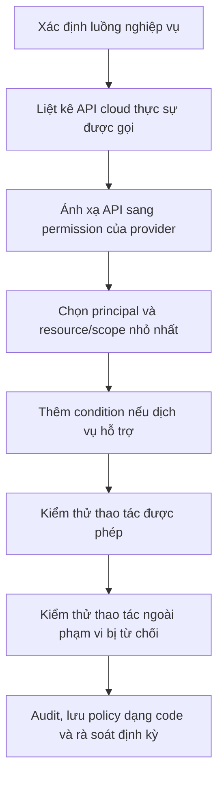
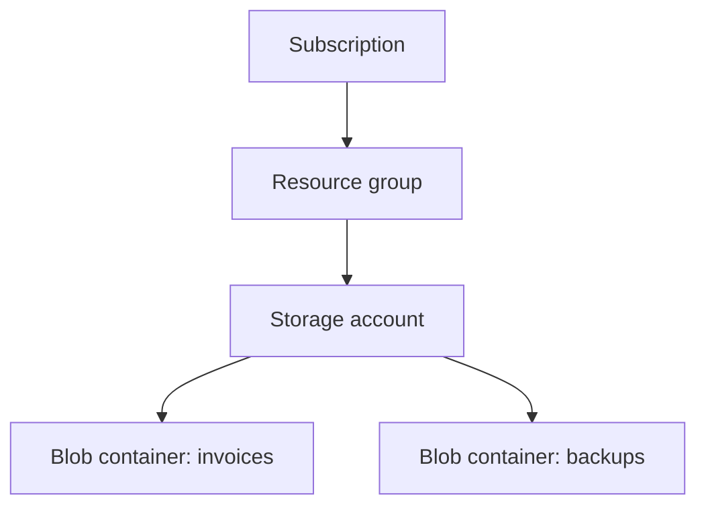

# Thiết kế quyền tối thiểu theo hành động và phạm vi tài nguyên

Giả sử `invoice-service` là một ứng dụng Spring Boot cần lưu hóa đơn lên object storage, gửi sự kiện sang hệ thống xử lý và đọc một secret cấu hình. Cấp quyền quản trị toàn bộ AWS account, Azure subscription hoặc Google Cloud project chắc chắn giúp tránh được nhiều lỗi `AccessDenied` trong lúc thử nghiệm, nhưng cũng khiến một lỗi của ứng dụng có thể ảnh hưởng đến lượng dữ liệu và dịch vụ rất lớn. Thiết kế đúng là xác định **danh tính nào cần thực hiện hành động nào trên tài nguyên nào, với điều kiện gì**, sau đó chỉ cấp tập quyền đó.

Trong chương **Danh tính và quyền** của module **SPRING_CLOUD_PROVIDER_INTEGRATION**, bài này tập trung vào thiết kế *least privilege* cho các tích hợp Spring Boot với dịch vụ managed trên AWS, Azure và Google Cloud. Phạm vi thực hành bao gồm storage, messaging, dữ liệu, secret manager và kiểm thử tích hợp. Mục tiêu là tạo một chính sách quyền có thể giải thích, kiểm tra được cả ca thành công và ca bị từ chối, thay vì chỉ dừng ở việc kết nối SDK thành công.

## 1. Mục tiêu học tập

Sau bài học, bạn có thể:

- Lập ma trận **principal – operation – permission – resource – scope – condition – environment** từ một luồng nghiệp vụ.
- Phân biệt quyền ở API Spring Boot với quyền của workload khi gọi dịch vụ cloud.
- Viết policy IAM AWS cho đúng ARN bucket/object/queue/secret; nhận diện khi nào cần quyền phụ như KMS.
- Chọn scope và data-plane role của Azure RBAC; biết khi nào built-in role rộng hơn yêu cầu và cần đánh giá custom role.
- Cấp IAM role ở phạm vi bucket/topic/secret trên Google Cloud; hiểu giới hạn của role có sẵn và việc kiểm soát prefix/object.
- Kiểm tra quyền **cho phép** và **từ chối** trên môi trường thực, phát hiện quyền được thừa hưởng hoặc policy ngoài ý muốn.
- Rà soát và cập nhật quyền theo thời gian mà không phải chèn access key/client secret vào mã nguồn.

## 2. Mô hình quyền tối thiểu: ai – làm gì – trên đâu – trong điều kiện nào?

Một quyết định phân quyền cloud có thể được biểu diễn khái quát:

```text
Principal + Action/Permission + Resource + Context/Conditions
                         |
                         v
          IAM / RBAC / resource policy evaluation
                         |
                    Allow / Deny
```

| Thành phần | Câu hỏi thực tế | Ví dụ với `invoice-service-prod` |
| --- | --- | --- |
| **Principal** | Chính xác danh tính nào gọi cloud API? | ECS task role, Azure managed identity hoặc Google service account của service production |
| **Action/permission** | API cần thực hiện thao tác nào? | Tạo object, gửi message, truy cập giá trị một secret |
| **Resource** | Tài nguyên đích nào được phép? | Bucket/container `invoices-prod`, queue/topic sự kiện, secret kết nối |
| **Scope** | Quyền được gắn ở cấp nào? | Object ARN/prefix, Azure container, GCP bucket hoặc secret cụ thể |
| **Condition** | Chỉ khi nào hoặc theo thuộc tính gì? | Vùng môi trường, nhãn, thuộc tính request, thời gian hoặc ràng buộc dịch vụ được hỗ trợ |
| **Environment** | Đây là dev, staging hay production? | Danh tính và tài nguyên production tách khỏi tài nguyên test |

**Quyền tối thiểu (principle of least privilege)** là cấp cho từng principal đúng các permission và phạm vi đủ để hoàn thành nhiệm vụ được giao. Không chỉ giới hạn **số thao tác**, mà còn giới hạn **tài nguyên**, **môi trường**, **thời gian** và **điều kiện** khi nền tảng hỗ trợ. Một role chỉ được `PutObject` nhưng trên mọi bucket trong account vẫn có thể quá rộng.

Đồng thời cần tách hai lớp:

- **Lớp nghiệp vụ:** Spring Security và logic ứng dụng quyết định người dùng nào được tạo, xem hay hủy hóa đơn, theo quyền và tenant của người dùng.
- **Lớp cloud:** IAM/RBAC xác định tiến trình `invoice-service` được đọc/ghi tài nguyên cloud nào. Client SDK thường sử dụng danh tính workload, không tự biến JWT của người dùng thành một cloud principal tương đương.

Nếu người dùng A được gọi `POST /invoices` nhưng workload thiếu quyền lưu object, API vẫn có thể thất bại ở bước storage. Ngược lại, nếu workload có quyền ghi object, ứng dụng vẫn phải ngăn người dùng B tạo hóa đơn trái phép. Hai lớp kiểm soát bổ sung cho nhau.

## 3. Bắt đầu từ thao tác nghiệp vụ, không bắt đầu từ tên role

Một phương pháp thiết kế hiệu quả là liệt kê **các API cloud thực sự được gọi** trong luồng nghiệp vụ, sau đó ánh xạ chúng sang permission của từng provider.

Giả sử `invoice-service` chỉ phải:

1. Tạo hóa đơn mới dưới key `invoices/2026/INV-001.json`.
2. Gửi sự kiện `invoice.created` sang một queue hoặc topic.
3. Đọc secret chứa thông tin kết nối đến một dịch vụ bên ngoài.

Không có yêu cầu xóa bucket, liệt kê toàn bộ object, thay đổi quyền IAM, quản trị queue hoặc đọc mọi secret của hệ thống. Từ đó xây dựng **ma trận quyền tối thiểu** trước khi cấu hình cloud:

| Principal | Operation ứng dụng | Permission cần đánh giá | Phạm vi | Operation không cần |
| --- | --- | --- | --- | --- |
| `invoice-api-prod` | Tạo object hóa đơn | Quyền tạo/ghi object của dịch vụ storage đang dùng | Bucket/container hóa đơn production, và prefix nếu cloud hỗ trợ chính xác | Xóa bucket, đọc toàn bộ object, sửa IAM |
| `invoice-api-prod` | Gửi sự kiện | Quyền send/publish | Một queue/topic sự kiện production | Nhận/xóa message, quản trị queue/topic |
| `invoice-api-prod` | Lấy nội dung secret | Quyền đọc giá trị secret | Một hoặc một vài secret cụ thể | Tạo, xóa hoặc liệt kê tất cả secret |
| `invoice-deployer-prod` | Triển khai service | Quyền cập nhật artifact/service và pass role khi thực sự cần | Tài nguyên triển khai production được duyệt | Đọc dữ liệu hóa đơn và secret runtime |
| `invoice-worker-prod` | Xử lý event, cập nhật trạng thái | Quyền nhận message và ghi dữ liệu theo công việc | Queue và bảng/DB thuộc worker | Quyền deploy và quyền ghi storage của mọi service |

**Nguyên tắc kiểm tra:** không kết luận “ứng dụng cần quyền storage” rồi gán một role rộng. Phải hỏi **gọi API nào, trên object nào, có cần ghi đè hay liệt kê không?** Một thao tác trong SDK có thể kéo theo nhiều request; hãy đối chiếu API thực tế và những quyền phụ mà dịch vụ yêu cầu.



## 4. AWS: action, resource ARN và điều kiện IAM

AWS IAM biểu diễn permission qua `Action`, `Resource`, `Effect`, và có thể thêm `Condition`. Với IAM role, **trust policy** xác định ai được assume role; **permission policy** xác định role session được gọi API nào. Hai loại policy giải quyết hai vấn đề khác nhau.

### 4.1. Chọn đúng ARN cho từng action

| Mục đích | IAM action | Resource dạng ví dụ | Ghi chú |
| --- | --- | --- | --- |
| Tạo/ghi object S3 | `s3:PutObject` | `arn:aws:s3:::invoices-prod/invoices/*` | Phạm vi ARN **object**; không phải ARN bucket trần |
| Đọc object S3 | `s3:GetObject` | `arn:aws:s3:::invoices-prod/invoices/*` | Độc lập với quyền ghi |
| Liệt kê object trong bucket | `s3:ListBucket` | `arn:aws:s3:::invoices-prod` | Phạm vi ARN **bucket**; có thể xét condition `s3:prefix` |
| Gửi message SQS | `sqs:SendMessage` | `arn:aws:sqs:ap-southeast-1:123456789012:invoice-events-prod` | Chỉ đúng queue cần gửi |
| Publish SNS | `sns:Publish` | `arn:aws:sns:ap-southeast-1:123456789012:invoice-created-prod` | Chỉ đúng topic đích |
| Lấy giá trị secret | `secretsmanager:GetSecretValue` | ARN của secret được cấp quyền | Cần kiểm tra KMS nếu secret dùng customer-managed key |

**Điểm hay bị nhầm:** `s3:PutObject` trên object ARN không bao hàm `s3:ListBucket`. Quyền liệt kê bucket dùng resource ARN khác. Khi chỉ cần ghi theo key đã biết, đừng tự thêm `ListBucket` vì “SDK S3 thường cần”. Hãy đo các request thực tế trước khi cấp quyền phụ.

Ví dụ với hành động liệt kê thật sự cần thiết, có thể giới hạn prefix bằng condition chỉ áp dụng cho `s3:ListBucket`:

```json
{
  "Effect": "Allow",
  "Action": "s3:ListBucket",
  "Resource": "arn:aws:s3:::invoices-prod",
  "Condition": {
    "StringLike": {
      "s3:prefix": ["invoices/", "invoices/*"]
    }
  }
}
```

Đây là **một statement minh họa**. `s3:prefix` giới hạn request liệt kê theo prefix, **không** thay thế việc dùng object ARN có prefix để kiểm soát `PutObject` hoặc `GetObject`.

### 4.2. Ví dụ policy cấp đúng ba nhu cầu của `invoice-service`

Policy sau dành cho **IAM role của workload**, giới hạn ở một prefix S3, một queue và một secret cụ thể. ARN, account, region, tên tài nguyên chỉ là giá trị minh họa:

```json
{
  "Version": "2012-10-17",
  "Statement": [
    {
      "Sid": "WriteInvoiceObjects",
      "Effect": "Allow",
      "Action": "s3:PutObject",
      "Resource": "arn:aws:s3:::invoices-prod/invoices/*"
    },
    {
      "Sid": "SendInvoiceEvents",
      "Effect": "Allow",
      "Action": "sqs:SendMessage",
      "Resource": "arn:aws:sqs:ap-southeast-1:123456789012:invoice-events-prod"
    },
    {
      "Sid": "ReadOnlyInvoiceSecret",
      "Effect": "Allow",
      "Action": "secretsmanager:GetSecretValue",
      "Resource": "arn:aws:secretsmanager:ap-southeast-1:123456789012:secret:invoice/db-prod-AbCdEf"
    }
  ]
}
```

Policy này **không** cấp `s3:DeleteObject`, `s3:GetObject`, `s3:ListBucket`, `sqs:ReceiveMessage`, `sqs:DeleteMessage`, `secretsmanager:DeleteSecret` hoặc quyền thay đổi IAM. Nếu workflow cần đọc lại object sau upload, cần bổ sung `GetObject` với cùng phạm vi, không mở quyền trên mọi bucket.

Các trường hợp phải kiểm tra thêm:

- **SSE-KMS hoặc secret dùng khóa KMS do khách hàng quản lý:** role có thể cần quyền tương ứng đối với KMS key và key policy phải chấp nhận principal. Không cấp `kms:*` trên mọi key.
- **Bucket policy/queue policy:** một explicit deny ở resource policy có thể chặn role dù identity policy có `Allow`. Truy cập khác account có thể cần chính sách từ cả hai phía.
- **SCP và permission boundary:** hạn chế tối đa quyền của principal trong những tình huống áp dụng; quyền cho phép hiệu lực phụ thuộc toàn bộ lớp đánh giá của AWS.
- **Prefix và tên đối tượng:** policy giới hạn `invoices/*` trên S3 object ARN, nhưng không tự bảo đảm ứng dụng chỉ tạo hóa đơn hợp lệ theo tenant. Logic nghiệp vụ vẫn phải kiểm tra key được sinh ra từ dữ liệu người dùng.

### 4.3. Deny rõ ràng và quyền kế thừa

AWS thường có quy tắc mặc định **không được phép nếu không có `Allow` áp dụng**; **explicit `Deny`** trong policy liên quan có thể ghi đè một `Allow`. Tuy nhiên, không phải mọi loại policy đều kết hợp theo một phép giao đơn giản trong tất cả tình huống. Ví dụ resource-based policy, cross-account và IAM role session có những quy tắc riêng; phải sử dụng tài liệu đánh giá policy của AWS khi phân tích tình huống cụ thể.

Không nên nghĩ rằng bỏ `s3:DeleteObject` khỏi **một policy vừa chỉnh** là đủ để chứng minh role không xóa được object. Role có thể còn identity policy khác, quyền từ managed policy gắn vào hoặc resource policy có tác dụng. Cần đánh giá **effective permissions** và thử hành động bị cấm trên tài nguyên test.

## 5. Azure: RBAC scope và quyền dữ liệu (data plane)

Azure Role-Based Access Control (Azure RBAC) gán **role definition** cho một **principal** trên một **scope**. Principal có thể là managed identity hoặc service principal của ứng dụng Spring Boot. Các scope quản lý thường kế thừa theo cấu trúc subscription → resource group → resource; một số dịch vụ còn hỗ trợ scope chi tiết hơn, ví dụ **blob container**.

### 5.1. Scope càng rộng, tác động càng lớn



Một role assignment ở **subscription** có thể áp dụng cho nhiều resource con; gán ở **container `invoices`** thu hẹp phạm vi cho ứng dụng chỉ xử lý hóa đơn. Cần xác minh dịch vụ và loại role có hỗ trợ scope mong muốn. Một số thao tác vẫn cần quyền tại scope khác hoặc phụ thuộc cấu hình mạng/khóa.

Azure phân biệt hai nhóm quyền quan trọng:

| Loại | Đối tượng | Ví dụ |
| --- | --- | --- |
| **Management plane (`Actions`)** | Quản lý Azure resource qua Azure Resource Manager | Tạo/sửa storage account, thay cấu hình tài nguyên |
| **Data plane (`DataActions`)** | Truy cập nội dung dữ liệu của dịch vụ | Đọc, tạo hoặc xóa blob qua Microsoft Entra ID |

Role `Contributor` thông thường cho quyền quản lý nhiều tài nguyên ARM nhưng **không tự động** trao quyền data-plane để đọc/ghi blob bằng Microsoft Entra token. Đối với Blob Storage, dùng data role phù hợp như `Storage Blob Data Contributor` hoặc custom role có những `DataActions` thực sự cần thiết.

### 5.2. Cấp role ở phạm vi container thay vì toàn subscription

Ví dụ Azure CLI gán role cho managed identity trên **một blob container**:

```bash
az role assignment create \
  --assignee-object-id "<MANAGED_IDENTITY_PRINCIPAL_OBJECT_ID>" \
  --assignee-principal-type ServicePrincipal \
  --role "Storage Blob Data Contributor" \
  --scope "/subscriptions/<SUBSCRIPTION_ID>/resourceGroups/rg-invoices-prod/providers/Microsoft.Storage/storageAccounts/stinvoiceprod/blobServices/default/containers/invoices"
```

Ví dụ này dùng placeholder; thay bằng giá trị thuộc môi trường của bạn. `Storage Blob Data Contributor` hỗ trợ nhiều thao tác dữ liệu, **bao gồm cả các thao tác vượt nhu cầu chỉ tạo object**. Lệnh trên minh họa cách **thu hẹp scope**, chưa phải cấu hình hành động nhỏ nhất tuyệt đối. Nếu nghiệp vụ chỉ cho phép tạo/ghi blob, cân nhắc **custom role** chứa data action cần thiết, ví dụ `Microsoft.Storage/storageAccounts/blobServices/containers/blobs/write`, và đánh giá permission phụ của SDK/thao tác thực tế. Azure RBAC không nên bị giả định có khả năng kiểm soát mọi điều kiện ghi đè theo cùng cách với S3.

Trong Azure, có thể tiếp tục kiểm soát mức hành động bằng custom role, **role assignment condition** ở dịch vụ/tình huống hỗ trợ, và kiểm soát API nghiệp vụ. Quyền trên Key Vault, Service Bus hoặc cơ sở dữ liệu có cơ chế riêng; đừng dùng một role Blob để suy ra quyền trên các dịch vụ khác.

### 5.3. Phân quyền các dịch vụ Azure khác

| Nhu cầu | Quyền/role thường dùng | Giới hạn cần nhớ |
| --- | --- | --- |
| Publish message vào Service Bus | `Azure Service Bus Data Sender` | Gán ở namespace/queue/topic theo phạm vi được hỗ trợ; không cần Data Receiver |
| Đọc giá trị secret từ Key Vault | Ví dụ `Key Vault Secrets User` khi vault dùng Azure RBAC | Phụ thuộc permission model của vault; quyền quản lý vault không tự cho đọc secret |
| Thao tác dữ liệu Cosmos DB for NoSQL | Data-plane RBAC của Cosmos DB và data role phù hợp | Không mặc nhiên tương đương Azure RBAC management role trên Cosmos DB account |
| Kết nối Azure SQL Database | Danh tính Entra cho kết nối và quyền ở database | Token kết nối không thay thế `GRANT`/database roles bên trong DB |

**Managed identity chỉ giải quyết việc nhận danh tính và token.** Quyền data-plane, phạm vi tài nguyên, networking/private endpoint và database permission là những kiểm tra độc lập. Nếu ứng dụng đã có token nhưng upload blob bị `403`, trước tiên xác định principal và scope role assignment; đừng tạo client secret để thử thay cho managed identity.

## 6. Google Cloud: IAM role binding ở đúng tài nguyên

Google Cloud IAM cấp quyền bằng **role binding** giữa principal và role trên một resource. Cấu trúc tổ chức có thể gồm organization, folder, project và tài nguyên cụ thể. Một role gán ở project thường có phạm vi rộng hơn cùng role gán ở **một bucket** nếu dịch vụ hỗ trợ IAM ở resource đó.

### 6.1. Chọn role theo permission thực sự cần

| Nhu cầu | Permission quan trọng | Role có sẵn để cân nhắc | Phạm vi nên xem xét |
| --- | --- | --- | --- |
| Tạo object Cloud Storage | `storage.objects.create` | `roles/storage.objectCreator` | Bucket riêng cho hóa đơn hoặc phạm vi hỗ trợ chi tiết hơn |
| Đọc object Cloud Storage | `storage.objects.get` | `roles/storage.objectViewer` | Bucket hoặc resource hỗ trợ cần đọc |
| Gửi Pub/Sub event | `pubsub.topics.publish` | `roles/pubsub.publisher` | Một topic cụ thể |
| Đọc Secret Manager secret version | `secretmanager.versions.access` | `roles/secretmanager.secretAccessor` | Secret cụ thể |
| Ghi dữ liệu vào database | Tùy Cloud SQL/Firestore/Spanner và đường xác thực | Vai trò và quyền đúng dịch vụ | Project/instance/database, kèm quyền bên trong DB nếu có |

Ví dụ service account `invoice-runtime@my-project.iam.gserviceaccount.com` chỉ cần tạo object ở bucket `invoice-prod`. Lệnh IAM binding minh họa:

```bash
gcloud storage buckets add-iam-policy-binding gs://invoice-prod \
  --member="serviceAccount:invoice-runtime@my-project.iam.gserviceaccount.com" \
  --role="roles/storage.objectCreator"
```

Binding này có thể đủ cho việc **tạo object mới** trong bucket nếu không có giới hạn khác. `roles/storage.objectCreator` không tự cho quyền đọc, liệt kê hay xóa object; việc ghi đè object đã tồn tại có thể cần quyền bổ sung tùy API và trạng thái object. Không gán role này ở toàn project nếu workload chỉ cần một bucket.

### 6.2. Giới hạn theo prefix không giống nhau giữa các cloud

AWS S3 hỗ trợ đặt object ARN theo prefix như `arn:aws:s3:::bucket/invoices/*`. **Không được sao chép cú pháp hoặc giả định của AWS sang Google Cloud IAM.** Với Cloud Storage, cấp IAM ở bucket bằng `roles/storage.objectCreator` thường bao phủ việc tạo object trong bucket đó. Khi cần tách dữ liệu theo đường dẫn, cần đánh giá các cơ chế mà cấu hình bucket thực tế hỗ trợ, ví dụ **managed folders** và các quyền ở cấp folder tương ứng, IAM Conditions khi loại tài nguyên và thuộc tính được hỗ trợ, hoặc đơn giản hơn là **tách bucket theo chức năng/tenant**.

Không giả định một IAM Condition dạng `resource.name.startsWith(...)` sẽ giới hạn hoàn toàn thao tác tạo object theo prefix trong mọi API và ở mọi loại bucket. Context và resource mà dịch vụ dùng để đánh giá IAM Conditions có thể không giống đường dẫn object mà ứng dụng sinh ra. Phải kiểm chứng bằng test thật trước khi coi prefix là ranh giới bảo mật.

### 6.3. Kiểm tra cả quyền được thừa hưởng

Google Cloud IAM có thể cấp quyền từ cấp organization/folder/project và resource trực tiếp. Ngoài allow bindings, môi trường còn có thể có IAM Deny, principal access boundary (nếu áp dụng), organization policies và các điều kiện khác. Một binding ở bucket hẹp không vô hiệu hóa quyền rộng đã được cấp ở project. Để chứng minh least privilege, hãy kiểm tra **effective access** và thử ca ngoài phạm vi từ đúng principal của workload.

## 7. Đối chiếu ba provider: cùng nhu cầu, cách cấp quyền khác nhau

| Tiêu chí | AWS | Azure | Google Cloud |
| --- | --- | --- | --- |
| Principal runtime phổ biến | IAM role session | Managed identity hoặc workload identity/service principal | Service account hoặc federated workload principal |
| Nơi diễn tả hành động | IAM `Action`, ví dụ `s3:PutObject` | RBAC `Actions`/`DataActions` hoặc RBAC dữ liệu riêng của dịch vụ | IAM permission nằm trong role, ví dụ `storage.objects.create` |
| Nơi giới hạn tài nguyên | `Resource` ARN; một số action có condition keys | Role assignment `scope`; role definition và điều kiện nếu được hỗ trợ | IAM binding trên resource; IAM Conditions khi phù hợp |
| Mức giới hạn storage nên bắt đầu | Object ARN trên bucket/prefix, quyền bucket riêng khi cần | Container scope và data role/custom role | Bucket scope hoặc managed folder/tài nguyên chi tiết được hỗ trợ |
| Cách kiểm soát explicit deny | IAM `Deny`, SCP, bucket policy và các loại policy liên quan | Azure deny assignments và cơ chế cấp quyền/dữ liệu liên quan | IAM Deny và policy/giới hạn tổ chức được hỗ trợ |
| Rủi ro dễ gặp | Nhầm bucket ARN với object ARN; gán `s3:*` | Gán `Contributor` rồi tưởng có data role; gán role ở subscription quá rộng | Gán `roles/editor`/`roles/owner` ở project chỉ để ghi một object |

**Không có policy trung lập cloud nào chuyển đổi tự động một-một** giữa AWS IAM, Azure RBAC và Google Cloud IAM. Một role built-in có thể bao gồm thêm operation, và mức chi tiết khi giới hạn resource không giống nhau. Luôn lấy **API thực tế, permission đúng provider và scope được dịch vụ hỗ trợ** làm căn cứ.

## 8. Điều kiện truy cập và ranh giới môi trường

Sau khi giới hạn action và resource, xem xét các điều kiện phù hợp với rủi ro của ứng dụng:

| Kiểm soát | Mục đích | Cách áp dụng đúng |
| --- | --- | --- |
| **Tách dev/staging/prod** | Không để workload thử nghiệm sửa dữ liệu production | Principal riêng, bucket/container/topic/secret riêng và policy riêng |
| **Giới hạn nguồn assume identity** | Chỉ workload được phê duyệt nhận role/token | AWS trust conditions, Azure federated credential, GCP workload identity provider conditions |
| **Điều kiện theo request/resource** | Giới hạn request theo thuộc tính được hỗ trợ | AWS IAM condition keys, Azure RBAC conditions, GCP IAM Conditions sau khi xác minh khả năng áp dụng |
| **Quyền theo tenant** | Giảm phạm vi truy cập giữa khách hàng | Tách tài nguyên hoặc identity khi cần; kiểm tra tenant trong nghiệp vụ và backend |
| **Hạn chế đường mạng** | Giới hạn endpoint hoặc mạng được phép sử dụng | VPC endpoint/network policy, private endpoint/firewall; độc lập với IAM |
| **Mã hóa và KMS** | Bảo vệ dữ liệu và khóa quản lý | Giới hạn quyền trên đúng encryption key và kiểm tra key policy/role liên quan |

### 8.1. Không nhầm quyền IAM với ranh giới tenant của ứng dụng

Giả sử tất cả hóa đơn của nhiều tenant cùng nằm trong bucket `invoices-prod`:

```text
invoices-prod/
  tenants/tenant-a/INV-001.json
  tenants/tenant-b/INV-002.json
```

Nếu ứng dụng dùng **một workload identity** được ghi toàn bộ `tenants/*`, cloud IAM thường không biết user đang gọi API thuộc tenant A hay B. Backend phải xác minh tenant từ phiên người dùng/định danh đã được chứng thực và tự sinh object key an toàn; không nhận nguyên một path do client gửi rồi ghép vào bucket.

Khi cần ranh giới cloud chặt hơn, có thể tách bucket/container, tách workload identity hoặc dùng các tính năng IAM chi tiết được provider hỗ trợ và đã kiểm thử. **Một quy ước prefix trong code không tự là rào chắn IAM** nếu principal có quyền ghi cả bucket.

### 8.2. Phân biệt identity trust với permission policy

Đối với OIDC CI/CD, trust policy/federated identity credential quyết định **job hoặc Pod nào có thể nhận identity**, còn IAM/RBAC quyết định **identity sau khi nhận được credential được gọi API nào**. Chỉ thu hẹp quyền storage nhưng để bất kỳ workflow nào assume được role vẫn là một thiết kế thiếu kiểm soát.

Ngược lại, một trust rule rất chặt cho branch `main` chưa bảo đảm an toàn nếu role sau khi assume có quyền quản trị tất cả tài nguyên. Cần thu hẹp cả hai phía.

## 9. Ví dụ Spring Boot: triển khai luồng nghiệp vụ theo quyền đã thiết kế

Với AWS, ứng dụng có thể dùng `DefaultCredentialsProvider` để nhận temporary credentials của workload. Config bean không chứa access key:

```java
@Configuration
public class InvoiceCloudClients {
    @Bean
    S3Client s3Client(@Value("${app.aws.region}") String region) {
        return S3Client.builder()
                .region(Region.of(region))
                .credentialsProvider(DefaultCredentialsProvider.create())
                .build();
    }

    @Bean
    SqsClient sqsClient(@Value("${app.aws.region}") String region) {
        return SqsClient.builder()
                .region(Region.of(region))
                .credentialsProvider(DefaultCredentialsProvider.create())
                .build();
    }
}
```

Trong ứng dụng thực, nên tạo và inject **một credential provider dùng chung** cho các client, nhất là khi cần xác minh principal đang được SDK chọn. Ví dụ trên minh họa default chain; khi dùng **Spring Cloud AWS starter**, có thể sử dụng client tự cấu hình của starter thay vì khai báo bean trùng lặp. Cần khai báo dependency SDK/starter tương ứng với phiên bản Spring Boot và thiết lập đúng region.

Phần service chỉ thao tác trên đường dẫn do backend quyết định:

```java
@Service
public class InvoiceStorage {
    private final S3Client s3;
    private final String bucket;

    public InvoiceStorage(S3Client s3,
                          @Value("${app.invoices.bucket}") String bucket) {
        this.s3 = s3;
        this.bucket = bucket;
    }

    public void saveNew(String invoiceId, byte[] json) {
        String safeId = requireValidInvoiceId(invoiceId);
        String key = "invoices/" + safeId + ".json";

        s3.putObject(
                PutObjectRequest.builder()
                        .bucket(bucket)
                        .key(key)
                        .ifNoneMatch("*")
                        .contentType("application/json")
                        .build(),
                RequestBody.fromBytes(json)
        );
    }

    private String requireValidInvoiceId(String id) {
        if (id == null || !id.matches("[A-Za-z0-9_-]{1,64}")) {
            throw new IllegalArgumentException("Invalid invoice ID");
        }
        return id;
    }
}
```

`If-None-Match: *` là điều kiện tạo mới được S3 hỗ trợ, giúp tránh ghi đè khi key đã tồn tại; chính sách `s3:PutObject` riêng lẻ **không** cấm ghi đè object. Đây là ví dụ kiểm soát ở **request/business operation**, không thay thế IAM. Cần xử lý các response do object đã tồn tại hoặc có request đồng thời theo hợp đồng nghiệp vụ. Dịch vụ SQS dùng `sqs:SendMessage` khi gửi sự kiện sau khi lưu hóa đơn; nếu luồng lưu S3 thành công nhưng gửi SQS lỗi, cần thiết kế retry/idempotency hoặc transactional outbox phù hợp, không liên quan trực tiếp đến việc mở quyền IAM.

Cấu hình Spring Boot nên chỉ chứa tên tài nguyên, region, URL đích, không chứa secret:

```yaml
app:
  aws:
    region: ${AWS_REGION:ap-southeast-1}
  invoices:
    bucket: ${INVOICE_BUCKET}
  events:
    queue-url: ${INVOICE_QUEUE_URL}
```

Tên bucket hay queue URL **không phải** bằng chứng xác thực. Cùng code ở local có thể sử dụng danh tính developer, còn trên ECS/EKS/EC2 nhận role credentials của workload. Phải xác minh danh tính thực tế vì biến môi trường AWS có thể lấn át role runtime trong credential chain. Không sao chép credential của CI/developer vào container.

### 9.1. Tương đương trên Azure và Google Cloud

- **Azure Blob Storage:** client dùng `DefaultAzureCredential` hoặc `ManagedIdentityCredential` từ Azure Identity; container và endpoint lấy từ cấu hình triển khai. Managed identity cần data role/custom `DataActions` trên đúng container, và hệ thống phải phân biệt quyền ghi dữ liệu với quyền quản lý storage account.
- **Google Cloud Storage:** client dùng ADC qua `GoogleCredentials.getApplicationDefault()` hoặc starter Spring Cloud GCP. Workload service account/federated principal cần `storage.objects.create` ở bucket phù hợp; khi cần tạo mới không ghi đè, cân nhắc precondition generation trên API Storage. Phạm vi prefix cần được kiểm chứng theo IAM của bucket, managed folder hoặc cách tách tài nguyên đang dùng.

Trên cả ba cloud, credential tự động chỉ giải quyết **danh tính**. Nó không tự tạo permission trên bucket, topic, database hoặc secret.

## 10. Kiểm thử quyền tối thiểu: phải có cả allow và deny

Một integration test chỉ upload thành công chứng minh ứng dụng **có đủ quyền tối thiểu để làm một việc**, nhưng không chứng minh nó **không có thêm quyền nguy hiểm**. Cần thử các ca bị cấm với chính principal runtime, trên tài nguyên thử nghiệm.

| Ca kiểm thử | Operation | Kết quả mong đợi |
| --- | --- | --- |
| A — Quyền hợp lệ | Tạo hóa đơn mới trong bucket/container được cấp | Thành công; audit ghi đúng workload principal |
| B — Không có quyền đọc | Đọc object nếu role chỉ có quyền tạo | Bị từ chối khi permission không được cấp ở nơi khác |
| C — Không có quyền xóa | Xóa object hoặc container thử nghiệm | Bị từ chối; tài nguyên vẫn còn |
| D — Vượt phạm vi resource | Ghi vào bucket/container khác không được cấp | Bị từ chối |
| E — Vượt phạm vi môi trường | Principal staging thử thao tác vào tài nguyên production test được mô phỏng riêng | Bị từ chối |
| F — Messaging | Gửi tới queue/topic đã cấp; thử nhận/xóa nếu chưa cấp | Gửi thành công, nhận/xóa bị từ chối |
| G — Secret | Đọc secret được gán; thử secret khác | Đúng secret được đọc; secret ngoài phạm vi bị từ chối |

Với môi trường cloud thật, chuẩn bị **resource test riêng** và principal giới hạn. Không thử thao tác xóa với dữ liệu quan trọng hoặc cấp quyền tạm thời trên production chỉ để chạy test. Nếu một thao tác dự định bị từ chối lại **thành công**, hãy tìm quyền inherited, role/policy chồng lấn, resource policy và nguồn credential đã chọn.

### 10.1. Một phép kiểm thử quyền âm tính trong Java

Ví dụ ý tưởng với AWS SDK for Java 2.x; chỉ chạy trên bucket **test** đã được thiết kế để từ chối thao tác xóa:

```java
@Test
void workloadCannotDeleteInvoiceObject() {
    assertThrows(S3Exception.class, () ->
        s3.deleteObject(DeleteObjectRequest.builder()
            .bucket(testBucket)
            .key("invoices/cannot-delete.json")
            .build())
    );
}
```

**Chưa đủ chặt nếu chỉ `assertThrows(S3Exception.class)`**: exception có thể do mạng, sai region hoặc bucket không tồn tại. Bài test hoàn chỉnh phải kiểm tra error code phù hợp như `AccessDenied`, HTTP status khi áp dụng, **principal thực tế** và bằng chứng object không bị xóa. Trong trường hợp bất ngờ có quyền xóa, một `DELETE` đối với key không tồn tại có thể vẫn trả thành công; nên dùng object test được tạo và xác minh trước, đồng thời bảo đảm môi trường an toàn.

Đối với Azure/GCP, thay kiểm tra tương tự bằng exception/error code của client library tương ứng. Không dùng mô phỏng SDK như LocalStack hoặc Azurite làm bằng chứng cuối cùng rằng IAM/RBAC trên cloud thật đã đúng; emulator hữu ích cho kiểm thử API và nghiệp vụ nhưng không phản ánh đầy đủ permission evaluation thực tế.

### 10.2. Kiểm chứng đúng principal

Thử quyền bằng account admin hoặc tài khoản developer không chứng minh quyền của workload:

- **AWS:** dùng STS `GetCallerIdentity` với **cùng credential provider** của ứng dụng; kiểm tra assumed-role ARN và account ID. `aws sts get-caller-identity` trong CLI chỉ phản ánh credential của phiên CLI tương ứng.
- **Azure:** xác minh managed identity/service principal được Java client chọn qua log Azure Identity và các công cụ kiểm toán phù hợp; kiểm tra role assignments trên đúng scope. `az account show` của terminal không tự chứng minh danh tính JVM.
- **Google Cloud:** xác minh ADC chọn đúng service account/federated principal và đối chiếu Cloud Audit Logs; tránh giả định `gcloud auth login` hay cấu hình project ID sẽ tự thay principal của Java.

Không in access token, session token, client secret, signed request hay private key vào log. Chỉ ghi principal identifier, resource, operation, request ID và thông tin lỗi đã lọc bí mật.

## 11. Vì sao request bị từ chối dù policy đã có Allow?

Lỗi `403`, `AccessDenied`, `PermissionDenied` hoặc tên ngoại lệ SDK không phải lúc nào cũng chỉ do thiếu action. Quy trình chẩn đoán nên đi từ **principal**, qua **action/resource**, rồi đến các chính sách và điều kiện khác:

1. **Credential nào được SDK chọn?** Môi trường có thể còn biến credential của developer/CI, khiến Java dùng principal khác.
2. **Operation thực sự là gì?** Upload khác list/read/delete; ghi đè có thể cần permission hoặc điều kiện bổ sung; publish topic khác receive message.
3. **Resource/scope có khớp?** Bucket ARN khác object ARN; Azure scope có thể là storage account thay vì container; GCP project binding khác bucket binding.
4. **Có policy khác không?** AWS explicit deny/SCP/bucket policy/KMS; Azure deny assignment, data-plane role và network; Google IAM binding inherited/deny/organization policy.
5. **Cấu hình dịch vụ có ràng buộc riêng?** Region, tenant/project, endpoint, key encryption, firewall/private endpoint và các yêu cầu của dịch vụ.
6. **Log kiểm toán nói gì?** Đối chiếu principal, permission, resource, request ID từ CloudTrail, Azure diagnostics/Entra logs hoặc Google Cloud Audit Logs theo khả năng ghi log của dịch vụ.

Nếu principal **đúng** nhưng thiếu permission, chỉ sửa policy tại scope cần thiết. Nếu principal **sai**, sửa cấu hình credential/workload identity trước khi cấp quyền, vì cho principal sai thêm quyền sẽ làm rủi ro lớn hơn và che giấu lỗi triển khai.

## 12. Giữ quyền tối thiểu khi hệ thống thay đổi

Least privilege không phải tác vụ một lần. Khi service bổ sung tính năng, SDK thay đổi hoặc dịch vụ được tách nhỏ, quyền cần được đánh giá lại.

### 12.1. Quản lý chính sách như mã nguồn hạ tầng

Sử dụng IaC được tổ chức chấp nhận (ví dụ CloudFormation/Terraform/Bicep hoặc công cụ tương đương) để lưu **role definition, principal, scope, condition và environment**. Review thay đổi giống code ứng dụng, đặc biệt các thay đổi:

- Mở `Resource` thành `*` hoặc chuyển scope từ bucket/container lên project/subscription.
- Thêm `s3:*`, `storage.*`, `Owner`, `Contributor` hoặc các role quản trị rộng.
- Thêm quyền sửa IAM, assume role, pass role, tạo access key hoặc xem secret ngoài nhu cầu.
- Bỏ giới hạn `sub`, `aud`, branch, environment hay namespace trong trust/federation.
- Dùng chung runtime principal giữa dev và production.

Khi role built-in rộng hơn nhu cầu, có thể chọn custom role/policy. Tuy vậy, custom role cũng cần quản lý version và rà soát khi dịch vụ thay đổi API. Đừng lập giả định rằng mọi provider đều cho phép áp dụng custom role ở mọi scope với cùng mức chi tiết.

### 12.2. Dùng bằng chứng thay vì suy đoán

Các công cụ mô phỏng/kiểm tra policy, access analyzer, recommender, audit logs và kết quả kiểm thử thực tế giúp nhận biết quyền thiếu hoặc dư. Chúng có phạm vi và giới hạn riêng: không công cụ nào thay thế hoàn toàn việc kiểm tra đúng service, resource và policy liên quan.

Phân tích quyền trong sản xuất cần thận trọng: một permission chưa xuất hiện trong log tháng này có thể vẫn cần cho tác vụ hiếm gặp như phục hồi dữ liệu hoặc xử lý cuối kỳ. Quyết định thu hẹp quyền nên dựa vào **hợp đồng nghiệp vụ**, quan sát sử dụng và test regression phù hợp.

### 12.3. Đặt trách nhiệm rõ ràng

| Vai trò trong nhóm | Trách nhiệm |
| --- | --- |
| Developer | Liệt kê API cloud thực sự gọi, điều kiện nghiệp vụ và những trường hợp lỗi |
| Platform/IaC | Gắn workload principal đúng môi trường, định nghĩa policy/role/scope và quản lý secret/identity |
| Reviewer/security | Phát hiện wildcard, inherited access, trust quá rộng và rủi ro vượt tenant/môi trường |
| QA/integration test | Chứng minh ca allow và deny bằng đúng runtime principal trên tài nguyên test |
| Operations | Theo dõi audit log, thay đổi quyền có kiểm soát và xử lý sự cố credential/authorization |

## 13. Bài thực hành: thiết kế và kiểm thử quyền cho `invoice-service`

**Đề bài:** xây dựng một ứng dụng Spring Boot có endpoint lưu JSON hóa đơn và phát sự kiện, triển khai lên **một** trong ba cloud làm môi trường thực hành chính. Thiết kế quyền tối thiểu cho workload, giải thích phương án tương đương ở hai provider còn lại.

### Dữ kiện

- `invoice-api-staging` cần **tạo object mới** dưới prefix `invoices/` trong tài nguyên storage staging.
- Sau khi tạo thành công, service cần **gửi một sự kiện** tới đúng queue/topic staging.
- Service cần **đọc một secret** cấu hình của chính nó.
- Service **không cần** xóa object, đọc dữ liệu khách hàng khác, nhận message hoặc quản trị hạ tầng.
- CI deploy service và runtime xử lý request là **hai principal riêng**.

### Các bước thực hiện

1. **Lập ma trận:** ghi principal, action, resource, scope, condition và environment cho ba operation. Đánh dấu operation không được cấp.
2. **Tạo identity runtime:** AWS task/Pod/instance role, Azure managed identity/AKS workload identity hoặc Google service account/GKE workload identity theo môi trường.
3. **Gán permission:** chỉ quyền storage create, messaging send/publish và secret read tại scope nhỏ nhất provider hỗ trợ. Nếu dùng built-in role rộng hơn, ghi rõ phần quyền thừa và phương án giảm scope/custom role.
4. **Triển khai cùng artifact:** ứng dụng dùng Java SDK/Spring Cloud credential provider của runtime; giữ region, bucket/container/topic/secret trong cấu hình riêng theo môi trường.
5. **Chạy các ca allow và deny:** tạo object hợp lệ, gửi sự kiện và đọc secret được cấp; thử xóa object, đọc secret khác và ghi vào tài nguyên ngoài phạm vi.
6. **Đối chiếu audit:** ghi principal thực tế, operation, tài nguyên, trạng thái API, request ID và policy/role đã áp dụng. Chỉnh policy nếu có thao tác trái kỳ vọng rồi chạy lại test.
7. **Review IaC:** giải thích vì sao mỗi permission tồn tại; kiểm tra không có wildcard/built-in role quá rộng ngoài phần đã được chấp nhận.

### Tiêu chí hoàn thành

| Kiểm tra | Đạt khi |
| --- | --- |
| Đúng danh tính | Audit/cloud log cho thấy request xuất phát từ **runtime principal**, không phải developer hoặc CI principal |
| Đúng thao tác | Ba operation được yêu cầu hoạt động trên resource staging |
| Đúng phạm vi | Không tạo object hoặc đọc secret ngoài tài nguyên được cấp |
| Không có quyền thừa | Thao tác xóa/nhận/admin bị từ chối nếu không được thiết kế |
| Không lộ secret | Source code, Docker image và application config không chứa key/token/client secret dài hạn |
| Có thể tái lập | Policy/IaC, cấu hình môi trường và ca integration test được mô tả đủ để reviewer xác minh |

**Lưu ý:** Khi một test âm tính bất ngờ thành công, không đánh dấu hoàn thành. Phải xác định quyền được cấp từ nguồn nào (identity policy khác, scope cha, resource policy, role gán nhầm) và sửa effective permissions.

## 14. Câu hỏi tự kiểm tra

1. Vì sao `s3:PutObject` trên `arn:aws:s3:::invoices-prod/invoices/*` không mặc nhiên cấp quyền `s3:ListBucket`? Hai action cần các ARN khác nhau thế nào?
2. Một Spring Boot service chỉ cần tạo object nhưng được gán `Storage Blob Data Contributor` ở cấp subscription. Bạn sẽ thu hẹp **hành động** và **scope** bằng cách nào?
3. Gán `roles/storage.objectCreator` ở cấp project khác với gán ở bucket cụ thể ra sao? Quyền này có bảo đảm chỉ tạo được object dưới một prefix bất kỳ không?
4. AWS role có identity policy `Allow`, nhưng API vẫn trả `AccessDenied`. Bạn sẽ kiểm tra những policy và điều kiện nào trước khi cấp thêm quyền?
5. Vì sao `invoice-service` có quyền cloud storage không đồng nghĩa người dùng bất kỳ được gọi `POST /invoices`?
6. Một role runtime vừa có `sqs:SendMessage` vừa có quyền xóa toàn bộ queue. Làm sao chứng minh quyền xóa là thừa và loại bỏ nó an toàn?
7. Tại sao việc upload object thành công không chứng minh role đã tuân thủ least privilege? Hãy đề xuất hai ca kiểm thử âm tính.
8. Một pipeline triển khai thành công nhưng ứng dụng không đọc được secret. Vì sao không nên cấp quyền secret cho CI principal thay cho runtime principal?
9. Khi IAM Condition giới hạn theo prefix không hoạt động như kỳ vọng trên một API của provider, những cách tách tài nguyên/identity nào có thể tạo ranh giới đáng tin hơn?

## 15. Ghi nhớ

**Quyền tối thiểu bắt đầu từ hành động nghiệp vụ và tài nguyên thực sự cần, sau đó mới chọn policy hoặc role.** Với AWS, cần phân biệt action và ARN bucket/object; với Azure, cần phân biệt management-plane và data-plane role cùng scope; với Google Cloud, cần kiểm tra role binding ở resource nhỏ nhất mà dịch vụ hỗ trợ. Không đánh đồng một built-in role trên cloud này với role có tên tương tự ở cloud khác.

Trong Spring Boot, hãy gắn danh tính workload với môi trường chạy, kiểm tra credential SDK thực sự chọn, cấp quyền riêng cho storage, messaging, database và secret, đồng thời tách CI identity khỏi runtime identity. Một thiết kế chỉ được xem là đạt khi **thao tác cần thiết thành công và thao tác ngoài phạm vi bị từ chối** trên tài nguyên test với đúng principal. Quy trình review policy, audit và kiểm thử liên tục giúp duy trì ranh giới đó khi ứng dụng thay đổi.
