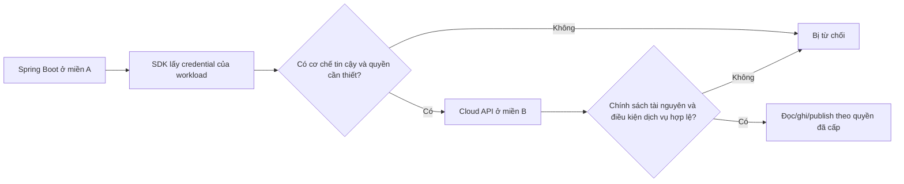
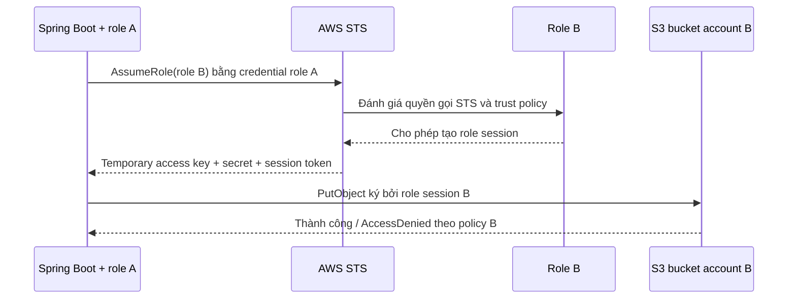
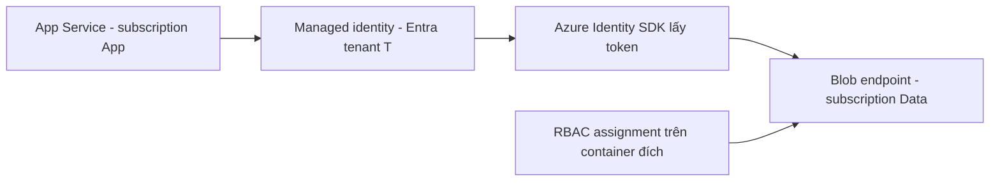
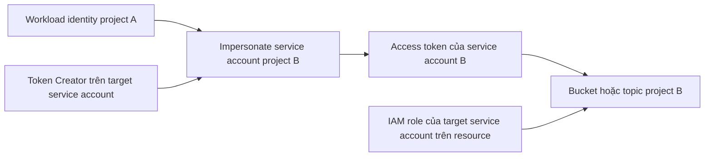

# Truy cập khác tài khoản, subscription hoặc project

Một hệ thống Spring Boot thường được triển khai ở một vùng quản trị cloud nhưng phải truy cập tài nguyên ở vùng quản trị khác. Ví dụ: `invoice-api` chạy trong **AWS account A** và ghi file vào bucket thuộc **AWS account B**; một **Azure App Service** ở subscription ứng dụng cần đọc blob trong subscription dữ liệu; hoặc **Cloud Run** ở project ứng dụng cần gửi thông điệp đến Pub/Sub topic trong project tích hợp. Việc SDK lấy được credential ở bên gọi **không bảo đảm** bên nhận cho phép thao tác.

Bài học thuộc chương **Danh tính và quyền** của module **SPRING_CLOUD_PROVIDER_INTEGRATION**. Trong quá trình thực hành Spring Boot với các thư viện Spring Cloud AWS, Spring Cloud Azure và Spring Cloud GCP, chúng ta sẽ thiết kế quyền truy cập xuyên ranh giới tài khoản, subscription và project cho storage, messaging, dữ liệu và secret; đồng thời xác minh danh tính, hạn chế quyền và kiểm thử tích hợp trên tài nguyên phù hợp.

## 1. Mục tiêu học tập

Sau bài này, bạn có thể:

- Phân biệt **principal nguồn**, **tài nguyên đích**, **ranh giới quản trị**, **trust** và **permission** khi truy cập qua account/subscription/project.
- Chọn giữa **AWS cross-account role assumption** và **resource-based policy**, rồi giải thích khi nào mỗi cách phù hợp.
- Cấp **Azure RBAC** trên subscription/resource khác trong **cùng Microsoft Entra tenant**, và nhận diện trường hợp **khác tenant** phải thiết kế danh tính riêng.
- Gán **Google Cloud IAM** cho service account từ project khác, đồng thời biết khi nào cần service account impersonation hoặc Workload Identity Federation.
- Cấu hình Spring Boot để dùng credential của đúng workload khi truy cập tài nguyên bên ngoài vùng quản trị đang chạy.
- Kiểm thử được cả ca **được phép**, **thiếu quyền**, **sai principal**, **sai tài nguyên** và **bị chặn bởi ràng buộc mạng/mã hóa**.
- Tránh mở quyền quản trị toàn account, subscription hoặc project chỉ để xử lý một request bị từ chối.

## 2. Hiểu đúng ranh giới quản trị và luồng truy cập

Ví dụ một tổ chức chia hệ thống thành hai miền:

| Thành phần | Miền ứng dụng | Miền dữ liệu |
| --- | --- | --- |
| Nơi chạy | `invoice-api-prod` trong account/subscription/project A | Bucket/container/topic/secret trong account/subscription/project B |
| Danh tính | IAM role, managed identity hoặc service account của Spring Boot | Chủ sở hữu tài nguyên và IAM/RBAC ở phía B |
| Công việc | Ghi hóa đơn, phát sự kiện, đọc cấu hình | Cho đúng workload được thực hiện đúng hành động |
| Ranh giới | Quyền nhận credential và chính sách của miền A | Quyền trên tài nguyên, chính sách tổ chức và điều kiện ở miền B |



Trong bảng và sơ đồ, **miền** không nhất thiết là một loại tổ chức giống nhau trên mọi cloud:

- **AWS account** là ranh giới quản trị IAM và thanh toán quan trọng. Việc truy cập giữa hai account thường cần xét quyền ở cả phía bên gọi và bên sở hữu tài nguyên, hoặc cho bên gọi nhận một role ở account đích.
- **Azure subscription** là ranh giới quản lý tài nguyên và chi phí; nhiều subscription có thể thuộc **cùng một Microsoft Entra tenant**. Truy cập khác subscription trong cùng tenant thường thực hiện bằng Azure RBAC ở scope đích. **Khác tenant** là bài toán liên kết danh tính khác, không chỉ là thêm subscription ID.
- **Google Cloud project** là phạm vi chứa tài nguyên, IAM và tính phí. Một service account thuộc project A có thể được gán role trực tiếp trên tài nguyên của project B, nếu chính sách tổ chức cho phép. Không bắt buộc tạo khóa service account hoặc mạo danh một tài khoản khác.

**Xác thực** trả lời “ai đang gọi API?”. **Phân quyền** trả lời “principal đó có được làm hành động này trên tài nguyên kia không?”. Thêm một role vào project A không tự cấp quyền trên bucket của project B. Trỏ client đến endpoint của subscription B không tự tạo token thuộc danh tính được B chấp nhận.

### 2.1. Ba hướng thiết kế phổ biến

| Kiểu | Bản chất | Dùng khi |
| --- | --- | --- |
| **Cấp quyền trực tiếp cho principal nguồn** | Tài nguyên đích cho phép danh tính ở miền A thực hiện hành động | AWS S3 bucket policy kết hợp quyền của A; Azure RBAC trong cùng tenant; GCP bucket/topic IAM binding |
| **Nhận danh tính tạm thời ở miền đích** | Principal A được tin cậy để assume/impersonate một danh tính B; client gọi API dưới danh tính đích | AWS STS `AssumeRole`; Google service account impersonation; một số luồng liên kết danh tính Azure được thiết kế riêng |
| **Truy cập qua API trung gian** | A gọi một API có xác thực của B, còn service B dùng chính workload identity của B | Dữ liệu nhạy cảm, cần kiểm soát nghiệp vụ, tenant isolation hoặc audit ở lớp ứng dụng |

Mục tiêu không phải cố gắng đưa mọi dịch vụ vào một mô hình chung. Chọn phương án hỗ trợ bởi **dịch vụ đích**, **nhu cầu nghiệp vụ** và **ranh giới quản trị** của từng cloud.

## 3. AWS: hai cách truy cập cross-account

Giả sử:

- **Account A:** `111111111111` chứa ECS task chạy `invoice-api-prod` với IAM role `arn:aws:iam::111111111111:role/invoice-api-prod`.
- **Account B:** `222222222222` sở hữu bucket `invoice-archive-prod`.
- Ứng dụng chỉ cần **tạo object mới** dưới `exports/` trong bucket account B.

Có hai chiến lược thông dụng: (1) sử dụng IAM role của account A và cho phép trực tiếp ở bucket B; (2) cho workload A assume một IAM role được tạo ở B.

### 3.1. Cách A: quyền ở caller và bucket policy ở account B

Ở account A, cấp permission tối thiểu cho IAM role của workload:

```json
{
  "Version": "2012-10-17",
  "Statement": [
    {
      "Sid": "WriteToPartnerBucket",
      "Effect": "Allow",
      "Action": "s3:PutObject",
      "Resource": "arn:aws:s3:::invoice-archive-prod/exports/*"
    }
  ]
}
```

Ở account B, bucket policy cho phép đúng role của A ghi vào prefix đích:

```json
{
  "Version": "2012-10-17",
  "Statement": [
    {
      "Sid": "AllowInvoiceExporterFromAccountA",
      "Effect": "Allow",
      "Principal": {
        "AWS": "arn:aws:iam::111111111111:role/invoice-api-prod"
      },
      "Action": "s3:PutObject",
      "Resource": "arn:aws:s3:::invoice-archive-prod/exports/*"
    }
  ]
}
```

Với yêu cầu cross-account S3 chuẩn, cần xét **quyền ở account nguồn và bucket policy ở account đích** cùng các lớp policy còn lại. Hai `Allow` trong ví dụ không ghi đè explicit deny, SCP, permissions boundary, các điều kiện bắt buộc hoặc hạn chế từ khóa KMS. Bucket policy là **resource-based policy**; nó không tạo credential mới. Request vẫn được ký bằng credential của role ở account A.

Nếu account B áp dụng cấu hình **Object Ownership: Bucket owner enforced**, bucket owner sở hữu các object mới và ACL bị vô hiệu hóa; điều này giúp tránh phức tạp về quyền sở hữu object được upload qua account khác. Không nên áp dụng cách cũ yêu cầu `bucket-owner-full-control` ACL mà không kiểm tra chính sách Object Ownership thực tế.

### 3.2. Cách B: account A assume IAM role trong account B

Ở account B, tạo IAM role `invoice-cross-account-writer`. **Trust policy** của role này cho phép đúng role ở A gọi `sts:AssumeRole`:

```json
{
  "Version": "2012-10-17",
  "Statement": [
    {
      "Sid": "TrustInvoiceApiFromAccountA",
      "Effect": "Allow",
      "Principal": {
        "AWS": "arn:aws:iam::111111111111:role/invoice-api-prod"
      },
      "Action": "sts:AssumeRole"
    }
  ]
}
```

Ở account A, role `invoice-api-prod` phải được phép assume role đích:

```json
{
  "Version": "2012-10-17",
  "Statement": [
    {
      "Sid": "AssumeArchiveWriter",
      "Effect": "Allow",
      "Action": "sts:AssumeRole",
      "Resource": "arn:aws:iam::222222222222:role/invoice-cross-account-writer"
    }
  ]
}
```

Ở account B, gắn **permission policy** cho role `invoice-cross-account-writer`:

```json
{
  "Version": "2012-10-17",
  "Statement": [
    {
      "Sid": "WriteExportObjects",
      "Effect": "Allow",
      "Action": "s3:PutObject",
      "Resource": "arn:aws:s3:::invoice-archive-prod/exports/*"
    }
  ]
}
```

Luồng:



Lúc này S3 nhìn thấy **role session của account B**. Nếu bucket cũng thuộc B, permission của role B thường có thể cấp trực tiếp mà không cần bucket policy riêng cho role B, miễn không bị điều kiện hoặc explicit deny khác chặn. Cơ chế này hữu ích khi account B muốn quản lý toàn bộ các quyền sử dụng tài nguyên dưới role của chính mình.

**Chú ý:** trust policy của B cho phép assume role, còn permission policy gắn vào role B mới cho phép thao tác trên S3. Thiếu một trong các phần này thì luồng thất bại. Nếu cần bắt buộc MFA hoặc `ExternalId` cho một trường hợp bên thứ ba, hãy cấu hình điều kiện tương ứng nhất quán ở trust policy và yêu cầu STS; không tự thêm `ExternalId` rồi quên truyền giá trị khi assume.

### 3.3. Spring Boot assume role với AWS SDK for Java 2.x

Đoạn mã tạo client S3 sử dụng credential tạm thời của role ở account B. Ứng dụng ECS ở account A **đầu tiên** lấy credential của chính task role bằng provider mặc định, sau đó dùng STS để assume role ở B:

```java
@Configuration
public class CrossAccountS3Configuration {

    @Bean
    StsClient stsClient(@Value("${app.aws.region}") String region) {
        return StsClient.builder()
                .region(Region.of(region))
                .credentialsProvider(DefaultCredentialsProvider.create())
                .build();
    }

    @Bean(destroyMethod = "close")
    StsAssumeRoleCredentialsProvider archiveCredentials(
            StsClient sts,
            @Value("${app.aws.archive-role-arn}") String roleArn) {
        return StsAssumeRoleCredentialsProvider.builder()
                .stsClient(sts)
                .refreshRequest(AssumeRoleRequest.builder()
                        .roleArn(roleArn)
                        .roleSessionName("invoice-api-archive")
                        .build())
                .build();
    }

    @Bean
    S3Client archiveS3Client(
            StsAssumeRoleCredentialsProvider archiveCredentials,
            @Value("${app.aws.region}") String region) {
        return S3Client.builder()
                .region(Region.of(region))
                .credentialsProvider(archiveCredentials)
                .build();
    }
}
```

Cấu hình triển khai chỉ chứa ARN/tên tài nguyên, **không chứa secret**:

```yaml
app:
  aws:
    region: ${AWS_REGION:ap-southeast-1}
    archive-role-arn: ${ARCHIVE_WRITER_ROLE_ARN}
    archive-bucket: ${ARCHIVE_BUCKET}
```

Trong dự án thực tế, thêm dependency AWS SDK cho S3 và STS, quản lý vòng đời các bean dùng chung, tránh tạo client lặp lại theo request. `StsAssumeRoleCredentialsProvider` quản lý credential phiên và hỗ trợ refresh theo SDK. Nếu dùng Spring Cloud AWS starter, kiểm tra bean/auto-configuration hiện có trước khi tự khai báo một client. **Client cho bucket nội bộ** và **client đã assume role cho bucket ngoài account** nên được phân biệt rõ bằng tên bean hoặc `@Qualifier`; tránh dùng nhầm credential của B cho các dịch vụ thuộc A.

### 3.4. AWS cross-account có thể thiếu quyền ở tầng khác

| Tình huống | Kiểm tra bổ sung |
| --- | --- |
| Bucket dùng **SSE-KMS customer-managed key** | Kiểm tra KMS key policy, quyền của caller và permission phù hợp như `kms:GenerateDataKey`; một số kiểu upload/đọc còn cần `kms:Decrypt`. AWS managed key không phù hợp cho mọi tình huống chia sẻ cross-account |
| S3 bucket policy có explicit deny | Kiểm tra deny theo VPC endpoint, principal, transport, encryption hoặc các condition khác |
| Organizations/SCP hoặc permissions boundary hạn chế principal | Thao tác có thể vẫn bị chặn dù role permission/bucket policy cho phép |
| Bucket và app khác region | Xác minh endpoint, region cấu hình SDK và chính sách của tài nguyên, tránh quy lỗi mạng thành IAM |
| Ghi S3 thành công nhưng gửi SQS ở B lỗi | `sqs:SendMessage` và queue resource policy/role permission là một quyền khác; không suy ra từ quyền S3 |
| Access account B thông qua role ở B | Kiểm tra role session ARN thực tế thay vì chỉ nhìn ARN role nguồn A |

## 4. Azure: khác subscription và khác tenant là hai bài toán

Trong Azure, **subscription** chứa các resource và cung cấp ranh giới quản trị/chi phí. Mỗi subscription gắn với một **Microsoft Entra tenant** tại một thời điểm. Vì thế cần xác định hai subscription có thuộc **cùng tenant** hay không trước khi chọn mô hình danh tính.

### 4.1. Hai subscription thuộc cùng Entra tenant

Giả sử:

- Subscription `App` có Azure App Service chạy `invoice-api` với **managed identity**.
- Subscription `Data` cùng tenant có storage account `stinvoicearchive` và blob container `invoices`.
- Ứng dụng cần upload blob qua token Entra ID.

Quản trị viên subscription `Data` có thể **gán Azure RBAC data role ở scope tài nguyên đích** cho principal ID của managed identity thuộc subscription `App`. Không cần cấp quyền `Contributor` trên toàn subscription `Data` hoặc chuyển cả App Service sang subscription khác.



Ví dụ Azure CLI gán role dữ liệu trên đúng container:

```bash
az role assignment create \
  --assignee-object-id "<MANAGED_IDENTITY_PRINCIPAL_ID>" \
  --assignee-principal-type ServicePrincipal \
  --role "Storage Blob Data Contributor" \
  --scope "/subscriptions/<DATA_SUBSCRIPTION_ID>/resourceGroups/rg-data/providers/Microsoft.Storage/storageAccounts/stinvoicearchive/blobServices/default/containers/invoices"
```

`<MANAGED_IDENTITY_PRINCIPAL_ID>` là **object/principal ID** của managed identity trong Entra tenant, không phải subscription ID hoặc tên App Service. Scope áp dụng cho container ở subscription Data; role được gán tại đây không nhất thiết có hiệu lực trên container khác. Quyền dữ liệu thực tế còn phụ thuộc điều kiện, deny assignments, firewall, private endpoint và những giới hạn khác.

**Lưu ý về độ hẹp:** `Storage Blob Data Contributor` cho phép nhiều thao tác dữ liệu, bao gồm các thao tác rộng hơn yêu cầu “chỉ tạo blob”. Ví dụ này minh họa **thu hẹp scope**; nếu cần giới hạn action chặt hơn, hãy đánh giá custom role có `DataActions` cụ thể, role assignment conditions hỗ trợ và hành vi SDK. Azure RBAC không mặc nhiên hỗ trợ mọi mức giới hạn object/prefix giống AWS S3.

### 4.2. Spring Boot trỏ đến blob ở subscription khác

Azure Blob SDK truy cập **data-plane endpoint** của storage account. Thông thường `BlobServiceClient` không cần được truyền subscription ID để upload blob: subscription thuộc **nơi quản lý storage resource**, còn credential Azure Identity và RBAC quyết định liệu principal có truy cập được endpoint đó hay không.

```java
@Configuration
public class CrossSubscriptionBlobConfiguration {

    @Bean
    TokenCredential azureCredential() {
        return new DefaultAzureCredentialBuilder().build();
    }

    @Bean
    BlobServiceClient archiveBlobServiceClient(
            TokenCredential azureCredential,
            @Value("${app.azure.archive-endpoint}") String endpoint) {
        return new BlobServiceClientBuilder()
                .endpoint(endpoint)
                .credential(azureCredential)
                .buildClient();
    }
}
```

```yaml
app:
  azure:
    archive-endpoint: ${ARCHIVE_BLOB_ENDPOINT}
    archive-container: ${ARCHIVE_BLOB_CONTAINER}
```

Ở App Service, khi không có nguồn credential khác lấn át và managed identity được hỗ trợ/cấu hình đúng, `DefaultAzureCredential` có thể lấy token của managed identity. Nếu gắn **nhiều user-assigned managed identity**, hãy xác định client ID theo cấu hình SDK; hoặc dùng `ManagedIdentityCredential` rõ ràng trên runtime được hỗ trợ. Với Spring Cloud Azure starter, kiểm tra auto-configuration và nguồn token của client hiện hữu thay vì tạo thêm client không rõ thứ tự ưu tiên.

**Phân biệt:** `az account set --subscription ...` chỉ thay đổi subscription mục tiêu của lệnh Azure CLI; nó không cấp thêm data role cho Java client. Khi dùng service principal/managed identity, lỗi `403` thường cần đối chiếu **principal object ID**, **data role**, **scope** và endpoint thực tế.

### 4.3. Nếu subscription thuộc hai Entra tenant khác nhau

Đây là tình huống **cross-tenant**, phức tạp hơn cross-subscription trong cùng tenant. Principal của một managed identity trong tenant A không tự động trở thành principal hợp lệ để gán Azure RBAC tại subscription thuộc tenant B. Cần chọn mô hình **danh tính được phía B công nhận** theo khả năng hỗ trợ của dịch vụ, ví dụ:

- **Ứng dụng đa tenant (multitenant app registration)**: phía B thực hiện consent/onboarding phù hợp để tạo service principal đại diện cho ứng dụng tại tenant B; cấp role trên resource của B. Ứng dụng lấy token dành cho **tenant và resource phù hợp** bằng cơ chế xác thực ứng dụng đã được phê duyệt, ưu tiên federation/certificate thay cho client secret dài hạn khi phù hợp.
- **B2B collaboration**: với truy cập dành cho **người dùng** hoặc trường hợp được hỗ trợ, tài khoản guest trong tenant B có thể được gán role tại scope đích. Đây không tự động là giải pháp cho Spring Boot workload identity.
- **Azure Lighthouse**: hỗ trợ **ủy quyền quản lý tài nguyên qua Azure Resource Manager** giữa các tenant theo phạm vi được cấu hình. Không giả định Lighthouse tự cấp quyền **data plane** để đọc/ghi blob, Service Bus message hay Key Vault secret bằng token.

Không mặc định rằng `DefaultAzureCredential` trên App Service ở tenant A tự chuyển sang tenant B khi đổi endpoint. Nếu hệ thống cần cross-tenant data access, phải làm rõ tenant phát token, principal ở tenant B, consent/trust, role assignment và đường mạng. Đôi khi giải pháp dễ kiểm soát hơn là API trung gian ở tenant B dùng chính managed identity của B và áp dụng thêm quyền nghiệp vụ.

### 4.4. Những kiểm tra Azure thường bị bỏ sót

| Lỗi hoặc yêu cầu | Điểm cần xác minh |
| --- | --- |
| Token Entra hợp lệ nhưng Blob trả `403` | `Storage Blob Data Contributor` hoặc custom data role trên **scope đích**; đúng principal và tenant |
| Có Azure `Contributor` ở resource group | Role quản lý ARM không đồng nghĩa có quyền data-plane Blob qua Entra ID |
| Khác subscription, cùng tenant | Role assignment ở subscription/resource đích; không cần sao chép credential giữa subscription |
| Khác tenant | Danh tính đại diện trong resource tenant, consent/trust và token tenant/audience; không dựa trên managed identity từ tenant nguồn một cách mặc định |
| Blob qua private endpoint/firewall | IAM/RBAC hợp lệ vẫn có thể thất bại vì DNS, mạng, private endpoint hoặc firewall |
| Key Vault hoặc Service Bus | Permission riêng của từng dịch vụ; role blob không cấp quyền secret/message |

## 5. Google Cloud: truy cập tài nguyên ở project khác

Trong Google Cloud, service account của project A có thể được cấp IAM role trên một resource của project B mà **không phải chuyển service account sang project B**. Đây thường là mô hình đơn giản nhất cho Spring Boot dùng Cloud Run/GKE/Compute Engine.

Giả sử:

- Project A: `invoice-app-prod` chạy Cloud Run, dùng service account `invoice-api@invoice-app-prod.iam.gserviceaccount.com`.
- Project B: `invoice-data-prod` chứa Cloud Storage bucket `invoice-archive-prod` và Pub/Sub topic `invoice-created`.
- Workload cần tạo object mới trong bucket B và publish message vào topic B.

### 5.1. Gán role trực tiếp cho service account của project A

Ở bucket project B, gán role giới hạn cho service account nguồn:

```bash
gcloud storage buckets add-iam-policy-binding gs://invoice-archive-prod \
  --member="serviceAccount:invoice-api@invoice-app-prod.iam.gserviceaccount.com" \
  --role="roles/storage.objectCreator"
```

Ở Pub/Sub topic project B, cấp publisher riêng:

```bash
gcloud pubsub topics add-iam-policy-binding invoice-created \
  --project=invoice-data-prod \
  --member="serviceAccount:invoice-api@invoice-app-prod.iam.gserviceaccount.com" \
  --role="roles/pubsub.publisher"
```

Tài nguyên thuộc project B nhưng service account được tạo và quản lý trong project A. Các binding trên bucket/topic đích xác định quyền của **principal nguồn**. Không cần cấp `roles/editor` ở project B; cũng không cần tải file khóa JSON của service account nguồn vào runtime.

Đối với secret ở project B, có thể gán `roles/secretmanager.secretAccessor` trên **secret cụ thể**, và kiểm tra phương thức `secretmanager.versions.access` cần thiết. Với database managed, quyền IAM để kết nối có thể chỉ là một phần: Cloud SQL còn có xác thực/quyền **bên trong database** theo cơ chế sử dụng.

### 5.2. Spring Boot và Google Cloud ADC

Ví dụ Spring Boot tạo client Storage theo ADC trong Cloud Run với service account project A, nhưng upload lên bucket project B:

```java
@Configuration
public class CrossProjectStorageConfiguration {

    @Bean
    Storage storage() {
        // ADC lấy danh tính của workload theo cấu hình runtime.
        return StorageOptions.getDefaultInstance().getService();
    }
}

@Service
public class InvoiceArchive {

    private final Storage storage;

    public InvoiceArchive(Storage storage) {
        this.storage = storage;
    }

    public void create(String bucket, String key, byte[] json) {
        BlobInfo blob = BlobInfo.newBuilder(BlobId.of(bucket, key))
                .setContentType("application/json")
                .build();

        storage.create(blob, json,
                Storage.BlobTargetOption.doesNotExist());
    }
}
```

Ví dụ cần dependency Google Cloud Storage Java client; có thể dùng bean/client do **Spring Cloud GCP starter** tự cấu hình theo phiên bản dự án. `bucket` được truyền từ cấu hình môi trường, ví dụ `invoice-archive-prod` của **project B**. ADC vẫn lấy principal runtime từ **project A**. `doesNotExist()` là precondition tạo mới, tránh ghi đè object đã tồn tại; nó không thay thế kiểm soát IAM. Nếu project đích dùng Requester Pays hoặc cơ chế tính quota/billing đặc thù, cần cấu hình bổ sung phù hợp; project đích không tự quyết định danh tính của client.

**Chú ý:** biến `GOOGLE_APPLICATION_CREDENTIALS` trỏ tới một credential file có độ ưu tiên cao hơn metadata có thể khiến Java client dùng **principal khác** với service account của Cloud Run. Thay đổi `GOOGLE_CLOUD_PROJECT` hoặc project ID dùng trong client cũng không tự đổi principal.

### 5.3. Khi nào cần service account impersonation?

Có lúc project B muốn các yêu cầu đi qua **service account đích do B quản lý**, thay vì cấp IAM trực tiếp cho service account từ A. Khi đó có thể sử dụng **service account impersonation**:

1. Service account hoặc principal của A được phép **tạo token cho service account đích ở B**, theo quyền như `roles/iam.serviceAccountTokenCreator` trên service account đích và các điều kiện áp dụng.
2. Service account đích được cấp IAM role cần thiết trên bucket/topic/secret B.
3. SDK hoặc credential tooling của A lấy **access token có hạn** của service account đích rồi gọi API dưới danh tính đó.



Không đánh đồng `roles/iam.serviceAccountTokenCreator` với quyền truy cập bucket. Quyền impersonation chỉ cho phép **lấy token đại diện cho danh tính đích** theo cách được hỗ trợ; **service account đích** còn cần permission trên resource. Nếu có thể gán IAM trực tiếp cho service account nguồn ở đúng bucket/topic mà vẫn đáp ứng yêu cầu kiểm soát, mô hình trực tiếp thường đơn giản hơn.

Khi dùng **Workload Identity Federation** từ CI hoặc Kubernetes, các bước ánh xạ principal, impersonation và binding phụ thuộc pool/provider và loại runtime. GKE có cơ chế Workload Identity Federation for GKE riêng; không được dùng cấu hình GitHub OIDC cho Pod GKE theo suy đoán.

### 5.4. Giới hạn do chính sách tổ chức và mạng

Truy cập cross-project không phải lúc nào cũng được cho phép chỉ bằng một binding ở bucket:

- **Organization policies** có thể hạn chế principal từ domain/organization khác hoặc khả năng chia sẻ IAM.
- **VPC Service Controls** nếu được cấu hình có thể chặn request vượt perimeter dù IAM đã có quyền.
- **CMEK/KMS** và service agent có thể cần permission riêng để mã hóa/giải mã, tùy dịch vụ và cấu hình khóa.
- **IAM Deny** hoặc các ranh giới quyền được áp dụng có thể loại bỏ quyền được allow ở binding.
- **Requester Pays**, quota project và billing context có thể ảnh hưởng thao tác dù client đã xác thực.

Hãy xem đây là các lớp kiểm tra bổ sung, không mở rộng IAM theo cảm tính khi request bị từ chối.

## 6. So sánh ba nền tảng

| Tiêu chí | AWS cross-account | Azure cross-subscription | Google Cloud cross-project |
| --- | --- | --- | --- |
| Danh tính nguồn | IAM role/session ở account A | Managed identity/service principal trong Entra tenant | Service account/federated principal ở project A |
| Cấp quyền trực tiếp | Identity policy phía A + resource policy phía B cho các dịch vụ hỗ trợ như S3 | Role assignment trên resource/scope subscription B, thường nếu cùng Entra tenant | IAM binding trực tiếp trên bucket/topic/secret project B |
| Nhận danh tính đích | STS `AssumeRole` với role trust + quyền assume | Mô hình danh tính/consent liên tenant khi cần; không mặc định có tương đương AssumeRole | Service account impersonation hoặc WIF theo mô hình hỗ trợ |
| Credential khi gọi | AWS temporary role credentials hoặc credential role A | Microsoft Entra access token đúng tenant/audience | Google OAuth access token từ ADC/impersonation |
| Ví dụ storage | `s3:PutObject` trên object ARN | Blob data role/custom data action trên container/account | `storage.objects.create` trên bucket |
| Rủi ro cấu hình | Chỉ thêm bucket policy nhưng thiếu quyền nguồn; nhầm ARN; KMS hoặc SCP chặn | Nhầm tenant; role `Contributor` không có quyền data plane | Gán role ở project quá rộng; thiếu binding; VPC SC/org policy chặn |
| Cách xác minh | STS caller identity và CloudTrail; principal ở request đích | Azure Identity logs, principal/tenant và Azure role assignments | ADC source, service account/federated principal, Cloud Audit Logs |

Không có một lệnh “grant cross-cloud” trung lập: tên role, cách xác thực, policy evaluation và phạm vi resource khác nhau theo dịch vụ. Cần đối chiếu theo **operation thực sự**, ví dụ tạo object, publish message hoặc đọc secret version.

## 7. Thiết kế quyền tối thiểu qua ranh giới

Áp dụng cùng một phương pháp cho cả ba cloud:

```text
1. Principal nguồn là ai? Ứng dụng chạy ở đâu?
2. Resource đích thuộc account/subscription/project nào?
3. Operation chính xác là gì? Có quyền phụ không?
4. Có cần assume/impersonate danh tính đích không?
5. Trust và permission được khai báo ở phía nào?
6. Có deny, condition, network hoặc KMS bổ sung không?
7. Kiểm thử được thao tác hợp lệ và ngoài phạm vi?
```

Một ma trận minh họa cho `invoice-service-prod`:

| Bên gọi | Bên sở hữu tài nguyên | Hành động | Phạm vi tối thiểu | Không cấp |
| --- | --- | --- | --- | --- |
| Workload app A | Storage B | Tạo object hóa đơn | Bucket/container B và prefix khi provider hỗ trợ thực sự | Xóa/đọc toàn bộ storage B |
| Workload app A | Messaging B | Publish event | Một queue/topic B | Quản trị messaging hoặc nhận/xóa message |
| Workload app A | Secret store B | Đọc secret cấu hình | Một secret/version được phép | List, tạo, xóa mọi secret |
| Pipeline CI | Hạ tầng app A | Deploy artifact | Dịch vụ và role deploy của A | Toàn quyền dữ liệu B hoặc runtime secret |
| Worker riêng | Database B | Chỉ thao tác cần thiết trên DB | Role DB và cloud permission riêng | Owner/Admin toàn project |

Có những kiểm soát không thể biểu diễn bằng IAM duy nhất. Nếu workload A dùng một credential đủ quyền ghi cả bucket chứa dữ liệu của nhiều tenant, cloud không tự biết user nào đang gọi API Spring Boot. Ứng dụng vẫn phải kiểm tra tenant từ identity của người dùng và tạo object key an toàn; nếu cần ranh giới mạnh hơn, tách bucket/container và workload identity theo tenant hoặc chức năng.

### 7.1. Bí mật và credential: phân phối ra sao?

- **AWS:** ECS task role/EKS identity/instance profile nhận temporary credentials. Nếu dùng role B, STS cấp role session có hạn, SDK quản lý refresh; không sao chép access key từ account B vào image.
- **Azure:** ưu tiên managed/workload identity và token Entra ID; khác tenant phải có thiết kế danh tính hợp lệ, không nhúng client secret vào Spring config để chữa `403`.
- **Google Cloud:** gắn service account cho Cloud Run/GKE và dùng ADC; khi cần federation hoặc impersonation, sử dụng credential có thời hạn do thư viện cấp. Không phát hành service account key JSON chỉ để truy cập bucket project B.

Cấu hình Spring nên lưu **endpoint**, **bucket/container/topic**, **region/project** và ARN/ID danh tính đích nếu cần. Những giá trị này khác **secret** và không tự cấp IAM/RBAC.

## 8. Quy trình chẩn đoán khi truy cập miền đích bị từ chối

Một lỗi `403` có thể phát sinh từ xác thực, quyền IAM/RBAC, policy tài nguyên, mạng hoặc điều kiện dịch vụ. Theo thứ tự sau:

1. **Nhận diện principal thực tế của ứng dụng:** không suy đoán theo profile ở terminal. Dùng STS `GetCallerIdentity` với đúng provider trong JVM trên AWS; Azure Identity logs và principal/tenant; ADC source và Cloud Audit Logs trên GCP.
2. **Kiểm tra resource đích:** account ID, subscription ID, tenant ID, project ID, bucket/container/topic/secret, region, endpoint và object key có đúng không?
3. **Kiểm tra cơ chế truy cập:** trực tiếp hay assume role/impersonation? Nếu assume/impersonation, phân biệt lỗi **nhận danh tính đích** với lỗi **gọi API bằng danh tính đích**.
4. **Kiểm tra permission cần thiết:** API nào thực sự được gọi? `PutObject` khác `ListBucket`; role Azure management khác Blob data role; Google `storage.objects.create` khác `storage.objects.get`.
5. **Xem các lớp policy bổ sung:** explicit deny, resource policy, scope cha, IAM Conditions, KMS key policy, organization policies, VPC Service Controls hoặc firewall/private endpoint.
6. **Đối chiếu audit và thực hiện test cô lập:** cùng principal, cùng operation, cùng resource test, có request ID và bằng chứng thành công/từ chối.

| Triệu chứng | Giả thuyết ưu tiên | Cách kiểm tra |
| --- | --- | --- |
| AWS `AssumeRole` vào B bị `AccessDenied` | A thiếu `sts:AssumeRole` hoặc trust policy B không chấp nhận A | Kiểm tra identity policy A, trust policy B, ARN principal và condition |
| AssumeRole thành công nhưng S3 B từ chối | Role B thiếu `s3:PutObject`, sai object ARN/prefix, bucket deny/KMS | Kiểm tra role session, permission policy B, bucket/key và encryption |
| AWS role A gọi trực tiếp bucket B bị từ chối | Thiếu Allow ở một trong hai phía hoặc explicit deny | Kiểm tra identity policy A và bucket policy B |
| Azure Blob ở subscription B trả `403` | Managed identity chưa được gán data role đúng scope; sai tenant/principal | Xác minh principal object ID, data role, container/account và token audience |
| Azure subscription B khác Entra tenant | Principal A không tự được công nhận tại tenant B | Kiểm tra mô hình multitenant/B2B/delegation được hỗ trợ và consent |
| GCP bucket B trả `PermissionDenied` | Service account A chưa có bucket IAM binding hoặc bị org/VPC SC chặn | Xác minh ADC thực tế, bucket B, IAM policy và perimeter |
| GCP impersonation bị từ chối trước request Storage | Thiếu `roles/iam.serviceAccountTokenCreator` hoặc trust nguồn sai | Kiểm tra IAM trên target service account và credential nguồn |
| CI deploy được, runtime lỗi secret B | CI principal có quyền nhưng workload principal không có | Phân biệt hai identity, kiểm tra secret policy của B cho runtime |

**Đừng cấp `AdministratorAccess`, `Owner` hoặc `Contributor` ở scope toàn tổ chức chỉ vì thấy một lỗi phân quyền.** Hãy định vị đúng bước thất bại và bổ sung đúng hành động/phạm vi cần thiết.

## 9. Kiểm thử tích hợp đúng với quyền xuyên ranh giới

Unit test với mock SDK chỉ kiểm tra logic gọi API, không chứng minh trust policy, role assignment hoặc IAM binding giữa các miền cloud đã đúng. Thiết kế phép thử với **tài nguyên riêng** và **principal workload thử nghiệm**.

| Ca | Thiết lập | Kết quả mong đợi |
| --- | --- | --- |
| A — Allow đúng miền | Workload A upload object mới vào bucket/container B đã cấp quyền | Thành công; audit thể hiện principal mong đợi |
| B — Deny sai resource | Cùng workload thử ghi vào bucket/container C chưa được cấp | Bị từ chối |
| C — Deny sai operation | Workload chỉ có quyền create thử read/delete/list khi chưa cấp | Bị từ chối theo permission thực tế |
| D — Sai trust | AWS A cố assume role B không tin A; hoặc GCP cố impersonate SA B không cấp quyền | Lỗi trước hoặc trong bước nhận credential đích |
| E — Đúng token, sai data permission | Azure cùng tenant lấy token managed identity nhưng bỏ role dữ liệu trên resource test | Blob operation bị từ chối |
| F — Thay danh tính runtime | Deploy cùng artifact với workload identity khác không được cấp ở B | Truy cập B bị từ chối |
| G — Lớp bảo vệ bổ sung | Dùng một tài nguyên test có policy mạng/KMS riêng được quản lý | Chẩn đoán được lỗi từ lớp đó và không “chữa” bằng mở IAM rộng |

Không chạy thao tác phá hủy trên dữ liệu production. Đối với các ca âm tính cần kiểm tra `DeleteObject` hoặc delete blob, hãy tạo **object test** riêng và xác minh object còn tồn tại sau request bị từ chối; một số API xóa trên key không tồn tại có thể trả kết quả không trực quan.

### 9.1. Điểm cần xác minh ở từng provider

**AWS:** Kiểm tra ARN của principal thực tế: role A trong mô hình bucket policy trực tiếp, hoặc **assumed-role session B** trong mô hình STS. CloudTrail của account liên quan có thể giúp đối chiếu request. Dùng cùng credential provider với client production; lệnh AWS CLI ở laptop chỉ phản ánh danh tính CLI.

**Azure:** Đối chiếu **tenant ID**, **principal/object ID**, data role assignment và **scope đích**. Đừng dựa duy nhất vào `az account show` ở máy dev để xác nhận managed identity của App Service. Kiểm tra thêm endpoint và firewall khi token đã hợp lệ.

**Google Cloud:** Kiểm tra Cloud Run/GKE service identity/ADC thực tế, IAM binding tại resource B và log audit; nếu impersonation, phân biệt **caller nguồn** và **service account đích** trong trace token/API. Không log raw access token hoặc nội dung service account key.

### 9.2. Những gì nên và không nên ghi vào log

Có thể ghi **service name, environment, principal ID**, account/subscription/project, resource, API operation, request ID, lỗi và timestamp nếu không lộ thông tin nhạy cảm. Không ghi **AWS secret access key/session token, OAuth token, client secret, private key**, signed request hoặc Authorization header. Log debug của SDK chỉ bật trong môi trường an toàn và được lọc phù hợp.

## 10. Thực hành: dịch vụ hóa đơn truy cập tài nguyên ở miền dữ liệu

**Bối cảnh:** `invoice-api` của nhóm ứng dụng chạy ở miền A. Nhóm dữ liệu quản lý storage và messaging ở miền B. Đội vận hành yêu cầu tách quyền giữa hai nhóm, nhưng vẫn cho ứng dụng tạo hóa đơn và publish event.

**Nhiệm vụ:** chọn một trong AWS, Azure hoặc Google Cloud để triển khai thử nghiệm end-to-end. Đối chiếu cách làm ở hai provider còn lại qua bảng mục 6.

1. **Chỉ rõ hai miền:** ghi account/subscription/project nguồn và đích, tenant khi dùng Azure, principal runtime nguồn và tên resource đích.
2. **Lập ma trận quyền:** `create object` và `publish event` là hai operation; liệt kê quyền cụ thể từng provider và những quyền phải bị từ chối.
3. **Chọn mô hình truy cập:** AWS bucket resource policy trực tiếp hoặc assume role B; Azure role assignment tại scope B trong cùng tenant hoặc mô hình cross-tenant được hỗ trợ; GCP gán IAM trực tiếp cho service account A hoặc dùng impersonation B nếu cần.
4. **Cấp quyền tối thiểu:** giới hạn bucket/container/topic, prefix/điều kiện chỉ khi cloud hỗ trợ; đánh giá KMS và network. Tách danh tính runtime khỏi CI.
5. **Cấu hình Spring Boot:** giữ code SDK không chứa secret; truyền endpoint, region, resource và ARN/ID cần thiết qua cấu hình môi trường; chỉ inject credential provider phù hợp.
6. **Thử thao tác hợp lệ:** tạo object JSON test mới, publish một event test, đối chiếu principal và resource trong audit.
7. **Thử thao tác ngoài phạm vi:** ghi vào resource khác, đọc/xóa object nếu chưa cấp; giả lập sai trust trong môi trường thử nghiệm riêng.
8. **Báo cáo bằng chứng:** luồng xác thực, đường cấp quyền, các policy/binding đã cấu hình, operation và kết quả test.

Mẫu ghi nhận:

| Trường | Giá trị cần ghi |
| --- | --- |
| Workload principal | IAM role A / Azure managed identity / GCP service account A |
| Target resource | Bucket/container/topic/secret thuộc miền B |
| Mô hình | Resource policy trực tiếp / role assumption / cross-subscription RBAC / IAM binding / impersonation |
| Trust hoặc identity mapping | ARN role được tin; Entra tenant và principal ID; WIF/impersonation nếu có |
| Permission | Action/role và scope cụ thể |
| Positive test | Request ID, resource, operation, thành công với đúng principal |
| Negative test | Resource/operation ngoài quyền bị từ chối, error code và audit |
| Điều kiện bổ sung | KMS, networking, org policy hoặc restrictions được kiểm tra |

**Tiêu chí đạt:** ứng dụng sử dụng đúng danh tính workload, có thể thao tác trên tài nguyên đích được cấp, bị từ chối ở resource/operation ngoài quyền và không cần sao chép secret dài hạn giữa hai miền.

## 11. Câu hỏi tự kiểm tra

1. Trong AWS, khi nào nên gán quyền trực tiếp qua bucket policy cho role ở account A, và khi nào nên cho workload assume một role ở account B?
2. Trong mô hình STS `AssumeRole`, trust policy B và permission policy A/B giữ vai trò khác nhau như thế nào?
3. Nếu assume role B thành công nhưng S3 bucket B vẫn từ chối `PutObject`, những lớp policy nào bạn sẽ kiểm tra?
4. Azure App Service ở subscription A cần upload blob ở subscription B **cùng tenant**. Bạn gán role ở scope nào và dùng principal ID của danh tính nào?
5. Vì sao hai Azure subscription thuộc **hai Entra tenant khác nhau** không thể được xử lý đơn giản bằng cách thay subscription ID trong client?
6. Vì sao Azure Lighthouse không phải câu trả lời tự động cho quyền đọc/ghi nội dung Blob Storage khác tenant?
7. Cloud Run ở project A muốn tạo object trong bucket project B. Cần gán role tại đâu, cho principal nào, và có nhất thiết impersonate một service account ở B không?
8. Trong GCP, quyền `roles/iam.serviceAccountTokenCreator` trên service account đích khác gì với `roles/storage.objectCreator` trên bucket?
9. Một phép thử upload thành công vào bucket B có chứng minh service không có quyền xóa ở B hoặc truy cập bucket C không? Bạn cần thêm những test nào?
10. Vì sao IAM/RBAC đã cấp đúng nhưng request cross-boundary vẫn có thể thất bại do KMS, private endpoint hoặc VPC Service Controls?

## 12. Ghi nhớ

**Truy cập xuyên account, subscription hoặc project là bài toán ghép danh tính nguồn, tài nguyên đích và chính sách ở ranh giới quản trị.** AWS thường cần xét cả bên gọi và bên sở hữu resource, hoặc dùng STS assume role ở account đích. Azure cấp RBAC tại scope ở subscription đích khi cùng tenant; khác tenant cần thiết kế identity/consent phù hợp. Google Cloud có thể gán IAM role trực tiếp cho service account từ project khác, và chỉ dùng impersonation khi yêu cầu quản trị thực sự cần.

Với Spring Boot, hãy để Spring Cloud/Java SDK sử dụng credential provider chuẩn, xác minh principal thật sự đã được chọn, quản lý quyền cho storage, messaging, database và secret theo hành động/phạm vi nhỏ nhất, kiểm thử cả allow lẫn deny trên tài nguyên thử nghiệm và tách runtime identity khỏi CI/developer. **Đổi account, subscription hoặc project đích không tự đổi danh tính ứng dụng và cũng không tự trao quyền truy cập.**

