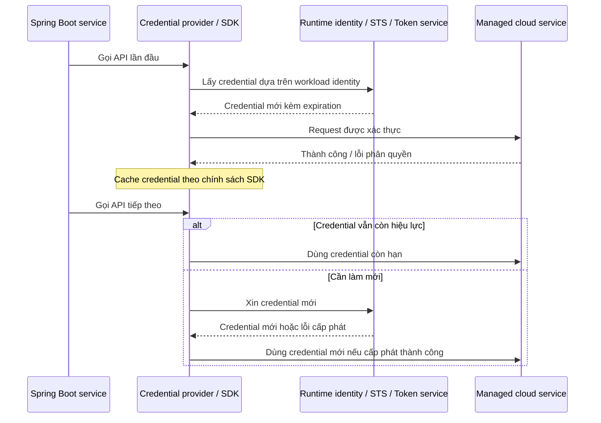
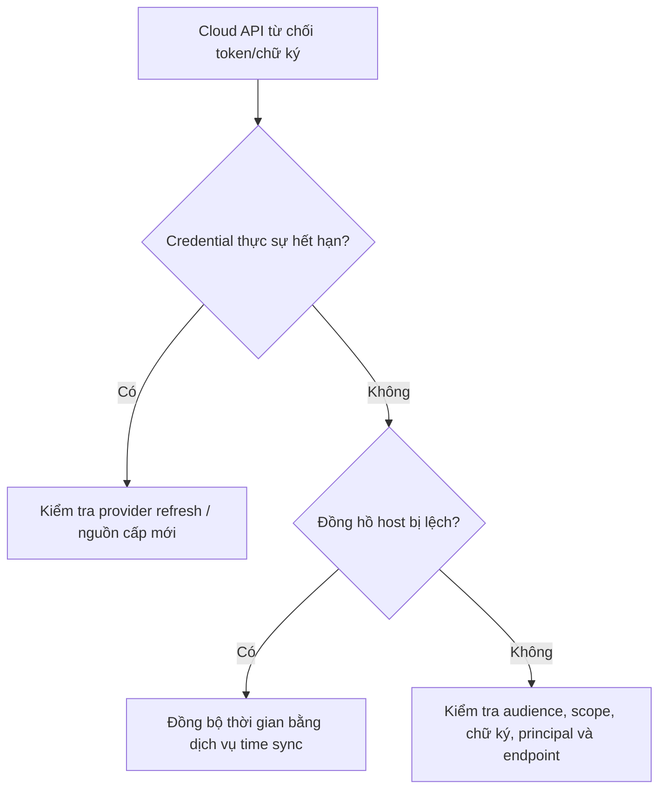

# Hết hạn token, làm mới thông tin xác thực và thời gian hệ thống

Một dịch vụ Spring Boot có thể upload hóa đơn lên Amazon S3 ngay sau khi khởi động, nhưng vài giờ sau bắt đầu trả lỗi xác thực. Một workload khác lấy được access token từ Microsoft Entra ID khi deploy Azure App Service, song thất bại sau khi chạy lâu. Trên Google Cloud, ứng dụng sử dụng service account hoặc Application Default Credentials (ADC) vẫn có thể ngừng hoạt động nếu không làm mới token đúng cách. Những lỗi này đặt ra ba câu hỏi: **credential có thời hạn đến đâu, ai chịu trách nhiệm làm mới và đồng hồ hệ thống có chính xác hay không?**

Bài học thuộc chương **Danh tính và quyền** của module **SPRING_CLOUD_PROVIDER_INTEGRATION**. Khi tích hợp Spring Boot với dịch vụ managed của **AWS, Azure và Google Cloud** bằng các thư viện Spring Cloud tương ứng, chúng ta cần xử lý đúng vòng đời xác thực cho storage, messaging, dữ liệu và secret manager. Thiết kế tốt cho phép workload chạy lâu dài bằng credential ngắn hạn mà không phải đưa access key, client secret, token hoặc khóa JSON vào mã nguồn và không phải khởi động lại ứng dụng mỗi khi token hết hạn.

## 1. Mục tiêu học tập

Sau bài này, bạn có thể:

- Giải thích **thời điểm phát hành, thời điểm bắt đầu hiệu lực, thời điểm hết hạn, thời gian còn lại** của token/credential, và tác động của **clock skew**.
- Phân biệt **credential có thể được làm mới**, **access token đã phát hành**, **OIDC ID token**, **AWS STS temporary credentials** và **quyền IAM/RBAC**.
- Hiểu cách AWS SDK for Java 2.x, Azure Identity for Java và Google Auth Library/ADC lấy và làm mới credential trong ứng dụng Spring Boot.
- Tránh những lỗi như cache một access token trong biến `static`, sao chép STS session vào `application.yml` hoặc giả định SDK sẽ tự chuyển danh tính sau lỗi `403`.
- Nhận biết lỗi thời gian hệ thống so với lỗi thiếu quyền, sai audience/scope, mất metadata endpoint và token bị thu hồi.
- Thiết kế phép thử dùng đồng hồ giả lập và kiểm thử tích hợp có kiểm soát, đồng thời ghi log chẩn đoán mà không làm lộ credential.

## 2. Những mốc thời gian quan trọng

Một credential ngắn hạn chỉ hợp lệ trong một khoảng thời gian. Các định dạng sử dụng thông tin thời gian khác nhau, nhưng các khái niệm chung gồm:

| Thuộc tính | Ý nghĩa | Nơi thường gặp |
| --- | --- | --- |
| **Issued at (`iat`)** | Thời điểm bên phát hành tạo token | Claim trong JWT |
| **Not before (`nbf`)** | Trước thời điểm này token chưa được chấp nhận, nếu có claim | JWT/OIDC token |
| **Expiration (`exp`)** | Từ mốc này token hết hiệu lực theo quy tắc xác minh | JWT/OIDC token |
| **ExpiresAt / Expiration** | Thời điểm credential/access token hết hiệu lực, đôi khi là metadata trả về ngoài token | `AccessToken` của Azure Identity, `Credentials` của AWS STS |
| **Time to live (TTL)** | Khoảng thời gian còn lại trước khi credential hết hạn | Giá trị suy từ expiration và thời gian hiện tại |
| **Refresh window / safety margin** | Khoảng đệm để lấy token mới trước khi token cũ hết hạn | Chiến lược cache/refresh của thư viện |
| **Clock skew** | Độ lệch giữa đồng hồ hệ thống bên gửi và đồng hồ bên kiểm tra | AWS request signing, JWT validation, token issuance |

Với JWT, các claim `iat`, `nbf` và `exp` thường là **NumericDate**: số giây theo mốc Unix epoch, về bản chất không phụ thuộc múi giờ hiển thị của máy. Đồng hồ chạy lệch mới là vấn đề; việc developer sử dụng múi giờ Việt Nam và cloud hiển thị UTC **không phải lỗi** nếu hai hệ thống cùng chỉ đúng một thời điểm tuyệt đối.

Một sơ đồ thời gian minh họa:

```text
Thời gian (UTC)  ---------------------------------------------------->
               t0              t1              t2              t3
               |               |               |               |
            phát hành       bắt đầu         nên refresh       hết hạn
            iat             hiệu lực        trước hạn        exp

            |<-------------------- khoảng hợp lệ ------------------->|
                                                |<-- đệm an toàn -->|
```

**Làm mới trước hạn** giúp tránh request đang thực hiện bị gián đoạn khi token hết hiệu lực. Khoảng đệm thực tế tùy SDK, loại token, thời lượng request và độ trễ mạng; không có một giá trị “luôn làm mới trước 5 phút” áp dụng cho mọi cloud. Với một số provider, client thư viện đã có refresh policy riêng và chúng ta không nên tự ghi đè nó tùy tiện.

### 2.1. Token đã hết hạn có thể làm mới trực tiếp không?

Cần phân biệt **làm mới một credential** với **kéo dài chính access token cũ**:

- OAuth access token đã phát hành thường **không được gia hạn tại chỗ**. Credential provider có thể lấy một **access token mới** bằng managed identity, refresh token, federation hoặc một bằng chứng danh tính mới.
- AWS STS session credentials đã hết hạn không được kéo dài bằng cách chỉnh `Expiration`; provider phải **nhận một bộ temporary credentials mới** thông qua role/metadata/STS.
- Một OIDC ID token dành cho lần chạy CI/Kubernetes thường có thời hạn ngắn. Token exchange hoặc projected token phải đáp ứng trust và audience; nếu nguồn token không còn hợp lệ, cloud không thể phát hành credential mới chỉ vì ứng dụng muốn refresh.
- Một IAM role, Azure managed identity hoặc Google service account có thể vẫn tồn tại lâu dài khi token của **phiên hiện tại** đã hết hạn. Danh tính và quyền là cấu hình riêng với vòng đời credential.

## 3. Vòng đời credential trong một ứng dụng chạy liên tục



Đối với sản phẩm chạy trên ECS/EKS/EC2, Azure App Service/AKS hoặc Cloud Run/GKE, những thành phần chủ yếu:

1. **Danh tính gắn runtime:** IAM role, managed identity, service account hoặc workload identity federation.
2. **Nguồn cấp credential:** endpoint metadata/container, STS, Microsoft Entra token endpoint hoặc Google token service tùy nền tảng.
3. **Provider quản lý cache/refresh:** Java SDK hoặc thư viện Identity/Auth. Một client được tạo và dùng lâu dài có thể lấy credential mới qua provider mà không cần tạo lại cả client.
4. **IAM/RBAC trên resource:** mỗi request vẫn phải được cấp quyền trên S3, Blob Storage, Cloud Storage, queue/topic, database hay secret đích.

### 3.1. Những tình huống không thể tự chữa bằng refresh

| Tình huống | Refresh có thể giúp? | Việc cần làm |
| --- | --- | --- |
| Token hết hạn nhưng provider vẫn truy cập được nguồn danh tính | **Có**, nếu SDK được cấu hình đúng | Để provider lấy credential mới |
| Metadata endpoint hoặc token service không liên lạc được | Không, cho tới khi kết nối được khôi phục | Kiểm tra mạng, DNS, endpoint, workload binding, retry phù hợp |
| Workload identity bị gỡ hoặc federated trust không còn hợp lệ | Không | Sửa cơ chế cấp danh tính/trust theo thiết kế |
| Credential còn hạn nhưng principal thiếu quyền `PutObject` | Không | Kiểm tra IAM/RBAC, operation, resource và điều kiện |
| Token được cấp cho audience/scope khác API đích | Lấy lại đúng loại token mới giúp, nhưng lặp lại token sai thì không | Kiểm tra request scope/resource và cấu hình client |
| Đồng hồ host nhanh/chậm đáng kể | Không bền vững | Khôi phục đồng bộ thời gian; dùng provider chuẩn |
| Ứng dụng cache bản sao access token thủ công | Chưa chắc | Loại cache thủ công; dùng credential provider có refresh |

**Quy tắc quan trọng:** một request cloud trả `403` vì quyền không khiến credential chain tự động chuyển sang danh tính khác. Thay đổi principal khi gặp lỗi sẽ làm hành vi ứng dụng khó dự đoán và có thể che khuất việc cấu hình quyền sai.

## 4. AWS: STS temporary credentials, SigV4 và đồng hồ

### 4.1. AWS có những thời hạn nào?

AWS SDK for Java 2.x có thể nhận credential từ môi trường, shared profile, IAM Identity Center, web identity, ECS task role hoặc EC2 instance profile, tùy cấu hình của workload. Với **IAM role**, SDK thường sử dụng temporary credentials gồm:

```text
AccessKeyId      : định danh access key tạm thời
SecretAccessKey  : bí mật dùng để ký request
SessionToken     : token phiên bắt buộc khi credential tạm thời
Expiration       : thời điểm credential phiên hết hạn
```

SDK ký các lời gọi dịch vụ như S3, SQS bằng **AWS Signature Version 4 (SigV4)**. Đây không phải OAuth bearer access token. Chữ ký chứa thông tin thời gian của request (chẳng hạn `x-amz-date` khi áp dụng); dịch vụ AWS kiểm tra chữ ký và cửa sổ thời gian hợp lệ để hạn chế replay. **Đồng hồ hệ thống lệch** có thể khiến chữ ký bị từ chối dù access key/session token chưa hết hạn.

Ví dụ hai vấn đề độc lập:

- **Session credential đã hết hạn:** request có thể bị từ chối với lỗi như `ExpiredToken`; cần provider lấy credentials mới.
- **Thời gian ký request lệch đáng kể:** có thể gặp `RequestTimeTooSkewed`, `RequestExpired`, `SignatureDoesNotMatch` hoặc lỗi tương tự tùy dịch vụ và cách ký. Cần kiểm tra thời gian hệ thống, region/endpoint và cách tạo chữ ký; không chỉ tạo role mới.

Tên và mã lỗi thay đổi theo API; không thể dựa duy nhất vào HTTP `403` để kết luận lớp nào sai.

### 4.2. Dùng DefaultCredentialsProvider trong Spring Boot

Ví dụ tạo **provider dùng chung** cho các AWS client trong cùng workload:

```java
@Configuration
public class AwsIdentityConfiguration {

    @Bean
    AwsCredentialsProvider awsCredentialsProvider() {
        return DefaultCredentialsProvider.create();
    }

    @Bean
    S3Client s3Client(
            AwsCredentialsProvider credentialsProvider,
            @Value("${app.aws.region}") String region) {

        return S3Client.builder()
                .region(Region.of(region))
                .credentialsProvider(credentialsProvider)
                .build();
    }

    @Bean
    SqsClient sqsClient(
            AwsCredentialsProvider credentialsProvider,
            @Value("${app.aws.region}") String region) {

        return SqsClient.builder()
                .region(Region.of(region))
                .credentialsProvider(credentialsProvider)
                .build();
    }
}
```

Với IAM role do ECS/EKS/EC2 cấp và default chain không bị nguồn khác lấn át, provider có thể lấy và làm mới credentials theo cách SDK hỗ trợ. Tùy nguồn credential, quy tắc refresh và cấu hình cache khác nhau. Đoạn mã không cài cặp key bí mật trong Spring config.

Nếu đã sử dụng Spring Cloud AWS starter có tự cấu hình client/provider, nên kiểm tra cơ chế đó của phiên bản starter đang dùng trước khi tạo bean riêng. Mục tiêu là **client nhận một provider có khả năng làm mới**, chứ không lấy bộ key tạm thời một lần rồi tự đóng gói thành thông tin xác thực cố định.

**Ví dụ sai:**

```java
// Không nên dùng với thông tin xác thực có thời hạn.
// Chỉ lấy một snapshot credential rồi dùng mãi.
AwsCredentials snapshot = DefaultCredentialsProvider.create()
        .resolveCredentials();

AwsCredentialsProvider frozen = StaticCredentialsProvider.create(snapshot);

S3Client client = S3Client.builder()
        .region(Region.AP_SOUTHEAST_1)
        .credentialsProvider(frozen)
        .build();
```

`StaticCredentialsProvider` giữ nguyên credential mà nó nhận lúc tạo. Khi snapshot là session credential của role, provider này **không tự quay về ECS/STS để lấy phiên mới**. Một client có thể chạy được ban đầu rồi thất bại khi session token hết hạn. Cũng không nên chuyển `AccessKeyId`, `SecretAccessKey` và `SessionToken` từ STS thành environment variables cố định để ứng dụng dùng nhiều ngày.

### 4.3. AssumeRole: để credential provider quản lý phiên mới

Khi `invoice-service` ở account A phải assume role ở account B, sử dụng `StsAssumeRoleCredentialsProvider` thay vì gọi `sts.assumeRole(...)` một lần rồi cache bộ kết quả mãi:

```java
@Bean
StsAssumeRoleCredentialsProvider archiveRoleCredentials(
        StsClient stsClient,
        @Value("${app.aws.archive-role-arn}") String roleArn) {

    return StsAssumeRoleCredentialsProvider.builder()
            .stsClient(stsClient)
            .refreshRequest(AssumeRoleRequest.builder()
                    .roleArn(roleArn)
                    .roleSessionName("invoice-archive-service")
                    .build())
            .build();
}

@Bean
S3Client archiveS3Client(
        StsAssumeRoleCredentialsProvider archiveRoleCredentials,
        @Value("${app.aws.region}") String region) {

    return S3Client.builder()
            .region(Region.of(region))
            .credentialsProvider(archiveRoleCredentials)
            .build();
}
```

Giả định `StsClient` đã được cấu hình để lấy credential **nguồn** của workload. `StsAssumeRoleCredentialsProvider` có cơ chế cache và làm mới role session, đồng thời tuân thủ vòng đời cấp phát do STS quy định. Trong triển khai thật cần quản lý đóng provider và STS client khi application context đóng, cấu hình role ARN trong môi trường, và tránh sử dụng nhầm credential role B cho client cần role A.

**Refresh không chữa được sai trust:** nếu role nguồn mất quyền `sts:AssumeRole` hoặc trust policy role đích từ chối, việc xin phiên mới sẽ thất bại. Nếu STS thành công nhưng S3 B vẫn báo `AccessDenied`, phải kiểm tra permission của role B, bucket policy và KMS.

### 4.4. Đặc thù local và CI/CD

- Với AWS IAM Identity Center, profile local thường có thời hạn đăng nhập. Khi phiên SSO cần đăng nhập lại, chạy `aws sso login --profile team-dev` theo quy trình developer; không thay bằng access key dài hạn.
- Với GitHub Actions OIDC, job xin ID token rồi STS cấp role credentials tạm thời. Mỗi job/workflow phải tự lấy thông tin xác thực theo trust đã cấu hình; không xuất credential của CI sang Docker image của ứng dụng.
- Với ECS/EKS/EC2, ứng dụng nên dựa trên credential do runtime cấp. Java system properties hoặc environment access keys có thể được ưu tiên trước role runtime, khiến toàn bộ cơ chế refresh hoạt động theo nguồn **không mong muốn**.

## 5. Azure: access token Entra ID và TokenCredential

### 5.1. Thời hạn của access token khác vòng đời managed identity

Azure App Service hoặc VM có thể được gắn **managed identity**; AKS có thể sử dụng **Microsoft Entra Workload ID** để đổi projected token của Pod. Danh tính này được quản lý độc lập với từng **OAuth 2.0 access token** mà ứng dụng nhận khi gọi dịch vụ Azure.

Một `AccessToken` trong Azure Identity SDK biểu diễn token và **thời điểm hết hạn**. Client đích thường yêu cầu token cho **đúng resource scope/audience**, ví dụ:

| Dịch vụ | Scope điển hình |
| --- | --- |
| Azure Blob Storage | `https://storage.azure.com/.default` |
| Azure Service Bus | `https://servicebus.azure.net/.default` |
| Azure Key Vault | `https://vault.azure.net/.default` |

Token dùng cho một audience không thể coi là token chung cho mọi Azure service. Token hết hạn là vấn đề **thời gian**; thiếu role dữ liệu hoặc sai scope là vấn đề **quyền/cấu hình token**. Ví dụ, managed identity lấy được token cho Blob nhưng chưa có `Storage Blob Data Contributor` hoặc custom data role tại container đích thì upload vẫn có thể bị từ chối.

### 5.2. Để Azure Identity và client library phối hợp refresh

```java
@Configuration
public class AzureIdentityConfiguration {

    @Bean
    TokenCredential azureTokenCredential() {
        return new DefaultAzureCredentialBuilder().build();
    }

    @Bean
    BlobServiceClient blobServiceClient(
            TokenCredential azureTokenCredential,
            @Value("${app.azure.blob-endpoint}") String endpoint) {

        return new BlobServiceClientBuilder()
                .endpoint(endpoint)
                .credential(azureTokenCredential)
                .buildClient();
    }
}
```

Client được truyền một **`TokenCredential`**, thay vì giá trị chuỗi token đã lấy từ trước. Azure SDK/Identity có thể lấy token theo yêu cầu của dịch vụ và quản lý các hành vi cache, refresh theo thư viện/phiên bản. Nếu dùng Spring Cloud Azure starter, kiểm tra client và credential đã được starter tự tạo, bảo đảm không vô tình xây hai chuỗi credential khác nhau trong cùng ứng dụng.

**Mẫu sai:**

```java
// Minh họa anti-pattern: lấy token một lần rồi truyền chuỗi cố định.
// String token = tokenCredential.getToken(requestContext).block().getToken();
// customHttpClient.setAuthorizationHeader("Bearer " + token);
// ... tiếp tục tái sử dụng token này trong nhiều giờ mà không xin token mới ...
```

Ngay cả khi token lúc khởi động còn hạn, việc đặt token vào một header cố định cho client HTTP tự viết sẽ khiến request thất bại khi hết hạn. Nếu thực sự cần HTTP client riêng, phải có bộ cấp token có cache/refresh an toàn, yêu cầu đúng scope cho từng dịch vụ và không ghi token vào log. Với Azure Blob/Service Bus/Key Vault, ưu tiên client library chính thức và `TokenCredential`.

### 5.3. DefaultAzureCredential có thể dùng nguồn nào?

Ở local, `DefaultAzureCredential` có thể lấy token từ đăng nhập developer thông qua các công cụ được hỗ trợ; trên cloud có thể chọn environment, workload identity hoặc managed identity. **Thứ tự và hành vi fallback phụ thuộc phiên bản `azure-identity`**.

Hết hạn token của một nguồn có thể được SDK xử lý bằng refresh. Nhưng các lỗi sau cần xem riêng:

- **Managed identity chưa bật hoặc sai client ID:** không thể đổi thành access token vì principal nguồn không hợp lệ.
- **Pod AKS sai federated token/tenant/client ID:** token exchange bị từ chối; tăng RBAC storage không sửa được.
- **Developer credential cần đăng nhập tương tác lại:** local có thể yêu cầu chạy `az login` hoặc công cụ phù hợp; không dựa vào phiên developer cho production.
- **Cấu hình environment service principal có secret hết hạn:** một nguồn ưu tiên cao có thể được chọn hoặc gây lỗi trước managed identity tùy chain. Loại bỏ credential không chủ đích và dùng identity runtime theo thiết kế.
- **Role assignment mới có độ trễ lan truyền:** có token hợp lệ nhưng request `403`; chờ khả năng đồng bộ quyền theo cơ chế dịch vụ và kiểm tra principal/scope, không phát hành secret mới để xử lý sai lớp.

Không log raw access token hoặc refresh token của developer. Khi cần xác minh hạn dùng, dùng metadata `expiresAt` trong môi trường chẩn đoán được kiểm soát, tránh phát tán chính chuỗi token.

## 6. Google Cloud: ADC, refresh token và metadata

### 6.1. ADC tìm nguồn danh tính, provider làm mới token

Google Cloud Java client library sử dụng **Application Default Credentials (ADC)**. Nguồn phổ biến theo thứ tự là:

1. File mà `GOOGLE_APPLICATION_CREDENTIALS` trỏ tới, có thể là cấu hình federation hoặc service account; tránh file khóa riêng JSON dài hạn.
2. File ADC local được tạo bằng `gcloud auth application-default login`.
3. Metadata của môi trường Google Cloud, như Cloud Run, Compute Engine hoặc GKE theo cơ chế danh tính đã cấu hình.

Nguồn được chọn quyết định **principal**. Việc làm mới access token phải theo nguồn đó, không tự chuyển sang service account khác khi gọi Cloud Storage trả `403`.

Trong local development, ADC có thể dựa trên authorized-user credential và refresh token do quy trình đăng nhập developer cấp. Refresh token này có vòng đời/quy tắc thu hồi riêng; nếu không còn hợp lệ, developer cần đăng nhập lại theo chính sách. Trên Cloud Run/GCE/GKE, metadata hoặc workload federation hỗ trợ lấy credential ngắn hạn không cần phát hành private key JSON cho workload.

### 6.2. Java client sử dụng GoogleCredentials thay vì giữ token thủ công

```java
@Configuration
public class GoogleStorageConfiguration {

    @Bean
    Storage storage(
            @Value("${app.gcp.project-id}") String projectId) throws IOException {

        GoogleCredentials credentials =
                GoogleCredentials.getApplicationDefault();

        return StorageOptions.newBuilder()
                .setProjectId(projectId)
                .setCredentials(credentials)
                .build()
                .getService();
    }
}
```

Ví dụ cần Google Cloud Storage Java client và Google Auth Library tương ứng. Client dùng credential object, cho phép thư viện quản lý token/cấp phát theo cơ chế được hỗ trợ. Khi Spring Cloud GCP starter tự cấu hình client, cần xác định property credential và project thực tế trước khi thay thế bean.

**Điều không nên làm:**

```java
// Anti-pattern: lấy một AccessToken rồi cache chuỗi token mãi.
GoogleCredentials adc = GoogleCredentials.getApplicationDefault();
adc.refreshIfExpired();
String frozenAccessToken = adc.getAccessToken().getTokenValue();

// frozenAccessToken sẽ trở thành token cũ khi hết hạn.
// Không lưu biến này vào application.yml, DB hoặc cache lâu dài.
```

Dùng `refreshIfExpired()` của credential object không sai khi cần lấy token trong trường hợp đặc biệt, nhưng sao chép một **chuỗi access token** rồi dùng mãi lại làm mất khả năng refresh của provider. Nếu gọi API bằng thư viện chính thức, hãy truyền credential object vào client.

### 6.3. Federation và lỗi liên quan đến thời gian

Với Workload Identity Federation (CI bên ngoài GCP hoặc GKE), bộ phát hành OIDC token phải cung cấp token hợp lệ với **issuer, audience, subject, thời hạn và chữ ký** phù hợp cấu hình của bên nhận. Một JWT bị hết hạn, chưa có hiệu lực vì đồng hồ lệch hoặc có `iat` không hợp lý có thể bị từ chối ở bước **token exchange**, trước khi Java client chạm tới Cloud Storage.

Nếu request Cloud Storage vẫn báo `PermissionDenied` sau khi ADC lấy được token hợp lệ, cần kiểm tra IAM của service account/federated principal trên bucket đích và các giới hạn như IAM Deny hoặc VPC Service Controls; **lỗi đó không nhất thiết là lỗi refresh**. Đồng thời, đổi `GOOGLE_CLOUD_PROJECT` không thay principal đang dùng ADC.

## 7. So sánh chu trình làm mới của ba cloud

| Khía cạnh | AWS | Azure | Google Cloud |
| --- | --- | --- | --- |
| Credential API thường dùng | Bộ AWS temporary credentials; ký SigV4 | OAuth access token Microsoft Entra ID | OAuth access token từ Google Auth/ADC |
| Danh tính workload điển hình | ECS task role, EKS IRSA/Pod Identity, EC2 instance profile | Managed identity, AKS Workload Identity | Service account runtime, GKE Workload Identity Federation |
| Nguồn token/credential | STS, container/instance metadata, federation | Azure Identity với Entra/managed identity endpoint | ADC với local credential, metadata hoặc external account |
| Cách SDK nhận mới | `AwsCredentialsProvider` / `StsAssumeRoleCredentialsProvider` và nguồn hỗ trợ refresh | `TokenCredential`, Azure client library, cache/refresh theo phiên bản | `GoogleCredentials` và client library, refresh dựa theo ADC source |
| Lỗi thời gian điển hình | Expired session, thời gian ký SigV4 lệch | Expired/not-yet-valid token, assertion/federation time mismatch | Expired access token, federation JWT time mismatch |
| Lỗi không được chữa bằng refresh | Role thiếu permission, trust sai, bucket deny | Data role/scope sai, tenant hoặc audience sai | Bucket IAM binding sai, org policy/VPC SC chặn |
| Cần tránh | `StaticCredentialsProvider` chứa snapshot role credential | Bearer token cố định trong HTTP header | `String` access token cố định, service account key dài hạn |

Sự khác nhau quan trọng: **AWS SDK không gửi OAuth bearer token để gọi S3**, còn Azure/GCP thường dùng OAuth access token để gọi API. Dù thế, cách thiết kế ứng dụng tương tự: đưa **provider có khả năng lấy credential mới** cho cloud client và phân quyền tối thiểu cho principal.

## 8. Thời gian hệ thống: UTC, clock skew và chữ ký yêu cầu

### 8.1. Múi giờ hiển thị không phải độ lệch đồng hồ

Trong Java, thời gian có các khái niệm cần phân biệt:

- `Instant.now()` biểu diễn thời điểm tuyệt đối theo UTC/epoch.
- `ZonedDateTime.now(ZoneId.of("Asia/Ho_Chi_Minh"))` hiển thị thời điểm theo múi giờ Việt Nam.
- `OffsetDateTime` chứa thông tin offset, hữu ích để biểu diễn thời hạn token.
- **Clock skew** là khi máy gửi hoặc máy cấp token có thời gian thực tế nhanh/chậm so với thời gian chuẩn, dù chúng có cùng múi giờ hiển thị hay không.

Hai máy có thể hiển thị `16:00+07:00` và `09:00Z` cùng một thời điểm, hoàn toàn đúng. Nhưng nếu một máy thực tế nhanh 12 phút, request SigV4 hoặc JWT validation có thể bị từ chối.



### 8.2. Các thành phần cần đồng bộ thời gian

| Nơi chạy | Điều cần lưu ý |
| --- | --- |
| Laptop/desktop developer | Hệ điều hành cần đồng bộ thời gian; tắt đồng bộ hoặc chỉnh tay có thể gây lỗi CLI/SDK |
| VM/EC2/Compute Engine | Dùng dịch vụ đồng bộ thời gian được nhà cung cấp/hệ điều hành hỗ trợ, theo chính sách hạ tầng |
| Docker/Kubernetes | Container thường sử dụng đồng hồ kernel của host/node; đổi biến `TZ` chỉ ảnh hưởng hiển thị, không sửa đồng hồ host lệch |
| CI runner | Node/VM runner phải đồng bộ thời gian để OIDC token và chữ ký cloud hợp lệ |
| OAuth/OIDC issuer hoặc hệ thống nội bộ | Đồng hồ và thời gian phát hành phải chính xác; `nbf`/`iat` quá xa hiện tại có thể làm token exchange bị từ chối |

Cần tìm ra **host thực** chứa tiến trình. Với Kubernetes, kiểm tra node chạy Pod trước khi cố sửa thời gian bằng lệnh bên trong container. Nên dùng nguồn đồng bộ thời gian như NTP/chrony hoặc dịch vụ đồng bộ được cloud cung cấp, có giám sát drift. Không tắt kiểm tra `exp`, kéo dài tolerance tùy tiện hoặc sửa giờ sản xuất thủ công để chữa lỗi xác thực.

Một số lệnh kiểm tra trạng thái đồng hồ (tùy OS/công cụ đã cài):

```bash
# Linux: kiểm tra trạng thái đồng bộ; không chỉnh đồng hồ.
timedatectl status

# Linux với chrony:
chronyc tracking

# Hiển thị UTC để đối chiếu trong log:
date -u
```

```powershell
# Windows: trạng thái Windows Time Service
w32tm /query /status

# Hiển thị giờ UTC trong PowerShell
(Get-Date).ToUniversalTime().ToString("o")
```

Các lệnh trên chỉ hỗ trợ quan sát. Một container tối giản có thể không có `timedatectl` hay `chronyc`; thao tác kiểm tra đồng bộ nên thực hiện ở host/node hoặc hệ thống giám sát hạ tầng.

### 8.3. Kiểm soát thời gian trong mã Java

Với nghiệp vụ cần so sánh thời hạn (ví dụ token nội bộ hoặc TTL cache do ứng dụng sở hữu), hãy dùng `java.time.Clock` để test deterministic thay vì sửa đồng hồ thật:

```java
public final class ExpirationPolicy {
    private final Clock clock;
    private final Duration safetyMargin;

    public ExpirationPolicy(Clock clock, Duration safetyMargin) {
        this.clock = clock;
        this.safetyMargin = safetyMargin;
    }

    public boolean needsRefresh(Instant expiresAt) {
        // Đệm trước hạn: khi tới ngưỡng này, có thể yêu cầu token mới.
        Instant threshold = expiresAt.minus(safetyMargin);
        return !clock.instant().isBefore(threshold);
    }
}
```

**Đây là ví dụ kiểm thử logic thời gian do ứng dụng tự quản lý, không phải khuyến nghị tự viết lại cơ chế refresh của AWS/Azure/GCP SDK.** Các SDK cloud có chính sách cache, backoff và refresh riêng. Trong production, ưu tiên dùng chính credential provider của SDK, không chèn một `Clock` giả vào toàn bộ thư viện để chạy thực tế.

Ví dụ unit test không phải đợi token thật hết hạn:

```java
@Test
void refreshesBeforeExpirationThreshold() {
    Instant now = Instant.parse("2026-11-24T09:00:00Z");
    Clock clock = Clock.fixed(now, ZoneOffset.UTC);
    ExpirationPolicy policy =
            new ExpirationPolicy(clock, Duration.ofMinutes(2));

    // Còn một phút: đã nằm trong khoảng đệm hai phút.
    assertTrue(policy.needsRefresh(now.plus(Duration.ofMinutes(1))));

    // Còn mười phút: chưa cần refresh.
    assertFalse(policy.needsRefresh(now.plus(Duration.ofMinutes(10))));
}
```

Không cần truyền `Clock` giả vào toàn bộ Spring Boot context nếu chỉ muốn kiểm tra toán học thời gian ở một service. Đối với credential SDK, dùng fake provider/HTTP stub theo đúng hợp đồng thư viện ở unit test; với integration test, xác minh nguồn credential thực tế trong môi trường test đã cách ly.

## 9. Chẩn đoán: lỗi hết hạn, lỗi đồng hồ hay thiếu quyền?

Quy trình nên bắt đầu từ **loại credential và principal thực tế**:

1. Xác định client đang sử dụng **nguồn credential nào**: AWS profile/role/STS, Azure developer credential/managed identity hoặc GCP ADC/federation.
2. Xác minh **credential còn hạn** theo metadata có sẵn, không in token/secret. Nếu thiếu credential, xem provider chain và đường cấp token.
3. Kiểm tra **thời gian UTC/clock drift** của host/node nếu lỗi nói về thời gian ký, `iat`, `nbf`, `exp` hoặc assertion không hợp lệ.
4. Kiểm tra **scope/audience và principal**. Với Azure/GCP, token có thể còn hạn nhưng cấp cho dịch vụ khác; với AWS, request có thể bị ký sai region/endpoint.
5. Kiểm tra **IAM/RBAC** nếu credential hợp lệ nhưng API trả từ chối. Phân biệt lỗi giao dịch token với lỗi quyền tài nguyên.
6. Đối chiếu **logs và request ID** từ SDK/cloud service; thử lại trong môi trường test sau khi sửa nguyên nhân, không phát hành credential dài hạn để lách vấn đề.

| Triệu chứng | Nguyên nhân cần ưu tiên kiểm tra | Hướng xử lý |
| --- | --- | --- |
| AWS request hoạt động ban đầu, sau đó `ExpiredToken` | Bộ STS credentials đã hết hạn; code cache snapshot; provider không refresh được | Dùng provider có refresh, kiểm tra STS/metadata endpoint và role trust |
| AWS `RequestTimeTooSkewed`, `RequestExpired` hoặc chữ ký liên quan thời gian | Clock của host sai hoặc timestamp ký request ngoài cửa sổ chấp nhận | Kiểm tra UTC/NTP/chrony, region/endpoint và cách ký |
| AWS `AccessDenied` liên tục dù credential mới | IAM role/bucket policy/KMS thiếu permission hoặc bị deny | Xác minh role session và resource/action, không chỉ refresh |
| Azure SDK không xin được access token managed identity | Endpoint, client ID, tenant, workload federation hoặc mạng cấu hình sai | Kiểm tra nguồn token qua Azure Identity logs (đã lọc secret) |
| Azure access token hợp lệ nhưng Blob `403` | Thiếu data role trên scope, token audience hoặc điều kiện mạng | Kiểm tra principal, tenant, `https://storage.azure.com/.default`, role assignment |
| Google Cloud `invalid_grant` hoặc lỗi JWT thời gian ở token exchange | Assertion hết hạn, `iat/nbf/exp` sai, clock skew hoặc federation không hợp lệ | Kiểm tra nguồn OIDC, thời gian host và provider trust |
| Google Cloud client không lấy được access token mới | ADC local/metadata/federation không còn hợp lệ hoặc endpoint không truy cập được | Xác minh ADC source; đăng nhập lại local nếu cần; sửa workload binding |
| Google Cloud `PermissionDenied` trên bucket | Sai IAM binding/service account, resource, org policy hoặc VPC SC | Kiểm tra principal trong audit và permission ở bucket |
| Bùng nhiều request lỗi đồng thời đúng lúc refresh | Token endpoint chậm/không khả dụng, nhiều luồng cùng refresh hoặc retry quá gắt | Sử dụng provider/cache chuẩn, backoff có giới hạn, quan sát số lần refresh |

**Lưu ý:** tên exception/error code chỉ là dấu hiệu hướng kiểm tra. Cùng mã HTTP `401` hoặc `403` có thể xuất hiện ở nhiều lớp tùy nhà cung cấp và API. Không phân loại nguyên nhân chỉ theo status; cần xem phần thông tin lỗi, request ID và ngữ cảnh thực tế.

## 10. Thiết kế chịu lỗi khi cấp token bị gián đoạn

Để một dịch vụ Spring Boot không gián đoạn đáng kể khi token service chậm hoặc metadata endpoint gặp lỗi ngắn hạn, cần xử lý đúng ở lớp client:

- **Tái sử dụng client/provider:** không tạo mới một client cloud hoặc chạy login/STS thủ công cho từng HTTP request của người dùng. Tận dụng cache/refresh đồng thời của SDK.
- **Timeout có giới hạn:** cấu hình timeout mạng cho cloud client phù hợp với SLA; không để mỗi lần làm mới credential treo vô hạn.
- **Retry với backoff và jitter:** dùng retry policy của SDK phù hợp khi lỗi tạm thời/rate limit; tránh retry vô hạn, retry ồ ạt hoặc retry `403` thiếu quyền.
- **Không cache token thô trong Redis/database:** một chuỗi bearer token lưu dài hạn có thể hết hạn, bị lộ hoặc dùng sai audience. Nếu cần lưu thông tin nghiệp vụ, lưu metadata không bí mật như thời điểm hết hạn do logic ứng dụng quản lý.
- **Giám sát tín hiệu:** theo dõi tỷ lệ lỗi credential acquisition/refresh, loại exception, thời gian còn lại (nếu lấy được an toàn), độ lệch đồng hồ và sức khỏe của metadata/token endpoint.
- **Không âm thầm đổi principal:** nếu role/managed identity hiện tại không thể refresh, để báo lỗi rõ ràng; không tự fallback sang account admin hoặc khóa tĩnh bất kỳ.
- **Tách hành động có thể retry:** upload object hoặc publish event có thể sinh tác dụng phụ. Khi retry business operation vì lỗi auth hoặc mạng, cần idempotency, precondition/object generation hoặc transaction/outbox phù hợp để tránh lặp dữ liệu.

### 10.1. Spring Boot config không chứa token

Một cấu hình minh họa chỉ chứa **tài nguyên đích** và các tham số triển khai:

```yaml
app:
  aws:
    region: ${AWS_REGION:ap-southeast-1}
  azure:
    blob-endpoint: ${AZURE_BLOB_ENDPOINT}
  gcp:
    project-id: ${GCP_PROJECT_ID}
  storage:
    target-name: ${INVOICE_STORAGE_TARGET}
```

Không đặt `AWS_SECRET_ACCESS_KEY`, `AZURE_CLIENT_SECRET`, `GOOGLE_APPLICATION_CREDENTIALS` trỏ tới file private key trong `application.yml`. Các giá trị nhạy cảm phải được quản lý bằng cơ chế danh tính/runtime hoặc secret manager đã kiểm soát khi thực sự cần. Cần lưu ý rằng project ID, bucket name và endpoint **không quyết định danh tính** mà credential provider sẽ chọn.

### 10.2. Log tối thiểu cho chẩn đoán

Dữ liệu thường có ích khi quan sát lỗi:

| Nên ghi theo chính sách bảo mật | Không được ghi |
| --- | --- |
| Tên service, môi trường, cloud provider, loại credential source | Raw access token, OIDC ID token, refresh token |
| Principal/role identifier đã được phép ghi, account/project/tenant | AWS secret access key, STS session token |
| Resource, operation, request ID, error code, thời điểm UTC | Client secret, private key, file service account JSON |
| Thống kê lỗi refresh, số lần retry, độ lệch đồng hồ đã đo | HTTP Authorization header, signed URL có chữ ký/token |
| Thời điểm hết hạn **dưới dạng metadata** nếu phù hợp và có kiểm soát | Toàn bộ thông điệp debug SDK chưa lọc dữ liệu nhạy cảm |

Log có thể hỗ trợ AWS CloudTrail, Azure diagnostics/Entra logs và Google Cloud Audit Logs. Cần đối chiếu **đúng workload** đang chạy, bởi một lệnh CLI trên laptop có thể dùng danh tính khác với JVM của ứng dụng.

## 11. Kiểm thử vòng đời credential mà không đợi sự cố production

Nên có cả **unit test logic thời gian** và **integration test xác thực thực tế**:

| Ca | Cách kiểm thử | Bằng chứng mong đợi |
| --- | --- | --- |
| A — Token còn hạn | Dùng fake provider hoặc test logic `Clock` gần thời điểm phát hành | Không refresh quá sớm ngoài chính sách |
| B — Sắp hết hạn | Đồng hồ giả ở mốc trước expiration trong khoảng đệm | Logic thuộc quyền ứng dụng yêu cầu token mới trước hạn |
| C — Hết hạn | Fake provider trả credential hết hạn hoặc lỗi token phù hợp với thư viện | Client/ứng dụng không tiếp tục dùng token cũ mãi |
| D — Refresh lỗi tạm thời | Mô phỏng token endpoint timeout, rate limit hoặc metadata không khả dụng | Error rõ ràng; retry có giới hạn; không đổi sang principal quyền rộng |
| E — Clock skew | Mô phỏng thời gian ký/assertion sai trong môi trường test cô lập | Phát hiện và chẩn đoán lỗi thời gian; không vô hiệu hóa xác thực |
| F — Đúng token nhưng thiếu quyền | Dùng runtime principal test có credential hợp lệ nhưng thiếu quyền storage | Bị từ chối; refresh liên tục không giúp |
| G — Sau khi deploy | Dùng workload identity trên môi trường cloud test, thử operation sau khi SDK đã phải refresh theo vòng đời tự nhiên hoặc điều kiện hỗ trợ | Vẫn dùng đúng principal; không cần restart/secret tĩnh |

**Giới hạn kiểm thử:** mock SDK có thể xác minh branch code, nhưng **không chứng minh** AWS STS, Azure managed identity hay GCP ADC thực sự cấp credential đúng. Cần ít nhất một integration test trên tài nguyên cloud test khi tính năng phụ thuộc vòng đời identity; tránh cố ý chỉnh đồng hồ node production hoặc cắt metadata endpoint của workload phục vụ khách hàng.

### Bài thực hành từng bước

**Bối cảnh:** `invoice-service` chạy dài hạn, cần tạo object và publish event bằng workload identity. Chọn **một provider chính** (AWS, Azure hoặc Google Cloud), rồi đối chiếu phương án tương đương ở hai provider còn lại.

1. **Tạo identity và scope test:** gắn role/managed identity/service account cho runtime; chỉ cấp quyền cần thiết trên một bucket/container và queue/topic test.
2. **Tạo SDK client qua provider:** dùng `DefaultCredentialsProvider`, `DefaultAzureCredential`/`ManagedIdentityCredential` hoặc ADC. Bảo đảm cùng client được tái sử dụng và không cất chuỗi token vào biến toàn cục.
3. **Gọi API lần đầu:** xác minh operation thành công và audit thể hiện đúng workload principal, không phải account developer/CI.
4. **Ghi nhận trạng thái credential:** khi khả thi, quan sát thời điểm hết hạn qua metadata đã được lọc; kiểm tra đồng hồ host ở UTC và trạng thái đồng bộ.
5. **Thử lỗi làm mới trong môi trường cách ly:** dùng fake provider hoặc workload test có cấu hình token source lỗi để xem exception, retry và log chẩn đoán. Không thay clock hay thu hồi role production.
6. **Thử quyền âm tính:** principal vẫn lấy được credential hợp lệ nhưng gọi một resource không được cấp quyền. Ghi nhận rằng lỗi phân quyền khác với lỗi hết hạn.
7. **Kiểm tra hoạt động dài hạn có kiểm soát:** trong test phù hợp, quan sát nhiều yêu cầu qua chu kỳ refresh của provider; đối chiếu principal trước và sau, bảo đảm không có token tĩnh.
8. **Báo cáo sự khác biệt ba cloud:** AWS STS và SigV4, Azure OAuth/Entra TokenCredential, Google OAuth/ADC; chỉ ra nơi kiểm tra thời hạn, nguồn làm mới và quyền tài nguyên.

Mẫu kết quả:

| Trường | Ghi nhận |
| --- | --- |
| Cloud/runtime | ECS/EKS/EC2, App Service/AKS hoặc Cloud Run/GKE |
| Principal đang dùng | Role/session, managed identity hoặc service account xác thực được |
| Credential source | STS/metadata, Azure Identity, ADC/federation |
| Hạn dùng / clock | Expiration metadata, thời điểm UTC của host, trạng thái đồng bộ |
| Thao tác hợp lệ | Request ID và outcome của storage/messaging |
| Lỗi làm mới có chủ đích | Exception, retry behavior, nguyên nhân đã mô phỏng |
| Lỗi thiếu quyền | Resource/operation bị từ chối, principal vẫn đúng |
| Bảo vệ secret | Không token/secret thô trong source, config, image hoặc log |

## 12. Câu hỏi tự kiểm tra

1. Vì sao **IAM role** hoặc **managed identity** có thể tiếp tục tồn tại sau khi credential/token một phiên đã hết hạn?
2. Tại sao việc lấy một bộ AWS STS credentials rồi đưa vào `StaticCredentialsProvider` có thể khiến ứng dụng thất bại sau vài giờ?
3. AWS SigV4 chịu ảnh hưởng của clock skew như thế nào? Vì sao đổi múi giờ hiển thị của JVM không sửa được đồng hồ host chạy lệch?
4. Với Azure Blob Storage, nếu access token còn hạn nhưng API trả `403`, cần kiểm tra những yếu tố nào trước khi quyết định refresh?
5. `gcloud auth login` và `gcloud auth application-default login` khác nhau thế nào đối với Google Cloud Java SDK và chu trình refresh?
6. Vì sao một token với audience `https://management.azure.com/` không tự dùng được cho Blob Storage data plane?
7. Khi OIDC token cho Workload Identity Federation có `nbf` nằm trong tương lai so với đồng hồ cloud, bạn sẽ xác minh gì?
8. Vì sao nên dùng provider có cache/refresh thay vì lưu chuỗi bearer token trong biến `static`?
9. Một service chỉ gặp lỗi khi chạy lâu dưới tải cao. Bạn sẽ phân biệt lỗi refresh đồng thời, token endpoint unavailable, sai clock và thiếu quyền như thế nào?
10. Trong integration test, làm sao kiểm tra vòng đời credential mà không phải chỉnh thời gian hoặc ngắt metadata endpoint của hệ thống production?

## 13. Ghi nhớ

**Hết hạn credential, làm mới token và thời gian hệ thống là ba phần của cùng một chu trình xác thực nhưng cần chẩn đoán riêng.** AWS role sessions dùng temporary credentials và SigV4; Azure Identity lấy access token Microsoft Entra cho đúng dịch vụ; Google Auth Library/ADC lấy access token dựa trên local identity hoặc workload identity. SDK chuẩn thường hỗ trợ cache/refresh, còn vai trò của Spring Boot là truyền **credential provider**, cấu hình đúng môi trường và không tự đóng băng token ở lần khởi động.

Dù một credential được làm mới thành công, **IAM/RBAC vẫn quyết định** nó có quyền trên storage, messaging, database hoặc secret manager hay không. Hãy đồng bộ đồng hồ host, theo dõi lỗi và hạn dùng một cách an toàn, kiểm thử cả token hết hạn lẫn thiếu quyền, sử dụng runtime identity thay cho khóa tĩnh và không ghi credential nhạy cảm vào log. Cách tiếp cận này giúp một ứng dụng Spring Boot chạy dài hạn đáng tin cậy trên cả AWS, Azure và Google Cloud.

