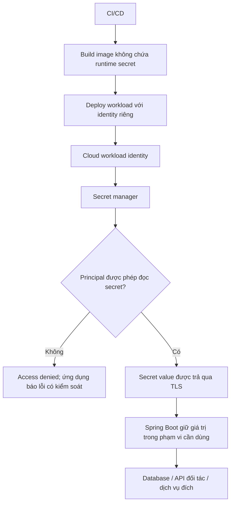
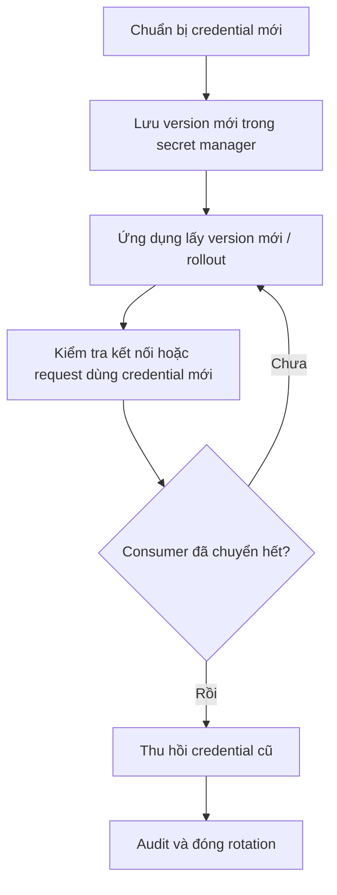

# Giữ khóa bí mật ngoài mã nguồn, ảnh container và nhật ký

Một ứng dụng Spring Boot thường cần mật khẩu database, API key của đối tác, signing key hoặc credential để gọi dịch vụ cloud. Đặt những giá trị này vào **application.yml**, commit file **.env**, truyền chúng qua Docker **ARG**, hay in toàn bộ cấu hình ra log có thể giúp chạy thử nhanh, nhưng tạo ra nhiều bản sao trong Git, build cache, image layer, CI artifact, terminal history và hệ thống quan sát. Xóa dòng cấu hình khỏi source sau đó **không thu hồi** credential đã bị lộ.

Bài thuộc chương **Danh tính và quyền** của module **SPRING_CLOUD_PROVIDER_INTEGRATION**. Khi tích hợp Spring Boot với dịch vụ managed của AWS, Azure và Google Cloud, chúng ta cần bảo vệ secret cho storage, messaging, database và dịch vụ bên ngoài. Mục tiêu là quản lý vòng đời secret ở một nơi được kiểm soát, cấp quyền đọc cho đúng workload, đưa secret vào ứng dụng khi cần, tránh để giá trị nhạy cảm đi qua mã nguồn/ảnh container/nhật ký và có quy trình xoay vòng khi credential thay đổi.

## 1. Mục tiêu học tập

Sau bài học, bạn có thể:

- Phân biệt **secret**, **configuration**, **identity credential** và **tên/định danh của secret**.
- Nhận diện các vị trí secret có thể bị lưu lại: Git history, build context, Docker image/layer, CI log, artifact, biến môi trường, heap dump và log ứng dụng.
- Thiết kế quy trình lấy secret từ **AWS Secrets Manager/SSM Parameter Store**, **Azure Key Vault** và **Google Cloud Secret Manager** bằng workload identity.
- Tích hợp Secret Manager client với Spring Boot mà không hardcode secret hoặc in giá trị ra log.
- Chọn cách đưa secret vào process: đọc trực tiếp từ secret manager, mount file, hoặc injection vào environment; đánh giá ưu/nhược điểm.
- Xoay vòng secret có kiểm soát, xử lý cache/connection pool và giảm thời gian ảnh hưởng khi lộ credential.
- Kiểm thử quyền được phép/bị từ chối và kiểm tra source, image, pipeline, log không chứa bí mật.

## 2. Secret là gì và khác cấu hình thông thường ra sao?

**Secret** là dữ liệu cần hạn chế người hoặc tiến trình được đọc vì nếu lộ có thể cho phép giả mạo, truy cập trái phép hoặc giải mã dữ liệu. Ví dụ:

- Mật khẩu database, API key của đối tác, OAuth client secret.
- Private key, certificate kèm private key, signing key, webhook signing secret.
- Access token, refresh token, AWS access key/secret/session token.
- Chuỗi kết nối có chứa username/password hoặc URL có query parameter ký request.
- Khóa mã hóa do ứng dụng quản lý và thông tin bootstrap có thể mở quyền đọc secret khác.

**Configuration** mô tả cách ứng dụng hoạt động, ví dụ tên bucket, region, endpoint, queue name, project ID, feature flag hoặc timeout. Một số cấu hình không bí mật có thể lưu trong YAML, biến môi trường hoặc hệ thống config. Tuy nhiên, một URL kết nối có chứa mật khẩu hoặc query parameter ký request phải được coi là secret.

| Dữ liệu | Ví dụ | Cách quản lý |
| --- | --- | --- |
| Cấu hình không bí mật | AWS_REGION, bucket name, queue URL, log level | Config theo môi trường |
| Định danh | IAM role ARN, managed identity client ID, service account email | Có thể lưu trong cấu hình triển khai; vẫn kiểm soát metadata theo chính sách tổ chức |
| Secret ứng dụng | DB password, partner API key, webhook secret | Secret manager hoặc cơ chế secret chuyên dụng; giới hạn principal đọc |
| Credential workload | AWS temporary credentials, OAuth access token, federated assertion | Để SDK/runtime identity quản lý; không lưu như cấu hình tĩnh |
| Dữ liệu nhạy cảm | Dữ liệu khách hàng, thông tin thanh toán, nội dung bí mật | Data governance, encryption, access control và retention riêng |

Một **secret identifier** như tên **prod/invoice/db-password** hoặc resource ID của Key Vault không nhất thiết là bí mật. Nhưng tên secret có thể tiết lộ cấu trúc hệ thống; chỉ công khai ở phạm vi cần thiết. **Không nhầm việc mã hóa secret với việc kiểm soát ai được phép giải mã.** Mã hóa at rest/in transit bảo vệ đường lưu/chuyển, còn IAM/RBAC quyết định principal nào được đọc giá trị.

## 3. Secret có thể rò rỉ ở đâu?

Secret không chỉ nằm trong source code. Một lần **COPY . .** hoặc **printenv** có thể đưa bí mật vào những nơi nhiều người và hệ thống khác có thể truy cập.

| Vị trí | Cách rò rỉ | Ví dụ cần tránh |
| --- | --- | --- |
| Source code | Commit key/password vào Java, YAML, properties hoặc script | Password production trong application-prod.yml |
| Git history | Xóa secret ở commit mới nhưng giá trị cũ vẫn nằm trong lịch sử | Commit file .env, sau đó chỉ xóa file ở commit tiếp |
| Build context | Docker gửi file không cần thiết đến builder | COPY toàn repository đưa .env, .aws/credentials, private key vào context |
| Dockerfile/image layer | ARG, ENV, COPY hoặc lệnh build lưu secret vào metadata/layer | ARG NPM_TOKEN, ENV DB_PASSWORD |
| Build cache | Bí mật nằm trong layer hoặc log của bước build | Xóa file ở layer sau nhưng layer trước vẫn chứa nội dung |
| CI/CD log | echo, shell tracing, in biến hoặc in response body | set -x, printenv, log lệnh curl có token |
| Artifact | Đóng gói config, test report hoặc file debug | Upload .env, heap dump, log chứa Authorization header |
| Runtime process | Environment, process arguments, mounted file hoặc heap dump bị người khác đọc | User trên host có thể đọc process env hoặc volume không giới hạn |
| Application log/tracing | Exception, request/response, SQL URL hoặc object toString chứa credential | Log toàn bộ DataSourceProperties hoặc HTTP headers |
| Monitoring/support bundle | Export log/trace/dump sang hệ thống bên ngoài | Gửi diagnostic bundle chưa lọc secret cho vendor |

### 3.1. Xóa khỏi source không có nghĩa secret đã an toàn

Nếu một API key đã được commit lên Git:

1. **Thu hồi hoặc xoay vòng credential ngay** theo quy trình của hệ thống sở hữu.
2. Xác minh audit log để xem credential đã được dùng ở đâu, khi nào và bởi principal nào.
3. Loại giá trị khỏi source và các bản sao/artifact còn lưu; nếu cần rewrite Git history, phối hợp với người quản lý repository vì thao tác này ảnh hưởng commit hash và các clone.
4. Kiểm tra Docker registry, build cache, CI logs, artifacts, package và bản backup có thể chứa giá trị.
5. Tìm các bản sao khác, cập nhật consumer sang secret mới và xác minh secret cũ không còn được sử dụng.

**Đổi Git history mà không rotate credential là chưa đủ.** Người khác có thể đã clone hoặc tải artifact trước đó; lịch sử đã bị xóa vẫn không làm key cũ mất hiệu lực.

## 4. Thiết kế luồng secret an toàn

Một mô hình thường dùng cho Spring Boot:



Luồng nên tuân theo:

1. **Tạo secret trong secret manager** hoặc kho bí mật được tổ chức phê duyệt; đặt version, owner, môi trường, ngày xoay vòng và chính sách truy cập.
2. **Gắn workload identity** cho ứng dụng: IAM role, managed identity hoặc service account/federated principal. Identity này chỉ được đọc các secret ứng dụng thực sự cần.
3. **Lấy secret khi runtime** qua SDK/secret integration dùng TLS và credential provider chuẩn. Không bootstrap bằng một client secret dài hạn khác nếu nền tảng đã hỗ trợ workload identity.
4. **Sử dụng trong bộ nhớ hoặc file mount** có quyền đọc hạn chế. Tránh ghi ra source, image, log, metric label, tracing attribute hoặc error message.
5. **Cache có kiểm soát:** giảm request đến secret manager nhưng vẫn đáp ứng yêu cầu xoay vòng; xác định TTL, refresh và hành vi khi secret service tạm thời không khả dụng.
6. **Xoay vòng và thu hồi:** tạo version mới, cập nhật consumer, xác minh hoạt động, sau đó vô hiệu hóa credential cũ theo kế hoạch.
7. **Audit:** ghi principal, secret identifier, version, operation và request ID khi phù hợp; không ghi secret value.

### 4.1. Đọc trực tiếp hay mount/inject secret?

| Cách đưa secret vào ứng dụng | Ưu điểm | Rủi ro/cân nhắc |
| --- | --- | --- |
| Đọc trực tiếp từ secret manager qua SDK | Quyền đọc rõ theo từng secret; có thể lấy version mới và audit từng lần truy cập | Ứng dụng phụ thuộc secret API/network; phải thiết kế cache, retry, refresh và startup behavior |
| Mount thành file từ CSI driver/secret integration | Ứng dụng đọc file theo chuẩn; có thể hỗ trợ cập nhật file khi version đổi | Phải bảo vệ volume, quyền file, node/Pod và cơ chế cập nhật; ứng dụng cần reload file nếu muốn nhận version mới |
| Inject thành environment variable ở runtime | Dễ tương thích với framework/thư viện cũ | Giá trị có thể lộ qua process inspection, crash dump, diagnostic tooling hoặc log; thay đổi thường cần restart process |
| Đọc từ file cấu hình được provision lúc deploy | Đơn giản cho ứng dụng | File có thể bị đóng gói/backup/copy sai; cần permission, rotation và kiểm soát vòng đời rõ ràng |

Không có một lựa chọn phù hợp cho mọi workload. Với dịch vụ cần xoay vòng thường xuyên, đọc qua provider/secret integration có cache/refresh rõ ràng thường dễ kiểm soát hơn. Nếu dùng env injection, cần hạn chế người có quyền đọc process/host và không dump environment vào log. Nếu mount file, cần bảo đảm ứng dụng có thể reload khi secret đổi hoặc rollout Pod/process theo quy trình.

## 5. Giữ secret ngoài Git và source code

### 5.1. Cấu hình Spring Boot không chứa giá trị bí mật

Không nên:

```yaml
spring:
  datasource:
    url: jdbc:postgresql://db.internal:5432/invoices
    username: invoice_app
    password: "real-production-password"

partner:
  api-key: "real-partner-api-key"
```

Thay bằng cấu hình chỉ định **tên secret** hoặc placeholder do runtime cung cấp:

```yaml
spring:
  datasource:
    url: ${DB_JDBC_URL}
    username: ${DB_USERNAME}
    password: ${DB_PASSWORD}

partner:
  api-key: ${PARTNER_API_KEY}
```

Ví dụ thứ hai không tự lấy secret; nó yêu cầu deployment/runtime cung cấp các property tương ứng. Nguồn có thể là environment injection, mounted secret file/config tree hoặc secret manager integration. Cần kiểm soát Actuator env, configprops, heap dump và endpoint debug để giá trị đã bind không bị phơi bày.

Một lựa chọn là dùng **Spring Boot config tree** với thư mục chứa file, tùy phiên bản Spring Boot hỗ trợ:

```yaml
spring:
  config:
    import: "optional:configtree:/run/secrets/"
```

Mỗi file trong /run/secrets/ có tên tương ứng với property key và nội dung là giá trị property. Ví dụ file DB_PASSWORD được mount bởi secret integration có thể bind thành DB_PASSWORD. Từ khóa optional: cho phép ứng dụng khởi động khi thư mục không có mặt; **không dùng tùy tiện cho secret bắt buộc** vì ứng dụng có thể chạy trong trạng thái thiếu cấu hình. Với production, thường nên fail fast nếu secret bắt buộc không tồn tại. Cú pháp và hành vi cần đối chiếu phiên bản Spring Boot của dự án.

### 5.2. File mẫu chỉ chứa placeholder

Có thể commit file application-local.example.yml hoặc .env.example với giá trị giả, không thể dùng để xác thực:

```dotenv
DB_JDBC_URL=jdbc:postgresql://localhost:5432/invoices
DB_USERNAME=invoice_local
DB_PASSWORD=replace-with-local-test-secret
PARTNER_API_KEY=not-a-real-key
```

Không commit file .env chứa giá trị thật. Cấu hình ignore phù hợp, ví dụ:

```gitignore
.env
.env.*
!.env.example
*.pem
*.key
.aws/
secrets/
```

Các pattern này là ví dụ, phải điều chỉnh theo repository. Đừng bỏ qua toàn bộ thư mục secrets/ nếu dự án có fixture không nhạy cảm cần version control; review từng loại file. .gitignore **không** bảo vệ file đã được track trước đó và không thay thế secret scanning.

### 5.3. Không để secret lọt vào Docker build context

Dùng .dockerignore để ngăn file local không cần thiết được gửi đến builder:

```dockerignore
.git
.env
.env.*
!.env.example
.aws
*.pem
*.key
secrets/
target/
build/
```

Kiểm tra kỹ ngoại lệ và thư mục cần thiết cho build. Không thêm .env production vào build context với lý do ứng dụng sẽ đọc khi chạy. Image nên chứa **mã và dependency**, không chứa bí mật theo môi trường.

## 6. Giữ secret ngoài Dockerfile, image và build cache

### 6.1. Vì sao ARG và ENV không phải kho bí mật?

Ví dụ không an toàn:

```dockerfile
FROM eclipse-temurin:21-jre
ARG DB_PASSWORD
ENV DB_PASSWORD=${DB_PASSWORD}
COPY target/invoice-service.jar /app/app.jar
ENTRYPOINT ["java", "-jar", "/app/app.jar"]
```

ARG và ENV không phải cơ chế lưu secret an toàn. Giá trị có thể bị lộ trong metadata/build history, cấu hình image, layer, log hoặc công cụ kiểm tra tùy cách build. Đặt secret vào ENV còn khiến nó tồn tại trong cấu hình container khi chạy. Xóa biến ở một layer sau không bảo đảm dữ liệu layer trước biến mất.

**Dockerfile runtime nên chỉ nhận cấu hình không bí mật**, còn secret được cung cấp khi workload chạy:

```dockerfile
FROM eclipse-temurin:21-jre
WORKDIR /app
COPY target/invoice-service.jar /app/app.jar
USER 10001
ENTRYPOINT ["java", "-jar", "/app/app.jar"]
```

Container runtime có thể gắn secret file hoặc cấp quyền workload identity để ứng dụng đọc secret manager. Không đưa credential production vào image build để “tiện deploy nhiều môi trường”.

### 6.2. Nếu build thật sự cần credential?

Một số bước build cần token để tải dependency từ private Maven/NPM repository. Đây là **build-time credential**, khác với secret runtime của ứng dụng. Ưu tiên cơ chế secret mount của builder, ví dụ Docker BuildKit:

```dockerfile
# syntax=docker/dockerfile:1
FROM maven:3.9-eclipse-temurin-21 AS build
WORKDIR /workspace

COPY pom.xml .
RUN --mount=type=secret,id=maven_settings,target=/root/.m2/settings.xml \
    mvn -B -DskipTests dependency:go-offline

COPY src ./src
RUN mvn -B -DskipTests package

FROM eclipse-temurin:21-jre
WORKDIR /app
COPY --from=build /workspace/target/invoice-service.jar /app/app.jar
USER 10001
ENTRYPOINT ["java", "-jar", "/app/app.jar"]
```

Lệnh build có thể truyền secret từ CI theo cú pháp BuildKit phù hợp với builder. File mount chỉ có trong bước RUN được cấp secret, không tự trở thành một layer thông thường. Tuy nhiên, **lệnh build vẫn có thể vô tình in secret**, copy nó sang vị trí khác hoặc ghi nó vào artifact/cache. Phải review command, dependency tooling và log. Nếu có thể, dùng credential ngắn hạn/federation cho package registry thay cho token dài hạn.

Multi-stage build giúp giảm thành phần build trong runtime image, nhưng **không tự xóa secret** đã bị copy vào layer hoặc public artifact. Không dựa vào việc “chỉ copy JAR từ build stage” để biện minh cho việc truyền secret không an toàn vào build.

### 6.3. Kiểm tra image trước khi phát hành

- Kiểm tra Dockerfile, build args, image config và build history để tìm dấu hiệu credential.
- Scan image layers và filesystem bằng công cụ secret scanning được tổ chức phê duyệt.
- Xác minh .dockerignore đã loại .env, credential file, private key và thư mục local nhạy cảm khỏi build context.
- Kiểm tra CI logs/artifacts và cache; bảo vệ quyền tải image/debug layer.
- Đảm bảo image digest giống nhau có thể deploy ở dev/staging/prod nhưng **secret được cung cấp riêng tại runtime**.

## 7. AWS: Secrets Manager và SSM Parameter Store

### 7.1. Dùng workload identity để đọc secret

AWS Secrets Manager lưu secret có version, hỗ trợ rotation workflow và audit qua CloudTrail. AWS Systems Manager Parameter Store có thể lưu tham số SecureString, được bảo vệ bằng AWS KMS theo cấu hình. Chọn dịch vụ dựa trên nhu cầu: quản lý credential và rotation, loại dữ liệu, chi phí, tích hợp và yêu cầu vận hành.

Ví dụ một ECS task role chỉ được đọc secret của database hóa đơn:

```json
{
  "Version": "2012-10-17",
  "Statement": [
    {
      "Effect": "Allow",
      "Action": "secretsmanager:GetSecretValue",
      "Resource": "arn:aws:secretsmanager:ap-southeast-1:123456789012:secret:prod/invoice/db-AbCdEf"
    }
  ]
}
```

Nếu secret được mã hóa bằng customer-managed KMS key, cần xem thêm key policy và quyền KMS phù hợp như kms:Decrypt cho thao tác đọc. Không cấp secretsmanager:* hoặc kms:* trên mọi secret/key chỉ để tránh lỗi.

### 7.2. Spring Boot đọc AWS Secrets Manager bằng SDK

Ví dụ service lấy secret theo identifier. Trong thực tế nên quản lý client như Spring bean và dùng credential provider của workload:

```java
@Configuration
public class AwsSecretsConfiguration {

    @Bean
    SecretsManagerClient secretsManagerClient(
            AwsCredentialsProvider credentialsProvider,
            @Value("${app.aws.region}") String region) {
        return SecretsManagerClient.builder()
                .region(Region.of(region))
                .credentialsProvider(credentialsProvider)
                .build();
    }
}

@Service
public class InvoiceSecretReader {

    private final SecretsManagerClient client;

    public InvoiceSecretReader(SecretsManagerClient client) {
        this.client = client;
    }

    public String readDatabaseSecret() {
        GetSecretValueResponse response = client.getSecretValue(
                GetSecretValueRequest.builder()
                        .secretId("prod/invoice/db")
                        .build());

        return response.secretString();
    }
}
```

**Không log secretString hoặc object response.** Trong production, secret identifier nên đến từ config không bí mật theo môi trường; quyền GetSecretValue của task role giới hạn đúng secret. Client SDK sử dụng HTTPS/TLS và credential provider; không truyền access key thủ công vào method.

Ví dụ trả về String để minh họa. Java String là immutable và không thể chủ động xóa nội dung bộ nhớ ngay khi dùng xong; tránh tạo nhiều bản sao, giữ tham chiếu lâu hơn cần thiết hoặc đưa secret vào exception/message. Với database password, thường nên tích hợp secret retrieval vào cấu hình DataSource theo cơ chế reload/rotation phù hợp.

### 7.3. Parameter Store SecureString

Nếu dùng Parameter Store, quyền đọc tham số có thể gồm ssm:GetParameter hoặc quyền phù hợp theo API; yêu cầu giải mã SecureString cần quyền KMS tương ứng khi sử dụng customer-managed key. Ví dụ CLI chỉ để minh họa cách đọc trong môi trường có quyền:

```bash
aws ssm get-parameter \
  --name "/prod/invoice/db-password" \
  --with-decryption \
  --query "Parameter.Name"
```

Không thêm --output text hoặc --query Parameter.Value vào lệnh chạy trong CI log công khai. Đầu ra giá trị secret cần được xử lý như dữ liệu nhạy cảm. Đối với ứng dụng Spring Boot, dùng AWS SDK/SSM integration phù hợp và cache/refresh theo yêu cầu. Không coi tên parameter là bí mật, nhưng không cấp quyền đọc toàn bộ parameter path nếu chỉ cần một nhóm cụ thể.

### 7.4. Rotation và version

Secrets Manager có thể hỗ trợ rotation qua Lambda/rotation workflow tùy loại credential. Một ứng dụng cần đọc version phù hợp và xử lý thay đổi thông tin đăng nhập của database/API đối tác. Khi xoay password database, cần bảo đảm database đã chấp nhận credential mới trước khi app chuyển sang dùng nó, hoặc dùng cơ chế chuyển đổi có giai đoạn overlap nếu hệ thống hỗ trợ. Nếu connection pool còn giữ connection đã xác thực bằng password cũ, việc đọc secret mới không tự thay credential của connection hiện có.

## 8. Azure: Key Vault và Managed Identity

### 8.1. Secret trong Key Vault, quyền qua Entra ID

Azure Key Vault quản lý secret có version và cung cấp API để ứng dụng lấy giá trị qua HTTPS. Workload như App Service/VM/AKS nên dùng **managed identity hoặc workload identity** để nhận access token từ Microsoft Entra ID. Identity được cấp quyền đọc đúng secret theo mô hình permission của vault:

- Nếu vault dùng **Azure RBAC permission model**, gán role data-plane phù hợp như Key Vault Secrets User ở scope vault hoặc scope hỗ trợ.
- Nếu vault dùng **Vault access policy model** (legacy/được cấu hình theo chế độ này), cấp quyền secret phù hợp qua access policy. Không giả định role assignment RBAC sẽ thay thế access policy khi vault đang dùng mô hình cũ.

Quyền quản lý resource ARM không tự động đồng nghĩa quyền đọc secret value. Đồng thời, firewall/private endpoint, network ACL và tenant/audience của token có thể ảnh hưởng việc truy cập.

### 8.2. Spring Boot dùng SecretClient và DefaultAzureCredential

```java
@Configuration
public class AzureKeyVaultConfiguration {

    @Bean
    SecretClient secretClient(
            @Value("${app.azure.key-vault-url}") String vaultUrl) {

        return new SecretClientBuilder()
                .vaultUrl(vaultUrl)
                .credential(new DefaultAzureCredentialBuilder().build())
                .buildClient();
    }
}

@Service
public class PartnerCredentialReader {

    private final SecretClient secretClient;

    public PartnerCredentialReader(SecretClient secretClient) {
        this.secretClient = secretClient;
    }

    public String readPartnerApiKey() {
        KeyVaultSecret secret = secretClient.getSecret("partner-api-key");
        return secret.getValue();
    }
}
```

Ví dụ cần dependency Azure Key Vault Secrets và Azure Identity tương ứng. Local có thể dùng developer identity được hỗ trợ; runtime Azure có thể sử dụng managed identity. Để tránh nhầm principal, bật log chẩn đoán Azure Identity ở môi trường an toàn và xác minh đúng identity được chọn. Với Spring Cloud Azure starter, kiểm tra auto-configuration/property của phiên bản dự án trước khi tự tạo SecretClient.

Không log secret.getValue hoặc toàn bộ object KeyVaultSecret. Tên secret partner-api-key có thể nằm trong cấu hình triển khai; giá trị secret chỉ nên được trả cho thành phần cần dùng.

### 8.3. Version và rotation

Key Vault lưu nhiều version của một secret. Client lấy version mặc định hiện hành khi không chỉ định version; ứng dụng cần quyết định cache bao lâu và thời điểm đọc lại. Nếu pin một version cụ thể trong config, ứng dụng sẽ không tự nhận version mới khi secret được rotate. Nếu luôn đọc version mới mỗi request, có thể tăng latency và số lần gọi; cân bằng bằng cache có TTL và cơ chế refresh.

Khi xoay API key đối tác, quy trình an toàn có thể là:

1. Tạo key mới ở phía đối tác.
2. Lưu version mới vào Key Vault.
3. Cập nhật ứng dụng/cache hoặc rollout để đọc version mới.
4. Kiểm tra request thật đã dùng key mới và không còn lỗi xác thực.
5. Thu hồi key cũ sau khi consumer đã chuyển đổi.

Không xóa version cũ trước khi biết tất cả workload đã chuyển, trừ khi đang xử lý sự cố cần thu hồi khẩn cấp.

## 9. Google Cloud: Secret Manager và service identity

### 9.1. Cấp quyền đọc đúng secret

Google Cloud Secret Manager lưu secret và các **secret version**. Workload dùng service account hoặc federated identity qua ADC. Để đọc payload của version, principal cần permission secretmanager.versions.access; role dựng sẵn thường dùng là roles/secretmanager.secretAccessor, có thể gán ở **một secret cụ thể**:

```bash
gcloud secrets add-iam-policy-binding invoice-db-password \
  --project=invoice-prod \
  --member="serviceAccount:invoice-api@invoice-prod.iam.gserviceaccount.com" \
  --role="roles/secretmanager.secretAccessor"
```

Không gán role trên toàn project nếu service chỉ cần một secret. Không nhầm quyền đọc secret với quyền tạo, sửa hoặc quản trị secret. Nếu dùng CMEK, cần xét quyền và policy trên KMS key theo yêu cầu của cấu hình mã hóa.

### 9.2. Spring Boot dùng Secret Manager Java client

```java
@Configuration
public class GcpSecretManagerConfiguration {

    @Bean(destroyMethod = "close")
    SecretManagerServiceClient secretManagerClient() throws IOException {
        return SecretManagerServiceClient.create();
    }
}

@Service
public class InvoiceDatabaseSecretReader {

    private final SecretManagerServiceClient client;
    private final String secretVersionName;

    public InvoiceDatabaseSecretReader(
            SecretManagerServiceClient client,
            @Value("${app.gcp.database-secret-version}") String secretVersionName) {
        this.client = client;
        this.secretVersionName = secretVersionName;
    }

    public String readPassword() {
        AccessSecretVersionResponse response = client.accessSecretVersion(
                AccessSecretVersionRequest.newBuilder()
                        .setName(secretVersionName)
                        .build());

        return response.getPayload().getData().toStringUtf8();
    }
}
```

Tên version có dạng projects/PROJECT_ID/secrets/SECRET_ID/versions/latest hoặc số version cụ thể. latest tiện nhận version mới nhưng cần cache/refresh có kiểm soát; pin version giúp tái lập nhưng cần cập nhật khi rotation. SecretManagerServiceClient sử dụng ADC theo môi trường; trên Cloud Run/GKE, service identity phải có permission trên secret. Nếu Spring Cloud GCP starter tự cấu hình client, không tạo một client thứ hai với nguồn credential khác ngoài ý muốn.

Không log payload hoặc chuỗi secret trả về. Hãy kiểm tra secretVersionName là cấu hình không chứa giá trị bí mật; secret ID không thay thế IAM permission.

### 9.3. Secret version, disable và destroy

Secret Manager phân biệt trạng thái version như enabled, disabled và destroyed. Có thể tạo version mới, chuyển workload sang version mới, disable version cũ sau khi xác minh, rồi destroy theo chính sách retention/khôi phục của tổ chức. Thao tác disable/destroy cần quyền quản trị riêng; runtime application chỉ nên có quyền access version cần dùng.

## 10. CI/CD: build và deploy không được làm lộ secret

CI pipeline thường có nhiều người có quyền xem log, artifact, runner và workflow. Hạn chế quyền đọc secret theo job và mục đích:

- Ưu tiên **OIDC federation** để pipeline nhận credential cloud ngắn hạn thay cho AWS access key, Azure client secret hoặc Google service account key JSON.
- Chỉ cấp secret triển khai cho job cần dùng; tách job build/test khỏi job deploy nếu quyền khác nhau.
- Dùng protected environment, reviewer, branch restriction và runner đáng tin cậy cho deployment production.
- Bật masking/redaction của CI như lớp hỗ trợ, nhưng **không xem masking là bảo vệ tuyệt đối**. Giá trị có thể bị biến đổi, encode, chia nhỏ hoặc xuất qua một công cụ khác.
- Không chạy set -x, echo secret, printenv, env, lệnh curl có token trong command line hoặc Maven debug log chứa credential.
- Không upload .env, settings.xml, credential JSON, heap dump, test report hoặc log chưa lọc như artifact chia sẻ.
- Không truyền secret runtime vào bước build image. Job deploy chỉ cần quyền deploy; runtime service nhận identity riêng để đọc secret khi chạy.

### 10.1. Ví dụ GitHub Actions chỉ dùng OIDC để deploy

Ví dụ rút gọn cho AWS, trong đó job lấy role credentials tạm thời bằng OIDC và chỉ xác minh principal:

```yaml
name: Deploy staging
on:
  push:
    branches: [main]

permissions:
  contents: read
  id-token: write

jobs:
  deploy:
    runs-on: ubuntu-latest
    steps:
      - uses: actions/checkout@v4
      - uses: aws-actions/configure-aws-credentials@v4
        with:
          role-to-assume: arn:aws:iam::123456789012:role/invoice-staging-deployer
          aws-region: ap-southeast-1
      - name: Verify identity
        run: aws sts get-caller-identity
```

Trong thực tế cần pin action theo commit/version được tổ chức phê duyệt, trust policy giới hạn repository/branch/environment và quyền IAM chỉ đủ deploy. Không cần tạo secret AWS_SECRET_ACCESS_KEY trong GitHub repository. Với Azure/GCP, dùng federation action tương ứng và kiểm soát issuer/subject/audience cùng role binding; không chuyển access token trả về thành artifact.

## 11. Nhật ký, tracing và diagnostics không được chứa bí mật

### 11.1. Không log request/response nhạy cảm

Các điểm thường vô tình ghi secret:

- Log HTTP request/response toàn bộ headers, đặc biệt Authorization, Cookie, Set-Cookie, X-Api-Key.
- Log URL có query parameter chứa token hoặc signed URL.
- Log SQL JDBC URL có username/password.
- Log request body/response body của API đối tác chứa dữ liệu nhạy cảm.
- Log exception hoặc SDK request object có thông tin xác thực.
- Log toàn bộ Environment, System.getenv(), Spring @ConfigurationProperties hoặc object toString() chứa secret.

Thay vì log giá trị, log **metadata** cần thiết:

```java
log.info("Calling partner API: partner={}, requestId={}",
        partnerName, requestId);

// Không làm:
// log.info("Partner API key={}", apiKey);
// log.debug("Authorization={}", authorizationHeader);
```

Khi cần chẩn đoán authentication failure, ghi provider, principal identifier (nếu được phép), endpoint/resource, operation, status/error code, request ID và thời điểm. Không ghi raw token, password hoặc secret response. Với database, tránh log full JDBC URL nếu có credential trong URL.

### 11.2. Spring Boot Actuator và cấu hình nhạy cảm

Các endpoint quản trị như env, configprops, heapdump, logfile hoặc endpoint tùy chỉnh có thể tiết lộ thông tin cấu hình hoặc dữ liệu nhạy cảm nếu được mở rộng quyền. Cần:

- Chỉ expose endpoint thật sự cần, qua network nội bộ và authentication/authorization phù hợp.
- Bảo đảm sanitization/masking secret được bật và không bị cấu hình tùy chỉnh vô hiệu hóa.
- Hạn chế quyền truy cập heap dump, thread dump, diagnostic bundle và backup.
- Không trả secret value trong health endpoint hoặc error response.
- Không dùng secret làm metric label, trace span attribute hoặc correlation ID.

Sanitization framework là **lớp phòng vệ bổ sung**, không phải lý do để in toàn bộ secret vào log. Một endpoint có thể che password theo tên key nhưng bỏ sót custom property hoặc giá trị được mã hóa trong URL.

### 11.3. Redaction phải theo dữ liệu, không chỉ theo tên field

Một số secret nằm trong field không có chữ password hoặc token: connection URI, signed URL, header tùy biến, JSON lồng nhau hoặc exception từ thư viện. Xây dựng chính sách redaction cho:

| Nhóm dữ liệu | Ví dụ cần lọc |
| --- | --- |
| Authorization | Bearer token, Basic auth, AWS signature/header |
| Credentials | password, client_secret, API key, private key |
| Connection string | JDBC URL có user/password, URI có query secret |
| Session | Cookie, refresh token, session token, CSRF token khi nhạy cảm |
| Cloud metadata | Temporary access key/session token, federated assertion, service account key |
| Signed resource | Presigned URL, SAS token, URL có signature/query credential |

## 12. Xoay vòng secret và cập nhật ứng dụng

Secret manager lưu nhiều version, nhưng ứng dụng vẫn cần biết **khi nào lấy version mới**. Nếu Spring Boot chỉ đọc secret lúc startup và giữ nó trong DataSource hoặc một bean singleton, rotation ở secret manager không tự đổi password trong connection pool hiện có.

Một quy trình rotation an toàn:



### 12.1. Chiến lược cache và reload

| Chiến lược | Ưu điểm | Hạn chế |
| --- | --- | --- |
| Đọc mỗi request | Có thể nhận version mới nhanh | Tăng latency, chi phí và phụ thuộc secret manager; thường không cần thiết |
| Cache TTL ngắn | Giảm request và có giới hạn thời gian dùng version cũ | Cần xác định hành vi khi refresh lỗi và thời gian tối đa chấp nhận secret cũ |
| Refresh chủ động/scheduler | Có thể cập nhật trước rotation window | Cần xử lý đồng bộ, lỗi refresh và concurrency |
| Reload qua file mount/config integration | Tận dụng nền tảng cập nhật secret | Ứng dụng phải phát hiện file thay đổi và cập nhật client/connection pool |
| Restart/rollout workload | Đơn giản nếu app chỉ đọc secret lúc khởi động | Cần rollout có kiểm soát, readiness và khả năng rollback |

Với database password, một quy trình phổ biến là tạo credential mới, cho phép hai credential cùng hoạt động trong thời gian chuyển đổi nếu DB hỗ trợ, rollout ứng dụng để tạo connection mới, xác minh pool đã dùng credential mới rồi mới thu hồi credential cũ. Không xoay password ngay lập tức nếu các instance đang chạy chưa thể cập nhật và sẽ mất kết nối đồng loạt.

### 12.2. Khi secret manager tạm thời không khả dụng

Xác định yêu cầu availability:

- Nếu ứng dụng đã có secret hợp lệ trong cache, có thể tiếp tục dùng **bản cache còn trong giới hạn policy** trong một khoảng thời gian ngắn, nếu rủi ro được chấp nhận.
- Nếu ứng dụng mới khởi động và không thể lấy secret bắt buộc, nên fail fast hoặc không nhận traffic thay vì dùng mật khẩu mặc định.
- Không ghi secret vào file tạm lâu dài chỉ để “đảm bảo ứng dụng luôn chạy”.
- Thiết lập timeout/retry có backoff, circuit breaker phù hợp và alert khi secret retrieval/refresh lỗi.
- Khi credential cũ bị thu hồi vì sự cố bảo mật, không tiếp tục dùng cache cũ chỉ để giữ availability; ưu tiên quy trình incident response.

## 13. Phân quyền đọc secret theo workload

Mỗi ứng dụng nên có danh tính riêng hoặc nhóm danh tính theo ranh giới trách nhiệm:

| Workload | Secret được phép đọc | Không cần quyền |
| --- | --- | --- |
| invoice-api-prod | Secret kết nối database invoice, partner API key cần cho luồng invoice | Mọi secret của payment, payroll, analytics |
| invoice-worker-prod | Secret của queue consumer/database worker nếu thực sự cần | Signing key của API không liên quan |
| reporting-service | Credential nguồn dữ liệu reporting | API key ghi dữ liệu hoặc secret deploy |
| invoice-deployer (CI) | Secret deploy chuyên biệt nếu OIDC không đủ cho một thao tác cần thiết | Secret runtime của database/partner API |
| Developer local | Secret test/dev theo tài khoản developer | Production database password và production signing key |

Ví dụ các permission thường dùng:

| Provider | Đọc secret | Phạm vi gợi ý |
| --- | --- | --- |
| AWS Secrets Manager | secretsmanager:GetSecretValue (và quyền KMS phù hợp khi cần) | ARN của secret cụ thể |
| AWS SSM Parameter Store | ssm:GetParameter/API tương ứng; KMS decrypt cho SecureString nếu cần | Parameter path cụ thể |
| Azure Key Vault | Data-plane role Key Vault Secrets User hoặc access policy phù hợp | Vault hoặc scope hỗ trợ, giới hạn theo secret khi dịch vụ cho phép |
| Google Secret Manager | secretmanager.versions.access, thường qua roles/secretmanager.secretAccessor | Secret cụ thể |

Không cấp quyền list toàn bộ secret nếu ứng dụng đã biết tên secret cần đọc. Việc enumerate có thể tiết lộ tên, cấu trúc và phạm vi hệ thống. Nếu ứng dụng cần đọc một tập secret động, cân nhắc tách secret theo workload hoặc dùng một lớp cấu hình được kiểm soát thay vì cấp quyền toàn kho.

## 14. Phản ứng khi secret đã bị lộ

Khi phát hiện key/password/token đã xuất hiện trong Git, image, log hoặc artifact:

1. **Xác định loại secret và owner**: database credential, cloud key, signing key, API token hay secret khác; xác định mọi consumer.
2. **Thu hồi/rotate ngay theo mức độ rủi ro**: ưu tiên vô hiệu hóa credential bị lộ, cấp giá trị mới và cập nhật consumer. Nếu là workload identity, kiểm tra role/trust và revoke/cut access phù hợp.
3. **Đánh giá sử dụng trái phép**: tra audit log, API usage, source IP, principal, request ID và thời điểm. Giữ bằng chứng theo quy trình incident response.
4. **Tìm mọi bản sao**: Git history, fork/clone, CI log, cache, Docker image/layer, registry, artifact, support bundle, backup và hệ thống log tập trung.
5. **Làm sạch và giảm quyền**: xóa secret khỏi nguồn lưu trữ theo quy trình; giới hạn người có quyền xem logs/artifacts; cập nhật scanning rule.
6. **Xác minh credential cũ không còn dùng được**: thử bằng test an toàn và theo dõi audit; không dựa trên việc xóa text khỏi file.
7. **Ghi nhận nguyên nhân và phòng ngừa tái diễn**: sửa pipeline/Dockerfile, thêm secret scan, thay đổi policy và cập nhật runbook.

Nếu key cloud bị lộ, chỉ xóa khỏi Git mà không revoke có thể để kẻ khác tiếp tục sử dụng key. Nếu secret nằm trong Docker image đã push, cần xử lý cả image/tag/digest, registry access và credential bên trong; xóa tag không chắc xóa layer đã được pull hoặc cache.

## 15. Kiểm thử và tự động hóa kiểm soát secret

Một pipeline tốt có nhiều lớp:

- **Pre-commit/local scan:** cảnh báo trước khi secret vào Git.
- **Repository scan:** quét commit mới và lịch sử theo quy trình bảo mật.
- **Build context check:** xác nhận .dockerignore loại file nhạy cảm.
- **Image scan:** kiểm tra filesystem/layer/metadata sau build.
- **CI log/artifact review:** kiểm tra command output, test reports, cache và artifact.
- **Runtime permission test:** principal chỉ đọc được secret của chính service; thử đọc secret khác phải bị từ chối.
- **Rotation test:** cập nhật version secret, xác minh ứng dụng nhận credential mới và connection pool/client hoạt động.
- **Incident drill:** dùng secret canary giả trong môi trường test để kiểm tra alert/rotation, không dùng credential thật làm mồi.

### 15.1. Bài test quyền âm tính

Giả sử runtime identity của invoice-api chỉ có quyền đọc prod/invoice/db. Integration test cần chứng minh:

| Ca | Thao tác | Kết quả |
| --- | --- | --- |
| A | Đọc secret database invoice được cấp | Thành công, không log payload |
| B | Đọc secret prod/payroll/admin không được cấp | Bị từ chối |
| C | Liệt kê tất cả secret | Bị từ chối nếu không có nhu cầu |
| D | CI deploy principal đọc secret runtime | Bị từ chối |
| E | Ứng dụng không có secret bắt buộc lúc khởi động | Không nhận traffic/khởi động thất bại theo thiết kế |
| F | Secret version được rotate | App reload/rollout đúng quy trình, request mới dùng credential mới |

Test B/C/D phải chạy bằng đúng principal runtime/CI tương ứng. Nếu một test âm tính bất ngờ thành công, kiểm tra role/policy inherited, principal được chọn, scope rộng hơn và resource policy. Không chỉ mock exception để kết luận IAM thật đã chặn request.

### 15.2. Ví dụ kiểm tra không ghi secret ra log

Một unit test có thể dùng test double để xác nhận log ứng dụng không chứa giá trị giả:

```java
@Test
void secretValueIsNotWrittenToApplicationLog() {
    String canary = "TEST_ONLY_SECRET_CANARY_9f3a";
    SecretReader reader = new FakeSecretReader(canary);

    // Gọi luồng nghiệp vụ có sử dụng secret.
    service.callPartner(reader);

    String capturedLogs = testLogAppender.getOutput();

    assertFalse(capturedLogs.contains(canary));
}
```

Đây chỉ là test cho **log của thành phần đã gắn appender**. Cần kiểm tra cả HTTP client wire logging, SDK debug log, CI logs, exception handler và tracing exporter; test không chứng minh mọi hệ thống bên ngoài đã redact. Dùng canary giả, không copy secret production vào test.

## 16. Bài thực hành: tích hợp secret manager với Spring Boot

**Bối cảnh:** invoice-service chạy trên một cloud provider, cần đọc password database và API key của đối tác. Yêu cầu: image dùng chung giữa các môi trường, secret khác nhau theo dev/staging/prod, workload identity có quyền đọc đúng secret, không có giá trị nhạy cảm trong Git/image/log.

Chọn **một provider chính** để thực hành end-to-end; dùng phần còn lại để đối chiếu:

- AWS: ECS task role/EC2/EKS identity + Secrets Manager hoặc SSM SecureString.
- Azure: App Service managed identity/AKS Workload Identity + Key Vault.
- Google Cloud: Cloud Run/GKE service identity + Secret Manager.

### Các bước thực hiện

1. **Tạo secret riêng cho môi trường test:** database credential và partner API key giả lập; đặt tên/version rõ ràng.
2. **Gắn workload identity:** không dùng credential tĩnh trong image; cấp quyền đọc đúng hai secret cho runtime principal.
3. **Tạo Spring Boot client:** dùng SDK/secret integration chuẩn, inject secret vào component cần dùng; không log giá trị hoặc toàn bộ response.
4. **Build image:** kiểm tra Dockerfile không dùng secret runtime trong ARG/ENV/COPY; .dockerignore loại .env, credential file, key và thư mục nhạy cảm.
5. **Deploy cùng image digest** vào staging bằng secret khác; xác minh ứng dụng nhận đúng secret staging, không dùng giá trị dev/prod.
6. **Chạy test allow/deny:** đọc secret được cấp thành công; đọc secret của service khác bị từ chối.
7. **Rotate một secret test:** tạo version mới, cập nhật consumer/connection pool theo quy trình; xác minh request mới thành công bằng credential mới và thu hồi giá trị cũ.
8. **Kiểm tra log/artifact/image:** dùng canary giả để tìm rò rỉ; xem CI log, image layer, test report, Actuator và tracing.
9. **Viết runbook:** owner secret, IAM role/identity, scope, cách rotate, thời gian cache, rollback và quy trình incident nếu lộ.

### Tiêu chí hoàn thành

| Kiểm tra | Đạt khi |
| --- | --- |
| Source | Không có secret thật trong code, YAML, properties, Git history mới |
| Image | Không có secret runtime trong Dockerfile metadata, image config, filesystem/layer |
| CI/CD | Không echo secret, không upload artifact nhạy cảm; dùng federation nếu có thể |
| Runtime identity | Ứng dụng lấy secret bằng đúng workload principal |
| Least privilege | Chỉ đọc secret được cấp; secret ngoài phạm vi bị từ chối |
| Rotation | Ứng dụng chuyển version mới theo thiết kế, không giữ credential cũ vô thời hạn |
| Logging | Không có secret/token trong log, trace, metric hoặc exception |
| Incident response | Có bước revoke/rotate và xác minh credential cũ không còn hiệu lực |

## 17. Câu hỏi tự kiểm tra

1. Vì sao xóa API key khỏi application.yml ở commit mới không làm key đã lộ trong Git history mất hiệu lực?
2. Vì sao Docker ARG và ENV không phải cơ chế lưu secret an toàn? Xóa file ở layer sau có xóa nội dung layer trước không?
3. Nếu bước Maven build cần token để tải dependency private, nên truyền token bằng cơ chế nào để tránh lưu vào image layer?
4. Một ECS task role có secretsmanager:GetSecretValue nhưng không đọc được secret mã hóa bằng customer-managed KMS key. Cần kiểm tra thêm gì?
5. Azure App Service lấy được token managed identity nhưng Key Vault từ chối đọc secret. Bạn phân biệt RBAC permission model và access policy model ra sao?
6. Google Cloud service account được cấp roles/secretmanager.secretAccessor ở project. Vì sao gán ở secret cụ thể có thể phù hợp hơn?
7. Nếu ứng dụng cache DB password lúc startup, điều gì xảy ra khi secret manager rotate password? Connection pool cần được xử lý thế nào?
8. Vì sao bật log debug của HTTP client hoặc Actuator env có thể làm lộ secret dù code không có câu log.info(secret)?
9. Khi phát hiện secret production nằm trong Docker image đã push, vì sao xóa tag hoặc rebuild image không đủ?
10. Làm sao chứng minh runtime chỉ đọc được secret của chính service, còn CI/developer không dùng cùng quyền runtime?

## 18. Ghi nhớ

**Secret cần được quản lý theo vòng đời, không phải chỉ được giấu khỏi một file source.** Giữ giá trị bí mật trong secret manager hoặc cơ chế chuyên dụng, cấp quyền đọc bằng workload identity, đưa vào Spring Boot lúc runtime, giới hạn cache và xoay vòng, đồng thời kiểm tra mọi đường rò rỉ qua Git, build context, Docker layer, CI, log, tracing và diagnostic endpoint.

AWS Secrets Manager/SSM, Azure Key Vault và Google Cloud Secret Manager cung cấp các cách lưu/version/audit khác nhau, nhưng đều cần principal và permission phù hợp. **Mã hóa không thay thế phân quyền; masking không thay thế việc tránh ghi secret; xóa khỏi source không thay thế revoke/rotate.** Một tích hợp an toàn là tích hợp mà image có thể dùng chung giữa các môi trường, mỗi workload chỉ đọc đúng secret của mình và có thể chứng minh bằng test/audit rằng giá trị nhạy cảm không bị phát tán.

