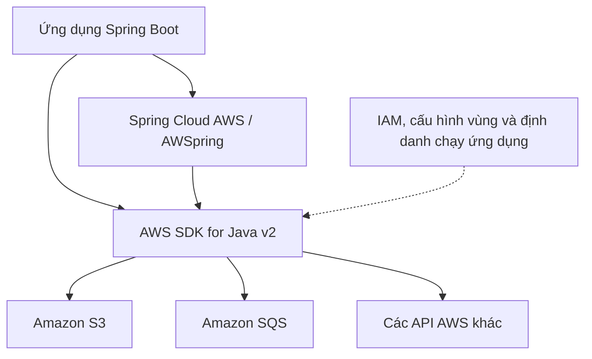

# Spring Cloud AWS của AWSpring và ranh giới với AWS SDK for Java

## 1. Bối cảnh: ứng dụng Spring Boot giao tiếp với AWS bằng cách nào?

Khi một ứng dụng Spring Boot cần lưu tài liệu lên Amazon S3, xử lý thông điệp từ Amazon SQS hoặc đọc cấu hình từ AWS Secrets Manager, ứng dụng phải gọi API của dịch vụ AWS tương ứng. Có hai lớp công cụ thường xuất hiện trong mã Java:

- **AWS SDK for Java**: bộ thư viện do AWS phát triển, cung cấp các client theo từng dịch vụ như `S3Client`, `SqsClient`, `SecretsManagerClient`. SDK xử lý việc ký yêu cầu, xác thực, gửi HTTP request, nhận response, retry và ánh xạ mô hình API của AWS.
- **Spring Cloud AWS**: dự án thuộc hệ sinh thái **AWSpring**, tích hợp AWS SDK với Spring Boot thông qua cơ chế auto-configuration, dependency injection, property, template, listener và các tích hợp quen thuộc của Spring.

Hai công cụ **không cạnh tranh theo kiểu chỉ được chọn một**. Spring Cloud AWS sử dụng AWS SDK ở phía dưới; một ứng dụng có thể dùng `S3Template` cho thao tác phổ biến và đồng thời inject `S3Client` để dùng API chuyên biệt.



**Mục tiêu bài học:** phân biệt trách nhiệm của AWSpring, AWS SDK và hạ tầng AWS; chọn mức trừu tượng phù hợp; triển khai một luồng S3/SQS cơ bản; nhận diện những vấn đề về credential, IAM, lỗi và kiểm thử khi chạy trên cloud.

## 2. Spring Cloud AWS là gì, AWSpring là gì?

**AWSpring** là tên cộng đồng/dự án phát triển **Spring Cloud AWS**. Tên thư viện xuất hiện trong dependency Maven/Gradle hiện đại dưới group `io.awspring.cloud`; các lớp tích hợp của thư viện cũng nằm dưới namespace `io.awspring.cloud.*`. Đây là một lớp tích hợp dành cho ứng dụng Spring, **không phải tên gọi khác của AWS SDK** và cũng không phải dịch vụ managed được triển khai trên AWS.

Spring Cloud AWS tận dụng các cơ chế nền tảng của Spring:

| Khả năng | AWSpring hỗ trợ gì? | Giới hạn cần hiểu |
| --- | --- | --- |
| Auto-configuration | Tạo và cấu hình bean client, template, listener khi có starter thích hợp | Không tự cấp quyền IAM hay tạo tài nguyên AWS cho mọi trường hợp |
| Quản lý cấu hình | Kết nối Spring properties, vùng AWS, chuỗi credential; tích hợp nguồn cấu hình như Parameter Store/Secrets Manager nếu bật module tương ứng | Secret vẫn cần được bảo vệ trong IAM và trong quá trình vận hành |
| S3 | Cung cấp API theo phong cách Spring như `S3Template` cho thao tác thông dụng | Các tùy chọn API đặc thù vẫn cần `S3Client`/`S3AsyncClient` hoặc thành phần SDK phù hợp |
| SQS | Cung cấp `@SqsListener`, `SqsTemplate`, chuyển đổi payload và quản lý listener container | Delivery, retry, visibility timeout, DLQ và thứ tự xử lý vẫn theo quy tắc SQS |
| Tích hợp Spring | Bean injection, cấu hình môi trường, lifecycle và cách xử lý message quen thuộc | Không xóa đi đặc tính riêng của từng dịch vụ cloud |

Phạm vi starter, API và phiên bản cụ thể có thể thay đổi theo bản phát hành. Ví dụ trong bài sử dụng **dòng Spring Cloud AWS 3.x cùng AWS SDK for Java 2.x**, phù hợp về mặt kiến trúc với hệ sinh thái Spring Boot 3.x. Khi tạo dự án thực tế, cần đối chiếu ma trận tương thích của đúng bản Spring Boot, Spring Cloud AWS và Java đang sử dụng. Không suy ra rằng mọi bản 3.x đều tương thích với mọi bản Spring Boot 3.x, hoặc rằng cấu hình của dòng 2.x có thể sao chép nguyên sang 3.x.

## 3. Ranh giới trách nhiệm giữa AWSpring, SDK và AWS

### 3.1. AWS SDK bám sát API của dịch vụ

AWS SDK for Java v2 cung cấp các client và request/response type gần với API AWS. Chẳng hạn, `S3Client.headObject(...)` nhận `HeadObjectRequest` và trả `HeadObjectResponse`; đối tượng response chứa `contentLength`, `eTag`, metadata cùng các trường do S3 cung cấp.

Lớp này phù hợp khi cần:

- Dùng một operation/tùy chọn mà template của AWSpring chưa bao phủ.
- Kiểm soát chi tiết timeout, HTTP transport, retry, endpoint, checksum, metadata hoặc async I/O theo yêu cầu thực tế.
- Viết thư viện Java độc lập với Spring hoặc tái sử dụng mã ở ứng dụng không dùng Spring Boot.
- Gọi các dịch vụ AWS chưa có tích hợp Spring Cloud AWS phù hợp với phiên bản đang dùng.

Việc dùng SDK trực tiếp **không bắt buộc** phải tự triển khai cơ chế IAM, ký request hay retry HTTP từ đầu; SDK đã có các cơ chế này. Tuy nhiên, lập trình viên thường phải tự tổ chức lifecycle client, ánh xạ lỗi, chuyển đổi dữ liệu và kết nối với các abstraction của Spring nếu ứng dụng cần.

### 3.2. AWSpring mang API AWS vào mô hình ứng dụng Spring

AWSpring thích hợp khi nhu cầu trùng với các tác vụ mà starter đã hỗ trợ tốt, chẳng hạn gửi/nhận sự kiện qua SQS hoặc lưu/đọc đối tượng đơn giản trên S3. Các starter giảm mã khởi tạo client, tận dụng Spring Boot auto-configuration và đưa thao tác cloud vào luồng ứng dụng Spring.

Điều này **không** biến AWSpring thành lớp trừu tượng dùng chung cho AWS, Azure và Google Cloud. `S3Template` vẫn gắn với S3; `@SqsListener` vẫn gắn với ngữ nghĩa của SQS. Muốn chuyển provider, thường phải thay adapter, cấu hình, triển khai tài nguyên và kiểm thử lại các khác biệt về hành vi.

### 3.3. AWS kiểm soát identity, quyền và hành vi dịch vụ

Ứng dụng gửi request bằng một **principal** (IAM role hoặc IAM user trong tình huống thích hợp). AWS đánh giá quyền trên tài nguyên đích. Dù gọi qua template hay SDK trực tiếp, thao tác `PutObject` vẫn cần quyền S3 tương ứng; thao tác lấy message từ queue vẫn cần các quyền SQS tương ứng. Cả hai thư viện cũng phụ thuộc vào vùng, endpoint, cấu hình mạng, chính sách KMS và trạng thái thực tế của dịch vụ.

Một cách phân tách trách nhiệm có ích:

| Câu hỏi | Nơi chịu trách nhiệm chính |
| --- | --- |
| Gọi `PutObject`, `HeadObject`, `SendMessage` theo giao thức AWS ra sao? | AWS SDK |
| Bean client được inject, listener được chạy và payload được chuyển đổi trong Spring ra sao? | Spring Cloud AWS + Spring Boot |
| Principal có quyền trên bucket/queue không? | IAM, resource policy, KMS policy khi áp dụng |
| Bucket/queue có tồn tại, ở đúng region, có cấu hình mã hóa/DLQ đúng không? | Hạ tầng và cấu hình AWS |
| Retry nghiệp vụ, chống xử lý trùng, quan sát lỗi ra sao? | Thiết kế ứng dụng kết hợp cơ chế SDK/SQS/AWS |

## 4. Thiết lập dependency và cơ chế auto-configuration

Ví dụ Maven sau nêu phần **dependency management** cốt lõi của dự án Spring Boot 3.x. Biến `spring-cloud-aws.version` phải được định nghĩa bằng **phiên bản phát hành cụ thể đã kiểm tra tương thích** với dự án; không sao chép một số phiên bản ngẫu nhiên chỉ vì cùng major version.

```xml
<dependencyManagement>
    <dependencies>
        <dependency>
            <groupId>io.awspring.cloud</groupId>
            <artifactId>spring-cloud-aws-dependencies</artifactId>
            <version>${spring-cloud-aws.version}</version>
            <type>pom</type>
            <scope>import</scope>
        </dependency>
    </dependencies>
</dependencyManagement>

<dependencies>
    <dependency>
        <groupId>io.awspring.cloud</groupId>
        <artifactId>spring-cloud-aws-starter-s3</artifactId>
    </dependency>
    <dependency>
        <groupId>io.awspring.cloud</groupId>
        <artifactId>spring-cloud-aws-starter-sqs</artifactId>
    </dependency>
</dependencies>
```

Các starter trên kéo theo phần tích hợp Spring và AWS SDK cần thiết theo BOM đã chọn. Nếu chỉ sử dụng SDK cho S3 trong một ứng dụng Java, dependency nền tảng có thể là `software.amazon.awssdk:s3`, không cần thêm AWSpring chỉ để gọi API S3.

Khi Spring Boot khởi động, auto-configuration kiểm tra classpath, cấu hình và các bean hiện hữu để cung cấp thành phần AWS thích hợp. Do đó, trong nhiều ứng dụng ta có thể inject `S3Template`, `SqsTemplate` hoặc client SDK do cấu hình cung cấp. **Không mặc định rằng mọi client hoặc mọi abstraction đều tồn tại**: chúng phụ thuộc starter, module, điều kiện auto-configuration và phiên bản cụ thể. Khi cần tùy chỉnh sâu, hãy tạo cấu hình bean có chủ đích và kiểm tra quy tắc back-off của auto-configuration.

### Cấu hình vùng AWS

Ví dụ khai báo region tường minh, đồng thời để SDK lấy thông tin định danh từ môi trường chạy:

```yaml
spring:
  cloud:
    aws:
      region:
        static: ${AWS_REGION}

app:
  aws:
    s3:
      bucket: ${APP_S3_BUCKET}
    sqs:
      orders-queue: ${APP_ORDERS_QUEUE}
```

`AWS_REGION`, `APP_S3_BUCKET` và `APP_ORDERS_QUEUE` là các biến môi trường cần được cấp khi chạy ví dụ; không tự động có trong mọi máy. Region của client phải phù hợp với tài nguyên và cách AWS service sử dụng endpoint. Có thể dựa vào chuỗi tìm kiếm region mặc định của SDK ở nơi phù hợp, nhưng cấu hình tường minh giúp giảm sai sót khi ứng dụng triển khai nhiều môi trường.

### Chuỗi credential và quyền

Với AWS SDK for Java v2, cách làm thông thường là dùng **default credentials provider chain**, ví dụ credential từ environment hoặc shared AWS profile khi phát triển, và **IAM role gắn với workload** trên môi trường AWS (EC2 instance profile, ECS task role hoặc cơ chế role dành cho EKS). AWSpring có thể cấu hình credential provider cho bean SDK, nhưng không phát minh ra một hệ thống cấp quyền riêng.

Quy tắc thực hành:

1. Ưu tiên temporary credentials từ role khi triển khai; áp dụng least privilege theo thao tác và ARN tài nguyên thực sự cần.
2. Không hard-code access key/secret key trong YAML, mã nguồn, Docker image, log hoặc bài kiểm thử.
3. Nếu dùng AWS profile khi phát triển, kiểm soát profile đang hoạt động để tránh vô tình truy cập môi trường production.
4. Với S3, xét thêm bucket policy và KMS key policy (nếu dùng SSE-KMS); với SQS, xét queue policy và KMS khi có mã hóa do khách hàng quản lý.

## 5. Ví dụ S3: template cho thao tác phổ biến, SDK cho API chi tiết

Giả sử nghiệp vụ cần lưu tệp biên nhận vào bucket riêng và kiểm tra kích thước một đối tượng. Với starter S3, thao tác upload đơn giản có thể đi qua `S3Template`:

```java
import io.awspring.cloud.s3.S3Template;
import java.io.ByteArrayInputStream;
import org.springframework.beans.factory.annotation.Value;
import org.springframework.stereotype.Service;

@Service
public class ReceiptStorage {
    private final S3Template s3Template;
    private final String bucket;

    public ReceiptStorage(S3Template s3Template,
                          @Value("${app.aws.s3.bucket}") String bucket) {
        this.s3Template = s3Template;
        this.bucket = bucket;
    }

    public void store(String key, byte[] content) {
        s3Template.upload(bucket, key, new ByteArrayInputStream(content));
    }
}
```

Đoạn mã minh họa với payload nhỏ đã có sẵn dưới dạng `byte[]`. Nếu xử lý tệp lớn, cần xem API streaming và giới hạn bộ nhớ phù hợp, thay vì đưa toàn bộ dữ liệu lên heap. Ứng dụng cũng phải kiểm tra `key`, loại nội dung, kích thước, quyền truy cập và yêu cầu mã hóa theo nghiệp vụ.

Khi cần lấy thông tin chuyên biệt từ S3, có thể dùng **cùng SDK client** ở mức thấp hơn mà AWSpring có thể cấu hình cho ứng dụng:

```java
import org.springframework.stereotype.Service;
import software.amazon.awssdk.services.s3.S3Client;

@Service
public class ReceiptMetadataReader {
    private final S3Client s3;

    public ReceiptMetadataReader(S3Client s3) {
        this.s3 = s3;
    }

    public long sizeInBytes(String bucket, String key) {
        return s3.headObject(request -> request
                .bucket(bucket)
                .key(key))
            .contentLength();
    }
}
```

`S3Client` ở ví dụ thứ hai là class của **AWS SDK for Java v2** (`software.amazon.awssdk.*`), còn `S3Template` là class tích hợp của AWSpring (`io.awspring.cloud.*`). Hai cách gọi đều gửi request tới S3 và đều cần IAM phù hợp. `HeadObject` có thể chịu tác động từ các quyền và chính sách liên quan đến object, kể cả tình huống object không tồn tại.

**Khi nào đi thẳng xuống SDK?** Ví dụ: cần thiết lập thuộc tính cụ thể của request S3, dùng presigner, gọi API không được `S3Template` biểu diễn rõ, hoặc điều chỉnh client nâng cao. Hãy bắt đầu ở mức abstraction giúp mã nghiệp vụ rõ ràng, rồi dùng SDK nơi yêu cầu cụ thể đòi hỏi. Không tạo một adapter chỉ chuyển tiếp từng lời gọi SDK mà không mang lại lợi ích kiểm thử hay thiết kế.

## 6. Ví dụ SQS: tiện ích Spring không thay đổi ngữ nghĩa messaging

Giả sử hệ thống đặt hàng đưa sự kiện `OrderCreated` lên queue để một service khác xử lý. Với starter SQS, ứng dụng có thể gửi qua `SqsTemplate` và đăng ký phương thức xử lý bằng `@SqsListener`.

```java
import io.awspring.cloud.sqs.operations.SqsTemplate;
import org.springframework.beans.factory.annotation.Value;
import org.springframework.stereotype.Service;

record OrderCreated(String orderId, String customerId) {}

@Service
public class OrderEventPublisher {
    private final SqsTemplate sqsTemplate;
    private final String queue;

    public OrderEventPublisher(SqsTemplate sqsTemplate,
                               @Value("${app.aws.sqs.orders-queue}") String queue) {
        this.sqsTemplate = sqsTemplate;
        this.queue = queue;
    }

    public void publish(OrderCreated event) {
        sqsTemplate.send(to -> to.queue(queue).payload(event));
    }
}
```

```java
import io.awspring.cloud.sqs.annotation.SqsListener;
import org.springframework.stereotype.Component;

@Component
public class OrderEventHandler {
    @SqsListener("${app.aws.sqs.orders-queue}")
    public void onOrderCreated(OrderCreated event) {
        // Xử lý idempotent: ghi nhận orderId đã được tiếp nhận.
        // Ném exception khi xử lý thất bại để cơ chế lỗi/ack xử lý phù hợp.
    }
}
```

Ví dụ giả định queue đã tồn tại, quyền IAM được cấp và cơ chế chuyển đổi JSON/payload đã có dependency/configuration phù hợp. `SqsTemplate` và listener giúp giảm mã giao tiếp queue, nhưng các đặc tính quan trọng vẫn do SQS và cấu hình listener quyết định:

- **Có thể nhận lại cùng một message.** Standard queue sử dụng mô hình *at-least-once delivery*; consumer phải xử lý idempotent, chẳng hạn dùng `eventId`/`orderId` kết hợp unique constraint hoặc bảng theo dõi xử lý.
- **Visibility timeout** quyết định khoảng thời gian message đang xử lý bị ẩn khỏi lượt nhận khác. Thời gian này phải phù hợp với thời lượng xử lý; có thể cần điều chỉnh/ gia hạn cho job dài.
- **Acknowledgement và lỗi** phải được hiểu theo acknowledgement mode/listener container đang cấu hình. Với luồng thông thường, xử lý thành công dẫn đến việc xóa/ack message; lỗi có thể khiến message xuất hiện lại sau visibility timeout.
- **Dead-letter queue (DLQ)** và redrive policy do cấu hình SQS quyết định việc cách ly message lỗi nhiều lần. Log và cảnh báo số message ở DLQ cần được thiết kế riêng.
- **Thứ tự và trùng lặp** có khác biệt giữa Standard và FIFO queue; FIFO không miễn trừ nhu cầu xử lý lỗi hoặc tự động đảm bảo tính đúng đắn của transaction nghiệp vụ.
- **Quyền IAM** cần xem xét các operation thực tế như nhận, xóa message, truy vấn thuộc tính/URL queue và thay đổi visibility khi dùng; producer cần quyền gửi.

Đáng chú ý, **retry của AWS SDK** (thử lại HTTP/API request khi gặp lỗi phù hợp) và **việc SQS phát lại message để consumer xử lý** là hai cơ chế khác nhau. Cần đánh giá cả hai để tránh gửi trùng sự kiện hoặc xử lý trùng side effect.

## 7. Secrets Manager, Parameter Store và ranh giới bảo mật

Ứng dụng Spring Boot thường cần cấu hình theo môi trường: endpoint bên ngoài, feature flag, API token, mật khẩu kết nối dữ liệu. Có thể dùng tích hợp của Spring Cloud AWS để đưa giá trị từ **AWS Systems Manager Parameter Store** hoặc **AWS Secrets Manager** vào cơ chế cấu hình của Spring, tùy starter và phiên bản đã chọn.

Đây là điểm khác biệt đáng kể so với SDK trực tiếp: thay vì tự gọi `GetSecretValue` rồi ánh xạ kết quả vào bean/config object, Spring Cloud AWS có thể tích hợp việc nạp cấu hình với vòng đời ứng dụng. Tuy nhiên cần xác định rõ nguồn, thứ tự ưu tiên property, cách xử lý khi không truy cập được secret, quyền IAM tối thiểu và chính sách xoay vòng secret.

Không nhầm lẫn ba tầng bảo vệ:

1. **Nơi lưu**: dùng dịch vụ quản lý secret/parameter phù hợp, có mã hóa và chính sách truy cập đúng.
2. **Quyền đọc**: workload role phải được phép đọc đúng ARN/đường dẫn secret cần dùng; nếu liên quan customer-managed KMS key phải có quyền giải mã phù hợp.
3. **Sử dụng trong ứng dụng**: tránh in secret ra log, exception, tracing, actuator hoặc response; kiểm tra cơ chế refresh khi secret thay đổi. Không mặc định cấu hình đã được nạp lúc khởi động sẽ tự làm mới mà không có thiết kế bổ sung.

Một `SecretsManagerClient` của AWS SDK vẫn cần thiết nếu nghiệp vụ phải gọi API quản trị secret, kiểm soát phiên bản secret hoặc thực hiện thao tác ngoài khả năng tích hợp cấu hình mà thư viện đang cung cấp.

## 8. Chọn thư viện theo bài toán, không theo tên dịch vụ

| Tình huống | Điểm khởi đầu hợp lý | Lý do |
| --- | --- | --- |
| Lưu file thông thường trong ứng dụng Spring Boot | `S3Template` của AWSpring | Ít mã tích hợp, phù hợp thao tác đơn giản |
| Lấy thông tin object, cấu hình request S3 đặc thù | `S3Client`/`S3AsyncClient` của AWS SDK | Truy cập trực tiếp operation và option của S3 |
| Nhận sự kiện từ SQS như một message handler Spring | `@SqsListener` của AWSpring | Tích hợp listener container và xử lý payload |
| Tự quản lý polling, batch hoặc request SQS theo yêu cầu rất riêng | `SqsClient`/`SqsAsyncClient` | Kiểm soát chi tiết vòng đời gọi API |
| Đưa secret/parameter vào Spring Environment | Module tích hợp cấu hình của AWSpring | Tận dụng cơ chế cấu hình Spring |
| Java service không dùng Spring | AWS SDK for Java | Không tạo phụ thuộc Spring không cần thiết |
| Dịch vụ AWS chưa có abstraction phù hợp trong phiên bản AWSpring | AWS SDK trực tiếp | Phạm vi SDK thường bao quát API dịch vụ hơn |

Một hệ thống có thể **kết hợp** hai hướng trong cùng module. Điểm cần giữ ổn định là ranh giới của mã nghiệp vụ: tầng service nên bộc lộ hành vi như `storeReceipt`, `publishOrderCreated`, `fetchSecret`, còn chi tiết gọi AWS được đặt ở adapter/infrastructure thích hợp để dễ thay đổi và kiểm thử.

### Những ngộ nhận thường gặp

**“Thêm starter là có thể gọi AWS ngay.”** Chưa đủ: còn phải có region/endpoint đúng, principal có credential, quyền IAM, tài nguyên tồn tại và kết nối mạng.

**“AWSpring thay thế toàn bộ SDK.”** Sai: AWSpring dựa vào SDK và chỉ cung cấp các abstraction cho những use case được hỗ trợ.

**“Spring Cloud AWS là Spring Cloud chung cho mọi cloud provider.”** Sai: tích hợp này thiết kế cho dịch vụ AWS. Với Azure và Google Cloud thường có dự án Spring integration tương ứng nhưng API, mô hình identity, permission, storage và messaging khác nhau.

**“Test mock client thành công nghĩa là hệ thống chạy được trên AWS.”** Chưa chắc: mock không chứng minh quyền IAM, endpoint, serialization, visibility timeout, network policy hoặc quota thực tế.

**“SQS listener chạy một lần nên không cần idempotency.”** Sai đối với thiết kế đáng tin cậy: message có thể được giao lại, consumer có thể crash sau khi tạo side effect nhưng trước khi ack.

## 9. Kiểm thử tích hợp và triển khai thực tế

Chia kiểm thử thành các lớp để phát hiện lỗi đúng chỗ:

| Lớp kiểm thử | Mục đích | Giới hạn |
| --- | --- | --- |
| Unit test | Kiểm tra logic nghiệp vụ, mapping và xử lý ngoại lệ bằng fake/mock adapter | Không xác nhận tương tác thực tế với AWS |
| Integration test với môi trường giả lập như LocalStack | Kiểm tra kết nối SDK/Spring, thao tác S3/SQS và dữ liệu gửi/nhận ở mức gần thực tế | Mức độ tương đồng không đảm bảo đầy đủ IAM, hành vi vận hành và mọi API AWS |
| Smoke/integration test trên tài khoản AWS dành riêng | Xác nhận IAM, network, region, tài nguyên, mã hóa và đường đi từ producer tới consumer | Tốn tài nguyên; cần giới hạn phạm vi, dữ liệu và chi phí |

Một checklist triển khai tối thiểu cho ví dụ S3/SQS:

1. **Provision** bucket/queue ở môi trường kiểm thử; cấu hình mã hóa, chính sách lifecycle và DLQ theo yêu cầu.
2. **IAM** cho role của service: chỉ cho phép các operation và tài nguyên thật sự cần; thử một request từ đúng workload identity.
3. **Cấu hình** region, bucket, queue, endpoint và credential provider cho từng môi trường; giữ secret ngoài repository.
4. **Quan sát** log có correlation ID, metric về lỗi, độ trễ, backlog queue và số message vào DLQ; tránh log payload nhạy cảm.
5. **Thử lỗi**: queue tạm không truy cập được, S3 trả lỗi, message bị giao lại, consumer xử lý chậm hơn visibility timeout; xác minh retry/idempotency và cảnh báo.

Ở bước kiểm thử integration, có thể dùng Testcontainers để khởi tạo LocalStack, rồi override endpoint/region/credential chỉ trong cấu hình test. Khi chạy trên AWS thật, ưu tiên credential chain/role và endpoint mặc định của dịch vụ. Không để endpoint LocalStack hoặc static test credential lẫn vào cấu hình production.

## 10. Bài tập ứng dụng

**Tình huống:** nhóm phát triển một dịch vụ Spring Boot nhận yêu cầu xuất báo cáo, lưu báo cáo vào S3 rồi đẩy message `ReportReady` vào SQS để một worker gửi thông báo. Khi triển khai lên ECS, service có task role; trong môi trường máy cá nhân, developer sử dụng AWS profile riêng.

Hãy thực hiện hoặc thiết kế các bước sau:

1. Chọn starter phù hợp, khai báo BOM tương thích và chỉ ra đường đi của một request từ `S3Template` hoặc `SqsTemplate` xuống AWS SDK và AWS API.
2. Liệt kê quyền cần thiết cho producer (`s3:PutObject`, `sqs:SendMessage` trên các tài nguyên cụ thể). Đối với worker, nêu các quyền cần để nhận/ack message và quyền đọc object nếu worker thật sự cần nội dung báo cáo.
3. Viết adapter lưu báo cáo bằng `S3Template`; dùng `S3Client` nếu yêu cầu thêm một trường metadata/API cụ thể mà template không đáp ứng.
4. Thiết kế idempotency key cho `ReportReady`, cấu hình DLQ và xử lý lại khi worker gặp lỗi sau khi đã gửi thông báo nhưng trước khi ack.
5. Mô tả cách test unit, test với LocalStack và một smoke test trên tài khoản AWS hạn chế quyền. Nêu điều mà từng lớp test không thể bảo đảm.

**Câu hỏi tự kiểm tra:** Nếu `@SqsListener` khởi động nhưng liên tục gặp lỗi truy cập queue, sửa `@SqsListener` hay kiểm tra IAM trước? Nếu upload S3 thành công trong unit test nhưng thất bại ở ECS, cần xem credential provider, task role, bucket policy, region và network ở đâu? Những câu hỏi này buộc tách vấn đề **thư viện tích hợp**, **SDK** và **hạ tầng AWS**.

## 11. Kết luận

Trong module tích hợp Spring Boot với dịch vụ managed của cloud provider, **Spring Cloud AWS của AWSpring** là lớp hỗ trợ theo phong cách Spring, còn **AWS SDK for Java** là lớp client thực thi API AWS. Hai lớp phối hợp với nhau; lựa chọn template/listener hay client trực tiếp phụ thuộc mức độ kiểm soát mà bài toán cần. Dù chọn cách nào, hệ thống vẫn phải thiết kế chính xác về IAM, credential, region, đặc tính delivery, retry, idempotency, vận hành và kiểm thử trên môi trường mục tiêu.
