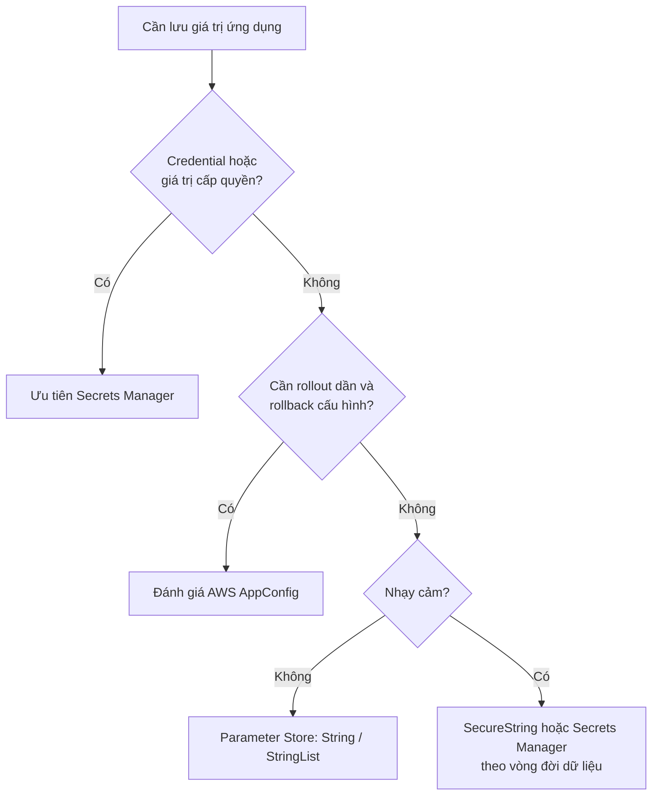
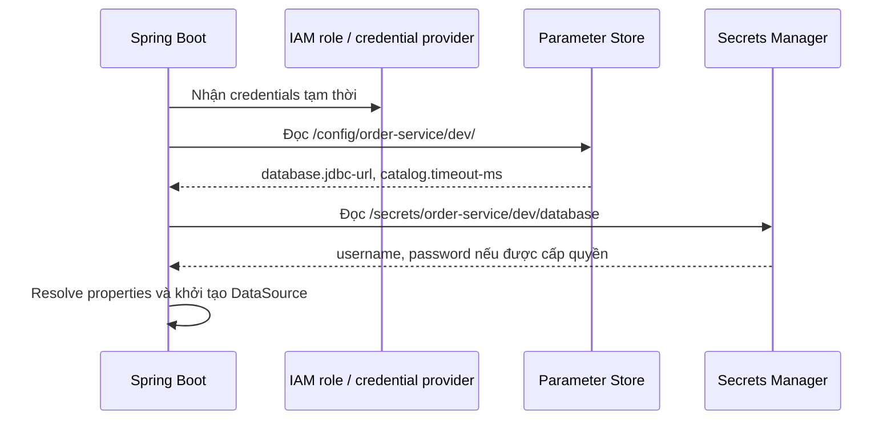

# Chọn Parameter Store hay Secrets Manager theo loại dữ liệu

## Mục tiêu

Trong module **SPRING_CLOUD_PROVIDER_INTEGRATION**, người học thực hành tích hợp Spring Boot với dịch vụ managed của AWS, Azure và Google Cloud. Ở chương **Cấu hình AWS**, ta cần biết lưu endpoint, tên queue, mật khẩu database hay API key ở đâu để an toàn, dễ vận hành và tối ưu chi phí.

Sau bài học, bạn có thể:

1. Phân biệt cấu hình thông thường, cấu hình nhạy cảm và **secret cấp quyền truy cập**.
2. Chọn **AWS Systems Manager Parameter Store** hoặc **AWS Secrets Manager** theo loại dữ liệu, yêu cầu rotation, bảo mật, quota và chi phí.
3. Nạp cả hai nguồn vào Spring Boot qua **Spring Cloud AWS** với IAM role.
4. Thiết kế quyền đọc, cập nhật secret, cache và kiểm thử tích hợp.

> **Quy tắc xuất phát:** Parameter Store phù hợp với cấu hình dạng key-value; Secrets Manager là lựa chọn ưu tiên cho password, token, API key và các secret có vòng đời cần quản lý. `SecureString` mã hóa được một giá trị nhưng không tự mang đến quy trình **rotation** như Secrets Manager.

## 1. Hiểu đúng hai dịch vụ

### Parameter Store: kho cấu hình theo đường dẫn

AWS Systems Manager Parameter Store lưu các cặp tên/giá trị có cấu trúc phân cấp:

```text
/config/order-service/dev/database.jdbc-url
/config/order-service/dev/catalog.timeout-ms
/config/order-service/prod/catalog.base-url
```

| Loại parameter | Đặc điểm | Ví dụ |
| --- | --- | --- |
| `String` | Chuỗi cấu hình dạng text | Endpoint không chứa credential, tên S3 bucket/SQS queue |
| `StringList` | Nhiều giá trị ngăn cách bằng dấu phẩy | Các Region được phép |
| `SecureString` | Giá trị được mã hóa bằng AWS KMS | Mã giấy phép nhạy cảm hoặc cấu hình bí mật không cần rotation chuyên dụng |

Parameter Store hỗ trợ quản lý phiên bản, phân quyền bằng IAM và đọc theo đường dẫn. Tier **Standard** có giới hạn **4 KB/giá trị**, tier **Advanced** là **8 KB/giá trị**. Standard thường không tính phí lưu parameter và đọc với thông lượng mặc định; Advanced và thông lượng cao có phí, có thể thêm chi phí KMS. **Parameter Store không có cơ chế tự động xoay vòng credential chuyên dụng**. Chính sách parameter của Advanced dùng cho các điều kiện như hết hạn/thông báo, không thay thế rotation.

Với `SecureString`, AWS mã hóa **giá trị** nhưng **tên, mô tả và metadata** không được mã hóa theo cách đó. Vì vậy không đưa token hoặc dữ liệu nhạy cảm vào tên đường dẫn.

### Secrets Manager: quản lý vòng đời bí mật

AWS Secrets Manager dành cho các giá trị có thể cho phép người sở hữu đăng nhập, ký yêu cầu hoặc truy cập tài nguyên: mật khẩu database, API key, OAuth token, private key, credential dịch vụ thứ ba. Secret có thể là chuỗi, JSON nhiều trường hoặc dữ liệu nhị phân, với giới hạn **64 KB**. Dịch vụ mã hóa nội dung bằng KMS, kiểm soát quyền bằng IAM/resource policy, có các phiên bản với nhãn như `AWSCURRENT`, `AWSPREVIOUS`, hỗ trợ rotation và sao chép secret sang Region khác.

**Rotation phải được bật và thiết lập đúng**. Với một số database/dịch vụ được hỗ trợ có thể dùng cơ chế managed rotation; trường hợp khác thường cần Lambda hoặc tích hợp riêng để thay credential tại hệ thống đích. Nếu bên cấp API key không có API tạo key mới, Secrets Manager không thể tự tạo key thay cho bên đó.

## 2. Chọn theo loại dữ liệu

| Dữ liệu ứng dụng | Lựa chọn ưu tiên | Lý do |
| --- | --- | --- |
| URL dịch vụ nội bộ, cổng kết nối | Parameter Store `String` | Không trực tiếp cấp quyền truy cập |
| Tên S3 bucket, SQS queue, SNS topic | Parameter Store `String` | Là định danh; IAM mới quyết định quyền thao tác |
| Timeout, retry count, batch size | Parameter Store `String` | Cấu hình ứng dụng đơn giản |
| Danh sách vùng, mã đối tác công khai | Parameter Store `StringList` | Danh sách nhỏ, không nhạy cảm |
| JDBC URL **không chứa mật khẩu** | Parameter Store `String` | Chỉ mô tả vị trí database |
| Username/password database | Secrets Manager | Là credential; thường cần thay định kỳ |
| API key thanh toán, bearer token, OAuth refresh token | Secrets Manager | Tiết lộ giá trị là tiết lộ quyền |
| Private key, webhook signing secret | Secrets Manager | Secret cần kiểm soát phân phối và thay thế |
| Mã giấy phép hoặc cấu hình nhạy cảm, rất ít đổi | `SecureString` hoặc Secrets Manager | Cân nhắc yêu cầu audit, KMS, rotation, chi phí |
| Secret cần bản sao có quản lý ở nhiều Region | Secrets Manager | Hỗ trợ replication |

Quy trình ra quyết định:

1. **Giá trị có dùng để xác thực, ký dữ liệu hoặc nhận quyền truy cập không?** Nếu có, ưu tiên Secrets Manager.
2. **Có cần rotation, truy cập xuyên tài khoản, sao chép Region hoặc quản lý nhiều phiên bản secret không?** Nếu có, đánh giá Secrets Manager trước.
3. **Chỉ là cấu hình nhỏ, tương đối ổn định?** Chọn Parameter Store. Nếu nhạy cảm nhưng không phải credential và cần mã hóa, đánh giá `SecureString`.
4. **Là feature flag/cấu hình thay đổi thường xuyên, yêu cầu rollout từng phần và rollback tự động?** Đánh giá **AWS AppConfig**, dịch vụ chuyên quản lý triển khai cấu hình động.
5. **Ngân sách hạn chế?** So sánh tổng chi phí lưu trữ, API, KMS, vận hành rotation và sự cố; không chỉ phí lưu một giá trị.



### So sánh tính năng

| Tiêu chí | Parameter Store | Secrets Manager |
| --- | --- | --- |
| Mục đích chính | Quản lý cấu hình có phân cấp | Quản lý secret và vòng đời |
| Mã hóa giá trị | Chọn `SecureString` với KMS; `String`/`StringList` không dùng mã hóa giá trị này | KMS mã hóa nội dung secret |
| Giới hạn giá trị | 4 KB Standard; 8 KB Advanced | 64 KB |
| Phiên bản | Version của parameter | Secret versions và staging labels |
| Rotation tự động | Không có sẵn | Có cơ chế hỗ trợ, phải cấu hình |
| Chia sẻ tài khoản | Có cơ chế chia sẻ với tier Advanced | Resource policy và KMS phù hợp |
| Replication nhiều Region | Cần thiết kế riêng | Hỗ trợ replication |
| Phí | Standard thường miễn phí lưu trữ; Advanced/higher throughput tính phí | Theo số secret và API call; thêm phí liên quan nếu dùng |

Quota, hạn mức API và giá có thể khác theo Region, tier và thời điểm; khi triển khai hãy kiểm tra tài liệu pricing chính thức. Không nên trả phí quản lý 300 secret chỉ để lưu 300 giá trị timeout và URL, nhưng một mật khẩu database cần rotation có thể đáng để dùng Secrets Manager.

## 3. Ví dụ thực hành với Spring Boot

Giả sử `order-service` cần kết nối PostgreSQL và gọi Catalog API. Chúng ta chia cấu hình theo **dịch vụ/môi trường**:

```text
Parameter Store
  /config/order-service/dev/database.jdbc-url
  /config/order-service/dev/catalog.timeout-ms

Secrets Manager
  /secrets/order-service/dev/database
```

| Nguồn | Tên | Giá trị minh họa |
| --- | --- | --- |
| `String` | `/config/order-service/dev/database.jdbc-url` | `jdbc:postgresql://db.dev.internal:5432/orders` |
| `String` | `/config/order-service/dev/catalog.timeout-ms` | `2500` |
| JSON secret | `/secrets/order-service/dev/database` | `{"username":"orders_app","password":"<giá trị bí mật>"}` |

Đường dẫn và thông tin database trên là dữ liệu **minh họa**. Trên hệ thống thật, không đưa mật khẩu vào code, commit, shell history hay log CI.

### 3.1. Tạo các parameter không nhạy cảm

Ví dụ với AWS CLI:

```bash
aws ssm put-parameter \
  --name "/config/order-service/dev/database.jdbc-url" \
  --type "String" \
  --value "jdbc:postgresql://db.dev.internal:5432/orders"

aws ssm put-parameter \
  --name "/config/order-service/dev/catalog.timeout-ms" \
  --type "String" \
  --value "2500"
```

Để thay tham số đã tồn tại, thêm `--overwrite`. Với secret, dùng AWS Console hoặc quy trình cấp secret bảo mật, rồi tạo secret JSON tên `/secrets/order-service/dev/database` gồm hai trường `username` và `password`. Tránh nhập giá trị thật trực tiếp vào tham số dòng lệnh vì lịch sử shell và log có thể lưu lại.

### 3.2. Khai báo Spring Cloud AWS

Đặt Spring Cloud AWS BOM tương thích với Spring Boot trong `pom.xml`:

```xml
<dependencyManagement>
    <dependencies>
        <dependency>
            <groupId>io.awspring.cloud</groupId>
            <artifactId>spring-cloud-aws-dependencies</artifactId>
            <version>${spring-cloud-aws.version}</version>
            <type>pom</type>
            <scope>import</scope>
        </dependency>
    </dependencies>
</dependencyManagement>

<dependencies>
    <dependency>
        <groupId>io.awspring.cloud</groupId>
        <artifactId>spring-cloud-aws-starter-parameter-store</artifactId>
    </dependency>
    <dependency>
        <groupId>io.awspring.cloud</groupId>
        <artifactId>spring-cloud-aws-starter-secrets-manager</artifactId>
    </dependency>
</dependencies>
```

Biến Maven `${spring-cloud-aws.version}` phải được dự án khai báo thành phiên bản phù hợp với Spring Boot đang dùng; đây là ví dụ cấu trúc, không chỉ định một phiên bản mặc định cho mọi dự án.

Trong `application.yml`:

```yaml
spring:
  application:
    name: order-service
  config:
    import:
      - "aws-parameterstore:/config/order-service/dev/"
      - "aws-secretsmanager:/secrets/order-service/dev/database?prefix=database."
  datasource:
    url: "${database.jdbc-url}"
    username: "${database.username}"
    password: "${database.password}"
```

Spring Cloud AWS đưa `database.jdbc-url` và `catalog.timeout-ms` từ path Parameter Store vào Spring Environment. Khi secret JSON có các trường `username`, `password`, tùy chọn `?prefix=database.` đặt tên property là `database.username`, `database.password` để tránh trùng tên với những nguồn khác. Dấu chấm cuối prefix cần có chủ đích. Spring Boot resolve chúng thành thuộc tính của `DataSource`.

Ví dụ bind cấu hình Catalog:

```java
import org.springframework.boot.context.properties.ConfigurationProperties;

@ConfigurationProperties(prefix = "catalog")
public record CatalogProperties(int timeoutMs) {}
```

Đăng ký qua `@ConfigurationPropertiesScan` hoặc `@EnableConfigurationProperties(CatalogProperties.class)`. Spring Boot ánh xạ `catalog.timeout-ms` thành `timeoutMs`.

Phần `dev` trong import có thể được thay bằng đường dẫn của từng Spring profile/deployment, nhưng phải tách đúng tài khoản, Region và quyền truy cập cho dev/prod. Nếu nguồn cấu hình **bắt buộc** không tồn tại, ứng dụng nên thất bại khi khởi động. Chỉ dùng `optional:aws-parameterstore:...` hoặc `optional:aws-secretsmanager:...` khi giá trị thực sự tùy chọn; `optional:` không giúp bean sử dụng placeholder còn thiếu hoạt động được.

### 3.3. Dùng IAM role thay cho access key cố định

Ứng dụng trên ECS, EKS, EC2 hoặc Lambda nên nhận **danh tính tạm thời từ workload**: ECS task role, EKS Pod Identity/IRSA, EC2 instance profile hoặc execution role phù hợp. Máy phát triển có thể dùng AWS profile/SSO được cấp quyền. Không đặt AWS access key trong `application.yml` hoặc source code.

Ví dụ policy dành riêng cho `order-service` ở môi trường `dev` (đổi tài khoản/Region giả định thành giá trị thực):

```json
{
  "Version": "2012-10-17",
  "Statement": [
    {
      "Sid": "ReadOrderServiceDevParameters",
      "Effect": "Allow",
      "Action": [
        "ssm:GetParameter",
        "ssm:GetParameters",
        "ssm:GetParametersByPath"
      ],
      "Resource": "arn:aws:ssm:ap-southeast-1:111122223333:parameter/config/order-service/dev/*"
    },
    {
      "Sid": "ReadOrderServiceDevDbSecret",
      "Effect": "Allow",
      "Action": "secretsmanager:GetSecretValue",
      "Resource": "arn:aws:secretsmanager:ap-southeast-1:111122223333:secret:/secrets/order-service/dev/database-*"
    }
  ]
}
```

`GetParametersByPath` cho phép đọc đệ quy theo path; cần đặc biệt thận trọng khi cấp quyền ở **path cha** và kiểm tra ARN ứng với lệnh thực tế. Policy trên chỉ cho phép đọc; quyền tạo, thay đổi hoặc xóa cấu hình nên thuộc một IAM role vận hành/CI riêng. Có thể cần quyền phụ trợ tùy theo thao tác thực tế và phiên bản thư viện.

Nếu secret hoặc `SecureString` dùng **customer managed KMS key**, luồng đọc có thể còn cần `kms:Decrypt` trên đúng key và key policy tương ứng. Luồng ghi/rotation có thể cần thêm quyền KMS. Không giải quyết `AccessDenied` bằng `kms:*`, `ssm:*` hoặc `secretsmanager:*` trên mọi tài nguyên. Với AWS managed key, chi tiết quyền KMS có thể khác; hãy kiểm tra thiết lập của key đang dùng.

### 3.4. Luồng nạp cấu hình



Khi dùng `spring.config.import`, dữ liệu được nạp trong giai đoạn cấu hình Spring Boot. **Rotation một secret trên AWS không mặc nhiên cập nhật ngay password trong `DataSource` đã khởi tạo**. Nếu cần cập nhật lúc chạy, phải thiết kế rõ cách đọc lại, cache, làm mới connection pool hoặc rollout/restart có kiểm soát. Không mặc định mọi phiên bản Spring Cloud AWS có cùng cơ chế refresh.

## 4. Rotation, cache và tính sẵn sàng

**Parameter Store:** Với timeout, tên queue hoặc endpoint ít thay đổi, đưa cập nhật vào quy trình review, quản lý version và kế hoạch rollback. Một parameter thay đổi sẽ có giá trị mới ở lần đọc kế tiếp từ dịch vụ; bean của ứng dụng hiện có chỉ đổi khi cơ chế refresh/rebind được thiết kế phù hợp.

**Secrets Manager:** Xây dựng vòng đời credential có thể kiểm chứng:

1. Cấp secret ban đầu và đảm bảo hệ thống đích (ví dụ PostgreSQL) chấp nhận credential tương ứng.
2. Bật rotation theo lịch và chọn cơ chế managed rotation, Lambda hoặc phương thức được dịch vụ hỗ trợ.
3. Thử rotation trong môi trường staging: credential mới hoạt động, credential cũ bị thu hồi theo chính sách mà không gây lỗi hàng loạt.
4. Kiểm tra nhãn phiên bản `AWSCURRENT`/`AWSPREVIOUS`, lỗi rotation, cảnh báo và đường lùi.
5. Đảm bảo ứng dụng đọc được credential mới sau TTL cache, refresh hoặc rollout và thay connection pool theo cách an toàn.

Nếu API bên thứ ba không có cơ chế tạo/thu hồi key tự động thì cần runbook thủ công hoặc tích hợp riêng. **Staging label không tự thay mật khẩu trong các kết nối database đang mở.**

**Cache và quota:** Truy vấn nguồn cấu hình trên *mỗi HTTP request* thường làm tăng độ trễ, số lần gọi API, chi phí và rủi ro throttling. Với cấu hình ít đổi, nạp lúc khởi động là hợp lý; với credential cần rotation liên tục, áp dụng SDK cache/refresh có TTL phù hợp. TTL quá dài khiến ứng dụng dùng credential cũ; TTL quá ngắn gây nhiều request và phụ thuộc mạng. Khi AWS API tạm lỗi, hãy phân biệt dữ liệu **bắt buộc** cần fail fast và dữ liệu **tùy chọn** có fallback an toàn.

**Giám sát:** AWS CloudTrail ghi nhận các lời gọi quản trị/truy cập API tương ứng; thiết lập cảnh báo cho lỗi `AccessDenied`, lỗi rotation, throttling và lượng gọi API bất thường. Không ghi nội dung secret trong log, stack trace, trace, CI output hoặc endpoint actuator.

## 5. Những lỗi thường gặp và cách tránh

| Lỗi thiết kế | Rủi ro | Hướng xử lý |
| --- | --- | --- |
| Lưu mật khẩu trong `String` hoặc JDBC URL chứa `?password=...` | Lộ credential cho người đọc config | Tách password thành secret và hạn chế quyền |
| Cho mọi ứng dụng đọc cả `/config/` hoặc toàn bộ secret | Lộ dữ liệu chéo môi trường/dịch vụ | IAM role và resource ARN theo ứng dụng/môi trường |
| Dùng chung credential cho dev và prod | Sự cố ở dev ảnh hưởng prod | Tách tài khoản/role, secret và KMS key theo yêu cầu |
| Giả định tạo secret là đã bật rotation | Secret có thể tồn tại nhiều năm | Cấu hình rotation, diễn tập và giám sát |
| Giả định rotation tự đổi `DataSource` đang chạy | Hết hiệu lực credential cũ, kết nối mới thất bại | Xác định chiến lược cache TTL, refresh hoặc rollout |
| Đưa secret vào log, history, commit, tags | Rò rỉ ngoài hệ thống mã hóa | Mask và giới hạn nơi có thể quan sát giá trị |
| Dùng `optional:` cho password bắt buộc | Ứng dụng khởi động lỗi muộn hoặc sai trạng thái | Required import, validate cấu hình sớm |
| Thiếu `kms:Decrypt` hoặc key policy | Lỗi giải mã dù có quyền đọc API | Kiểm tra IAM + KMS theo đúng resource |
| Chọn Parameter Store để thay feature flag liên tục | Thiếu staged rollout/auto rollback | Dùng AppConfig khi cần quản lý triển khai cấu hình động |

Đường dẫn, mô tả, tag và tên secret cũng có thể xuất hiện trong audit log; tuyệt đối không đặt secret value trong metadata.

## 6. Kiểm thử tích hợp và xử lý sự cố

Nên tách hai lớp kiểm thử:

- **Kiểm thử logic Spring Boot:** dùng test properties giả lập để xác minh binding, điều kiện cấu hình và xử lý lỗi của ứng dụng mà không cần kết nối AWS.
- **Kiểm thử tích hợp AWS:** chạy trong account sandbox có IAM role giới hạn, xác minh API thực, KMS, path, Region, rotation, quota và hành vi khi bị từ chối quyền. LocalStack có thể giúp một phần nhưng không thay thế việc kiểm tra cơ chế IAM/KMS/rotation thực tế.

| Tình huống | Điều cần xác nhận |
| --- | --- |
| Đúng account/Region, đủ tham số và secret | Ứng dụng khởi động, bind đúng timeout và kết nối database |
| Thiếu path Parameter Store bắt buộc | Lỗi cấu hình rõ ràng lúc khởi động |
| Thiếu secret bắt buộc | Fail fast, không in giá trị nhạy cảm |
| Role bị từ chối `secretsmanager:GetSecretValue` | Phân biệt lỗi quyền với lỗi secret không tồn tại |
| Thiếu `kms:Decrypt` cho custom key | Nhận diện vấn đề key policy/role thay vì mở toàn bộ quyền |
| Credential được rotate khi đang có traffic | Kết nối mới hoạt động sau chiến lược refresh/rollout |
| Khởi động đồng thời nhiều instance | Không vượt quota hoặc bị throttling không kiểm soát |

Khi debug, kiểm tra theo thứ tự **tên resource/path → AWS account/Region → IAM role → KMS key → trạng thái/phiên bản secret → thứ tự nguồn Spring và cache**. `aws secretsmanager describe-secret --secret-id /secrets/order-service/dev/database` dùng để xem metadata mà không in giá trị; tránh chạy `get-secret-value` vào console/log chung. Kiểm tra CloudTrail và các metrics phù hợp khi có lỗi quyền hoặc rotation.

## 7. Bài tập áp dụng

`payment-service` có các giá trị:

```text
payment.gateway-url
payment.timeout-ms
payment.api-key
payment.webhook-signing-secret
sqs.payment-events-queue
database.username
database.password
```

Hãy đề xuất sơ đồ lưu trữ cho `/config/payment-service/prod/` và `/secrets/payment-service/prod/`:

1. Lưu `gateway-url`, `timeout-ms` và tên queue vào Parameter Store `String`, với điều kiện URL không chứa token nhạy cảm.
2. Lưu `api-key`, `webhook-signing-secret` và database credential vào Secrets Manager; nếu cần rotation, xác định bên nào có thể tạo, kích hoạt và thu hồi credential.
3. Viết `spring.config.import`, cấu trúc JSON secret và policy cho IAM role chỉ đọc cấu hình của `payment-service` trên môi trường prod.
4. Mô tả hành vi khi key bị thu hồi: cache hết hạn sau bao lâu, ứng dụng tải giá trị mới bằng cách nào, cảnh báo gì xuất hiện và cách rollback.

**Tiêu chí hoàn thành:** Có bảng phân loại kèm lý do, namespace, nguyên tắc least privilege, cấu hình Spring Boot và kịch bản rotation/kiểm thử.

## 8. Liên hệ với Azure và Google Cloud

Module tích hợp nhiều cloud provider nên cần hiểu **nhu cầu** thay vì máy móc tìm tên dịch vụ giống nhau:

| Nhu cầu | AWS | Azure | Google Cloud |
| --- | --- | --- | --- |
| Cấu hình không bí mật | Parameter Store, hoặc AppConfig khi cần rollout | Azure App Configuration | Cấu hình từ nền tảng chạy như environment/ConfigMap trên GKE; không có tương ứng 1:1 với mọi tính năng Parameter Store |
| Secret và credential | Secrets Manager | Azure Key Vault | Google Cloud Secret Manager |
| Danh tính workload | IAM role | Managed Identity | Service Account / Workload Identity |

Cơ chế cấp quyền, SDK, rotation và cách nạp cấu hình vào Spring Boot khác nhau giữa các provider. Không giả định `spring.config.import` của hai thư viện Spring Cloud khác nhau có cú pháp hoặc cơ chế refresh giống nhau.

## Kết luận

**Parameter Store** là lựa chọn hợp lý cho cấu hình có phân cấp và ít thay đổi. **Secrets Manager** ưu tiên cho credential cần bảo vệ và quản lý vòng đời. Khi quyết định, cần xét đồng thời bản chất dữ liệu, yêu cầu rotation/replication, IAM/KMS, cache, quota, chi phí và kịch bản kiểm thử. Một kho bí mật an toàn chỉ phát huy tác dụng khi ứng dụng cũng bảo vệ giá trị sau khi đọc về.

## Tài liệu tham khảo

- [AWS Systems Manager Parameter Store](https://docs.aws.amazon.com/systems-manager/latest/userguide/systems-manager-parameter-store.html) — loại parameter, giới hạn, giá và tiêu chí lựa chọn.
- [Parameter Store reference](https://docs.aws.amazon.com/systems-manager/latest/userguide/what-is-a-parameter.html) — bảo mật `SecureString` và metadata.
- [What is AWS Secrets Manager?](https://docs.aws.amazon.com/secretsmanager/latest/userguide/) — secret, KMS, rotation, version và chi phí.
- [AWS Security Blog: How to choose the right AWS service for managing secrets and configurations](https://aws.amazon.com/blogs/security/how-to-choose-the-right-aws-service-for-managing-secrets-and-configurations/) — so sánh Parameter Store, AppConfig và Secrets Manager.
- [Spring Cloud AWS Reference 3.4.2](https://docs.awspring.io/spring-cloud-aws/docs/3.4.2/reference/html/index.html) — dependency, `spring.config.import`, prefix và tích hợp Spring Boot; đối chiếu với phiên bản đang dùng trong dự án.
