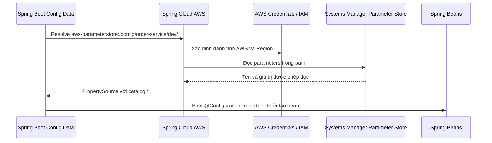

# Nạp Parameter Store bằng Config Data

## Mục tiêu và bối cảnh

Trong module **SPRING_CLOUD_PROVIDER_INTEGRATION**, chúng ta thực hành tích hợp Spring Boot với các dịch vụ managed của AWS, Azure và Google Cloud qua thư viện Spring Cloud tương ứng. Khi triển khai ứng dụng lên AWS, thông tin như URL của service, timeout, số lần retry, tên bucket hoặc queue thường khác nhau giữa `dev`, `staging` và `prod`. Đưa các giá trị đó vào mã nguồn hay đóng gói lại ứng dụng mỗi lần đổi cấu hình khiến quy trình vận hành khó kiểm soát.

Ở chương **Cấu hình AWS**, bài này tập trung vào cách sử dụng **Spring Boot Config Data API** kết hợp **Spring Cloud AWS Parameter Store** để nạp các giá trị từ AWS Systems Manager Parameter Store vào Spring `Environment` ngay khi ứng dụng khởi động.

Sau bài học, bạn có thể:

1. Giải thích cơ chế `spring.config.import` và sự khác biệt giữa nạp Config Data với việc gọi AWS SDK thủ công.
2. Tổ chức đường dẫn Parameter Store theo ứng dụng/môi trường và ánh xạ tên parameter thành thuộc tính Spring Boot.
3. Cấu hình dependency, import, `@ConfigurationProperties`, AWS Region và IAM role.
4. Xử lý cấu hình bắt buộc/tùy chọn, bảo vệ `SecureString`, kiểm thử và khắc phục lỗi khi khởi động.
5. Đánh giá khi nào cần cơ chế reload riêng hoặc dịch vụ cấu hình khác như AWS AppConfig.

> **Phạm vi:** Ví dụ dùng Spring Boot có hỗ trợ **Config Data** (từ Spring Boot 2.4) và họ thư viện **Spring Cloud AWS 3.x** (`io.awspring.cloud`). Cần chọn bản Spring Cloud AWS tương thích với bản Spring Boot thực tế của dự án; tên starter/cấu hình có thể khác ở các thế hệ thư viện cũ.

## 1. Config Data hoạt động như thế nào?

### 1.1. Từ parameter đến property

Giả sử `order-service` cần hai cấu hình:

```text
/config/order-service/dev/catalog.base-url     = https://catalog.dev.example.internal
/config/order-service/dev/catalog.timeout      = 2s
```

Parameter Store lưu **tên** và **giá trị**. Spring Cloud AWS đọc các parameter thuộc đường dẫn `/config/order-service/dev/`, bỏ phần prefix path để cung cấp:

```properties
catalog.base-url=https://catalog.dev.example.internal
catalog.timeout=2s
```

Các property này tham gia vào hệ thống cấu hình của Spring Boot, vì vậy bạn sử dụng `${catalog.base-url}`, `@Value`, `@ConfigurationProperties` hoặc điều kiện `@ConditionalOnProperty` giống như dữ liệu từ `application.yml`.

Khi ứng dụng khởi động, Spring Boot xử lý khai báo:

```yaml
spring:
  config:
    import: "aws-parameterstore:/config/order-service/dev/"
```

`aws-parameterstore:` là **Config Data location resolver** do starter Spring Cloud AWS cung cấp. Spring Boot yêu cầu resolver tải dữ liệu trong pha chuẩn bị cấu hình, trước khi phần lớn bean ứng dụng được tạo.



**Config Data khác với gọi SDK tại runtime:** Khi tự gọi `SsmClient` trong một `@Service`, bean phải biết lúc nào gọi và xử lý cache, retry, cập nhật property; còn Config Data tích hợp việc nạp vào cơ chế external configuration của Spring Boot. Đổi một parameter trên AWS **không mặc nhiên cập nhật bean đã khởi tạo**: phải có cơ chế tải lại và rebind/refresh phù hợp, hoặc tái triển khai ứng dụng.

### 1.2. Vì sao dùng Config Data thay cho bootstrap cũ?

Từ Spring Boot 2.4, `spring.config.import` là cách chính thống để nhập nguồn cấu hình bổ sung vào quá trình khởi động. Một số bài hướng dẫn Spring Cloud đời cũ sử dụng `bootstrap.yml` hoặc `spring.cloud.config...`; không nên sao chép nguyên cách đó vào ứng dụng Spring Cloud AWS 3.x.

Config Data có các lợi ích:

- Một điểm khai báo rõ ràng: ứng dụng biết path nào được nhập ngay trong file cấu hình theo profile.
- Giá trị từ AWS tham gia quá trình phân giải placeholder và bind đối tượng cấu hình của Spring.
- Có thể chọn **nguồn bắt buộc** hoặc **nguồn tùy chọn** qua tiền tố `optional:`.
- Có thể theo dõi lỗi nạp cấu hình ngay trong giai đoạn startup, trước khi application phục vụ request.

## 2. Thiết kế Parameter Store trước khi viết code

### 2.1. Tổ chức theo ứng dụng và môi trường

Một cách đặt tên dễ kiểm soát là:

```text
/config/order-service/dev/catalog.base-url
/config/order-service/dev/catalog.timeout
/config/order-service/dev/catalog.max-retries

/config/order-service/prod/catalog.base-url
/config/order-service/prod/catalog.timeout
/config/order-service/prod/catalog.max-retries
```

| Thành phần | Ý nghĩa | Quy ước |
| --- | --- | --- |
| `/config/` | Không gian tên cấu hình ứng dụng | Tách khỏi `/secrets/` khi quản lý bí mật |
| `order-service` | Workload sở hữu cấu hình | Mỗi service có cây riêng |
| `dev` hoặc `prod` | Môi trường triển khai | Không dùng chung đường dẫn cho dev và prod |
| `catalog.timeout` | Tên property sau khi cắt prefix | Đặt theo dạng dễ bind của Spring Boot |

Đường dẫn là một **quy ước thiết kế**, không tự trở thành ranh giới bảo mật. Quyền IAM và chính sách KMS mới quyết định workload nào được đọc hay sửa parameter.

### 2.2. Chọn kiểu dữ liệu

Parameter Store có ba kiểu giá trị thường gặp:

| Kiểu | Dùng cho | Lưu ý |
| --- | --- | --- |
| `String` | URL, timeout, số lần retry, tên tài nguyên | Không đặt credential hoặc token trong giá trị |
| `StringList` | Một danh sách chuỗi ngắn | Chú ý dấu phẩy khi muốn bind sang `List` |
| `SecureString` | Cấu hình nhạy cảm cần mã hóa bằng AWS KMS | Quyền IAM, KMS và cách quản lý vòng đời phải được xem xét riêng |

Standard parameter có giới hạn **4 KB** mỗi giá trị; Advanced là **8 KB**. Parameter Store phù hợp với cấu hình nhỏ, tương đối ổn định. Với mật khẩu, API key hoặc token cần rotation và quản lý vòng đời, nên đánh giá **AWS Secrets Manager**. Với staged rollout và tự động rollback cấu hình, cân nhắc **AWS AppConfig**.

### 2.3. Tạo dữ liệu minh họa

Các lệnh dưới đây chỉ tạo **cấu hình không bí mật**. Giả sử AWS CLI đã được cấu hình cho tài khoản sandbox và Region dự kiến:

```bash
aws ssm put-parameter \
  --name "/config/order-service/dev/catalog.base-url" \
  --type "String" \
  --value "https://catalog.dev.example.internal"

aws ssm put-parameter \
  --name "/config/order-service/dev/catalog.timeout" \
  --type "String" \
  --value "2s"

aws ssm put-parameter \
  --name "/config/order-service/dev/catalog.max-retries" \
  --type "String" \
  --value "3"
```

Để cập nhật một parameter đã tồn tại, sử dụng `--overwrite` theo quy trình có review và theo dõi phiên bản. Tham số trong AWS mang giá trị dạng chuỗi; `Duration`, `int`, `boolean` hoặc đối tượng Java là kiểu dữ liệu được **Spring Boot chuyển đổi khi bind**, không phải kiểu được Parameter Store tự lưu.

Trong sản phẩm thật, tránh tạo các tham số từ script có chứa secret plaintext hoặc đưa credential vào shell history, log CI/CD và commit.

## 3. Thêm dependency Spring Cloud AWS

Ứng dụng ví dụ có Spring Boot và Maven. Khai báo Spring Cloud AWS BOM cùng starter Parameter Store:

```xml
<dependencyManagement>
    <dependencies>
        <dependency>
            <groupId>io.awspring.cloud</groupId>
            <artifactId>spring-cloud-aws-dependencies</artifactId>
            <version>${spring-cloud-aws.version}</version>
            <type>pom</type>
            <scope>import</scope>
        </dependency>
    </dependencies>
</dependencyManagement>

<dependencies>
    <dependency>
        <groupId>io.awspring.cloud</groupId>
        <artifactId>spring-cloud-aws-starter-parameter-store</artifactId>
    </dependency>
</dependencies>
```

Property `${spring-cloud-aws.version}` được khai báo trong `pom.xml`/quản lý phiên bản của dự án sau khi đối chiếu **ma trận tương thích Spring Boot – Spring Cloud AWS**. BOM giúp các artifact Spring Cloud AWS dùng phiên bản đồng bộ. Không thêm starter Secrets Manager nếu bài tập chỉ cần Parameter Store.

Nếu ứng dụng cần xác thực cấu hình bằng Jakarta Bean Validation (`@Validated`, `@NotNull`, ...), khai báo thêm `spring-boot-starter-validation` phù hợp với phiên bản Spring Boot của dự án; ví dụ chính bên dưới chỉ cần cơ chế binding cơ bản.

## 4. Nạp parameter bằng `spring.config.import`

### 4.1. Môi trường phát triển

Tạo file `src/main/resources/application-dev.yml`:

```yaml
spring:
  config:
    import: "aws-parameterstore:/config/order-service/dev/"
```

Khi chạy với profile `dev`, Spring Boot nhập các parameter trong path đã chỉ định. Trong dự án ví dụ, `application.yml` không khai báo import bắt buộc chung cho tất cả profile, để profile `test` có thể chạy không cần AWS.

```bash
java -jar order-service.jar --spring.profiles.active=dev
```

Đối với môi trường production, file `application-prod.yml` dùng đường dẫn riêng:

```yaml
spring:
  config:
    import: "aws-parameterstore:/config/order-service/prod/"
```

Việc có file khác nhau theo profile **không thay thế** việc tách IAM role, account và Region theo môi trường. Workload prod không nên có quyền đọc cấu hình dev chỉ vì cùng định dạng đường dẫn.

Khi nhập path, nên dùng dấu `/` kết thúc rõ ràng và đặt key tương ứng dưới path đó. Ví dụ `catalog.timeout` nằm ở `/config/order-service/dev/catalog.timeout`; không lấy nguyên path dài làm tên property. Một import có thể chứa nhiều location khác nhau khi ứng dụng có nhu cầu, nhưng cần tránh hai nguồn cùng tạo một property khó xác định nguồn thắng.

### 4.2. Bind cấu hình vào Java

Spring Boot hỗ trợ relaxed binding: `catalog.base-url` có thể bind thành `baseUrl`, `catalog.max-retries` thành `maxRetries`. Ví dụ Java:

```java
import java.net.URI;
import java.time.Duration;

import org.springframework.boot.context.properties.ConfigurationProperties;

@ConfigurationProperties(prefix = "catalog")
public record CatalogProperties(
        URI baseUrl,
        Duration timeout,
        int maxRetries
) {}
```

Đăng ký lớp cấu hình:

```java
import org.springframework.boot.SpringApplication;
import org.springframework.boot.autoconfigure.SpringBootApplication;
import org.springframework.boot.context.properties.ConfigurationPropertiesScan;

@SpringBootApplication
@ConfigurationPropertiesScan
public class OrderServiceApplication {
    public static void main(String[] args) {
        SpringApplication.run(OrderServiceApplication.class, args);
    }
}
```

Một service nhận cấu hình qua constructor:

```java
import org.springframework.stereotype.Service;

@Service
public class CatalogGateway {
    private final CatalogProperties config;

    public CatalogGateway(CatalogProperties config) {
        this.config = config;
    }

    public int maximumRetries() {
        return config.maxRetries();
    }
}
```

Với dữ liệu minh họa, `baseUrl` là `URI("https://catalog.dev.example.internal")`, `timeout` là `Duration.ofSeconds(2)` và `maxRetries` là `3`. Khi muốn bắt buộc giá trị phải có và hợp lệ, bổ sung `@Validated`, các ràng buộc phù hợp như `@NotNull`, `@Min` cùng dependency validation; tránh để thuộc tính `int` thiếu tự nhận `0` và gây hành vi không mong muốn.

### 4.3. Thứ tự ưu tiên cấu hình

Nguồn được nhập bằng `spring.config.import` tham gia hệ thống **Config Data** của Spring Boot. Theo cơ chế này, giá trị trong tài liệu import thường có ưu tiên cao hơn các giá trị cùng tên trong tài liệu khai báo import. Các nguồn ưu tiên cao hơn như tham số dòng lệnh, biến môi trường hoặc test property vẫn có thể ghi đè theo thứ tự ưu tiên cấu hình của Spring Boot.

Ví dụ nếu `application-dev.yml` vừa import Parameter Store vừa đặt `catalog.timeout: 5s`, cần hiểu rằng giá trị import có thể ghi đè `5s`. Cách đơn giản hơn là chọn một **nguồn chuẩn** cho mỗi property theo môi trường, rồi chỉ định override có kiểm soát khi cần. Khi sự cố xảy ra, kiểm tra tất cả nguồn cấu hình và profile đang active thay vì chỉ quan sát giá trị trên AWS.

## 5. Danh tính AWS, Region và IAM

### 5.1. Ứng dụng đăng nhập AWS bằng cách nào?

Spring Cloud AWS sử dụng AWS SDK và chuỗi cơ chế cung cấp credentials của môi trường. Trên máy lập trình, có thể dùng AWS CLI profile hoặc đăng nhập AWS IAM Identity Center; trên môi trường AWS, ưu tiên **temporary credentials của workload**:

| Nơi chạy | Cơ chế danh tính khuyến nghị |
| --- | --- |
| Local development | AWS profile/SSO được cấp quyền giới hạn |
| Amazon ECS | ECS task role |
| Amazon EKS | EKS Pod Identity hoặc IRSA theo thiết kế cluster |
| Amazon EC2 | Instance profile |
| AWS Lambda | Lambda execution role |

Không nhúng access key cố định trong `application.yml`, source code hoặc file đóng gói JAR. Cũng không đặt credentials ở tên parameter, trong tags hoặc log. Lệnh `aws sts get-caller-identity` cho biết CLI đang dùng danh tính nào, nhưng **không đảm bảo process Spring Boot đang chạy dưới đúng danh tính đó** nếu hai process sử dụng profile hoặc role khác nhau.

AWS SDK cần biết **Region** chứa parameter. Có thể cấu hình Region rõ ràng trong Spring Cloud AWS:

```yaml
spring:
  cloud:
    aws:
      region:
        static: ap-southeast-1
```

Trong nhiều môi trường triển khai, Region cũng có thể lấy từ chuỗi nhận diện Region mặc định của AWS SDK (chẳng hạn `AWS_REGION`, shared AWS config hoặc môi trường chạy). Khi debug cần kiểm tra **cả tài khoản lẫn Region**, vì cùng tên path có thể xuất hiện ở nhiều tài khoản/Region với giá trị khác nhau.

### 5.2. Policy chỉ đọc cho một path

Ví dụ IAM policy cho `order-service` ở môi trường `dev`, sử dụng tài khoản và Region giả định:

```json
{
  "Version": "2012-10-17",
  "Statement": [
    {
      "Sid": "ReadDevCatalogConfig",
      "Effect": "Allow",
      "Action": [
        "ssm:GetParameter",
        "ssm:GetParameters",
        "ssm:GetParametersByPath"
      ],
      "Resource": [
        "arn:aws:ssm:ap-southeast-1:111122223333:parameter/config/order-service/dev",
        "arn:aws:ssm:ap-southeast-1:111122223333:parameter/config/order-service/dev/*"
      ]
    }
  ]
}
```

IAM ARN của SSM parameter dùng dạng `parameter/config/...` (không có dấu `/` ngay sau dấu `:`). Mẫu trên minh họa resource cho path và các parameter bên dưới; cần xác minh bằng IAM policy simulator hoặc trên account sandbox với lời gọi API thực tế.

Không cấp `ssm:*` hoặc `Resource: "*"`, và tách role ghi/triển khai khỏi role chỉ đọc. Lưu ý đặc biệt: quyền `GetParametersByPath` trên **đường dẫn cha** cùng chế độ đọc đệ quy có thể dẫn tới quyền đọc các path con; không dựa vào `Deny` riêng trên một parameter con để coi toàn bộ cây đã an toàn. Hãy thiết kế namespace phù hợp với chính sách IAM trước khi gom dữ liệu nhiều team vào một path.

### 5.3. Nếu có `SecureString`

Khi import path chứa `SecureString`, việc giải mã phụ thuộc quyền IAM/KMS, cấu hình dịch vụ và cơ chế đọc của thư viện. Với **customer managed KMS key**, role đọc thông thường cần quyền `kms:Decrypt` trên đúng key và key policy cho phép; khác với quyền `ssm:GetParametersByPath` chỉ cho phép đọc metadata/giá trị từ SSM.

Ví dụ điều kiện KMS nên được giới hạn theo ứng dụng, account và key phù hợp; không tự mở `kms:*` để khắc phục lỗi. Đừng in giá trị `SecureString` ra console để “thử xem có đọc được không”. Nếu chỉ cần biết tên hoặc kiểu parameter, ưu tiên API xem metadata. Với password, token hoặc API key cần thay định kỳ, **AWS Secrets Manager** phù hợp hơn vì cung cấp các tính năng quản lý vòng đời secret.

## 6. Bắt buộc, tùy chọn và các trường hợp lỗi

### 6.1. Import bắt buộc

```yaml
spring:
  config:
    import: "aws-parameterstore:/config/order-service/prod/"
```

Khi location bắt buộc không tồn tại hoặc không thể được tải, quá trình khởi động thường thất bại ở pha Config Data. Đây là cách hợp lý cho những giá trị mà thiếu chúng ứng dụng sẽ không an toàn hoặc không thể phục vụ request.

Ngoài việc bắt buộc path tồn tại, cần **validate các property cụ thể**. Một path hợp lệ vẫn có thể thiếu `catalog.base-url` trong khi có những tham số khác; khi đó không thể chỉ dựa vào import mà kết luận mọi property yêu cầu đều có.

### 6.2. Import tùy chọn

```yaml
spring:
  config:
    import: "optional:aws-parameterstore:/config/order-service/dev/"
catalog:
  timeout: 1s
```

`optional:` cho phép xử lý **location bị thiếu** theo cơ chế Config Data; ví dụ cấu hình dev có thể dùng default `catalog.timeout` khi path chưa được tạo. Tuy nhiên không nên xem `optional:` là cơ chế bỏ qua mọi lỗi AWS: vấn đề IAM, KMS, Region, mạng hay throttling có thể vẫn gây lỗi khởi động, tùy loại lỗi và phiên bản thư viện.

Không dùng `optional:` cho credential, endpoint bắt buộc hoặc cấu hình quan trọng của prod nếu hệ quả là ứng dụng chạy với giá trị mặc định không phù hợp. Đối với config không bắt buộc, xác định rõ default và hành vi an toàn khi thiếu giá trị.

### 6.3. Config Data không tự hot reload

Thay `catalog.timeout` từ `2s` thành `5s` bằng AWS CLI sẽ tạo phiên bản parameter mới, nhưng một `CatalogProperties` được bind trong quá trình khởi động **không tự chuyển thành 5s**. Có ba chiến lược thường gặp:

1. **Restart/rollout có kiểm soát:** phù hợp cấu hình ít đổi, hạ tầng Kubernetes/ECS và luồng triển khai có quản lý.
2. **Refresh được hỗ trợ bởi phiên bản thư viện:** cần kiểm tra chính xác tính năng, cấu hình, các bean có được rebind hay không và tác động của refresh đến kết nối đang mở.
3. **Đọc bằng AWS SDK hoặc cache theo lịch tại runtime:** phù hợp khi thật sự cần cập nhật theo nhu cầu, nhưng bổ sung trách nhiệm xử lý IAM, timeout, retry, TTL và nhất quán giá trị.

Parameter Store không phải cơ chế phân phối feature flag tức thời; nếu cần rollout theo phần trăm người dùng hoặc rollback tự động khi có cảnh báo, hãy đánh giá **AWS AppConfig**. Không nên gọi API Parameter Store trên mỗi HTTP request vì độ trễ, quota và chi phí.

## 7. Thử nghiệm và quan sát

### 7.1. Quy trình kiểm tra trong AWS sandbox

1. Tạo các parameter ví dụ trên account/Region sandbox.
2. Cấp cho workload IAM role chỉ đọc đúng path.
3. Chạy Spring Boot với `dev` profile và xem ứng dụng khởi động thành công.
4. Xác minh `CatalogProperties` nhận đúng `URI`, `Duration`, `int`, không đọc giá trị từ file fallback trùng tên.
5. Đổi `catalog.timeout` bằng `put-parameter --overwrite`, khởi động lại và quan sát giá trị mới được bind.
6. Đổi IAM role sang role không có `ssm:GetParametersByPath`, rồi kiểm tra lỗi bị từ chối quyền.
7. Xóa hoặc đổi tên path trên sandbox, kiểm tra khác biệt giữa required và `optional:` import.

Có thể kiểm tra **tham số không nhạy cảm** từ CLI:

```bash
aws ssm get-parameter \
  --name "/config/order-service/dev/catalog.timeout" \
  --region ap-southeast-1 \
  --query "Parameter.Value" \
  --output text
```

Không chạy lệnh xuất `SecureString` hoặc secret thật trong terminal dùng chung, pipeline có lưu log hoặc buổi trình diễn công khai. Với giá trị nhạy cảm, dùng kiểm tra quyền và kiểm thử hành vi của ứng dụng thay cho việc in giá trị.

### 7.2. Test Spring Boot không phụ thuộc AWS

Đối với unit test và các kiểm thử không nhằm đánh giá tích hợp AWS, sử dụng profile `test` không có `aws-parameterstore:` import. Ví dụ `application-test.yml`:

```yaml
catalog:
  base-url: "http://127.0.0.1:18080"
  timeout: 100ms
  max-retries: 0
```

Một test có thể dùng `@ActiveProfiles("test")` và assert các trường của `CatalogProperties`. Cách này phù hợp khi `application.yml` chung **không có import AWS bắt buộc**. Nếu ứng dụng vẫn nhập AWS từ một Config Data document khác, phải điều chỉnh bố cục file cấu hình/profile để test thật sự độc lập, không chỉ dựa vào việc thêm `@TestPropertySource`.

Ví dụ kiểm thử binding với context riêng:

```java
import static org.assertj.core.api.Assertions.assertThat;

import java.time.Duration;

import org.junit.jupiter.api.Test;
import org.springframework.boot.test.context.runner.ApplicationContextRunner;
import org.springframework.boot.context.properties.EnableConfigurationProperties;
import org.springframework.context.annotation.Configuration;

class CatalogPropertiesTest {
    @Configuration(proxyBeanMethods = false)
    @EnableConfigurationProperties(CatalogProperties.class)
    static class TestConfig {}

    private final ApplicationContextRunner contextRunner =
            new ApplicationContextRunner()
                    .withUserConfiguration(TestConfig.class)
                    .withPropertyValues(
                            "catalog.base-url=https://catalog.test.example",
                            "catalog.timeout=250ms",
                            "catalog.max-retries=2"
                    );

    @Test
    void bindsCatalogProperties() {
        contextRunner.run(context -> {
            CatalogProperties properties =
                    context.getBean(CatalogProperties.class);

            assertThat(properties.timeout())
                    .isEqualTo(Duration.ofMillis(250));
            assertThat(properties.maxRetries()).isEqualTo(2);
        });
    }
}
```

Đoạn test sử dụng JUnit Jupiter, AssertJ và `ApplicationContextRunner` từ bộ phụ thuộc kiểm thử Spring Boot; cần có `spring-boot-starter-test` với scope `test` trong dự án.

Đây là **test binding**, không xác minh AWS IAM, KMS hay thư viện tải parameter. Với integration test, sử dụng sandbox AWS hoặc công cụ mô phỏng được kiểm tra rõ phạm vi hỗ trợ, sau đó vẫn xác minh tính năng nhạy cảm như IAM/KMS trên AWS thực.

### 7.3. Tình huống kiểm thử cần có

| Tình huống | Kết quả cần quan sát |
| --- | --- |
| Đúng Region, đúng role, đúng path | Khởi động thành công; bind đầy đủ property |
| Có path nhưng thiếu một parameter bắt buộc | Validation hoặc placeholder fail sớm, thông báo thiếu property |
| Import bắt buộc không tìm thấy location | Lỗi startup trong Config Data |
| Import `optional:` và location không tồn tại | Có thể tiếp tục với default phù hợp |
| IAM role không có `GetParametersByPath` | Nhận lỗi `AccessDenied`, không mở rộng quyền toàn cục |
| `SecureString` dùng custom KMS key nhưng thiếu quyền giải mã | Xác định lỗi IAM/KMS chính xác |
| Đổi parameter khi ứng dụng đã chạy | Giá trị bean cũ tồn tại đến khi có refresh/restart phù hợp |
| Khởi động nhiều instance cùng lúc | Đánh giá giới hạn API, retry và thời gian startup |

## 8. Chẩn đoán những lỗi thực tế

| Triệu chứng | Nguyên nhân có thể gặp | Cách kiểm tra |
| --- | --- | --- |
| Không nhận diện `aws-parameterstore:` | Thiếu starter hoặc Spring Cloud AWS không tương thích với Spring Boot | Kiểm tra dependency/BOM, ma trận phiên bản |
| Không thấy property sau import | Path hoặc profile sai; tên parameter không khớp | Kiểm tra `spring.profiles.active`, path, tên property sau khi cắt prefix |
| `AccessDenied` từ SSM | Role hiện tại thiếu quyền đọc path | Kiểm tra danh tính workload và IAM resource ARN |
| `AccessDenied` khi đọc `SecureString` | IAM/KMS key policy chưa cho giải mã | Xem key được dùng và quyền `kms:Decrypt` |
| Import không tìm thấy path dù đã tạo | Sai AWS account/Region, sai dấu `/` hoặc phân cấp | So sánh account, Region, tên path và quyền |
| Value vẫn cũ sau khi thay parameter | Giá trị đã được bind ở startup, chưa reload | Kiểm tra cơ chế cập nhật và vòng đời bean |
| Một property có giá trị lạ | Có nhiều nguồn cấu hình cùng tên | Kiểm tra Config Data, biến môi trường, CLI và profile |
| Khởi động chậm/thất bại ngẫu nhiên | Kết nối mạng, API rate limit, throttle, retry | Quan sát log AWS SDK, metric và số instance đồng thời |

**Quy tắc debug:** lần lượt kiểm tra **phiên bản thư viện → active profile → tên path → account/Region → IAM role → quyền KMS → property precedence → refresh/cache**. Khi cần chẩn đoán startup, chỉ log tên parameter, số lượng bản ghi hoặc trạng thái lỗi; không log nội dung `SecureString`, headers xác thực hay toàn bộ Spring Environment.

## 9. Bài tập tổng hợp

`notification-service` đang chạy trên ECS, dùng:

```text
notification.endpoint
notification.connect-timeout
notification.max-attempts
aws.sqs.queue-name
```

Hãy xây dựng quy trình nạp cấu hình từ Parameter Store:

1. Tạo hai cây `/config/notification-service/dev/` và `/config/notification-service/prod/` bằng `String`, với giá trị riêng từng môi trường.
2. Viết `application-dev.yml` và `application-prod.yml` sử dụng `spring.config.import` đúng path.
3. Tạo `@ConfigurationProperties(prefix = "notification")` có `URI endpoint`, `Duration connectTimeout` và `int maxAttempts`; thêm kiểm tra dữ liệu bắt buộc.
4. Thiết kế IAM task role cho ECS chỉ đọc path prod, không có quyền ghi, không thể đọc nhầm config service khác.
5. Mô tả và thử ba lỗi: path không tồn tại, thiếu quyền `GetParametersByPath`, sai AWS Region.
6. Thay timeout trong Parameter Store, so sánh giá trị **trước và sau khi rollout ứng dụng**; giải thích vì sao giá trị của bean hiện tại không tự thay.

**Tiêu chí hoàn thành:** Có YAML Config Data, tên parameter nhất quán, bean bind đúng kiểu, policy đọc tối thiểu, kịch bản kiểm thử và phương án cập nhật cấu hình vận hành.

## 10. Liên hệ với Azure và Google Cloud

Trong phạm vi **SPRING_CLOUD_PROVIDER_INTEGRATION**, mục tiêu là hiểu nguyên tắc nạp cấu hình managed vào Spring Boot, sau đó đánh giá khác biệt giữa các provider:

| Nhu cầu | AWS | Azure | Google Cloud |
| --- | --- | --- | --- |
| Cấu hình ứng dụng ngoài JAR | Systems Manager Parameter Store; AppConfig nếu cần rollout động | Azure App Configuration | Các nguồn cấu hình theo nền tảng chạy (ví dụ environment, Kubernetes ConfigMap); không có ánh xạ tính năng 1:1 |
| Secret cần quản lý vòng đời | AWS Secrets Manager | Azure Key Vault | Google Cloud Secret Manager |
| Xác thực workload | IAM role | Managed Identity | Service Account/Workload Identity |
| Nạp vào Spring Boot | Spring Cloud AWS Config Data | Spring Cloud Azure và cơ chế Config Data phù hợp | SDK/thư viện và cách cấu hình tương ứng với dịch vụ được chọn |

Không giả định `spring.config.import` có cùng tiền tố và cùng hành vi refresh trên mọi cloud. Các giới hạn và chính sách IAM của AWS, Azure RBAC và Google Cloud IAM khác nhau; phải kiểm thử với danh tính thực tế của workload.

## Tổng kết

**Config Data** giúp Spring Boot nhận cấu hình từ Parameter Store trong pha khởi động như một nguồn externalized configuration. Để dùng an toàn và ổn định, cần tổ chức path theo service/môi trường, khai báo starter tương thích, bind property đúng kiểu, cấp IAM role tối thiểu, chọn Region chính xác và phân biệt required/optional import. Thay đổi parameter trên AWS không đồng nghĩa với cập nhật tự động trong các bean đã chạy; cơ chế refresh hoặc rollout là quyết định vận hành riêng.

## Tài liệu tham khảo

- [Spring Boot: Externalized Configuration](https://docs.spring.io/spring-boot/reference/features/external-config.html) — Config Data, `spring.config.import`, profile và property source precedence.
- [Spring Cloud AWS Reference 3.4.2](https://docs.awspring.io/spring-cloud-aws/docs/3.4.2/reference/html/index.html) — Parameter Store integration, starter và cấu hình AWS.
- [AWS Systems Manager Parameter Store](https://docs.aws.amazon.com/systems-manager/latest/userguide/systems-manager-parameter-store.html) — kiểu parameter, giới hạn, phân quyền và cách dùng.
- [AWS IAM permissions for Parameter Store](https://docs.aws.amazon.com/systems-manager/latest/userguide/sysman-paramstore-access.html) — IAM policies, kiểm soát path và KMS.
- [AWS Systems Manager Pricing](https://aws.amazon.com/systems-manager/pricing/) — tier, thông lượng, chi phí Parameter Store.
