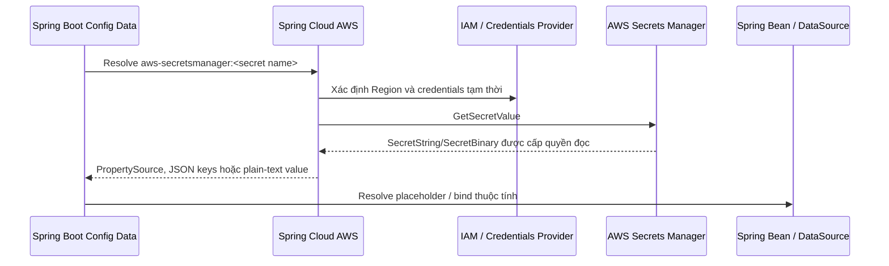
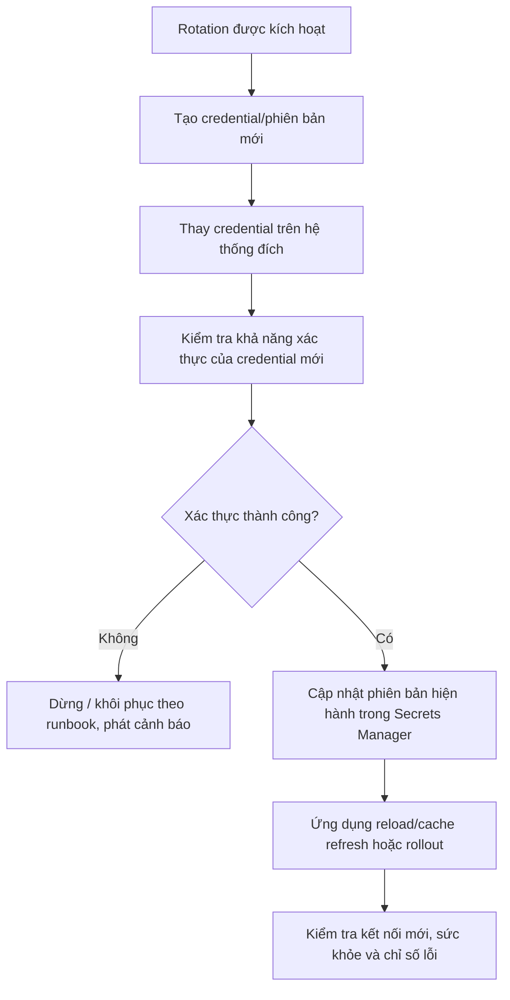

# Nạp Secrets Manager bằng Config Data

## 1. Bối cảnh và mục tiêu học tập

Trong module **SPRING_CLOUD_PROVIDER_INTEGRATION**, người học thực hành tích hợp Spring Boot với các dịch vụ managed của **AWS, Azure và Google Cloud** thông qua thư viện Spring Cloud tương ứng. Một phần quan trọng của tích hợp này là sử dụng **danh tính workload** để truy cập dịch vụ, bảo vệ secret, kiểm thử và vận hành an toàn khi cấu hình thay đổi.

Ở chương **Cấu hình AWS**, chúng ta cần đưa mật khẩu database, API key hoặc thông tin xác thực dịch vụ thứ ba vào Spring Boot mà không nhúng chúng trong `application.yml`, mã nguồn, ảnh container hay lịch sử Git. AWS Secrets Manager cung cấp kho bí mật có mã hóa, IAM policy, phiên bản và khả năng thiết kế rotation. **Spring Cloud AWS** cho phép ứng dụng đưa secret vào Spring `Environment` thông qua cơ chế **Config Data** của Spring Boot.

Sau khi học xong, bạn có thể:

1. Giải thích `spring.config.import=aws-secretsmanager:...` và giai đoạn Config Data được tải trong vòng đời Spring Boot.
2. Tổ chức secret theo ứng dụng/môi trường; phân biệt JSON secret, plain-text secret và `SecretBinary`.
3. Tích hợp Spring Cloud AWS 3.x, sử dụng `?prefix=`, placeholder và `@ConfigurationProperties` để đọc secret.
4. Cấp quyền truy cập tối thiểu bằng IAM role, phân biệt quyền Secrets Manager và quyền giải mã AWS KMS.
5. Xử lý secret bắt buộc/tùy chọn, rotation, reload, cấu hình đa môi trường và các lỗi thường gặp.
6. Thiết kế thử nghiệm có thể xác minh hành vi thực tế mà không để lộ secret.

> **Nguyên tắc:** Config Data giúp **nạp** secret thành property khi ứng dụng khởi động; nó không tự làm credential được xoay vòng tại hệ thống đích và cũng không mặc nhiên cập nhật tất cả kết nối đang mở. Cần thiết kế vòng đời rotation và làm mới ứng dụng như hai vấn đề riêng.

## 2. Phân biệt vai trò của Secrets Manager và Config Data

AWS Secrets Manager là dịch vụ lưu và quản lý **bí mật dùng để xác thực hoặc cấp quyền**, ví dụ:

- Username/password của PostgreSQL hoặc MySQL.
- API key của payment gateway.
- OAuth client secret hoặc refresh token.
- Webhook signing secret, private key hoặc credential của hệ thống thứ ba.

Secrets Manager lưu `SecretString` hoặc `SecretBinary`, mã hóa nội dung ở trạng thái lưu bằng AWS KMS, dùng IAM/resource policy để kiểm soát việc đọc/ghi và quản lý nhiều phiên bản. Nhãn `AWSCURRENT` thường biểu thị phiên bản hiện hành; `AWSPREVIOUS` có thể dùng trong quy trình rotation hoặc khôi phục tùy thiết kế. **Tạo secret không đồng nghĩa với tự động bật rotation**: việc cập nhật credential ở cơ sở dữ liệu hoặc API bên thứ ba còn cần cơ chế được hỗ trợ hoặc logic tự xây dựng.

Spring Boot **Config Data API** (xuất hiện từ Spring Boot 2.4) cho phép tải thêm nguồn cấu hình trong pha khởi động. Khi có starter tích hợp Secrets Manager, khai báo:

```properties
spring.config.import=aws-secretsmanager:/secrets/order-service/dev/database
```

sẽ yêu cầu Spring Cloud AWS tải secret tương ứng và đóng góp các property vào `Environment`. Các property đó có thể dùng qua `${...}`, `@Value` hoặc `@ConfigurationProperties`.



Với Config Data, ứng dụng vẫn cần kết nối AWS thành công trong giai đoạn khởi động. Giá trị tải từ AWS sẽ nằm trong **bộ nhớ của process** để Spring sử dụng. Lưu mã hóa trên AWS không có nghĩa là giá trị sẽ không xuất hiện trong heap, log hay endpoint giám sát nếu ứng dụng triển khai thiếu an toàn.

### So với Parameter Store

| Tiêu chí | Parameter Store | Secrets Manager |
| --- | --- | --- |
| Dữ liệu điển hình | URL, tên queue, timeout, cấu hình ít thay đổi | Password, token, API key, private key |
| Config Data prefix | `aws-parameterstore:` | `aws-secretsmanager:` |
| Nguồn được import | **Đường dẫn** chứa các parameter | **Tên/ARN của từng secret** |
| Cấu trúc dữ liệu | `String`, `StringList`, `SecureString` | JSON, plain-text `SecretString`, `SecretBinary` |
| Quản lý vòng đời credential | Không có rotation tự động chuyên dụng | Có khả năng rotation theo lịch khi cấu hình đúng |
| IAM đọc điển hình | `ssm:GetParametersByPath` | `secretsmanager:GetSecretValue` |
| KMS | Cần xem quyền KMS khi dùng `SecureString` | Cần xem KMS key policy và `kms:Decrypt` khi dùng customer managed key |

Không dùng Secrets Manager chỉ để lưu hàng trăm giá trị timeout không nhạy cảm. Ngược lại, không đưa mật khẩu thật vào một `String` của Parameter Store chỉ vì thao tác đọc có vẻ đơn giản hơn.

## 3. Thiết kế secret cho ứng dụng Spring Boot

Giả sử `order-service` chạy trên AWS và cần truy cập PostgreSQL. Thiết kế secret theo **service/môi trường/mục đích**:

```text
/secrets/order-service/dev/database
/secrets/order-service/staging/database
/secrets/order-service/prod/database
```

Mỗi môi trường có secret và IAM role riêng. Ví dụ nội dung **SecretString dạng JSON** của `/secrets/order-service/dev/database`:

```json
{
  "username": "orders_app",
  "password": "<SECRET_VALUE_ONLY_IN_AWS>"
}
```

`<SECRET_VALUE_ONLY_IN_AWS>` chỉ là ký hiệu trong tài liệu, **không phải password để triển khai**. Trên AWS thực, cần thay bằng giá trị được cấp qua quy trình an toàn, không commit JSON chứa mật khẩu vào repository.

Chỉ có hai trường JSON ở cấp cao nhất: `username`, `password`. Spring Cloud AWS sẽ đưa hai trường đó thành property khi secret được import. JSON top-level nhiều trường phù hợp với thông tin xác thực có liên quan chặt chẽ; không mặc nhiên coi mọi JSON lồng sâu là một cây property có thể bind như YAML. Nếu muốn cấu trúc phức tạp, cần kiểm thử mapping theo đúng phiên bản thư viện.

| Phần tên | Vai trò | Lưu ý |
| --- | --- | --- |
| `/secrets/` | Namespace phân biệt với cấu hình thường | Tên secret không phải ranh giới bảo mật tự động |
| `order-service` | Workload sở hữu credential | Tránh dùng chung tài khoản/secret giữa các dịch vụ |
| `dev`, `prod` | Môi trường | Tách quyền truy cập và chính sách rotation |
| `database` | Mục đích credential | Có thể gắn tags cho quản trị, không đưa secret value vào tags |

**Thực hành tạo secret:** Tạo một JSON secret tên `/secrets/order-service/dev/database` qua AWS Console hoặc quy trình secret provisioning được tổ chức phê duyệt. Chọn AWS Region, KMS key và IAM role ghi phù hợp. Tránh gõ password thật trực tiếp vào command-line argument vì có thể bị lưu trong shell history, telemetry hoặc log. Nếu tự động hóa bằng CLI, nên đưa payload bằng phương thức truyền dữ liệu bảo mật được môi trường CI/CD hỗ trợ, bảo vệ tệp tạm và xóa an toàn sau khi dùng.

## 4. Khai báo Spring Cloud AWS 3.x

Ví dụ sử dụng Spring Boot hiện đại và Spring Cloud AWS nhánh **3.x** (`io.awspring.cloud`). Chọn phiên bản theo **ma trận tương thích** Spring Boot/Spring Cloud AWS của dự án; cú pháp starter của Spring Cloud AWS 2.x có thể khác.

Thêm BOM và Secrets Manager starter trong `pom.xml`:

```xml
<dependencyManagement>
    <dependencies>
        <dependency>
            <groupId>io.awspring.cloud</groupId>
            <artifactId>spring-cloud-aws-dependencies</artifactId>
            <version>${spring-cloud-aws.version}</version>
            <type>pom</type>
            <scope>import</scope>
        </dependency>
    </dependencies>
</dependencyManagement>

<dependencies>
    <dependency>
        <groupId>io.awspring.cloud</groupId>
        <artifactId>spring-cloud-aws-starter-secrets-manager</artifactId>
    </dependency>
</dependencies>
```

Trong đó `${spring-cloud-aws.version}` là Maven property được dự án định nghĩa; cần chọn giá trị tương thích, không sử dụng bừa một phiên bản bất kỳ. BOM giúp đồng bộ phiên bản các artifact Spring Cloud AWS. Nếu ứng dụng dùng Spring Data JDBC/JPA, PostgreSQL driver hoặc `spring-boot-starter-jdbc` thì khai báo các dependency đó theo nhu cầu ứng dụng; chúng không phải yêu cầu riêng của Config Data.

`spring-cloud-aws-starter-secrets-manager` đăng ký cơ chế Config Data location resolver cho tiền tố `aws-secretsmanager:` và tự động cấu hình `SecretsManagerClient` trong Spring context. Người học không phải tự viết một `@PostConstruct` gọi AWS SDK để đọc secret rồi nhét thủ công vào `Environment`.

## 5. Nạp JSON secret bằng `spring.config.import`

### 5.1. Import bắt buộc theo profile

Đặt file `src/main/resources/application-dev.yml`:

```yaml
spring:
  config:
    import: "aws-secretsmanager:/secrets/order-service/dev/database?prefix=database."
  datasource:
    url: "${ORDERS_JDBC_URL}"
    username: "${database.username}"
    password: "${database.password}"
```

Ở ví dụ này:

1. Spring Boot đang chạy với profile `dev`, nên nạp `application-dev.yml`.
2. Config Data resolver gọi AWS Secrets Manager để lấy `/secrets/order-service/dev/database`.
3. Spring Cloud AWS phân tích các trường JSON top-level `username` và `password`.
4. `?prefix=database.` biến chúng thành `database.username` và `database.password`, được dùng làm placeholder cấu hình DataSource.
5. JDBC URL không chứa mật khẩu được đưa vào bằng biến môi trường `ORDERS_JDBC_URL`, ví dụ `jdbc:postgresql://db.dev.internal:5432/orders`, để tập trung minh họa secret trong bài này.

**Dấu `.` cuối prefix là cần thiết:** Prefix được nối nguyên văn vào tên property. Với `prefix=database` (không có dấu chấm), tên sẽ thành `databaseusername`, `databasepassword`, không phải `database.username`, `database.password`.

Khi cần triển khai production, file `application-prod.yml` trỏ đến **secret prod**:

```yaml
spring:
  config:
    import: "aws-secretsmanager:/secrets/order-service/prod/database?prefix=database."
  datasource:
    url: "${ORDERS_JDBC_URL}"
    username: "${database.username}"
    password: "${database.password}"
```

Chạy local với cấu hình phát triển:

```bash
java -jar order-service.jar --spring.profiles.active=dev
```

Chỉ khai báo import ở profile cần AWS. Nếu đặt import bắt buộc trong `application.yml` chung, ngay cả bài test sử dụng `test` profile cũng có thể gọi Secrets Manager khi khởi động. Việc phân tách import theo profile giúp unit test không phải có quyền AWS. Mặt khác, **profile không phải là lớp bảo mật**: IAM role của workload prod phải không được phép đọc secret dev, và ngược lại.

### 5.2. Tại sao cần prefix?

Không có prefix, JSON secret gồm `username` và `password` sẽ tạo ra hai property rất chung tên. Nếu ứng dụng import thêm secret của Redis hoặc một API provider, key `username` có thể trùng; giá trị cuối cùng phụ thuộc thứ tự ưu tiên các PropertySource.

Ví dụ hai secret:

| Secret name | JSON keys | Prefix | Property trong Spring |
| --- | --- | --- | --- |
| `/secrets/order-service/dev/database` | `username`, `password` | `db.` | `db.username`, `db.password` |
| `/secrets/order-service/dev/payment` | `apiKey`, `webhookSecret` | `payment.` | `payment.apiKey`, `payment.webhookSecret` |

Đặt prefix theo chức năng để giảm trùng key và giúp mã nguồn diễn đạt rõ nguồn dữ liệu.

### 5.3. Nạp nhiều secret

Spring Cloud AWS hỗ trợ khai báo nhiều tên secret bằng dấu `;` trong một location, chẳng hạn:

```properties
spring.config.import=aws-secretsmanager:/secrets/order-service/dev/database;/secrets/order-service/dev/payment
```

Tuy nhiên, khi cần **prefix riêng** hoặc phối hợp secret bắt buộc/tùy chọn, nên khai báo các location thành từng phần tử:

```yaml
spring:
  config:
    import:
      - "aws-secretsmanager:/secrets/order-service/dev/database?prefix=db."
      - "optional:aws-secretsmanager:/secrets/order-service/dev/payment?prefix=payment."
```

Ở đây secret database bắt buộc cho khởi động; secret payment có thể vắng mặt khi chưa bật tích hợp payment. Nếu bean thanh toán vẫn yêu cầu `${payment.apiKey}` nhưng secret không tồn tại, bean đó vẫn có thể bị lỗi khi tạo. `optional:` chỉ có ý nghĩa khi luồng ứng dụng thực sự chịu được việc thiếu secret.

Nếu ứng dụng dùng nhiều account, tài liệu Spring Cloud AWS cũng hỗ trợ import secret bằng **ARN** thay vì tên, ví dụ:

```properties
spring.config.import=aws-secretsmanager:arn:aws:secretsmanager:ap-southeast-1:111122223333:secret:team/shared/token-AbCdEf
```

ARN minh họa cần được thay bằng ARN thực tế; đọc xuyên tài khoản còn phụ thuộc **resource policy**, IAM policy, KMS key policy và thiết lập mạng/Region, chứ không tự hoạt động chỉ nhờ điền ARN.

## 6. Các dạng secret và cách truy cập property

### 6.1. JSON secret: nhiều property có liên quan

Một secret JSON là lựa chọn dễ quản lý khi một hệ thống phát hành một cặp credential, chẳng hạn:

```json
{
  "clientId": "orders-client",
  "clientSecret": "<SECRET_VALUE_ONLY_IN_AWS>"
}
```

Nếu tên là `/secrets/order-service/dev/oauth` và import:

```properties
spring.config.import=aws-secretsmanager:/secrets/order-service/dev/oauth?prefix=oauth.
```

thì các property là `oauth.clientId`, `oauth.clientSecret`. Bạn có thể dùng:

```java
import org.springframework.beans.factory.annotation.Value;
import org.springframework.stereotype.Service;

@Service
public class OAuthCredentialProvider {
    private final String clientId;
    private final String clientSecret;

    public OAuthCredentialProvider(
            @Value("${oauth.clientId}") String clientId,
            @Value("${oauth.clientSecret}") String clientSecret) {
        this.clientId = clientId;
        this.clientSecret = clientSecret;
    }

    // Dùng các giá trị này trong client xác thực, không ghi ra log.
}
```

Constructor trên minh họa việc **tiêm property đã được Config Data nạp**. Không thêm logging của `clientSecret`, không xuất trả property trong HTTP response và không viết `toString()` tiết lộ credential. Nếu cần nhóm nhiều trường, có thể dùng `@ConfigurationProperties` cùng validation; cẩn thận với `record.toString()`, Lombok `@Data` và những logger tự động in toàn bộ object.

### 6.2. Plain-text secret: một giá trị duy nhất

Secrets Manager cũng lưu một `SecretString` chỉ chứa **một chuỗi**. Ví dụ secret `/secrets/order-service/dev/webhook-signing-key` có một giá trị bất kỳ do hệ thống phát hành. Sau khi import:

```yaml
spring:
  config:
    import: "aws-secretsmanager:/secrets/order-service/dev/webhook-signing-key"
```

với cách ánh xạ tên secret ở Spring Cloud AWS 3.x, có thể tham chiếu **phần tên cuối** của secret:

```properties
webhook.signing-key=${webhook-signing-key}
```

Với plain text hoặc `SecretBinary`, tài liệu Spring Cloud AWS mô tả cơ chế sử dụng phần tên secret làm property; tuy nhiên cần cân nhắc biểu diễn dữ liệu nếu đó là khóa nhị phân thực sự. **Không dùng Config Data như cơ chế quản lý file certificate, key material dạng binary hoặc cấu trúc byte phức tạp nếu bạn chưa kiểm thử chuyển đổi và cách sử dụng**. Khi cần xử lý nhị phân theo bytes hoặc chủ động chọn version, có thể dùng AWS SDK `SecretsManagerClient` với quy trình cache/bảo mật rõ ràng.

### 6.3. Dùng `@ConfigurationProperties` với nhóm secret

Giả sử ứng dụng cũng có JSON payment secret:

```json
{
  "apiKey": "<SECRET_VALUE_ONLY_IN_AWS>",
  "webhookSecret": "<SECRET_VALUE_ONLY_IN_AWS>"
}
```

Nạp qua `?prefix=payment.` rồi bind vào class cấu hình:

```java
import org.springframework.boot.context.properties.ConfigurationProperties;

@ConfigurationProperties(prefix = "payment")
public record PaymentSecrets(
        String apiKey,
        String webhookSecret) {

    // Tránh record.toString() mặc định làm lộ credential khi bị log.
    @Override
    public String toString() {
        return "PaymentSecrets[REDACTED]";
    }
}
```

Đăng ký bằng `@ConfigurationPropertiesScan` trên main class hoặc `@EnableConfigurationProperties(PaymentSecrets.class)`. Nếu hai giá trị là bắt buộc, nên dùng `spring-boot-starter-validation`, `@Validated` và các ràng buộc như `@NotBlank` trên tham số/field để phát hiện thiếu dữ liệu lúc khởi động. Ví dụ tránh dùng cấu hình `optional:` với một bean yêu cầu các property này.

> **Ghi nhớ:** Spring `Environment` vẫn có thể chứa secret dạng chuỗi sau khi import. Việc tự viết class với `toString()` được che giá trị chỉ giải quyết một nguồn rò rỉ; không loại bỏ khả năng secret bị lộ từ HTTP diagnostics, cấu hình actuator, log request, debugger hoặc memory dump.

## 7. IAM, KMS và xác thực workload

### 7.1. Cấp danh tính cho ứng dụng

Ứng dụng chạy trên AWS nên nhận **temporary credentials** của workload:

| Môi trường | Danh tính phù hợp |
| --- | --- |
| Máy phát triển | AWS IAM Identity Center / AWS CLI profile được cấp quyền hạn chế |
| Amazon ECS | Task role của service |
| Amazon EKS | EKS Pod Identity hoặc IAM Roles for Service Accounts (IRSA) |
| Amazon EC2 | EC2 instance profile |
| AWS Lambda | Lambda execution role |

Đừng đặt `AWS_ACCESS_KEY_ID`, `AWS_SECRET_ACCESS_KEY` thật trong file cấu hình được commit, Docker image hoặc ví dụ code. Khi chạy trên AWS, Spring Cloud AWS/AWS SDK sử dụng chuỗi tìm kiếm credentials và Region phù hợp với môi trường. Nếu không có Region hợp lệ, Config Data có thể thất bại trước khi ứng dụng tạo bean.

Có thể chỉ định Region cho Secrets Manager:

```yaml
spring:
  cloud:
    aws:
      secretsmanager:
        region: ap-southeast-1
```

Hoặc dùng Region mặc định của workload/SDK khi cách đó nhất quán với thiết kế. **Cùng tên secret có thể tồn tại ở nhiều account hoặc Region**; luôn kiểm tra danh tính thực tế và Region, đặc biệt khi làm việc với `dev` và `prod`.

### 7.2. Policy đọc tối thiểu

Đối với đường dẫn `/secrets/order-service/dev/database`, ARN secret có thêm **hậu tố ngẫu nhiên** do AWS cấp; nên dùng ARN **chính xác** lấy từ tài nguyên thực. Policy minh họa (account, Region và hậu tố đều giả định):

```json
{
  "Version": "2012-10-17",
  "Statement": [
    {
      "Sid": "ReadOnlyDevDatabaseSecret",
      "Effect": "Allow",
      "Action": "secretsmanager:GetSecretValue",
      "Resource": "arn:aws:secretsmanager:ap-southeast-1:111122223333:secret:/secrets/order-service/dev/database-AbCdEf"
    }
  ]
}
```

Policy trên chỉ cho **đọc nội dung secret**, không cho tạo/xóa/cập nhật/rotate. IAM role dành cho luồng cấp/rotation secret cần quyền khác và được tách ra theo nguyên tắc **least privilege**. Nếu dùng wildcard như `database-*`, phải hiểu đó là một pattern quyền rộng hơn ARN cụ thể và kiểm tra kỹ những tài nguyên có thể khớp.

Để kiểm tra ARN hoặc metadata khi đã có quyền tương ứng, có thể sử dụng CLI mà **không đọc ra secret value**:

```bash
aws secretsmanager describe-secret \
  --secret-id /secrets/order-service/dev/database \
  --region ap-southeast-1 \
  --query "{Name:Name,ARN:ARN,RotationEnabled:RotationEnabled}"
```

Lệnh trên chỉ minh họa metadata. Quyền gọi `DescribeSecret` có thể cần cấp riêng cho nhóm vận hành, không nhất thiết cấp cho role ứng dụng chỉ cần `GetSecretValue`.

### 7.3. Khi dùng KMS customer managed key

Secrets Manager mã hóa nội dung secret bằng KMS. Nếu tổ chức sử dụng **customer managed KMS key**, role ứng dụng có thể cần thêm quyền `kms:Decrypt` và key policy phải cho phép thao tác này. Ví dụ statement giới hạn vào key giả định:

```json
{
  "Sid": "DecryptDevDatabaseSecret",
  "Effect": "Allow",
  "Action": "kms:Decrypt",
  "Resource": "arn:aws:kms:ap-southeast-1:111122223333:key/11111111-2222-3333-4444-555555555555",
  "Condition": {
    "StringEquals": {
      "kms:ViaService": "secretsmanager.ap-southeast-1.amazonaws.com"
    }
  }
}
```

Chỉ ghép statement KMS vào policy khi thực tế dùng đúng key đó; quyền IAM một mình chưa đủ nếu **key policy**, grants hoặc các cơ chế kiểm soát khác không cho phép. Điều kiện KMS còn có thể được thu hẹp qua encryption context của secret theo thiết kế của tổ chức. Với AWS managed key, chi tiết quyền và khả năng chia sẻ xuyên account khác; cần xác minh từng trường hợp.

**Không nên sửa lỗi `AccessDenied` bằng `Resource: "*"` hoặc `kms:*` trên mọi key.** Hãy xác định rõ request nào bị từ chối: `GetSecretValue` trên secret hay `Decrypt` trên KMS key.

### 7.4. Chia sẻ secret giữa account/Region

Nạp secret xuyên tài khoản không chỉ thay tên bằng ARN. AWS cần phối hợp:

1. Identity policy của role gọi API cho phép đúng secret ARN.
2. Resource-based policy phía secret cho phép principal được chọn.
3. KMS key và policy cho phép giải mã phù hợp; AWS managed key có những giới hạn với chia sẻ xuyên account.
4. Đường mạng và Region kết nối đúng nơi đặt secret.

Khi yêu cầu độ sẵn sàng nhiều Region, có thể đánh giá **multi-Region secret replication** của Secrets Manager, nhưng ứng dụng phải trỏ tới ARN/tên phù hợp ở Region mà nó phục vụ và cần thống nhất quy trình rotation, failover, cache.

## 8. Bắt buộc, tùy chọn và thứ tự ưu tiên cấu hình

### 8.1. Secret bắt buộc

```properties
spring.config.import=aws-secretsmanager:/secrets/order-service/prod/database
```

Nếu secret không tồn tại, import bắt buộc sẽ làm ứng dụng không thể khởi động thành công. Đây thường là hành vi mong muốn khi database credential là điều kiện để dịch vụ có thể phục vụ một cách đúng đắn.

Một secret tồn tại nhưng **thiếu key `password`** lại là trường hợp khác. Import vẫn có thể trả về những property còn lại; `${database.password}` sẽ không phân giải được nếu không có nguồn thay thế. Dùng **validation cấu hình** để phát hiện thiếu trường sớm và hiển thị lỗi có ý nghĩa, nhưng tuyệt đối không dump secret trong exception.

### 8.2. Secret tùy chọn

```yaml
spring:
  config:
    import: "optional:aws-secretsmanager:/secrets/order-service/dev/experimental-api?prefix=experimental."
```

`optional:` xử lý trường hợp **location không tồn tại** theo cơ chế Config Data. Nó không có nghĩa mọi lỗi IAM, KMS, timeout hoặc mạng sẽ bị bỏ qua. Một secret là tùy chọn khi dịch vụ có thể **không khởi tạo** phần tích hợp tương ứng và vẫn hoạt động đúng, ví dụ bật/tắt tính năng qua một flag độc lập.

### 8.3. Property precedence

Property đến từ Secrets Manager tham gia vào hệ thống property source của Spring Boot. Khi import vào Config Data, nó có thứ tự ưu tiên theo quy tắc của Config Data; các nguồn ưu tiên cao hơn như command-line arguments hoặc một số environment overrides có thể ghi đè tùy cấu hình.

**Bảo mật:** Không dựa hoàn toàn vào việc secret trên AWS đã đúng để kết luận giá trị ứng dụng đang dùng là giá trị đó. Cấu hình cùng tên từ môi trường chạy/CLI có thể ghi đè. Mặt khác, không đẩy credential thật qua CLI argument để sửa tạm khi deployment; đây là nguồn gây lộ secrets trong lịch sử lệnh và quan sát process.

Đặt prefix riêng cho từng secret, hạn chế khai báo cùng property trong nhiều nguồn và kiểm soát rõ thứ tự import. Nếu có hai secret cùng tạo `password` mà không có prefix, ứng dụng có thể dùng credential ngoài ý muốn mà không dễ nhận biết.

## 9. Rotation, reload và ảnh hưởng tới ứng dụng đang chạy

### 9.1. Phân biệt ba thay đổi

| Hoạt động | Hệ thống nào xử lý? | Tác động thực tế |
| --- | --- | --- |
| **Thay giá trị của secret** | Secrets Manager API và người/quy trình có quyền ghi | Có phiên bản secret mới, nhãn hiện hành có thể thay đổi |
| **Thay credential ở dịch vụ đích** | Database, API provider, Lambda rotation hoặc cơ chế rotation được hỗ trợ | Credential cũ có thể hết hạn; hệ thống đích chấp nhận credential mới |
| **Cập nhật credential trong ứng dụng** | Spring Boot, SDK cache, client/connection pool hoặc rollout | Những request/kết nối mới dùng đúng credential đang có hiệu lực |

Ba hoạt động phải được phối hợp. Ví dụ, nếu rotation đổi mật khẩu PostgreSQL thành công nhưng `HikariDataSource` trong một pod vẫn lưu mật khẩu cũ từ lúc khởi động, những kết nối mới có thể thất bại sau khi connection pool cần mở kết nối mới. Ngược lại, đổi property trong JVM chưa đảm bảo database đã chấp nhận credential mới.

### 9.2. Cách hoạt động mặc định của Config Data

Với cấu hình:

```yaml
spring:
  config:
    import: "aws-secretsmanager:/secrets/order-service/prod/database?prefix=database."
```

Spring Cloud AWS nạp secret trong **pha khởi động**. Nếu sau đó một phiên bản mới của secret trở thành `AWSCURRENT`, các property và bean đã được tạo **không tự cập nhật ngay**.

Có ba hướng triển khai phổ biến:

1. **Rollout/restart ứng dụng có kiểm soát:** đọc lại secret ở lần startup kế tiếp; thường đơn giản và dễ quan sát cho dịch vụ có quy trình release tốt.
2. **Dùng chức năng PropertySource reload của Spring Cloud AWS:** polling thay đổi rồi `refresh` cấu hình hoặc restart application context; cần cấu hình các dependency bổ sung và kiểm thử từng loại bean.
3. **Dùng AWS SDK/secret caching tại runtime:** thích hợp khi hệ thống phải thay credential linh hoạt; cần quản lý TTL, retry, concurrency và vòng đời connection pool bằng code.

### 9.3. Cấu hình PropertySource reload khi thực sự cần

Spring Cloud AWS 3.4.x có chức năng reload **mặc định tắt**. Khi bật, thư viện có thể polling secret và kích hoạt một chiến lược refresh. Ví dụ để bật `refresh`:

```yaml
spring:
  cloud:
    aws:
      secretsmanager:
        reload:
          strategy: refresh
          period: 1m
```

Theo tài liệu Spring Cloud AWS 3.4.x, chức năng này cần những dependency hỗ trợ như:

```xml
<dependencies>
    <dependency>
        <groupId>org.springframework.boot</groupId>
        <artifactId>spring-boot-starter-actuator</artifactId>
    </dependency>
    <dependency>
        <groupId>org.springframework.cloud</groupId>
        <artifactId>spring-cloud-commons</artifactId>
    </dependency>
    <dependency>
        <groupId>org.springframework.cloud</groupId>
        <artifactId>spring-cloud-context</artifactId>
    </dependency>
</dependencies>
```

Hai chiến lược được tài liệu mô tả:

- `refresh`: dùng Spring Cloud Context để làm mới các bean cấu hình theo cơ chế hỗ trợ của `@ConfigurationProperties` hoặc `@RefreshScope`. Các bean khác, connection pool hoặc HTTP client **không chắc tự được xây dựng lại** chỉ vì một property thay đổi.
- `restart_context`: cố gắng restart Spring application context. Chiến lược này có thêm điều kiện về Spring Boot Actuator restart endpoint, phù hợp thư viện, quyền và gián đoạn trong quá trình restart; **không tùy tiện mở public endpoint restart** ở production.

Giá trị `period: 1m` là ví dụ nhịp polling, không phải cam kết mọi pod sẽ nhận giá trị đồng thời sau đúng một phút. Cần kiểm chứng thời điểm phát hiện thay đổi, cách giải quyết race condition với rotation, connection pool, trạng thái ứng dụng và retry.

Để chọn chiến lược:

| Hệ thống | Phương án tham khảo | Điều cần xác minh |
| --- | --- | --- |
| Ứng dụng ít đổi secret, triển khai rolling update | Restart/rollout có kiểm soát | Pod mới đọc secret mới, Pod cũ thoát an toàn |
| Cấu hình bean đơn giản cần cập nhật định kỳ | `refresh` | Bean thực sự nhận property mới và thread dùng được giá trị mới |
| Container có nhiều singleton phụ thuộc lẫn nhau | Cân nhắc restart context hoặc rollout | Gián đoạn, cleanup tài nguyên, readiness, session |
| Database credential rotate thường xuyên | AWS SDK caching/refresh hoặc rollout | Connection pool nhận credential mới và reconnect thành công |
| Ứng dụng cần lấy secret tại thời điểm request đặc biệt | SDK client + cache phù hợp | Quota API, IAM, TTL và xử lý lỗi mạng |

**Lưu ý:** Cấu hình reload và dependency có thể thay đổi giữa các phiên bản Spring Cloud AWS. Đối chiếu đúng tài liệu phiên bản đang dùng trước khi bật trong production.

### 9.4. Thiết kế quy trình rotation database

Giả sử database password được tự động xoay vòng:



Đây là sơ đồ **khái niệm**. Cơ chế rotation thực của AWS có thể dùng các bước/nhãn như `AWSPENDING` và `AWSCURRENT`; chi tiết phụ thuộc managed rotation, Lambda rotation, chiến lược một người dùng/hai người dùng và loại database. Không tự thay nhãn phiên bản bằng tay khi chưa hiểu quy trình rotation.

Trong thiết kế hệ thống thực tế, cần xác định khoảng thời gian credential cũ và mới cùng được chấp nhận, cách tạo kết nối mới, timeout, retries và cách rollback khi kiểm tra credential thất bại. Một quy trình rotation thiếu bước kiểm tra kết nối ứng dụng có thể gây gián đoạn dù cập nhật secret trên AWS thành công.

### 9.5. TTL, quota và chi phí

Secrets Manager có phí dựa trên lượng secret, số API call và các dịch vụ đi kèm tùy cấu hình/Region. Với cơ chế polling `GetSecretValue` hoặc tương đương, số lần gọi tăng theo số instance và nhịp polling. Khi sử dụng cache hoặc reload:

- Ước lượng số request gần đúng: **số instance × số lần polling mỗi instance × số secret**, cộng các lần gọi lúc khởi động và retry (hành vi chính xác tùy triển khai thư viện).
- Chọn chu kỳ refresh theo rotation và yêu cầu cập nhật, tránh gọi Secrets Manager cho mọi HTTP request.
- Chú ý rate limiting/throttling khi hàng trăm pod cùng khởi động hoặc sau deployment.
- Theo dõi lỗi nhận secret, retry, kết nối database và chi phí API thay vì chỉ theo dõi thời điểm AWS cập nhật secret.

Không dùng bộ nhớ đệm vô thời hạn nếu secret có thể bị thu hồi, và không xuất secret sang distributed cache không được mã hóa/quản lý quyền đúng cách.

## 10. Kiểm thử Config Data và secret an toàn

### 10.1. Test business logic mà không gọi AWS

Tách file chứa import AWS theo profile. Ví dụ:

```yaml
# application-dev.yml: dùng AWS thật ở môi trường dev
spring:
  config:
    import: "aws-secretsmanager:/secrets/order-service/dev/payment?prefix=payment."
```

```yaml
# application-test.yml: dùng dữ liệu giả dành riêng cho test
payment:
  api-key: test-only-placeholder-key
  webhook-secret: test-only-placeholder-webhook-key
```

Không để `spring.config.import` bắt buộc trỏ AWS trong `application.yml` chung nếu muốn test hoàn toàn offline; chỉ thêm test properties không ngăn việc Config Data đã cố kết nối AWS trong pha startup.

Ví dụ unit test cho `PaymentSecrets` với `ApplicationContextRunner` (cần `spring-boot-starter-test` trong test scope):

```java
import static org.assertj.core.api.Assertions.assertThat;

import org.junit.jupiter.api.Test;
import org.springframework.boot.context.properties.EnableConfigurationProperties;
import org.springframework.boot.test.context.runner.ApplicationContextRunner;
import org.springframework.context.annotation.Configuration;

class PaymentSecretsBindingTest {
    @Configuration(proxyBeanMethods = false)
    @EnableConfigurationProperties(PaymentSecrets.class)
    static class TestConfig {
    }

    private final ApplicationContextRunner contextRunner =
            new ApplicationContextRunner()
                    .withUserConfiguration(TestConfig.class)
                    .withPropertyValues(
                            "payment.api-key=test-only-placeholder-key",
                            "payment.webhook-secret=test-only-placeholder-webhook-key"
                    );

    @Test
    void bindsSecretPropertiesWithoutAws() {
        contextRunner.run(context -> {
            PaymentSecrets value = context.getBean(PaymentSecrets.class);
            assertThat(value.apiKey()).isEqualTo("test-only-placeholder-key");
            assertThat(value.webhookSecret())
                    .isEqualTo("test-only-placeholder-webhook-key");
            assertThat(value.toString()).doesNotContain("test-only-placeholder-key");
        });
    }
}
```

Test này xác minh **binding** property vào Java, chưa xác minh hoạt động mạng, IAM hay KMS của Secrets Manager. Để kiểm tra integration thật cần môi trường AWS sandbox. Có thể dùng công cụ mô phỏng như LocalStack khi hành vi cần test được hỗ trợ, nhưng không nên lấy đó làm chứng cứ duy nhất cho quyền IAM/KMS, rotation và cross-account access.

### 10.2. Kiểm thử tích hợp trên account sandbox

Chuẩn bị secret JSON chỉ chứa credential sandbox, IAM role đọc đúng ARN và ứng dụng chạy dưới `dev` profile. Sau đó kiểm tra:

| Tình huống | Kết quả cần quan sát |
| --- | --- |
| Đúng account, Region, secret name, IAM role | Ứng dụng startup, bind đủ các trường JSON |
| Sai Region hoặc account | Không tìm được secret, error có ngữ cảnh nhưng không lộ dữ liệu |
| Secret bắt buộc bị xóa/đổi tên | Khởi động thất bại ở pha Config Data |
| Secret tùy chọn vắng mặt | Phần tích hợp tùy chọn không khởi chạy, ứng dụng vẫn ổn định |
| Có secret nhưng thiếu JSON key bắt buộc | Placeholder/binding/validation fail rõ ràng |
| Role thiếu `secretsmanager:GetSecretValue` | `AccessDenied` tại Secrets Manager |
| Dùng custom KMS key nhưng thiếu quyền giải mã | Xác định lỗi KMS/IAM policy hoặc key policy |
| Có hai JSON secret với key `password` | Prefix giúp tránh nhầm/ghi đè property |
| Secret rotate khi DataSource đang có kết nối | Xác minh khi nào kết nối mới dùng credential mới |
| 50–100 instance cùng khởi động | Quan sát timeout/throttling, startup latency và retry |

Những bài test với secret thật nên diễn ra trên account sandbox, dùng credential ngắn hạn, có giới hạn quyền và xóa các tài nguyên thử nghiệm bằng quy trình được phê duyệt sau khi hoàn tất.

### 10.3. Kiểm thử không làm lộ giá trị bí mật

Đối với cơ chế bảo mật, điều ta cần xác minh thường là **có đọc được đúng credential và truy cập hệ thống đích thành công không**, không phải in giá trị credential ra terminal. Tránh:

- Gọi `aws secretsmanager get-secret-value` rồi gửi toàn bộ output vào log CI/CD hoặc ticket hỗ trợ.
- Log `Environment`, `@ConfigurationProperties` chứa secret, HTTP authentication header hoặc chuỗi kết nối có password.
- Bật công khai Spring Boot Actuator endpoints `/env`, `/configprops`, `/heapdump` hoặc debug dumps.
- Đưa JSON secret thật vào test fixture, ảnh màn hình, error message, trace và tài liệu hướng dẫn.

Ngay cả khi Spring Boot có cơ chế che dữ liệu của Actuator, cần cấu hình endpoint và quyền truy cập phù hợp; không dựa vào việc key đặt tên `password` là đủ để ngăn mọi kiểu lộ dữ liệu.

## 11. Chẩn đoán lỗi thực tế

| Triệu chứng | Nguyên nhân thường gặp | Cách kiểm tra |
| --- | --- | --- |
| Không nhận tiền tố `aws-secretsmanager:` | Thiếu starter, BOM/phiên bản không tương thích | Kiểm tra Maven dependency và tài liệu Spring Cloud AWS cho phiên bản đang dùng |
| `ResourceNotFoundException` | Sai tên/ARN, Region hoặc account | So sánh `spring.config.import`, metadata secret và danh tính chạy ứng dụng |
| `AccessDeniedException` khi gọi API | IAM role thiếu `GetSecretValue` hoặc resource policy từ chối | Kiểm tra role workload và ARN cụ thể |
| Bị từ chối khi giải mã | Customer managed KMS key không cho `Decrypt` | Kiểm tra key policy, IAM policy và điều kiện KMS |
| `${database.password}` không resolve | Thiếu JSON key hoặc sai `?prefix=` | Kiểm tra **tên key** và prefix; không in password |
| App đọc credential của môi trường khác | Active profile, Region, account hoặc override sai | So sánh config locations, role, profile và nguồn property |
| Secret mới nhưng DB login vẫn thất bại | Connection pool/bean chưa nhận giá trị mới, rotation chưa đồng bộ | Kiểm tra trạng thái rotation, refresh/rollout và các kết nối mới |
| Startup chậm hoặc lỗi ngắt quãng | Mạng, VPC endpoint, DNS, throttling, retry | Xác minh đường mạng đến Secrets Manager và metrics/SDK errors |
| Secret không thay khi đã bật reload | Thiếu dependency, strategy chưa bật, bean không hỗ trợ refresh | Đối chiếu cấu hình reload và lifecycle của bean |
| `optional:` vẫn không khởi động | Lỗi IAM/KMS/mạng hoặc bean vẫn cần property bắt buộc | Phân biệt location bị thiếu với lỗi truy xuất hoặc binding |

Thứ tự debug gợi ý: **starter/phiên bản → active profile → secret name/ARN → account/Region → IAM/resource policy → KMS → cấu trúc JSON/prefix → property precedence → reload/rotation → tài nguyên đích**.

Khi cần kiểm tra quyền, dùng metadata (`DescribeSecret`) và CloudTrail trong phạm vi được cấp phép. Không truy xuất secret value chỉ để chụp ảnh màn hình hoặc đưa vào yêu cầu hỗ trợ.

## 12. Bài tập thực hành tổng hợp

Một ứng dụng `payment-service` chạy trên ECS cần:

```text
payment.api-key
payment.webhook-secret
database.username
database.password
payment.gateway-url
payment.timeout
```

Hãy thiết kế tích hợp Secrets Manager bằng Config Data theo yêu cầu:

1. Tạo hai JSON secret trong **sandbox**: `/secrets/payment-service/dev/gateway` chứa `apiKey`, `webhookSecret` và `/secrets/payment-service/dev/database` chứa `username`, `password`.
2. Đặt `gateway-url` và `timeout` ở nguồn cấu hình **không bí mật** (ví dụ Parameter Store), không lưu credential trong URL.
3. Khai báo `application-dev.yml` với hai `spring.config.import` và prefix tương ứng `payment.` và `database.`; sử dụng `${payment.apiKey}` và `${database.password}` trong client/DataSource phù hợp.
4. Viết IAM task role **chỉ đọc** hai ARN cụ thể. Nếu một secret dùng customer managed KMS key, bổ sung quyền giải mã trên đúng key cùng key policy thích hợp.
5. Tạo `application-test.yml` sử dụng giá trị giả để test binding offline; không cần kết nối AWS.
6. Mô tả kịch bản khi secret gateway vắng mặt, khi key JSON bị thiếu, khi role mất quyền đọc và khi xoay vòng mật khẩu database. Phân biệt lỗi startup và lỗi kết nối tại runtime.
7. Chọn chiến lược sau rotation (`rollout`, `refresh`, `restart_context` hoặc SDK cache) và chứng minh cách ứng dụng tiếp tục xử lý request sau khi credential cũ hết hiệu lực.

**Sản phẩm mong đợi:** Cây tên secret theo môi trường, JSON schema, Maven dependencies, Config Data YAML, policy IAM/KMS, test binding và kế hoạch rotation/rollback có thể kiểm chứng.

## 13. Liên hệ với Azure và Google Cloud

Trong module **SPRING_CLOUD_PROVIDER_INTEGRATION**, hãy liên hệ cùng một yêu cầu **nạp secret an toàn vào Spring Boot** với các nền tảng khác:

| Khía cạnh | AWS | Azure | Google Cloud |
| --- | --- | --- | --- |
| Dịch vụ secret | AWS Secrets Manager | Azure Key Vault | Google Cloud Secret Manager |
| Danh tính của workload | IAM role | Managed Identity | Service Account / Workload Identity |
| Phân quyền | IAM, resource policy, KMS key policy | Azure RBAC/access policy và quản lý key thích hợp | Google Cloud IAM và Cloud KMS khi dùng customer-managed encryption |
| Nạp vào Spring Boot | Spring Cloud AWS Config Data `aws-secretsmanager:` | Spring Cloud Azure hoặc Azure SDK theo cấu hình phù hợp | Thư viện Google Cloud/Spring tích hợp hoặc SDK theo dịch vụ và phiên bản |
| Đổi secret khi ứng dụng chạy | Cần chiến lược reload/cache/rollout | Cần kiểm tra refresh và cách cập nhật client của Azure | Cần kiểm tra phiên bản secret, refresh và vòng đời client của Google Cloud |

Không sao chép nguyên tiền tố `spring.config.import`, cấu trúc IAM policy, cách đánh số phiên bản hoặc mặc định refresh từ provider này sang provider khác. Chọn cơ chế cụ thể theo SDK, framework và quy định của môi trường triển khai.

## Tổng kết

Để **nạp Secrets Manager bằng Config Data**, thêm starter Spring Cloud AWS tương thích, khai báo `aws-secretsmanager:` trỏ tới **tên/ARN secret**, tổ chức JSON key rõ ràng, dùng `?prefix=` để tránh đụng tên và bind giá trị vào ứng dụng thông qua Spring `Environment`. Một triển khai đáng tin cậy phải có **IAM role với quyền đọc tối thiểu**, KMS phù hợp, phân tách dev/prod, xử lý secret bắt buộc/tùy chọn và bảo vệ mọi đường có thể làm rò rỉ giá trị đã nạp. Khi rotation xảy ra, cần kiểm chứng **cả ứng dụng lẫn dịch vụ đích** sử dụng credential mới; chỉ thấy `AWSCURRENT` thay đổi là chưa đủ.

## Tài liệu tham khảo

- [Spring Cloud AWS 3.4.2 Reference — Secrets Manager Integration](https://docs.awspring.io/spring-cloud-aws/docs/3.4.2/reference/html/index.html#secrets-manager-integration) — `spring.config.import`, JSON, plain text, prefix, IAM và reload.
- [Spring Boot Reference — Externalized Configuration](https://docs.spring.io/spring-boot/reference/features/external-config.html) — Config Data, profile, placeholder, property precedence.
- [AWS Secrets Manager User Guide](https://docs.aws.amazon.com/secretsmanager/latest/userguide/) — quản lý secret, mã hóa, phiên bản và rotation.
- [AWS: Authentication and access control for Secrets Manager](https://docs.aws.amazon.com/secretsmanager/latest/userguide/auth-and-access.html) — IAM/resource policy và KMS.
- [AWS: Rotate Secrets](https://docs.aws.amazon.com/secretsmanager/latest/userguide/rotating-secrets.html) — lịch và cơ chế rotation.
- [AWS Secrets Manager Pricing](https://aws.amazon.com/secrets-manager/pricing/) — đánh giá phí secret, API và các chi phí liên quan.
