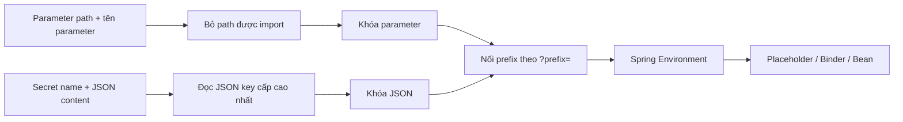

# Ánh xạ đường dẫn, tiền tố và khóa bí mật vào thuộc tính Spring

## Mục tiêu bài học

Module **SPRING_CLOUD_PROVIDER_INTEGRATION** hướng dẫn tích hợp Spring Boot với dịch vụ managed của **AWS, Azure và Google Cloud** qua các thư viện Spring Cloud tương ứng, từ danh tính và quyền truy cập đến storage, messaging, dữ liệu, secret và kiểm thử tích hợp. Trong chương **Cấu hình AWS**, việc nạp được dữ liệu từ Parameter Store hay Secrets Manager chỉ là bước đầu. Ứng dụng còn phải biết **giá trị đó xuất hiện dưới tên property nào trong Spring `Environment`** và làm cách nào tránh trùng tên giữa nhiều dịch vụ, nhiều môi trường.

Ví dụ: ứng dụng có hai bí mật cùng chứa key `password`: một mật khẩu database và một mật khẩu hệ thống đối tác. Nếu import cả hai mà không quản lý tên property, Spring có thể nhìn thấy hai nguồn cùng cung cấp `password`. Sự nhầm lẫn này có thể dẫn đến lỗi kết nối, cấu hình bị ghi đè hoặc lộ quyền truy cập ngoài ý muốn.

Sau bài học, bạn có thể:

1. Giải thích ba lớp tên: **tên tài nguyên trên AWS**, **tên phần tử bên trong tài nguyên**, và **tên property cuối cùng trong Spring**.
2. Ánh xạ tên parameter theo path bằng `aws-parameterstore:` và khóa JSON secret bằng `aws-secretsmanager:`.
3. Sử dụng `?prefix=` đúng cú pháp, bao gồm dấu `/` kết thúc path và dấu `.` kết thúc prefix.
4. Nạp nhiều nguồn cấu hình mà vẫn tách biệt namespace, bind vào `@ConfigurationProperties` và phát hiện thiếu giá trị.
5. Kiểm tra precedence, profile, IAM/KMS, rotation và chẩn đoán lỗi mapping trong triển khai Spring Boot.

> **Phạm vi phiên bản:** Các ví dụ sử dụng **Spring Boot Config Data** và **Spring Cloud AWS 3.x** (`io.awspring.cloud`), minh họa theo cú pháp tham khảo của Spring Cloud AWS 3.4.2. Trước khi đưa vào dự án thật, chọn phiên bản Spring Cloud AWS tương thích với Spring Boot và đối chiếu tài liệu của đúng phiên bản đang dùng.

## 1. Ba lớp tên trong một phép ánh xạ

Phân biệt các khái niệm trước khi cấu hình:

| Lớp | Parameter Store | Secrets Manager | Ý nghĩa đối với Spring Boot |
| --- | --- | --- | --- |
| **Tên tài nguyên** | `/config/order-service/dev/catalog.timeout` | `/secrets/order-service/dev/database` | Cho biết **đọc dữ liệu từ đâu** |
| **Khóa gốc** | `catalog.timeout` sau khi bỏ prefix path đã import | `username`, `password` trong JSON secret | Cho biết **tên thuộc tính ban đầu** |
| **Prefix property** | `app.` nếu import có `?prefix=app.` | `db.` nếu import có `?prefix=db.` | Được **nối nguyên văn** vào khóa gốc |
| **Spring property** | `app.catalog.timeout` | `db.username`, `db.password` | Tên ứng dụng đọc qua `${...}` hoặc binder |

Một tên tài nguyên có thể rất dài; nó không buộc property của Spring phải dài tương ứng. Chẳng hạn:

```text
AWS Parameter Store:
  path được import = /config/order-service/dev/
  tên đầy đủ     = /config/order-service/dev/catalog.timeout
  khóa gốc       = catalog.timeout
  prefix         = app.
  Spring property= app.catalog.timeout

AWS Secrets Manager:
  secret được import = /secrets/order-service/dev/database
  JSON key            = password
  prefix              = db.
  Spring property     = db.password
```



`Spring Environment` có thể chứa nhiều `PropertySource` cùng cung cấp một tên. Khi có xung đột, giá trị hiệu lực phụ thuộc **thứ tự ưu tiên property source**. Vì vậy nên chủ động thiết kế namespace để các nguồn không va chạm, thay vì dựa vào thứ tự nhập để che giấu sự trùng lặp.

## 2. Ánh xạ Parameter Store: path, tên parameter và prefix

### 2.1. Không có prefix: lấy tên ở dưới path

Giả sử trong AWS Systems Manager Parameter Store có ba parameter `String`:

| Tên đầy đủ trên AWS | Giá trị ví dụ | Tên property sau import |
| --- | --- | --- |
| `/config/order-service/dev/catalog.base-url` | `https://catalog.dev.example.internal` | `catalog.base-url` |
| `/config/order-service/dev/catalog.timeout` | `2s` | `catalog.timeout` |
| `/config/order-service/dev/catalog.max-retries` | `3` | `catalog.max-retries` |

Trong `application-dev.yml`:

```yaml
spring:
  config:
    import: "aws-parameterstore:/config/order-service/dev/"
```

Spring Cloud AWS đọc những parameter thuộc path `/config/order-service/dev/`. Với các parameter minh họa trên, phần path được bỏ khỏi tên property và các khóa còn lại được đưa vào Spring `Environment`.

Ví dụ trong code:

```java
@Value("${catalog.timeout}")
private Duration timeout;
```

`2s` được Spring Boot chuyển thành `Duration` khi bind. AWS vẫn lưu nó như **chuỗi**; `Duration` là kiểu dữ liệu của ứng dụng.

**Dấu `/` ở cuối path quan trọng.** Trong Spring Cloud AWS 3.x, đường dẫn sau `aws-parameterstore:` được dùng để tìm parameter. Viết đầy đủ `/config/order-service/dev/` giúp phân biệt prefix path với tên property và tránh ghép đường dẫn sai; không nên giả định framework tự thêm dấu `/` vào mọi tên.

### 2.2. Thêm prefix để tránh đụng tên

Giả sử một thư viện khác cũng sử dụng `catalog.timeout`. Ta muốn nhóm các property được quản lý bởi đội vận hành dưới `app.`:

```yaml
spring:
  config:
    import: "aws-parameterstore:/config/order-service/dev/?prefix=app."
```

Kết quả:

| Tên parameter | Khóa trước prefix | Khóa sau prefix |
| --- | --- | --- |
| `/config/order-service/dev/catalog.base-url` | `catalog.base-url` | `app.catalog.base-url` |
| `/config/order-service/dev/catalog.timeout` | `catalog.timeout` | `app.catalog.timeout` |
| `/config/order-service/dev/catalog.max-retries` | `catalog.max-retries` | `app.catalog.max-retries` |

Chuỗi `?prefix=app.` là **một phần của Config Data import location**, không được thêm vào tên tham số trên AWS.

Prefix được **nối nguyên văn**, không tự thêm dấu phân cách:

| Cú pháp import | Property tạo thành từ `catalog.timeout` |
| --- | --- |
| `...?prefix=app.` | `app.catalog.timeout` |
| `...?prefix=app` | `appcatalog.timeout` |
| Không có `?prefix=` | `catalog.timeout` |

Vì vậy `?prefix=app` thường là lỗi nếu mục đích là nhóm property theo namespace `app`. Dấu `.` kết thúc prefix thuộc trách nhiệm người thiết kế.

### 2.3. Nạp nhiều path và phân biệt cấu hình chung/riêng

Một ứng dụng có thể dùng cấu hình chung và cấu hình riêng, ví dụ:

```text
/config/shared/dev/http.timeout
/config/shared/dev/http.connect-timeout

/config/order-service/dev/catalog.timeout
/config/order-service/dev/catalog.base-url
```

Có thể import thành hai location với prefix riêng:

```yaml
spring:
  config:
    import:
      - "aws-parameterstore:/config/shared/dev/?prefix=shared."
      - "aws-parameterstore:/config/order-service/dev/?prefix=app."
```

Kết quả là `shared.http.timeout`, `shared.http.connect-timeout`, `app.catalog.timeout`, `app.catalog.base-url`. Phân tách namespace cho phép người đọc biết mỗi property đến từ nguồn nào. Nếu muốn cùng một namespace để ghi đè mặc định có chủ đích, cần hiểu và kiểm thử precedence theo phiên bản Spring Boot; không nên tạo ra hai key trùng nhau một cách vô tình.

Spring Cloud AWS cũng cho phép liệt kê nhiều path, phân tách bởi dấu `;`, chẳng hạn:

```properties
spring.config.import=aws-parameterstore:/config/shared/dev/;/config/order-service/dev/
```

Khi cần **prefix khác nhau** hoặc trộn import bắt buộc/tùy chọn, dùng các phần tử `spring.config.import` riêng như ví dụ YAML sẽ dễ kiểm tra hơn.

### 2.4. Một số tên đặc biệt và danh sách có chỉ số

Các tên property trong Spring hỗ trợ dạng dấu chấm, dấu gạch nối và cú pháp chỉ số. Tài liệu Spring Cloud AWS 3.4.2 nêu quy ước đặt tên parameter kiểu:

```text
/config/order-service/dev/worker.names_0_
/config/order-service/dev/worker.names_1_
```

để được giải quyết thành các tên dạng `worker.names[0]`, `worker.names[1]`. Nếu import path có `?prefix=app.`, các tên sẽ tương ứng `app.worker.names[0]`, `app.worker.names[1]`, thuận tiện khi bind `List<String>`.

Tuy nhiên đừng tự suy đoán rằng mọi quy ước tên lồng nhau, dấu gạch dưới hoặc ký tự đặc biệt đều được chuyển chính xác theo ý định. Kiểm thử tên sau import bằng binder; tên resource trên AWS còn phải đáp ứng quy tắc đặt tên của Parameter Store. Với danh sách ngắn ít thay đổi, `StringList` có thể phù hợp, nhưng cần kiểm tra cách Spring chuyển dấu phẩy và các giá trị có dấu phân cách.

## 3. Ánh xạ Secrets Manager: tên secret, JSON key và prefix

### 3.1. JSON secret: mỗi khóa cấp cao nhất thành property

Secret có tên:

```text
/secrets/order-service/dev/database
```

Nội dung `SecretString` dạng JSON minh họa:

```json
{
  "username": "orders_app",
  "password": "<gia-tri-bi-mat-tai-AWS>"
}
```

Đối với import:

```yaml
spring:
  config:
    import: "aws-secretsmanager:/secrets/order-service/dev/database"
```

các khóa JSON **cấp cao nhất** được đưa vào `Environment` với tên `username`, `password`. Những tên này quá chung nếu ứng dụng có nhiều loại credential.

Thêm prefix:

```yaml
spring:
  config:
    import: "aws-secretsmanager:/secrets/order-service/dev/database?prefix=db."
```

Kết quả:

| JSON key | Prefix | Spring property |
| --- | --- | --- |
| `username` | `db.` | `db.username` |
| `password` | `db.` | `db.password` |

Khi đó có thể viết:

```yaml
spring:
  datasource:
    username: "${db.username}"
    password: "${db.password}"
```

**Không nên đưa mật khẩu thật vào ví dụ, repository, ảnh container hoặc log.** Trong ví dụ JSON, `<gia-tri-bi-mat-tai-AWS>` chỉ là placeholder trong tài liệu, không phải giá trị để sử dụng trong hệ thống thực.

### 3.2. Hai secret đều chứa `password`: phải tách namespace

Giả sử Secrets Manager lưu hai secret:

```text
/secrets/order-service/dev/database
  {"username":"orders_app","password":"<placeholder>"}

/secrets/order-service/dev/partner-api
  {"username":"partner_client","password":"<placeholder>"}
```

Nếu import cả hai mà không có prefix, cả hai cùng tạo `username` và `password`. Việc tham chiếu `${password}` lúc này mơ hồ và phụ thuộc thứ tự ưu tiên. Thay bằng:

```yaml
spring:
  config:
    import:
      - "aws-secretsmanager:/secrets/order-service/dev/database?prefix=db."
      - "aws-secretsmanager:/secrets/order-service/dev/partner-api?prefix=partner."
```

Các property lúc này là:

```text
db.username
db.password
partner.username
partner.password
```

Thiết kế này dễ audit hơn, hạn chế khả năng một credential bị cấp nhầm cho client khác và giảm phụ thuộc vào chi tiết precedence khi thay đổi thứ tự import.

### 3.3. Secret dạng plain text khác JSON

Không phải secret nào cũng là JSON. Với `SecretString` là chuỗi thuần, hoặc `SecretBinary` theo khả năng hỗ trợ của thư viện, Spring Cloud AWS 3.4.2 sử dụng **phần tên cuối** của secret làm tên property.

Ví dụ secret tên `/secrets/order-service/dev/webhook-signing-key` có nội dung secret thuần. Khi import:

```properties
spring.config.import=aws-secretsmanager:/secrets/order-service/dev/webhook-signing-key
```

property được tạo có tên `webhook-signing-key`, và có thể tham chiếu:

```yaml
webhook:
  signing-key: "${webhook-signing-key}"
```

Nếu thêm prefix `?prefix=partner.`, tên sẽ là `partner.webhook-signing-key`. **Không** lấy cả đường dẫn `/secrets/order-service/dev/...` làm tên property.

Với secret nhị phân thật, cần kiểm chứng cách dữ liệu bytes được biểu diễn/chuyển đổi trong phiên bản Spring Cloud AWS đang dùng. Nếu ứng dụng xử lý certificate, khóa mã hóa hoặc dữ liệu cần dạng `byte[]` không mất mát, AWS SDK `SecretsManagerClient` có thể phù hợp hơn việc dùng placeholder chuỗi.

### 3.4. Cẩn trọng với JSON nhiều tầng

Tài liệu Spring Cloud AWS mô tả **các key cấp cao nhất** của JSON `SecretString` là property. Không mặc định rằng JSON lồng sâu như:

```json
{
  "database": {
    "username": "orders_app",
    "password": "<placeholder>"
  }
}
```

sẽ tự trải phẳng thành `database.username`, `database.password`. Để mapping ổn định, dùng JSON phẳng và `?prefix=db.` như ví dụ trước, hoặc xác minh hành vi JSON phức tạp bằng integration test cho đúng phiên bản thư viện. Không dựa vào suy đoán từ cú pháp JSON/YAML của Spring Boot vì cách resolver chuyển dữ liệu AWS thành property là một bước riêng.

## 4. Ví dụ tích hợp hoàn chỉnh trong Spring Boot

### 4.1. Dữ liệu nguồn

Xét `order-service` chạy trong account AWS sandbox và profile `dev`. Ứng dụng gọi Catalog API, kết nối PostgreSQL và xác thực với đối tác giao hàng. Thiết kế như sau:

| Nguồn AWS | Dữ liệu | Prefix import | Spring property |
| --- | --- | --- | --- |
| Parameter `/config/order-service/dev/catalog.base-url` | URL không chứa token | `app.` | `app.catalog.base-url` |
| Parameter `/config/order-service/dev/catalog.timeout` | `3s` | `app.` | `app.catalog.timeout` |
| Parameter `/config/order-service/dev/catalog.max-retries` | `2` | `app.` | `app.catalog.max-retries` |
| Parameter `/config/order-service/dev/database.jdbc-url` | JDBC URL không chứa password | `app.` | `app.database.jdbc-url` |
| JSON secret `/secrets/order-service/dev/database`, key `username` | Username | `db.` | `db.username` |
| JSON secret `/secrets/order-service/dev/database`, key `password` | Mật khẩu | `db.` | `db.password` |
| JSON secret `/secrets/order-service/dev/partner`, key `apiKey` | API key | `partner.` | `partner.apiKey` |

Các secret thực tế cần được cấp qua kênh bảo mật. Chỉ dùng giá trị giả cho bài tập; tên path và endpoint trong bảng là dữ liệu minh họa.

Từ bảng này, ta có ba Config Data import:

```text
aws-parameterstore:/config/order-service/dev/?prefix=app.
aws-secretsmanager:/secrets/order-service/dev/database?prefix=db.
aws-secretsmanager:/secrets/order-service/dev/partner?prefix=partner.
```

### 4.2. Dependency Maven

Dùng BOM Spring Cloud AWS phù hợp với phiên bản Spring Boot đang sử dụng:

```xml
<dependencyManagement>
    <dependencies>
        <dependency>
            <groupId>io.awspring.cloud</groupId>
            <artifactId>spring-cloud-aws-dependencies</artifactId>
            <version>${spring-cloud-aws.version}</version>
            <type>pom</type>
            <scope>import</scope>
        </dependency>
    </dependencies>
</dependencyManagement>

<dependencies>
    <dependency>
        <groupId>io.awspring.cloud</groupId>
        <artifactId>spring-cloud-aws-starter-parameter-store</artifactId>
    </dependency>
    <dependency>
        <groupId>io.awspring.cloud</groupId>
        <artifactId>spring-cloud-aws-starter-secrets-manager</artifactId>
    </dependency>
    <dependency>
        <groupId>org.springframework.boot</groupId>
        <artifactId>spring-boot-starter-validation</artifactId>
    </dependency>
</dependencies>
```

`${spring-cloud-aws.version}` là property Maven phải do dự án định nghĩa bằng phiên bản đã được kiểm tra tương thích. Nếu ví dụ cần kết nối PostgreSQL thực sự, dự án còn cần starter JDBC hoặc JPA, JDBC driver và cấu hình connection pool; các dependency đó thuộc phần tích hợp dữ liệu của ứng dụng.

### 4.3. File cấu hình theo profile

Trong `application.yml` chung:

```yaml
spring:
  application:
    name: order-service
```

Trong `application-dev.yml`:

```yaml
spring:
  config:
    import:
      - "aws-parameterstore:/config/order-service/dev/?prefix=app."
      - "aws-secretsmanager:/secrets/order-service/dev/database?prefix=db."
      - "aws-secretsmanager:/secrets/order-service/dev/partner?prefix=partner."
  cloud:
    aws:
      region:
        static: ap-southeast-1
  datasource:
    url: "${app.database.jdbc-url}"
    username: "${db.username}"
    password: "${db.password}"
```

Ở đây:

1. `aws-parameterstore:` nhập **path**, lấy các phần tên parameter và thêm `app.`.
2. `aws-secretsmanager:` nhập **tên từng secret**, lấy JSON keys rồi thêm `db.` hoặc `partner.`.
3. Spring Boot dùng `${...}` để đưa dữ liệu vào `spring.datasource` và có thể bind các property còn lại vào bean.
4. `spring.cloud.aws.region.static` là cấu hình Region minh họa, không chứa credentials. Nền tảng triển khai có thể dùng cơ chế xác định Region mặc định của AWS SDK nếu phù hợp.

Phải tạo các parameter và secret tương ứng trong **account/Region đã chọn**. Chạy với:

```bash
java -jar order-service.jar --spring.profiles.active=dev
```

Không đặt các import AWS **bắt buộc** trong file cấu hình chung nếu muốn unit test chạy hoàn toàn offline. Với `prod`, tạo `application-prod.yml` trỏ đến `/prod/`, dùng IAM role production riêng và kiểm tra dữ liệu trước khi phát hành. Đổi profile không tự tạo ranh giới truy cập AWS; chính sách IAM mới quyết định tài nguyên nào có thể được đọc.

### 4.4. Bind property thông thường với `@ConfigurationProperties`

Các property `app.catalog.*` được bind vào record Java:

```java
import java.net.URI;
import java.time.Duration;

import jakarta.validation.constraints.Min;
import jakarta.validation.constraints.NotNull;
import org.springframework.boot.context.properties.ConfigurationProperties;
import org.springframework.validation.annotation.Validated;

@Validated
@ConfigurationProperties(prefix = "app.catalog")
public record CatalogProperties(
        @NotNull URI baseUrl,
        @NotNull Duration timeout,
        @Min(0) int maxRetries
) {}
```

Thêm `@ConfigurationPropertiesScan` vào ứng dụng:

```java
import org.springframework.boot.SpringApplication;
import org.springframework.boot.autoconfigure.SpringBootApplication;
import org.springframework.boot.context.properties.ConfigurationPropertiesScan;

@SpringBootApplication
@ConfigurationPropertiesScan
public class OrderServiceApplication {
    public static void main(String[] args) {
        SpringApplication.run(OrderServiceApplication.class, args);
    }
}
```

Spring Boot hỗ trợ **relaxed binding**: `app.catalog.base-url` có thể bind thành `baseUrl`, `app.catalog.max-retries` bind thành `maxRetries`; `3s` được chuyển thành `Duration.ofSeconds(3)`. Bean validation giúp phát hiện URL và timeout bắt buộc chưa có, đồng thời từ chối `maxRetries` âm.

`@NotNull` chỉ kiểm tra sự hiện diện, không chứng minh URL hay timeout có ý nghĩa nghiệp vụ. Nếu timeout phải lớn hơn 0 hoặc URL phải dùng HTTPS, bổ sung validation riêng phù hợp và test các giá trị không hợp lệ.

### 4.5. Bind secret mà không vô tình log credential

JSON secret của partner có thể là:

```json
{
  "apiKey": "<gia-tri-bi-mat-tai-AWS>"
}
```

Với `?prefix=partner.`, binder tìm `partner.apiKey`. Ví dụ:

```java
import jakarta.validation.constraints.NotBlank;
import org.springframework.boot.context.properties.ConfigurationProperties;
import org.springframework.validation.annotation.Validated;

@Validated
@ConfigurationProperties(prefix = "partner")
public record PartnerCredentials(@NotBlank String apiKey) {
    @Override
    public String toString() {
        return "PartnerCredentials[REDACTED]";
    }
}
```

Ứng dụng có thể inject `PartnerCredentials` vào client gửi request, nhưng không nên log `apiKey`, trả nó trong response API hay hiển thị qua Spring Boot Actuator. `toString()` đã che một đường lộ thông tin thường gặp của Java record; nó **không** loại bỏ rủi ro lộ secret từ log HTTP headers, debugger, heap dump, trace hoặc endpoint quản trị.

**Khi cần truy cập một thuộc tính đơn lẻ**, có thể viết:

```java
@Value("${db.username}")
private String databaseUsername;
```

Trong production, cấu hình database thường do Spring Boot tự bind từ `spring.datasource.username/password`. Với secret mới hoặc nhiều trường liên quan, `@ConfigurationProperties` có validation thường giúp kiểm soát hợp đồng cấu hình tốt hơn việc rải nhiều chuỗi `${...}` vào hàng chục class.

## 5. Tránh collision và hiểu precedence

### 5.1. Collision phổ biến

| Tình huống | Hậu quả | Giải pháp |
| --- | --- | --- |
| Hai JSON secret cùng có `password` | Property `password` đến từ nguồn thắng precedence, có thể sai mục đích | Dùng `db.` và `partner.` |
| Hai path Parameter Store đều chứa `timeout` | Không rõ timeout nào đang được áp dụng | Dùng `app.`, `shared.` hoặc key thể hiện từng thành phần |
| Prefix thiếu dấu `.` | `dbpassword` thay vì `db.password` | Viết `?prefix=db.` |
| Path SSM thiếu dấu `/` kết thúc | Có thể nạp sai tên/path dự kiến | Dùng path chuẩn dạng `/config/service/env/` |
| Plain-text secret khác nhau cùng có basename `token` | Cùng key `token` trong Spring | Dùng prefix theo chức năng hoặc tên secret riêng |
| Tạo JSON key `apiKey` nhưng code đọc `${partner.api-key}` | Có thể lệ thuộc quy tắc phân giải placeholder khác binder | Dùng tên property nhất quán; ưu tiên canonical kebab-case ở thiết kế mới và kiểm thử |
| Nhiều location cùng tạo một key | Trở nên phụ thuộc thứ tự property source | Chọn namespace không trùng hoặc document rõ chiến lược ghi đè |

**Đặc biệt:** `@ConfigurationProperties` có cơ chế **relaxed binding** để chuyển kiểu tên như `api-key` ↔ `apiKey` khi bind vào Java. Không coi đó là bảo đảm mọi cách viết bên trong `${...}` đều tương đương trong mọi `PropertySource` và tình huống. Khi viết placeholder, dùng tên thực tế được resolver tạo ra hoặc quy ước canonical đã kiểm thử.

### 5.2. Thứ tự ưu tiên cấu hình là tầng khác với mapping

Mapping trả lời câu hỏi **“Giá trị có tên property gì?”**. Precedence trả lời **“Nếu nhiều nguồn cung cấp cùng tên, nguồn nào thắng?”**

Trong Spring Boot Config Data, tài liệu được import thường có độ ưu tiên cao hơn tài liệu đã khai báo import; thứ tự location, thứ tự tài liệu/profile và các nguồn cấu hình ngoài Config Data (ví dụ environment variables hoặc command-line arguments) cũng ảnh hưởng kết quả cuối. Ví dụ:

```yaml
spring:
  config:
    import: "aws-parameterstore:/config/order-service/dev/?prefix=app."
app:
  catalog:
    timeout: 1s
```

Nếu Parameter Store có `catalog.timeout=3s`, ứng dụng có thể nhận `app.catalog.timeout=3s` từ import thay vì fallback `1s` trong cùng document. Không nên xem việc ghi default trong YAML là đủ để áp dụng khi AWS đã có giá trị.

Ở runtime, một biến môi trường hoặc CLI argument ưu tiên cao có thể tiếp tục ghi đè property đã import. Đối với credential, điều này có thể khiến ứng dụng sử dụng giá trị khác với secret `AWSCURRENT` trên AWS. Kiểm tra các nguồn override trong deployment nhưng **không in nội dung secret** để tìm nguồn thắng.

Nếu thật sự cần cấu hình **mặc định chung rồi override theo service**, nên quyết định rõ nguồn chuẩn, profile và thứ tự nhập, sau đó viết integration test xác minh key sau resolution. Đừng dùng xung đột key làm cơ chế override ngầm mà không có kiểm thử.

### 5.3. Một số điều nên kiểm tra trong code review

- Mọi path import của Parameter Store có dấu `/` kết thúc, và mọi `?prefix=` cần phân cấp đều có dấu `.` kết thúc.
- Tên secret và parameter được tách rõ theo ứng dụng/môi trường; không có một JSON secret “tổng hợp mọi password” cho nhiều service.
- Mọi `spring.config.import` cần có lý do; `optional:` chỉ dùng cho tích hợp thật sự tùy chọn.
- Placeholder và prefix khớp nhau, ví dụ `?prefix=db.` đi cùng `${db.password}`.
- Các class `@ConfigurationProperties` dùng tên gói và prefix có ý nghĩa; có validation cho giá trị bắt buộc.
- Mỗi IAM role chỉ được đọc đúng path/secret đã khai báo trong import; không dùng role toàn quyền để làm bài tập.
- Không có dữ liệu secret thật trong file test, tài liệu, output CI/CD hoặc cấu hình actuator được công khai.

## 6. Mapping đúng vẫn cần IAM, KMS và Region đúng

`spring.config.import` chỉ cho biết **tài nguyên ứng dụng muốn đọc**; nó không cấp quyền AWS. Ví dụ `?prefix=db.` là thao tác đổi tên property phía Spring, **không** đổi tên secret, không chuyển dữ liệu sang một KMS key khác và không tạo chính sách truy cập mới.

### 6.1. Danh tính workload

Với Spring Boot triển khai trên AWS, ưu tiên credentials tạm thời lấy qua:

| Nền tảng | Danh tính đề xuất |
| --- | --- |
| ECS | ECS task role |
| EKS | EKS Pod Identity hoặc IRSA theo thiết kế cluster |
| EC2 | Instance profile |
| Lambda | Execution role |
| Máy developer | AWS IAM Identity Center / AWS CLI profile có quyền phù hợp |

Không đặt access key cố định trong YAML, trong tham số `String` hoặc trong secret khác chỉ để ứng dụng có thể đọc Secrets Manager. Phải biết process Spring đang dùng **account và Region** nào; CLI trong terminal của người phát triển có thể sử dụng credentials khác với process chạy trong IDE/container.

### 6.2. Ví dụ IAM policy đọc tối thiểu

Policy minh họa dưới đây dành cho `order-service` dev ở Region `ap-southeast-1` và account giả định `111122223333`. Với secret, sử dụng **ARN thực tế** có hậu tố ngẫu nhiên (ví dụ `-AbCdEf`) thay vì cố tự tạo ARN từ tên:

```json
{
  "Version": "2012-10-17",
  "Statement": [
    {
      "Sid": "ReadOrderServiceDevConfig",
      "Effect": "Allow",
      "Action": "ssm:GetParametersByPath",
      "Resource": [
        "arn:aws:ssm:ap-southeast-1:111122223333:parameter/config/order-service/dev",
        "arn:aws:ssm:ap-southeast-1:111122223333:parameter/config/order-service/dev/*"
      ]
    },
    {
      "Sid": "ReadOrderServiceDevSecrets",
      "Effect": "Allow",
      "Action": "secretsmanager:GetSecretValue",
      "Resource": [
        "arn:aws:secretsmanager:ap-southeast-1:111122223333:secret:/secrets/order-service/dev/database-AbCdEf",
        "arn:aws:secretsmanager:ap-southeast-1:111122223333:secret:/secrets/order-service/dev/partner-GhIjKl"
      ]
    }
  ]
}
```

Policy này minh họa **quyền đọc**. Quyền tạo, cập nhật, xóa hoặc rotation phải thuộc quy trình vận hành có role riêng. Không cấp `ssm:*`, `secretsmanager:*` hoặc `Resource: "*"` cho mọi workload để né lỗi cấu hình. Với `GetParametersByPath`, quyền trên một path cha có thể cho phép đọc đệ quy các path con; hạn chế truy vấn và cấp quyền tới đúng namespace ứng dụng.

Khi Parameter Store có `SecureString` hoặc Secrets Manager dùng **customer managed KMS key**, IAM/key policy phải cho phép giải mã tương ứng, thường là `kms:Decrypt` trên đúng key. Quyền `GetSecretValue` không thể bù cho key policy từ chối giải mã. Nếu có cross-account access, cần tính cả resource policy của secret và điều kiện KMS.

### 6.3. Tách dữ liệu nhạy cảm khỏi tên và metadata

Prefix và đường dẫn thường có thể xuất hiện trong log hoặc metadata của tài nguyên. Do đó:

- Tên như `/secrets/order-service/prod/database` mô tả **mục đích**, không chứa mật khẩu hay token.
- Không dùng API key, email riêng tư hoặc dữ liệu nhận dạng nhạy cảm làm một phần của tên parameter, secret, tag hoặc prefix.
- Không log toàn bộ Spring `Environment`, `PropertySource`, `@ConfigurationProperties` chứa credential hay `GetSecretValue` response.
- Khi dùng Actuator, áp dụng authentication/authorization, không mở công khai `/env`, `/configprops`, `/heapdump` và các endpoint quản trị nguy cơ cao.

## 7. Import bắt buộc, tùy chọn và cập nhật property

### 7.1. Trường hợp location không tồn tại

Các nguồn bắt buộc có thể được import trực tiếp:

```yaml
spring:
  config:
    import:
      - "aws-parameterstore:/config/order-service/prod/?prefix=app."
      - "aws-secretsmanager:/secrets/order-service/prod/database?prefix=db."
```

Khi path Parameter Store hoặc secret bắt buộc không có, Config Data thường khiến ứng dụng thất bại lúc startup. Điều này phù hợp khi thiếu cấu hình khiến ứng dụng không thể hoạt động đúng.

Với một tích hợp thật sự tùy chọn:

```yaml
spring:
  config:
    import: "optional:aws-secretsmanager:/secrets/order-service/dev/experimental?prefix=experimental."
```

`optional:` xử lý trường hợp **location không có**. Nó không bảo đảm bỏ qua lỗi mạng, `AccessDenied`, KMS hoặc mọi lỗi SDK. Nếu một bean vẫn yêu cầu `${experimental.apiKey}`, thiếu secret có thể khiến bean đó thất bại trong lúc tạo. Do vậy cần conditional bean, fallback an toàn hoặc validation tương ứng với ý nghĩa “tùy chọn”.

**Đường dẫn tồn tại không đồng nghĩa đủ khóa:** SSM path có thể có `catalog.timeout` mà thiếu `catalog.base-url`; JSON secret có thể có `username` nhưng không có `password`. Resolver có thể đã tải location thành công mà ứng dụng vẫn không đủ dữ liệu. Phải validate từng property bắt buộc sau khi bind.

### 7.2. Cập nhật parameter và rotation secret

Đổi một giá trị trong AWS **không mặc nhiên** đổi giá trị property trong bean đã chạy. Phân biệt:

1. SSM parameter mới có một version khác hoặc Secrets Manager có `AWSCURRENT` mới.
2. Spring Cloud AWS tải lại dữ liệu theo cơ chế được cấu hình hoặc ứng dụng được restart.
3. Các bean, HTTP client và `DataSource` nhận giá trị mới đúng cách.

Ví dụ, một `HikariDataSource` nhận `${db.password}` khi khởi động sẽ không đảm bảo mở kết nối mới bằng mật khẩu vừa được rotate nếu chưa có cơ chế cập nhật datasource/connection pool. Với hệ thống có yêu cầu rotation, cần phối hợp việc đổi password tại database, cập nhật secret trong Secrets Manager và rollout/refresh/caching của ứng dụng.

Spring Cloud AWS có cơ chế PropertySource reload ở một số phiên bản, nhưng chỉ bật sau khi đã kiểm thử đúng dependency và chiến lược (`refresh`, `restart_context`) cũng như tác động đến bean. Với cấu hình ít đổi, rollout có kiểm soát là lựa chọn dễ quản trị. Với secret cần đọc động, có thể dùng SDK caching với TTL phù hợp; không đọc AWS API mỗi request chỉ để tránh thiết kế cache.

## 8. Kiểm thử mapping mà không làm lộ secret

Nên chia kiểm thử thành hai tầng: **binding của Spring Boot** (không cần kết nối AWS) và **mapping Config Data/AWS thật** (sandbox có IAM role giới hạn).

### 8.1. Kiểm thử binding trong JVM

Ví dụ test kiểm tra `app.catalog.*` bind đúng kiểu từ **các tên property kỳ vọng**. Test này cần `spring-boot-starter-test` với scope `test`; các class cấu hình là những class đã khai báo ở phần 4:

```java
import static org.assertj.core.api.Assertions.assertThat;

import java.time.Duration;

import org.junit.jupiter.api.Test;
import org.springframework.boot.context.properties.EnableConfigurationProperties;
import org.springframework.boot.test.context.runner.ApplicationContextRunner;
import org.springframework.context.annotation.Configuration;

class CatalogPropertyBindingTest {
    @Configuration(proxyBeanMethods = false)
    @EnableConfigurationProperties(CatalogProperties.class)
    static class TestConfig {}

    private final ApplicationContextRunner runner =
            new ApplicationContextRunner()
                    .withUserConfiguration(TestConfig.class)
                    .withPropertyValues(
                            "app.catalog.base-url=https://catalog.test.example",
                            "app.catalog.timeout=250ms",
                            "app.catalog.max-retries=2"
                    );

    @Test
    void mapsCanonicalPropertyNamesToJava() {
        runner.run(context -> {
            CatalogProperties props = context.getBean(CatalogProperties.class);
            assertThat(props.timeout()).isEqualTo(Duration.ofMillis(250));
            assertThat(props.maxRetries()).isEqualTo(2);
        });
    }
}
```

Kết quả của test chứng minh **Spring Boot bind tên property đúng**, chưa chứng minh Parameter Store thực sự tạo tên đó. Không ghi giá trị secret thật vào test properties. Với secret, dùng chuỗi như `test-only-placeholder-key` và kiểm tra bean hoạt động mà không log nội dung.

### 8.2. Kiểm thử Config Data trên AWS sandbox

Hãy tạo tài nguyên **giả lập không chứa credential production** theo bảng phần 4; chạy application với `dev` profile và IAM role đọc đúng tài nguyên. Kiểm tra:

| Tình huống | Kết quả cần xác minh |
| --- | --- |
| Path `/config/order-service/dev/` và prefix `app.` hợp lệ | Có `app.catalog.timeout`; giá trị bind thành `Duration` |
| Prefix SSM bị đổi từ `app.` thành `app` | Key kỳ vọng `app.catalog.timeout` không còn được tạo |
| JSON secret database có `username`, `password` | Có `db.username`, `db.password` nhờ `?prefix=db.` |
| Hai JSON secret đều có key `password` | `db.password` và `partner.password` tách biệt khi dùng prefix riêng |
| JSON secret thiếu key `password` | Validation hoặc placeholder bắt buộc phát hiện lỗi |
| Plain-text secret tên `/secrets/.../webhook-key` | Property tương ứng basename `webhook-key` xuất hiện |
| Nhầm profile hoặc Region | Location đọc sai/không tồn tại; ứng dụng thất bại hoặc nhận dữ liệu khác dự kiến |
| Role không có `GetParametersByPath` hoặc `GetSecretValue` | Có lỗi quyền; không tự thêm wildcard để “chữa” |
| Thay parameter khi ứng dụng đang chạy | Bean hiện có giữ giá trị cũ nếu chưa cấu hình reload |
| Biến môi trường trùng tên property AWS | Quan sát precedence theo cấu hình Spring Boot, không in secret |

Đối với test integration, có thể dùng **environment giả** hoặc metadata để xác minh tên property **có tồn tại** mà không in giá trị. Tuy nhiên `containsProperty()` chỉ cho biết sự hiện diện; muốn xác minh credential đúng thì dùng hành vi xác thực đến hệ thống sandbox, không trả credential ra output.

Ví dụ xác minh metadata AWS mà không hiển thị secret value:

```bash
aws secretsmanager describe-secret \
  --secret-id /secrets/order-service/dev/database \
  --region ap-southeast-1 \
  --query "{Name:Name,ARN:ARN}"
```

Lệnh metadata cần quyền `DescribeSecret` phù hợp. Không chạy `get-secret-value` đưa output vào CI logs hoặc ticket hỗ trợ. Cả LocalStack và các công cụ mô phỏng chỉ hỗ trợ một phần cơ chế AWS; các kết luận về IAM/KMS và rotation phải được kiểm chứng trên AWS thật trong phạm vi cho phép.

### 8.3. Kỹ thuật debug không xuất secret value

Khi app không nhận giá trị, hãy kiểm tra lần lượt:

1. **Starter/phiên bản:** cả `spring-cloud-aws-starter-parameter-store` và `spring-cloud-aws-starter-secrets-manager` đã có và tương thích với Spring Boot chưa?
2. **Active profile:** file `application-dev.yml` hay `application-prod.yml` được nạp? Import có nằm trong đúng profile?
3. **Tên AWS:** SSM path có đúng dấu `/`, secret có đúng tên hoặc ARN?
4. **Prefix:** có `?prefix=app.` / `?prefix=db.` và đúng dấu `.` chưa?
5. **Tên khóa:** SSM parameter tên `catalog.timeout`; JSON secret có `password` hay `passwd`? JSON key có ở cấp cao nhất không?
6. **Danh tính/quyền:** AWS account, Region, IAM, resource policy và KMS có đúng không?
7. **Precedence:** environment variable hoặc command-line argument nào đang ghi đè property?
8. **Vòng đời:** bean đã restart/refresh sau khi thay secret hoặc parameter chưa?

Nên ghi nhận tên key, trạng thái tải nguồn và mã lỗi SDK khi cần; tránh in payload AWS hoặc toàn bộ Spring Environment.

## 9. Bài tập vận dụng

Một hệ thống `notification-service` dùng SQS và gọi dịch vụ email ngoài AWS. Đầu vào:

```text
Parameter Store:
  /config/notification-service/prod/email.endpoint
  /config/notification-service/prod/email.timeout
  /config/notification-service/prod/sqs.queue-name

Secrets Manager:
  /secrets/notification-service/prod/email-provider
    JSON keys: clientId, clientSecret
  /secrets/notification-service/prod/webhook-key
    plain text
```

Yêu cầu:

1. Viết `spring.config.import` cho cả ba nguồn sao cho parameter có prefix `app.`, JSON secret có prefix `emailAuth.`, còn plain-text secret có prefix `webhook.`.
2. Lập bảng ánh xạ đầy đủ: tên AWS → khóa gốc → prefix → tên property Spring. Chú ý dấu `/` ở path SSM và dấu `.` ở prefix.
3. Viết `@ConfigurationProperties` cho `app.email` để bind `URI endpoint` và `Duration timeout`; viết class nhận `emailAuth.clientId` và `emailAuth.clientSecret` nhưng không lộ giá trị qua `toString()`/log.
4. Đề xuất IAM role chỉ đọc path `notification-service/prod` và hai secret prod, bổ sung KMS khi sử dụng customer managed key.
5. Thiết kế ba ca kiểm thử: prefix sai (`app` thay vì `app.`), JSON key bị đổi tên (`clientSecret` thành `secret`), và secret tồn tại ở Region khác.
6. Nêu cách xác nhận property và client đã nhận secret mới sau rotation mà không xuất secret ra console.

**Gợi ý kiểm tra kết quả:** Với `?prefix=app.`, `email.timeout` phải thành `app.email.timeout`. Với `?prefix=emailAuth.`, `clientSecret` phải thành `emailAuth.clientSecret`. Với plain text `webhook-key` và `?prefix=webhook.`, property là `webhook.webhook-key`. Một lựa chọn namespace hợp lý giúp code dễ hiểu và ngăn giá trị của nhiều credential bị trộn.

## 10. So sánh nguyên tắc ánh xạ giữa các cloud

Mục tiêu rộng hơn của **SPRING_CLOUD_PROVIDER_INTEGRATION** là thực hành tích hợp Spring Boot với dịch vụ managed của cả **AWS, Azure và Google Cloud**, đồng thời đánh giá khác biệt ở nhận dạng, quyền truy cập, cấu hình dữ liệu, secret và kiểm thử. Các thuật ngữ “path”, “key”, “prefix” có thể giống nhau nhưng resolver của từng thư viện không nhất thiết có cùng quy tắc.

| Khía cạnh | AWS | Azure | Google Cloud |
| --- | --- | --- | --- |
| Nơi lưu cấu hình | Systems Manager Parameter Store | Azure App Configuration | Cấu hình của runtime hoặc dịch vụ được chọn; không có ánh xạ hoàn toàn tương đương |
| Nơi lưu secret | AWS Secrets Manager | Azure Key Vault | Google Cloud Secret Manager |
| Danh tính workload | IAM role | Managed Identity | Service Account/Workload Identity |
| Lớp ánh xạ sang Spring | `aws-parameterstore:`, `aws-secretsmanager:` của Spring Cloud AWS | Spring Cloud Azure/SDK và cơ chế cấu hình tương ứng | Spring/Google Cloud integration hoặc SDK tương ứng |
| Điều cần kiểm tra | Path, JSON key, prefix, Spring precedence | Tên key/label, secret reference và quy tắc resolver | Secret version, tên resource, cách bind và cơ chế cache |

Khi chuyển provider, hãy giữ nguyên **hợp đồng cấu hình của ứng dụng** như `app.catalog.timeout`, `db.username`, `db.password` nếu có thể, rồi thay bộ đọc nguồn và phương thức IAM tương ứng. Không giả định tiền tố `spring.config.import`, quy ước JSON hoặc khả năng tự refresh giống nhau ở các cloud.

## Tổng kết

Muốn ánh xạ cấu hình AWS vào Spring Boot một cách đáng tin cậy, cần hiểu rõ:

- **Parameter Store:** Import theo path, bỏ phần path đã khai báo và dùng tên parameter làm khóa; `?prefix=` thêm namespace mới.
- **Secrets Manager:** Import theo tên/ARN secret; JSON tạo property từ key cấp cao nhất, còn secret plain text có thể dùng basename; `?prefix=` giúp phân biệt credential.
- **Spring Boot:** Binder/placeholder đọc tên property cuối cùng. Property source precedence, active profile và các nguồn override quyết định giá trị thực tế khi có key trùng.
- **Vận hành:** IAM/KMS cấp quyền độc lập với prefix; Config Data tải cấu hình ở startup, còn rotation/reload cần chiến lược riêng.

Chủ động thiết kế tên, dùng prefix có dấu `.` đúng chỗ, validate dữ liệu bắt buộc và kiểm thử mapping trên sandbox sẽ giúp ứng dụng tránh các lỗi cấu hình khó phát hiện, đặc biệt khi tích hợp đồng thời nhiều dịch vụ AWS.

## Tài liệu tham khảo

- [Spring Cloud AWS Reference 3.4.2](https://docs.awspring.io/spring-cloud-aws/docs/3.4.2/reference/html/index.html) — mục **Secrets Manager Integration** và **Parameter Store Integration**, cách dùng `?prefix=`, JSON/plain text, Config Data và reload.
- [Spring Boot — Externalized Configuration](https://docs.spring.io/spring-boot/reference/features/external-config.html) — Config Data, precedence, placeholder và cấu hình theo profile.
- [Spring Boot — Type-safe Configuration Properties](https://docs.spring.io/spring-boot/reference/features/external-config.html#features.external-config.typesafe-configuration-properties) — relaxed binding, type conversion và validation.
- [AWS Systems Manager Parameter Store](https://docs.aws.amazon.com/systems-manager/latest/userguide/systems-manager-parameter-store.html) — tên/path, loại parameter và IAM.
- [AWS Secrets Manager User Guide](https://docs.aws.amazon.com/secretsmanager/latest/userguide/) — secret naming, JSON, KMS, version/rotation.
- [AWS Parameter Store IAM Access](https://docs.aws.amazon.com/systems-manager/latest/userguide/sysman-paramstore-access.html) — quyền `GetParametersByPath` và kiểm soát path.
