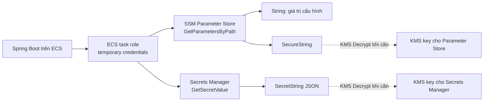

# Phân quyền đọc tham số, bí mật và khóa KMS liên quan

## Mục tiêu bài học

Trong module **SPRING_CLOUD_PROVIDER_INTEGRATION**, người học thực hành tích hợp Spring Boot với dịch vụ managed của **AWS, Azure và Google Cloud** qua những thư viện Spring Cloud tương ứng. Ngoài việc truy cập storage, messaging và dữ liệu, một ứng dụng cloud cần có **danh tính workload** rõ ràng, chỉ được đọc cấu hình và bí mật của chính nó, đồng thời có khả năng kiểm thử chính sách cấp quyền.

Ở chương **Cấu hình AWS**, ta sẽ thiết kế quyền cho ba lớp liên quan:

1. **AWS Systems Manager Parameter Store**: đọc các tham số cấu hình thông thường hoặc `SecureString`.
2. **AWS Secrets Manager**: đọc mật khẩu, API key, token và các bí mật ứng dụng.
3. **AWS Key Management Service (KMS)**: sử dụng khóa phù hợp để giải mã giá trị đã được mã hóa, đặc biệt với **customer managed key**.

Sau bài học, bạn có thể:

- Phân biệt **trust policy** của IAM role, **permission policy** của workload, **resource policy** và **KMS key policy**.
- Xác định quyền đọc cần thiết cho từng API: `ssm:GetParameter`, `ssm:GetParameters`, `ssm:GetParametersByPath`, `secretsmanager:GetSecretValue`, `kms:Decrypt`.
- Viết policy phạm vi hẹp theo **AWS account, Region, ứng dụng và môi trường**, tránh quyền wildcard quá rộng.
- Tích hợp IAM role với Spring Cloud AWS Config Data, kiểm soát hành vi khi thiếu quyền và khi secret được rotation.
- Kiểm thử khả năng đọc dữ liệu bằng account sandbox mà không in secret ra terminal hoặc log.

> **Nguyên tắc xuyên suốt:** Có quyền gọi `ssm:GetParametersByPath` hoặc `secretsmanager:GetSecretValue` **không đồng nghĩa** luôn có quyền giải mã bằng KMS. Ngược lại, chỉ có `kms:Decrypt` cũng **không đủ** để đọc parameter hoặc secret. Quyền hiệu lực là kết quả đánh giá nhiều chính sách cùng lúc và còn phụ thuộc vào cấu hình thực tế của khóa.

## 1. Bản đồ quyền từ Spring Boot tới dữ liệu AWS

Giả sử `order-service` chạy trên Amazon ECS và cần:

```text
Parameter Store
  /config/order-service/prod/catalog.base-url       (String)
  /config/order-service/prod/catalog.timeout        (String)
  /config/order-service/prod/licensing.token         (SecureString)

Secrets Manager
  /secrets/order-service/prod/database               (JSON secret)

KMS
  CMK dành riêng cho SecureString licensing.token
  CMK dành riêng cho database secret
```

`CMK` ở đây là **customer managed KMS key** được tổ chức tạo và quản lý. Các tên và khóa trong ví dụ chỉ là tài nguyên sandbox giả định; không sử dụng key ID hoặc credential từ hệ thống thật khi làm bài tập.



Sơ đồ trên mô tả **các quyết định quyền cần kiểm tra**. SDK của ứng dụng thường gọi API SSM/Secrets Manager; các dịch vụ AWS phối hợp với KMS để xử lý mã hóa/giải mã. Không nên hiểu mũi tên KMS là ứng dụng luôn phải trực tiếp gọi `KmsClient.decrypt()`.

### Các lớp chính sách

| Lớp | Câu hỏi cần trả lời | Ví dụ |
| --- | --- | --- |
| **IAM role trust policy** | Ai có quyền nhận (assume) role? | `ecs-tasks.amazonaws.com` được dùng task role của ECS |
| **IAM identity-based permission policy** | Role được gọi những API nào, trên tài nguyên nào? | `ssm:GetParametersByPath` trên cây cấu hình `order-service/prod` |
| **Service resource policy** | Tài nguyên có cho một principal truy cập không? | Secret cho phép role từ tài khoản khác đọc |
| **KMS key policy/grant** | Principal có được sử dụng khóa mã hóa/giải mã không? | Cho phép `kms:Decrypt` với khóa cụ thể |
| **Boundary/SCP/explicit deny** | Có chính sách tổ chức nào hạn chế thêm không? | SCP từ chối truy cập một Region hoặc cấm `GetSecretValue` |

Một lệnh API có thể bị `AccessDenied` dù identity policy trông hợp lệ: trust policy có thể khiến ứng dụng không nhận được role; một `Deny` hiệu lực, resource policy hoặc KMS key policy có thể chặn lời gọi. Với KMS, việc cấp phép còn phụ thuộc **key policy**, IAM policy nếu được key policy cho phép, và KMS grant khi áp dụng. Không sửa quyền bằng suy đoán; phải xác định lớp nào đang từ chối.

## 2. Chọn đúng quyền đọc Parameter Store

### 2.1. Mỗi API dành cho nhu cầu khác nhau

| IAM action | API/ý nghĩa | Khi nào cần |
| --- | --- | --- |
| `ssm:GetParameter` | Đọc một parameter theo tên hoặc version/label được hỗ trợ | Service tự gọi `GetParameter` |
| `ssm:GetParameters` | Đọc nhiều parameter được chỉ định tường minh | Batch retrieval theo danh sách tên |
| `ssm:GetParametersByPath` | Đọc các parameter trong một path, có thể đọc đệ quy | Spring Cloud AWS Config Data import một path |
| `ssm:DescribeParameters` | Liệt kê và xem metadata | Công cụ vận hành/kiểm tra metadata; không mặc định cần cho mọi ứng dụng |
| `ssm:GetParameterHistory` | Đọc các phiên bản trước của parameter | Quy trình audit/khôi phục được phân quyền riêng |

**Không cấp tất cả action chỉ vì chúng cùng có tiền tố `Get`.** Chọn action dựa trên lời gọi thực tế. Với ví dụ Spring Cloud AWS 3.x:

```yaml
spring:
  config:
    import: "aws-parameterstore:/config/order-service/prod/"
```

ta cần xem xét quyền `ssm:GetParametersByPath` cho cây đã nhập. Khi một component khác gọi `SsmClient.getParameter`, nó cần `ssm:GetParameter`; quyền chỉ dành cho `GetParametersByPath` không thay thế mọi hành vi SDK khác.

### 2.2. ARN của parameter khác với tên path

Tên parameter có dấu `/` đầu tiên:

```text
/config/order-service/prod/catalog.timeout
```

Trong IAM, ARN tương ứng có dạng:

```text
arn:aws:ssm:ap-southeast-1:111122223333:parameter/config/order-service/prod/catalog.timeout
```

Chú ý sau `parameter` trong ARN là `/config/...`, **không phải** `parameter:/config/...`. Phần `111122223333` và `ap-southeast-1` là account/Region minh họa, phải thay bằng giá trị thực tế khi cấp quyền.

Ví dụ policy tối thiểu cho việc đọc cây `/config/order-service/prod/`:

```json
{
  "Version": "2012-10-17",
  "Statement": [
    {
      "Sid": "ReadOrderServiceProdParameters",
      "Effect": "Allow",
      "Action": "ssm:GetParametersByPath",
      "Resource": [
        "arn:aws:ssm:ap-southeast-1:111122223333:parameter/config/order-service/prod",
        "arn:aws:ssm:ap-southeast-1:111122223333:parameter/config/order-service/prod/*"
      ]
    }
  ]
}
```

Mẫu này minh họa path đích và các phần tử bên dưới. Quyền hiệu lực và resource ARN mà lời gọi API sử dụng phải được xác minh trên sandbox với đúng client, `Recursive` và policy của tổ chức. Nếu ứng dụng **chỉ** đọc hai tên parameter cụ thể bằng `GetParameters`, policy nên liệt kê hai ARN cụ thể và action `ssm:GetParameters` thay cho quyền đọc cả cây.

### 2.3. Cảnh báo về `GetParametersByPath` đọc đệ quy

Một điểm dễ mắc lỗi: theo tài liệu IAM cho Parameter Store, nếu principal được phép đọc một **path cha** bằng `GetParametersByPath`, lời gọi đọc **đệ quy** có thể cho phép lấy giá trị thuộc các path con ngay cả khi có explicit deny trên một parameter con theo mô hình được AWS mô tả cho API này. Vì vậy:

```text
/config/
  team-a/
    prod/password
  team-b/
    prod/password
```

**Không** cấp `ssm:GetParametersByPath` tại `/config/` rồi chỉ dựa vào một deny trên parameter của `team-b` để bảo đảm role `team-a` không đọc được. Cần tách namespace theo boundary bảo mật và cấp quyền trực tiếp trên path thuộc trách nhiệm của workload. Dùng tài khoản hoặc role riêng nếu yêu cầu cô lập mạnh.

Ngay cả các parameter cùng prefix `prod` cũng không nhất thiết có cùng độ nhạy. Đặt `SecureString` đặc biệt nhạy cảm vào path rộng mà nhiều ứng dụng được đọc có thể khiến IAM không đủ chi tiết như mong muốn; cân nhắc tách path và quyền hoặc chuyển sang Secrets Manager.

### 2.4. `String`, `StringList` và `SecureString`

Parameter Store có ba kiểu thường dùng:

| Kiểu | Quyền đọc chính | Cần nghĩ thêm về KMS? |
| --- | --- | --- |
| `String` | Quyền SSM phù hợp với API | Không phải giải mã `SecureString` |
| `StringList` | Quyền SSM phù hợp với API | Không phải giải mã `SecureString` |
| `SecureString` | Quyền SSM phù hợp với API | Có: AWS KMS key, `kms:Decrypt` và key policy khi cần trả về plaintext |

Khi gọi SSM với `WithDecryption=true`, `SecureString` cần được giải mã. AWS KMS sử dụng khóa gắn với parameter. Với **customer managed key**, phải kiểm tra quyền `kms:Decrypt` của principal theo cơ chế quyền KMS; khi dùng khóa AWS managed `alias/aws/ssm`, chính sách và phạm vi quyền khác, cần kiểm tra trước khi kết luận dữ liệu đã được cô lập.

**Không lưu mật khẩu production vào `String`**, cũng không giải quyết mọi nhu cầu quản lý credential bằng `SecureString`: Parameter Store không có quy trình rotation credential chuyên dụng như Secrets Manager. Thông tin xác thực quan trọng, cần rotation hoặc lifecycle riêng nên được đánh giá cho Secrets Manager.

## 3. Cấp quyền đọc Secrets Manager

### 3.1. `GetSecretValue` trên secret ARN chính xác

Giả sử tên secret:

```text
/secrets/order-service/prod/database
```

ARN thực tế của Secrets Manager có hậu tố ngẫu nhiên sáu ký tự, ví dụ:

```text
arn:aws:secretsmanager:ap-southeast-1:111122223333:secret:/secrets/order-service/prod/database-AbCdEf
```

Policy **chỉ đọc** secret này:

```json
{
  "Version": "2012-10-17",
  "Statement": [
    {
      "Sid": "ReadProdDatabaseSecret",
      "Effect": "Allow",
      "Action": "secretsmanager:GetSecretValue",
      "Resource": "arn:aws:secretsmanager:ap-southeast-1:111122223333:secret:/secrets/order-service/prod/database-AbCdEf"
    }
  ]
}
```

`GetSecretValue` cho phép lấy nội dung secret đã được cấp quyền, kể cả các trường trong một JSON secret. **IAM không tự phân quyền theo từng JSON key**: nếu `database` chứa cả username, password và API key, ứng dụng có quyền đọc secret đó có thể nhận cả ba. Tách secret theo nhóm credential và đối tượng sử dụng khi cần boundary bảo mật khác nhau.

Spring Cloud AWS Config Data import một secret:

```yaml
spring:
  config:
    import: "aws-secretsmanager:/secrets/order-service/prod/database?prefix=db."
```

Khi secret JSON có các key `username` và `password`, Spring có thể dùng `${db.username}` và `${db.password}` để bind cấu hình. `?prefix=db.` **chỉ thay tên property phía Spring**, không mở rộng hoặc thu hẹp IAM. Không nhầm prefix với tên resource được IAM đánh giá.

### 3.2. Những action không cần cấp tùy tiện

| Action | Mục đích | Role chỉ đọc cần không? |
| --- | --- | --- |
| `secretsmanager:GetSecretValue` | Đọc nội dung secret | Có, nếu ứng dụng đọc secret này |
| `secretsmanager:DescribeSecret` | Xem metadata, version, cấu hình rotation | Chỉ khi ứng dụng có lời gọi cần metadata |
| `secretsmanager:ListSecrets` | Liệt kê secret | Thường **không** cần cho import theo tên cụ thể |
| `secretsmanager:BatchGetSecretValue` | Đọc nhiều secret qua API batch | Chỉ cấp nếu code thực sự sử dụng API này |
| `secretsmanager:PutSecretValue` | Tạo phiên bản secret mới | **Không** cấp cho role ứng dụng chỉ đọc |
| `secretsmanager:UpdateSecret`, `RotateSecret`, `DeleteSecret` | Thay đổi/rotate/xóa secret | Thuộc role vận hành hoặc rotation riêng |

Lựa chọn action dựa trên SDK và phiên bản thư viện đang dùng. Việc cho phép `GetSecretValue` của một ARN không đòi hỏi mặc định phải thêm `ListSecrets`. Nếu một thư viện thực tế cần `DescribeSecret`, cấp bổ sung trên secret ARN đó sau khi xác minh lời gọi, thay vì mở rộng toàn bộ Secrets Manager.

### 3.3. Tên secret, ARN và wildcard

ARN dạng `...:secret:/secrets/order-service/prod/database-*` thường được dùng khi cần biểu thức khớp với hậu tố tự sinh. Nhưng wildcard có thể khớp nhiều ARN nếu tổ chức đặt tên trùng prefix. Khi biết ARN thực, dùng **ARN đầy đủ** sẽ thu hẹp phạm vi chính xác hơn.

Tương tự, `secretsmanager:GetSecretValue` với `Resource: "*"` cho phép đọc mọi secret mà các chính sách khác không chặn; đây là quyền quá rộng cho ứng dụng nghiệp vụ. Tên, tags và metadata của secret cũng không nên chứa chính **giá trị bí mật** vì chúng có thể xuất hiện trong log và bảng quản trị.

## 4. KMS: tại sao một quyền đọc có thể vẫn bị từ chối?

### 4.1. Hai nhóm khóa và các câu hỏi cần đặt

AWS KMS dùng để bảo vệ dữ liệu được mã hóa; trong bối cảnh bài này, SSM xử lý mã hóa `SecureString`, còn Secrets Manager mã hóa nội dung secret. Khi cấp quyền, cần biết khóa nào đang bảo vệ giá trị:

| Tình huống | Khóa mã hóa | Điều cần đánh giá |
| --- | --- | --- |
| Parameter Store `String` / `StringList` | Không phải kiểu `SecureString` | Quyền đọc SSM, không đòi riêng quyền giải mã KMS cho loại giá trị này |
| `SecureString` với khóa mặc định `alias/aws/ssm` | **AWS managed KMS key** | Cơ chế cấp phép mặc định của khóa AWS managed, IAM và quyền đọc SSM |
| `SecureString` với customer managed key | Khóa do tổ chức quản lý | `kms:Decrypt`, key policy/grants, Region và điều kiện KMS phù hợp |
| Secrets Manager với khóa mặc định `alias/aws/secretsmanager` | **AWS managed KMS key** | Quyền đọc secret và chính sách mặc định của khóa |
| Secrets Manager với customer managed key | Khóa do tổ chức quản lý | `GetSecretValue`, quyền giải mã phù hợp, key policy/grants |
| Secrets Manager cần đọc xuyên AWS account | Thường cần customer managed key có quyền chia sẻ phù hợp | Identity policy, secret resource policy và KMS key policy đều phải phối hợp |

**AWS managed key** là khóa do AWS quản lý chính sách; tổ chức không chỉnh sửa key policy theo cách giống customer managed key. Với nhu cầu phân quyền giải mã chi tiết hoặc chia sẻ xuyên tài khoản, thường cần **customer managed key**.

Đừng mặc định rằng thêm `kms:Decrypt` trên một khóa bất kỳ sẽ khắc phục được lỗi. `SecureString` và secret có thể dùng **hai khóa khác nhau**, ở Region khác nhau. Cần xác định key ID/ARN thực tế mà từng tài nguyên đang dùng.

### 4.2. Quyền `kms:Decrypt` không tương đương quyền đọc secret

Ví dụ role có:

```json
{
  "Effect": "Allow",
  "Action": "kms:Decrypt",
  "Resource": "arn:aws:kms:ap-southeast-1:111122223333:key/11111111-2222-3333-4444-555555555555"
}
```

Statement này có thể là một phần quyền giải mã, nhưng role vẫn **không có quyền đọc bí mật** nếu thiếu `secretsmanager:GetSecretValue` trên ARN secret. Tương tự, `ssm:GetParametersByPath` có thể đọc tên parameter và các giá trị không nhạy cảm, nhưng yêu cầu `SecureString` được giải mã bằng customer managed key có thể thất bại nếu quyền KMS không phù hợp.

Trong nhiều thiết lập, IAM policy được đánh giá cùng key policy. Để một role giải mã bằng customer managed key, phải có **đường cấp phép KMS hiệu lực** thông qua key policy, IAM policy được key policy cho phép hoặc KMS grants; không chỉ nhìn vào một trong số các tệp chính sách. Các `Deny` có hiệu lực từ tổ chức hoặc chính sách khác vẫn có thể chặn hành động.

### 4.3. Giới hạn quyền giải mã qua dịch vụ

KMS condition key **`kms:ViaService`** cho phép hạn chế việc sử dụng khóa thông qua một dịch vụ AWS đã chỉ định. Ví dụ statement IAM cho **customer managed key của Parameter Store**:

```json
{
  "Sid": "DecryptOrderServiceSecureParameters",
  "Effect": "Allow",
  "Action": "kms:Decrypt",
  "Resource": "arn:aws:kms:ap-southeast-1:111122223333:key/11111111-2222-3333-4444-555555555555",
  "Condition": {
    "StringEquals": {
      "kms:ViaService": "ssm.ap-southeast-1.amazonaws.com"
    }
  }
}
```

Với **customer managed key của Secrets Manager**:

```json
{
  "Sid": "DecryptOrderServiceDatabaseSecret",
  "Effect": "Allow",
  "Action": "kms:Decrypt",
  "Resource": "arn:aws:kms:ap-southeast-1:111122223333:key/66666666-7777-8888-9999-000000000000",
  "Condition": {
    "StringEquals": {
      "kms:ViaService": "secretsmanager.ap-southeast-1.amazonaws.com"
    }
  }
}
```

Điều kiện này giúp hạn chế trường hợp dùng khóa qua KMS trực tiếp hoặc dịch vụ khác. Nó **không** chỉ định parameter/secret cụ thể được phép đọc: quyền SSM/Secrets Manager phía trên vẫn phải giới hạn tài nguyên.

KMS còn hỗ trợ **encryption context** để ràng buộc cách một giá trị được mã hóa/giải mã. SSM và Secrets Manager dùng các thuộc tính encryption context khác nhau; có thể thiết kế thêm điều kiện `kms:EncryptionContext:...` sau khi xác minh chính xác giá trị context do dịch vụ gửi. Không tự đoán context để đưa policy vào production, vì một điều kiện sai có thể chặn toàn bộ việc giải mã.

### 4.4. Key policy là lớp kiểm soát riêng

Với customer managed KMS key, một statement **minh họa** trong key policy của chính khóa dành cho database secret có thể cho role cụ thể sử dụng `Decrypt` thông qua Secrets Manager:

```json
{
  "Sid": "AllowOrderServiceProdDecryptViaSecretsManager",
  "Effect": "Allow",
  "Principal": {
    "AWS": "arn:aws:iam::111122223333:role/order-service-prod-task-role"
  },
  "Action": "kms:Decrypt",
  "Resource": "*",
  "Condition": {
    "StringEquals": {
      "kms:ViaService": "secretsmanager.ap-southeast-1.amazonaws.com"
    }
  }
}
```

Đây là **một statement để tích hợp vào key policy hiện có**, không phải toàn bộ key policy. Trong **key policy**, `"Resource": "*"` được hiểu là **chính KMS key có policy đó**, không có nghĩa mở quyền trên tất cả các key trong tài khoản. Khác biệt này quan trọng khi review chính sách: cùng ký tự `*` có ý nghĩa phạm vi khác nhau tùy loại policy.

Khi sử dụng key policy trực tiếp cấp quyền cho role, nó có thể tạo ra quyền KMS độc lập với identity-based allow của role, tùy cấu trúc chính sách. Do đó phải đánh giá **quyền hiệu lực tổng thể**, không chỉ nhìn vào IAM permission policy. Trong môi trường doanh nghiệp, đội nền tảng thường duy trì key policy và grants, còn team ứng dụng quản lý role với quyền đọc tối thiểu.

### 4.5. Khóa mặc định, isolation và rotation

Với **AWS managed key**, người dùng không có quyền quản lý key policy như customer managed key. Với `alias/aws/ssm`, các principal có quyền SSM phù hợp có thể có khả năng giải mã giá trị dựa trên cơ chế mặc định của khóa; vì thế không xem `SecureString` với khóa mặc định là một ranh giới IAM/KMS tách biệt mạnh cho nhiều nhóm không tin cậy lẫn nhau.

Khi yêu cầu giới hạn một workload chỉ được giải mã một nhóm tham số nhạy cảm, đánh giá **customer managed key riêng** và policy được giới hạn kỹ, hoặc tách secret trong Secrets Manager. Nhưng việc dùng nhiều key có chi phí, quy trình vận hành và trách nhiệm quản lý key policy riêng.

**KMS key rotation và secret rotation là hai khái niệm khác nhau.** Rotation khóa KMS xử lý vật liệu mã hóa của khóa theo cơ chế KMS; nó **không tự đổi password của database, API key hoặc JSON secret**. Secrets Manager rotation phải phối hợp hệ thống đích và ứng dụng đọc credential mới.

## 5. Policy kết hợp cho Spring Boot đọc SSM, Secrets Manager và KMS

### 5.1. Thiết kế môi trường

Ứng dụng `order-service` trên ECS production cần:

- Path SSM `/config/order-service/prod/`, trong đó có một `SecureString` mã hóa bằng customer managed key `11111111-2222-3333-4444-555555555555`.
- JSON secret `/secrets/order-service/prod/database`, có ARN đầy đủ với hậu tố `-AbCdEf`, mã hóa bằng key `66666666-7777-8888-9999-000000000000`.
- IAM role `order-service-prod-task-role` dùng để đọc đúng hai nguồn.

Các ARN dưới đây chỉ là **ví dụ cấu trúc**; triển khai cần dùng ARN thực, key policy và role trust policy đúng account/Region. Mã UUID trong ví dụ không đại diện cho một tài nguyên có thật.

### 5.2. Ví dụ IAM permission policy

```json
{
  "Version": "2012-10-17",
  "Statement": [
    {
      "Sid": "ReadProdParameterPath",
      "Effect": "Allow",
      "Action": "ssm:GetParametersByPath",
      "Resource": [
        "arn:aws:ssm:ap-southeast-1:111122223333:parameter/config/order-service/prod",
        "arn:aws:ssm:ap-southeast-1:111122223333:parameter/config/order-service/prod/*"
      ]
    },
    {
      "Sid": "ReadProdDatabaseSecret",
      "Effect": "Allow",
      "Action": "secretsmanager:GetSecretValue",
      "Resource": "arn:aws:secretsmanager:ap-southeast-1:111122223333:secret:/secrets/order-service/prod/database-AbCdEf"
    },
    {
      "Sid": "DecryptSecureParametersViaSSM",
      "Effect": "Allow",
      "Action": "kms:Decrypt",
      "Resource": "arn:aws:kms:ap-southeast-1:111122223333:key/11111111-2222-3333-4444-555555555555",
      "Condition": {
        "StringEquals": {
          "kms:ViaService": "ssm.ap-southeast-1.amazonaws.com"
        }
      }
    },
    {
      "Sid": "DecryptDatabaseSecretViaSecretsManager",
      "Effect": "Allow",
      "Action": "kms:Decrypt",
      "Resource": "arn:aws:kms:ap-southeast-1:111122223333:key/66666666-7777-8888-9999-000000000000",
      "Condition": {
        "StringEquals": {
          "kms:ViaService": "secretsmanager.ap-southeast-1.amazonaws.com"
        }
      }
    }
  ]
}
```

Đây là **identity-based policy** gắn vào role, chưa bao gồm trust policy hay key policy. Sau khi gắn policy, phải kiểm tra quyền KMS thực tế trên **cả hai key**. Nếu một nguồn dùng AWS managed key thay cho customer managed key, yêu cầu KMS khác; sửa chính sách theo loại key thực tế và kiểm thử, không sao chép nguyên ví dụ.

Không thấy bất kỳ quyền ghi nào trong policy: role này không thể tự tạo parameter, thay secret hoặc điều khiển rotation chỉ từ các statement trên. CI/CD, người vận hành và rotation Lambda (nếu có) dùng role riêng với quyền **ghi/rotate được giới hạn**.

### 5.3. Trust policy và vai trò ECS task role

ECS sử dụng trust policy để cho phép ECS task nhận role, còn **permission policy** phần 5.2 quy định role được đọc dữ liệu nào. Ví dụ phần chính của trust policy:

```json
{
  "Version": "2012-10-17",
  "Statement": [
    {
      "Sid": "AllowECSTasksAssumeRole",
      "Effect": "Allow",
      "Principal": {
        "Service": "ecs-tasks.amazonaws.com"
      },
      "Action": "sts:AssumeRole",
      "Condition": {
        "StringEquals": {
          "aws:SourceAccount": "111122223333"
        },
        "ArnLike": {
          "aws:SourceArn": "arn:aws:ecs:ap-southeast-1:111122223333:*"
        }
      }
    }
  ]
}
```

`aws:SourceAccount` và `aws:SourceArn` giúp giảm rủi ro confused deputy theo khuyến nghị của AWS; phần ARN được giới hạn ở account/Region ví dụ và cần đối chiếu đúng yêu cầu ECS. Trust policy không cho phép gọi `GetSecretValue` nếu role thiếu permission policy.

**Đừng nhầm ECS task role với ECS task execution role.** Ứng dụng Spring Boot dùng credentials của **task role** để gọi SSM/Secrets Manager qua AWS SDK. **Execution role** phục vụ các tác vụ do ECS agent thực hiện, chẳng hạn lấy image từ ECR hoặc hỗ trợ inject một số secret dưới dạng environment variable; đó là một luồng khác với ứng dụng gọi Config Data khi khởi động.

### 5.4. Config Data sử dụng các quyền trên

Trong `application-prod.yml`:

```yaml
spring:
  application:
    name: order-service
  config:
    import:
      - "aws-parameterstore:/config/order-service/prod/"
      - "aws-secretsmanager:/secrets/order-service/prod/database?prefix=db."
  datasource:
    url: "${database.jdbc-url}"
    username: "${db.username}"
    password: "${db.password}"
```

Mã nguồn không có AWS access key hoặc password. Spring Cloud AWS dùng AWS SDK credentials mặc định của workload để truy xuất hai nguồn trong pha **Config Data initialization**. Cần khai báo các starter đúng phiên bản:

```xml
<dependencyManagement>
    <dependencies>
        <dependency>
            <groupId>io.awspring.cloud</groupId>
            <artifactId>spring-cloud-aws-dependencies</artifactId>
            <version>${spring-cloud-aws.version}</version>
            <type>pom</type>
            <scope>import</scope>
        </dependency>
    </dependencies>
</dependencyManagement>

<dependencies>
    <dependency>
        <groupId>io.awspring.cloud</groupId>
        <artifactId>spring-cloud-aws-starter-parameter-store</artifactId>
    </dependency>
    <dependency>
        <groupId>io.awspring.cloud</groupId>
        <artifactId>spring-cloud-aws-starter-secrets-manager</artifactId>
    </dependency>
</dependencies>
```

`${spring-cloud-aws.version}` là Maven property do dự án khai báo theo **ma trận tương thích** với Spring Boot đang sử dụng. Khi chạy ở local, có thể dùng AWS IAM Identity Center / AWS CLI profile với quyền sandbox; khi chạy trên ECS, dùng task role. **Không** sao chép credentials từ local vào `application-prod.yml` để ứng dụng có thể khởi động.

`database.jdbc-url` minh họa là một parameter `String` **không chứa username/password**. Với secret JSON database:

```json
{
  "username": "orders_app",
  "password": "<SECRET_VALUE_IN_AWS_ONLY>"
}
```

`?prefix=db.` tạo `db.username` và `db.password`. Cần kiểm tra placeholder thật sự khớp các khóa JSON. String `<SECRET_VALUE_IN_AWS_ONLY>` chỉ là ký hiệu trong bài học, không phải credential để đưa lên AWS.

Tài nguyên SSM nằm trong **một Region**; secret và KMS key cũng gắn với Region/cơ chế replication tương ứng. Khi dùng account/Region khác nhau, phải cập nhật đường dẫn, ARN, cấu hình Region và policy nhất quán, không chỉ thay `spring.profiles.active`.

## 6. Trường hợp nâng cao: đọc secret giữa nhiều AWS account

Trong doanh nghiệp, một **shared-services account** có thể giữ secret dùng chung còn ứng dụng chạy ở application account khác. Đây là trường hợp cần phối hợp quyền phía role **và phía tài nguyên**.

Giả sử:

- Account A `111122223333` chạy `order-service` bằng role `order-service-prod-task-role`.
- Account B `444455556666` sở hữu secret `shared/payments/partner-token`.
- Secret ở account B được mã hóa bằng **customer managed KMS key** của B.

Để đọc secret cross-account, cần kiểm tra:

1. **Identity-based policy** của role ở account A cho phép `secretsmanager:GetSecretValue` trên ARN chính xác của secret ở B.
2. **Resource policy** gắn với secret ở B cho phép principal thuộc A đọc secret.
3. **KMS key policy/grant** ở B và quyền IAM thích hợp ở A cho phép sử dụng key giải mã; với loại chia sẻ này, **AWS managed key `aws/secretsmanager` không thay thế được customer managed key**.
4. Ứng dụng import bằng **ARN đầy đủ** thay vì chỉ tên khi cần truy xuất qua account và chạy trong Region phù hợp.

Ví dụ **một statement** trong Secrets Manager resource policy phía B:

```json
{
  "Sid": "AllowOrderServiceAccountARead",
  "Effect": "Allow",
  "Principal": {
    "AWS": "arn:aws:iam::111122223333:role/order-service-prod-task-role"
  },
  "Action": "secretsmanager:GetSecretValue",
  "Resource": "*"
}
```

`Resource: "*"` là cấu trúc trong **resource policy gắn trực tiếp với secret**. Không sao chép statement này thành một policy IAM gắn cho role, vì `"Principal"` và phạm vi đánh giá không giống nhau. Trước khi áp dụng, phải kiểm tra cấu trúc toàn bộ policy, hạn chế `Principal`, và đánh giá việc chia sẻ bằng các công cụ như **IAM Access Analyzer**. Chính sách KMS phía B phải được thiết kế riêng cho chính xác role/Region/key đó.

Khi ứng dụng lấy secret theo ARN, ví dụ Config Data có thể chỉ định:

```properties
spring.config.import=aws-secretsmanager:arn:aws:secretsmanager:ap-southeast-1:444455556666:secret:shared/payments/partner-token-AbCdEf
```

Đây là ARN minh họa. Việc ghi ARN vào config **không cấp quyền**; nếu policy hoặc key policy không đáp ứng, lời gọi vẫn bị từ chối. Không nên chia sẻ secret giữa nhiều môi trường hoặc account chỉ vì tên thư viện hỗ trợ import bằng ARN. Xem xét nhân bản secret theo yêu cầu và giới hạn phạm vi chia sẻ.

Đối với **Parameter Store**, AWS có cơ chế chia sẻ parameter Advanced trong một số mô hình cross-account. Quá trình chia sẻ, RAM/resource policy và quyền KMS khác với ví dụ Secrets Manager; không nên áp dụng nguyên resource policy của Secrets Manager cho tham số SSM. Khi không có yêu cầu chia sẻ, cấp quyền same-account trên cây parameter riêng của workload đơn giản và dễ kiểm soát hơn.

## 7. Chẩn đoán lỗi quyền theo từng lớp

### 7.1. Tách lỗi xác thực, cấp quyền, tồn tại tài nguyên và mạng

| Triệu chứng | Nhóm nguyên nhân khả dĩ | Kiểm tra trước tiên |
| --- | --- | --- |
| `Unable to load credentials` / không tìm được AWS credentials | Không có AWS profile/session hoặc task/pod không nhận đúng role | Cấu hình identity provider; trust policy và role binding |
| `AccessDeniedException` ở `GetParametersByPath` | IAM role thiếu SSM action, resource ARN sai, SCP/boundary hoặc endpoint policy chặn | API bị gọi, role thực, path, IAM/resource constraint |
| `AccessDeniedException` ở `GetSecretValue` | Role không được phép đọc ARN secret, secret resource policy từ chối | ARN thực có hậu tố, principal và các policy liên quan |
| Thông báo KMS `AccessDenied` / `DecryptionFailure` | Khóa sai, thiếu quyền KMS, key policy, grant, encryption context không khớp | KMS key ARN, Region, `kms:Decrypt` và key policy |
| `ParameterNotFound` / secret `ResourceNotFoundException` | Tên, account hoặc Region sai; tài nguyên đã bị xóa/đổi tên | So sánh tên cấu hình với tài nguyên thật và môi trường |
| Timeout kết nối / SDK không truy cập endpoint | DNS, NAT, route, security group, VPC endpoint, proxy | Kết nối mạng từ chính workload và endpoint Region |
| Import `optional:` nhưng ứng dụng vẫn lỗi | Lỗi không phải chỉ do thiếu location, hoặc bean vẫn bắt buộc property | Root cause và property/validation của Spring |
| Đọc được parameter String nhưng `SecureString` lỗi | SSM cho phép đọc nhưng không giải mã được KMS key liên quan | Loại parameter và khóa mã hóa |
| Sau rotation, DB login thất bại | Credential đổi ở database nhưng app chưa refresh, connection pool vẫn có credential cũ | Rotation status, cache, reload/rollout và pool |

Lỗi quyền và lỗi không tìm thấy có thể bị dịch vụ che giấu thông tin theo policy bảo mật hoặc do request sai; không dùng một thông báo đơn lẻ để kết luận resource có/không tồn tại. Khi gặp lỗi, so sánh API và ARN trong **AWS CloudTrail**, SDK exception và cấu hình triển khai; tránh đưa payload bí mật vào log.

### 7.2. Quy trình debug có thể lặp lại

1. **Xác nhận danh tính chạy ứng dụng.** Với ECS, kiểm tra task definition và `taskRoleArn`; với EKS, kiểm tra service account, Pod Identity/IRSA; với EC2, kiểm tra instance profile. Không suy rằng role của máy developer chính là role trên production.
2. **Xác nhận account/Region.** Tên `/secrets/order-service/prod/database` có thể tồn tại trong nhiều account, Region nhưng là các tài nguyên khác nhau.
3. **Đọc chính xác API bị từ chối.** SSM `GetParametersByPath` khác `GetParameter`, Secrets Manager `GetSecretValue` khác `DescribeSecret`, KMS `Decrypt` khác `DescribeKey`.
4. **Đối chiếu resource ARN.** Parameter ARN có prefix `parameter/config/...`, secret ARN có hậu tố tự sinh; không thay ARN thật bằng tên không đầy đủ trong policy.
5. **Đánh giá các chính sách.** Identity allow, resource policy, key policy, permission boundary, SCP, session policy, explicit deny và VPC endpoint policy khi được dùng.
6. **Kiểm tra encryption.** Dữ liệu `String` khác `SecureString`; secret dùng AWS managed key khác customer managed key; `kms:ViaService` và encryption context phải khớp.
7. **Thử lại bằng workload sandbox.** Chỉ cần xác nhận API truy cập thành công và ứng dụng kết nối được hệ thống đích; không in secret.

Một role có quyền IAM phù hợp nhưng vẫn gặp lỗi mạng khi task nằm trong private subnet không có NAT hoặc **VPC interface endpoint** tới Secrets Manager/SSM. Đây không phải lý do để nới IAM. Ngược lại, endpoint policy có thể từ chối ngay cả khi đường mạng tốt và IAM allow. Quy trình debug cần phân biệt lớp mạng với lớp phân quyền.

### 7.3. Những lệnh CLI chỉ đọc metadata

Khi điều tra trong account sandbox, có thể xem danh tính hiện tại:

```bash
aws sts get-caller-identity
```

Hoặc lấy metadata **không chứa nội dung secret**:

```bash
aws secretsmanager describe-secret \
  --secret-id "/secrets/order-service/prod/database" \
  --region ap-southeast-1 \
  --query "{Name:Name,ARN:ARN,KmsKeyId:KmsKeyId,RotationEnabled:RotationEnabled}"
```

Với KMS customer managed key, nhóm vận hành có thể kiểm tra metadata:

```bash
aws kms describe-key \
  --key-id "arn:aws:kms:ap-southeast-1:111122223333:key/66666666-7777-8888-9999-000000000000" \
  --region ap-southeast-1 \
  --query "KeyMetadata.{Arn:Arn,KeyState:KeyState,KeyManager:KeyManager}"
```

Những lệnh metadata cần **quyền xem metadata riêng** (`secretsmanager:DescribeSecret`, `kms:DescribeKey`) nếu principal chưa có. Role production chỉ cần đọc secret để khởi động ứng dụng không nhất thiết phải được cấp các quyền này. Dùng principal vận hành được cấp phép cho mục tiêu debug.

Không chạy `get-secret-value` hoặc `get-parameter --with-decryption` rồi dán output vào ticket, shell history, CI log hoặc ứng dụng chat. Nếu phải chứng minh truy cập thành công, kiểm tra bằng **hành vi ứng dụng** (ví dụ database authentication trên sandbox thành công) hoặc test chỉ xác nhận trạng thái mà không in payload.

## 8. Kiểm thử least privilege trước khi triển khai

### 8.1. Ma trận thử nghiệm trong AWS sandbox

Chuẩn bị các tài nguyên sandbox và ba role: role ứng dụng được cấp quyền hẹp, role không được cấp quyền, role quản trị kiểm thử. Không sử dụng secret production.

| Ca kiểm thử | Kết quả mong đợi |
| --- | --- |
| `order-service-prod-role` đọc parameter `String` trong `/config/order-service/prod/` | Thành công |
| Role này đọc parameter thuộc `/config/another-service/prod/` | Bị từ chối |
| Role này đọc secret `/secrets/order-service/prod/database` | Thành công |
| Role này đọc `/secrets/another-service/prod/database` | Bị từ chối |
| Role bị bỏ quyền `secretsmanager:GetSecretValue` | Đọc secret thất bại; KMS allow không cứu được |
| Role còn SSM read nhưng bị bỏ đường cấp phép `kms:Decrypt` với CMK của `SecureString` | Đọc `String` còn thành công, giải mã `SecureString` thất bại |
| Role có KMS decrypt nhưng bị bỏ SSM read | Không đọc được parameter qua SSM |
| Secret dùng KMS key khác key đã cấp quyền | Có thể thất bại ở bước giải mã |
| Role chỉ có quyền path cha được dùng với lời gọi đệ quy | Xác minh không có path con ngoài dự kiến bị đọc |
| Secret được rotation, app chưa reload/restart | Quan sát khả năng dùng credential cũ của client/connection pool |

Hai ca **bị từ chối** quan trọng ngang ca thành công. Nếu chỉ thử “ứng dụng vẫn khởi động”, bạn chưa chứng minh role không đọc được dữ liệu của workload khác.

### 8.2. Phân biệt unit test và integration test

Với unit test và kiểm thử business logic của Spring Boot, dùng profile `test` **không import AWS** rồi cung cấp dữ liệu giả:

```yaml
# application-test.yml
database:
  jdbc-url: jdbc:postgresql://localhost:5432/orders_test
db:
  username: test_user
  password: test-only-placeholder
```

Khi đó test `@ConfigurationProperties`, validation và logic ứng dụng mà không phải xin quyền AWS. Để kiểm tra IAM, KMS hoặc AWS Config Data thực tế, cần **integration test trên sandbox AWS**, chạy đúng role hoặc mô hình assume-role được phép. Môi trường mô phỏng API như LocalStack hữu ích cho một số luồng nhưng không chứng minh key policy, Organizations SCP, KMS grant hay toàn bộ semantics AWS IAM thật.

Một kịch bản integration test thực tế có thể làm:

1. Tạo hai parameter `String` và một `SecureString` sandbox; ghi lại ARN và key ARN.
2. Tạo JSON secret sandbox có một credential chỉ dùng cho database thử nghiệm.
3. Triển khai một ECS task hoặc workload test nhận IAM role có policy theo phần 5.
4. Khởi động ứng dụng với `spring.config.import` trỏ đúng path/secret; kiểm tra readiness và kết nối được database test.
5. Dùng role hạn chế để thử truy cập một secret ngoài namespace; xác minh bị từ chối **mà không in giá trị bí mật**.
6. Đổi key policy hoặc IAM của **tài nguyên sandbox** theo kịch bản được phê duyệt, kiểm tra phản ứng và khôi phục cấu hình quyền đúng.
7. Ghi nhận kết quả, xóa các tài nguyên thử nghiệm theo quy trình của môi trường và thu hồi credentials tạm thời nếu cần.

Đừng làm các bài thử "tắt quyền rồi mở lại" ngay trên role/CMK production đang phục vụ người dùng. Dùng sandbox riêng để tránh gây gián đoạn và tạo bằng chứng có thể lặp lại.

### 8.3. Tự động đánh giá và giám sát

Trong vòng đời triển khai, nên kết hợp:

- **Policy review/IAM Access Analyzer:** phát hiện quyền chia sẻ secret/key ngoài phạm vi và các policy cho phép principal quá rộng.
- **IAM policy simulation:** hữu ích cho một số identity-based permission, nhưng phải hiểu giới hạn của simulator; kết quả không thay thế test thực tế của resource policy, KMS key policy, SCP và các điều kiện runtime.
- **CloudTrail:** xem API calls như `GetSecretValue`, `GetParametersByPath` và các sự kiện KMS phù hợp, đồng thời kiểm tra principal, account, Region, lỗi và thời gian. CloudTrail cũng là nguồn audit; tránh đưa secret value vào tham số request hay log ứng dụng.
- **Cảnh báo:** phát hiện số lần `AccessDenied` tăng, lỗi rotation, gọi đọc secret bất thường hoặc workload đọc tài nguyên không thuộc namespace dự kiến.
- **Review định kỳ:** quyền role phải được cập nhật khi service ngừng dùng một secret, di chuyển sang ARN khác hoặc thay đổi Region.

Kiểm tra chính sách nên là một phần của CI/IaC review, không đợi đến khi service thất bại startup mới kiểm tra.

## 9. Những sai lầm phân quyền và cách sửa

| Sai lầm | Tại sao nguy hiểm hoặc không hiệu quả | Hướng sửa |
| --- | --- | --- |
| Role ứng dụng có `ssm:*`, `secretsmanager:*`, `kms:*` | Có thể đọc, ghi, xóa/rotate quá nhiều tài nguyên | Chỉ cấp đúng action mà client thực sự gọi, scope theo ARN |
| Dùng `Resource: "*"` cho `GetSecretValue` trong IAM policy | Ứng dụng có thể đọc nhiều secret không thuộc sở hữu | Dùng ARN secret thực có hậu tố ngẫu nhiên |
| Cho đọc `/config/` rồi deny một số path con | `GetParametersByPath` đệ quy có semantics có thể làm rò rỉ path con | Chia namespace và cấp trực tiếp path hẹp |
| Cấp `kms:Decrypt` nhưng thiếu quyền SSM/Secrets Manager | Không đọc được dữ liệu dù khóa giải mã có quyền | Cấp đúng **cả hai** lớp theo workload |
| Chỉ thêm IAM `kms:Decrypt`, không xem key policy | Customer managed key có thể vẫn từ chối | Kiểm tra key policy, grants, conditions và explicit deny |
| Cho rằng mọi secret đều cần cùng một KMS key | Quyền giải mã bị mở rộng, khó phân tách ứng dụng | Chọn key theo boundary bảo mật/chi phí/vận hành |
| Gắn mọi quyền AWS vào ECS execution role | Ứng dụng có thể không nhận được quyền cần thiết qua task role | Phân biệt task role (SDK của app) và execution role (ECS agent) |
| Dùng cùng role cho `dev` và `prod` | Quyền truy cập chéo môi trường, tăng phạm vi sự cố | Tách role, policy, path, secret; cân nhắc account riêng |
| Cấp quyền write/rotation cho role chỉ đọc | Workload bị khai thác có thể thay credential | Dùng role provisioning/rotation riêng |
| Chỉ kiểm tra ứng dụng đọc được secret của mình | Chưa chứng minh không đọc được secret của service khác | Có negative tests với tài nguyên ngoài phạm vi |
| Bật `optional:` để lờ lỗi IAM | Không giải quyết nguyên nhân, có thể tạo lỗi muộn hoặc thiếu config | Kiểm tra đúng role/ARN/Region và validate property |
| Log JSON secret để điều tra `AccessDenied` | Có thể rò rỉ credential qua log/ticket | Chỉ xem mã lỗi, metadata, CloudTrail; test qua hành vi |

Khi review, cần nhìn cả **các quyền được cấp** và **các tài nguyên có thể truy cập nhờ kết hợp chính sách**. Một policy IAM ngắn chưa chắc là policy an toàn nếu wildcard và trust policy quá rộng. Ngược lại, một thiết kế có nhiều statement chính xác có thể an toàn và dễ bảo trì hơn.

## 10. Bài tập tình huống

Một ứng dụng `payment-service` chạy trên EKS trong môi trường `prod`, tích hợp ngân hàng và gửi thông báo qua Amazon SQS. Ứng dụng cần:

```text
Parameter Store:
  /config/payment-service/prod/payment.gateway-url   (String)
  /config/payment-service/prod/payment.timeout       (String)
  /config/payment-service/prod/license.code          (SecureString)

Secrets Manager:
  /secrets/payment-service/prod/bank-api              (JSON: clientId, clientSecret)
  /secrets/payment-service/prod/database              (JSON: username, password)

KMS:
  Key A: mã hóa license.code
  Key B: mã hóa bank-api
  Key C: mã hóa database
```

Hãy thiết kế giải pháp theo từng bước:

1. **Danh tính:** Chọn EKS Pod Identity hoặc IRSA, xác định Kubernetes ServiceAccount và IAM role gắn với `payment-service`, bảo đảm workload khác không thể dùng role này ngoài thiết kế.
2. **SSM:** Viết IAM statement chỉ cho phép `ssm:GetParametersByPath` trong `/config/payment-service/prod/`. Giải thích vì sao không nên cấp `/config/` cho tất cả service.
3. **Secrets Manager:** Viết IAM statement `secretsmanager:GetSecretValue` trên **hai ARN secret chính xác**, không dùng wildcard toàn tài khoản. Nêu rằng quyền đọc JSON secret bao gồm tất cả key cấp cao nhất của secret.
4. **KMS:** Thêm `kms:Decrypt` trên Key A/B/C với `kms:ViaService` tương ứng `ssm.ap-southeast-1.amazonaws.com` hoặc `secretsmanager.ap-southeast-1.amazonaws.com`. Mô tả cách key policy/grant cho phép role giải mã, không chỉ có IAM allow.
5. **Ứng dụng:** Viết `spring.config.import` cho Parameter Store, bank secret và database secret; chọn prefix `bank.` và `db.` để ngăn hai JSON secret tạo property trùng.
6. **Negative test:** Kiểm tra role không thể đọc `/secrets/hr-service/prod/payroll`, không thể đọc `/config/hr-service/prod/`, và không thể tự gọi `PutSecretValue`.
7. **Rotation:** Mô tả cách cập nhật credential bank và database, cách ứng dụng nhận credential mới, cùng giám sát lỗi sau rotation.
8. **Audit:** Xác định dữ liệu nào được phép ghi vào CloudTrail/log hoặc kết quả kiểm thử, dữ liệu nào tuyệt đối không được đưa vào output.

### Gợi ý đáp án định hướng

`payment.gateway-url` và `payment.timeout` chỉ cần đọc bằng SSM và không yêu cầu decrypt KMS theo mô hình `SecureString`. `license.code` dùng **cả SSM read và KMS** khi cần giá trị được giải mã bằng customer managed key. Hai JSON secret cần `GetSecretValue` trên từng ARN và giải mã bằng đúng key của mỗi secret. Role ứng dụng không cần các action ghi như `PutParameter`, `UpdateSecret` hoặc `PutSecretValue`.

Config Data có thể viết:

```yaml
spring:
  config:
    import:
      - "aws-parameterstore:/config/payment-service/prod/"
      - "aws-secretsmanager:/secrets/payment-service/prod/bank-api?prefix=bank."
      - "aws-secretsmanager:/secrets/payment-service/prod/database?prefix=db."
```

Đáp án tốt phải giải thích được trường hợp **thiếu IAM**, **thiếu KMS**, **sai ARN/Region**, **role không đúng** và **bí mật bị rotation trong lúc app đang chạy**. Chỉ đọc được secret của mình là chưa đủ; bài tập hoàn thành khi các phép thử truy cập chéo bị từ chối và quy trình xác minh không xuất giá trị bí mật.

## 11. Đối chiếu cùng yêu cầu trên Azure và Google Cloud

Vì **SPRING_CLOUD_PROVIDER_INTEGRATION** học cả AWS, Azure và Google Cloud, nên chuyển các yêu cầu bảo mật từ thiết kế này sang cloud khác theo **khả năng và principal**, không tìm một tên dịch vụ “tương đương 100%”.

| Nhu cầu | AWS | Azure | Google Cloud |
| --- | --- | --- | --- |
| Danh tính ứng dụng | IAM role của ECS/EKS/EC2/Lambda | Managed Identity hoặc workload identity phù hợp | Service Account / Workload Identity |
| Kho cấu hình thông thường | Systems Manager Parameter Store | Azure App Configuration và RBAC tương ứng | Cấu hình của runtime (ví dụ GKE ConfigMap), Cloud Storage hoặc dịch vụ tùy kiến trúc |
| Kho bí mật | Secrets Manager | Azure Key Vault | Secret Manager |
| Quyền đọc secret | `secretsmanager:GetSecretValue` trên ARN | Data-plane permissions, ví dụ vai trò **Key Vault Secrets User** theo mô hình RBAC | `roles/secretmanager.secretAccessor` trên secret/project trong phạm vi thích hợp |
| Khóa mã hóa do khách hàng quản lý | AWS KMS `kms:Decrypt`, key policy/grants | Key Vault/Managed HSM và cơ chế key permissions phù hợp | Cloud KMS và **quyền của service agent** khi Secret Manager sử dụng CMEK; không mặc định chính role đọc secret phải trực tiếp giải mã |
| Kiểm thử | IAM/resource/KMS policy, CloudTrail | Azure RBAC, Key Vault access, Azure Monitor logs | Google Cloud IAM, KMS permissions, Cloud Audit Logs |

**Ví dụ khác biệt:** Với AWS Secrets Manager dùng customer managed KMS key, cần kiểm tra quyền KMS của principal đọc secret theo cơ chế AWS. Với Google Cloud Secret Manager sử dụng **CMEK**, Cloud KMS thường được gọi bởi service agent của Secret Manager; chủ thể và đường cấp quyền không được suy trực tiếp từ ví dụ IAM/KMS của AWS. Azure có mô hình data-plane role và key permissions khác IAM/KMS của AWS. Khi chuyển cloud provider, phải kiểm chứng danh tính thực sự dùng dịch vụ và chủ thể nào gọi API giải mã.

Tương tự, các thư viện Spring Cloud AWS, Spring Cloud Azure và tích hợp Google Cloud không đảm bảo cùng cú pháp `spring.config.import`, property name hay cơ chế refresh. Duy trì hợp đồng cấu hình ứng dụng nhất quán khi có thể, nhưng thay đổi phần tích hợp/permission theo từng provider.

## Tổng kết

Phân quyền đọc tham số và bí mật trên AWS là việc ghép các lớp kiểm soát một cách nhất quán:

1. **Danh tính workload:** Spring Boot sử dụng IAM role tạm thời với trust policy đúng môi trường chạy.
2. **Quyền đọc tài nguyên:** SSM cần action theo API (`GetParametersByPath` cho import path, `GetParameter` cho đọc một key); Secrets Manager cần `GetSecretValue` trên đúng secret ARN.
3. **Quyền KMS:** `SecureString` và secret dùng customer managed key cần đường cấp phép giải mã hợp lệ, key policy/grants và điều kiện như `kms:ViaService` khi thích hợp.
4. **Ranh giới cô lập:** Giới hạn account, Region, namespace và ARN; không cấp path cha rộng hoặc wildcard chỉ để làm ứng dụng chạy.
5. **Kiểm chứng:** Thử cả quyền **được phép** và quyền **bị từ chối** trên sandbox, đồng thời không log hay xuất bí mật ra công cụ kiểm thử.

Khi áp dụng các nguyên tắc này, việc nạp cấu hình vào Spring Boot qua Config Data trở nên có thể kiểm soát, có bằng chứng kiểm thử và dễ đánh giá khi thay đổi dịch vụ, khóa mã hóa hoặc cloud provider.

## Tài liệu tham khảo

- [AWS IAM: Policies and permissions](https://docs.aws.amazon.com/IAM/latest/UserGuide/access_policies.html) — mô hình permission, identity-based policy và evaluation.
- [AWS Systems Manager: Restricting access to Parameter Store parameters](https://docs.aws.amazon.com/systems-manager/latest/userguide/sysman-paramstore-access.html) — SSM IAM, path và cảnh báo `GetParametersByPath` đệ quy.
- [AWS Systems Manager: SecureString parameters](https://docs.aws.amazon.com/systems-manager/latest/userguide/secure-string-parameter-kms-encryption.html) — cách Parameter Store sử dụng AWS KMS.
- [AWS Secrets Manager: Authentication and access control](https://docs.aws.amazon.com/secretsmanager/latest/userguide/auth-and-access.html) — IAM, resource policy và truy cập secret.
- [AWS Secrets Manager: Access secrets from a different AWS account](https://docs.aws.amazon.com/secretsmanager/latest/userguide/auth-and-access_examples_cross.html) — phối hợp IAM, resource policy và KMS.
- [AWS KMS: Key policies](https://docs.aws.amazon.com/kms/latest/developerguide/key-policies.html) — quyền hiệu lực của customer managed KMS key.
- [AWS KMS: `kms:ViaService` condition](https://docs.aws.amazon.com/kms/latest/developerguide/conditions-kms.html#conditions-kms-via-service) — giới hạn sử dụng key qua dịch vụ AWS.
- [AWS ECS: Task IAM role](https://docs.aws.amazon.com/AmazonECS/latest/developerguide/task-iam-roles.html) — sự khác biệt task role và quyền của ứng dụng.
- [Spring Cloud AWS Reference](https://docs.awspring.io/spring-cloud-aws/docs/3.4.2/reference/html/index.html) — Config Data cho Parameter Store và Secrets Manager.
