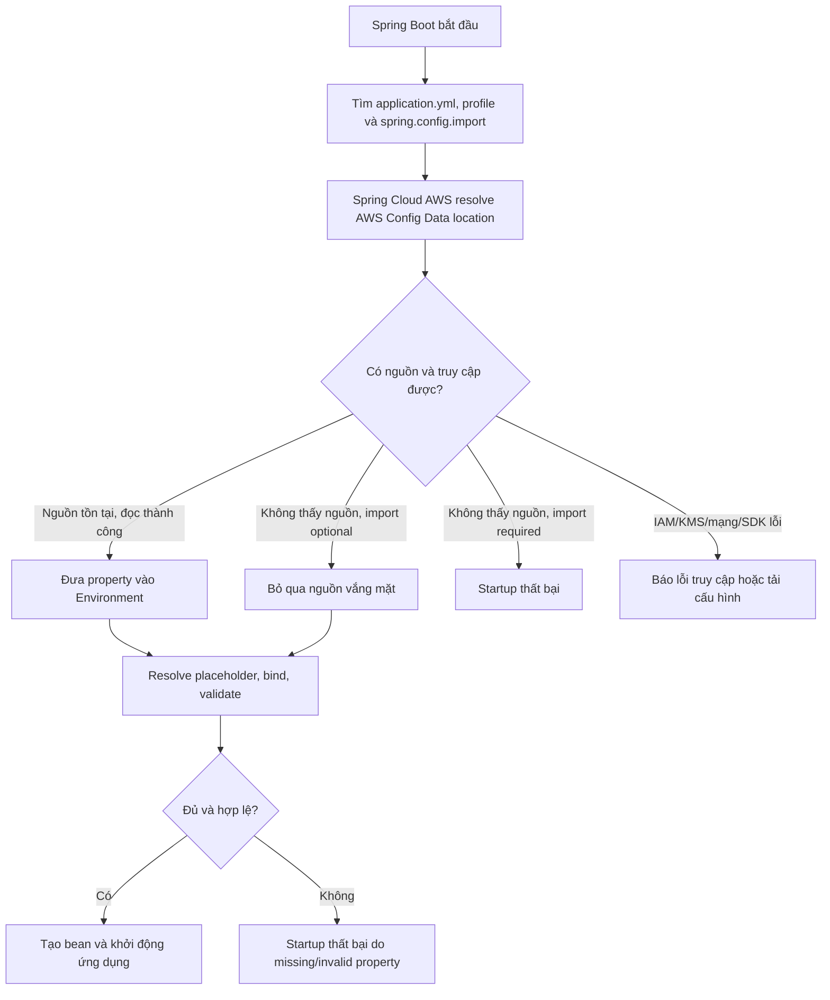

# Nguồn cấu hình bắt buộc, optional và lỗi lúc khởi động

## Mục tiêu và bối cảnh

Trong module **SPRING_CLOUD_PROVIDER_INTEGRATION**, chúng ta thực hành tích hợp Spring Boot với dịch vụ managed của **AWS, Azure và Google Cloud** qua các thư viện Spring Cloud tương ứng. Bên cạnh storage, messaging và cơ sở dữ liệu, việc dùng đúng **danh tính workload**, **IAM/KMS**, kho cấu hình và kho secret quyết định ứng dụng có thể khởi động an toàn hay không.

Chương **Cấu hình AWS** đặt ra một câu hỏi quan trọng: khi Spring Boot đọc **AWS Systems Manager Parameter Store** hoặc **AWS Secrets Manager** thông qua Config Data, điều gì xảy ra nếu một path/secret không tồn tại, thiếu một thuộc tính hoặc không thể truy cập do IAM, KMS hay lỗi mạng?

Sau bài học, bạn có thể:

1. Phân biệt **nguồn cấu hình bắt buộc**, **nguồn tùy chọn** và **khóa cấu hình bắt buộc** trong một nguồn đã nạp.
2. Cấu hình `spring.config.import` với `aws-parameterstore:`, `aws-secretsmanager:` và tiền tố `optional:` đúng trường hợp.
3. Phân loại lỗi **missing location**, **missing property**, **authorization**, **decryption**, **network**, **binding** và **validation** trong startup.
4. Thiết kế **fail fast**, fallback an toàn, Spring profile và validation phù hợp theo môi trường.
5. Kiểm thử các tình huống thành công/thất bại trên môi trường cô lập mà không làm lộ secret.
6. Liên hệ nguyên tắc khởi động với các tích hợp Azure và Google Cloud.

> **Nguyên tắc cốt lõi:** `optional:` chỉ thể hiện việc ứng dụng **chấp nhận thiếu một Config Data location** trong những điều kiện mà cơ chế nạp hỗ trợ. Nó **không biến mọi lỗi AWS thành thành công**, không tự cấp quyền IAM/KMS và không đảm bảo những property mà bean cần sẽ tồn tại.

## 1. Các tầng cần phân biệt

Giả sử `order-service` cần URL của Catalog API, thông số timeout và mật khẩu PostgreSQL. Ta có:

```text
Parameter Store:
  /config/order-service/prod/catalog.base-url
  /config/order-service/prod/catalog.timeout
  /config/order-service/prod/database.jdbc-url

Secrets Manager:
  /secrets/order-service/prod/database
    JSON keys: username, password
```

Có ít nhất ba hợp đồng độc lập:

| Tầng | Câu hỏi | Ví dụ |
| --- | --- | --- |
| **Config Data location** | Có thể tìm thấy và nạp được **nguồn** đã khai báo không? | Path `/config/order-service/prod/` hoặc secret `.../database` |
| **Property** | Sau khi nạp, **khóa** ứng dụng yêu cầu có tồn tại không? | `catalog.base-url`, `db.password` |
| **Giá trị nghiệp vụ** | Giá trị có **đúng định dạng, không rỗng và phù hợp** không? | `https://...`, timeout dương, credential hợp lệ |

Ví dụ, một path Parameter Store tồn tại và đọc được nhưng chỉ chứa `catalog.timeout`: Config Data có thể đã nạp nguồn thành công mà ứng dụng vẫn thiếu `catalog.base-url`. Tương tự, JSON secret tồn tại với `username` nhưng không có `password`. `optional:` không phải giải pháp cho hai trường hợp thiếu khóa này.

Phân biệt **“thiếu nguồn”** với **“nguồn hiện có nhưng truy cập thất bại”**:

- *Missing location*: tên secret không tồn tại hoặc resolver coi path không có dữ liệu là không tìm thấy nguồn.
- *Access denied*: tài nguyên có thể tồn tại nhưng IAM role không được gọi `GetSecretValue`/`GetParametersByPath`.
- *Decryption failure*: role được gọi API dịch vụ nhưng không có đường cấp quyền KMS phù hợp với khóa đang dùng.
- *Connectivity/availability*: SDK không kết nối được AWS endpoint, gặp timeout, DNS, VPC endpoint hoặc throttling.
- *Missing property*: đã có `PropertySource` nhưng không có key cần thiết do thiếu JSON field, sai prefix hoặc key sai tên.
- *Invalid property*: key tồn tại nhưng giá trị sai kiểu (`catalog.timeout=abc`) hoặc sai ràng buộc (`max-retries=-2`).

**Quyết định required/optional nằm ở yêu cầu nghiệp vụ**, không chỉ ở khả năng cú pháp của framework. Nếu không có password database thì `order-service` không thể phục vụ request đúng cách; nếu thiếu cấu hình tích hợp thử nghiệm chưa bật, hệ thống có thể bỏ qua phần đó và chạy bình thường.

## 2. Config Data xuất hiện lúc nào trong quá trình startup?

Spring Boot từ phiên bản **2.4** cung cấp cơ chế **Config Data API**. Với Spring Cloud AWS 3.x, các starter liên quan đăng ký khả năng hiểu những location như:

```properties
spring.config.import=aws-parameterstore:/config/order-service/prod/
```

hoặc:

```properties
spring.config.import=aws-secretsmanager:/secrets/order-service/prod/database?prefix=db.
```

Spring Boot xử lý import khi chuẩn bị `Environment`, **trước khi phần lớn Spring bean được khởi tạo**. Các bước khái niệm:



Sơ đồ nhấn mạnh các **nhóm lỗi**, không định nghĩa cứng lớp exception cho mọi phiên bản thư viện. Một số lỗi có thể xuất hiện trong bước resolver, bước bind hoặc khi tạo bean; cần đọc **root cause** trong stack trace để biết nơi xảy ra.

Config Data khác với việc `@Service` tự gọi `SsmClient` hoặc `SecretsManagerClient` sau startup. Trong mô hình Config Data, nếu nguồn bắt buộc chưa được nạp thì quá trình tạo ứng dụng thường dừng trước khi server sẵn sàng nhận traffic. Đây là cách **fail fast** cho cấu hình cần thiết.

## 3. Nguồn bắt buộc: mặc định không có `optional:`

### 3.1. Ví dụ môi trường production

Trong `application-prod.yml`:

```yaml
spring:
  config:
    import:
      - "aws-parameterstore:/config/order-service/prod/"
      - "aws-secretsmanager:/secrets/order-service/prod/database?prefix=db."
  datasource:
    url: "${database.jdbc-url}"
    username: "${db.username}"
    password: "${db.password}"
```

Giả định Parameter Store cung cấp `database.jdbc-url` và Secrets Manager cung cấp JSON secret:

```json
{
  "username": "orders_app",
  "password": "<SECRET_ONLY_IN_AWS>"
}
```

Chuỗi `<SECRET_ONLY_IN_AWS>` chỉ là ký hiệu trong bài học; **không phải credential để dùng trên AWS**. Trong môi trường thật, giá trị được cấp từ hệ thống quản lý bí mật và không đưa vào Git, ví dụ mã nguồn, log hoặc ảnh container.

Nếu secret được khai báo là required nhưng **không tồn tại**, ứng dụng không thể nạp location và startup sẽ thất bại theo cơ chế Config Data. Hành vi này có ích: một phiên bản mới của `order-service` không nên tự chuyển sang một mật khẩu “mặc định” hoặc cơ sở dữ liệu khác chỉ để khởi động được.

Ở production, URL kết nối, quyền đọc và credential thường là **đầu vào bắt buộc**. Dù dữ liệu có ở một nguồn AWS, vẫn cần validation cho từng property cụ thể; một path có ít nhất một parameter không chứng minh nó có toàn bộ các key cần thiết.

### 3.2. Đọc lỗi required một cách chính xác

Khi lỗi xảy ra trong Config Data, log có thể thông báo không tìm thấy location hoặc `ConfigDataLocationNotFoundException`/ngoại lệ liên quan, tùy loại nguồn và resolver. Nhưng nếu nguyên nhân là lỗi IAM hoặc KMS, kết quả thường được bao bọc bởi ngoại lệ từ AWS SDK, ví dụ `AccessDeniedException`, `SdkClientException` hoặc exception tương đương.

Đừng chỉ tìm từ khóa `optional` trong thông báo rồi thêm `optional:` để khắc phục. Trước hết cần xác định:

1. **Tên resource/path có đúng?**
2. **Đúng AWS account và Region chưa?**
3. **Workload đã có credentials đúng role chưa?**
4. **Đã được gọi đúng API SSM/Secrets Manager chưa?**
5. **Key mã hóa có yêu cầu giải mã KMS không?**
6. **Nguồn đã tải nhưng property có thiếu hoặc sai định dạng không?**

## 4. Nguồn tùy chọn: `optional:` và fallback an toàn

### 4.1. Cú pháp chính xác

Config Data cho phép thêm tiền tố `optional:` **trước tên location**:

```yaml
spring:
  config:
    import:
      - "aws-parameterstore:/config/order-service/dev/"
      - "optional:aws-secretsmanager:/secrets/order-service/dev/experimental-api?prefix=experimental."
```

Path SSM ở đây bắt buộc, còn secret `experimental-api` là nguồn tùy chọn. Nếu resolver nhận diện secret tùy chọn là **không tồn tại**, nó có thể bỏ qua location và tiếp tục chuẩn bị cấu hình. Khi cần JSON secret có key `apiKey`, import trên tạo property `experimental.apiKey`.

`optional:` là tiền tố của **location**, không phải một phần của tên secret trên AWS, không phải một query parameter (`?optional=true`) và không phải tham số IAM. Ví dụ đúng:

```properties
spring.config.import=optional:aws-secretsmanager:/secrets/order-service/dev/experimental-api
```

Một trường hợp dùng hợp lý là tính năng gửi SMS thử nghiệm chỉ bật ở môi trường dev; khi secret của SMS không tồn tại thì ứng dụng chỉ chạy những tính năng khác.

### 4.2. `optional:` không có nghĩa “bỏ qua mọi lỗi”

| Trường hợp | Có thể dùng `optional:` để tiếp tục? | Vì sao? |
| --- | --- | --- |
| Secret thử nghiệm thực sự không tồn tại | **Có**, nếu resolver hỗ trợ bỏ qua missing location | Không cần tính năng đó để chạy |
| Path cấu hình tùy chọn chưa được tạo | **Có**, theo semantics missing location của resolver | Có fallback hoặc tắt tính năng |
| Role không được `secretsmanager:GetSecretValue` | **Không nên kỳ vọng** | Đây là lỗi cấp quyền, không phải thiếu nguồn |
| Customer managed KMS key từ chối `Decrypt` | **Không** | Thiếu quyền giải mã, cần sửa IAM/key policy |
| Mất mạng hoặc timeout gọi AWS API | **Không nên kỳ vọng** | Không chứng minh nguồn vắng mặt; có thể là sự cố tạm thời |
| JSON secret có key `apiKey` nhưng thiếu `token` mà bean cần | **Không** | Location đã nạp; lỗi là thiếu property |
| Giá trị `catalog.timeout=not-a-duration` | **Không** | Key tồn tại nhưng binding thất bại |

Các phiên bản Spring Boot và Spring Cloud AWS có thể khác nhau ở cách báo lỗi hoặc phân loại một số ngoại lệ. Mọi cơ chế `optional:` phải được xác minh bằng integration test với đúng starter, IAM, account và Region của môi trường triển khai. Không dùng nó để che giấu sự cố production.

### 4.3. `optional:` và logic tắt tính năng phải đi cùng nhau

Ví dụ một tính năng thông báo webhook chỉ hoạt động khi được bật:

```yaml
spring:
  config:
    import: "optional:aws-secretsmanager:/secrets/order-service/dev/webhook?prefix=webhook."

features:
  webhook-enabled: false
```

Một bean chỉ được khởi tạo khi bật tính năng:

```java
import org.springframework.boot.autoconfigure.condition.ConditionalOnProperty;
import org.springframework.stereotype.Component;

@Component
@ConditionalOnProperty(
        prefix = "features",
        name = "webhook-enabled",
        havingValue = "true"
)
public class WebhookClient {
    // Ở ứng dụng thực, constructor đọc webhook.* và validate khi bean được bật.
}
```

Khi `features.webhook-enabled=false`, ứng dụng không tạo `WebhookClient`. Nếu bật `true`, **phải có cơ chế validation** đảm bảo `webhook.apiKey` hay secret tương ứng đã tồn tại, ví dụ constructor yêu cầu property hoặc `@ConfigurationProperties` được validate. `optional:` không thay thế điều kiện này. Mọi component khác phụ thuộc vào `WebhookClient` cũng phải thiết kế để chịu được trường hợp tính năng tắt.

### 4.4. Có nên dùng `spring.config.on-not-found=ignore`?

Spring Boot có cấu hình:

```properties
spring.config.on-not-found=ignore
```

Nó có thể bỏ qua **những Config Data location not found** theo quy tắc của Spring Boot trên **phạm vi rộng**, thay vì chỉ một location được đánh dấu `optional:`. Với cấu hình quan trọng, điều này dễ che giấu sai đường dẫn hoặc thiếu nguồn khi triển khai. Không dùng tùy chọn toàn cục để thay thế thiết kế required/optional rõ ràng. Nó cũng **không có nghĩa** bỏ qua lỗi IAM, KMS hay lỗi ràng buộc thuộc tính.

## 5. Kiểm tra giá trị bắt buộc sau khi đã nạp nguồn

### 5.1. Tại sao chỉ import chưa đủ?

Một secret JSON có thể được nạp thành công dù thiếu `password`. Tương tự, path `/config/order-service/prod/` có thể đọc được và chứa `catalog.timeout` nhưng thiếu `catalog.base-url`.

Nếu Spring cần `${db.password}` mà không có property đó, việc phân giải placeholder hoặc tạo bean có thể thất bại. Nhưng nếu code sử dụng giá trị mặc định, kiểu nguyên thủy hoặc chỉ lấy property khi request đến, lỗi có thể xuất hiện muộn hơn. **Validation ngay khi startup** giúp phát hiện cấu hình thiếu và trả về thông báo rõ ràng trước khi nhận traffic.

### 5.2. Dùng `@ConfigurationProperties` và Bean Validation

Maven cần Spring Boot, starter quản lý cấu hình AWS tương thích và starter validation:

```xml
<dependencyManagement>
    <dependencies>
        <dependency>
            <groupId>io.awspring.cloud</groupId>
            <artifactId>spring-cloud-aws-dependencies</artifactId>
            <version>${spring-cloud-aws.version}</version>
            <type>pom</type>
            <scope>import</scope>
        </dependency>
    </dependencies>
</dependencyManagement>

<dependencies>
    <dependency>
        <groupId>io.awspring.cloud</groupId>
        <artifactId>spring-cloud-aws-starter-parameter-store</artifactId>
    </dependency>
    <dependency>
        <groupId>io.awspring.cloud</groupId>
        <artifactId>spring-cloud-aws-starter-secrets-manager</artifactId>
    </dependency>
    <dependency>
        <groupId>org.springframework.boot</groupId>
        <artifactId>spring-boot-starter-validation</artifactId>
    </dependency>
</dependencies>
```

`${spring-cloud-aws.version}` là property Maven phải được dự án định nghĩa theo **bảng tương thích Spring Boot/Spring Cloud AWS**. Những phiên bản Spring Cloud AWS đời cũ có thể có starter hoặc cách bootstrap khác.

Định nghĩa các kiểu cấu hình:

```java
import java.net.URI;
import java.time.Duration;

import jakarta.validation.constraints.Min;
import jakarta.validation.constraints.NotNull;
import org.springframework.boot.context.properties.ConfigurationProperties;
import org.springframework.validation.annotation.Validated;

@Validated
@ConfigurationProperties(prefix = "catalog")
public record CatalogSettings(
        @NotNull URI baseUrl,
        @NotNull Duration timeout,
        @Min(0) int maxRetries
) {}
```

Và cấu hình credential:

```java
import jakarta.validation.constraints.NotBlank;
import org.springframework.boot.context.properties.ConfigurationProperties;
import org.springframework.validation.annotation.Validated;

@Validated
@ConfigurationProperties(prefix = "db")
public record DatabaseCredentials(
        @NotBlank String username,
        @NotBlank String password
) {
    @Override
    public String toString() {
        return "DatabaseCredentials[REDACTED]";
    }
}
```

Đăng ký bằng `@ConfigurationPropertiesScan` ở main class hoặc `@EnableConfigurationProperties(...)` ở cấu hình Spring. Trong `CatalogSettings`, `@NotNull` kiểm tra `URI` và `Duration` phải có; `@Min(0)` chặn số retry âm. Nếu timeout phải **dương** hoặc URL chỉ được dùng HTTPS, cần bổ sung ràng buộc nghiệp vụ tương ứng. Với `DatabaseCredentials`, `@NotBlank` giúp phát hiện thiếu/giá trị trống ngay lúc bind.

**Lưu ý về secret trong exception và log:** Không tạo exception có message chứa password; không log toàn bộ `DatabaseCredentials`, Spring `Environment` hay placeholder resolved. `toString()` đã được che chỉ giúp tránh một kiểu lộ dữ liệu, không bảo vệ tất cả đường xuất thông tin như heap dump, trace hoặc Actuator.

### 5.3. Phân biệt validation và fallback

Giả sử `catalog.max-retries` là cấu hình có thể dùng mặc định an toàn, còn URL của Catalog API bắt buộc phải được cung cấp. Cấu hình:

```yaml
spring:
  config:
    import: "aws-parameterstore:/config/order-service/dev/"

catalog:
  max-retries: 2
```

cho phép `max-retries` có giá trị mặc định `2` từ YAML nếu nguồn nhập không cung cấp property đó. Khi Parameter Store có `catalog.max-retries=5`, property được import có thể có ưu tiên cao hơn default trong tài liệu khai báo import, theo quy tắc Config Data. Nhưng nếu thiếu `catalog.base-url`, `@NotNull URI baseUrl` vẫn phải báo lỗi, không nên tự chuyển sang một endpoint production/dev khác.

Một số lưu ý:

| Tình huống | Cách ứng dụng nên xử lý |
| --- | --- |
| Thiếu `catalog.max-retries`, có default an toàn | Dùng default đã được duyệt và kiểm thử |
| `catalog.max-retries=-1` | Validation thất bại, không âm thầm lấy default khác |
| Thiếu `catalog.base-url` bắt buộc | Thất bại ngay trong binding/validation |
| Thiếu `db.password` | Không mở JDBC connection bằng password rỗng |
| Có `db.password` nhưng sai tại PostgreSQL | Nạp cấu hình đã thành công, lỗi xảy ra khi xác thực kết nối database |
| Thiếu optional webhook secret và tính năng đã tắt | Không tạo WebhookClient; các chức năng cốt lõi vẫn chạy |
| Bật webhook nhưng thiếu secret | Fail fast ở cấu hình/bean của tính năng đó |

Một **default** hợp lệ phải có ý nghĩa nghiệp vụ an toàn. Ví dụ timeout mặc định `2s` có thể được duyệt; một password `changeme` hoặc một URL production được hard-code cho mọi môi trường thường không phải fallback an toàn.

## 6. Thiết kế cấu hình theo môi trường để tránh lỗi startup

### 6.1. Không import AWS bắt buộc ở mọi profile khi test offline

Cách bố trí gợi ý:

```text
src/main/resources/
  application.yml
  application-dev.yml
  application-prod.yml
  application-test.yml
```

File chung `application.yml` chỉ giữ những thông số có thể áp dụng cho tất cả môi trường:

```yaml
spring:
  application:
    name: order-service
```

File `application-prod.yml` nhập các nguồn production **bắt buộc**:

```yaml
spring:
  config:
    import:
      - "aws-parameterstore:/config/order-service/prod/"
      - "aws-secretsmanager:/secrets/order-service/prod/database?prefix=db."
  datasource:
    url: "${database.jdbc-url}"
    username: "${db.username}"
    password: "${db.password}"
```

File `application-dev.yml` có thể bao gồm một tích hợp không bắt buộc:

```yaml
spring:
  config:
    import:
      - "aws-parameterstore:/config/order-service/dev/"
      - "aws-secretsmanager:/secrets/order-service/dev/database?prefix=db."
      - "optional:aws-secretsmanager:/secrets/order-service/dev/webhook?prefix=webhook."

features:
  webhook-enabled: false
```

File `application-test.yml` dành cho test không kết nối AWS:

```yaml
catalog:
  base-url: "http://localhost:18080"
  timeout: 250ms
  max-retries: 0
db:
  username: test_user
  password: test-only-placeholder
```

Với cấu trúc này, chạy `@ActiveProfiles("test")` không đọc hai file import AWS của `dev`/`prod`. Nếu import bắt buộc vẫn nằm trong một Config Data document khác được test nạp vào, bổ sung test properties **không đủ** để ngăn việc Spring Boot cố truy cập AWS trước khi tạo test context. Cần kiểm tra bố cục file và profile thực tế.

**Không coi profile là một cơ chế IAM.** Ứng dụng dùng `prod` profile nhưng bị cấu hình nhầm AWS profile hoặc task role dev vẫn có thể đọc sai nguồn hoặc bị lỗi. Tách tài khoản, IAM role, parameter path và secret ARN đúng môi trường.

### 6.2. Hạn chế các property trùng tên

Khi nạp:

```yaml
spring:
  config:
    import:
      - "aws-secretsmanager:/secrets/order-service/dev/database"
      - "aws-secretsmanager:/secrets/order-service/dev/partner"
```

nếu hai JSON secret cùng có key `password`, cả hai cùng tạo property tên `password`. Kết quả cuối phụ thuộc thứ tự ưu tiên property source. Cách rõ ràng hơn:

```yaml
spring:
  config:
    import:
      - "aws-secretsmanager:/secrets/order-service/dev/database?prefix=db."
      - "optional:aws-secretsmanager:/secrets/order-service/dev/partner?prefix=partner."
```

Khi đó `db.password` và `partner.password` không bị trùng. Dấu `.` cuối của `?prefix=db.` là có chủ đích; nếu viết `?prefix=db` thì tên được nối thành `dbpassword`, gây lỗi placeholder.

Với Parameter Store, import `/config/order-service/dev/` nghĩa là đọc path, tên parameter cuối path được đưa thành property. Ví dụ `/config/order-service/dev/catalog.timeout` thành `catalog.timeout`. Nếu khai báo thêm `?prefix=app.`, property trở thành `app.catalog.timeout`, và lớp `@ConfigurationProperties(prefix="catalog")` cũng cần đổi tương ứng thành `app.catalog`.

## 7. Tại sao một nguồn tồn tại vẫn làm startup thất bại?

### 7.1. Bảng chẩn đoán theo lớp lỗi

| Dấu hiệu / nguyên nhân | Tầng xảy ra | Việc kiểm tra |
| --- | --- | --- |
| Spring báo không hiểu `aws-secretsmanager:` / `aws-parameterstore:` | Config Data resolver | Đã có starter Spring Cloud AWS, BOM tương thích và đúng phiên bản chưa? |
| `ConfigDataLocationNotFoundException` hoặc lỗi not found tương tự | Resolve nguồn | Path/tên secret, profile, account và Region có đúng không? |
| `ResourceNotFoundException` từ Secrets Manager | AWS SDK/resource | Secret bị xóa, sai tên/ARN, sai account/Region? |
| `AccessDeniedException` từ `GetSecretValue` | IAM/resource policy | Role có quyền trên **ARN thực** của secret chưa? |
| `AccessDeniedException` từ `GetParametersByPath` | IAM đối với SSM | Role có quyền đọc **path được import** chưa? |
| Lỗi `kms:Decrypt` / `DecryptionFailure` | KMS | Đúng KMS key, IAM/key policy, Region, encryption context chưa? |
| SDK báo không có credentials | AWS identity chain | ECS task role, EKS Pod Identity/IRSA, EC2 instance profile hoặc profile local đúng không? |
| Timeout, `SdkClientException`, lỗi DNS/TLS | Kết nối tới AWS | Route, NAT/VPC endpoint, proxy, endpoint policy, cấu hình Region? |
| API throttling | Quota/tốc độ truy cập | Số pod khởi động đồng thời, retry/backoff, quota của dịch vụ? |
| `Could not resolve placeholder 'db.password'` | Spring placeholder | JSON key tên `password` có tồn tại? Prefix là `db.` chưa? |
| Bind `Duration` hoặc số nguyên thất bại | Type conversion | Giá trị có định dạng hợp lệ như `2s`, `500ms`, `3` không? |
| Validation báo `must not be blank` | Bean Validation | Credential bị thiếu/trống hoặc key sai tên? |
| App khởi động nhưng DB login thất bại | Dịch vụ đích/runtime | Credential có đúng/đã rotate, địa chỉ kết nối, vai trò database? |

Tên ngoại lệ có thể thay đổi theo Spring Boot, AWS SDK và Spring Cloud AWS. Vì vậy hãy đọc **chuỗi nguyên nhân** thay vì chỉ thông báo lỗi ở lớp ngoài. Ví dụ `Failed to bind properties under 'db'` mô tả lỗi binding; còn lỗi gốc có thể là một key chưa được tạo vì secret JSON sai cấu trúc.

### 7.2. Phân biệt `AccessDenied` và `ResourceNotFound`

Giả sử code yêu cầu `/secrets/order-service/prod/database`:

1. Nếu **tên/Region/account sai**, secret có thể thực sự không tồn tại ở nơi ứng dụng đang truy cập.
2. Nếu **role không được đọc**, lời gọi có thể nhận `AccessDenied` dù secret tồn tại.
3. Nếu **key mã hóa không cho phép**, lời gọi có thể thất bại ở KMS ngay cả khi `GetSecretValue` được cấp.
4. Nếu **network gặp lỗi**, chưa thể xác định secret có tồn tại hay không.

Không nên coi “lỗi tải secret” luôn là “secret vắng mặt có thể bỏ qua”. Bỏ qua lỗi quyền hoặc mạng có thể khiến hệ thống chạy với cấu hình không dự kiến, và che khuất vấn đề phân quyền cần sửa.

### 7.3. Cấu hình IAM, KMS và Region

Một task ECS/ứng dụng EKS nên đọc dữ liệu qua **IAM role của workload** thay vì access key dài hạn nhúng vào file. Ví dụ các môi trường:

| Nơi chạy | Danh tính phù hợp |
| --- | --- |
| Máy lập trình | AWS IAM Identity Center/AWS CLI profile được cấp quyền |
| ECS | ECS task role |
| EKS | EKS Pod Identity hoặc IRSA |
| EC2 | EC2 instance profile |
| Lambda | Lambda execution role |

Khi Spring Boot dùng `aws-parameterstore:/config/order-service/prod/`, action cần kiểm tra là `ssm:GetParametersByPath`. Khi dùng `aws-secretsmanager:/secrets/order-service/prod/database`, action chủ đạo là `secretsmanager:GetSecretValue`. Nếu một parameter `SecureString` hoặc secret được mã hóa bằng **customer managed KMS key**, việc đọc plaintext còn phụ thuộc quyền `kms:Decrypt`, key policy hoặc grants tương ứng.

Ví dụ identity-based policy chỉ đọc hai nguồn (ARN/tài khoản/Region minh họa; thay bằng tài nguyên sandbox thật):

```json
{
  "Version": "2012-10-17",
  "Statement": [
    {
      "Sid": "ReadProdConfig",
      "Effect": "Allow",
      "Action": "ssm:GetParametersByPath",
      "Resource": [
        "arn:aws:ssm:ap-southeast-1:111122223333:parameter/config/order-service/prod",
        "arn:aws:ssm:ap-southeast-1:111122223333:parameter/config/order-service/prod/*"
      ]
    },
    {
      "Sid": "ReadProdDatabaseSecret",
      "Effect": "Allow",
      "Action": "secretsmanager:GetSecretValue",
      "Resource": "arn:aws:secretsmanager:ap-southeast-1:111122223333:secret:/secrets/order-service/prod/database-AbCdEf"
    }
  ]
}
```

ARN của Secrets Manager có hậu tố ngẫu nhiên, ví dụ `-AbCdEf` trong ARN giả định trên. IAM policy này không chứa quyền ghi; role provisioning/rotation phải được quản lý riêng. Nếu dùng customer managed KMS key, thêm quyền giải mã trên **đúng key** và phối hợp key policy, không chỉ cấp `kms:*` trên toàn tài khoản.

Tài nguyên khác nhau giữa các Region và account. `prod` trong đường dẫn chỉ là một quy ước tên; một role vẫn có thể bị cấu hình sai Region. Để debug có thể dùng `aws sts get-caller-identity` trên đúng credentials của workload hoặc xem task/service account đang gắn role nào; kết quả từ shell của người vận hành không tự phản ánh credentials của ứng dụng.

### 7.4. Không in secret khi điều tra lỗi

Không cần in plaintext password để xác nhận lỗi IAM hoặc secret có tồn tại:

```bash
aws secretsmanager describe-secret \
  --secret-id "/secrets/order-service/prod/database" \
  --region ap-southeast-1 \
  --query "{Name:Name,ARN:ARN,RotationEnabled:RotationEnabled}"
```

Lệnh này chỉ lấy metadata và cần quyền `secretsmanager:DescribeSecret` riêng. Nó dành cho nhóm vận hành được cấp phép, không có nghĩa role ứng dụng phải có quyền mô tả mọi secret. Khi debug KMS, xem key ARN, key policy và lỗi trên CloudTrail theo quyền phù hợp. Không sao chép `get-secret-value`, `GetParameter(WithDecryption=true)` hoặc Spring `Environment` chứa secret vào log/ticket.

## 8. Thiết kế fail fast, fallback, thời gian chờ và khả năng sẵn sàng

### 8.1. Chọn fail fast theo hậu quả của dữ liệu thiếu

Một quyết định vận hành cần xét **điều gì xảy ra nếu cấu hình không có hoặc không dùng được**.

| Dữ liệu | Quyết định đề xuất | Nếu thiếu thì sao? |
| --- | --- | --- |
| Database credential phục vụ chức năng cốt lõi | Required import + validate | Không cho instance phục vụ request |
| Endpoint API thanh toán bắt buộc | Required/validated property | Không chuyển sang một endpoint ngẫu nhiên hoặc môi trường khác |
| Timeout/giới hạn retry có default được duyệt | Default có validation | Có thể tiếp tục với giá trị an toàn |
| Secret tích hợp thử nghiệm chưa bật | Optional import hoặc không import ở profile đó | Không khởi tạo client liên quan |
| Config giám sát không ảnh hưởng nghiệp vụ | Có thể optional + default phù hợp | Ứng dụng vẫn chạy, nhưng phải quan sát thiếu cấu hình |
| Feature flag cần rollout theo trạng thái/cảnh báo | Xem xét AppConfig thay vì dựa vào Parameter Store | Có cơ chế triển khai/rollback chuyên biệt |

**Fail fast** phù hợp khi khởi động mà không có cấu hình sẽ đưa ứng dụng vào trạng thái sai hoặc nguy hiểm. Fail fast không có nghĩa toàn hệ thống phải dừng khi một instance mới chưa thể khởi động: nền tảng triển khai cần giữ những instance khỏe mạnh hiện có và rollout theo khả năng sẵn sàng.

Với **fallback**, phải nêu rõ chủ sở hữu, giá trị, phạm vi môi trường và cách quan sát. Một default an toàn cho `dev` chưa chắc an toàn ở `prod`. Nếu `prod` không thể đọc credential, chuyển sang password cũ được ghi trong file cấu hình là một phản mẫu bảo mật.

### 8.2. Khi AWS tạm thời không phản hồi

Giả sử Secrets Manager sẵn sàng bình thường nhưng mạng của ECS task tới AWS endpoint gặp timeout trong lúc deployment. Đây là lỗi **availability**. Nó không đồng nghĩa secret bị xóa, và không thể khắc phục hợp lý bằng cách đánh dấu `optional`.

Các lớp cần thiết kế:

1. **Timeout có giới hạn** ở AWS SDK/HTTP client để lỗi không khiến startup treo vô hạn.
2. **Retry/backoff phù hợp**, chú ý behavior mặc định của AWS SDK và giới hạn API. Không retry vô hạn hoặc tạo bão request khi nhiều pod/task khởi động cùng lúc.
3. **Rollout an toàn**: readiness chỉ báo sẵn sàng khi instance thực sự có cấu hình và các thành phần cốt lõi đã hoạt động; giữ instance cũ phục vụ đến khi instance mới khỏe.
4. **Quan sát nguồn lỗi**: log mã lỗi SDK, endpoint/Region, tên location được phép hiển thị và request ID khi có; tuyệt đối không log secret value.
5. **Cảnh báo**: lỗi startup hàng loạt, tỷ lệ bị từ chối IAM/KMS và timeout API tăng cần thông báo cho nhóm vận hành.

Một container chỉ có **liveness probe** không đủ: nó có thể sống về mặt process nhưng chưa sẵn sàng phục vụ request. Với Kubernetes hoặc ECS, kết hợp readiness/health check và quy tắc rolling deployment để tránh gửi traffic quá sớm.

**Không nhầm lỗi sau startup với lỗi Config Data:** Một secret đã nạp thành công lúc khởi động nhưng bị rotation sau đó có thể khiến kết nối database mới thất bại. Đây là bài toán cập nhật credential, cache, connection pool và cơ chế refresh/restart; thêm `optional:` vào import không giải quyết được.

### 8.3. Khi nào không nên import một nguồn tùy chọn?

Ngay cả với `optional:`, Spring Cloud AWS vẫn có thể **thử đọc** location nếu location được khai báo. Nếu tính năng bị tắt hoàn toàn và nguồn không cần dùng, thiết kế có thể **không khai báo import ở profile/tài liệu cấu hình được kích hoạt**. Điều này tránh phụ thuộc vào IAM, KMS và availability của tích hợp chưa dùng.

Ví dụ ứng dụng phát hành hai bản deployment:

- `application-prod.yml`: chỉ nhập cấu hình và secret bắt buộc cho core service.
- `application-sms.yml`: chỉ được kích hoạt trong deployment có tích hợp SMS; import SMS secret **bắt buộc** nếu bật tính năng này.

Cách tiếp cận ấy đôi khi rõ nghĩa hơn `optional:` vì không có trạng thái mơ hồ “tính năng bật nhưng secret chưa có”. Dù chọn cách nào, cần kiểm thử rõ **tổ hợp active profiles** của từng deployment.

## 9. Kiểm thử theo ba lớp: binding, Config Data và IAM

### 9.1. Kiểm thử binding hoàn toàn offline

Ví dụ dùng `ApplicationContextRunner` để kiểm tra hai lớp `CatalogSettings` và `DatabaseCredentials` đã khai báo ở phần 5, với dependency `spring-boot-starter-test` ở scope `test` và validation starter có mặt trên classpath:

```java
import static org.assertj.core.api.Assertions.assertThat;

import org.junit.jupiter.api.Test;
import org.springframework.boot.context.properties.EnableConfigurationProperties;
import org.springframework.boot.test.context.runner.ApplicationContextRunner;
import org.springframework.context.annotation.Configuration;

class RequiredConfigurationTest {
    @Configuration(proxyBeanMethods = false)
    @EnableConfigurationProperties({
            CatalogSettings.class,
            DatabaseCredentials.class
    })
    static class Config {}

    private final ApplicationContextRunner runner =
            new ApplicationContextRunner()
                    .withUserConfiguration(Config.class)
                    .withPropertyValues(
                            "catalog.base-url=https://catalog.test.example",
                            "catalog.timeout=500ms",
                            "catalog.max-retries=2",
                            "db.username=test_user",
                            "db.password=test-only-placeholder"
                    );

    @Test
    void startsWhenRequiredPropertiesExist() {
        runner.run(context -> {
            assertThat(context).hasNotFailed();
            assertThat(context.getBean(CatalogSettings.class).maxRetries())
                    .isEqualTo(2);
            assertThat(context.getBean(DatabaseCredentials.class).username())
                    .isEqualTo("test_user");
        });
    }

    @Test
    void failsWhenRequiredPasswordIsMissing() {
        runner.withPropertyValues("db.password=")
              .run(context ->
                      assertThat(context.getStartupFailure()).isNotNull());
    }
}
```

Test trên xác nhận **binding và validation** của Spring Boot. Nó không gọi AWS SDK, không chứng minh logic của Config Data location resolver và không kiểm thử IAM/KMS. `db.password` chỉ là chuỗi giả dành riêng cho test; không đưa credential thật vào test fixture.

Nếu muốn kiểm tra `catalog.timeout=not-a-duration`, tạo một test tương tự với override property không thể chuyển thành `Duration`, rồi assert context startup failure. Các case này giúp phân biệt **đã nạp nhưng sai kiểu** với **không có location**.

### 9.2. Kiểm thử Config Data và IAM trên AWS sandbox

Kiểm thử hành vi `required` và `optional` phải chạy cùng phiên bản Spring Boot/Spring Cloud AWS và bộ credentials mô phỏng sát triển khai. Một account sandbox có các tài nguyên và role hẹp sẽ phù hợp. Để tránh ảnh hưởng tới người dùng thật, **không xóa secret production hoặc thu hồi quyền của role production để thử lỗi**.

| Kịch bản | Nhóm lỗi | Kết quả mong đợi |
| --- | --- | --- |
| Required SSM path và secret có đầy đủ dữ liệu | Thành công | Startup và validation thành công |
| Required secret không tồn tại | Missing location | Startup thất bại, root cause nói rõ location |
| Optional secret không tồn tại, tính năng tắt | Missing optional location | Startup có thể tiếp tục, không khởi tạo client |
| Optional secret tồn tại nhưng role bị deny | Authorization | Không kỳ vọng `optional:` tự bỏ qua AccessDenied |
| Path tồn tại nhưng thiếu `catalog.base-url` | Missing property | `@NotNull`/placeholder phát hiện lỗi |
| Secret JSON thiếu `password` | Missing property | `@NotBlank` hoặc placeholder phát hiện lỗi |
| Timeout nhập sai dạng `abc` | Type conversion | Bind/validation thất bại |
| Secret có customer managed key thiếu quyền decrypt | KMS | Startup lỗi giải mã; không nới wildcard tùy tiện |
| Sai AWS Region nhưng tên secret đúng ở Region khác | Resource resolution | Không tìm thấy nguồn ở Region hiện tại |
| AWS endpoint tạm thời timeout | Network/availability | Startup có lỗi giới hạn thời gian, rollout giữ instance cũ |
| 50 instance cùng khởi động | Quota/load | Quan sát retry/throttling, không tạo bão request |
| Secret vừa rotate nhưng client vẫn dùng credential cũ | Runtime lifecycle | Xác minh refresh/restart và khả năng kết nối mới |

Một kế hoạch thử nghiệm tiêu biểu:

1. Tạo **parameter và secret sandbox**, không dùng credential production.
2. Cấp IAM role chỉ cho đọc đúng path và secret ARN cần dùng; với KMS key của sandbox, cấp quyền giải mã phù hợp.
3. Chạy deployment với `required` và chứng minh nó khởi động bằng tài nguyên hiện có.
4. Trên bản thử nghiệm riêng, đổi import sang tên nguồn sandbox không có để kiểm tra `required` và `optional` khác nhau thế nào.
5. Thử thiếu key JSON/SSM, sai prefix, sai type để chứng minh validation hoạt động.
6. Dùng role bị giới hạn quyền để tạo lỗi IAM có chủ đích trên **tài nguyên sandbox**; quan sát root cause mà không log secret.
7. Lặp lại với sai Region, trạng thái mạng không khả dụng (nếu môi trường kiểm thử cho phép) và chiến lược rollout.

**Negative tests** có giá trị: không chỉ chứng minh ứng dụng đọc được secret của nó, mà còn xác nhận role không thể đọc secret của ứng dụng khác. Công cụ giả lập như LocalStack chỉ hữu ích trong phạm vi API/behavior nó hỗ trợ; những kết luận về IAM, KMS, SCP và cơ chế cloud thực phải xác minh trên AWS.

### 9.3. Cách thu thập bằng chứng mà không lộ thông tin

Ghi lại **điều kiện kiểm thử**, thông tin resource không nhạy cảm, phiên bản thư viện, profile, mã lỗi, request ID, thời điểm chạy và kết quả pass/fail. Để chứng minh credential đúng, thực hiện một hành vi an toàn với dịch vụ sandbox (ví dụ mở connection thành công) thay vì in plaintext secret. Khi dùng CloudTrail, chỉ thu thập sự kiện đã được quyền xem; không đưa nội dung `GetSecretValue` vào ticket, ảnh chụp hoặc log.

Với Spring Boot Actuator, hạn chế quyền truy cập các endpoint `/env`, `/configprops`, `/heapdump`. Mặc dù một số endpoint có cơ chế ẩn giá trị theo cấu hình, không thể coi đó là lớp bảo vệ duy nhất.

## 10. Những sai lầm thường gặp

| Cách làm chưa đúng | Hậu quả | Cách sửa |
| --- | --- | --- |
| Gắn `optional:` cho secret database production vì “đôi lúc AWS chậm” | Che nhầm sự cố và có nguy cơ cấu hình thiếu | Giữ required, thiết kế timeout/retry, rollout, alert |
| Dùng `spring.config.on-not-found=ignore` cho cả ứng dụng | Bỏ qua nhiều location thiếu ngoài dự kiến | Chỉ đánh dấu optional từng nguồn thực sự tùy chọn |
| Nghĩ `optional:` bỏ qua `AccessDenied` | Lỗi vẫn xảy ra, nguyên nhân bị hiểu sai | Kiểm tra IAM role, policy, SCP và ARN |
| Nghĩ có `kms:Decrypt` là đủ để đọc secret | Vẫn thiếu `GetSecretValue` hoặc quyền resource policy | Xem đầy đủ lớp IAM, Secrets Manager và KMS |
| Mặc định rằng import thành công có nghĩa mọi JSON key đều có | Placeholder/binding fail muộn | Validate từng property bắt buộc |
| Dùng default `password: changeme` | Dịch vụ có thể dùng credential yếu/sai | Không fallback credential production |
| Để import AWS required ở `application.yml` dùng chung mọi profile | Unit test offline vẫn cố kết nối AWS | Tách import sang profile/deployment thích hợp |
| Prefix `db` thay vì `db.` | Tạo `dbpassword` thay vì `db.password` | Dùng `?prefix=db.` và kiểm thử tên key |
| Cấp `secretsmanager:*`/`ssm:*` để lỗi biến mất | Mở rộng quyền không cần thiết | Chỉ cấp API, path và ARN thực sự dùng |
| Log toàn bộ cấu hình để tìm property thiếu | Secret có thể lộ vào log/CI | Log tên key không nhạy cảm, mã lỗi và trạng thái |
| Restart tất cả instance đồng thời khi AWS có sự cố | Mất các instance đang phục vụ và tạo bão API | Rolling deployment, readiness, giới hạn concurrency |
| Không kiểm thử khi role bị từ chối | Không phát hiện lỗi policy hoặc quyền rộng | Thử cả ca thành công và bị từ chối trên sandbox |
| Giả định credential rotate xong thì DataSource tự đổi | Connection mới có thể dùng mật khẩu cũ | Refresh/cache/connection pool hoặc rollout có kiểm soát |

Trong code review, nên hỏi: *Nguồn nào thực sự cần cho chức năng cốt lõi? Property nào cần validation? Nếu không đọc được, ứng dụng dừng hay tiếp tục với trạng thái nào? Có thể biết chính xác nguyên nhân mà không xuất secret không?*

## 11. Bài tập thực hành: triển khai `notification-service`

Một dịch vụ gửi thông báo chạy trên ECS tại `ap-southeast-1` có cấu hình:

```text
Parameter Store:
  /config/notification-service/prod/email.endpoint      (String)
  /config/notification-service/prod/email.timeout       (String)
  /config/notification-service/prod/email.max-attempts  (String)

Secrets Manager:
  /secrets/notification-service/prod/email-provider      (JSON)
    keys: clientId, clientSecret

Tích hợp thử nghiệm:
  /secrets/notification-service/prod/sms-provider        (JSON, có thể chưa có)
    keys: apiKey
```

Yêu cầu nghiệp vụ:

- Gửi email là chức năng **cốt lõi**, cần có endpoint, timeout hợp lệ và secret `email-provider`.
- Gửi SMS đang tắt theo feature flag, nên không cần secret `sms-provider` để ứng dụng chạy.
- Khi SMS được bật trong một deployment mới, `apiKey` phải trở thành **bắt buộc**.
- Role ứng dụng chỉ được phép đọc namespace của `notification-service/prod`; không được sửa hoặc xóa secret.
- Mọi ca lỗi phải được quan sát mà không in giá trị secret.

Hãy thực hiện:

1. Viết `spring.config.import` cho Parameter Store và `email-provider` **bắt buộc**. Dùng prefix `emailAuth.` để tạo property riêng cho `clientId` và `clientSecret`.
2. Giải thích hai phương án cho SMS: **optional import khi tính năng tắt** hoặc **không khai báo import trong profile tắt tính năng**, và chọn phương án bạn ưu tiên.
3. Thiết kế `@ConfigurationProperties(prefix="email")` với `URI endpoint`, `Duration timeout`, `int maxAttempts`; kiểm tra thiếu URL hoặc timeout sai kiểu.
4. Thiết kế `@ConfigurationProperties(prefix="emailAuth")` với `@NotBlank` cho `clientId`/`clientSecret`; không in giá trị trong `toString()` và log.
5. Viết IAM policy cho `GetParametersByPath` trên path prod và `GetSecretValue` trên ARN email secret. Xác định khi nào cần bổ sung `kms:Decrypt` cho customer managed key.
6. Thử các tình huống: thiếu parameter path, thiếu JSON key `clientSecret`, secret không tồn tại, role bị `AccessDenied`, key KMS bị từ chối, timeout API AWS và timeout không chuyển được thành `Duration`.
7. Dùng profile `test` chỉ chứa giá trị giả để kiểm thử binding offline; dùng account sandbox để xác minh `required`, `optional` và IAM thật.
8. Xác định readiness/rollout khi secret core không đọc được lúc triển khai phiên bản mới, sao cho các instance cũ khỏe mạnh vẫn có thể phục vụ.

### Gợi ý một cấu hình đầu vào

```yaml
# application-prod.yml (SMS chưa bật)
spring:
  config:
    import:
      - "aws-parameterstore:/config/notification-service/prod/"
      - "aws-secretsmanager:/secrets/notification-service/prod/email-provider?prefix=emailAuth."

features:
  sms-enabled: false
```

Khi kích hoạt SMS, cấu hình của deployment cần thêm:

```yaml
spring:
  config:
    import:
      - "aws-parameterstore:/config/notification-service/prod/"
      - "aws-secretsmanager:/secrets/notification-service/prod/email-provider?prefix=emailAuth."
      - "aws-secretsmanager:/secrets/notification-service/prod/sms-provider?prefix=smsAuth."

features:
  sms-enabled: true
```

Cách này diễn đạt rõ: **SMS được bật thì secret SMS phải hiện diện**. Nếu muốn sử dụng `optional:`, hãy chứng minh bean SMS chỉ được tạo khi bật, đồng thời validate secret trước khi bắt đầu gửi tin nhắn. Không chỉ thay optional thành required trong mọi profile mà quên giới hạn chức năng SMS theo môi trường.

**Tiêu chí hoàn thành:** Bài thực hành có bảng phân loại required/optional theo nghiệp vụ, file Config Data, validation property, IAM/KMS tối thiểu, ma trận lỗi, thử nghiệm quyền bị từ chối và phương án rollout khi nguồn AWS tạm unavailable.

## 12. Liên hệ với Azure và Google Cloud

Trong **SPRING_CLOUD_PROVIDER_INTEGRATION**, chúng ta còn tích hợp Spring Boot với dịch vụ managed của **Azure** và **Google Cloud**, vì vậy nên giữ nguyên **câu hỏi về required/optional và validation** dù thay cloud provider.

| Yêu cầu | AWS | Azure | Google Cloud |
| --- | --- | --- | --- |
| Kho cấu hình ngoài ứng dụng | Parameter Store, AppConfig khi cần rollout | Azure App Configuration | Cấu hình của runtime/dịch vụ phù hợp, ví dụ ConfigMap trên GKE hoặc cấu hình môi trường |
| Kho bí mật | AWS Secrets Manager | Azure Key Vault | Google Cloud Secret Manager |
| Danh tính workload | IAM role | Managed Identity/Workload Identity phù hợp | Service Account/Workload Identity |
| Quyền đọc | IAM SSM/Secrets Manager, KMS | Azure RBAC và quyền data plane của Key Vault | Google Cloud IAM cho secret, cấu hình CMEK phù hợp khi dùng |
| Nạp vào Spring Boot | `aws-parameterstore:`, `aws-secretsmanager:` qua Spring Cloud AWS | Tích hợp Spring Cloud Azure hoặc SDK tùy phiên bản | Tích hợp Spring/Google Cloud hoặc SDK phù hợp |
| Xử lý missing source | Required/`optional:` theo Config Data và resolver | Phụ thuộc cơ chế tích hợp/version của Azure | Phụ thuộc thư viện/SDK và mô hình resource/version của Google |

Ví dụ một PostgreSQL password là **bắt buộc** bất kể nó được lưu trong AWS Secrets Manager, Azure Key Vault hay Google Cloud Secret Manager. Nếu nguồn không tồn tại, cần fail fast hoặc một chiến lược nghiệp vụ đã được thiết kế; nếu nguồn tồn tại nhưng principal không có quyền, đó là vấn đề xác thực/cấp quyền và phải được giải quyết ở provider tương ứng.

Tuy nhiên, **không giả định cú pháp `optional:`, cách mapping JSON, thứ tự property source hoặc cơ chế reload giống nhau** giữa Spring Cloud AWS, Spring Cloud Azure và các thư viện Google Cloud. Phải kiểm tra tài liệu phiên bản tích hợp, chính sách danh tính và quy tắc ngoại lệ của từng SDK.

## Tổng kết

**Nguồn cấu hình bắt buộc** phải được nạp thành công trước khi một Spring Boot service dựa vào nó hoạt động. **Nguồn optional** chỉ nên được bỏ qua khi nó thực sự không cần cho chức năng đang bật, và `optional:` chủ yếu dành cho **location không tồn tại** theo semantics của Config Data. Hai quyết định này khác với kiểm tra **property bắt buộc**: một path hoặc JSON secret có thể đọc thành công nhưng vẫn thiếu khóa, có giá trị trống hoặc không đúng kiểu.

Vì vậy, một thiết kế vững chắc cần kết hợp `spring.config.import`, profile phù hợp, `@ConfigurationProperties` với validation, IAM/KMS tối thiểu, timeout/retry, health/readiness và kiểm thử cả lỗi thiếu nguồn lẫn lỗi từ chối truy cập. Khi nguyên nhân được phân loại đúng, ứng dụng có thể **fail fast khi cần**, **fallback khi an toàn**, và tránh biến lỗi cấu hình thành sự cố bảo mật hoặc gián đoạn trên diện rộng.

## Tài liệu tham khảo

- [Spring Boot — Externalized Configuration](https://docs.spring.io/spring-boot/reference/features/external-config.html) — `spring.config.import`, `optional:`, `spring.config.on-not-found`, profile và thứ tự property sources.
- [Spring Boot — Type-safe Configuration Properties](https://docs.spring.io/spring-boot/reference/features/external-config.html#features.external-config.typesafe-configuration-properties) — binding, validation và chuyển đổi kiểu.
- [Spring Cloud AWS Reference 3.4.2](https://docs.awspring.io/spring-cloud-aws/docs/3.4.2/reference/html/index.html) — Parameter Store, Secrets Manager, Config Data locations và các tính năng tích hợp.
- [AWS Systems Manager Parameter Store](https://docs.aws.amazon.com/systems-manager/latest/userguide/systems-manager-parameter-store.html) — lưu và truy xuất tham số.
- [AWS IAM permissions for Parameter Store](https://docs.aws.amazon.com/systems-manager/latest/userguide/sysman-paramstore-access.html) — `GetParametersByPath` và ranh giới quyền.
- [AWS Secrets Manager User Guide](https://docs.aws.amazon.com/secretsmanager/latest/userguide/) — quyền đọc, KMS, lifecycle và rotation.
- [AWS Secrets Manager — Authentication and access control](https://docs.aws.amazon.com/secretsmanager/latest/userguide/auth-and-access.html) — IAM, resource policy và quyền giải mã.
- [AWS SDK for Java 2.x — Retry strategy](https://docs.aws.amazon.com/sdk-for-java/latest/developer-guide/retry-strategy.html) — nguyên tắc retry/backoff khi truy cập AWS API.
