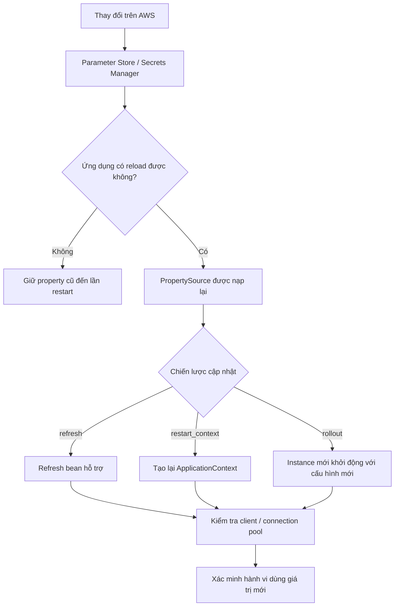
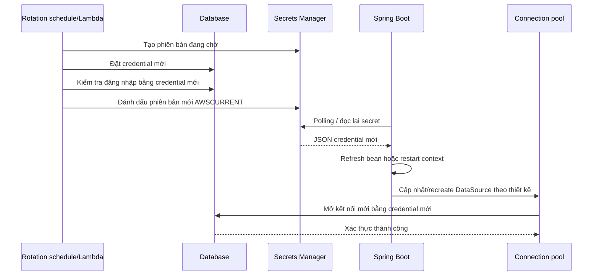

# Nạp lại cấu hình và xoay vòng bí mật theo khả năng phiên bản

## Mục tiêu bài học

Trong module **SPRING_CLOUD_PROVIDER_INTEGRATION**, chúng ta thực hành tích hợp Spring Boot với dịch vụ managed của AWS, Azure và Google Cloud qua các thư viện Spring Cloud tương ứng. Với phần **Cấu hình AWS**, ứng dụng cần đọc Parameter Store và Secrets Manager ở thời điểm khởi động; nhưng trong vận hành, tham số có thể thay đổi, API key có thể bị thu hồi và mật khẩu database phải được xoay vòng.

Hai việc thường bị nhầm lẫn là **nạp lại cấu hình (configuration reload)** và **xoay vòng bí mật (secret rotation)**. Reload cập nhật giá trị trong ứng dụng sau khi nguồn cấu hình thay đổi. Rotation thay credential tại hệ thống đích và cập nhật phiên bản secret. Để một ứng dụng đang chạy dùng được credential mới, hai quy trình này phải phối hợp cùng vòng đời của bean, HTTP client và connection pool.

Sau bài học, bạn có thể:

1. Phân biệt Config Data load lúc startup, property source reload, Spring bean refresh, application context restart và secret rotation.
2. Xác định khả năng theo dòng **Spring Cloud AWS 2.x, 3.x và 4.x**, tránh dùng lẫn starter và property của các phiên bản.
3. Cấu hình polling reload cho Parameter Store và Secrets Manager trong Spring Cloud AWS 3.x.
4. Chọn `refresh`, `restart_context`, rolling deployment hoặc đọc secret bằng SDK/cache theo loại ứng dụng.
5. Thiết kế rotation cho database password và API key mà không làm lộ secret hoặc gây gián đoạn ngoài ý muốn.
6. Kiểm thử việc phát hiện thay đổi, cập nhật bean, kết nối mới, rollback và hành vi khi AWS tạm thời không truy cập được.

> **Lưu ý phiên bản:** Các property cụ thể trong ví dụ chính dựa trên tài liệu **Spring Cloud AWS 3.4.2**. Trước khi áp dụng, đối chiếu Spring Boot, Spring Cloud và Spring Cloud AWS BOM mà dự án đang dùng. Không sao chép cấu hình 2.x sang 3.x hoặc 4.x mà chưa kiểm tra migration guide.

## 1. Bốn khái niệm phải tách biệt

Giả sử `order-service` đang chạy với cấu hình:

```text
Parameter Store:
  /config/order-service/prod/catalog.timeout = 2s
  /config/order-service/prod/catalog.max-retries = 3

Secrets Manager:
  /secrets/order-service/prod/database
    JSON keys: username, password
```

Ứng dụng đã đọc các giá trị này lúc startup. Sau đó, đội vận hành thay `catalog.timeout` thành `5s` và Secrets Manager chuyển sang một database password mới. Có bốn lớp cần xử lý:

| Khái niệm | Điều gì thay đổi? | Ví dụ |
| --- | --- | --- |
| **Nguồn từ xa** | Giá trị trên AWS được cập nhật | Parameter mới, secret version mới được gắn `AWSCURRENT` |
| **Property source reload** | Spring đọc lại nguồn và cập nhật `Environment` | Polling phát hiện `catalog.timeout=5s` |
| **Bean refresh/restart** | Đối tượng Java nhận cấu hình mới | `CatalogSettings` được bind lại, hoặc context tạo lại bean |
| **Secret rotation** | Credential ở hệ thống đích được thay đổi/thu hồi | PostgreSQL chấp nhận mật khẩu mới và Secrets Manager lưu phiên bản tương ứng |

Không thể suy ra rằng một bước tự động kéo theo mọi bước khác. Ví dụ:

- Parameter Store đã có giá trị mới nhưng Spring không polling thì `Environment` vẫn giữ giá trị cũ.
- `Environment` đã có giá trị mới nhưng bean singleton không hỗ trợ refresh thì ứng dụng vẫn dùng giá trị cũ.
- Bean credential đã được refresh nhưng HikariCP vẫn giữ `DataSource` với mật khẩu cũ thì kết nối mới có thể thất bại.
- Secrets Manager đã đổi `AWSCURRENT` nhưng database chưa chấp nhận credential mới thì ứng dụng vẫn không thể đăng nhập.



Sơ đồ thể hiện luồng khái niệm. **Secret rotation** còn cần thay credential tại dịch vụ đích và kiểm tra credential mới hoạt động; chỉ cập nhật property trong Spring không hoàn tất rotation.

## 2. Khả năng theo dòng Spring Cloud AWS

### 2.1. Bảng định hướng phiên bản

| Dòng Spring Cloud AWS | Nền tảng Spring điển hình | Tích hợp cấu hình | Cần lưu ý |
| --- | --- | --- | --- |
| **2.4.x** | Spring Boot 2.6.x/2.7.x, Spring Cloud 2021.0.x, AWS SDK v1 | Dòng cũ, các starter và cơ chế cấu hình kiểu legacy; có các thuộc tính reload riêng theo phiên bản | Đang ở trạng thái maintenance; không áp dụng thẳng cú pháp/property của 3.x |
| **3.0.x–3.2.x** | Spring Boot 3.0–3.3, AWS SDK v2 | Config Data qua `spring.config.import`; có reload cho Parameter Store và Secrets Manager | Chuyển package và property prefix so với 2.x; chọn đúng BOM |
| **3.3.x–3.4.x** | Spring Boot 3.4–3.5, AWS SDK v2 | Config Data và PropertySource reload với `refresh`/`restart_context` | 3.4.x là dòng tương thích Spring Boot 3.5.x theo bảng tương thích của dự án |
| **4.0.x–4.1.x** | Spring Boot 4.x, Spring Framework 7.x, AWS SDK v2 | Tiếp tục hỗ trợ Config Data và reload; 4.1.x bổ sung tích hợp AWS AppConfig | Cần nâng Spring Boot/Cloud đồng bộ; không dùng BOM 4.x trong ứng dụng Boot 3.x |

Bảng là định hướng tương thích, không thay thế ma trận phiên bản chính thức. Một số bản minor/patch có thay đổi property hoặc dependency. Ví dụ, Spring Cloud AWS 2.4.x dùng hệ sinh thái Spring Boot 2 và AWS SDK v1; từ 3.0.0-M3, dự án chuyển sang Spring Boot 3.0. Các bản 3.x dùng group `io.awspring.cloud` và starter như `spring-cloud-aws-starter-parameter-store`/`spring-cloud-aws-starter-secrets-manager`.

### 2.2. Khác biệt khi nâng cấp 2.x lên 3.x

Một số property được đổi tên. Ví dụ theo migration guide:

| Dòng 2.x | Dòng 3.x |
| --- | --- |
| `cloud.aws.credentials.access-key` | `spring.cloud.aws.credentials.access-key` |
| `cloud.aws.credentials.secret-key` | `spring.cloud.aws.credentials.secret-key` |
| `aws.paramstore.region` | `spring.cloud.aws.parameterstore.region` |
| `aws.secretsmanager.region` | `spring.cloud.aws.secretsmanager.region` |

2.x và 3.x cũng khác nhau về starter, package và cách tích hợp cấu hình. Trong ứng dụng 3.x, dùng Spring Boot Config Data:

```yaml
spring:
  config:
    import:
      - "aws-parameterstore:/config/order-service/prod/"
      - "aws-secretsmanager:/secrets/order-service/prod/database?prefix=db."
```

Với ứng dụng 2.x hiện hữu, cần đọc tài liệu đúng bản 2.4.x và migration guide trước khi thay `bootstrap.yml`, tên starter hoặc prefix. **Không chỉ đổi version dependency rồi giữ nguyên mọi property**. Đặc biệt, không coi `spring.config.import` và property `spring.cloud.aws.*.reload.*` trong ví dụ 3.x là cấu hình có thể dùng nguyên vẹn cho tất cả dự án 2.x.

### 2.3. AppConfig xuất hiện ở dòng mới hơn

Spring Cloud AWS **4.1.x** bổ sung tích hợp AWS AppConfig. AppConfig phù hợp với cấu hình cần triển khai theo môi trường, kiểm soát rollout và liên tục nhận thay đổi. Theo ma trận tích hợp được công bố, AppConfig chưa có starter tích hợp trong các dòng 2.x, 3.x và 4.0.x; khả năng này xuất hiện ở 4.1.x.

AppConfig không thay thế Secrets Manager cho password/API key. Một cách phân chia hợp lý:

- Parameter Store: cấu hình đơn giản, ít thay đổi.
- Secrets Manager: credential và bí mật cần lifecycle/rotation.
- AppConfig: cấu hình động, feature flag, rollout theo chiến lược.

Nếu ứng dụng vẫn ở Spring Boot 3.x và Spring Cloud AWS 3.4.x, không thể chỉ thêm `spring-cloud-aws-starter-app-config` của 4.1.x. Hãy chọn một thiết kế tương thích với dòng framework hiện tại.

## 3. Reload có sẵn trong Spring Cloud AWS 3.4.2

### 3.1. Mặc định là chỉ tải lúc khởi động

Với Config Data:

```properties
spring.config.import=aws-parameterstore:/config/order-service/prod/
```

hoặc:

```properties
spring.config.import=aws-secretsmanager:/secrets/order-service/prod/database
```

Spring Cloud AWS tải nguồn trong giai đoạn startup. **PropertySource reload bị tắt mặc định**. Muốn phát hiện thay đổi sau startup, phải bật reload qua property tương ứng và thêm các dependency cần thiết.

Reload của Parameter Store và Secrets Manager được cấu hình **độc lập**. Nếu chỉ bật:

```yaml
spring:
  cloud:
    aws:
      secretsmanager:
        reload:
          strategy: refresh
```

thì chỉ nguồn Secrets Manager có reload theo cấu hình này; không mặc nhiên bật reload cho Parameter Store.

### 3.2. Dependency cần thiết

Trong Maven, ngoài starter Parameter Store/Secrets Manager và BOM Spring Cloud AWS, tính năng reload yêu cầu các thành phần Spring sau theo tài liệu 3.4.2:

```xml
<dependencies>
    <dependency>
        <groupId>io.awspring.cloud</groupId>
        <artifactId>spring-cloud-aws-starter-parameter-store</artifactId>
    </dependency>
    <dependency>
        <groupId>io.awspring.cloud</groupId>
        <artifactId>spring-cloud-aws-starter-secrets-manager</artifactId>
    </dependency>
    <dependency>
        <groupId>org.springframework.boot</groupId>
        <artifactId>spring-boot-starter-actuator</artifactId>
    </dependency>
    <dependency>
        <groupId>org.springframework.cloud</groupId>
        <artifactId>spring-cloud-commons</artifactId>
    </dependency>
    <dependency>
        <groupId>org.springframework.cloud</groupId>
        <artifactId>spring-cloud-context</artifactId>
    </dependency>
</dependencies>
```

Các dependency Spring Cloud cần tương thích với Spring Boot/Spring Cloud release train của ứng dụng; BOM Spring Cloud AWS không có nghĩa mọi phiên bản Spring Cloud tùy ý đều được hỗ trợ.

### 3.3. Cấu hình reload theo chu kỳ

Ví dụ cấu hình cho cả hai nguồn trong `application-prod.yml`:

```yaml
spring:
  cloud:
    aws:
      parameterstore:
        reload:
          strategy: refresh
          period: 30s
      secretsmanager:
        reload:
          strategy: refresh
          period: 30s
```

Trong ví dụ này:

- `strategy: refresh` yêu cầu Spring Cloud Context refresh các bean cấu hình được hỗ trợ khi phát hiện property source thay đổi.
- `period: 30s` là khoảng polling được khai báo tường minh; đây **không phải** cam kết mọi instance sẽ thấy giá trị mới chính xác sau 30 giây.
- Mỗi lần polling có thể gọi lại API AWS; cần cấp quyền đọc và thiết kế quota/chi phí phù hợp.

Các property được tài liệu Spring Cloud AWS 3.4.2 liệt kê:

| Nguồn | Property | Ý nghĩa |
| --- | --- | --- |
| Parameter Store | `spring.cloud.aws.parameterstore.reload.strategy` | `refresh` hoặc `restart_context` |
| Parameter Store | `spring.cloud.aws.parameterstore.reload.period` | Chu kỳ kiểm tra thay đổi |
| Parameter Store | `spring.cloud.aws.parameterstore.reload.max-wait-time-for-restart` | Thời gian chờ tối đa trước restart context |
| Secrets Manager | `spring.cloud.aws.secretsmanager.reload.strategy` | `refresh` hoặc `restart_context` |
| Secrets Manager | `spring.cloud.aws.secretsmanager.reload.period` | Chu kỳ kiểm tra thay đổi |
| Secrets Manager | `spring.cloud.aws.secretsmanager.reload.max-wait-time-for-restart` | Thời gian chờ tối đa trước restart context |

**Chú ý tài liệu phiên bản:** Trong reference 3.4.2, phần mô tả polling nói chu kỳ mặc định là `1 minute`, trong khi bảng cấu hình liệt kê `15s` cho `reload.period`. Để tránh phụ thuộc vào giá trị mặc định có thể không nhất quán giữa phần mô tả và metadata, hãy đặt `period` rõ ràng trong ứng dụng và kiểm tra lại tài liệu/API của đúng patch release.

## 4. Chọn chiến lược `refresh` hay `restart_context`

### 4.1. `refresh`: cập nhật các bean cấu hình hỗ trợ

`refresh` tận dụng Spring Cloud Context. Theo tài liệu Spring Cloud AWS, các bean được hỗ trợ là:

- Bean được bind bằng `@ConfigurationProperties`.
- Bean được đánh dấu `@RefreshScope`.

Các singleton khác không mặc nhiên được tạo lại. Ví dụ, một bean client được khởi tạo bằng `new Client(config.apiKey())` ở constructor có thể giữ API key cũ ngay cả khi một bean cấu hình khác đã nhận giá trị mới.

Ví dụ một bean cấu hình mutable:

```java
import org.springframework.boot.context.properties.ConfigurationProperties;

@ConfigurationProperties(prefix = "catalog")
public class CatalogSettings {
    private String baseUrl;
    private int timeoutMillis;

    public String getBaseUrl() {
        return baseUrl;
    }

    public void setBaseUrl(String baseUrl) {
        this.baseUrl = baseUrl;
    }

    public int getTimeoutMillis() {
        return timeoutMillis;
    }

    public void setTimeoutMillis(int timeoutMillis) {
        this.timeoutMillis = timeoutMillis;
    }
}
```

Đăng ký bằng `@ConfigurationPropertiesScan` hoặc `@EnableConfigurationProperties(CatalogSettings.class)`. Khi reload thành công, Spring Cloud Context có thể bind lại cấu hình cho bean phù hợp. Bean consumer cần sử dụng đối tượng được refresh đúng cách; tránh sao chép các trường cấu hình sang field riêng tại thời điểm khởi tạo nếu muốn nhận thay đổi.

`refresh` phù hợp hơn cho các giá trị nhẹ như timeout, giới hạn retry, endpoint không nhạy cảm hoặc feature setting. Với secret, phải kiểm tra mọi client đang giữ credential cũ có được cập nhật hay không.

### 4.2. `restart_context`: tạo lại toàn bộ Spring ApplicationContext

Nếu bean/client cần được xây dựng lại, có thể dùng:

```yaml
spring:
  cloud:
    aws:
      secretsmanager:
        reload:
          strategy: restart_context
          period: 30s
          max-wait-time-for-restart: 5s
```

Chiến lược này restart Spring `ApplicationContext` một cách graceful để các bean được tạo lại theo cấu hình mới. Theo tài liệu, cần có Actuator restart endpoint được bật và expose:

```yaml
management:
  endpoint:
    restart:
      enabled: true
  endpoints:
    web:
      exposure:
        include: restart
```

**Không expose endpoint restart ra Internet hoặc mạng người dùng thông thường.** Endpoint quản trị có thể gây gián đoạn toàn bộ process; chỉ cho phép gọi qua kênh nội bộ được xác thực, giới hạn network và quyền vận hành. Trong hệ thống container, phải thử cách context restart tương tác với liveness/readiness probe, listener thread, scheduler và connection pool.

`restart_context` có phạm vi tác động lớn hơn `refresh`. Nó có thể giải quyết việc một số singleton/client giữ state cũ, nhưng cũng có thể làm mất các request đang xử lý nếu vòng đời shutdown/start không được thiết kế đúng. Không xem đây là lựa chọn mặc định cho mọi thay đổi cấu hình.

### 4.3. So sánh lựa chọn

| Tiêu chí | `refresh` | `restart_context` |
| --- | --- | --- |
| Phạm vi | Bean `@ConfigurationProperties`/`@RefreshScope` được hỗ trợ | Toàn bộ Spring ApplicationContext |
| Tác động | Nhẹ hơn, không khởi tạo lại toàn ứng dụng | Tạo lại các bean và tài nguyên |
| Phù hợp | Tham số ứng dụng, cấu hình có thể bind lại | Client/bean cần tạo mới từ config |
| Hạn chế | Singleton/client không hỗ trợ refresh có thể giữ giá trị cũ | Có thể gây gián đoạn và tiêu tốn thời gian khởi động |
| Yêu cầu bổ sung | Spring Cloud Context và dependency reload | Thêm Actuator, bật/expose restart endpoint an toàn |
| Rủi ro | Hệ thống ở trạng thái nửa cũ/nửa mới nếu consumer giữ state riêng | Restart đồng thời nhiều instance hoặc không graceful |

## 5. Secret rotation không phải là property reload

### 5.1. Vòng đời rotation

Với database credential, quy trình rotation thường gồm các bước:

1. Một lịch rotation hoặc tác vụ vận hành kích hoạt quy trình.
2. Cơ chế rotation tạo credential mới hoặc chuẩn bị phiên bản đang chờ.
3. Database/API đích được cập nhật để chấp nhận credential mới theo chiến lược được chọn.
4. Secrets Manager cập nhật secret version và nhãn, thông thường `AWSCURRENT` chuyển sang phiên bản mới sau khi quy trình thành công.
5. Ứng dụng phát hiện secret thay đổi qua polling, refresh/restart hoặc rollout.
6. Client/connection pool sử dụng credential mới; kiểm tra kết nối mới thành công và theo dõi lỗi xác thực.
7. Credential cũ bị vô hiệu hóa theo chính sách rotation sau khi hệ thống đã chuyển đổi an toàn.



Đây là sơ đồ khái niệm. Cách triển khai thực tế phụ thuộc loại database, rotation Lambda/managed rotation và chiến lược một user/hai user. Không tự chuyển nhãn `AWSCURRENT` bằng tay để thay thế quy trình rotation có kiểm tra.

### 5.2. Vì sao HikariCP có thể vẫn dùng mật khẩu cũ?

Giả sử Spring Boot tạo:

```yaml
spring:
  datasource:
    username: "${db.username}"
    password: "${db.password}"
```

Khi startup, Spring Boot tạo một `DataSource` và HikariCP lưu cấu hình xác thực để mở các kết nối mới. Khi `db.password` được refresh trong `Environment` hoặc bean cấu hình:

- Không có bảo đảm `HikariDataSource` tự nhận giá trị mới.
- Các connection đang mở không tự thay password.
- Khi pool tạo connection mới, nó có thể vẫn dùng credential đã giữ từ lúc khởi tạo.

Vì vậy, với database credential rotation, cần chọn rõ một trong các cách:

1. **Rolling deployment/restart:** instance mới đọc `AWSCURRENT`, tạo `DataSource` mới; giữ instance cũ phục vụ trong thời gian chuyển tiếp theo chiến lược rotation.
2. **`restart_context`:** tạo lại `DataSource` và pool trong cùng process, sau đó kiểm tra readiness và xử lý request đang chạy.
3. **Pool/client có cơ chế cập nhật credential:** triển khai một component chuyên trách, có kiểm thử mở connection mới bằng secret hiện hành và loại bỏ connection cũ đúng thời điểm.

Không chỉ kiểm tra bean chứa `password`; hãy xác minh **kết nối mới thực sự** tới database thành công sau rotation.

### 5.3. Rotation API key của dịch vụ thứ ba

Một API key có thể không được nhà cung cấp hỗ trợ rotation tự động. Quy trình thường phải phối hợp:

1. Tạo key mới tại nhà cung cấp.
2. Cập nhật secret trong Secrets Manager.
3. Nạp key mới vào ứng dụng bằng reload/rollout.
4. Gửi request thử tới API sandbox/health endpoint không gây side effect.
5. Theo dõi tỷ lệ `401/403`, lỗi ký request và độ trễ.
6. Chỉ thu hồi key cũ sau khi mọi instance đã dùng key mới và không còn request cần credential cũ.

Nếu nhà cung cấp cho phép **hai key cùng hiệu lực**, có thể triển khai chuyển tiếp ít gián đoạn: tạo key mới, chuyển toàn bộ workload, rồi thu hồi key cũ. Nếu chỉ cho một key, cần lịch bảo trì hoặc cơ chế chấp nhận lỗi tạm thời đã được nghiệp vụ duyệt.

### 5.4. Rotation và reload có thể lệch nhịp

Polling chỉ phát hiện thay đổi sau lần kiểm tra kế tiếp. Ví dụ chu kỳ 30 giây có nghĩa thời gian phát hiện có thể gần 30 giây cộng độ trễ AWS API và xử lý; nhiều instance không nhất thiết phát hiện cùng lúc. Nếu credential cũ bị thu hồi ngay khi `AWSCURRENT` đổi, các instance chưa reload có thể lỗi xác thực.

Do đó:

- Chọn chu kỳ polling theo thời gian credential cũ còn hợp lệ.
- Nếu không thể duy trì hai credential cùng hiệu lực, cân nhắc rolling deployment có kiểm soát hoặc cơ chế rotation chuyên biệt.
- Theo dõi phiên bản secret/rotation status, thời điểm reload, trạng thái kết nối mới và lỗi xác thực.
- Có runbook rollback hoặc khôi phục credential nếu bước kiểm tra rotation thất bại.

## 6. Ví dụ cấu hình đầy đủ cho Spring Cloud AWS 3.4.2

### 6.1. Maven dependencies

Ví dụ dùng BOM tương thích với Spring Boot 3.5.x và Spring Cloud AWS 3.4.x:

```xml
<dependencyManagement>
    <dependencies>
        <dependency>
            <groupId>io.awspring.cloud</groupId>
            <artifactId>spring-cloud-aws-dependencies</artifactId>
            <version>${spring-cloud-aws.version}</version>
            <type>pom</type>
            <scope>import</scope>
        </dependency>
    </dependencies>
</dependencyManagement>

<dependencies>
    <dependency>
        <groupId>io.awspring.cloud</groupId>
        <artifactId>spring-cloud-aws-starter-parameter-store</artifactId>
    </dependency>
    <dependency>
        <groupId>io.awspring.cloud</groupId>
        <artifactId>spring-cloud-aws-starter-secrets-manager</artifactId>
    </dependency>
    <dependency>
        <groupId>org.springframework.boot</groupId>
        <artifactId>spring-boot-starter-actuator</artifactId>
    </dependency>
    <dependency>
        <groupId>org.springframework.cloud</groupId>
        <artifactId>spring-cloud-commons</artifactId>
    </dependency>
    <dependency>
        <groupId>org.springframework.cloud</groupId>
        <artifactId>spring-cloud-context</artifactId>
    </dependency>
</dependencies>
```

`${spring-cloud-aws.version}` phải được khai báo là phiên bản 3.4.x tương thích trong dự án. Không trộn artifact 4.x vào ứng dụng Spring Boot 3.x.

### 6.2. `application-prod.yml`

```yaml
spring:
  application:
    name: order-service
  config:
    import:
      - "aws-parameterstore:/config/order-service/prod/"
      - "aws-secretsmanager:/secrets/order-service/prod/database?prefix=db."
  cloud:
    aws:
      region:
        static: ap-southeast-1
      parameterstore:
        reload:
          strategy: refresh
          period: 30s
      secretsmanager:
        reload:
          strategy: refresh
          period: 30s
  datasource:
    url: "${database.jdbc-url}"
    username: "${db.username}"
    password: "${db.password}"
```

Ví dụ này bật polling reload riêng cho SSM và Secrets Manager. Nó **chưa bảo đảm** HikariCP tự cập nhật credential; cần thử hành vi thực tế và chọn `restart_context` hoặc rollout nếu DataSource không được cập nhật đúng.

Nếu chọn `restart_context`, ví dụ:

```yaml
spring:
  cloud:
    aws:
      secretsmanager:
        reload:
          strategy: restart_context
          period: 30s
          max-wait-time-for-restart: 5s

management:
  endpoint:
    restart:
      enabled: true
  endpoints:
    web:
      exposure:
        include: restart
```

Đây chỉ là ví dụ cho **endpoint nội bộ đã được bảo vệ**. Không mở restart endpoint trên mạng công khai. Nếu cùng ứng dụng còn reload Parameter Store, cấu hình strategy tương ứng cho `parameterstore` theo cùng nguyên tắc.

### 6.3. Quyền IAM khi bật reload

Reload polling tiếp tục gọi API đọc. Role ứng dụng cần quyền tối thiểu tương ứng:

| Nguồn | Quyền chính |
| --- | --- |
| Parameter Store import path | `ssm:GetParametersByPath` |
| Secrets Manager import secret | `secretsmanager:GetSecretValue` |
| `SecureString` hoặc secret dùng customer managed KMS key | `kms:Decrypt` trên đúng key, nếu cấu hình KMS yêu cầu |

Reload không yêu cầu role ứng dụng có quyền `PutParameter`, `PutSecretValue`, `UpdateSecret`, `RotateSecret` hoặc `DeleteSecret`. Quyền ghi và rotation nên nằm ở pipeline/role vận hành hoặc rotation Lambda riêng.

## 7. Chiến lược chọn theo loại cấu hình

| Dữ liệu thay đổi | Chiến lược tham khảo | Vì sao |
| --- | --- | --- |
| Timeout, retry, giới hạn tải | `refresh` | Bean cấu hình có thể bind lại mà không cần tạo lại toàn ứng dụng |
| Feature setting ít rủi ro | `refresh` hoặc AppConfig ở phiên bản hỗ trợ | Cần xác minh consumer nhận giá trị mới |
| Endpoint HTTP thay đổi | Refresh nếu client đọc cấu hình động; nếu client giữ endpoint khi tạo thì restart/rollout | HTTP client có thể cache base URL |
| API key của provider | Refresh nếu client hỗ trợ cập nhật header/key; nếu không, tạo lại client hoặc rollout | Credential có thể nằm trong singleton |
| Password database | Rolling restart, `restart_context` hoặc cơ chế pool chuyên biệt | DataSource/pool giữ credential |
| TLS certificate/private key | Reload/recreate SSL context và connection/client | Kết nối hiện hữu có thể giữ certificate cũ |
| Feature flag cần staged rollout/rollback | AppConfig nếu phiên bản Spring Cloud AWS hỗ trợ, hoặc nền tảng feature flag | Parameter Store polling không thay thế deployment strategy |

Không nên chọn `restart_context` chỉ để tránh viết code refresh nếu ứng dụng có hàng trăm instance. Restart đồng loạt có thể tạo bão startup, API throttling và mất năng lực phục vụ. Với rollout, dùng giới hạn concurrency, readiness, graceful shutdown và kiểm tra tải.

## 8. Thời gian polling, quota và tải hệ thống

### 8.1. Ước lượng số lần gọi

Nếu mỗi instance kiểm tra một secret và một path mỗi 30 giây, với 40 instance:

```text
Số lượt kiểm tra/giờ/instance = 3600 / 30 = 120
Số lượt kiểm tra/giờ/toàn hệ thống = 120 × 40 = 4.800
```

Đây là phép tính minh họa số lần kiểm tra nguồn; số API call thực tế có thể khác do cách resolver lấy nhiều parameter, retry, batch, polling độc lập và số lượng location. Khi có 200 instance cùng khởi động hoặc cùng phát hiện thay đổi, cần tính cả burst load.

### 8.2. Chọn `period`

- Poll quá nhanh làm tăng API traffic, chi phí và nguy cơ throttling.
- Poll quá chậm kéo dài thời gian ứng dụng tiếp tục dùng giá trị cũ.
- Với credential có thời gian overlap ngắn, chu kỳ polling phải nằm trong cửa sổ chuyển đổi an toàn, cộng thời gian retry và rollout.
- Đặt `period` tường minh để không phụ thuộc giá trị mặc định có thể khác giữa phiên bản hoặc tài liệu.

Khi nhiều instance cùng phát hiện thay đổi, cân nhắc rollout có kiểm soát, giới hạn số lần restart đồng thời và theo dõi readiness. Tài liệu 3.4.2 có `max-wait-time-for-restart` cho `restart_context`; cần kiểm tra đúng property metadata của patch release đang dùng trước khi cấu hình.

### 8.3. Retry và lỗi AWS tạm thời

Nếu polling gặp `AccessDenied`, KMS error hoặc timeout mạng, không được coi đó là một lần reload thành công. Cần:

- Giữ nguyên cấu hình cuối cùng đã được xác minh nếu ứng dụng có thể tiếp tục an toàn.
- Ghi log mã lỗi/request ID và nguồn gặp lỗi; không ghi giá trị secret.
- Phân biệt lỗi tạm thời với IAM policy bị thay đổi hoặc secret bị thu hồi.
- Dùng retry/backoff có giới hạn theo AWS SDK và giám sát throttling.
- Với credential cũ sắp hết hiệu lực, kích hoạt cảnh báo sớm để có thời gian khắc phục.

Không tự động chuyển sang một password hoặc API key mặc định trong code khi reload thất bại.

## 9. Kiểm thử reload và rotation

### 9.1. Kiểm thử binding mà không cần AWS

Tách lớp cấu hình và logic tiêu thụ thành các thành phần có thể test offline. Ví dụ một class `@ConfigurationProperties`:

```java
import org.springframework.boot.context.properties.ConfigurationProperties;

@ConfigurationProperties(prefix = "catalog")
public class CatalogSettings {
    private String endpoint;
    private int timeoutMillis;

    public String getEndpoint() {
        return endpoint;
    }

    public void setEndpoint(String endpoint) {
        this.endpoint = endpoint;
    }

    public int getTimeoutMillis() {
        return timeoutMillis;
    }

    public void setTimeoutMillis(int timeoutMillis) {
        this.timeoutMillis = timeoutMillis;
    }
}
```

Trong unit test, cung cấp property giả bằng `ApplicationContextRunner` hoặc `@SpringBootTest` với profile `test` không import AWS. Xác minh binder nhận giá trị và bean consumer dùng giá trị đó. Test này không chứng minh AWS polling, KMS hay rotation thật.

### 9.2. Kiểm thử PropertySource reload

Trong AWS sandbox:

1. Tạo parameter `catalog.timeout=2s` và secret JSON có credential giả dùng riêng cho database test.
2. Khởi động ứng dụng với IAM role chỉ đọc đúng path và secret ARN.
3. Bật reload với `period` ngắn phù hợp cho test.
4. Thay parameter thành `5s`, quan sát bean `CatalogSettings` được refresh.
5. Cập nhật một key trong secret sandbox, quan sát property source/bean được cập nhật mà không in giá trị.
6. Thử `refresh` với bean không có `@ConfigurationProperties`/`@RefreshScope` để xác nhận nó không tự được tạo lại.
7. Thử `restart_context` trong môi trường riêng, theo dõi thời gian restart, readiness và request đang xử lý.

### 9.3. Kiểm thử database secret rotation

Không chỉ kiểm tra `AWSCURRENT`. Một ca kiểm thử tốt cần:

1. Tạo user/database sandbox và credential ban đầu.
2. Cho ứng dụng mở connection qua pool.
3. Thực hiện rotation bằng quy trình được hỗ trợ.
4. Xác minh secret version mới đã thành hiện hành.
5. Xác minh ứng dụng đã nhận giá trị mới theo cơ chế reload/rollout.
6. Tạo **connection mới** qua pool và kiểm tra đăng nhập thành công.
7. Xác minh các request đang chạy, connection cũ và lỗi xác thực trong giai đoạn chuyển tiếp.
8. Kiểm tra rollback khi bước rotation hoặc xác thực credential mới thất bại.

### 9.4. Ma trận tình huống cần có

| Tình huống | Kết quả cần xác minh |
| --- | --- |
| Thay Parameter Store, reload tắt | Ứng dụng vẫn giữ giá trị cũ đến restart |
| Thay Parameter Store, bật `refresh` | Bean cấu hình được hỗ trợ nhận giá trị mới |
| Thay secret, bật `refresh` | Bean `@ConfigurationProperties`/`@RefreshScope` được cập nhật |
| Secret đổi nhưng client singleton giữ key trong constructor | Client vẫn có thể dùng key cũ; cần recreate/refresh client |
| Database password rotate, chỉ refresh property | Kiểm tra pool; không mặc định DataSource tự đổi |
| Database password rotate, restart/rollout | Connection mới dùng credential hiện hành |
| IAM bị thu hồi quyền đọc trong lúc polling | Reload lỗi, cảnh báo được ghi nhận, không log secret |
| KMS từ chối giải mã | Phân biệt lỗi KMS với secret không tồn tại |
| Nhiều instance phát hiện thay đổi cùng lúc | Không restart đồng loạt gây mất năng lực phục vụ |
| Rollback sang phiên bản secret trước | Ứng dụng và dịch vụ đích cùng chấp nhận credential đã khôi phục |

## 10. Quan sát và xử lý sự cố

### 10.1. Chỉ số cần theo dõi

- Thời điểm phát hiện thay đổi và thời điểm bean/client nhận cấu hình mới.
- Lỗi polling, lỗi SDK, `AccessDenied`, KMS `Decrypt` failure và throttling.
- Thời gian startup/restart, số instance sẵn sàng, readiness và tỷ lệ lỗi request.
- Lỗi xác thực database/API (`SQLState` phù hợp, HTTP 401/403) sau rotation.
- Phiên bản/nhãn secret đang hiện hành, trạng thái rotation và kết quả bước kiểm tra.

Không đưa secret value, password, API key hoặc token vào metric label, trace tag, log hay exception message.

### 10.2. Những lỗi phổ biến

| Triệu chứng | Nguyên nhân có thể | Cách xử lý |
| --- | --- | --- |
| Thay đổi trên AWS nhưng app không đổi | Reload chưa bật hoặc sai property prefix | Kiểm tra đúng dòng thư viện và property `parameterstore`/`secretsmanager` |
| Polling không chạy | Thiếu `spring-cloud-context`/`spring-cloud-commons`/Actuator theo yêu cầu hoặc strategy chưa được cấu hình | Đối chiếu dependency và cấu hình của đúng release |
| Bean `@Value` vẫn cũ | Bean không thuộc nhóm refresh hoặc giữ giá trị copy trong field | Chuyển sang cấu hình có thể refresh hoặc recreate consumer |
| `@ConfigurationProperties` đổi nhưng DataSource không đổi | Pool giữ credential lúc khởi tạo | Dùng restart/rollout hoặc pool reconfiguration được kiểm thử |
| `restart_context` không hoạt động | Actuator restart endpoint chưa enable/expose, hoặc version không tương thích | Kiểm tra cấu hình và dependency; bảo vệ endpoint |
| App restart liên tục | Period quá ngắn, thay đổi lặp hoặc nhiều nguồn xung đột | Kiểm tra detector, polling, config và giới hạn restart |
| Secret rotation thành công nhưng DB login thất bại | Database và app chưa chuyển cùng nhịp | Kiểm tra AWSCURRENT, overlap credential, refresh và connection pool |
| API key mới bị 401 | Client chưa nhận key mới hoặc key mới chưa được kích hoạt ở provider | Kiểm tra lifecycle hai phía và recreate client |
| Nhiều pod cùng lỗi khi polling | IAM/KMS/network chung hoặc throttling | Kiểm tra CloudTrail, endpoint, IAM và retry/backoff |

### 10.3. Runbook khi rotation gặp lỗi

1. Dừng thay đổi tiếp theo của lịch rotation theo runbook vận hành; không sửa secret trực tiếp ngoài quy trình.
2. Kiểm tra trạng thái rotation và version label bằng metadata, không đọc plaintext secret vào log.
3. Xác định credential nào đang được database/API provider chấp nhận.
4. Kiểm tra role ứng dụng còn đọc được secret và có quyền KMS phù hợp không.
5. Kiểm tra các instance đã reload/restart hay vẫn giữ client/pool cũ.
6. Nếu cần rollback, khôi phục **đồng bộ** credential tại dịch vụ đích và phiên bản secret theo quy trình được hỗ trợ.
7. Chỉ mở lại traffic/rotation sau khi connection mới và health check đạt.

## 11. Bài tập thực hành

Một dịch vụ `payment-service` chạy trên ECS có:

```text
Parameter Store:
  /config/payment-service/prod/payment.timeout = 2s
  /config/payment-service/prod/payment.retry-count = 3

Secrets Manager:
  /secrets/payment-service/prod/gateway
    JSON: apiKey, merchantId
  /secrets/payment-service/prod/database
    JSON: username, password
```

Yêu cầu:

1. Chọn Spring Cloud AWS phù hợp với Spring Boot hiện tại và nêu vì sao không thể trộn starter 2.x/3.x/4.x.
2. Cấu hình Config Data import và reload polling cho Parameter Store/Secrets Manager theo phiên bản đã chọn.
3. Tạo `@ConfigurationProperties` cho payment timeout/retry và secret gateway; không log `apiKey`.
4. Chọn `refresh`, `restart_context` hay rolling deployment cho API key và database password; giải thích ảnh hưởng tới HTTP client và HikariCP.
5. Thiết kế quy trình rotation database: cập nhật database, cập nhật `AWSCURRENT`, reload/rollout, kiểm tra connection mới, thu hồi credential cũ.
6. Viết test sandbox thay đổi `payment.timeout`, đổi secret gateway và rotate password database.
7. Tạo ca negative test: IAM role bị mất `GetSecretValue`, thiếu `kms:Decrypt`, polling timeout và một instance chưa reload.
8. Đề xuất cảnh báo khi version secret đã đổi nhưng một số instance vẫn dùng credential cũ.

**Sản phẩm mong đợi:** Sơ đồ lifecycle, bảng tương thích phiên bản, YAML reload, chiến lược refresh/restart/rollout, ma trận kiểm thử và runbook rotation có rollback.

## 12. Liên hệ với Azure và Google Cloud

Mục tiêu của **SPRING_CLOUD_PROVIDER_INTEGRATION** là đánh giá khác biệt giữa các cloud provider. Nguyên tắc **đổi giá trị nguồn – nạp lại property – cập nhật client – thay credential ở hệ thống đích** vẫn đúng, nhưng cơ chế triển khai khác nhau:

| Khía cạnh | AWS | Azure | Google Cloud |
| --- | --- | --- | --- |
| Kho cấu hình | Parameter Store; AppConfig khi cần rollout động | Azure App Configuration | Config/runtime hoặc dịch vụ cấu hình được chọn |
| Kho secret | Secrets Manager | Azure Key Vault | Secret Manager |
| Danh tính workload | IAM role | Managed Identity/Workload Identity | Service Account/Workload Identity |
| Phát hiện thay đổi | Spring Cloud AWS PropertySource polling; AppConfig Data trong 4.1.x | Cơ chế refresh của Spring Cloud Azure/SDK tùy dịch vụ và version | Cơ chế polling/refresh của SDK hoặc integration tương ứng |
| Cập nhật bean | Spring Cloud Context `refresh` hoặc `restart_context` | Tính năng refresh của integration/version | Cần kiểm tra cách thư viện và client quản lý lifecycle |
| Rotation | Secrets Manager rotation và ứng dụng reload/rollout | Key Vault rotation policy cùng consumer refresh | Secret Manager rotation/integration tùy loại secret và workload |

Không giả định các thư viện Spring Cloud trên Azure/Google có cùng property name, chu kỳ polling hoặc phạm vi bean refresh như Spring Cloud AWS. Khi chuyển nền tảng, cần kiểm tra tài liệu đúng phiên bản và kiểm thử client thực tế.

## Tổng kết

**Reload cấu hình** và **secret rotation** là hai quy trình liên quan nhưng độc lập. Spring Cloud AWS 3.4.2 hỗ trợ polling reload cho Parameter Store và Secrets Manager bằng `refresh` hoặc `restart_context`, nhưng chức năng này tắt mặc định và cần dependency phù hợp. `refresh` chỉ cập nhật bean cấu hình được hỗ trợ; `restart_context` tạo lại toàn bộ Spring context và cần Actuator restart endpoint được bảo vệ.

Đối với credential, phải xác minh thêm hệ thống đích và client đang chạy. Đặc biệt, **DataSource/connection pool có thể giữ password cũ** dù property source đã đổi. Chọn refresh, restart hoặc rolling deployment theo vòng đời bean/client, cửa sổ credential cũ-mới và yêu cầu sẵn sàng. Cuối cùng, luôn thử trên sandbox cả đường thành công lẫn rollback, theo dõi kết nối mới và không ghi giá trị bí mật ra log.

## Tài liệu tham khảo

- [Spring Cloud AWS 3.4.2 Reference — Secrets Manager `PropertySource` Reload](https://docs.awspring.io/spring-cloud-aws/docs/3.4.2/reference/html/index.html#secrets-manager-integration-propertysource-reload) — dependency, strategy và polling cho secret.
- [Spring Cloud AWS 3.4.2 Reference — Parameter Store `PropertySource` Reload](https://docs.awspring.io/spring-cloud-aws/docs/3.4.2/reference/html/index.html#parameter-store-integration-propertysource-reload) — dependency, strategy và polling cho parameter.
- [Spring Cloud AWS 3.4.2 API — ReloadStrategy](https://docs.awspring.io/spring-cloud-aws/docs/3.4.2/apidocs/io/awspring/cloud/autoconfigure/config/reload/ReloadStrategy.html) — ý nghĩa `REFRESH` và `RESTART_CONTEXT`.
- [Spring Cloud AWS — Compatibility and supported integrations](https://github.com/awspring/spring-cloud-aws) — bảng tương thích Spring Cloud AWS/Spring Boot và các tích hợp theo phiên bản.
- [Spring Cloud AWS 4.1.1 Reference — AppConfig Integration](https://docs.awspring.io/spring-cloud-aws/docs/4.1.1/reference/html/index.html#appconfig-integration) — tích hợp AppConfig cho cấu hình động.
- [AWS Secrets Manager — Rotate secrets](https://docs.aws.amazon.com/secretsmanager/latest/userguide/rotating-secrets.html) — cơ chế và lịch rotation.
- [AWS Secrets Manager — GetSecretValue and version stages](https://docs.aws.amazon.com/secretsmanager/latest/apireference/API_GetSecretValue.html) — đọc secret theo version/staging label.
- [Spring Cloud Context — Refresh Scope](https://docs.spring.io/spring-cloud-commons/reference/spring-cloud-commons/application-context-services.html) — hành vi refresh bean và application context.
