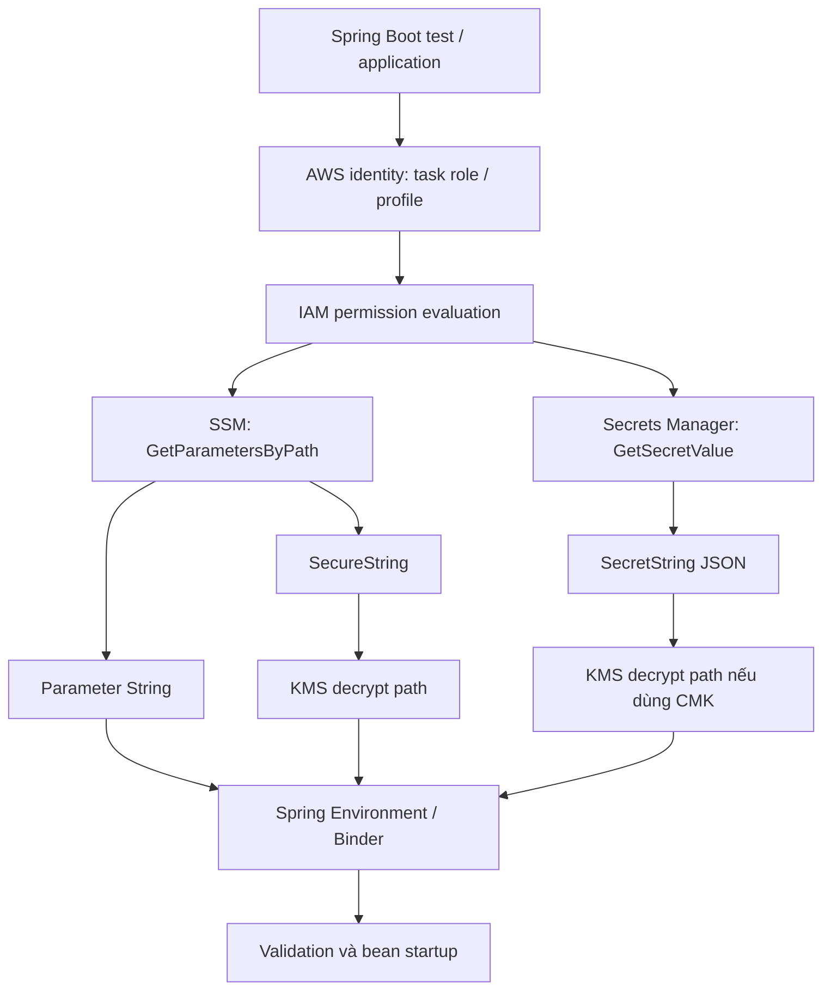

# Kiểm thử quyền truy cập và xử lý cấu hình bị thiếu

## Mục tiêu bài học

Module **SPRING_CLOUD_PROVIDER_INTEGRATION** hướng dẫn tích hợp Spring Boot với dịch vụ managed của **AWS, Azure và Google Cloud** qua các thư viện Spring Cloud tương ứng. Trong thực tế, ứng dụng cần đọc cấu hình và bí mật bằng danh tính workload, tuân thủ quyền tối thiểu, xử lý lỗi khi một nguồn không tồn tại và vẫn bảo vệ được dữ liệu nhạy cảm trong lúc kiểm thử.

Ở chương **Cấu hình AWS**, bài này tập trung kiểm thử tích hợp giữa Spring Boot, AWS Systems Manager Parameter Store, AWS Secrets Manager, IAM và AWS KMS. Ta sẽ kiểm tra cả đường đi được phép và đường đi bị từ chối, đồng thời phân biệt lỗi thiếu nguồn, thiếu khóa, sai quyền, lỗi giải mã và lỗi mạng.

Sau bài học, bạn có thể:

1. Xây dựng ma trận kiểm thử cho quyền đọc Parameter Store, Secrets Manager và KMS.
2. Kiểm tra danh tính thực tế của ứng dụng, policy allow/deny và phạm vi ARN.
3. Kiểm thử `spring.config.import` với nguồn bắt buộc và `optional:`.
4. Phân biệt missing location, missing property, invalid value, `AccessDenied`, lỗi KMS và lỗi kết nối.
5. Thiết kế unit test, Spring context test và integration test trên AWS sandbox.
6. Thu thập bằng chứng từ IAM Policy Simulator, AWS CLI, CloudTrail và log ứng dụng mà không xuất secret plaintext.

> **Nguyên tắc:** Một bài test chỉ chứng minh điều nó thực sự kiểm tra. Unit test chứng minh binding; LocalStack có thể hỗ trợ một số API integration; IAM Policy Simulator hỗ trợ đánh giá một số identity policy; chỉ kiểm thử trên AWS thật với đúng principal, resource, key và điều kiện triển khai mới chứng minh đầy đủ hành vi runtime của IAM/KMS.

## 1. Mô hình kiểm thử theo các lớp

Giả sử `order-service` trên ECS cần các nguồn sau:

```text
Parameter Store
  /config/order-service/test/catalog.base-url       String
  /config/order-service/test/catalog.timeout        String
  /config/order-service/test/licensing.token         SecureString

Secrets Manager
  /secrets/order-service/test/database               JSON: username, password

KMS
  CMK-SSM: mã hóa licensing.token
  CMK-DB: mã hóa database secret
```

Tên và tài nguyên trong bài là ví dụ dành cho **sandbox**. Không sử dụng secret production trong fixture, log, lệnh kiểm thử hoặc tài khoản demo.



Mỗi tầng có một nhóm lỗi và bằng chứng khác nhau:

| Tầng | Điều cần kiểm thử | Bằng chứng |
| --- | --- | --- |
| Spring binding | Key tồn tại, đúng kiểu và đúng validation | Unit test, `ApplicationContextRunner` |
| Config Data | Import đúng path/secret, required/optional đúng | Startup test với profile tương ứng |
| AWS identity | Process dùng đúng role/account/Region | Task definition, identity metadata, CloudTrail principal |
| IAM SSM | Chỉ đọc đúng parameter/path | IAM simulation và API test trên sandbox |
| IAM Secrets Manager | Chỉ đọc đúng secret ARN | Policy review, simulation phù hợp và API test |
| KMS | Principal có đường cấp phép decrypt đúng key | Key policy/IAM/grant review và thử giải mã qua dịch vụ |
| Network | Workload kết nối được endpoint AWS | Log SDK, DNS/VPC endpoint/route checks |
| Hệ thống đích | Credential hợp lệ sau khi đọc | Database/API sandbox authentication |

Không gộp mọi tình huống thành một test “Spring context starts”. Nếu context thất bại, cần biết lỗi ở resolver, IAM, KMS, property binding hay bean validation.

## 2. Thiết kế ma trận quyền trước khi chạy test

### 2.1. Các hành động AWS cần xét

| Tài nguyên | Action thường dùng | Mục tiêu kiểm thử |
| --- | --- | --- |
| Một SSM parameter | `ssm:GetParameter` | Đọc đúng parameter theo tên |
| Nhiều SSM parameter chỉ định | `ssm:GetParameters` | Batch read đúng danh sách |
| Cả SSM path | `ssm:GetParametersByPath` | Spring Cloud AWS import theo path |
| Secret content | `secretsmanager:GetSecretValue` | Đọc đúng secret |
| Secret metadata | `secretsmanager:DescribeSecret` | Chỉ khi công cụ kiểm thử/vận hành cần metadata |
| Customer managed KMS key | `kms:Decrypt` | Giải mã qua dịch vụ sử dụng key |

Không cấp mọi action cho role chỉ để test chạy được. Chọn action theo **API thực tế của starter hoặc code**. Ví dụ Config Data import một path Parameter Store cần kiểm tra `GetParametersByPath`; không thể kết luận nó được phép chỉ vì role có `GetParameter`.

### 2.2. Bảng allow/deny tối thiểu

| Principal | Resource | Kết quả mong đợi |
| --- | --- | --- |
| `order-service-test-role` | `/config/order-service/test/*` | Allow |
| `order-service-test-role` | `/config/other-service/test/*` | Deny |
| `order-service-test-role` | Secret database của `order-service/test` | Allow |
| `order-service-test-role` | Secret payroll của `hr-service/test` | Deny |
| `order-service-test-role` | CMK của secret được cấp phép | Decrypt qua dịch vụ theo key policy |
| `order-service-test-role` | CMK của workload khác | Deny |
| `order-service-test-role` | `ssm:PutParameter` / `secretsmanager:PutSecretValue` | Deny |

**Positive test** chứng minh role làm được điều cần thiết. **Negative test** chứng minh role không thể vượt ra khỏi ranh giới đã thiết kế. Một role đọc được secret của chính nó chưa chứng minh policy least privilege.

### 2.3. Chú ý `GetParametersByPath`

SSM `GetParametersByPath` có khả năng đọc đệ quy. Cấp quyền trên path cha quá rộng có thể cho phép đọc các path con không dự kiến; không dựa vào một explicit deny ở parameter con để tạo boundary khi quyền đệ quy trên path cha vẫn cho phép lấy dữ liệu theo semantics AWS đã mô tả.

Ví dụ không nên dùng làm thiết kế cô lập:

```text
/config/
  order-service/test/
  payroll-service/test/
  payment-service/prod/
```

Nếu role được phép đọc đệ quy `/config/`, hãy kiểm tra khả năng nó truy cập toàn bộ các cây con. Thiết kế tốt hơn là cấp role `order-service` chỉ đọc path của chính nó, hoặc dùng account/namespace riêng khi cần boundary mạnh.

## 3. Kiểm thử Spring Boot không gọi AWS

### 3.1. Tách binding khỏi Config Data resolver

Unit test cho `@ConfigurationProperties` nên cung cấp property giả lập. Test này kiểm tra:

- Spring chuyển `2s` thành `Duration`.
- Property bắt buộc được bind.
- Giá trị không hợp lệ bị validation từ chối.
- Secret placeholder giả được dùng mà không ghi ra log.

Ví dụ lớp cấu hình:

```java
import java.net.URI;
import java.time.Duration;

import jakarta.validation.constraints.Min;
import jakarta.validation.constraints.NotNull;
import org.springframework.boot.context.properties.ConfigurationProperties;
import org.springframework.validation.annotation.Validated;

@Validated
@ConfigurationProperties(prefix = "catalog")
public record CatalogSettings(
        @NotNull URI baseUrl,
        @NotNull Duration timeout,
        @Min(0) int maxRetries
) {}
```

Ví dụ kiểm thử bằng `ApplicationContextRunner` (cần `spring-boot-starter-test` và `spring-boot-starter-validation`):

```java
import static org.assertj.core.api.Assertions.assertThat;

import java.time.Duration;

import org.junit.jupiter.api.Test;
import org.springframework.boot.context.properties.EnableConfigurationProperties;
import org.springframework.boot.test.context.runner.ApplicationContextRunner;
import org.springframework.context.annotation.Configuration;

class CatalogSettingsTest {
    @Configuration(proxyBeanMethods = false)
    @EnableConfigurationProperties(CatalogSettings.class)
    static class TestConfig {}

    private final ApplicationContextRunner runner =
            new ApplicationContextRunner()
                    .withUserConfiguration(TestConfig.class)
                    .withPropertyValues(
                            "catalog.base-url=https://catalog.test.example",
                            "catalog.timeout=250ms",
                            "catalog.max-retries=2"
                    );

    @Test
    void bindsValidProperties() {
        runner.run(context -> {
            assertThat(context).hasNotFailed();
            CatalogSettings settings =
                    context.getBean(CatalogSettings.class);
            assertThat(settings.timeout())
                    .isEqualTo(Duration.ofMillis(250));
            assertThat(settings.maxRetries()).isEqualTo(2);
        });
    }

    @Test
    void rejectsNegativeRetryCount() {
        runner.withPropertyValues("catalog.max-retries=-1")
                .run(context ->
                        assertThat(context.getStartupFailure()).isNotNull());
    }
}
```

Đây là **test binding**, không kiểm tra AWS IAM, Config Data resolver hay KMS. Không nên đặt `spring.config.import` trỏ AWS trong file chung được test nạp nếu mục tiêu là chạy offline; nếu import nằm trong `application.yml`, test có thể cố truy cập AWS trước khi `ApplicationContextRunner` cung cấp property giả.

### 3.2. Kiểm thử thiếu property và sai kiểu

Thêm các ca kiểm thử riêng:

| Property | Giá trị test | Kết quả |
| --- | --- | --- |
| `catalog.base-url` | Không khai báo | Validation báo thiếu URL |
| `catalog.timeout` | `not-a-duration` | Type conversion thất bại |
| `catalog.max-retries` | `-1` | `@Min(0)` thất bại |
| `db.username` | Chuỗi rỗng | `@NotBlank` thất bại |
| `db.password` | Không khai báo | Validation/placeholder bắt buộc thất bại |

Không dùng password thật trong test. Với `DatabaseCredentials`, nên override `toString()` hoặc tránh log object để kết quả kiểm thử không in credential.

### 3.3. Kiểm thử điều kiện optional

Giả sử tính năng webhook có thể tắt:

```yaml
features:
  webhook-enabled: false
```

Bean có thể được điều kiện hóa:

```java
@Component
@ConditionalOnProperty(
        prefix = "features",
        name = "webhook-enabled",
        havingValue = "true"
)
public class WebhookClient {
    // Chỉ tạo khi tính năng bật; lúc đó credential phải hợp lệ.
}
```

Test cần xác nhận:

1. Khi `webhook-enabled=false`, context không tạo `WebhookClient`.
2. Khi `webhook-enabled=true` và đủ credential giả, bean được tạo.
3. Khi `webhook-enabled=true` nhưng thiếu credential, startup thất bại sớm.

Test điều kiện bean này không tự kiểm tra `optional:aws-secretsmanager:`. Việc resolver bỏ qua một location vắng mặt phải được kiểm tra riêng bằng Config Data integration test.

## 4. Kiểm thử Config Data với nguồn AWS thật

### 4.1. Tách profile để test offline và sandbox

Một cách tổ chức phổ biến:

```text
src/main/resources/
  application.yml
  application-test.yml
  application-aws-test.yml
  application-prod.yml
```

File chung không import AWS bắt buộc:

```yaml
spring:
  application:
    name: order-service
```

File `application-test.yml` chỉ dùng dữ liệu giả:

```yaml
catalog:
  base-url: https://catalog.test.example
  timeout: 250ms
  max-retries: 0
db:
  username: test_user
  password: test-only-placeholder
```

File `application-aws-test.yml` dùng AWS sandbox:

```yaml
spring:
  config:
    import:
      - "aws-parameterstore:/config/order-service/test/"
      - "aws-secretsmanager:/secrets/order-service/test/database?prefix=db."
  cloud:
    aws:
      region:
        static: ap-southeast-1
```

Chạy profile offline:

```bash
java -jar order-service.jar --spring.profiles.active=test
```

Chạy integration test trên AWS sandbox:

```bash
java -jar order-service.jar --spring.profiles.active=aws-test
```

Đảm bảo không có import AWS bắt buộc nằm trong document chung hoặc profile khác mà test cũng nạp. **Profile không phải boundary IAM**: process `aws-test` vẫn cần chạy bằng role được giới hạn vào sandbox, không dùng credentials production.

### 4.2. Kiểm tra import bắt buộc và optional

Tạo hai biến thể test trong sandbox:

```yaml
# Required
spring:
  config:
    import: "aws-secretsmanager:/secrets/order-service/test/database?prefix=db."
```

```yaml
# Optional
spring:
  config:
    import: "optional:aws-secretsmanager:/secrets/order-service/test/experimental?prefix=experimental."
```

Kiểm tra theo bảng:

| Tình huống | Required | Optional |
| --- | --- | --- |
| Secret tồn tại và role có quyền | Nạp thành công | Nạp thành công |
| Secret không tồn tại | Startup thất bại do missing location | Có thể tiếp tục theo semantics Config Data |
| Secret tồn tại nhưng role bị `AccessDenied` | Lỗi truy cập | Không kỳ vọng `optional:` che lỗi authorization |
| Customer managed key từ chối decrypt | Lỗi KMS | Không kỳ vọng `optional:` che lỗi decrypt |
| Secret tồn tại nhưng thiếu JSON key `password` | Import có thể thành công, validation/placeholder thất bại | Vẫn thiếu property nếu bean yêu cầu |
| Secret JSON có `password` nhưng giá trị sai | Binding có thể thành công; xác thực hệ thống đích thất bại | Tương tự |

Khi kiểm tra missing location, hãy dùng tên secret sandbox chắc chắn chưa tồn tại và không gây nhầm với lỗi sai account/Region. Khi kiểm tra `AccessDenied`, giữ nguyên resource và thay đổi **role/policy** có kiểm soát để cô lập nguyên nhân.

### 4.3. Kiểm tra `GetParametersByPath` và SSM path

Với Parameter Store, tạo hai cây:

```text
/config/order-service/test/catalog.timeout
/config/other-service/test/catalog.timeout
```

Role `order-service-test-role` chỉ nên đọc cây của `order-service`. Thực hiện:

1. Import `/config/order-service/test/` và xác minh ứng dụng nhận đúng property.
2. Thử đọc path `/config/other-service/test/` bằng cùng role; kỳ vọng bị từ chối.
3. Thử đọc path cha `/config/` trong sandbox để chứng minh ranh giới quyền không bị mở rộng ngoài dự kiến.
4. Kiểm tra `Recursive` và policy thực tế; không giả định explicit deny trên child path luôn chặn được truy vấn đệ quy đã được allow ở parent.
5. Nếu có `SecureString`, kiểm tra riêng giá trị `String` và `SecureString` để xác định quyền SSM và KMS.

Có thể kiểm tra một parameter không nhạy cảm bằng CLI:

```bash
aws ssm get-parameter \
  --name "/config/order-service/test/catalog.timeout" \
  --region ap-southeast-1 \
  --query "Parameter.{Name:Name,Type:Type,Version:Version}"
```

Lệnh trên chỉ trả metadata, không xuất `Value`. Để chứng minh ứng dụng đã đọc được nội dung, hãy kiểm tra kết quả binding hoặc hành vi nghiệp vụ trong test sandbox, tránh log toàn bộ `Environment`.

## 5. Kiểm thử IAM policy

### 5.1. Review policy trước khi gọi API

Ví dụ policy chỉ đọc Parameter Store path:

```json
{
  "Version": "2012-10-17",
  "Statement": [
    {
      "Sid": "ReadOrderServiceTestParameters",
      "Effect": "Allow",
      "Action": "ssm:GetParametersByPath",
      "Resource": [
        "arn:aws:ssm:ap-southeast-1:111122223333:parameter/config/order-service/test",
        "arn:aws:ssm:ap-southeast-1:111122223333:parameter/config/order-service/test/*"
      ]
    }
  ]
}
```

Ví dụ policy chỉ đọc secret database:

```json
{
  "Version": "2012-10-17",
  "Statement": [
    {
      "Sid": "ReadOrderServiceTestDatabaseSecret",
      "Effect": "Allow",
      "Action": "secretsmanager:GetSecretValue",
      "Resource": "arn:aws:secretsmanager:ap-southeast-1:111122223333:secret:/secrets/order-service/test/database-AbCdEf"
    }
  ]
}
```

ARN và account ID ở trên chỉ là ví dụ. Secret ARN có hậu tố ngẫu nhiên do AWS cấp; trong policy thật, lấy ARN thực từ tài nguyên thay vì tự suy diễn hậu tố. Không dùng `Resource: "*"` cho ứng dụng chỉ đọc một secret hoặc một path.

### 5.2. IAM Policy Simulator

IAM Policy Simulator giúp kiểm tra một số quyết định dựa trên identity-based policy trước khi triển khai. Ví dụ:

```bash
aws iam simulate-principal-policy \
  --policy-source-arn arn:aws:iam::111122223333:role/order-service-test-role \
  --action-names ssm:GetParametersByPath \
  --resource-arns arn:aws:ssm:ap-southeast-1:111122223333:parameter/config/order-service/test/catalog.timeout
```

Kiểm tra quyền đọc secret:

```bash
aws iam simulate-principal-policy \
  --policy-source-arn arn:aws:iam::111122223333:role/order-service-test-role \
  --action-names secretsmanager:GetSecretValue \
  --resource-arns arn:aws:secretsmanager:ap-southeast-1:111122223333:secret:/secrets/order-service/test/database-AbCdEf
```

Để test negative case, thay resource ARN bằng một secret/path thuộc `other-service`; kỳ vọng `implicitDeny` hoặc `explicitDeny` theo policy.

**Giới hạn quan trọng:** IAM Policy Simulator không thay thế việc thực hiện API thật trong mọi trường hợp. Khả năng mô phỏng phụ thuộc loại policy và ngữ cảnh; resource-based policy, KMS key policy/grant, SCP, permission boundary, session policy, VPC endpoint policy, trust relationship và điều kiện runtime có thể không được mô phỏng đầy đủ như môi trường thật. Kết quả `allowed` từ simulator không chứng minh toàn bộ request runtime sẽ thành công.

### 5.3. Kiểm tra danh tính workload

Trong môi trường chạy, xác nhận role thực tế được gắn:

| Nền tảng | Vị trí cần kiểm tra |
| --- | --- |
| ECS | `taskRoleArn` trong task definition và task đang chạy |
| EKS | ServiceAccount, EKS Pod Identity association hoặc annotation IRSA |
| EC2 | Instance profile gắn với instance |
| Lambda | Execution role của function |
| Local development | AWS IAM Identity Center/AWS CLI profile được chọn |

`aws sts get-caller-identity` cho biết danh tính của **credentials mà lệnh CLI đang dùng**. Nếu chạy từ terminal local, kết quả không chứng minh ứng dụng trong ECS/EKS đang dùng cùng role. Khi cần kiểm chứng, chạy một phép thử từ chính workload hoặc kiểm tra principal trong CloudTrail.

### 5.4. Negative test cho quyền ghi

Role ứng dụng chỉ đọc không nên có:

```text
ssm:PutParameter
ssm:DeleteParameter
secretsmanager:PutSecretValue
secretsmanager:UpdateSecret
secretsmanager:DeleteSecret
secretsmanager:RotateSecret
```

IAM Policy Simulator hoặc policy review nên xác minh các action này không được allow trên tài nguyên của ứng dụng. Nếu cần thử gọi API ghi để chứng minh bị từ chối, chỉ thực hiện trong sandbox với một tên resource dành riêng cho test; không thử `DeleteSecret` hoặc ghi đè tài nguyên đang dùng. Không cần thực hiện thao tác phá hủy để chứng minh quyền đã bị từ chối nếu simulator/negative policy review đã đáp ứng mục tiêu.

## 6. Kiểm thử quyền giải mã KMS

### 6.1. Hai lớp quyền phải cùng hợp lệ

Với `SecureString` hoặc secret mã hóa bằng customer managed KMS key, cần phân biệt:

1. **Quyền gọi API nguồn:** `ssm:GetParameter(s)`, `ssm:GetParametersByPath` hoặc `secretsmanager:GetSecretValue`.
2. **Quyền sử dụng khóa:** `kms:Decrypt` qua IAM policy/key policy/grant phù hợp.

| Tình huống | Quyền nguồn | Quyền KMS | Kết quả mong đợi |
| --- | --- | --- | --- |
| A | Allow | Allow đúng key | Có thể đọc plaintext nếu các điều kiện khác hợp lệ |
| B | Allow | Deny | Đọc `String` được; giải mã `SecureString`/secret dùng CMK thất bại |
| C | Deny | Allow | Vẫn không đọc được nguồn |
| D | Allow đúng path | Allow key khác | Không giải mã được bằng key của tài nguyên |

Không dùng một ca test secret để kết luận luôn cho cả SSM và KMS. Mỗi nguồn có cơ chế mã hóa, key ARN, encryption context và điều kiện dịch vụ khác nhau.

### 6.2. Kiểm thử `SecureString`

Trong sandbox, tạo một parameter `String` và một `SecureString` được mã hóa bằng customer managed key, ví dụ `/config/order-service/test/licensing.token`. Chạy cùng workload role với các policy biến thể:

| Biến thể | SSM read | KMS decrypt trên CMK | Kết quả |
| --- | --- | --- | --- |
| A | Allow | Allow đúng key và điều kiện | Đọc `String` và giải mã `SecureString` |
| B | Allow | Không có quyền hiệu lực | Đọc `String`; `SecureString` lỗi khi yêu cầu plaintext |
| C | Deny | Allow | Không đọc được parameter qua SSM |
| D | Allow đúng path | Allow key khác | `SecureString` không giải mã được bằng key của nó |

Trong ứng dụng, kiểm tra bean sandbox có thể sử dụng giá trị sau khi nạp, ví dụ gọi API sandbox bằng token thử nghiệm. **Không in token** hoặc chạy lệnh trả plaintext ra terminal chỉ để chứng minh decrypt thành công.

### 6.3. Kiểm thử secret dùng customer managed key

Tạo hai secret sandbox: một secret dùng khóa mặc định của Secrets Manager và một secret dùng customer managed key `CMK-DB-TEST`. Sau đó:

1. Cấp `secretsmanager:GetSecretValue` trên hai ARN secret.
2. Xác minh secret dùng khóa mặc định đọc được theo chính sách phù hợp.
3. Với secret dùng CMK, kiểm tra role có `kms:Decrypt` trên đúng key và key policy cho phép.
4. Loại bỏ quyền decrypt trong **role sandbox** để kiểm tra lỗi KMS.
5. Khôi phục policy, đọc lại qua ứng dụng và xác nhận kết nối database sandbox.

Ví dụ IAM statement giới hạn decrypt qua Secrets Manager:

```json
{
  "Sid": "DecryptOnlyThroughSecretsManager",
  "Effect": "Allow",
  "Action": "kms:Decrypt",
  "Resource": "arn:aws:kms:ap-southeast-1:111122223333:key/66666666-7777-8888-9999-000000000000",
  "Condition": {
    "StringEquals": {
      "kms:ViaService": "secretsmanager.ap-southeast-1.amazonaws.com"
    }
  }
}
```

Đây là statement minh họa cho customer managed key, không phải toàn bộ key policy. Khi kiểm thử SSM `SecureString`, `kms:ViaService` cần trỏ tới `ssm.ap-southeast-1.amazonaws.com` và đúng key của parameter. Nếu tổ chức dùng encryption context conditions, phải lấy context chính xác từ tài liệu AWS và chính sách của dịch vụ; không tự đoán.

### 6.4. Không dùng IAM simulator thay cho KMS runtime test

IAM Policy Simulator có thể giúp đánh giá một số identity permission, nhưng không chứng minh đầy đủ customer managed key policy, KMS grant, encryption context, `kms:ViaService` và key được gắn với tài nguyên thực. Khi cần chứng minh KMS integration, test trên AWS sandbox với key riêng, secret/parameter giả và role giới hạn. Không thay key hoặc policy của tài nguyên production để thử negative case.

## 7. Xử lý nguồn thiếu và lỗi khởi động

### 7.1. Ma trận required/optional

| Tình huống | Import required | Import `optional:` |
| --- | --- | --- |
| SSM path/secret không tồn tại | Startup thất bại do missing location theo resolver | Có thể tiếp tục nếu resolver coi là missing location |
| Resource tồn tại, role bị `AccessDenied` | Lỗi truy cập | Không mặc định bỏ qua lỗi quyền |
| Customer managed key từ chối decrypt | Lỗi KMS | Không mặc định bỏ qua lỗi KMS |
| Secret có nhưng thiếu key JSON bắt buộc | Import có thể thành công; placeholder/validation thất bại | Vẫn thất bại nếu bean cần key đó |
| Parameter có nhưng giá trị sai kiểu | Binding thất bại | Vẫn thất bại |
| AWS API timeout hoặc endpoint không truy cập được | Startup có thể thất bại | Không coi timeout là nguồn không tồn tại |
| Optional feature tắt, không có secret | Có thể không cần import | Optional hoặc không khai báo import trong profile đó |

`optional:` giúp Spring xử lý **missing Config Data location** theo cơ chế của Spring Boot và resolver. Nó không cấp quyền IAM, không khắc phục KMS và không chứng minh fallback an toàn.

### 7.2. Test thiếu location

Trong sandbox, dùng một tên resource riêng chưa được tạo:

```yaml
spring:
  config:
    import: "aws-secretsmanager:/secrets/order-service/test/does-not-exist"
```

Đây là import required; startup phải thất bại ở pha nạp Config Data. Đổi thành:

```yaml
spring:
  config:
    import: "optional:aws-secretsmanager:/secrets/order-service/test/does-not-exist"
```

ứng dụng có thể tiếp tục nếu resolver nhận diện lỗi là location không tồn tại và các bean không yêu cầu property đó. Nếu một bean vẫn yêu cầu `${does-not-exist}` hoặc credential bắt buộc, startup có thể thất bại ở bước sau.

Không sử dụng `spring.config.on-not-found=ignore` toàn cục chỉ để làm test pass. Cấu hình này có phạm vi rộng và có thể che giấu nhiều location quan trọng bị sai tên.

### 7.3. Test thiếu key trong nguồn đã nạp

Tạo secret JSON sandbox:

```json
{
  "username": "test_user"
}
```

Import:

```yaml
spring:
  config:
    import: "aws-secretsmanager:/secrets/order-service/test/database?prefix=db."
```

Secret tồn tại và có thể đọc được, nhưng `db.password` không có. Bean `DatabaseCredentials` dùng `@NotBlank` cho `username/password` phải báo lỗi validation. Đây là **missing property**, không phải `ResourceNotFoundException`.

Với Parameter Store, tạo path có `catalog.timeout` nhưng bỏ `catalog.base-url`; import path có thể thành công nhưng `CatalogSettings` yêu cầu `@NotNull URI baseUrl` phải thất bại. Điều này chứng minh nguồn đọc được không đồng nghĩa cấu hình đầy đủ.

### 7.4. Phân biệt lỗi bằng root cause

| Root cause / nhóm lỗi | Tầng | Hướng xử lý |
| --- | --- | --- |
| `ConfigDataLocationNotFoundException` hoặc lỗi not found tương đương | Config Data resolver | Kiểm tra location, tên resource, profile |
| `ResourceNotFoundException` | AWS resource lookup | Kiểm tra tên, account, Region, tài nguyên |
| `AccessDeniedException` | IAM/resource policy | Kiểm tra principal, action, ARN, explicit deny |
| `DecryptionFailure` hoặc KMS `AccessDenied` | KMS | Kiểm tra CMK, `kms:Decrypt`, key policy/grant, condition |
| `SdkClientException`, timeout, DNS/TLS | Network/AWS SDK | Kiểm tra endpoint, route, NAT/VPC endpoint, retry |
| `Could not resolve placeholder` | Spring Environment | Kiểm tra JSON key, prefix, profile, property source |
| `BindException`/conversion error | Spring Binder | Kiểm tra định dạng kiểu dữ liệu |
| Validation error | Bean Validation | Kiểm tra required property và ràng buộc nghiệp vụ |
| JDBC authentication failure | Database runtime | Kiểm tra credential pool sử dụng và rotation |

Tên exception có thể được bọc qua nhiều lớp. Đọc chuỗi `Caused by` để tìm nguyên nhân sâu nhất. Không bắt mọi exception rồi trả về giá trị mặc định; cách đó có thể biến lỗi IAM thành ứng dụng chạy với cấu hình không mong muốn.

## 8. LocalStack, Testcontainers và giới hạn của môi trường giả lập

### 8.1. Khi nào dùng LocalStack?

LocalStack hoặc môi trường mô phỏng AWS có thể giúp kiểm thử sớm:

- Ứng dụng có khởi tạo AWS SDK client và gọi đúng service endpoint hay không.
- Một số API Parameter Store/Secrets Manager có nhận tên tài nguyên và payload đúng định dạng không.
- Cấu trúc JSON, cách ứng dụng xử lý property và luồng startup cơ bản.
- Test lặp lại nhanh trong CI mà không cần tạo tài nguyên AWS thật cho mọi lần chạy.

Có thể dùng **Testcontainers** để khởi chạy LocalStack trong integration test Java. Khi đó test có thể tạo parameter/secret giả, cấu hình endpoint override cho AWS SDK client và khởi động Spring context với profile riêng. Chi tiết module, image version và API được hỗ trợ phụ thuộc phiên bản LocalStack/Testcontainers; hãy pin phiên bản và đọc tài liệu tương ứng.

### 8.2. Điều LocalStack không chứng minh

Không coi test LocalStack là bằng chứng đầy đủ cho:

- IAM policy evaluation giống AWS thật trong mọi trường hợp.
- Trust policy, ECS task role, EKS Pod Identity/IRSA và STS runtime credentials.
- Customer managed KMS key policy, grants, encryption context và `kms:ViaService`.
- AWS Organizations SCP, permission boundary, VPC endpoint policy hoặc resource policy phức tạp.
- CloudTrail event, quota/throttling, multi-account, multi-Region và hành vi rotation managed thực tế.

Một test giả lập có thể cho phép truy cập dù policy AWS thật sẽ từ chối, hoặc không mô phỏng đầy đủ một tính năng. Do đó:

| Mục tiêu | LocalStack/Testcontainers | AWS sandbox |
| --- | --- | --- |
| Kiểm tra code gọi đúng API/endpoint | Phù hợp trong phạm vi API hỗ trợ | Có |
| Kiểm tra JSON mapping và logic ứng dụng | Có thể hữu ích | Có |
| Kiểm tra IAM deny/allow runtime chính xác | Không đủ để kết luận | **Cần** |
| Kiểm tra customer managed KMS key | Không đủ để kết luận | **Cần** |
| Kiểm tra ECS/EKS workload identity | Không chứng minh được danh tính AWS thực | **Cần** |
| Kiểm tra CloudTrail/rotation/quota AWS | Không thay thế dịch vụ thật | **Cần** |

Một chiến lược tốt là chạy test nhanh bằng LocalStack cho logic/API shape, rồi chạy **một tập integration test có chọn lọc** trên account AWS sandbox để xác minh quyền, KMS, identity và các behavior đặc thù.

## 9. Dùng AWS CLI và CloudTrail để thu thập bằng chứng

### 9.1. Kiểm tra danh tính

Với credentials đang được sử dụng bởi AWS CLI:

```bash
aws sts get-caller-identity
```

Kết quả cho biết account, ARN và user ID của principal. Khi chạy trong ECS/EKS, nên kiểm tra principal từ chính workload hoặc đối chiếu task role/ServiceAccount và CloudTrail. Kết quả từ terminal laptop không chứng minh ứng dụng trong cluster đang dùng cùng credentials.

### 9.2. Xem metadata Parameter Store

Lấy metadata một parameter không xuất giá trị:

```bash
aws ssm describe-parameters \
  --parameter-filters "Key=Name,Option=BeginsWith,Values=/config/order-service/test/" \
  --region ap-southeast-1 \
  --query "Parameters[].{Name:Name,Type:Type,Version:Version}"
```

`DescribeParameters` cần action IAM tương ứng nếu principal chưa có quyền. Role ứng dụng chỉ đọc path để khởi động không nhất thiết cần quyền liệt kê metadata; có thể dùng principal vận hành dành riêng cho debug.

### 9.3. Xem metadata Secrets Manager

```bash
aws secretsmanager describe-secret \
  --secret-id "/secrets/order-service/test/database" \
  --region ap-southeast-1 \
  --query "{Name:Name,ARN:ARN,KmsKeyId:KmsKeyId,RotationEnabled:RotationEnabled}"
```

Lệnh này xem tên, ARN, KMS key và trạng thái rotation; không lấy `SecretString`. `DescribeSecret` là action riêng, không mặc định thêm vào role ứng dụng chỉ cần `GetSecretValue`.

### 9.4. Đối chiếu CloudTrail

Khi API bị từ chối hoặc truy cập bất thường, CloudTrail có thể giúp xác định:

- Principal/role nào thực hiện lời gọi.
- API nào được gọi (`GetParametersByPath`, `GetSecretValue`, các sự kiện KMS liên quan).
- Thời điểm, Region, nguồn request và error code.
- Resource được nhắm tới, trong phạm vi sự kiện có ghi nhận.

CloudTrail event không phải lúc nào cũng chứa đủ ngữ cảnh để giải thích toàn bộ quyết định policy. Kết hợp nó với policy thực tế, IAM simulator, key policy và log AWS SDK. Không đưa request/response có thể chứa secret vào ticket; chỉ chia sẻ metadata và lỗi đã được làm sạch.

### 9.5. Vì sao không dùng lệnh đọc plaintext để debug?

Các lệnh như:

```bash
aws secretsmanager get-secret-value --secret-id "..."
aws ssm get-parameter --name "..." --with-decryption
```

có thể xuất **giá trị bí mật** vào terminal. Shell transcript, recording, CI logs, clipboard hoặc ảnh chụp màn hình có thể giữ lại nội dung. Không dùng chúng trong log chung hoặc copy output vào ticket.

Để chứng minh quyền đọc/giải mã, hãy chạy ứng dụng sandbox dưới đúng role, rồi xác nhận hành vi an toàn như kết nối database test hoặc xác thực với API sandbox. Nếu cần CLI test, dùng một giá trị giả không có quyền thực tế và kiểm soát output; không bao giờ dùng secret production.

## 10. Quy trình xử lý sự cố cấu hình bị thiếu

Khi Spring Boot không khởi động được do nguồn AWS, làm theo thứ tự:

1. **Xác định profile và import location.** Xem active profile và tên path/secret được khai báo; không log giá trị.
2. **Phân loại lỗi root cause.** Missing location khác `AccessDenied`, KMS, timeout, placeholder và validation.
3. **Kiểm tra account/Region.** Tên resource giống nhau có thể tồn tại ở nhiều môi trường.
4. **Kiểm tra workload identity.** Xác nhận task role/Pod Identity/IRSA đúng; không suy từ AWS CLI local.
5. **Kiểm tra IAM resource scope.** Action có khớp API thực tế? ARN SSM có prefix `parameter/`? Secret ARN có hậu tố thực?
6. **Kiểm tra KMS.** Dữ liệu có phải `SecureString` hoặc secret dùng CMK? Key policy/grant có cho phép decrypt không?
7. **Kiểm tra property mapping.** SSM path, JSON key, `?prefix=`, placeholder và tên `@ConfigurationProperties` có khớp không?
8. **Kiểm tra type/validation.** `Duration`, `URI`, integer, nonblank có đúng định dạng và ràng buộc không?
9. **Kiểm tra mạng/quota.** VPC endpoint, NAT, DNS, TLS, SDK retry, throttling và concurrency lúc startup.
10. **Chạy lại positive và negative tests.** Chứng minh role đọc đúng nguồn và bị từ chối ở ngoài namespace.

Không thêm wildcard IAM hoặc đổi mọi import thành `optional:` trước khi phân loại lỗi. Hai cách đó có thể làm startup vượt qua nhưng để lại quyền quá rộng hoặc ứng dụng chạy với cấu hình thiếu.

### Bảng quyết định nhanh

| Quan sát | Hành động tiếp theo |
| --- | --- |
| Required location không tồn tại | Sửa tên/path hoặc provisioning tài nguyên; giữ required nếu nghiệp vụ cần |
| Optional location không tồn tại và feature tắt | Có thể tiếp tục, ghi nhận trạng thái feature |
| `AccessDenied` | Kiểm tra principal, action, ARN, explicit deny và resource policy |
| KMS decrypt bị từ chối | Kiểm tra key ARN, key policy, grant, `kms:ViaService`/context |
| Location có nhưng thiếu key | Sửa JSON/parameter schema hoặc validation |
| Key có nhưng sai kiểu | Sửa giá trị nguồn hoặc converter/ràng buộc |
| AWS endpoint timeout | Kiểm tra mạng, retry, readiness và rollout |
| LocalStack pass nhưng AWS fail | Kiểm tra IAM/KMS/identity/Region/endpoint policy trên AWS thật |

## 11. Bài tập thực hành tổng hợp

Một ứng dụng `payment-service` chạy trên ECS trong môi trường `test`, cần:

```text
Parameter Store:
  /config/payment-service/test/payment.gateway-url      String
  /config/payment-service/test/payment.timeout          String
  /config/payment-service/test/license.code             SecureString

Secrets Manager:
  /secrets/payment-service/test/bank-api                JSON: clientId, clientSecret
  /secrets/payment-service/test/database                JSON: username, password

KMS:
  CMK-LICENSE-TEST
  CMK-BANK-TEST
  CMK-DATABASE-TEST
```

Hãy thiết kế và thực hiện kế hoạch kiểm thử:

1. Tạo IAM task role `payment-service-test-role` có trust relationship cho ECS và chỉ đọc đúng parameter path cùng hai secret ARN.
2. Cấp `kms:Decrypt` trên các CMK cần thiết, giới hạn theo dịch vụ và Region phù hợp; kiểm tra key policy/grant.
3. Viết `spring.config.import` cho SSM, bank secret prefix `bank.` và database secret prefix `db.`.
4. Viết `@ConfigurationProperties` cho payment settings và credential, có validation required.
5. Chạy unit test offline cho binding, missing property, sai `Duration` và negative retry count.
6. Chạy integration test trên AWS sandbox với quyền đầy đủ; xác nhận ứng dụng khởi động và xác thực tới database test.
7. Chạy negative test: role không đọc được secret của `hr-service`, không đọc được path của service khác, không được ghi `PutSecretValue`.
8. Tạo role sandbox biến thể thiếu `GetSecretValue`, biến thể thiếu `kms:Decrypt` và biến thể sai Region; ghi nhận lỗi theo đúng tầng.
9. Xóa một secret sandbox chưa dùng để kiểm tra required/optional; tạo secret có JSON thiếu `password` để kiểm tra validation.
10. Thu thập bằng chứng từ test report, metadata AWS và CloudTrail mà không xuất plaintext secret.

### Tiêu chí đánh giá

| Tiêu chí | Đạt khi |
| --- | --- |
| Identity | Ứng dụng dùng đúng ECS task role, không có access key nhúng |
| IAM least privilege | Allow đúng path/ARN, deny được tài nguyên ngoài phạm vi |
| KMS | Đọc `SecureString`/secret CMK khi được cấp quyền và bị từ chối khi thiếu quyền |
| Required/optional | Missing location được xử lý đúng, missing key vẫn bị validation phát hiện |
| Spring binding | Property được bind đúng kiểu và không log secret |
| Troubleshooting | Phân loại đúng IAM, KMS, resource, network và binding errors |
| Evidence | Có kết quả test có thể lặp lại, không chứa credential |

## 12. Liên hệ với Azure và Google Cloud

Module **SPRING_CLOUD_PROVIDER_INTEGRATION** yêu cầu đánh giá sự khác biệt giữa các cloud provider. Khi chuyển bộ test từ AWS sang nền tảng khác, giữ lại **mục tiêu bảo mật và hợp đồng cấu hình**, nhưng thay cách kiểm tra danh tính, policy và API:

| Mục tiêu kiểm thử | AWS | Azure | Google Cloud |
| --- | --- | --- | --- |
| Danh tính workload | IAM role của ECS/EKS/EC2/Lambda | Managed Identity/Workload Identity | Service Account/Workload Identity |
| Kho cấu hình | Systems Manager Parameter Store | Azure App Configuration | Cấu hình runtime hoặc dịch vụ phù hợp |
| Kho secret | Secrets Manager | Azure Key Vault | Secret Manager |
| Quyền đọc secret | `secretsmanager:GetSecretValue` | Key Vault data-plane permission/RBAC | `roles/secretmanager.secretAccessor` |
| Khóa do khách hàng quản lý | KMS key policy/grant, `kms:Decrypt` | Key Vault/Managed HSM permissions | Cloud KMS và quyền của service agent khi dùng CMEK |
| Bằng chứng audit | CloudTrail | Azure Monitor/diagnostic logs | Cloud Audit Logs |
| Thiếu nguồn | Config Data resolver + `optional:` theo integration | Phụ thuộc Spring Cloud Azure/SDK/version | Phụ thuộc Spring/Google Cloud integration/SDK |

Ví dụ với Google Cloud Secret Manager dùng CMEK, service agent của Secret Manager có thể là principal sử dụng Cloud KMS; không mặc định role của ứng dụng phải có quyền giải mã trực tiếp giống mô hình AWS. Azure Key Vault cũng có quyền data-plane và mô hình RBAC riêng. Vì vậy, mỗi provider cần test trên môi trường thật với principal thực tế, không chỉ đổi endpoint trong cùng một test.

## Tổng kết

Kiểm thử quyền truy cập và cấu hình bị thiếu phải bao gồm **đường được phép**, **đường bị từ chối** và **các trạng thái thiếu/không hợp lệ**. Unit test xác minh Spring binding; Config Data integration test xác minh import và required/optional; IAM policy review/simulator hỗ trợ đánh giá một phần chính sách; AWS sandbox xác minh danh tính, resource policy, KMS và hành vi runtime thực.

Hãy luôn tách lỗi missing location, missing property, invalid value, IAM `AccessDenied`, KMS decrypt và network timeout. Chỉ dùng `optional:` cho nguồn thật sự không cần thiết; không mở rộng IAM để che lỗi. Cuối cùng, thu thập bằng chứng bằng metadata, test report và audit event mà không xuất secret plaintext ra terminal, log hay ticket.

## Tài liệu tham khảo

- [AWS IAM Policy Simulator](https://docs.aws.amazon.com/IAM/latest/UserGuide/access_policies_testing-policies.html) — mô phỏng một số identity-based permission và giới hạn của simulator.
- [AWS Systems Manager Parameter Store access control](https://docs.aws.amazon.com/systems-manager/latest/userguide/sysman-paramstore-access.html) — quyền SSM và truy cập path.
- [AWS Secrets Manager authentication and access control](https://docs.aws.amazon.com/secretsmanager/latest/userguide/auth-and-access.html) — IAM, resource policy và KMS.
- [AWS KMS key policies](https://docs.aws.amazon.com/kms/latest/developerguide/key-policies.html) — quyền sử dụng customer managed key.
- [AWS CloudTrail user guide](https://docs.aws.amazon.com/awscloudtrail/latest/userguide/cloudtrail-user-guide.html) — audit API activity.
- [Spring Boot Externalized Configuration](https://docs.spring.io/spring-boot/reference/features/external-config.html) — Config Data, profile và property precedence.
- [Spring Cloud AWS 3.4.2 Reference](https://docs.awspring.io/spring-cloud-aws/docs/3.4.2/reference/html/index.html) — Parameter Store và Secrets Manager Config Data.
- [Testcontainers LocalStack module](https://java.testcontainers.org/modules/localstack/) — kiểm thử tích hợp dịch vụ AWS giả lập trong Java.
- [LocalStack documentation](https://docs.localstack.cloud/) — phạm vi hỗ trợ và cấu hình môi trường mô phỏng AWS.
