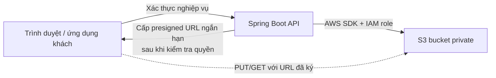

# Amazon S3: Bucket, object key, metadata và mô hình truy cập đối tượng

## 1. S3 lưu trữ những gì?

Amazon Simple Storage Service (Amazon S3) là dịch vụ **object storage** được AWS quản lý. Ứng dụng Spring Boot thường dùng S3 để lưu ảnh, tài liệu, tệp xuất báo cáo, bản sao lưu hoặc dữ liệu đầu vào cho xử lý bất đồng bộ. Ứng dụng không cần tự vận hành máy chủ lưu tệp, nhưng vẫn phải thiết kế danh tính, quyền truy cập, tên đối tượng, metadata và vòng đời dữ liệu.

Khác với hệ thống tệp truyền thống, S3 thao tác chủ yếu trên **toàn bộ object** thông qua API như `PutObject`, `GetObject`, `HeadObject`, `ListObjectsV2` và `DeleteObject`. Không thể mở một object để chỉnh vài byte ở giữa như ghi vào tệp cục bộ. Muốn thay nội dung, thông thường ứng dụng tải lên phiên bản nội dung mới; một số quy trình có thể dùng multipart upload hoặc các tính năng chuyên biệt.

Một object được xác định bằng **bucket + object key**, và thêm **version ID** nếu cần chỉ rõ một phiên bản trong bucket bật versioning.

| Thành phần | Ý nghĩa | Ví dụ |
| --- | --- | --- |
| Bucket | Không gian chứa object, được tạo tại một AWS Region | `demo-provider-files` |
| Object key | Tên định danh chính xác của object **bên trong bucket** | `documents/2026/report-42.pdf` |
| Object body | Dãy byte của dữ liệu | Nội dung PDF |
| System metadata | Thuộc tính S3/HTTP như `Content-Type`, `Cache-Control`, `Content-Length` | `application/pdf` |
| User-defined metadata | Các cặp khóa–giá trị ứng dụng gắn vào object | `x-amz-meta-source: portal` |
| Object tags | Các cặp khóa–giá trị để phân loại, kiểm soát vòng đời hoặc điều kiện quyền | `classification=internal` |
| Version ID | Định danh phiên bản khi bucket bật versioning | ID do S3 trả về |

Ví dụ, `s3://demo-provider-files/documents/2026/report-42.pdf` là **cách biểu diễn vị trí S3**, trong đó bucket là `demo-provider-files` và key là `documents/2026/report-42.pdf`. Đây không mặc nhiên là một URL HTTP công khai.

## 2. Bucket: phạm vi lưu trữ và cấu hình nền

Bucket là đơn vị cơ bản để chọn Region, chính sách truy cập, versioning, lifecycle và nhiều cấu hình bảo vệ dữ liệu.

- **Tên bucket** phải tuân thủ quy tắc đặt tên của S3 và là duy nhất trong một AWS partition (ví dụ partition AWS thương mại). Không giả định có thể dùng cùng một tên cho mọi môi trường hoặc mọi tài khoản.
- **Region** được chọn lúc tạo bucket. Nên đặt gần ứng dụng hoặc hệ thống xử lý chính để quản lý độ trễ, chi phí truyền dữ liệu và yêu cầu lưu trú dữ liệu.
- **Block Public Access** nên được duy trì cho bucket riêng tư. Bucket S3 mới mặc định chặn truy cập công khai và áp dụng chế độ Object Ownership **Bucket owner enforced**, trong đó ACL bị vô hiệu hóa.
- **Mã hóa khi lưu trữ**: S3 tự động áp dụng mã hóa phía máy chủ SSE-S3 cho object mới theo mặc định. Nếu yêu cầu quản lý khóa riêng, có thể chọn SSE-KMS và cấu hình thêm quyền KMS.
- **Versioning** giúp lưu lại nhiều phiên bản của cùng key. Khi bật versioning, xóa thông thường có thể tạo *delete marker* thay vì xóa vĩnh viễn các phiên bản cũ.
- **Lifecycle** hỗ trợ chuyển lớp lưu trữ và hết hạn object/phiên bản theo quy tắc. Cần cân nhắc khả năng khôi phục và chi phí trước khi áp dụng.

Trong hệ thống thật, thường tách bucket theo môi trường hoặc yêu cầu bảo mật, chẳng hạn `dev`, `staging`, `production`. Việc tách bucket hay dùng chung bucket với nhiều prefix là một quyết định thiết kế; một prefix tự nó **không tạo ra ranh giới bảo mật**.

### Bucket và object có ARN khác nhau

IAM dùng Amazon Resource Name (ARN) để mô tả tài nguyên:

```text
Bucket ARN:  arn:aws:s3:::demo-provider-files
Object ARN:  arn:aws:s3:::demo-provider-files/documents/2026/report-42.pdf
Prefix ARN:  arn:aws:s3:::demo-provider-files/documents/*
```

`s3:ListBucket` áp dụng lên **bucket ARN**, còn `s3:GetObject` và `s3:PutObject` áp dụng lên **object ARN**. Nhầm hai loại ARN là nguyên nhân thường gặp của lỗi `AccessDenied`.

## 3. Object key: tên chính xác, prefix và cách tổ chức dữ liệu

Một bucket có thể chứa các key như:

```text
documents/2026/report-42.pdf
documents/2026/report-43.pdf
images/profiles/u_783/5b7d2a.png
exports/2026-11-24/part-0001.csv
```

Những chuỗi `documents/`, `images/` hay `exports/` là **prefix**. Dấu `/` chỉ là một ký tự trong key; S3 không bắt buộc phải có thư mục thật. Console có thể hiển thị các prefix thành cây thư mục để người dùng dễ duyệt. Một object có key `documents/` cũng có thể được tạo như một object riêng, thường dùng để mô phỏng thư mục rỗng.

Các tính chất cần nhớ:

1. Key **phân biệt chữ hoa và chữ thường**: `Invoice.pdf` và `invoice.pdf` là hai key khác nhau.
2. Key dài tối đa **1.024 byte khi mã hóa UTF-8**; số ký tự hiển thị không luôn bằng số byte.
3. Hai yêu cầu PUT vào **cùng bucket và cùng key** sẽ tạo kết quả ghi đè logic nếu không dùng cơ chế điều kiện; khi versioning bật, S3 có thể lưu phiên bản cũ. Không tự giả định PUT luôn tạo một tệp mới.
4. Với các thao tác PUT, DELETE và GET/LIST thông thường, S3 cung cấp tính nhất quán mạnh sau khi thao tác thành công. Ứng dụng không cần tự thêm bước đợi để một object PUT thành công xuất hiện trong LIST.
5. S3 không cung cấp lệnh đổi tên object theo mô hình hệ thống tệp. Quy trình thường là **copy sang key mới rồi delete key cũ**, và hai thao tác này không tạo thành một giao dịch nguyên tử.
6. Prefix giúp lọc khi `ListObjectsV2` và có thể dùng trong điều kiện IAM, nhưng **không phải** chỉ mục tìm kiếm theo nội dung hoặc user metadata.

### Gợi ý thiết kế key

```text
tenants/{tenantId}/invoices/{year}/{generatedId}.pdf
```

Ví dụ: `tenants/t_42/invoices/2026/9f8a7b61.pdf`.

Nên ưu tiên ID khó trùng, quy ước prefix nhất quán, và lưu quan hệ object–người dùng–nghiệp vụ trong cơ sở dữ liệu ứng dụng. Tránh đưa email, số giấy tờ tùy thân, token hoặc thông tin nhạy cảm vào key. Không ghép nguyên văn tên tệp do người dùng gửi thành key khi chưa xử lý ký tự đặc biệt và kiểm tra quyền truy cập.

**Tình huống:** nếu một ứng dụng phải truy vấn “mọi hóa đơn của khách hàng X có trạng thái đã duyệt”, hãy dùng bảng dữ liệu hoặc chỉ mục nghiệp vụ để tìm key, rồi truy cập S3. Không nên duyệt toàn bộ bucket và cố tìm theo `x-amz-meta-status`.

## 4. Metadata: thông tin kèm object, không phải nội dung của object

S3 lưu metadata cùng object và trả các trường phù hợp khi gọi `HeadObject` hoặc `GetObject`.

| Nhóm | Ví dụ | Đặc điểm |
| --- | --- | --- |
| System metadata do ứng dụng có thể cung cấp | `Content-Type`, `Cache-Control`, `Content-Disposition`, `Content-Encoding` | Ảnh hưởng cách client nhận và xử lý dữ liệu |
| System metadata do S3 quản lý | `Content-Length`, `Last-Modified`, `ETag`, thông tin mã hóa, version ID | Phản ánh trạng thái object và kết quả thao tác |
| User-defined metadata | `x-amz-meta-source: spring-api`, `x-amz-meta-document-type: invoice` | Các giá trị text nhỏ đi kèm object, có giới hạn kích thước header |
| Object tags | `classification=internal`, `retention=short` | Được quản lý qua API tagging riêng; có thể đổi mà không cần thay body |

Ví dụ khi upload một PDF:

```http
PUT /documents/2026/report-42.pdf HTTP/1.1
Host: demo-provider-files.s3.ap-southeast-1.amazonaws.com
Content-Type: application/pdf
Cache-Control: private, max-age=60
x-amz-meta-source: spring-api

<binary PDF body>
```

Đoạn HTTP trên chỉ để giải thích cấu trúc yêu cầu. Lời gọi S3 thực tế cần được **ký xác thực** bằng AWS Signature Version 4 hoặc sử dụng một presigned URL hợp lệ. SDK AWS sẽ xử lý ký yêu cầu theo credentials của ứng dụng.

Lưu ý:

- `Content-Type` nên mô tả đúng định dạng đã kiểm tra. Nếu đặt sai, trình duyệt có thể hiển thị hoặc tải file không như mong muốn.
- `Content-Disposition: attachment` thường phù hợp khi muốn trình duyệt tải tệp thay vì hiển thị trực tiếp.
- **Đổi user-defined metadata hoặc nhiều trường system metadata thường đòi hỏi tạo lại/copy object** với metadata mới; không tồn tại một lệnh cập nhật mọi metadata tại chỗ. Ngược lại, object tags có API riêng như `PutObjectTagging`.
- `ETag` không luôn bằng MD5 nội dung (ví dụ multipart upload hoặc một số hình thức mã hóa). Khi cần đối chiếu toàn vẹn dữ liệu, hãy dùng cơ chế checksum được S3/SDK hỗ trợ thay vì mặc định coi ETag là MD5.
- Không đưa secret hoặc dữ liệu cá nhân nhạy cảm vào metadata. Metadata không phải kho bí mật hay hệ thống quyền truy cập.

**Metadata, tags và key có vai trò khác nhau:** key định danh object; metadata mô tả cách xử lý/đặc điểm object; tags hỗ trợ phân loại và chính sách. Chúng không thay cho quyền IAM.

## 5. Mô hình truy cập: ai được làm gì với object?

Một thiết kế an toàn thường giữ **bucket ở chế độ private** và cho ứng dụng Spring Boot truy cập bằng **IAM role**. Người dùng cuối tương tác với API ứng dụng hoặc nhận presigned URL có hạn sử dụng khi cần tải/lấy object trực tiếp.



### Các lớp kiểm soát quyền

- **IAM identity-based policy:** gắn với IAM role/user, quy định hành động được thực hiện trên bucket và object.
- **Bucket policy (resource-based):** gắn với bucket, hữu ích cho các điều kiện truy cập, kiểm soát truy cập từ tài khoản khác hoặc những trường hợp cần chính sách trên tài nguyên.
- **Block Public Access và Object Ownership:** giảm nguy cơ mở public/ACL ngoài ý muốn. Với bucket mới, ACL mặc định bị vô hiệu hóa trong chế độ *Bucket owner enforced*.
- **Các ràng buộc bổ sung:** AWS Organizations SCP, VPC endpoint policy, điều kiện policy và AWS KMS key policy có thể ảnh hưởng quyền hiệu lực.

Khi AWS xét quyền, một lệnh cho phép ở IAM không bảo đảm truy cập thành công nếu có **explicit deny**, thiếu quyền KMS hoặc bị chính sách cấp cao hơn chặn. Quyền `s3:ListBucket` cũng không tự cấp `s3:GetObject`, và ngược lại.

Ví dụ **identity policy** tối thiểu cho một service chỉ đọc, ghi và liệt kê object dưới `documents/`:

```json
{
  "Version": "2012-10-17",
  "Statement": [
    {
      "Sid": "ListDocumentsOnly",
      "Effect": "Allow",
      "Action": "s3:ListBucket",
      "Resource": "arn:aws:s3:::demo-provider-files",
      "Condition": {
        "StringLike": {
          "s3:prefix": ["documents/", "documents/*"]
        }
      }
    },
    {
      "Sid": "ReadWriteDocumentsOnly",
      "Effect": "Allow",
      "Action": ["s3:GetObject", "s3:PutObject"],
      "Resource": "arn:aws:s3:::demo-provider-files/documents/*"
    }
  ]
}
```

Policy này là ví dụ để học phạm vi tài nguyên; hãy thay tên bucket thực tế và giới hạn quyền theo nghiệp vụ. Nó không cấp `DeleteObject`, không cấp truy cập ngoài `documents/`, và không thay thế kiểm tra quyền người dùng/tenant ở API. Điều kiện `s3:prefix` chỉ giới hạn **yêu cầu LIST**; muốn hạn chế GET/PUT phải thu hẹp **object ARN** tương ứng.

### Presigned URL không làm object thành public

Presigned URL cho phép người nhận thực hiện **một loại yêu cầu đã ký** đến object trong thời hạn xác định, trên cơ sở quyền của danh tính ký. Mô hình này giúp trình duyệt truyền file trực tiếp với S3 mà không cần API Spring Boot làm trung gian truyền toàn bộ byte.

Luồng upload phổ biến:

1. Client xác thực với Spring Boot và đề nghị upload file.
2. Spring Boot kiểm tra quyền nghiệp vụ, tạo **key do server kiểm soát**, rồi cấp presigned PUT URL ngắn hạn cho key và các điều kiện đã chọn.
3. Client PUT file lên S3 bằng URL và các header đã ký.
4. Client báo hoàn tất; backend có thể gọi `HeadObject` để xác minh kích thước, metadata và trạng thái trước khi ghi nhận dữ liệu nghiệp vụ.

URL đã ký thực chất là một **bearer capability**: ai có URL còn hạn có thể dùng nó trong phạm vi được ký. Vì thế không ghi URL vào log công khai, không để thời hạn quá dài và không dựa riêng vào presigned URL để xác nhận danh tính người truy cập. Nếu browser gọi S3 từ một origin khác, còn cần cấu hình **CORS** phù hợp; CORS không cấp quyền S3 và không thay thế IAM.

### Quyền đối với object không đồng nghĩa quyền theo người dùng ứng dụng

Giả sử IAM role của backend được `GetObject` trên `documents/*`. Role đó có thể đọc nhiều object, nhưng người dùng A **không mặc nhiên được phép** xem tài liệu của người dùng B. Backend phải xác minh tenant/chủ sở hữu theo database hoặc quy tắc nghiệp vụ trước khi trả dữ liệu hay ký URL. Nếu cần cách ly mạnh hơn, kết hợp IAM condition, prefix theo tenant, các role khác nhau hoặc tách bucket tùy hệ thống.

## 6. Tích hợp vào Spring Boot với Spring Cloud AWS

Trong module tích hợp Spring Boot với dịch vụ managed cloud, **Spring Cloud AWS** giúp cấu hình AWS SDK và cung cấp các thành phần tích hợp S3. Ví dụ dưới đây sử dụng `S3Client` của **AWS SDK for Java v2**, được Spring Cloud AWS starter cấu hình để có thể inject vào Spring service.

### 6.1. Dependency và cấu hình

Khi dùng Maven, import BOM **Spring Cloud AWS phiên bản tương thích với Spring Boot của dự án**; sau đó khai báo starter S3:

```xml
<dependencyManagement>
    <dependencies>
        <dependency>
            <groupId>io.awspring.cloud</groupId>
            <artifactId>spring-cloud-aws-dependencies</artifactId>
            <version>${spring-cloud-aws.version}</version>
            <type>pom</type>
            <scope>import</scope>
        </dependency>
    </dependencies>
</dependencyManagement>

<dependencies>
    <dependency>
        <groupId>io.awspring.cloud</groupId>
        <artifactId>spring-cloud-aws-starter-s3</artifactId>
    </dependency>
</dependencies>
```

`spring-cloud-aws.version` là property phải được dự án khai báo theo ma trận tương thích của phiên bản đang dùng; ví dụ cố ý không cố định một phiên bản cho mọi dự án.

```yaml
# application.yml
spring:
  cloud:
    aws:
      region:
        static: ap-southeast-1

app:
  storage:
    bucket: ${S3_BUCKET_NAME}
```

Ở máy phát triển có thể dùng AWS profile hoặc cách cung cấp credentials được AWS SDK hỗ trợ. Khi triển khai trên AWS, ưu tiên IAM role gắn với workload (ví dụ ECS task role, EC2 instance profile, hoặc vai trò phù hợp với EKS). **Không hard-code access key/secret key** vào source hoặc `application.yml`. Region cấu hình phải phù hợp Region thực của bucket.

### 6.2. Service upload và đọc object nhỏ

```java
import java.util.Map;
import java.util.UUID;

import org.springframework.beans.factory.annotation.Value;
import org.springframework.stereotype.Service;

import software.amazon.awssdk.core.sync.RequestBody;
import software.amazon.awssdk.services.s3.S3Client;
import software.amazon.awssdk.services.s3.model.GetObjectRequest;
import software.amazon.awssdk.services.s3.model.PutObjectRequest;

@Service
public class DocumentObjectStorage {
    private final S3Client s3Client;
    private final String bucket;

    public DocumentObjectStorage(
            S3Client s3Client,
            @Value("${app.storage.bucket}") String bucket) {
        this.s3Client = s3Client;
        this.bucket = bucket;
    }

    public String upload(byte[] bytes, String declaredContentType) {
        // Server tạo key; không dùng trực tiếp tên file người dùng cung cấp.
        String key = "documents/" + UUID.randomUUID();
        String contentType = (declaredContentType == null
                || declaredContentType.isBlank())
                ? "application/octet-stream" : declaredContentType;

        PutObjectRequest request = PutObjectRequest.builder()
                .bucket(bucket)
                .key(key)
                .contentType(contentType)
                .metadata(Map.of("source", "spring-api"))
                .build();

        s3Client.putObject(request, RequestBody.fromBytes(bytes));
        return key; // Lưu key này vào bản ghi nghiệp vụ của ứng dụng.
    }

    public byte[] downloadSmallObject(String key) {
        if (key == null || !key.startsWith("documents/")) {
            throw new IllegalArgumentException("Object key không hợp lệ");
        }

        GetObjectRequest request = GetObjectRequest.builder()
                .bucket(bucket)
                .key(key)
                .build();
        return s3Client.getObjectAsBytes(request).asByteArray();
    }
}
```

Trong code:

- `bucket` đến từ cấu hình; `key` do backend phát sinh. Một lần upload tạo object dưới prefix `documents/`.
- `contentType` là **system metadata**; `metadata(Map.of("source", ...))` sinh **user-defined metadata** mà S3 biểu diễn bằng header `x-amz-meta-source`.
- `S3Client` ký yêu cầu theo thông tin định danh runtime. Quyền IAM role vẫn cần cho `s3:PutObject` và `s3:GetObject`.
- `getObjectAsBytes` và `RequestBody.fromBytes` phù hợp demo với file nhỏ. Với file lớn, nên stream/multipart upload hoặc presigned URL để tránh đưa toàn bộ file vào RAM.
- Kiểm tra prefix trong method chỉ là ví dụ kiểm tra đầu vào, **chưa phải phân quyền tài liệu**. API thực tế phải tra chủ sở hữu và xác thực người dùng trước khi gọi method.
- Với file do client cung cấp, backend phải xác minh định dạng, kích thước, chính sách tải file và mục đích sử dụng, thay vì tin hoàn toàn vào `declaredContentType`.

Nếu cần thao tác trừu tượng hơn, Spring Cloud AWS còn có `S3Template`. Việc dùng `S3Client` trực tiếp ở đây giúp nhìn rõ bucket, key, metadata và các API AWS đang được gọi.

### 6.3. Đọc metadata mà không tải body

```java
var response = s3Client.headObject(builder -> builder
        .bucket(bucket)
        .key("documents/9f8a7b61.pdf"));

System.out.println(response.contentType());
System.out.println(response.contentLength());
System.out.println(response.metadata().get("source"));
```

`HeadObject` tiện để kiểm tra sự tồn tại và thuộc tính, nhưng vẫn yêu cầu quyền truy cập thích hợp. Với key không tồn tại, S3 có thể trả **404** nếu principal có `s3:ListBucket`; nếu không có quyền đó, kết quả có thể là **403**. Vì vậy không nên giải thích mọi lỗi 403 là “file chắc chắn tồn tại nhưng bị cấm đọc”.

## 7. Ví dụ quyết định thiết kế cho hệ thống lưu tài liệu

Giả sử API cho phép người dùng tải hóa đơn PDF, với yêu cầu tách tài liệu giữa các tenant.

| Vấn đề | Thiết kế đề xuất | Vì sao |
| --- | --- | --- |
| Lưu trữ | Bucket private tại Region phù hợp | Dữ liệu không vô tình lộ công khai |
| Định danh | `tenants/{opaqueTenantId}/invoices/{uuid}.pdf` | Key ít trùng, thuận tiện tổ chức theo prefix |
| Metadata | `Content-Type: application/pdf` và metadata nhỏ không nhạy cảm | Client xử lý đúng định dạng |
| Chỉ mục nghiệp vụ | Database lưu `tenantId`, `invoiceId`, `bucket`, `key`, trạng thái | Tìm kiếm theo nghiệp vụ, không phải quét S3 |
| Quyền backend | IAM role chỉ có hành động và phạm vi object cần thiết | Hạn chế tác động khi code bị lỗi |
| Quyền người dùng | Backend kiểm tra tenant và hóa đơn được phép xem | IAM role của backend không thay thế phân quyền ứng dụng |
| Tải file | API stream hoặc cấp presigned GET URL ngắn hạn | Điều khiển quyền trước khi tải |
| Phục hồi | Versioning/lifecycle theo chính sách lưu trữ | Giảm tác động khi ghi đè, xóa nhầm |

Một lỗi phổ biến là dùng `tenantId` trong key rồi coi đó là đủ để ngăn truy cập chéo tenant. Nếu backend cho phép client truyền bất kỳ key nào để tạo presigned URL, kẻ tấn công vẫn có thể thử key của tenant khác. **Key naming** là quy ước tổ chức; **authorization** là một bước kiểm tra độc lập.

## 8. Liên hệ AWS, Azure và Google Cloud

Module Spring Cloud Provider Integration còn đề cập các dịch vụ managed khác. Khái niệm object storage tương đồng, nhưng tên tài nguyên và quyền truy cập khác nhau:

| Ý tưởng | AWS | Azure | Google Cloud |
| --- | --- | --- | --- |
| Lưu trữ object | Amazon S3 | Azure Blob Storage | Google Cloud Storage |
| Không gian chứa | Bucket | Storage account → container | Bucket |
| Định danh object | Object key | Blob name | Object name |
| Danh tính workload thường dùng | IAM role | Managed identity và Azure RBAC | Service account và IAM |
| Chia sẻ truy cập tạm thời | Presigned URL | SAS token/URL | Signed URL |

Các nhà cung cấp đều hỗ trợ truy cập bằng API và metadata, song không thể sao chép nguyên cấu hình policy, role hay yêu cầu chữ ký từ cloud này sang cloud khác. Azure Data Lake Storage Gen2 còn có chế độ hierarchical namespace riêng; không nên dùng đặc điểm đó để suy luận rằng prefix của S3 là thư mục thật.

## 9. Thực hành và tự kiểm tra

Với một bucket sandbox private và IAM role chỉ có quyền cần thiết, hãy thực hiện:

1. Upload một file nhỏ vào `documents/lab/example.txt`, đặt `Content-Type: text/plain` và user metadata `source=lab`.
2. Gọi `HeadObject` để kiểm tra `contentType`, độ dài và `metadata().get("source")`, không tải body.
3. Gọi `ListObjectsV2` với prefix `documents/lab/` và đối chiếu key trả về. Thử một prefix khác để hiểu bộ lọc.
4. Upload nội dung khác vào **chính key đó**; quan sát kết quả có/không bật versioning.
5. Thử gọi GET bằng một role thiếu `s3:GetObject`, sau đó bổ sung đúng quyền trong môi trường thử nghiệm; kiểm tra bucket ARN và object ARN.
6. Từ Spring Boot, tạo key mới cho từng file, ghi key vào một bản ghi nghiệp vụ thử nghiệm, rồi chỉ cho phép tải lại khi chủ sở hữu được xác thực.

**Câu hỏi ôn tập**

- Bucket và object key khác nhau ra sao? Vì sao `photos/2026/` không mặc nhiên là một thư mục?
- `Content-Type`, user-defined metadata và object tags khác nhau ở điểm nào? Trường hợp nào đổi metadata có thể phải copy object?
- Vì sao một IAM policy có `s3:ListBucket` nhưng thiếu `s3:GetObject` vẫn không tải được nội dung?
- Presigned URL thay đổi trạng thái private của bucket hay chỉ cấp quyền thực hiện một yêu cầu có giới hạn?
- Vì sao backend phải kiểm tra chủ sở hữu tài liệu ngay cả khi key đã có prefix theo tenant?

Khi hoàn thành, người học cần có thể đọc một S3 URI để xác định đúng **bucket/key**, thiết kế metadata và key cho ứng dụng Spring Boot, cấp quyền IAM theo **bucket ARN/object ARN**, đồng thời giải thích được đường đi của dữ liệu và quyền truy cập trong một hệ thống S3 private.
