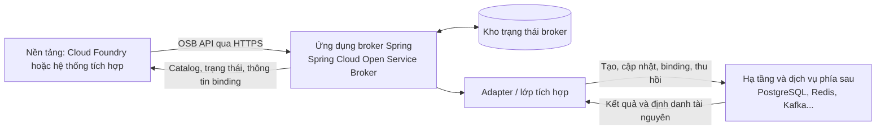

# Spring Cloud Service Broker và tên dự án Spring Cloud Open Service Broker

## Bức tranh tổng quan

Khi một nền tảng ứng dụng cần cung cấp cơ sở dữ liệu, hàng đợi thông điệp, bộ nhớ đệm hoặc một dịch vụ hạ tầng khác cho ứng dụng, nền tảng đó cần một cách thống nhất để khám phá dịch vụ, yêu cầu tạo tài nguyên, nhận thông tin kết nối và giải phóng tài nguyên khi không còn sử dụng. **Service broker** đảm nhiệm vai trò điều phối vòng đời này thông qua một giao diện mà nền tảng có thể gọi.

Trong hệ sinh thái Spring, **Spring Cloud Open Service Broker** là tên dự án cung cấp mô hình lập trình để xây dựng một service broker bằng Java và Spring. Cụm từ **Spring Cloud Service Broker** trong tên chủ đề mô tả lĩnh vực và ứng dụng broker được xây dựng; khi nói đến dự án hỗ trợ triển khai theo chuẩn Open Service Broker API, tài liệu dùng tên đầy đủ Spring Cloud Open Service Broker.

Module `SPRING_CLOUD_SERVICE_BROKER` tập trung vào việc xây dựng broker theo **Open Service Broker API**: công bố catalog và service plan, tiếp nhận yêu cầu cấp phát, cập nhật, thu hồi và binding tài nguyên. Trong quá trình học, người phát triển còn cần hiểu cách lưu trạng thái, xử lý thao tác bất đồng bộ, bảo đảm idempotency, bảo vệ thông tin xác thực và kết nối broker với nền tảng như Cloud Foundry hoặc môi trường Kubernetes có thành phần tích hợp tương thích.

## Service broker giải quyết vấn đề gì?

Giả sử một nhóm phát triển cần cấp PostgreSQL cho nhiều ứng dụng. Nếu mỗi nền tảng phải biết cách gọi API riêng của PostgreSQL, cách tạo database, tạo user, cấp quyền, lấy mật khẩu và xóa tài nguyên, logic đó sẽ bị lặp lại ở nhiều nơi. Mỗi dịch vụ lại có giao diện và quy trình riêng, khiến việc tự động hóa, kiểm soát quyền và quản lý vòng đời trở nên khó khăn.

Service broker đặt một lớp giao tiếp có hợp đồng rõ ràng giữa nền tảng và hệ thống cung cấp dịch vụ:

- Nền tảng hỏi broker đang có những dịch vụ và gói dịch vụ nào.
- Người dùng hoặc quy trình triển khai chọn một dịch vụ cùng một plan.
- Nền tảng gửi yêu cầu tạo service instance; broker chuyển yêu cầu thành thao tác phù hợp trên hệ thống phía sau.
- Khi ứng dụng cần kết nối, nền tảng yêu cầu binding và nhận thông tin kết nối.
- Khi ứng dụng ngừng sử dụng, nền tảng yêu cầu gỡ binding hoặc thu hồi service instance.

Nhờ vậy, nền tảng chỉ cần hiểu giao thức chung. Broker chịu trách nhiệm chuyển các yêu cầu đó thành hành động cụ thể trên PostgreSQL, Redis, Kafka hoặc một dịch vụ do tổ chức tự vận hành.

Broker thường quản lý mặt phẳng điều khiển của dịch vụ, tức là tạo, cấu hình, theo dõi và thu hồi tài nguyên. Ứng dụng sử dụng dịch vụ vẫn kết nối trực tiếp đến endpoint của cơ sở dữ liệu, hàng đợi hoặc hệ thống tương ứng; luồng dữ liệu nghiệp vụ không nhất thiết đi xuyên qua broker.

## Open Service Broker API và vai trò của dự án Spring

**Open Service Broker API (OSB API)** là hợp đồng HTTP/REST để nền tảng và service broker trao đổi với nhau. Hợp đồng quy định cách broker công bố catalog và cách nền tảng yêu cầu các thao tác vòng đời. API sử dụng các tài nguyên và định danh như service, plan, service instance và binding.

OSB API định nghĩa giao thức; nó không quy định broker phải tạo database bằng câu lệnh SQL nào, phải gọi nhà cung cấp cloud nào hay phải lưu trạng thái ở loại cơ sở dữ liệu nào. Những quyết định đó thuộc về phần triển khai broker.

Spring Cloud Open Service Broker giúp đưa hợp đồng này vào ứng dụng Spring. Thay vì tự xây dựng toàn bộ lớp HTTP, ánh xạ payload và xử lý từng quy tắc giao thức, nhà phát triển sử dụng các abstraction của dự án để triển khai hành vi nghiệp vụ của broker. Ứng dụng vẫn cần cung cấp logic thực tế: kiểm tra yêu cầu, gọi hệ thống quản lý tài nguyên, lưu trạng thái và trả kết quả phù hợp với vòng đời OSB API.

Có thể phân biệt ba khái niệm như sau:

| Khái niệm | Vai trò |
|---|---|
| Open Service Broker API | Chuẩn giao tiếp giữa nền tảng và broker. |
| Spring Cloud Open Service Broker | Dự án trong hệ sinh thái Spring hỗ trợ xây dựng ứng dụng tuân theo chuẩn đó. |
| Service broker được triển khai | Ứng dụng cụ thể kết hợp framework với logic quản lý một hoặc nhiều dịch vụ phía sau. |

Vì vậy, Spring Cloud Open Service Broker không phải là một cơ sở dữ liệu, một nền tảng cloud hay một dịch vụ PostgreSQL/Kafka được host sẵn. Đây là nền tảng lập trình để nhóm phát triển xây dựng ứng dụng broker của mình.

## Các khái niệm cốt lõi trong catalog

Catalog là danh mục những dịch vụ mà broker cung cấp. Mỗi service có định danh ổn định, tên hiển thị, mô tả và một hoặc nhiều plan.

| Thành phần | Ý nghĩa | Ví dụ |
|---|---|---|
| Service | Một loại dịch vụ mà broker có thể quản lý. | PostgreSQL, Redis, Kafka. |
| Plan | Một cấu hình hoặc cấp dịch vụ của một service. | PostgreSQL dung lượng nhỏ, PostgreSQL hiệu năng cao. |
| Service instance | Một tài nguyên cụ thể được tạo theo service và plan. | Cụm PostgreSQL dành cho ứng dụng `orders`. |
| Binding | Một liên kết cho phép ứng dụng sử dụng service instance, thường đi kèm thông tin kết nối. | Database, username, password và endpoint. |

Ví dụ rút gọn về catalog:

```json
{
  "services": [
    {
      "id": "service-postgresql",
      "name": "postgresql",
      "description": "Dịch vụ cơ sở dữ liệu PostgreSQL được quản lý",
      "bindable": true,
      "plans": [
        {
          "id": "plan-small",
          "name": "small",
          "description": "Gói dành cho tải công việc nhỏ"
        },
        {
          "id": "plan-standard",
          "name": "standard",
          "description": "Gói dành cho tải công việc thông thường"
        }
      ]
    }
  ]
}
```

Đây là ví dụ minh họa cấu trúc và ý nghĩa của catalog, không phải catalog hoàn chỉnh cho một môi trường triển khai. Các giá trị `id` cần ổn định qua những lần broker khởi động và cập nhật. Nền tảng dùng các định danh này trong những yêu cầu tiếp theo, vì vậy không nên tạo ID ngẫu nhiên mới mỗi lần trả catalog.

Thuộc tính `bindable` cho biết service có hỗ trợ binding hay không. Một số dịch vụ có thể chỉ được cấp phát mà không cung cấp thông tin kết nối theo mô hình binding. Plan biểu diễn lựa chọn cấu hình mà người dùng có thể chọn; broker cần xác thực plan và các tham số đi kèm trước khi tạo tài nguyên.

## Vòng đời mà broker quản lý

OSB API chuẩn hóa những thao tác chính trong vòng đời dịch vụ. Các endpoint dưới đây minh họa những nhóm yêu cầu thường gặp; chi tiết payload và điều kiện phản hồi phải tuân theo phiên bản OSB API mà broker công bố hỗ trợ.

| Nhóm thao tác | Endpoint tiêu biểu | Mục đích |
|---|---|---|
| Khám phá catalog | `GET /v2/catalog` | Nền tảng lấy danh sách service và plan. |
| Provision | `PUT /v2/service_instances/{instance_id}` | Tạo service instance theo service và plan đã chọn. |
| Cập nhật | `PATCH /v2/service_instances/{instance_id}` | Thay đổi cấu hình hoặc plan khi dịch vụ hỗ trợ cập nhật. |
| Deprovision | `DELETE /v2/service_instances/{instance_id}` | Thu hồi tài nguyên đã cấp phát. |
| Bind | `PUT /v2/service_instances/{instance_id}/service_bindings/{binding_id}` | Tạo binding và cung cấp thông tin để ứng dụng kết nối. |
| Unbind | `DELETE /v2/service_instances/{instance_id}/service_bindings/{binding_id}` | Gỡ binding và thu hồi thông tin kết nối tương ứng. |
| Theo dõi thao tác | `GET /v2/service_instances/{instance_id}/last_operation` | Cho nền tảng kiểm tra trạng thái thao tác bất đồng bộ. |

Các định danh `instance_id` và `binding_id` do nền tảng truyền vào giúp broker nhận diện tài nguyên qua nhiều lần gọi. Broker cần liên kết chúng với tài nguyên thực tế ở hệ thống phía sau và lưu lại mối liên hệ đó để có thể xử lý yêu cầu cập nhật, binding hoặc thu hồi sau này.

Ví dụ, khi nền tảng yêu cầu provision PostgreSQL, broker có thể thực hiện các bước sau:

1. Xác thực yêu cầu và kiểm tra `service_id`, `plan_id`, context cùng các tham số.
2. Kiểm tra xem `instance_id` đã được xử lý hay chưa để tránh tạo trùng tài nguyên.
3. Ghi nhận yêu cầu và gọi hệ thống quản lý PostgreSQL để tạo database hoặc cụm cơ sở dữ liệu.
4. Lưu ánh xạ giữa `instance_id` và tài nguyên được tạo.
5. Trả kết quả phù hợp với việc thao tác đã hoàn tất hay vẫn đang chạy.

Khi ứng dụng cần thông tin kết nối, nền tảng gửi yêu cầu bind. Broker kiểm tra service instance có tồn tại và cho phép binding không, tạo thông tin xác thực hoặc quyền truy cập cần thiết, rồi trả thông tin binding theo hợp đồng API. Khi unbind, broker thu hồi quyền truy cập tương ứng. Khi deprovision, broker giải phóng tài nguyên theo chính sách của dịch vụ.

## Xử lý đồng bộ và bất đồng bộ

Không phải thao tác nào cũng hoàn tất nhanh. Tạo một database có thể mất vài giây, nhưng tạo một cụm dữ liệu, cấu hình mạng hoặc khởi tạo dịch vụ trên hạ tầng từ xa có thể mất lâu hơn thời gian một HTTP request nên chờ.

OSB API hỗ trợ mô hình bất đồng bộ. Khi nền tảng cho phép thao tác bất đồng bộ và broker chưa thể hoàn tất ngay, broker có thể trả `202 Accepted` cùng thông tin định danh thao tác. Nền tảng tiếp tục gọi endpoint `last_operation` để hỏi trạng thái cho đến khi thao tác thành công hoặc thất bại.

Ví dụ rút gọn về phản hồi khi một thao tác được tiếp nhận:

```http
HTTP/1.1 202 Accepted
Content-Type: application/json

{
  "operation": "operation-123"
}
```

Phản hồi này có nghĩa là broker đã tiếp nhận thao tác; nó không có nghĩa tài nguyên đã sẵn sàng. Broker cần lưu trạng thái thao tác một cách bền vững, cập nhật tiến độ và trả trạng thái nhất quán khi nền tảng truy vấn. Nếu thao tác thất bại, broker cần cung cấp thông tin lỗi đủ để nền tảng hoặc người vận hành hiểu vấn đề mà không làm lộ bí mật.

Với thao tác đồng bộ, broker chỉ trả kết quả thành công sau khi công việc tương ứng đã hoàn tất theo hợp đồng. Việc chọn đồng bộ hay bất đồng bộ cần dựa trên khả năng của nền tảng, đặc tính của dịch vụ phía sau và thời gian thực hiện dự kiến.

## Kiến trúc tổng thể

Một ứng dụng broker xây dựng bằng Spring Cloud Open Service Broker thường có các phần trách nhiệm sau:

- **Nền tảng tiêu thụ dịch vụ:** gọi API để đọc catalog và quản lý vòng đời service instance, binding.
- **Ứng dụng broker Spring:** tiếp nhận yêu cầu OSB API, kiểm tra đầu vào, điều phối nghiệp vụ và tạo phản hồi.
- **Lớp quản lý trạng thái:** lưu định danh tài nguyên, plan đã chọn, binding, trạng thái thao tác và kết quả cần thiết để xử lý retry.
- **Adapter hoặc lớp tích hợp:** chuyển yêu cầu nghiệp vụ thành lời gọi đến API cloud, hệ thống quản trị database, Kubernetes operator hoặc dịch vụ nội bộ.
- **Hệ thống phía sau:** nơi tài nguyên thực sự được tạo, cấu hình, cấp quyền và thu hồi.



Spring Cloud Open Service Broker hỗ trợ phần tích hợp giao thức vào ứng dụng Spring. Cấu trúc cụ thể của lớp trạng thái, adapter và hệ thống phía sau phụ thuộc vào dịch vụ mà nhóm phát triển muốn cung cấp. Với một broker nhỏ, các phần này có thể nằm trong cùng một ứng dụng; với môi trường lớn, chúng có thể được tách thành các thành phần riêng.

## Những yêu cầu kỹ thuật cần quan tâm

### Quản lý trạng thái bền vững

Broker phải biết service instance nào đang tồn tại, nó thuộc service và plan nào, tài nguyên phía sau có định danh gì, những binding nào đang hoạt động và thao tác gần nhất đang ở trạng thái nào. Không nên chỉ giữ dữ liệu này trong bộ nhớ của một tiến trình vì ứng dụng có thể khởi động lại hoặc chạy nhiều bản sao.

Trạng thái bền vững giúp broker xử lý được yêu cầu tiếp theo, đối chiếu kết quả với hệ thống phía sau và phục hồi sau sự cố. Thiết kế lưu trữ cũng cần xác định rõ thời điểm ghi nhận yêu cầu, thời điểm cập nhật trạng thái và cách xử lý trường hợp lời gọi đến hạ tầng thành công nhưng broker chưa kịp lưu kết quả.

### Idempotency và retry

Nền tảng có thể gửi lại một yêu cầu khi kết nối bị ngắt hoặc không nhận được phản hồi. Broker cần thiết kế thao tác sao cho việc nhận lại cùng một yêu cầu không tạo ra nhiều tài nguyên ngoài ý muốn. Các ID của service instance và binding là một phần quan trọng để nhận diện yêu cầu; broker cần tra cứu trạng thái trước khi thực hiện hành động tạo mới.

Idempotency cũng cần được tính đến khi gọi hệ thống phía sau. Nếu broker gửi lệnh tạo database, bị timeout rồi thử lại, nó phải có cách xác định database đã được tạo hay chưa. Tùy API của nhà cung cấp, cách xử lý có thể là dùng khóa idempotency, tên tài nguyên ổn định hoặc bước đối soát trước khi tạo lại.

### Bảo mật

Broker là điểm trung gian có thể tạo tài nguyên và phát hành thông tin truy cập, vì vậy cần xác thực nền tảng gọi API, sử dụng kết nối TLS và giới hạn quyền của tài khoản mà broker dùng để thao tác trên hạ tầng. Tham số nhạy cảm và thông tin binding phải được bảo vệ khi lưu trữ, truyền tải và hiển thị trong log. Broker cũng cần kiểm tra quyền và tính hợp lệ của từng yêu cầu trước khi thay đổi tài nguyên.

### Tích hợp nền tảng

Cloud Foundry có thể sử dụng service broker để công bố dịch vụ trên marketplace và điều phối provision, bind, unbind, deprovision cho ứng dụng. Broker cần được đăng ký, cấu hình endpoint và thông tin xác thực phù hợp với nền tảng.

Trong môi trường Kubernetes, OSB API có thể được sử dụng khi có thành phần service catalog, controller hoặc adapter tương thích đóng vai trò nền tảng gọi broker. Bản thân Kubernetes core không tự động biến mọi ứng dụng thành một client OSB API; nhóm triển khai cần xác định rõ thành phần tích hợp, cách ánh xạ service instance sang tài nguyên Kubernetes và cơ chế quản lý vòng đời tương ứng.

## Phạm vi học tập của module

Các phần tiếp theo của module đi từ giao thức và cấu trúc broker đến việc triển khai từng thao tác. Người học sẽ lần lượt làm rõ:

1. Cấu trúc ứng dụng Spring và cách khởi tạo broker.
2. Open Service Broker API, catalog, service và plan.
3. Tham số đầu vào và quy trình provision, truy vấn, cập nhật, deprovision.
4. Binding và vòng đời binding.
5. Lưu trạng thái, xử lý thao tác bất đồng bộ và bảo đảm idempotency.
6. Tích hợp hạ tầng, mở rộng framework, chuẩn hóa lỗi và phản hồi.
7. Bảo mật, tích hợp Cloud Foundry/Kubernetes, kiểm thử, triển khai, giám sát và xử lý sự cố.

Khi hoàn thành module, người học có thể giải thích được vị trí của Spring Cloud Open Service Broker trong kiến trúc, đọc được luồng trao đổi giữa nền tảng và broker, đồng thời biết cách tổ chức một ứng dụng broker có khả năng quản lý vòng đời tài nguyên một cách an toàn và có thể phục hồi.
