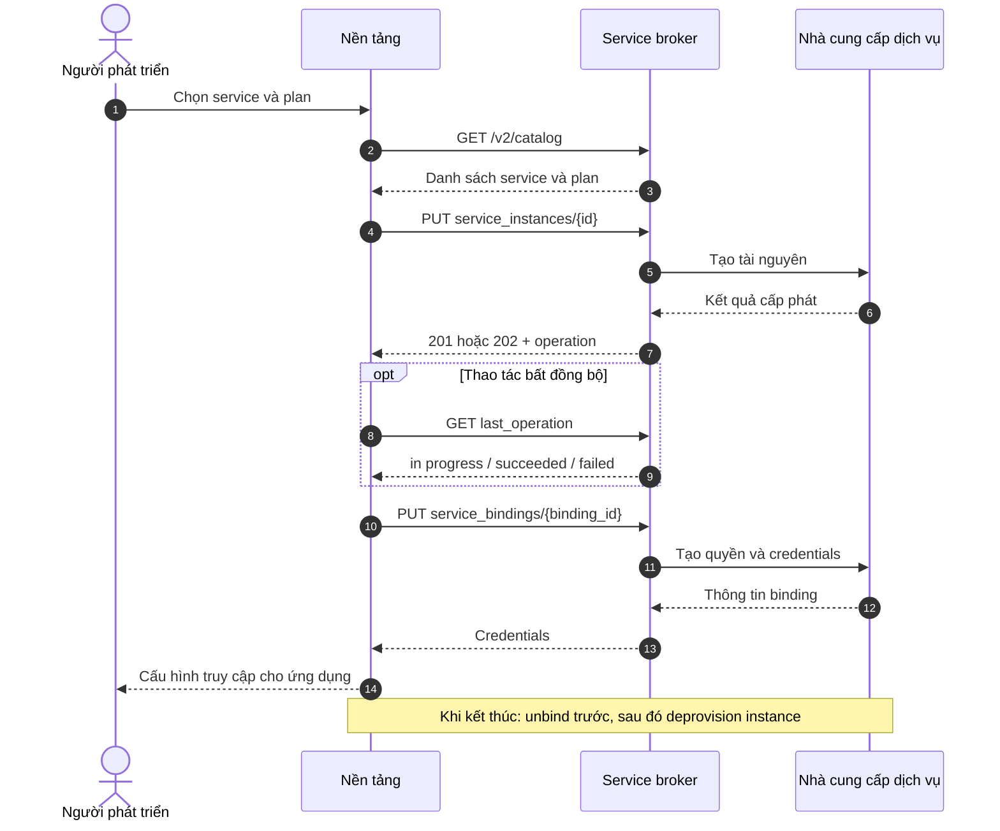

# Bài toán tự phục vụ tài nguyên và vai trò của service broker

Một ứng dụng thường cần nhiều tài nguyên bên ngoài mã nguồn của nó: cơ sở dữ liệu PostgreSQL, Redis, hàng đợi thông điệp, bộ lưu trữ đối tượng hoặc một dịch vụ tìm kiếm. Khi mỗi yêu cầu phải đi qua một nhóm vận hành để tạo tài nguyên, cấp tài khoản, phân phối thông tin kết nối và thu hồi khi không còn dùng, quá trình phát triển dễ bị chậm và khó kiểm soát. Service broker giải quyết bài toán này bằng cách cung cấp một giao diện chuẩn để nền tảng có thể yêu cầu tạo, thay đổi, kết nối và xóa tài nguyên theo cách tự phục vụ có kiểm soát.

Trong module `SPRING_CLOUD_SERVICE_BROKER`, ta xây dựng broker bằng hệ sinh thái Spring Cloud và tuân theo **Open Service Broker API (OSB API)**. Trọng tâm không chỉ là tạo một REST API, mà còn là quản lý vòng đời tài nguyên, trạng thái thao tác, xử lý bất đồng bộ, tính idempotent, bảo mật thông tin truy cập và tích hợp với nền tảng triển khai như Cloud Foundry hoặc Kubernetes.

## Mục tiêu bài học

Sau bài này, bạn có thể:

- Giải thích vì sao nền tảng cần cơ chế tự phục vụ tài nguyên và service broker tham gia vào quy trình đó như thế nào.
- Phân biệt service, service plan, service instance và service binding.
- Nhận diện các thao tác chính của OSB API: catalog, provision, update, deprovision, bind và unbind.
- Hiểu vì sao một thao tác cấp phát có thể cần xử lý bất đồng bộ, và cách nền tảng theo dõi kết quả.
- Giải thích cách broker tránh tạo tài nguyên trùng lặp khi nền tảng gửi lại yêu cầu, đồng thời bảo vệ thông tin xác thực.
- Mô tả vai trò của Spring Cloud Open Service Broker trong việc triển khai hợp đồng OSB API.

## 1. Bài toán tự phục vụ tài nguyên

Hãy hình dung một nhóm phát triển chuẩn bị triển khai ứng dụng thương mại điện tử. Ứng dụng cần một cơ sở dữ liệu, một cache và một hàng đợi thông điệp. Nếu quy trình hoàn toàn thủ công, nhóm phát triển phải gửi yêu cầu, chờ người vận hành chọn cấu hình, tạo tài nguyên, thiết lập quyền truy cập rồi chuyển thông tin kết nối qua một kênh khác. Khi cần môi trường thử nghiệm mới, tăng dung lượng hoặc ngừng sử dụng, quy trình lại lặp lại.

Cách làm này tạo ra một số vấn đề:

- **Thời gian chờ dài:** nhóm phát triển phụ thuộc vào lịch và khối lượng công việc của nhóm vận hành.
- **Thiếu nhất quán:** mỗi người có thể tạo tài nguyên với cấu hình, cách đặt tên và chính sách bảo mật khác nhau.
- **Khó kiểm soát quyền:** thông tin kết nối có thể được chia sẻ thủ công, cấp quá quyền hoặc không được thu hồi đúng lúc.
- **Tài nguyên bị bỏ quên:** môi trường thử nghiệm đã kết thúc nhưng cơ sở dữ liệu, tài khoản hoặc dung lượng lưu trữ vẫn tồn tại và tiếp tục tiêu thụ chi phí.
- **Khó kiểm toán:** nền tảng thiếu một lịch sử thống nhất về ai yêu cầu tài nguyên, tài nguyên thuộc môi trường nào và thao tác đã hoàn tất hay chưa.

Tự phục vụ (self-service) cho phép người dùng yêu cầu tài nguyên qua giao diện hoặc API của nền tảng mà không cần thực hiện từng bước vận hành thủ công. Tuy nhiên, tự phục vụ không có nghĩa là người dùng được toàn quyền tạo bất kỳ tài nguyên nào. Nền tảng vẫn cần áp dụng danh mục dịch vụ được phê duyệt, giới hạn theo tổ chức hoặc môi trường, quota, chính sách truy cập và cơ chế ghi nhận hoạt động.

Ví dụ, người phát triển chọn dịch vụ PostgreSQL với plan `small` trong catalog. Nền tảng gửi yêu cầu đến broker. Broker kiểm tra yêu cầu, gọi hệ thống cung cấp PostgreSQL để tạo cơ sở dữ liệu và báo lại trạng thái. Sau đó, ứng dụng yêu cầu binding để nhận thông tin kết nối. Khi môi trường không còn cần thiết, nền tảng gọi các thao tác thu hồi binding và xóa instance.

## 2. Service broker là gì?

Service broker là thành phần trung gian cung cấp một hợp đồng API thống nhất giữa nền tảng và hệ thống tạo tài nguyên thực tế. Broker nhận yêu cầu từ nền tảng, chuyển yêu cầu thành thao tác phù hợp với nhà cung cấp dịch vụ, theo dõi kết quả và trả trạng thái theo định dạng mà nền tảng hiểu được.

Broker thường thuộc **control plane**: nó điều phối việc tạo và quản lý tài nguyên. Dữ liệu ứng dụng vẫn được xử lý bởi dịch vụ nền như PostgreSQL, Redis hoặc Kafka; broker không nhất thiết phải lưu trữ hay truyền tải dữ liệu nghiệp vụ của ứng dụng.

Một quy trình điển hình có bốn thành phần:

1. **Người dùng hoặc ứng dụng:** chọn dịch vụ, plan và yêu cầu quyền truy cập.
2. **Nền tảng (platform):** cung cấp catalog, tiếp nhận yêu cầu, xác định danh tính và ngữ cảnh tổ chức/môi trường, sau đó gọi broker.
3. **Service broker:** triển khai hợp đồng OSB API, xác thực yêu cầu, điều phối vòng đời, lưu trạng thái và quản lý thông tin binding.
4. **Nhà cung cấp hoặc hệ thống nền (backing service):** thực sự tạo và vận hành cơ sở dữ liệu, cache, hàng đợi hoặc tài nguyên khác.

Ví dụ, broker có thể gọi API quản trị của một cụm PostgreSQL để tạo database và user. Với một dịch vụ khác, broker có thể gọi API của nhà cung cấp cloud để tạo bucket lưu trữ. Nền tảng không cần biết chi tiết riêng của từng nhà cung cấp; nó chỉ cần hiểu hợp đồng broker.

Broker chịu trách nhiệm công bố dịch vụ và plan có thể sử dụng, thực hiện các thao tác vòng đời, quản lý trạng thái, xử lý lỗi và cung cấp thông tin truy cập khi binding. Nhà cung cấp dịch vụ chịu trách nhiệm về khả năng tạo tài nguyên thực tế, dung lượng, tính sẵn sàng và các đặc tính vận hành của tài nguyên đó. Ranh giới này giúp thay đổi nhà cung cấp mà không buộc ứng dụng phải thay đổi cách yêu cầu dịch vụ.

## 3. Những khái niệm cốt lõi

| Khái niệm | Ý nghĩa | Ví dụ |
|---|---|---|
| **Service** | Một loại dịch vụ mà broker cung cấp trong catalog. | `postgresql`, `redis`, `message-queue` |
| **Service plan** | Một cấu hình hoặc cấp dịch vụ, mô tả tính năng, giới hạn, dung lượng hay mức chất lượng. | `small`, `standard`, `high-availability` |
| **Service instance** | Một tài nguyên cụ thể được tạo từ service và plan. | Database `orders-db` được tạo theo plan `small` |
| **Service binding** | Một quan hệ cấp quyền truy cập giữa ứng dụng và service instance; thường đi kèm credentials. | User/password và JDBC URL dành cho ứng dụng `orders-api` |

Service và plan mô tả những gì người dùng có thể chọn. Instance là tài nguyên đã được cấp phát. Binding mô tả cách một ứng dụng được phép sử dụng tài nguyên đó. Một instance có thể có nhiều binding nếu dịch vụ và chính sách cho phép; mỗi binding có thể có credentials riêng để dễ giới hạn và thu hồi quyền.

Không phải dịch vụ nào cũng hỗ trợ binding. Một dịch vụ có thể cung cấp endpoint dùng chung hoặc một cơ chế truy cập khác. Broker phải công bố khả năng binding trong catalog để nền tảng không gửi thao tác mà dịch vụ không hỗ trợ.

## 4. Open Service Broker API chuẩn hóa giao tiếp

Open Service Broker API là hợp đồng HTTP REST để nền tảng quản lý dịch vụ thông qua broker. Nhờ hợp đồng chung, nền tảng không cần tích hợp một bộ API riêng cho từng loại database, cache hay dịch vụ cloud. Broker chịu trách nhiệm ánh xạ các yêu cầu chuẩn sang API hoặc công cụ quản trị của nhà cung cấp.

Các thao tác chính gồm:

| Thao tác | HTTP endpoint | Mục đích |
|---|---|---|
| Lấy catalog | `GET /v2/catalog` | Công bố các service và plan broker hỗ trợ. |
| Provision | `PUT /v2/service_instances/{instance_id}` | Tạo một service instance. |
| Update | `PATCH /v2/service_instances/{instance_id}` | Thay đổi plan hoặc tham số được dịch vụ cho phép. |
| Deprovision | `DELETE /v2/service_instances/{instance_id}?service_id={service_id}&plan_id={plan_id}` | Thu hồi và giải phóng service instance. |
| Bind | `PUT /v2/service_instances/{instance_id}/service_bindings/{binding_id}` | Tạo quyền truy cập cho một ứng dụng hoặc consumer. |
| Unbind | `DELETE /v2/service_instances/{instance_id}/service_bindings/{binding_id}?service_id={service_id}&plan_id={plan_id}` | Thu hồi quyền truy cập đã cấp qua binding. |
| Theo dõi thao tác | `GET /v2/service_instances/{instance_id}/last_operation?operation={operation}` | Trả trạng thái của một thao tác instance đang hoặc đã được xử lý. |

Các endpoint nằm dưới tiền tố `/v2` của OSB API. Request cũng mang header phiên bản API `X-Broker-API-Version` để broker và nền tảng xác định phiên bản hợp đồng đang sử dụng. Theo hợp đồng OSB API, broker phải hỗ trợ HTTP Basic Authentication; giao tiếp cần được bảo vệ bằng HTTPS để bảo vệ thông tin xác thực trên đường truyền. Request deprovision và unbind mang `service_id` cùng `plan_id` dưới dạng query parameter. Khi nền tảng cho phép thao tác bất đồng bộ, request gửi `accepts_incomplete=true`; nếu broker trả về `operation`, nền tảng truyền mã đó khi gọi `last_operation` để theo dõi đúng thao tác.

### 4.1. Catalog và service plan

Catalog cho nền tảng biết broker đang cung cấp dịch vụ nào, dịch vụ có binding hay không và những plan nào có thể chọn. Một catalog rút gọn có thể trông như sau:

```json
{
  "services": [
    {
      "id": "svc-postgres",
      "name": "postgresql",
      "description": "Cơ sở dữ liệu PostgreSQL được quản lý",
      "bindable": true,
      "plan_updateable": true,
      "plans": [
        {
          "id": "plan-small",
          "name": "small",
          "description": "Phù hợp cho môi trường phát triển và thử nghiệm"
        },
        {
          "id": "plan-standard",
          "name": "standard",
          "description": "Dành cho ứng dụng có tải ổn định"
        }
      ]
    }
  ]
}
```

Các `id` là định danh ổn định mà nền tảng sử dụng trong những request vòng đời. Tên và mô tả giúp người dùng hiểu lựa chọn; `bindable` cho biết dịch vụ có hỗ trợ binding; `plan_updateable` cho biết broker hỗ trợ thay đổi plan theo hợp đồng. Một plan nên thể hiện những khác biệt có ý nghĩa như dung lượng, giới hạn kết nối, tính sẵn sàng hoặc tính năng. Broker không nên công bố một plan nếu chưa thể thực hiện đúng những cam kết của plan đó.

### 4.2. Provision một service instance

Khi người dùng chọn một service và plan, nền tảng gửi yêu cầu provision. Ví dụ phần thân request:

```json
{
  "service_id": "svc-postgres",
  "plan_id": "plan-small",
  "organization_guid": "org-42",
  "space_guid": "space-dev",
  "parameters": {
    "database_name": "orders",
    "storage_gb": 10
  }
}
```

`service_id` và `plan_id` tham chiếu đến catalog. `organization_guid` và `space_guid` cung cấp ngữ cảnh nơi tài nguyên được yêu cầu. `parameters` chứa các tùy chọn riêng của dịch vụ; broker phải kiểm tra chúng theo schema và chính sách của mình, không được mặc định tin mọi giá trị từ client.

`instance_id` nằm trong URL và do nền tảng quản lý. Broker dùng định danh này để liên kết request, tài nguyên bên dưới và bản ghi trạng thái. Nếu thao tác hoàn tất nhanh, broker có thể trả kết quả thành công đồng bộ. Nếu cần nhiều thời gian, broker có thể nhận yêu cầu ở chế độ bất đồng bộ khi nền tảng gửi `accepts_incomplete=true`, rồi trả `202 Accepted` cùng mã `operation` để nền tảng theo dõi.

### 4.3. Bind và unbind

Provision tạo ra tài nguyên; bind cấp quyền để một consumer sử dụng tài nguyên đó. Ví dụ, sau khi tạo database, broker có thể tạo một database user riêng, đặt quyền trên database và trả về credentials:

```json
{
  "credentials": {
    "uri": "postgresql://db.example.internal:5432/orders",
    "username": "orders_app_7",
    "password": "<secret>",
    "sslmode": "require"
  }
}
```

Đây là dữ liệu minh họa; credentials thực tế phải được sinh và lưu trữ an toàn. Nền tảng chuyển thông tin kết nối đến ứng dụng theo cơ chế cấu hình của nền tảng. Khi ứng dụng ngừng sử dụng dịch vụ, unbind thu hồi quyền hoặc credentials tương ứng. Unbind không đồng nghĩa với xóa database: service instance vẫn có thể tồn tại và được binding bởi consumer khác.

### 4.4. Update và deprovision

Update cho phép thay đổi plan hoặc các tham số mà broker hỗ trợ, chẳng hạn tăng dung lượng. Broker phải kiểm tra khả năng chuyển đổi, giới hạn của plan và trạng thái hiện tại trước khi thực hiện. Nếu dịch vụ không hỗ trợ cập nhật một thuộc tính, broker cần từ chối yêu cầu rõ ràng thay vì âm thầm áp dụng một cấu hình khác.

Deprovision yêu cầu broker thu hồi service instance và giải phóng tài nguyên bên dưới. Tùy chính sách, việc này có thể bao gồm xóa database, thu hồi user, giải phóng địa chỉ hoặc xóa dữ liệu. Đây là thao tác có tác động lớn, vì vậy cần áp dụng xác thực, kiểm tra quyền, ghi nhận lịch sử và chính sách lưu giữ dữ liệu phù hợp.

## 5. Vòng đời và luồng tương tác

Một vòng đời phổ biến bắt đầu bằng việc nền tảng đọc catalog, sau đó provision instance, tạo binding cho ứng dụng và cuối cùng thu hồi binding rồi deprovision instance khi không còn sử dụng.



Nền tảng điều phối trải nghiệm của người dùng; broker chịu trách nhiệm thực hiện hợp đồng và tương tác với nhà cung cấp. Trong một triển khai thực tế, broker cần lưu mối liên hệ giữa `instance_id`, `binding_id`, tài nguyên bên dưới và tổ chức/space tương ứng để có thể xử lý update, retry và thu hồi chính xác.

## 6. Quản lý trạng thái và xử lý bất đồng bộ

Tạo database, cấp cụm cache hoặc cấu hình hàng đợi có thể mất nhiều thời gian hơn thời hạn chờ HTTP của nền tảng. Giữ một request mở cho đến khi mọi việc hoàn tất làm tăng nguy cơ timeout. Khi client timeout, broker có thể đã tạo xong tài nguyên nhưng nền tảng không nhận được response; nếu nền tảng gửi lại request mà broker không quản lý trạng thái tốt, tài nguyên trùng lặp có thể xuất hiện.

Với xử lý bất đồng bộ, broker tiếp nhận yêu cầu, ghi nhận thao tác và trả về mã `operation`. Một worker thực hiện công việc ở nền sau. Nền tảng gọi endpoint `last_operation` để hỏi trạng thái cho đến khi thao tác kết thúc. Các trạng thái phổ biến trong phản hồi là `in progress`, `succeeded` và `failed`.

Ví dụ, broker có thể trả phản hồi dạng:

```json
{
  "operation": "provision-job-104"
}
```

Trong lúc xử lý, `last_operation` có thể trả:

```json
{
  "state": "in progress",
  "description": "Đang tạo database và cấu hình quyền truy cập"
}
```

Khi hoàn tất, trạng thái chuyển thành `succeeded`; nếu không thể hoàn thành, broker trả `failed` cùng mô tả lỗi phù hợp. Không đưa password, token hoặc dữ liệu nhạy cảm vào trường mô tả hay log.

Một thiết kế có thể quản lý các trạng thái instance như `provisioning`, `active`, `updating`, `deleting` và `failed`; thao tác có thể có trạng thái riêng như `queued`, `running`, `succeeded` hoặc `failed`. Đây là mô hình nội bộ của broker, cần ánh xạ nhất quán sang trạng thái OSB API. Việc lưu trạng thái phải bền vững qua lần khởi động lại; không nên chỉ giữ operation trong bộ nhớ của một tiến trình.

Một quy trình xử lý đáng tin cậy thường thực hiện các bước sau:

1. Kiểm tra request, quyền và trạng thái hiện tại.
2. Ghi nhận instance hoặc binding cùng operation trong kho lưu trữ bền vững.
3. Đưa công việc vào hàng đợi hoặc cơ chế thực thi nền.
4. Worker gọi nhà cung cấp, cập nhật kết quả và lưu lỗi có thể phục vụ vận hành.
5. Endpoint `last_operation` đọc trạng thái đã lưu để trả lời nền tảng.

Nếu nhà cung cấp tạo được tài nguyên nhưng bước lưu kết quả của broker thất bại, broker cần có cách đối soát hoặc thử lại an toàn. Nếu một quy trình gồm nhiều bước bị lỗi giữa chừng, cần xác định bước nào có thể retry, bước nào phải bù trừ (compensation) và cách dọn tài nguyên đã tạo dở. Mục tiêu là đưa hệ thống về một trạng thái có thể xác định, thay vì để tài nguyên mồ côi.

## 7. Idempotency: an toàn khi request được gửi lại

Trong hệ thống phân tán, request có thể được gửi lại do timeout, mất kết nối hoặc retry tự động. Broker phải xử lý việc lặp lại sao cho cùng một yêu cầu logic không tạo ra nhiều tài nguyên ngoài ý muốn. Đó là tính idempotent.

OSB API sử dụng định danh instance và binding do nền tảng truyền qua URL. Broker cần dùng các định danh ổn định này làm khóa để tra cứu và đồng bộ thao tác. Ví dụ:

- Nếu nhận lại yêu cầu provision cho cùng `instance_id` với service và plan tương ứng, broker cần nhận diện instance đã có hoặc operation đang chạy, rồi trả kết quả phù hợp thay vì tạo database thứ hai.
- Nếu cùng một định danh được dùng với thông tin không tương thích, broker cần phát hiện xung đột và phản hồi theo hợp đồng; không được âm thầm ghi đè tài nguyên hiện hữu.
- Nếu nhận lại yêu cầu bind với cùng `binding_id`, broker không nên tạo thêm user hoặc secret trùng lặp.
- Nếu một yêu cầu unbind hoặc deprovision được gửi lại sau khi tài nguyên đã được thu hồi, broker cần xử lý theo trạng thái đã biết và quy tắc của API để hệ thống hội tụ về trạng thái mong muốn.

Để thực hiện điều này, broker có thể dùng unique constraint cho định danh, transaction khi tạo bản ghi, khóa hoặc cơ chế điều phối theo instance, cùng bảng operation có mã định danh ổn định. Worker cũng cần kiểm tra trạng thái trước khi thực hiện lại tác vụ. Chỉ dựa vào việc kiểm tra trong bộ nhớ là không đủ khi có nhiều replica broker cùng nhận request.

Idempotency không có nghĩa là bỏ qua mọi request trùng. Broker vẫn phải so sánh service, plan và các thuộc tính liên quan để nhận biết một lần retry hợp lệ với một yêu cầu xung đột. Mục tiêu là bảo đảm retry an toàn và trạng thái cuối cùng có thể dự đoán.

## 8. Bảo mật và kiểm soát truy cập

Broker thường xử lý thông tin có quyền tạo hoặc xóa tài nguyên và trả credentials cho ứng dụng. Vì vậy, bảo mật phải được thiết kế xuyên suốt vòng đời:

- **Xác thực nền tảng:** kiểm tra thông tin xác thực mà nền tảng dùng khi gọi broker. Bảo vệ kết nối bằng HTTPS và quản lý secret đăng ký broker an toàn.
- **Phân quyền:** xác định request được phép tác động đến tổ chức, space, project hoặc tenant nào. Không coi các GUID và context trong request là bằng chứng xác thực độc lập.
- **Nguyên tắc quyền tối thiểu:** tài khoản broker dùng để gọi nhà cung cấp chỉ có quyền cần thiết cho thao tác được giao.
- **Bảo vệ credentials:** sinh secret đủ mạnh, lưu trong secret manager hoặc kho lưu trữ được mã hóa, giới hạn người có thể đọc và hỗ trợ thu hồi hoặc xoay vòng.
- **Không để lộ secret:** không ghi password, token hay toàn bộ binding response vào log, thông báo lỗi hoặc metric label.
- **Kiểm tra tham số:** xác thực kiểu dữ liệu, miền giá trị, tên tài nguyên và quota; tránh để parameters trở thành đường truyền trực tiếp tới lệnh hệ thống hoặc truy vấn không an toàn.
- **Cô lập tenant và kiểm toán:** gắn tài nguyên với đúng chủ sở hữu, ghi lại ai yêu cầu thao tác nào, thời điểm và kết quả mà không lưu nội dung bí mật.

Binding cần được xem như một quyền truy cập có vòng đời riêng. Khi unbind, broker phải thu hồi hoặc vô hiệu hóa credential tương ứng ở nhà cung cấp nếu loại dịch vụ đó hỗ trợ. Khi deprovision, broker cần áp dụng chính sách dữ liệu đã công bố để tránh xóa nhầm tài nguyên vẫn đang được sử dụng.

## 9. Tích hợp với Cloud Foundry, Kubernetes và Spring Cloud

### Cloud Foundry

Cloud Foundry có mô hình service broker để nền tảng đăng ký broker, đọc catalog và hiển thị các service plan cho người dùng. Khi người dùng yêu cầu một service instance hoặc binding, Cloud Foundry gọi các endpoint OSB API tương ứng. Broker không cần biết giao diện người dùng của Cloud Foundry; nó tập trung thực hiện hợp đồng và trả kết quả đúng định dạng.

### Kubernetes

Trong môi trường Kubernetes, một controller, operator hoặc lớp adapter tương thích OSB có thể chuyển trạng thái mong muốn được khai báo trong tài nguyên Kubernetes thành request tới broker. Controller theo dõi trạng thái, retry khi phù hợp và cập nhật trạng thái tài nguyên Kubernetes dựa trên kết quả broker. Cách tích hợp cụ thể phụ thuộc vào thành phần service catalog hoặc operator mà cụm đang sử dụng; không nên giả định mọi bản phân phối Kubernetes đều có sẵn cùng một cơ chế OSB.

### Spring Cloud Open Service Broker

Spring Cloud Open Service Broker cung cấp nền tảng lập trình Spring để triển khai broker theo OSB API. Thư viện giúp xử lý phần giao tiếp và ánh xạ request của API vào các handler theo nghiệp vụ như catalog, provision, update, deprovision, bind và unbind. Nhờ vậy, ứng dụng Spring có thể tập trung vào logic tích hợp nhà cung cấp, kiểm tra tham số, lưu trạng thái, xử lý operation và bảo mật.

Thư viện không tự tạo database, cache hay tài nguyên cloud thay cho nhà cung cấp. Người triển khai vẫn phải thiết kế kho trạng thái bền vững, kết nối tới backing service, cơ chế worker nếu cần bất đồng bộ, quản lý secret, phân quyền và chiến lược retry. Một broker Spring Cloud hoàn chỉnh là sự kết hợp giữa hợp đồng OSB API, các handler nghiệp vụ và phần tích hợp vận hành đáng tin cậy.

## 10. Ví dụ tổng hợp: cấp PostgreSQL cho ứng dụng

Giả sử catalog công bố service `postgresql` với hai plan `small` và `standard`. Một nhóm phát triển chọn `small` cho môi trường thử nghiệm:

1. Nền tảng gửi provision với `instance_id` ổn định, `service_id`, `plan_id` và context của môi trường.
2. Broker xác thực request, kiểm tra plan và quota, ghi nhận instance ở trạng thái `provisioning`, sau đó giao operation cho worker.
3. Worker gọi API quản trị PostgreSQL để tạo database. Khi thành công, broker lưu thông tin tham chiếu tài nguyên và chuyển instance sang `active`.
4. Nền tảng gửi bind với `binding_id`. Broker tạo database user có quyền tối thiểu, lưu liên kết binding và trả credentials cho nền tảng.
5. Ứng dụng nhận cấu hình kết nối thông qua cơ chế của nền tảng và kết nối tới database.
6. Khi ứng dụng không còn cần quyền truy cập, nền tảng gọi unbind. Broker thu hồi user hoặc credential của binding đó.
7. Khi toàn bộ môi trường thử nghiệm kết thúc, nền tảng gọi deprovision. Broker kiểm tra trạng thái, xóa database theo chính sách và giải phóng tài nguyên.

Nếu request provision ở bước 1 bị timeout và nền tảng gửi lại, broker tra cứu `instance_id` để tiếp tục hoặc trả trạng thái của operation hiện có. Đây là điểm kết nối giữa quản lý trạng thái và idempotency: trạng thái được lưu bền vững giúp broker biết request đã đi đến đâu, còn idempotency giúp việc retry không tạo thêm database.

## 11. Những lỗi thiết kế thường gặp

- **Coi mọi thao tác đều hoàn tất ngay:** cấp phát tài nguyên lớn thường cần thời gian; broker cần hỗ trợ xử lý bất đồng bộ khi phù hợp.
- **Không lưu operation bền vững:** broker khởi động lại có thể mất khả năng trả lời trạng thái cho nền tảng.
- **Tạo tài nguyên mới mỗi lần nhận request:** retry sau timeout sẽ tạo instance trùng lặp và tăng chi phí.
- **Nhầm instance với binding:** thu hồi quyền truy cập của một ứng dụng không nhất thiết phải xóa tài nguyên dùng chung.
- **Công bố plan vượt quá khả năng thực thi:** catalog là cam kết của broker; plan phải tương ứng với cấu hình thực tế.
- **Đưa credentials vào log:** log và hệ thống quan sát thường có nhiều người hoặc dịch vụ truy cập hơn kho secret.
- **Bỏ qua lỗi một phần:** cần có cơ chế retry, đối soát hoặc bù trừ khi nhà cung cấp đã thực hiện một phần thao tác.
- **Không kiểm tra quyền theo tenant:** một request hợp lệ về cấu trúc vẫn có thể tác động sai tổ chức hoặc môi trường nếu broker không kiểm tra context.

## Kết luận

Service broker biến việc cấp phát và quản lý tài nguyên thành một quy trình tự phục vụ có hợp đồng rõ ràng. Open Service Broker API chuẩn hóa cách nền tảng khám phá catalog, provision, update, bind, unbind và deprovision; broker ánh xạ các thao tác đó sang hệ thống cung cấp dịch vụ thực tế. Khi triển khai bằng Spring Cloud Open Service Broker, phần API được hỗ trợ bởi framework Spring, còn độ tin cậy của hệ thống phụ thuộc vào cách thiết kế trạng thái, operation bất đồng bộ, idempotency, bảo mật và tích hợp nền tảng.

Khi đọc hoặc xây dựng một broker, hãy luôn lần theo ba câu hỏi: nền tảng đang yêu cầu thay đổi trạng thái nào, broker lưu và xác minh trạng thái đó ra sao, và thao tác ở nhà cung cấp có thể được retry hoặc thu hồi an toàn như thế nào. Trả lời được ba câu hỏi này là nền tảng để xây dựng broker có thể vận hành ổn định trong môi trường thực tế.
