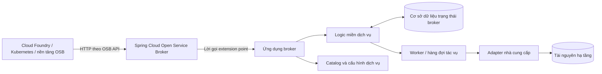

# Phạm vi trách nhiệm của framework và phần nghiệp vụ do người viết broker đảm nhiệm

Khi xây dựng service broker theo Open Service Broker API (OSB API), cần phân biệt rõ phần việc của framework Spring Cloud Open Service Broker với phần việc của ứng dụng broker. Framework cung cấp lớp tích hợp Spring và hỗ trợ thực hiện hợp đồng HTTP của OSB API. Nhà phát triển broker định nghĩa dịch vụ được cung cấp, quy tắc nghiệp vụ và cách tạo, quản lý, liên kết hoặc thu hồi tài nguyên thật.

Ranh giới này quyết định cách tổ chức mã nguồn. Nếu đưa logic cấp phát tài nguyên vào lớp xử lý HTTP, ứng dụng sẽ khó kiểm thử và khó thay đổi. Nếu kỳ vọng framework tự quản lý tài nguyên, trạng thái hoặc thông tin xác thực, broker sẽ thiếu những phần cốt lõi mà chỉ nhà cung cấp dịch vụ mới hiểu.

## 1. Vị trí của framework trong kiến trúc broker

Một broker thường nằm giữa nền tảng cung cấp dịch vụ và hệ thống hạ tầng thực thi. Cloud Foundry, Kubernetes hoặc một nền tảng tương thích OSB API gửi yêu cầu đến broker. Broker kiểm tra yêu cầu, áp dụng chính sách của dịch vụ rồi gọi API của cơ sở dữ liệu, hệ thống lưu trữ, dịch vụ mạng hoặc nhà cung cấp hạ tầng khác.



Có thể chia kiến trúc thành ba vùng:

- **Nền tảng** là bên tiêu thụ dịch vụ. Nền tảng hiển thị catalog cho người dùng, lưu thông tin về service instance và binding theo cách triển khai của nó, đồng thời gọi broker khi người dùng yêu cầu tạo, cập nhật, liên kết hoặc xóa dịch vụ.
- **Framework** là lớp giao tiếp OSB API trong ứng dụng Spring. Nó tiếp nhận yêu cầu giao thức, chuyển yêu cầu đến các điểm mở rộng của broker và định dạng phản hồi theo hợp đồng API.
- **Ứng dụng broker** là phần triển khai dịch vụ cụ thể. Nó quyết định một plan có ý nghĩa gì, tài nguyên được tạo ở đâu, trạng thái được lưu thế nào, credential được cấp ra sao và lỗi từ hệ thống hạ tầng được xử lý như thế nào.

Framework không thay thế nền tảng và cũng không thay thế logic nghiệp vụ của broker. Nó giúp broker tuân thủ giao thức nhất quán để đội ngũ có thể tập trung vào dịch vụ mà mình cung cấp.

## 2. Những phần framework Spring Cloud Open Service Broker hỗ trợ

Phạm vi chính của framework là lớp giao thức và các điểm tích hợp với Spring. Chi tiết API và tên extension point có thể thay đổi theo phiên bản thư viện, nhưng trách nhiệm thường được chia thành các nhóm sau.

### 2.1 Tiếp nhận và thực hiện hợp đồng HTTP của OSB API

Framework cung cấp cơ chế tiếp nhận các endpoint của OSB API, chẳng hạn endpoint đọc catalog, quản lý service instance, quản lý service binding và truy vấn trạng thái thao tác bất đồng bộ. Nó xử lý phần HTTP chung như ánh xạ đường dẫn, đọc header, chuyển JSON thành các đối tượng request và chuyển kết quả thành response.

Ví dụ, khi nền tảng gửi yêu cầu tạo service instance, framework xử lý phần giao thức và chuyển dữ liệu yêu cầu đến thành phần xử lý tạo instance mà broker đã đăng ký. Nhà phát triển không cần tự viết lại toàn bộ bộ điều khiển REST và bộ chuyển đổi JSON cho từng thao tác.

### 2.2 Cung cấp mô hình dữ liệu và điểm mở rộng

Framework định nghĩa các kiểu dữ liệu đại diện cho catalog, service, plan, request, response và kết quả thao tác. Các điểm mở rộng thường được tổ chức theo trách nhiệm như cung cấp catalog, xử lý vòng đời service instance, xử lý binding và cung cấp trạng thái `last_operation`. Trong các phiên bản Spring Cloud Open Service Broker, có thể gặp các abstraction với tên như `CatalogService`, `ServiceInstanceService` và `ServiceInstanceBindingService`; cần đối chiếu đúng phiên bản thư viện đang dùng trước khi triển khai chữ ký phương thức.

Những abstraction này là ranh giới giữa giao thức và nghiệp vụ. Framework gọi điểm mở rộng tương ứng; mã ứng dụng của broker trả về kết quả dựa trên chính sách và trạng thái thực tế của dịch vụ.

### 2.3 Hỗ trợ các quy ước phản hồi và lỗi của giao thức

OSB API quy định cấu trúc phản hồi cho các thao tác, bao gồm thông tin về service instance, binding, thao tác đang chạy và lỗi. Framework hỗ trợ chuyển kết quả từ điểm mở rộng thành phản hồi giao thức, đồng thời cung cấp cơ chế biểu diễn các lỗi theo dạng mà nền tảng có thể hiểu.

Framework có thể giúp chuẩn hóa cách phản hồi, nhưng không thể tự xác định ý nghĩa nghiệp vụ của mọi lỗi. Broker vẫn phải phân biệt, chẳng hạn, plan không được hỗ trợ, instance không tồn tại, yêu cầu không hợp lệ, thao tác đang ở trạng thái không cho phép hoặc nhà cung cấp hạ tầng tạm thời không truy cập được. Ứng dụng cần chuyển những tình huống này thành loại lỗi phù hợp để framework ánh xạ ra phản hồi OSB API.

### 2.4 Tích hợp với môi trường Spring

Framework tận dụng cơ chế cấu hình và dependency injection của Spring để đăng ký các thành phần xử lý, nạp cấu hình và kết nối với ứng dụng Spring Boot. Nhờ vậy, broker có thể chia logic thành các service, repository, adapter và worker độc lập.

Ứng dụng vẫn phải cấu hình những thành phần phù hợp với môi trường triển khai, ví dụ kết nối cơ sở dữ liệu, hàng đợi, HTTP client, quản lý secret và cơ chế bảo mật. Việc sử dụng Spring không có nghĩa các thành phần này tự xuất hiện hoặc đã được cấu hình an toàn.

### 2.5 Hỗ trợ mô hình đồng bộ và bất đồng bộ

Một số thao tác có thể hoàn tất ngay trong thời gian xử lý HTTP; những thao tác khác cần nhiều thời gian để tạo cụm cơ sở dữ liệu, cấp phát volume hoặc cấu hình mạng. Framework hỗ trợ cách biểu diễn kết quả đồng bộ hoặc bất đồng bộ theo OSB API, cùng cơ chế để nền tảng truy vấn trạng thái thao tác.

Framework cung cấp hợp đồng trao đổi trạng thái. Broker phải thực hiện công việc nền, lưu trạng thái bền vững và trả lời trạng thái dựa trên tiến độ thật. Chỉ bật chế độ bất đồng bộ trong phản hồi mà không có worker và nơi lưu trạng thái sẽ khiến nền tảng không thể biết thao tác đã hoàn tất hay chưa.

## 3. Những phần người viết broker phải tự triển khai

Framework không biết dịch vụ của tổ chức là PostgreSQL, Redis, object storage hay một dịch vụ nội bộ. Vì vậy, mọi quyết định gắn với tài nguyên và chính sách của dịch vụ thuộc về ứng dụng broker.

### 3.1 Định nghĩa catalog, service và plan

Broker phải công bố catalog phản ánh chính xác dịch vụ có thể cung cấp. Mỗi service và plan cần có định danh ổn định để nền tảng tham chiếu trong các yêu cầu vòng đời. Broker cũng phải xác định các thuộc tính như tên hiển thị, mô tả, khả năng binding, các tính năng được hỗ trợ và những tham số mà người dùng được phép truyền.

Plan cần ánh xạ đến cấu hình tài nguyên cụ thể. Ví dụ, plan `small` có thể tương ứng với một cấu hình cơ sở dữ liệu giới hạn CPU và dung lượng lưu trữ; plan `large` có thể có hạn mức cao hơn. Framework có thể cung cấp mô hình dữ liệu catalog, nhưng broker chịu trách nhiệm bảo đảm plan được công bố thực sự có thể cấp phát và có chính sách rõ ràng.

Khi thay đổi catalog, broker cần duy trì tính tương thích với những service instance đã được tạo. Xóa hoặc đổi ID của plan đang được sử dụng có thể khiến nền tảng không thể quản lý các instance cũ. Các thay đổi về giá trị mặc định, tham số và khả năng cập nhật plan cũng cần được cân nhắc như thay đổi hợp đồng dịch vụ.

### 3.2 Thực hiện cấp phát và quản lý service instance

Khi nhận yêu cầu tạo instance, broker phải thực hiện các bước nghiệp vụ cần thiết:

1. Xác định service và plan được yêu cầu có tồn tại, còn được phép cấp phát và phù hợp với tenant hay không.
2. Kiểm tra tham số, context và chính sách như quota, vùng triển khai, giới hạn tài nguyên hoặc quyền của người gọi.
3. Tạo bản ghi quản lý instance và xác định định danh nội bộ để liên kết trạng thái broker với tài nguyên bên ngoài.
4. Gọi nhà cung cấp hạ tầng hoặc điều phối tác vụ nền để tạo tài nguyên.
5. Ghi nhận kết quả, endpoint, thông tin vận hành và trạng thái cuối cùng.

Với thao tác cập nhật, broker quyết định trường nào được thay đổi, plan nào có thể chuyển đổi và cần điều chỉnh tài nguyên ra sao. Với thao tác thu hồi, broker phải xóa hoặc giải phóng tài nguyên theo chính sách, cập nhật trạng thái và xử lý trường hợp tài nguyên đã bị xóa thủ công ở bên ngoài.

Framework chuyển yêu cầu đến đúng điểm mở rộng. Nó không biết cách tạo database, cấp volume, tạo user hay xóa tài nguyên trên nhà cung cấp cụ thể.

### 3.3 Tạo và thu hồi service binding

Binding thường cung cấp thông tin để một ứng dụng hoặc workload kết nối đến service instance. Với dịch vụ cơ sở dữ liệu, broker có thể phải tạo database user, đặt quyền truy cập, sinh mật khẩu, xác định host và port rồi trả credential cho nền tảng.

Broker chịu trách nhiệm bảo đảm credential chỉ có quyền cần thiết, được gắn với đúng instance và binding, được lưu trữ an toàn nếu cần truy xuất lại, và được thu hồi khi binding bị xóa. Thao tác unbind phải thu hồi quyền truy cập thực tế ở hệ thống đích; chỉ xóa bản ghi binding trong cơ sở dữ liệu broker là chưa đủ.

Không phải service nào cũng hỗ trợ binding. Catalog cần khai báo khả năng này đúng với hành vi thực tế. Nếu service có binding, broker phải xác định rõ binding có thể tạo nhiều lần hay không, credential có được dùng chung hay không và quy trình xoay vòng thông tin xác thực được thực hiện thế nào.

### 3.4 Quản lý trạng thái và thao tác bất đồng bộ

Broker cần một mô hình trạng thái có thể khôi phục sau khi tiến trình ứng dụng khởi động lại. Với service instance, các trạng thái thường gặp có thể là `provisioning`, `available`, `updating`, `deleting` và `failed`. Binding cũng có vòng đời riêng nếu việc tạo hoặc thu hồi binding cần xử lý nền.

Khi một thao tác kéo dài, broker cần lưu ít nhất định danh instance, loại thao tác, định danh operation, trạng thái hiện tại, thời điểm cập nhật gần nhất và thông tin lỗi có thể dùng để chẩn đoán. Worker thực hiện công việc nền rồi cập nhật trạng thái. Khi nền tảng gọi `last_operation`, broker trả về trạng thái đã lưu thay vì suy đoán từ việc HTTP request trước đó đã kết thúc.

Trạng thái phải phản ánh kết quả của tài nguyên bên ngoài. Ví dụ, nếu worker đã gửi yêu cầu tạo database nhưng chưa xác nhận database sẵn sàng, broker không nên báo thao tác thành công. Nếu tiến trình worker bị dừng giữa chừng, broker cần có khả năng tiếp tục, đối soát hoặc đánh dấu lỗi có thể xử lý lại.

### 3.5 Bảo đảm idempotency và xử lý cạnh tranh

Nền tảng có thể gửi lại yêu cầu khi mất kết nối hoặc không nhận được phản hồi. Broker phải thiết kế để một yêu cầu lặp lại không vô tình tạo nhiều tài nguyên hoặc cấp phát nhiều bộ credential ngoài dự kiến.

Với mỗi thao tác, broker nên xác định khóa định danh phù hợp, kiểm tra bản ghi hiện có và lưu kết quả đủ bền vững để lần gọi lại có thể trả về trạng thái nhất quán. Nếu cùng một định danh instance được yêu cầu với dữ liệu khác biệt, broker cần phát hiện xung đột thay vì âm thầm ghi đè cấu hình.

Idempotency cũng liên quan đến cập nhật và thu hồi. Việc xóa một instance đã được thu hồi trước đó nên có kết quả ổn định; việc cập nhật không được áp dụng hai lần theo cách làm tăng quota hoặc tạo thêm tài nguyên. Khi có nhiều request đồng thời, broker cần dùng transaction, unique constraint, khóa hoặc cơ chế điều phối thích hợp để tránh hai worker cùng xử lý một chuyển đổi trạng thái.

### 3.6 Bảo mật và cách ly tenant

Broker chịu trách nhiệm xác thực nền tảng gọi API và xác định danh tính, tenant hoặc context được phép thao tác trên tài nguyên nào. Việc đọc một trường tenant từ request không tự chứng minh người gọi có quyền với tenant đó; broker phải dựa vào nguồn tin cậy và chính sách xác thực đã cấu hình.

Thông tin xác thực do binding trả về phải được bảo vệ khi tạo, lưu, truyền và thu hồi. Không ghi password, token hoặc secret vào log. Quyền của credential nên được giới hạn theo instance và mục đích sử dụng. Các thao tác quản trị, thay đổi plan hoặc xóa tài nguyên cần có kiểm soát quyền tương ứng.

Framework có thể tích hợp với cơ chế bảo mật của Spring, nhưng ứng dụng phải cấu hình authentication, authorization, TLS, quản lý secret, chính sách truy cập và kiểm soát tenant theo môi trường thực tế.

### 3.7 Độ tin cậy, quan sát và vận hành

Broker cần xử lý lỗi mạng, timeout, giới hạn tốc độ và sự cố từ nhà cung cấp hạ tầng. Retry phải có giới hạn và có chiến lược backoff; không nên lặp vô hạn một thao tác có thể tạo tài nguyên trùng lặp. Với thao tác không thể xác định kết quả do timeout, broker có thể cần truy vấn trạng thái nhà cung cấp trước khi thử lại.

Ứng dụng cũng phải cung cấp log có ngữ cảnh, metric về số lượng instance và thao tác thất bại, trace qua các lời gọi tới nhà cung cấp, cảnh báo cho worker bị kẹt và quy trình đối soát tài nguyên mồ côi. Đây là trách nhiệm vận hành của sản phẩm broker, không phải điều được bảo đảm chỉ bằng việc thêm dependency framework.

## 4. Bảng phân chia trách nhiệm

| Công việc | Framework Spring Cloud Open Service Broker | Nhà phát triển broker |
|---|---|---|
| Endpoint và cấu trúc HTTP của OSB API | Cung cấp lớp giao thức và cơ chế định tuyến | Đăng ký điểm xử lý phù hợp và cấu hình ứng dụng |
| Request/response | Cung cấp mô hình dữ liệu và chuyển đổi giao thức | Đọc dữ liệu nghiệp vụ, tạo kết quả đúng với dịch vụ |
| Catalog | Cung cấp abstraction và mô hình catalog | Định nghĩa service, plan, metadata, tham số và chính sách |
| Provision/update/deprovision | Chuyển yêu cầu đến điểm mở rộng và biểu diễn phản hồi | Cấp phát, thay đổi, thu hồi tài nguyên và lưu trạng thái |
| Bind/unbind | Cung cấp hợp đồng thao tác binding | Tạo credential, cấp quyền và thu hồi quyền thực tế |
| Bất đồng bộ và `last_operation` | Hỗ trợ hợp đồng phản hồi, truy vấn trạng thái | Xây dựng worker, operation ID và kho trạng thái bền vững |
| Idempotency và cạnh tranh | Không tự quyết định tính duy nhất của tài nguyên | Thiết kế khóa, transaction, constraint và xử lý request lặp |
| Bảo mật | Tích hợp được với hệ sinh thái Spring Security | Cấu hình xác thực, phân quyền, tenant isolation và secret |
| Nhà cung cấp hạ tầng | Không biết API riêng của nhà cung cấp | Viết adapter và xử lý lỗi, retry, đối soát |
| Vận hành dịch vụ | Cung cấp nền tảng tích hợp trong ứng dụng Spring | Thiết lập quan sát, cảnh báo, backup, phục hồi và quy trình vận hành |

Bảng này mô tả ranh giới trách nhiệm phổ biến. Một dự án có thể bổ sung lớp dùng chung hoặc thư viện nội bộ, nhưng cần giữ rõ nơi sở hữu quyết định nghiệp vụ và trạng thái tài nguyên.

## 5. Ví dụ: yêu cầu tạo một database instance

Giả sử nền tảng gửi yêu cầu tạo instance với service ID, plan ID, instance ID, tham số cấu hình và context của nền tảng.

1. **Framework tiếp nhận yêu cầu.** Lớp giao thức đọc HTTP request, kiểm tra cấu trúc theo OSB API và chuyển request đến điểm mở rộng xử lý service instance.
2. **Broker kiểm tra chính sách.** Logic nghiệp vụ xác minh service ID và plan ID, kiểm tra tham số, quota và tenant. Nếu plan không hợp lệ hoặc tenant vượt hạn mức, broker trả về lỗi nghiệp vụ phù hợp.
3. **Broker ghi nhận thao tác.** Ứng dụng tạo bản ghi instance ở trạng thái đang cấp phát và tạo operation ID. Việc ghi nhận cần được bảo vệ trước request lặp hoặc hai request đồng thời.
4. **Broker gọi nhà cung cấp.** Worker hoặc adapter gửi yêu cầu tạo database, cấu hình dung lượng, mạng và tài khoản quản trị theo plan.
5. **Broker cập nhật kết quả.** Khi database sẵn sàng, broker lưu endpoint và trạng thái khả dụng. Nếu tác vụ vẫn đang chạy, broker giữ trạng thái đang xử lý để nền tảng tiếp tục truy vấn.
6. **Framework trả phản hồi giao thức.** Kết quả mà broker cung cấp được framework chuyển thành response OSB API. Với thao tác bất đồng bộ, nền tảng dùng endpoint `last_operation` để hỏi tiến độ.

Phần framework chịu trách nhiệm cho các bước giao tiếp HTTP và chuyển đổi dữ liệu. Phần broker chịu trách nhiệm từ việc xác minh plan đến khi tài nguyên database thực sự tồn tại và có thể sử dụng.

Một service nghiệp vụ minh họa có thể được tổ chức như sau. Đây là mã giả thể hiện ranh giới giữa nghiệp vụ và hạ tầng, không phải chữ ký API cố định của một phiên bản Spring Cloud Open Service Broker:

```java
@Service
public class DatabaseProvisioningService {

    private final PlanRegistry plans;
    private final TenantResolver tenants;
    private final InstanceRepository instances;
    private final ProvisioningJobPublisher jobs;

    public ProvisioningResult provision(CreateInstanceCommand command) {
        ServicePlan plan = plans.requireSupported(command.planId());
        Tenant tenant = tenants.resolveTrusted(command.context());

        return instances.findOrCreateIdempotently(
            command.instanceId(),
            command.fingerprint(),
            () -> {
                ServiceInstance instance = ServiceInstance.provisioning(
                    command.instanceId(), tenant.id(), plan.id()
                );
                instances.save(instance);
                jobs.publish(new ProvisionDatabaseJob(instance.id(), plan));
                return ProvisioningResult.accepted(instance.id());
            }
        );
    }
}
```

Trong ví dụ này, `PlanRegistry`, `TenantResolver`, `InstanceRepository` và `ProvisioningJobPublisher` là thành phần do ứng dụng định nghĩa. Framework không cung cấp sẵn chính sách plan, cách xác định tenant, schema lưu instance hoặc adapter tạo database. Trong triển khai thực tế, việc lưu instance và phát job cần được thiết kế để tránh tình trạng transaction đã commit nhưng job bị mất; transactional outbox là một lựa chọn khi hệ thống cần bảo đảm điều đó.

## 6. Cách tổ chức mã nguồn để giữ ranh giới rõ ràng

Một cấu trúc dễ bảo trì thường tách các trách nhiệm sau:

```text
broker
├── catalog
│   ├── CatalogConfiguration
│   └── PlanRegistry
├── application
│   ├── ProvisionInstanceUseCase
│   ├── UpdateInstanceUseCase
│   ├── DeleteInstanceUseCase
│   └── BindInstanceUseCase
├── domain
│   ├── ServiceInstance
│   ├── ServiceBinding
│   └── OperationState
├── persistence
│   ├── InstanceRepository
│   └── OperationRepository
├── provider
│   ├── DatabaseProviderClient
│   └── DatabaseProviderAdapter
├── worker
│   └── ProvisioningWorker
└── security
    └── BrokerSecurityConfiguration
```

Các extension point của framework nên đóng vai trò adapter giao thức: nhận request, chuyển thành command của ứng dụng và chuyển kết quả use case thành response tương ứng. Logic miền không nên phụ thuộc trực tiếp vào controller HTTP hoặc định dạng JSON của OSB API. Adapter nhà cung cấp cũng nên nằm riêng để có thể thay đổi nhà cung cấp mà không viết lại quy tắc plan, quota hay vòng đời instance.

Cách tổ chức này giúp kiểm thử độc lập: kiểm thử domain để xác minh chuyển trạng thái; kiểm thử application service với repository và provider giả lập; kiểm thử tích hợp để xác minh endpoint, header, response và hành vi OSB API của framework.

## 7. Những câu hỏi cần trả lời trước khi đưa broker vào sử dụng

- Catalog có công bố đúng các plan mà broker thực sự cấp phát được không? ID của service và plan có ổn định qua các lần phát hành không?
- Với mỗi thao tác, broker có xác định rõ điều kiện đầu vào, trạng thái bắt đầu, trạng thái kết thúc và cách xử lý lỗi không?
- Nếu request được gửi lại hoặc hai request đến đồng thời, broker có tránh tạo tài nguyên trùng lặp không?
- Nếu tiến trình broker dừng giữa lúc cấp phát, worker có thể tiếp tục hoặc đối soát trạng thái với nhà cung cấp không?
- Nếu unbind hoặc deprovision được gọi nhiều lần, tài nguyên và quyền truy cập có được thu hồi an toàn không?
- Credential có được giới hạn quyền, bảo vệ trong lưu trữ và không xuất hiện trong log không?
- Context từ nền tảng có được xác thực trước khi dùng để xác định tenant hoặc quyền sở hữu tài nguyên không?
- Các lỗi tạm thời của nhà cung cấp có được phân biệt với lỗi nghiệp vụ không thể thử lại không?
- Có metric, log, cảnh báo và quy trình xử lý tài nguyên mồ côi hoặc operation bị kẹt không?

Khi trả lời được những câu hỏi này, đội ngũ có thể xác định phần nào được framework hỗ trợ và phần nào phải được thiết kế trong chính sản phẩm broker. Framework giúp thực hiện OSB API trong ứng dụng Spring; chất lượng của broker vẫn phụ thuộc vào catalog, logic vòng đời, trạng thái, bảo mật và cách tích hợp với hạ tầng mà nhà phát triển triển khai.
