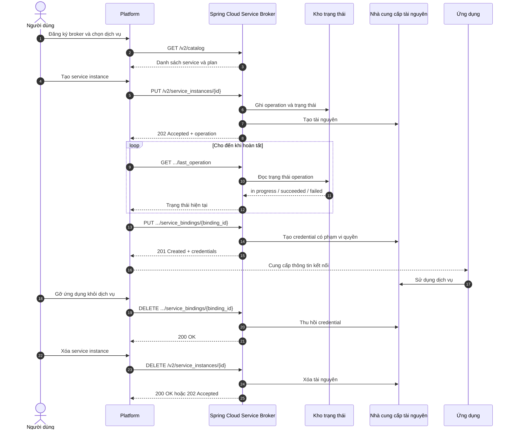

# Luồng tổng thể từ công bố dịch vụ đến cấp phát, liên kết và thu hồi

Trong module `SPRING_CLOUD_SERVICE_BROKER`, ta xây dựng một service broker theo **Open Service Broker API (OSB API)** bằng Spring Cloud. Broker công bố danh mục dịch vụ và các gói dịch vụ để một nền tảng như Cloud Foundry hoặc một thành phần tích hợp trên Kubernetes có thể tự động tạo, cập nhật, liên kết và thu hồi tài nguyên cho ứng dụng.

Luồng này biến một yêu cầu ở cấp nền tảng, chẳng hạn “cấp cho ứng dụng một cơ sở dữ liệu PostgreSQL gói nhỏ”, thành các thao tác cụ thể trên hạ tầng. Nền tảng điều phối vòng đời và gửi yêu cầu theo hợp đồng OSB API; broker kiểm tra yêu cầu, quản lý trạng thái, gọi hệ thống cung cấp tài nguyên và trả kết quả theo đúng hợp đồng. Spring Cloud Open Service Broker cung cấp lớp tích hợp HTTP và các mô hình request/response để người phát triển tập trung vào nghiệp vụ cấp phát.

## 1. Các thành phần trong luồng

| Thành phần | Trách nhiệm |
|---|---|
| Người dùng hoặc nhóm vận hành | Chọn dịch vụ và plan trên marketplace hoặc giao diện của nền tảng. |
| Nền tảng (platform) | Đăng ký broker, đọc catalog, gửi yêu cầu vòng đời, quản lý thông tin gắn kết với ứng dụng và thăm dò thao tác bất đồng bộ. |
| Service broker | Triển khai OSB API, xác thực nền tảng, kiểm tra service/plan, quản lý trạng thái và điều phối nhà cung cấp tài nguyên. |
| Nhà cung cấp tài nguyên (provisioner) | Tạo, cấu hình, cập nhật, cấp thông tin truy cập và xóa tài nguyên thực tế như database, queue hoặc storage. |
| Ứng dụng tiêu thụ | Nhận thông tin kết nối từ binding và sử dụng dịch vụ được cấp. |
| Cơ sở dữ liệu trạng thái của broker | Lưu service instance, binding, operation, định danh tài nguyên bên ngoài và thông tin cần thiết để xử lý retry hoặc phục hồi. |

Một **service** mô tả loại dịch vụ mà broker cung cấp, ví dụ PostgreSQL hoặc Redis. Một **plan** mô tả biến thể cấu hình hoặc mức dịch vụ, ví dụ `small`, `standard` hay `high-availability`. Khi nền tảng yêu cầu tạo dịch vụ, broker tạo một **service instance**. Khi một ứng dụng cần truy cập instance đó, nền tảng yêu cầu tạo một **binding**. Instance đại diện cho tài nguyên dùng chung; binding đại diện cho quyền truy cập của một consumer cụ thể.

## 2. Công bố dịch vụ: đăng ký broker và đọc catalog

Broker cần được triển khai tại một địa chỉ mà platform có thể truy cập. Quản trị viên đăng ký địa chỉ broker cùng thông tin xác thực trên platform. Sau khi đăng ký, platform gọi endpoint catalog để khám phá những dịch vụ và plan đang được cung cấp:

```http
GET /v2/catalog HTTP/1.1
Host: broker.example.internal
X-Broker-API-Version: 2.14
Authorization: Basic <broker-credentials>
```

Ví dụ một phần phản hồi catalog:

```json
{
  "services": [
    {
      "id": "postgres-service",
      "name": "managed-postgresql",
      "description": "Cơ sở dữ liệu PostgreSQL được quản lý",
      "bindable": true,
      "plan_updateable": true,
      "plans": [
        {
          "id": "postgres-small",
          "name": "small",
          "description": "Một database với giới hạn tài nguyên cơ bản",
          "free": false
        },
        {
          "id": "postgres-ha",
          "name": "high-availability",
          "description": "Database có cấu hình sẵn sàng cao",
          "free": false
        }
      ]
    }
  ]
}
```

Các `id` của service và plan là định danh mà platform sẽ gửi lại trong những yêu cầu vòng đời. Chúng cần ổn định qua các lần triển khai broker; đổi tên hiển thị thường ít ảnh hưởng hơn đổi ID. Trường `bindable` cho biết service có hỗ trợ binding hay không. `plan_updateable` cho biết service có cho phép chuyển plan qua thao tác update hay không. Catalog còn có thể mô tả tag, metadata, yêu cầu tính năng và schema tham số tùy phiên bản OSB API.

Catalog chỉ công bố **khả năng cung cấp**, chưa tạo tài nguyên nào. Broker cũng không tự đẩy từng dịch vụ vào giao diện marketplace: platform đọc catalog từ broker rồi quyết định cách hiển thị cho người dùng. Vì vậy, catalog phải nhất quán với năng lực thật của provisioner. Nếu broker công bố một plan nhưng backend không thể tạo plan đó, yêu cầu cấp phát sẽ thất bại ở bước sau.

OSB API sử dụng đường dẫn `/v2` và header `X-Broker-API-Version` để trao đổi phiên bản hợp đồng. Broker cần kiểm tra phiên bản mà platform gửi và chỉ quảng bá hoặc xử lý các khả năng mà phiên bản đó hỗ trợ. Các request tới broker phải được bảo vệ bằng TLS và cơ chế xác thực đã cấu hình khi đăng ký.

## 3. Cấp phát service instance

Khi người dùng chọn một service và plan, platform tạo một ID cho service instance rồi gửi yêu cầu provision. Ví dụ:

```http
PUT /v2/service_instances/instance-abc?accepts_incomplete=true HTTP/1.1
Host: broker.example.internal
X-Broker-API-Version: 2.14
Content-Type: application/json
Authorization: Basic <broker-credentials>

{
  "service_id": "postgres-service",
  "plan_id": "postgres-small",
  "organization_guid": "org-123",
  "space_guid": "space-456",
  "context": {
    "platform": "cloudfoundry"
  },
  "parameters": {
    "storage_gb": 20
  }
}
```

Broker xử lý yêu cầu theo một chuỗi bước có thể kiểm soát:

1. Xác thực platform và kiểm tra phiên bản OSB API.
2. Tìm service và plan theo ID; kiểm tra plan có được công bố và tham số có hợp lệ hay không.
3. Kiểm tra `instance-abc` đã được ghi nhận chưa để bảo đảm retry không tạo thêm tài nguyên.
4. Ghi nhận yêu cầu và trạng thái ban đầu vào kho trạng thái.
5. Gọi provisioner để tạo database hoặc tài nguyên tương ứng với plan.
6. Lưu ID tài nguyên bên ngoài, cấu hình đã áp dụng và kết quả xử lý.
7. Trả kết quả đồng bộ hoặc thông báo thao tác đang chạy.

Nếu thao tác hoàn thành nhanh, broker trả phản hồi thành công đồng bộ. Nếu phải chờ hệ thống hạ tầng, broker có thể trả `202 Accepted` cùng một mã `operation`:

```http
HTTP/1.1 202 Accepted
Content-Type: application/json

{
  "operation": "provision-001"
}
```

Platform dùng mã instance để thăm dò trạng thái:

```http
GET /v2/service_instances/instance-abc/last_operation?service_id=postgres-service&plan_id=postgres-small&operation=provision-001 HTTP/1.1
Host: broker.example.internal
X-Broker-API-Version: 2.14
Authorization: Basic <broker-credentials>
```

Broker trả trạng thái theo hợp đồng, ví dụ:

```json
{
  "state": "in progress",
  "description": "Đang tạo database và cấu hình quyền truy cập"
}
```

Khi hoàn tất, `state` chuyển thành `succeeded`; nếu thất bại, broker trả `failed` kèm mô tả phù hợp. Platform có thể dùng header `Retry-After` để điều chỉnh khoảng thời gian thăm dò. Endpoint `last_operation` phải đọc trạng thái đã lưu, không khởi chạy lại công việc tạo tài nguyên mỗi khi platform polling.

Tham số `accepts_incomplete=true` cho biết platform chấp nhận xử lý bất đồng bộ. Nếu thao tác bắt buộc phải chạy lâu nhưng platform không chấp nhận async, broker phải trả lỗi theo hợp đồng thay vì trả thành công khi tài nguyên chưa sẵn sàng.

## 4. Binding: cấp quyền truy cập cho ứng dụng

Sau khi service instance sẵn sàng, ứng dụng cần thông tin để kết nối. Platform gửi yêu cầu tạo binding với ID binding riêng:

```http
PUT /v2/service_instances/instance-abc/service_bindings/binding-789 HTTP/1.1
Host: broker.example.internal
X-Broker-API-Version: 2.14
Content-Type: application/json
Authorization: Basic <broker-credentials>

{
  "service_id": "postgres-service",
  "plan_id": "postgres-small",
  "app_guid": "app-456",
  "bind_resource": {
    "app_guid": "app-456"
  }
}
```

Broker kiểm tra instance đã tồn tại và đang ở trạng thái cho phép binding, kiểm tra service có `bindable: true`, sau đó tạo danh tính truy cập riêng cho ứng dụng. Với PostgreSQL, broker có thể tạo database user, đặt quyền chỉ trên database cần thiết và sinh mật khẩu ngẫu nhiên. Với một message queue, broker có thể tạo user hoặc credential có quyền publish/consume trên một tập queue cụ thể.

Phản hồi binding thường chứa `credentials` để platform chuyển cho ứng dụng qua cơ chế cấu hình của nền tảng:

```json
{
  "credentials": {
    "uri": "postgresql://db.example.internal:5432/appdb",
    "username": "app_binding_789",
    "password": "<secret-value>",
    "database": "appdb"
  }
}
```

Một service instance có thể có nhiều binding. Ví dụ, hai ứng dụng có thể cùng sử dụng một database nhưng mỗi ứng dụng nhận một user riêng. Cách làm này giúp broker thu hồi quyền của một ứng dụng mà không phải xóa toàn bộ service instance hoặc làm gián đoạn consumer khác.

Binding là ranh giới bảo mật quan trọng. Credential cần có phạm vi quyền tối thiểu, gắn với đúng instance và consumer, được truyền qua TLS, không ghi vào log và được bảo vệ khi lưu trữ. Broker cần có cách trả lại kết quả nhất quán khi platform gửi lại cùng một binding ID, thay vì tạo nhiều user hoặc nhiều bộ credential ngoài dự kiến.

## 5. Cập nhật service instance

Trong quá trình sử dụng, người dùng có thể đổi cấu hình hoặc chuyển plan nếu service hỗ trợ. Platform gửi `PATCH /v2/service_instances/{instance_id}` với service ID, plan ID mới, giá trị trước đó và các tham số cập nhật. Broker cần kiểm tra `plan_updateable`, tính tương thích giữa plan cũ và mới, giới hạn tài nguyên và chính sách của nhà cung cấp.

Một số cập nhật chỉ thay đổi cấu hình nhẹ và có thể hoàn tất đồng bộ. Những cập nhật như tăng dung lượng, chuyển topology hoặc di chuyển dữ liệu có thể mất thời gian; khi platform gửi `accepts_incomplete=true`, broker có thể trả `202 Accepted` và mã operation để platform theo dõi qua endpoint `last_operation` của instance.

Broker nên lưu lại plan và cấu hình đang áp dụng, cấu hình đích, cùng trạng thái update. Nếu provisioner thất bại giữa chừng, broker phải xác định tài nguyên đang ở trạng thái nào và có thể khôi phục cấu hình cũ hay cần đánh dấu lỗi để vận hành xử lý. Không được cập nhật metadata thành công trước khi backend đã đạt trạng thái mà broker cam kết.

## 6. Unbind và deprovision: thu hồi theo đúng thứ tự

Khi ứng dụng không còn cần dịch vụ, platform gửi yêu cầu xóa binding. Broker thu hồi credential hoặc quyền đã cấp cho binding đó, rồi ghi nhận binding không còn hoạt động:

```http
DELETE /v2/service_instances/instance-abc/service_bindings/binding-789?service_id=postgres-service&plan_id=postgres-small HTTP/1.1
Host: broker.example.internal
X-Broker-API-Version: 2.14
Authorization: Basic <broker-credentials>
```

Sau khi các consumer đã unbind, người dùng hoặc platform có thể xóa service instance bằng yêu cầu deprovision:

```http
DELETE /v2/service_instances/instance-abc?service_id=postgres-service&plan_id=postgres-small&accepts_incomplete=true HTTP/1.1
Host: broker.example.internal
X-Broker-API-Version: 2.14
Authorization: Basic <broker-credentials>
```

Broker xác nhận đúng instance và plan, kiểm tra các binding còn hiệu lực theo chính sách, sau đó yêu cầu provisioner xóa tài nguyên. Nếu xóa cần thời gian, broker trả `202 Accepted` và platform polling `last_operation` cho đến khi nhận `succeeded` hoặc `failed`. Khi tài nguyên đã được xóa, broker cập nhật trạng thái để retry deprovision không làm phát sinh lỗi hoặc xóa nhầm tài nguyên khác.

Thứ tự thông thường là **unbind từng consumer trước, sau đó deprovision instance**. Unbind chỉ thu hồi quyền truy cập của một consumer; deprovision xóa tài nguyên nền và ảnh hưởng tới tất cả consumer còn lại. Hai thao tác phải có kiểm soát riêng để tránh một yêu cầu unbind vô tình xóa database đang được ứng dụng khác sử dụng.

## 7. Sơ đồ tổng thể



## 8. Đồng bộ và bất đồng bộ trong OSB API

Không phải thao tác nào cũng cần async. Catalog thường trả kết quả nhanh. Binding thường cần trả credential ngay để platform chuyển cho ứng dụng. Provision, update hoặc deprovision có thể kéo dài vì phải tạo máy chủ, cấu hình mạng, khởi tạo database, sao lưu hoặc xóa dữ liệu lớn.

| Thao tác | Endpoint chính | Kết quả điển hình | Khi cần async |
|---|---|---|---|
| Đọc catalog | `GET /v2/catalog` | `200 OK` | Không cần polling vòng đời. |
| Provision | `PUT /v2/service_instances/{id}` | `201 Created` hoặc `202 Accepted` | Platform polling `last_operation`. |
| Update | `PATCH /v2/service_instances/{id}` | `200 OK` hoặc `202 Accepted` | Platform polling `last_operation`. |
| Deprovision | `DELETE /v2/service_instances/{id}` | `200 OK` hoặc `202 Accepted` | Platform polling `last_operation`. |
| Bind | `PUT /v2/service_instances/{id}/service_bindings/{binding_id}` | `201 Created` | Thường phải trả credential trong phản hồi. |
| Unbind | `DELETE /v2/service_instances/{id}/service_bindings/{binding_id}` | `200 OK` | Thu hồi quyền và xác nhận kết quả. |

Với thao tác async, broker cần lưu operation trước khi trả `202`, trả mã operation ổn định và cung cấp trạng thái có thể đọc lại. Worker nền thực hiện công việc với timeout, retry có giới hạn và khả năng phục hồi sau khi tiến trình broker khởi động lại. Không nên giữ kết nối HTTP mở trong nhiều phút để chờ hạ tầng hoàn thành.

Trạng thái nội bộ có thể chi tiết hơn trạng thái OSB API. Ví dụ:

```text
PROVISIONING -> AVAILABLE
             -> PROVISION_FAILED

AVAILABLE -> UPDATING -> AVAILABLE
                      -> UPDATE_FAILED

AVAILABLE -> DEPROVISIONING -> DEPROVISIONED
                            -> DEPROVISION_FAILED
```

Endpoint `last_operation` ánh xạ trạng thái nội bộ sang các giá trị hợp đồng `in progress`, `succeeded` hoặc `failed`. Mỗi operation nên lưu loại thao tác, instance ID, mã operation, thời điểm bắt đầu/kết thúc, số lần thử và mô tả lỗi đã loại bỏ thông tin nhạy cảm.

## 9. Idempotency và quản lý trạng thái

Platform có thể gửi lại request khi timeout hoặc mất kết nối, kể cả khi broker đã thực hiện xong thao tác nhưng phản hồi chưa tới nơi. Nếu mỗi lần nhận request broker đều tạo tài nguyên mới, một service instance có thể vô tình tạo nhiều database hoặc nhiều credential. Vì vậy, broker phải thiết kế thao tác có tính **idempotent**.

- Dùng `service_instance_id` do platform cung cấp làm khóa ổn định cho vòng đời instance; dùng `binding_id` làm khóa ổn định cho binding.
- Đặt ràng buộc duy nhất trong kho trạng thái để hai request đồng thời không tạo hai bản ghi hoặc hai tài nguyên cho cùng ID.
- Với request lặp có cùng ý nghĩa, trả lại kết quả hoặc trạng thái của thao tác đã ghi nhận. Nếu cùng ID nhưng service, plan hoặc tham số xung đột, xử lý như xung đột thay vì âm thầm thay đổi tài nguyên.
- Ghi nhận operation và việc cần thực hiện một cách bền vững trước khi xác nhận đã nhận thao tác. Có thể dùng transactional outbox để bảo đảm việc ghi trạng thái và phát lệnh cho worker không bị lệch nhau.
- Khi gọi provisioner, truyền khóa idempotency hoặc external resource ID nếu hệ thống đó hỗ trợ. Lưu ID tài nguyên bên ngoài để retry, reconcile và deprovision đúng đối tượng.
- Với deprovision và unbind, xử lý trường hợp tài nguyên hoặc binding đã được thu hồi trước đó theo ngữ nghĩa của OSB API; không coi một lần retry hợp lệ là lệnh xóa tài nguyên khác.

Một bản ghi instance thường cần có instance ID, service ID, plan ID, tenant context, trạng thái, external resource ID, cấu hình đã áp dụng và thời điểm cập nhật. Bản ghi binding cần có binding ID, instance ID, consumer ID, trạng thái và tham chiếu tới credential. Credential cần được mã hóa khi lưu hoặc được tạo lại theo cách an toàn; không lưu mật khẩu dạng rõ trong log hay bản ghi vận hành.

Broker cũng cần xử lý tình huống trạng thái nội bộ và hạ tầng không đồng nhất. Ví dụ, provisioner tạo database thành công nhưng tiến trình broker dừng trước khi ghi nhận kết quả. Một tác vụ reconcile có thể đối chiếu external resource ID hoặc nhãn quản lý để phát hiện tài nguyên đã tồn tại, rồi cập nhật trạng thái thay vì tạo thêm database. Nếu không thể xác định kết quả an toàn, broker giữ trạng thái cần xử lý và phát cảnh báo cho vận hành.

## 10. Bảo mật xuyên suốt vòng đời

Broker là cổng điều khiển có khả năng tạo và xóa tài nguyên, đồng thời phát hành credential. Bảo mật cần được áp dụng ở mọi endpoint và mọi bước xử lý:

1. **Xác thực platform:** chỉ chấp nhận request từ platform hoặc client được ủy quyền. Bảo vệ credential broker, giới hạn quyền truy cập mạng và dùng TLS.
2. **Kiểm tra tenant và ngữ cảnh:** kiểm tra `organization_guid`, `space_guid`, `context` hoặc thông tin consumer theo danh tính platform đã xác thực. Không xem các trường trong JSON là bằng chứng xác thực độc lập.
3. **Kiểm tra tham số:** chỉ nhận tham số được hỗ trợ bởi service/plan; kiểm tra kiểu dữ liệu, giới hạn dung lượng, tên tài nguyên và các giá trị có thể gây injection.
4. **Quyền tối thiểu:** credential của binding chỉ có quyền cần thiết cho ứng dụng và tài nguyên tương ứng. Không dùng một tài khoản quản trị chung cho mọi ứng dụng.
5. **Bảo vệ bí mật:** chỉ trả credential cho platform qua kết nối an toàn; mã hóa khi lưu, giới hạn người có quyền đọc và loại bỏ bí mật khỏi log, trace, exception và thông báo lỗi.
6. **Thu hồi và kiểm toán:** unbind phải thu hồi quyền đã cấp; deprovision phải xóa hoặc vô hiệu hóa tài nguyên theo chính sách. Ghi audit event cho các thay đổi quan trọng mà không ghi giá trị bí mật.

Các endpoint đọc catalog cũng cần được kiểm soát truy cập theo cấu hình broker. Endpoint `last_operation` không được để lộ thông tin hạ tầng hoặc lỗi chứa credential. Khi trả lỗi, cung cấp mã và mô tả đủ để platform xử lý, còn chi tiết nội bộ được ghi trong hệ thống quan sát có kiểm soát.

## 11. Tích hợp với Cloud Foundry và Kubernetes

**Cloud Foundry** có mô hình service broker và marketplace tích hợp với OSB API. Quản trị viên đăng ký broker, platform lấy catalog, người dùng tạo service instance trong organization/space, rồi yêu cầu bind instance vào ứng dụng. Platform chuyển context của organization và space trong request; sau khi bind thành công, thông tin kết nối được cung cấp cho ứng dụng theo cơ chế của Cloud Foundry. Broker vẫn chịu trách nhiệm tạo tài nguyên thật và quản lý credential.

**Kubernetes** không tự cung cấp một OSB broker client mặc định trong mọi cụm. Để dùng broker theo OSB API, cụm cần thành phần tích hợp tương thích, chẳng hạn service catalog/controller hoặc một controller do tổ chức xây dựng. Thành phần đó đọc catalog, chuyển yêu cầu tạo/xóa instance và binding tới broker, sau đó đưa thông tin kết nối vào Kubernetes Secret hoặc cơ chế service binding phù hợp. Cần kiểm tra rõ thành phần tích hợp đang dùng hỗ trợ phiên bản OSB API và các thao tác nào; không giả định mọi tính năng của platform đều giống Cloud Foundry.

Ở cả hai nền tảng, broker nên dựa vào hợp đồng OSB API và dữ liệu context được xác thực, đồng thời giữ phần triển khai hạ tầng trong provisioner riêng. Cách phân lớp này giúp cùng một nghiệp vụ cấp phát có thể phục vụ nhiều platform mà không gắn toàn bộ logic với một nền tảng cụ thể.

## 12. Ví dụ xuyên suốt: cấp PostgreSQL cho một ứng dụng

Giả sử broker công bố service `managed-postgresql` với hai plan `small` và `high-availability`:

1. Platform đọc catalog và hiển thị hai plan cho người dùng.
2. Người dùng chọn `small`; platform gửi provision với instance ID `instance-abc`.
3. Broker lưu yêu cầu, gọi nhà cung cấp tạo database và trả `202` nếu cần chờ. Platform polling đến khi instance sẵn sàng.
4. Platform gửi bind với binding ID `binding-789` và app ID `app-456`.
5. Broker tạo user PostgreSQL riêng cho ứng dụng, giới hạn quyền trên database, rồi trả URI, username và password.
6. Platform cung cấp credential cho ứng dụng. Ứng dụng kết nối database bằng thông tin binding.
7. Khi ứng dụng không còn dùng dịch vụ, platform yêu cầu unbind. Broker thu hồi user hoặc quyền của `binding-789`.
8. Khi không còn consumer cần instance, platform yêu cầu deprovision. Broker xóa database và đánh dấu instance đã thu hồi.

Nếu platform gửi lại bước provision do timeout, broker nhận diện `instance-abc` và tiếp tục hoặc trả trạng thái của operation cũ. Nếu hai ứng dụng cùng bind một instance, mỗi binding có credential riêng. Nếu unbind một ứng dụng thất bại, broker giữ lại trạng thái lỗi để retry hoặc reconcile; không xóa database đang phục vụ ứng dụng còn lại.

## 13. Những điểm cần kiểm soát khi triển khai

- Catalog chỉ công bố service và plan mà provisioner thực sự hỗ trợ; ID phải ổn định.
- Mỗi instance và binding có định danh, trạng thái lưu bền vững và quy tắc retry rõ ràng.
- Provision, update và deprovision hỗ trợ async khi thời gian xử lý vượt quá thời gian request hợp lý; `last_operation` phản ánh đúng trạng thái thực tế.
- Binding trả credential có phạm vi quyền tối thiểu; unbind thu hồi chính credential hoặc quyền đó.
- Retry cùng ID không tạo thêm tài nguyên; request cùng ID nhưng khác nội dung được xử lý như xung đột.
- Lỗi từ provisioner, timeout, tiến trình dừng giữa chừng và tài nguyên mồ côi đều có đường phục hồi hoặc reconcile.
- Thông tin tenant, tham số, credential và endpoint quản trị được bảo vệ xuyên suốt; log không chứa bí mật.
- Tích hợp Cloud Foundry hoặc Kubernetes cần xác nhận rõ phiên bản OSB API và khả năng của thành phần platform client.

Khi các bước trên được triển khai nhất quán, service broker trở thành lớp điều phối có thể dự đoán được: platform chỉ cần biết catalog và hợp đồng OSB API, còn broker chịu trách nhiệm biến yêu cầu cấp phát thành tài nguyên thực, theo dõi trạng thái và thu hồi quyền cũng như tài nguyên đúng vòng đời.
