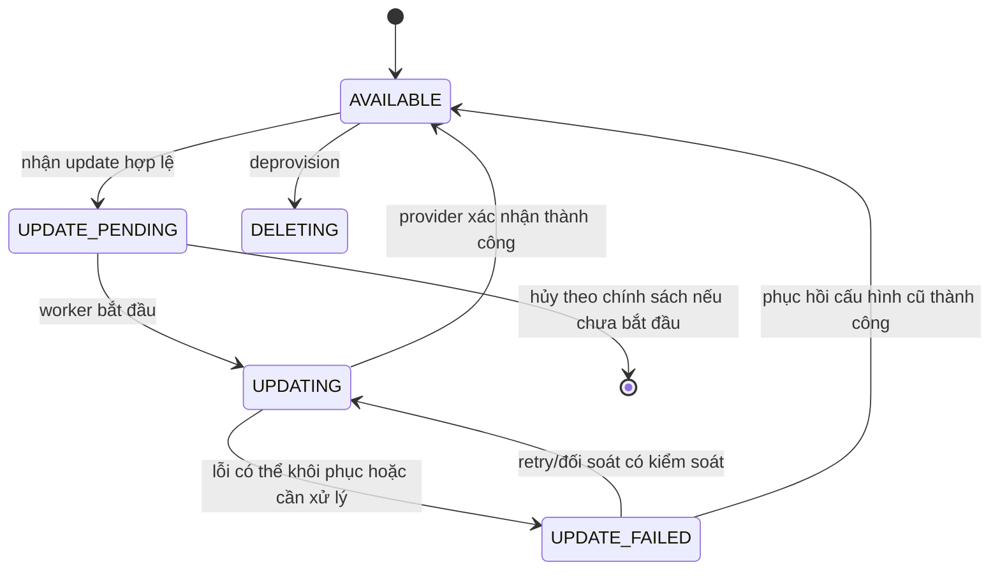

# Cài đặt `updateServiceInstance()` và mô hình request/response

Trong Open Service Broker API (OSB API), thao tác cập nhật service instance cho phép nền tảng yêu cầu broker thay đổi plan hoặc tham số cấu hình của một tài nguyên đã được cấp phát. Trong Spring Cloud Open Service Broker, điểm tích hợp nghiệp vụ cho thao tác này là phương thức `updateServiceInstance()` của `ServiceInstanceService`. Phương thức nhận một `UpdateServiceInstanceRequest`, kiểm tra yêu cầu theo trạng thái instance và chính sách dịch vụ, điều phối thay đổi ở nhà cung cấp rồi trả về `UpdateServiceInstanceResponse`.

Với `SPRING_CLOUD_SERVICE_BROKER`, update cần được thiết kế như một chuyển đổi trạng thái có kiểm soát. Một request hợp lệ về cấu trúc vẫn có thể không được phép áp dụng vì plan không hỗ trợ nâng cấp, quota không đủ, instance đang chạy operation khác hoặc nhà cung cấp không thể thực hiện thay đổi. Broker phải phân biệt lỗi đầu vào, xung đột trạng thái và lỗi tạm thời của hạ tầng; đồng thời bảo đảm retry không làm thay đổi tài nguyên nhiều lần ngoài ý muốn.

## 1. Update service instance trong OSB API

Nền tảng gửi yêu cầu cập nhật bằng HTTP `PUT` đến endpoint service instance, với `instance_id` trên đường dẫn và định danh service/plan theo hợp đồng OSB API. Request body có thể mang context, parameters và thông tin giá trị trước đó để broker hiểu thay đổi mà nền tảng đang yêu cầu.

```http
PUT /v2/service_instances/instance-8f21?service_id=postgres-service&plan_id=postgres-standard HTTP/1.1
Host: broker.example.com
Content-Type: application/json
X-Broker-API-Version: 2.17
Authorization: Bearer <platform-token>
```

Một request body minh họa:

```json
{
  "service_id": "postgres-service",
  "plan_id": "postgres-standard",
  "context": {
    "platform": "cloud-foundry",
    "organization_guid": "org-42",
    "space_guid": "space-17"
  },
  "parameters": {
    "storage_gb": 200,
    "backup_enabled": true
  },
  "previous_values": {
    "service_id": "postgres-service",
    "plan_id": "postgres-small",
    "organization_id": "org-42",
    "space_id": "space-17"
  }
}
```

Trong ví dụ, nền tảng yêu cầu instance chuyển từ plan `postgres-small` sang `postgres-standard` và đặt lại một số tham số. `previous_values` cung cấp thông tin mà nền tảng biết về trạng thái trước đó. Broker nên đối chiếu thông tin này với bản ghi instance nội bộ và dữ liệu provider; không dùng nó làm nguồn sự thật duy nhất vì request đến từ bên ngoài vẫn phải được xác thực.

OSB API có quy định chi tiết về query parameter, request fields và header theo phiên bản giao thức. Khi triển khai, phải theo đúng phiên bản API mà broker công bố và cấu hình. Ví dụ trên thể hiện hình dạng thường gặp, không thay thế việc kiểm tra schema của phiên bản cụ thể.

## 2. Khi nào nền tảng gọi update?

Một số tình huống thường gặp:

- **Nâng hoặc hạ plan:** chuyển từ cấu hình nhỏ sang cấu hình lớn hơn, hoặc sang plan có tính năng khác.
- **Thay đổi tham số:** tăng dung lượng, bật backup, thay đổi cửa sổ bảo trì hoặc cập nhật giới hạn kết nối.
- **Thay đổi cả plan và parameters:** nền tảng yêu cầu plan mới cùng các tham số phù hợp với plan đó.
- **Áp dụng thay đổi đã được người dùng phê duyệt:** nền tảng gửi request sau khi người dùng chọn cấu hình mới trong giao diện.

Không phải broker nào cũng hỗ trợ tất cả các dạng update. Service definition có cờ `plan_updateable` để công bố khả năng cập nhật plan. Cờ này nói về việc thay đổi plan; nó không tự khẳng định mọi tham số đều có thể thay đổi, cũng không bảo đảm mọi cặp plan có thể chuyển đổi qua lại. Broker vẫn phải xác định danh sách chuyển đổi được phép và các tham số nào có thể cập nhật.

Nếu dịch vụ không hỗ trợ update plan, broker cần công bố đúng capability và từ chối yêu cầu thay đổi plan theo mã lỗi phù hợp với OSB API. Nếu chỉ hỗ trợ thay đổi một số tham số, cần mô tả rõ schema và kiểm tra lại ở tầng nghiệp vụ.

## 3. Mô hình `UpdateServiceInstanceRequest`

Spring Cloud Open Service Broker ánh xạ request giao thức thành model `UpdateServiceInstanceRequest` để service implementation xử lý. Tên package và accessor cụ thể cần đối chiếu với phiên bản dependency của dự án, nhưng các nhóm dữ liệu quan trọng thường gồm:

| Thành phần | Ý nghĩa | Cách broker sử dụng |
|---|---|---|
| `serviceInstanceId` | Định danh instance trên broker | Tìm bản ghi instance và operation hiện tại |
| `serviceDefinitionId` | Định danh service được yêu cầu | Xác minh request thuộc đúng service đã tạo |
| `planId` | Plan đích mà nền tảng yêu cầu | Kiểm tra plan tồn tại và chính sách chuyển đổi |
| `parameters` | Tham số mới của thao tác update | Validate, chuẩn hóa và tạo cấu hình đích |
| `context` | Context do nền tảng cung cấp | Xác định thông tin nền tảng/tenant theo nguồn tin cậy |
| `previousValues` | Thông tin trước thay đổi mà nền tảng gửi | So sánh với trạng thái đã lưu và hỗ trợ migration |
| `asyncAccepted` | Nền tảng có chấp nhận xử lý bất đồng bộ hay không | Quyết định có thể trả kết quả async khi cần |

Trong một số phiên bản thư viện, model có thể cung cấp thêm thông tin hoặc biểu diễn khác nhau cho các giá trị tùy chọn. Không nên suy luận rằng một accessor luôn trả về giá trị khác `null`, hoặc rằng mọi phiên bản đều có cùng chữ ký. Hãy dùng model được cung cấp bởi dependency thực tế.

### Phân biệt request với cấu hình hiệu lực

`parameters` là dữ liệu nền tảng gửi cho lần update. Nó không nhất thiết là toàn bộ cấu hình hiệu lực cuối cùng. Với hợp đồng partial update, trường bị bỏ qua có thể có nghĩa là giữ nguyên giá trị cũ. Broker cần đọc cấu hình hiện tại, hợp nhất phần thay đổi, áp dụng default theo contract và validate cấu hình đích trước khi gọi provider.

Ví dụ, instance đang có `storage_gb=100` và `backup_enabled=false`. Request chỉ gửi `backup_enabled=true`. Nếu hợp đồng quy định partial update, cấu hình đích phải là `storage_gb=100` và `backup_enabled=true`, không được tự đặt dung lượng về default chỉ vì request không gửi trường đó.

## 4. Mô hình `UpdateServiceInstanceResponse`

Sau khi xử lý request, handler trả `UpdateServiceInstanceResponse`. Response cho nền tảng biết thao tác đã hoàn tất ngay hay broker đang thực hiện một operation bất đồng bộ.

| Trường/đặc tính | Ý nghĩa |
|---|---|
| `async` | Cho biết update được xử lý bất đồng bộ |
| `operation` | Mã operation do broker tạo để nền tảng truy vấn tiến độ |
| HTTP status | Phân biệt update hoàn tất ngay với update được chấp nhận để xử lý nền |

Với update đồng bộ, broker trả phản hồi thành công theo hợp đồng OSB API khi thay đổi đã hoàn tất và trạng thái tài nguyên đã được xác nhận. Với update bất đồng bộ, broker trả `202 Accepted`, đánh dấu response là async và cung cấp operation identifier để nền tảng truy vấn `last_operation`.

Ví dụ phản hồi đồng bộ có thể là HTTP `200 OK` với body rỗng theo quy định của giao thức. Ví dụ phản hồi bất đồng bộ:

```http
HTTP/1.1 202 Accepted
Content-Type: application/json
```

```json
{
  "operation": "update-op-2026-0017"
}
```

Tên và cách serialize các trường response phụ thuộc model/framework version. Không trả `202` chỉ vì handler đã gửi message vào queue; trước khi chấp nhận operation, broker phải ghi bền vững operation ID, trạng thái và dữ liệu cần thiết để worker có thể tiếp tục sau khi tiến trình khởi động lại.

## 5. Đăng ký `ServiceInstanceService` trong Spring

Ứng dụng cung cấp một bean triển khai `ServiceInstanceService`. Framework dùng bean này làm điểm mở rộng cho các thao tác vòng đời service instance. `updateServiceInstance()` nên đóng vai trò adapter: chuyển request của framework thành command nghiệp vụ, gọi use case và ánh xạ kết quả thành response.

Ví dụ dưới đây minh họa kiểu API reactive thường gặp trong các phiên bản Spring Cloud Open Service Broker hiện đại. Hãy đối chiếu đúng interface và kiểu trả về của phiên bản thư viện đang dùng trước khi đưa mã vào dự án:

```java
package com.example.broker.instance;

import org.springframework.stereotype.Service;
import org.springframework.cloud.servicebroker.model.instance.UpdateServiceInstanceRequest;
import org.springframework.cloud.servicebroker.model.instance.UpdateServiceInstanceResponse;
import org.springframework.cloud.servicebroker.service.ServiceInstanceService;
import reactor.core.publisher.Mono;

@Service
public class BrokerServiceInstanceService implements ServiceInstanceService {

    private final UpdateServiceInstanceUseCase updateUseCase;

    public BrokerServiceInstanceService(
            UpdateServiceInstanceUseCase updateUseCase) {
        this.updateUseCase = updateUseCase;
    }

    @Override
    public Mono<UpdateServiceInstanceResponse> updateServiceInstance(
            UpdateServiceInstanceRequest request) {
        return updateUseCase.execute(request)
                .map(result -> {
                    if (result.async()) {
                        return UpdateServiceInstanceResponse.builder()
                                .async(true)
                                .operation(result.operationId())
                                .build();
                    }
                    return UpdateServiceInstanceResponse.builder().build();
                });
    }

    // Các phương thức ServiceInstanceService khác được cài đặt
    // theo cùng phiên bản API của Spring Cloud Open Service Broker.
}
```

Đây là ví dụ về ranh giới adapter và use case; tên builder/accessor có thể khác giữa các phiên bản. Một số phiên bản cũ hoặc cấu hình khác có thể dùng chữ ký đồng bộ. Không tự tạo controller riêng cho endpoint OSB nếu framework đã cung cấp endpoint và routing tương ứng.

Use case nên nhận command nghiệp vụ đã được chuyển đổi từ request, thay vì để toàn bộ domain phụ thuộc trực tiếp vào model giao thức. Điều này giúp kiểm thử quy tắc update mà không cần dựng Spring WebFlux hoặc giả lập HTTP.

## 6. Các bước xử lý bên trong `updateServiceInstance()`

Một luồng update an toàn thường bao gồm các bước sau:

1. **Tìm instance:** tra cứu bằng `serviceInstanceId`; nếu không tồn tại, trả lỗi phù hợp.
2. **Xác minh service:** `serviceDefinitionId` phải khớp service mà instance đang thuộc về. Không cho phép biến update thành thao tác chuyển sang service khác.
3. **Đọc trạng thái hiện tại:** kiểm tra instance có đang provision, update hoặc deprovision hay không.
4. **Xác thực plan đích:** xác nhận plan tồn tại, thuộc đúng service và còn được phép dùng.
5. **Kiểm tra quyền update:** kiểm tra `plan_updateable` và chính sách chuyển đổi từ plan hiện tại sang plan đích.
6. **Chuẩn hóa parameters:** hợp nhất request với cấu hình hiện tại theo ngữ nghĩa update; áp dụng default và xác thực schema.
7. **Kiểm tra chính sách:** quota, tenant, vùng triển khai, quyền sử dụng tính năng và khả năng của provider.
8. **Ghi nhận operation:** lưu cấu hình đích, operation ID, trạng thái và fingerprint trước khi khởi chạy tác vụ dài.
9. **Thực hiện thay đổi:** gọi provider trực tiếp nếu có thể hoàn tất nhanh, hoặc giao cho worker nếu cần xử lý nền.
10. **Cập nhật trạng thái và phản hồi:** chỉ đánh dấu thành công khi provider đã xác nhận cấu hình mới; trả response đồng bộ hoặc bất đồng bộ đúng với kết quả.

Luồng này nên được chia thành application service, repository và provider adapter. Adapter giao thức không nên tự chứa SQL, retry loop hoặc logic riêng của từng nhà cung cấp.

## 7. Xác thực plan và quy tắc chuyển đổi

Broker cần xác định rõ plan nào có thể chuyển sang plan nào. Ví dụ:

| Plan hiện tại | Plan đích | Quy tắc minh họa |
|---|---|---|
| `small` | `standard` | Cho phép nâng cấp, tăng quota và dung lượng |
| `standard` | `production` | Cho phép nếu tenant còn quota và provider hỗ trợ replica |
| `production` | `small` | Có thể từ chối nếu dữ liệu hiện tại vượt giới hạn plan nhỏ |
| `standard` | `standard` | Có thể là update parameters hoặc no-op nếu cấu hình không đổi |

Không nên chỉ so sánh tên plan. Dùng plan ID ổn định và registry chính sách để xác định đặc tính, giới hạn tài nguyên và chuyển đổi được phép. Nếu plan đích giống plan hiện tại, broker vẫn phải kiểm tra parameters: request có thể chỉ yêu cầu thay đổi dung lượng hoặc bật backup.

`previous_values` có thể giúp nhận biết nền tảng nghĩ instance đang ở plan nào. Broker nên so sánh với bản ghi nội bộ. Nếu dữ liệu khác nhau, cần xác định đây là stale request, thay đổi đã được thực hiện ở một nơi khác hay dữ liệu nền tảng không đồng bộ. Không được âm thầm ghi đè trạng thái thực tế chỉ vì `previous_values` khai báo một giá trị cũ.

## 8. Chuẩn hóa parameters và tạo cấu hình đích

Request update có thể mang một tập tham số một phần. Broker cần định nghĩa rõ cách diễn giải trường bị bỏ qua, trường `null` và trường có giá trị. Sau đó tạo một cấu hình đích bất biến để dùng cho validation, provider call và operation record.

Ví dụ mô hình miền:

```java
public record DatabaseConfiguration(
        int storageGb,
        boolean backupEnabled,
        String maintenanceWindow) {
}

public record UpdateDatabaseParameters(
        Integer storageGb,
        Boolean backupEnabled,
        String maintenanceWindow) {
}
```

Một hàm merge minh họa cho hợp đồng partial update:

```java
public DatabaseConfiguration apply(
        DatabaseConfiguration current,
        UpdateDatabaseParameters changes) {
    return new DatabaseConfiguration(
            changes.storageGb() == null
                    ? current.storageGb()
                    : changes.storageGb(),
            changes.backupEnabled() == null
                    ? current.backupEnabled()
                    : changes.backupEnabled(),
            changes.maintenanceWindow() == null
                    ? current.maintenanceWindow()
                    : changes.maintenanceWindow());
}
```

Đoạn mã chỉ đúng nếu `null` hoặc trường bị thiếu đều mang nghĩa “không thay đổi”. Nếu API cần cho phép xóa một giá trị bằng `null`, DTO phải giữ được thông tin field có xuất hiện trong JSON hay không. Có thể dùng kiểu wrapper biểu diễn presence hoặc giữ `JsonNode`/map đầu vào để phân biệt. Không nên để cách deserialize mặc định quyết định ngữ nghĩa hợp đồng.

Sau khi merge, validate toàn bộ cấu hình đích. Ví dụ, `storage_gb` có thể tăng từ 100 lên 200 nhưng không được giảm xuống 50 nếu dữ liệu hiện tại đã chiếm 80 GB. `backup_enabled=true` chỉ hợp lệ nếu plan và khu vực hỗ trợ backup.

## 9. Xử lý đồng bộ và bất đồng bộ

Update có thể cần vài mili giây nếu chỉ thay đổi metadata nội bộ, nhưng có thể mất nhiều phút nếu phải resize database, di chuyển dữ liệu hoặc tạo replica. Broker cần chọn mô hình phản hồi phù hợp với thời gian và khả năng của provider.

### Update đồng bộ

Dùng khi thao tác có thể hoàn tất trong thời gian HTTP hợp lý và broker có thể xác nhận trạng thái cuối cùng trước khi phản hồi. Luồng cơ bản:

1. Validate request và trạng thái instance.
2. Gọi provider để cập nhật.
3. Chờ provider xác nhận cấu hình mới đã có hiệu lực.
4. Lưu plan/configuration mới và trạng thái `AVAILABLE`.
5. Trả response đồng bộ theo OSB API.

Không trả thành công ngay sau khi gửi lệnh đến provider nếu provider xử lý theo kiểu eventual consistency và chưa xác nhận kết quả. Nếu timeout khiến kết quả chưa rõ, cần đối soát trạng thái provider trước khi quyết định retry.

### Update bất đồng bộ

Nếu nền tảng gửi `accepts_incomplete=true` và broker hỗ trợ asynchronous operation, broker có thể chấp nhận update dài hạn. Luồng thường gồm:

1. Validate và kiểm tra khả năng async.
2. Tạo operation ID duy nhất.
3. Lưu operation cùng snapshot cấu hình đích và trạng thái `IN_PROGRESS`.
4. Đảm bảo tác vụ được đưa vào hàng đợi bền vững, ví dụ qua transactional outbox.
5. Trả HTTP `202 Accepted` cùng operation identifier.
6. Worker gọi provider, kiểm tra tiến độ và cập nhật trạng thái.
7. Nền tảng truy vấn endpoint `last_operation` để biết update còn chạy, thành công hay thất bại.

Ví dụ response body có operation ID:

```json
{
  "operation": "update-op-2026-0017"
}
```

Khi nền tảng polling, broker trả trạng thái operation theo hợp đồng OSB API, chẳng hạn `in progress`, `succeeded` hoặc `failed`, kèm mô tả phù hợp nếu thất bại. `operation` phải đủ ổn định để nền tảng tiếp tục truy vấn cùng một thao tác sau khi mất kết nối.

Nếu request không cho phép async mà update cần thời gian dài, broker phải trả lỗi giao thức phù hợp thay vì tự ý chuyển sang async. Việc hỗ trợ `accepts_incomplete` phải nhất quán với capability và cấu hình endpoint của broker.

## 10. Quản lý trạng thái và chống request đồng thời

Update là thao tác thay đổi trạng thái nên cần mô hình chuyển trạng thái rõ ràng. Một ví dụ:



Không phải mọi hệ thống cần đúng các tên trạng thái trên; điều quan trọng là định nghĩa trạng thái nào cho phép update, delete hoặc bind. Nếu instance đang `UPDATING`, request update mới có thể bị từ chối bằng conflict hoặc được xếp hàng theo chính sách. Không để hai operation đồng thời thay đổi cùng một instance mà không có cơ chế tuần tự hóa.

Có thể dùng optimistic locking với version field, transaction và unique constraint trên operation đang hoạt động. Ví dụ, khi tạo operation, cập nhật bản ghi instance chỉ thành công nếu version vẫn là giá trị vừa đọc. Nếu một request khác đã thay đổi trạng thái, request hiện tại phải dừng và trả lỗi xung đột phù hợp.

## 11. Idempotency và retry cho update

Nền tảng có thể gửi lại cùng request nếu không nhận được phản hồi. Update phải được thiết kế để retry không lặp side effect ngoài dự kiến.

Một cách tiếp cận là tạo fingerprint từ:

- `serviceInstanceId`;
- loại thao tác `UPDATE`;
- service ID và plan ID đích;
- cấu hình đích đã chuẩn hóa;
- phiên bản contract dùng để chuẩn hóa request.

Khi nhận lại request có fingerprint trùng với operation đang chạy hoặc đã hoàn tất, broker trả lại kết quả/trạng thái tương ứng thay vì tạo operation mới. Nếu cùng instance ID nhưng cấu hình đích khác với operation đang chạy, broker phát hiện xung đột.

Idempotency ở broker chưa đủ nếu provider cũng không hỗ trợ retry an toàn. Adapter cần truyền idempotency key nếu API provider hỗ trợ, hoặc thực hiện read-before-retry để kiểm tra tài nguyên đã đạt cấu hình đích chưa. Sau timeout, không nên mặc định lệnh update chưa được thực hiện.

## 12. Xử lý lỗi và ánh xạ HTTP response

Lỗi update có thể đến từ request, chính sách broker, trạng thái instance hoặc provider. Cần phân loại trước khi ánh xạ ra lỗi OSB API.

| Tình huống | Xử lý ở broker | Phản hồi thường dùng theo hợp đồng API |
|---|---|---|
| JSON hoặc tham số không hợp lệ | Trả lỗi validation, chỉ rõ trường sai | `400 Bad Request` |
| Instance không tồn tại | Không gọi provider; trả lỗi không tìm thấy | `404 Not Found` |
| Service/plan không tồn tại hoặc không thuộc service | Từ chối yêu cầu | `400` hoặc mã lỗi đặc tả cho trường hợp tương ứng |
| Plan update không được hỗ trợ | Từ chối theo capability và quy tắc OSB API | `422 Unprocessable Entity` trong trường hợp được đặc tả |
| Instance đang có operation xung đột | Không khởi chạy operation thứ hai | `409 Conflict` |
| Nền tảng không chấp nhận async nhưng thao tác cần async | Không tự ý chạy nền | Lỗi theo quy định OSB API cho async không được chấp nhận |
| Provider tạm thời không khả dụng | Retry có giới hạn hoặc đánh dấu operation thất bại có thể phục hồi | `5xx` nếu đồng bộ; trạng thái failed nếu async |

Mã HTTP và cấu trúc error body phải được đối chiếu với phiên bản OSB API đang triển khai. Không biến mọi exception thành `500`, vì điều đó khiến nền tảng không phân biệt được lỗi client, conflict và lỗi tạm thời. Cũng không trả thông tin nội bộ hoặc credential trong thông báo lỗi.

Với async operation, lỗi xảy ra sau khi trả `202` phải được lưu trong operation state để `last_operation` trả kết quả thất bại. Không thể đổi response HTTP ban đầu sau khi nền tảng đã nhận.

## 13. Bảo mật và kiểm soát quyền update

Update có thể tăng chi phí hoặc mở rộng quyền truy cập, nên broker cần kiểm tra quyền ở mọi lần gọi:

- Xác thực nền tảng gọi API và kiểm tra quyền đối với service instance.
- Lấy tenant/organization từ context đã xác thực hoặc mapping đáng tin cậy; không tin một `tenant_id` tùy ý trong parameters.
- Kiểm tra tenant có quyền chuyển sang plan đích và có đủ quota.
- Kiểm tra tham số theo schema, policy và giới hạn của provider.
- Không ghi token, password hoặc dữ liệu nhạy cảm trong parameters vào log.
- Ghi audit event về ai yêu cầu update, plan/configuration trước và sau, operation ID và thời điểm.
- Hạn chế thông tin trong error message để không lộ endpoint hoặc cấu trúc hạ tầng.

Nếu update có thể thay đổi quyền, ví dụ mở rộng CIDR hoặc bật public access, cần áp dụng policy chuyên biệt và có thể yêu cầu phê duyệt bổ sung tùy sản phẩm.

## 14. Ví dụ use case điều phối update

Use case nên làm rõ thứ tự kiểm tra và ranh giới transaction. Ví dụ dưới đây là mã minh họa ở tầng ứng dụng, không phải chữ ký API của framework:

```java
public UpdateResult execute(UpdateCommand command) {
    ServiceInstance instance = instances.require(command.instanceId());
    instance.assertBelongsTo(command.serviceId());
    instance.assertUpdateAllowed();

    ServicePlan targetPlan = plans.require(command.planId());
    policies.assertPlanTransitionAllowed(
            instance.planId(), targetPlan.id(), instance.tenantId());

    DatabaseConfiguration target = configurationMapper.mergeAndValidate(
            instance.configuration(), command.parameters(), targetPlan);

    String fingerprint = fingerprints.create(
            instance.id(), targetPlan.id(), target, command.contractVersion());

    return operations.findByFingerprint(fingerprint)
            .map(UpdateResult::fromExisting)
            .orElseGet(() -> startUpdate(instance, targetPlan, target, fingerprint));
}
```

`startUpdate` có thể thực hiện đồng bộ nếu provider trả kết quả ngay, hoặc lưu operation và phát job bền vững. Khi lưu operation, nên ghi cùng cấu hình đích và version instance trong transaction; nếu phát message qua queue, transactional outbox giúp tránh trường hợp database commit nhưng message bị mất.

Không giữ database transaction mở trong suốt một lời gọi provider kéo dài. Hãy commit trạng thái `UPDATE_PENDING`, thực hiện tác vụ bên ngoài transaction, sau đó mở transaction khác để cập nhật kết quả. Nếu provider hỗ trợ operation polling riêng, worker có thể lưu provider operation ID và tiếp tục kiểm tra sau.

## 15. Kiểm thử `updateServiceInstance()`

Nên kiểm thử ở nhiều lớp:

**Unit test cho use case:**

- Từ chối instance không tồn tại hoặc thuộc service khác.
- Từ chối plan không tồn tại hoặc không được phép chuyển đổi.
- Giữ nguyên tham số cũ khi request không gửi trường đó theo hợp đồng partial update.
- Từ chối cấu hình vượt quota hoặc không tương thích với plan.
- Nhận diện request lặp và trả operation/result hiện có.
- Từ chối update đồng thời khi instance đang có operation không tương thích.

**Test cho response adapter:**

- Kết quả hoàn tất đồng bộ tạo response async=false và HTTP status đúng.
- Kết quả bất đồng bộ chứa operation ID và được ánh xạ thành `202 Accepted`.
- Exception nghiệp vụ được chuyển thành error response theo đúng loại.

**Integration test:**

- Gửi `PUT` đến endpoint OSB API với request hợp lệ và xác minh response.
- Gửi request có `accepts_incomplete` và kiểm tra nhánh async.
- Poll `last_operation` đến khi hoàn tất.
- Xác minh broker lưu plan/configuration mới sau khi provider xác nhận.
- Mô phỏng timeout, provider trả lỗi và worker khởi động lại.
- Gửi retry cùng request để xác minh không tạo side effect trùng.

Ví dụ kiểm thử cho phép merge cấu hình (dùng JUnit và AssertJ):

```java
@Test
void updateKeepsUnspecifiedFields() {
    DatabaseConfiguration current =
            new DatabaseConfiguration(100, false, "02:00-03:00");
    UpdateDatabaseParameters changes =
            new UpdateDatabaseParameters(null, true, null);

    DatabaseConfiguration updated = mapper.apply(current, changes);

    assertThat(updated.storageGb()).isEqualTo(100);
    assertThat(updated.backupEnabled()).isTrue();
    assertThat(updated.maintenanceWindow()).isEqualTo("02:00-03:00");
}
```

Test trên kiểm tra một quy tắc partial update cụ thể. Nếu contract dùng semantics khác, hãy thay assertion theo quy tắc đã công bố. Test không thay thế kiểm thử endpoint và provider adapter.

## 16. Những lỗi triển khai thường gặp

**Cập nhật bản ghi trước khi provider thành công:** broker báo plan mới dù tài nguyên vẫn dùng cấu hình cũ. Hãy lưu desired state riêng và chỉ chuyển trạng thái hiệu lực sau khi provider xác nhận.

**Tin `previous_values` tuyệt đối:** dữ liệu nền tảng gửi có thể cũ. Đối chiếu với trạng thái nội bộ và provider trước khi thực hiện chuyển đổi.

**Coi `plan_updateable=true` là cho phép mọi chuyển đổi:** capability chỉ công bố khả năng update plan ở mức service. Broker vẫn cần policy cho từng cặp plan và điều kiện tài nguyên.

**Gộp parameters như cấu hình đầy đủ:** trường bị bỏ qua có thể bị đặt về default ngoài ý muốn. Xác định semantics partial/desired-state và kiểm thử.

**Trả `202` trước khi lưu operation:** nền tảng có operation token nhưng broker không thể truy vấn hoặc khôi phục công việc sau crash. Lưu operation bền vững trước khi phản hồi.

**Retry provider update không có idempotency:** timeout có thể khiến broker áp dụng thay đổi nhiều lần. Dùng provider idempotency key hoặc đối soát trạng thái trước khi retry.

**Cho phép update đồng thời:** hai request có thể ghi đè cấu hình hoặc hoàn tất sai thứ tự. Dùng locking, version check hoặc tuần tự hóa theo instance.

**Ghi parameters nguyên bản vào log:** có thể làm lộ secret. Chỉ log trường cần thiết và che dữ liệu nhạy cảm.

## 17. Trình tự triển khai update cho broker

Khi triển khai `updateServiceInstance()` cho một service plan, có thể làm theo trình tự:

1. Xác định service và plan nào hỗ trợ update; công bố `plan_updateable` chính xác.
2. Định nghĩa schema và semantics của parameters cho create/update, bao gồm trường bị bỏ qua và `null`.
3. Xây dựng model cấu hình hiệu lực và registry chính sách chuyển đổi plan.
4. Triển khai repository để đọc instance, operation và version; bảo đảm transaction/locking phù hợp.
5. Xây dựng use case validate, merge parameters, kiểm tra quota và tạo desired state.
6. Xây dựng provider adapter có timeout, idempotency và cơ chế đối soát.
7. Đăng ký `ServiceInstanceService` bean và ánh xạ `UpdateServiceInstanceRequest` sang command.
8. Trả `UpdateServiceInstanceResponse` đồng bộ hoặc bất đồng bộ đúng với kết quả và khả năng nền tảng.
9. Cung cấp `last_operation` để nền tảng polling các update bất đồng bộ.
10. Kiểm thử request cũ/mới, retry, conflict, lỗi provider, rollback và instance đang tồn tại.

Khi `updateServiceInstance()` được triển khai theo ranh giới rõ ràng giữa request/response giao thức, use case nghiệp vụ, kho trạng thái và provider adapter, broker có thể cập nhật plan hoặc tham số mà vẫn duy trì tính nhất quán. Nền tảng nhận được phản hồi đúng hợp đồng, còn broker giữ được khả năng phục hồi khi thao tác kéo dài, request bị gửi lại hoặc nhà cung cấp gặp sự cố.
