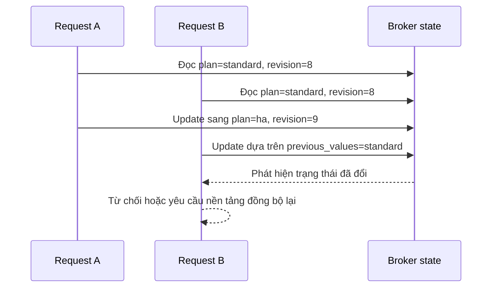
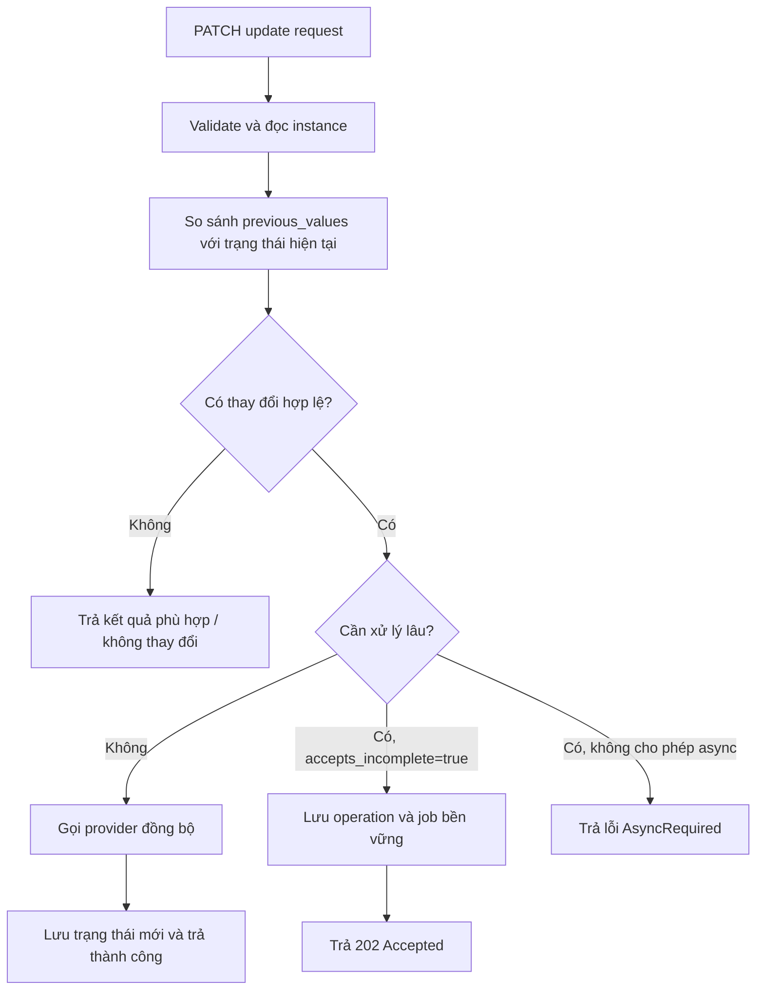

# `previous_values` và đối chiếu cấu hình trước khi thay đổi

## Vì sao phải biết trạng thái trước khi update?

Trong Open Service Broker API (OSB API), nền tảng dùng `PATCH /v2/service_instances/{instance_id}` để yêu cầu broker cập nhật một service instance đã được provision. Một lần update có thể đổi service plan, điều chỉnh tham số cấu hình hoặc áp dụng phiên bản bảo trì mới. Trước khi thực hiện, broker cần xác định instance hiện đang ở trạng thái nào và request đang giả định trạng thái trước đó ra sao.

Trường `previous_values` trong request cung cấp một phần thông tin mà nền tảng biết về service instance trước khi cập nhật. Broker dùng thông tin này để đối chiếu với dữ liệu đã lưu, phát hiện request dựa trên trạng thái cũ và tránh áp dụng một thay đổi lên nhầm phiên bản cấu hình.

Module `SPRING_CLOUD_SERVICE_BROKER` sử dụng Spring Cloud Open Service Broker để xây dựng broker quản lý catalog, plan và vòng đời tài nguyên. Vì vậy, xử lý `previous_values` cần gắn với kho trạng thái của broker, quy tắc tương thích plan, quản lý tham số, idempotency và kiểm soát các request update đến đồng thời.

## Endpoint update và cấu trúc request

Endpoint update service instance có dạng:

```http
PATCH /v2/service_instances/{instance_id}
```

`instance_id` nằm trong path và xác định service instance cần thay đổi. Body chứa service đang được tham chiếu, plan đích nếu có thay đổi, tham số mới và `previous_values` mô tả một số giá trị trước update.

Ví dụ request rút gọn:

```http
PATCH /v2/service_instances/inst-orders-001?accepts_incomplete=true HTTP/1.1
Content-Type: application/json
X-Broker-API-Version: 2.17
```

```json
{
  "service_id": "svc-postgresql",
  "plan_id": "plan-ha",
  "parameters": {
    "storage_gb": 100,
    "backup_enabled": true
  },
  "previous_values": {
    "service_id": "svc-postgresql",
    "plan_id": "plan-standard",
    "organization_id": "org-100",
    "space_id": "space-orders"
  }
}
```

Trong ví dụ, nền tảng muốn chuyển instance `inst-orders-001` từ `plan-standard` sang `plan-ha`, đồng thời gửi cấu hình đích. `previous_values.plan_id` mô tả plan trước update mà nền tảng đang ghi nhận; `plan_id` ở cấp cao nhất của body là plan đích được yêu cầu.

Các giá trị ID chỉ là ví dụ. Broker phải dùng ID ổn định đã công bố trong catalog và tra cứu theo `instance_id` đã được nền tảng cấp.

## Phân biệt dữ liệu mới và `previous_values`

Hai nhóm dữ liệu có mục đích khác nhau:

| Dữ liệu | Ý nghĩa | Cách broker sử dụng |
|---|---|---|
| `service_id` | Service offering mà request update tham chiếu. | Xác nhận service đúng với instance và service catalog hiện tại. |
| `plan_id` | Plan đích nếu request yêu cầu thay đổi plan. | Kiểm tra plan tồn tại, thuộc service và có thể chuyển đổi từ trạng thái hiện tại. |
| `parameters` | Tham số cấu hình mới do nền tảng gửi. | Validate schema, chuẩn hóa và tính toán phần cấu hình cần thay đổi. |
| `previous_values` | Một số giá trị trước update mà nền tảng gửi. | Đối chiếu với bản ghi instance do broker lưu để phát hiện trạng thái cũ hoặc request không nhất quán. |

`previous_values` không phải bản sao đầy đủ của toàn bộ cấu hình instance. Theo hợp đồng OSB API, object này mang các giá trị trước đó như `service_id`, `plan_id`, `organization_id`, `space_id` và có thể có `maintenance_info` khi luồng bảo trì được sử dụng. Nó không thay thế kho dữ liệu nội bộ của broker và không phải nơi chứa toàn bộ tham số cũ.

Đặc biệt, nếu broker cần so sánh tham số cũ với `parameters` mới, nó phải lấy tham số đã lưu trong bản ghi instance hoặc cấu hình thực tế từ provider. Không nên giả định `previous_values` chứa mọi trường đã gửi trong request provision.

## Ý nghĩa của từng trường trong `previous_values`

| Trường | Thông tin trước update | Cách đối chiếu |
|---|---|---|
| `service_id` | Service offering đã dùng khi provision hoặc update trước đó. | Kiểm tra instance có đang thuộc service mà request tham chiếu hay không. |
| `plan_id` | Plan hiện tại trước khi áp dụng plan đích. | Xác nhận nền tảng và broker đang nói về cùng một trạng thái plan. |
| `organization_id` | Tổ chức mà instance được tạo trong ngữ cảnh nền tảng. | Đối chiếu tenant/quota và phạm vi sở hữu khi broker có lưu trường này. |
| `space_id` | Space hoặc vùng logic mà instance thuộc về. | Đối chiếu ngữ cảnh triển khai và chính sách cô lập. |
| `maintenance_info` | Thông tin bảo trì trước đó nếu được dùng trong catalog/plan. | Xác định phiên bản bảo trì hiện tại mà nền tảng đang kỳ vọng. |

Các trường trong `previous_values` phản ánh dữ liệu mà nền tảng gửi theo hợp đồng và phiên bản API. Không phải mọi nền tảng đều cung cấp mọi trường trong mọi tình huống. Broker cần xử lý trường tùy chọn theo đúng đặc tả đang hỗ trợ, đồng thời không tự suy diễn một giá trị bị thiếu thành giá trị mặc định.

## Đối chiếu với trạng thái broker đã lưu

Broker cần duy trì bản ghi service instance sau provision. Một bản ghi tối thiểu có thể gồm:

```text
instance_id
service_id
plan_id
organization_id
space_id
parameters
maintenance_version
provider_resource_id
instance_state
revision
updated_at
```

Các trường là mô hình nội bộ minh họa; hệ thống thực tế có thể dùng tên khác hoặc lưu dữ liệu trong nhiều bảng. `revision` là phiên bản nội bộ do broker quản lý để kiểm soát cập nhật đồng thời.

Khi nhận request update, broker có thể thực hiện trình tự:

1. Tìm instance bằng `instance_id` trong kho trạng thái.
2. Xác minh instance tồn tại và đang ở trạng thái cho phép update.
3. Đối chiếu `previous_values.service_id` với service đã lưu.
4. Đối chiếu `previous_values.plan_id` với plan hiện tại nếu trường được gửi.
5. Đối chiếu `organization_id`, `space_id` và `maintenance_info` khi có trong request và có dữ liệu tương ứng trong mô hình broker.
6. Đọc cấu hình cũ từ kho trạng thái hoặc provider để so sánh với `parameters` mới.
7. Xác định chính xác các thay đổi được yêu cầu, kiểm tra quyền và khả năng chuyển đổi.
8. Ghi nhận update operation và thực hiện thay đổi theo mô hình đồng bộ hoặc bất đồng bộ.

Ví dụ logic đối chiếu:

```java
StoredInstance current = instanceRepository.findById(instanceId)
        .orElseThrow(InstanceNotFoundException::new);

PreviousValues previous = request.getPreviousValues();

if (previous.getServiceId() != null
        && !previous.getServiceId().equals(current.serviceId())) {
    throw new StaleInstanceStateException("service_id does not match");
}

if (previous.getPlanId() != null
        && !previous.getPlanId().equals(current.planId())) {
    throw new StaleInstanceStateException("plan_id does not match");
}

UpdatePlan target = resolveTargetPlan(request, current);
validateTransition(current, target, request.getParameters());
```

Đây là pseudocode mô tả nguyên tắc, không phải chữ ký API cố định của Spring Cloud Open Service Broker. Tên getter, kiểu `PreviousValues` và exception thực tế phụ thuộc phiên bản thư viện và lớp domain của ứng dụng.

## `previous_values` không phải dữ liệu có thẩm quyền tuyệt đối

Nền tảng gửi `previous_values` để broker hiểu trạng thái mà nền tảng đang tham chiếu. Tuy nhiên, dữ liệu này vẫn là dữ liệu trong request. Broker phải so sánh nó với bản ghi do chính broker quản lý và trạng thái provider khi cần.

Ví dụ, broker đang lưu:

```json
{
  "instance_id": "inst-orders-001",
  "service_id": "svc-postgresql",
  "plan_id": "plan-ha",
  "revision": 8
}
```

Nhưng request gửi:

```json
{
  "service_id": "svc-postgresql",
  "plan_id": "plan-large",
  "previous_values": {
    "service_id": "svc-postgresql",
    "plan_id": "plan-standard"
  }
}
```

Broker nhận thấy `previous_values.plan_id` là `plan-standard`, trong khi trạng thái đang lưu là `plan-ha`. Đây có thể là request dựa trên dữ liệu cũ, một update khác vừa hoàn tất hoặc một sai lệch trong quá trình đồng bộ nền tảng. Broker cần xử lý theo chính sách xung đột, không được giả định plan hiện tại vẫn là `plan-standard` và ghi đè trạng thái đang có.

Tương tự, không nên tin `organization_id` hoặc `space_id` trong request để cấp quyền truy cập. Những giá trị này có thể giúp xác định phạm vi, nhưng quyền của caller và quan hệ sở hữu phải được xác minh bằng thông tin xác thực và dữ liệu broker tin cậy.

## Kiểm soát thay đổi plan

Một update có thể thay đổi plan, nhưng không phải service nào cũng cho phép. Catalog có thể công bố capability `plan_updateable` để cho nền tảng biết việc đổi plan có được hỗ trợ hay không.

Khi request chứa `plan_id` đích, broker cần:

- Xác nhận plan đích tồn tại và thuộc đúng service.
- Xác nhận service/plan hỗ trợ cập nhật plan theo catalog và chính sách thực tế.
- So sánh plan hiện tại trong kho trạng thái với `previous_values.plan_id`.
- Kiểm tra hướng chuyển đổi, ví dụ nâng cấp từ gói nhỏ lên gói lớn có được phép hay không.
- Kiểm tra quota, giới hạn tài nguyên, điều kiện downtime và khả năng rollback.
- Cập nhật plan trong trạng thái broker sau khi provider xác nhận thay đổi thành công.

Không được đổi `plan_id` trong database của broker trước rồi mới gọi provider mà không có trạng thái trung gian. Nếu provider từ chối hoặc timeout, dữ liệu broker sẽ cho biết một plan mới trong khi tài nguyên thực tế vẫn dùng plan cũ. Nên dùng trạng thái `UPDATING`, operation record và cơ chế reconciliation để quản lý khoảng thời gian chuyển tiếp.

## Đối chiếu và hợp nhất `parameters`

`parameters` trong request update mô tả các giá trị mà nền tảng muốn áp dụng. Chúng có thể là một phần cấu hình hoặc tập tham số mới tùy theo schema của service. Broker phải xác định semantics của từng tham số: thay thế toàn bộ, cập nhật một phần hay có giá trị mặc định.

Một cách tiếp cận an toàn:

1. Đọc cấu hình hiện tại từ kho trạng thái.
2. Chuẩn hóa tham số request theo schema của plan đích.
3. So sánh từng trường để xác định giá trị thêm, sửa hoặc giữ nguyên.
4. Kiểm tra các ràng buộc chéo, chẳng hạn `storage_gb` không vượt quota hoặc backup yêu cầu một loại storage cụ thể.
5. Tạo cấu hình đích hoàn chỉnh và lưu fingerprint để nhận diện request lặp.
6. Gửi lệnh cập nhật tới provider.
7. Chỉ công bố cấu hình mới là trạng thái hiệu lực sau khi có kết quả xác nhận phù hợp.

Ví dụ cấu hình hiện tại và cấu hình đích:

| Thuộc tính | Đang lưu | Request mới | Cách xử lý |
|---|---:|---:|---|
| `storage_gb` | 20 | 100 | Kiểm tra quota và khả năng tăng dung lượng. |
| `backup_enabled` | `false` | `true` | Kiểm tra plan có hỗ trợ backup và bật chính sách backup. |
| `database_name` | `orders` | Không gửi | Giữ nguyên nếu schema định nghĩa đây là tham số không đổi khi update. |

Không phải mọi tham số đều có thể thay đổi sau provision. Có tham số chỉ được dùng lúc tạo tài nguyên, có tham số yêu cầu restart hoặc migration, và có tham số không thể đảo ngược. Broker cần mô tả rõ khả năng cập nhật trong tài liệu service/plan và trả lỗi phù hợp nếu request yêu cầu thay đổi không được hỗ trợ.

## Phát hiện update cũ và xử lý cạnh tranh

`previous_values` giúp nhận ra một số request được xây dựng dựa trên trạng thái trước đó, nhưng nó không tự tạo ra khóa đồng bộ. Hai request update có thể cùng đọc plan cũ rồi đồng thời yêu cầu hai thay đổi khác nhau.

Ví dụ:



Nên dùng một hoặc nhiều cơ chế:

- **Optimistic locking:** cập nhật với điều kiện `revision` vẫn bằng giá trị đã đọc; nếu không, không ghi đè.
- **Pessimistic lock hoặc khóa theo instance:** tuần tự hóa các thay đổi trên cùng `instance_id`.
- **Unique operation / request fingerprint:** nhận diện request lặp và tránh khởi tạo cùng một update nhiều lần.
- **Reconciliation:** đối chiếu trạng thái provider sau timeout để biết thay đổi đã áp dụng hay chưa.

Ví dụ cập nhật có điều kiện:

```sql
UPDATE service_instance
SET plan_id = :target_plan,
    revision = revision + 1,
    state = 'UPDATING'
WHERE instance_id = :instance_id
  AND revision = :expected_revision;
```

Nếu số dòng được cập nhật bằng 0, trạng thái đã thay đổi hoặc instance không còn tồn tại theo điều kiện truy vấn. Broker cần đọc lại và trả kết quả xung đột thích hợp. Câu SQL chỉ minh họa kỹ thuật optimistic locking; schema và transaction cụ thể phụ thuộc hệ lưu trữ.

## Xử lý đồng bộ và bất đồng bộ

Nếu update hoàn tất nhanh, broker có thể xử lý đồng bộ và trả response thành công sau khi provider xác nhận. Nếu thao tác kéo dài, nền tảng có thể gửi `accepts_incomplete=true`; broker tiếp nhận, ghi operation và trả `202 Accepted` theo hợp đồng.



Trong lúc update bất đồng bộ, broker nên lưu cả trạng thái trước và cấu hình đích, operation ID, revision và lỗi gần nhất. Khi polling `last_operation`, response phải phản ánh tiến trình thật. Khi thao tác thành công, broker chuyển cấu hình hiệu lực sang giá trị đích; khi thất bại, broker phải biết provider đang ở cấu hình cũ, cấu hình mới một phần hay trạng thái không xác định để xử lý phục hồi.

## Tích hợp xử lý update bằng Spring Cloud Open Service Broker

Spring Cloud Open Service Broker cung cấp abstraction để ứng dụng xử lý update service instance, thường thông qua `ServiceInstanceService` và request model tương ứng của phiên bản framework. Handler nhận request từ lớp giao thức; domain service của ứng dụng chịu trách nhiệm so sánh trạng thái, kiểm tra transition và gọi provider.

Ví dụ pseudocode:

```java
@Service
public class PostgresUpdateService {

    private final InstanceRepository instances;
    private final UpdateCoordinator coordinator;

    public Mono<UpdateResult> update(
            String instanceId,
            UpdateRequest request) {

        return instances.findById(instanceId)
                .switchIfEmpty(Mono.error(new InstanceNotFoundException()))
                .flatMap(current -> {
                    verifyPreviousValues(current, request.previousValues());
                    UpdateTarget target = resolveTarget(current, request);
                    validateTarget(current, target);
                    return coordinator.apply(current, target, request);
                });
    }
}
```

Đây là pseudocode cho domain layer, không phải chữ ký interface cố định của framework. `UpdateRequest`, `UpdateResult`, repository, coordinator và các exception là lớp do ứng dụng định nghĩa. Trong adapter của Spring Cloud Open Service Broker, ánh xạ request framework sang domain request và domain result sang response model tương ứng với version đang dùng.

Nên tách các phần sau để dễ kiểm thử:

- `PreviousValuesVerifier`: kiểm tra dữ liệu trước update với bản ghi broker.
- `UpdatePolicy`: xác định plan/parameter nào được thay đổi.
- `UpdateCoordinator`: quản lý đồng bộ, bất đồng bộ và operation.
- `InstanceRepository`: lưu trạng thái, revision và cấu hình.
- `InfrastructureAdapter`: áp dụng thay đổi lên database, cloud API hoặc Kubernetes operator.
- `ReconciliationService`: đối soát sau timeout, retry hoặc lỗi không xác định.

## Các trường hợp lỗi cần xử lý

| Trường hợp | Nguyên nhân | Hướng xử lý |
|---|---|---|
| Instance không tồn tại | `instance_id` không được broker quản lý. | Trả lỗi theo hợp đồng update. |
| `service_id` không khớp | Request tham chiếu service khác với instance đã lưu. | Từ chối request và ghi nhận xung đột. |
| `previous_values.plan_id` cũ | Một update khác đã thay đổi plan trước đó. | Đọc lại trạng thái, không áp dụng trên dữ liệu stale. |
| Plan đích không tồn tại hoặc không thuộc service | Request sai catalog. | Trả lỗi validation phù hợp. |
| Plan không cho phép update | Capability hoặc policy không hỗ trợ đổi plan. | Từ chối trước khi gọi provider. |
| Parameters vi phạm schema | Giá trị thiếu, sai kiểu hoặc vượt quota. | Trả lỗi tham số có thể hành động được. |
| Provider timeout | Không biết thay đổi đã được áp dụng hay chưa. | Đối soát trạng thái trước khi retry. |
| Hai request update đồng thời | Cả hai dựa trên cùng revision cũ. | Dùng lock hoặc optimistic concurrency control. |
| Update thất bại giữa chừng | Provider đã áp dụng một phần thay đổi. | Lưu trạng thái trung gian và thực hiện rollback/reconciliation theo khả năng. |

Không nên trả thành công chỉ vì broker đã ghi nhận request. Với thao tác đồng bộ, phải xác nhận hoàn tất. Với thao tác bất đồng bộ, chỉ trả accepted khi job và operation đã được lưu bền vững để tiếp tục xử lý.

## Checklist kiểm tra `previous_values`

1. Request update có `instance_id`, `service_id` và `previous_values` hợp lệ theo hợp đồng.
2. Broker tìm đúng instance và so sánh service ID trước khi thay đổi.
3. Plan cũ trong `previous_values` được đối chiếu với plan broker đang lưu.
4. Trường tổ chức, space và maintenance được xử lý đúng khi xuất hiện.
5. Broker không coi `previous_values` là toàn bộ snapshot tham số cũ.
6. Plan đích được kiểm tra capability và quy tắc chuyển đổi.
7. Parameters mới được validate và so sánh với cấu hình hiện tại.
8. Request dựa trên trạng thái cũ bị phát hiện, không ghi đè thay đổi mới hơn.
9. Hai request đồng thời trên một instance được tuần tự hóa hoặc phát hiện xung đột.
10. Timeout và retry không làm áp dụng cùng một thay đổi nhiều lần ngoài ý muốn.
11. Update bất đồng bộ lưu operation và trạng thái trung gian bền vững.
12. Log và response không làm lộ secret hoặc dữ liệu nhạy cảm.

## Kết luận

`previous_values` giúp broker hiểu trạng thái trước update mà nền tảng đang tham chiếu. Giá trị này có ích nhất khi được đối chiếu với bản ghi service instance và cấu hình thực tế mà broker lưu giữ. Bằng cách xác minh service/plan, kiểm tra tham số, dùng revision hoặc khóa để kiểm soát cạnh tranh và lưu operation bền vững, broker có thể thực hiện update an toàn, phát hiện request stale và giữ trạng thái nhất quán giữa nền tảng, Spring Cloud Open Service Broker và hệ thống hạ tầng phía sau.
