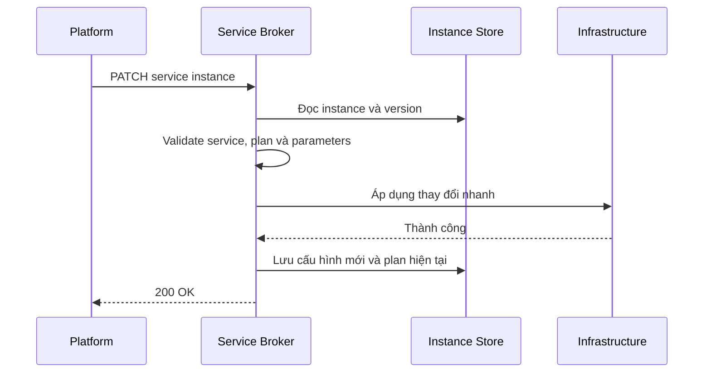
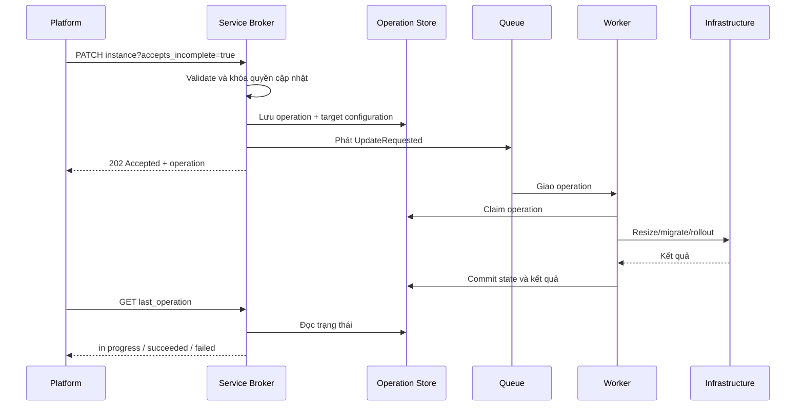

# Cập nhật đồng bộ, bất đồng bộ và kiểm soát thao tác đang diễn ra

Sau khi một service instance được provision, platform có thể yêu cầu thay đổi cấu hình của instance đó. Ví dụ, người dùng tăng dung lượng database, đổi tham số backup hoặc chuyển plan từ `standard` sang `high-availability`. Với Spring Cloud Service Broker, thao tác này đi qua endpoint Update Service Instance của Open Service Broker API (OSB API). Broker cần xác định thay đổi có hợp lệ hay không, có thể hoàn tất ngay hay cần xử lý nền, và phải bảo vệ instance khỏi các cập nhật cạnh tranh.

Một request update có thể chỉ thay đổi parameters, thay đổi plan hoặc kết hợp cả hai. Một số thay đổi chỉ cập nhật metadata nội bộ và hoàn tất nhanh; một số khác phải resize volume, di chuyển dữ liệu, tạo replica hoặc thay đổi topology trên Cloud Foundry/Kubernetes. Vì vậy, thiết kế update cần kết hợp hợp đồng OSB API, trạng thái service instance, operation store, idempotency và cơ chế điều phối concurrency.

## 1. Endpoint và nội dung request update

OSB API sử dụng phương thức `PATCH` cho Update Service Instance:

```http
PATCH /v2/service_instances/{instance_id}?accepts_incomplete=true HTTP/1.1
Content-Type: application/json
X-Broker-API-Version: 2.17
Authorization: Basic <broker-credentials>

{
  "service_id": "postgresql-service-v1",
  "plan_id": "postgresql-high-availability-v1",
  "parameters": {
    "storage_gb": 200,
    "backup_retention_days": 30
  },
  "previous_values": {
    "service_id": "postgresql-service-v1",
    "plan_id": "postgresql-standard-v1",
    "organization_guid": "org-42",
    "space_guid": "space-17"
  }
}
```

Các thành phần chính:

- `instance_id` trong URL xác định service instance mà platform muốn cập nhật.
- `service_id` xác định service definition của instance. Broker phải kiểm tra giá trị này khớp với instance đã lưu.
- `plan_id` có thể được gửi khi platform muốn chọn plan đích. Nếu không có thay đổi plan, platform có thể không cần gửi field này.
- `parameters` chứa các tham số cấu hình mới theo schema và quy ước của service.
- `previous_values` có thể cung cấp một số giá trị trước khi cập nhật, giúp broker xử lý tương thích với các platform gửi thông tin này. Đây là dữ liệu ngữ cảnh của request; trạng thái chuẩn của instance vẫn phải được broker đọc từ kho dữ liệu của mình.
- `accepts_incomplete` cho biết platform có chấp nhận broker xử lý update bất đồng bộ hay không.

Không phải request update nào cũng cần thay đổi `plan_id`. Broker cần phân biệt rõ việc cập nhật parameters trong cùng plan với việc chuyển sang plan khác. Cả hai đều phải được kiểm tra theo khả năng thực tế mà broker công bố và triển khai.

## 2. Kiểm tra khả năng cập nhật trước khi thực thi

Trước khi thay đổi tài nguyên, broker cần xác định request có hợp lệ và có thể áp dụng lên trạng thái hiện tại hay không. Một trình tự kiểm tra phổ biến:

1. Xác thực caller và xác định platform instance/tenant scope.
2. Tìm service instance theo khóa phạm vi, chẳng hạn `(platform_instance_id, service_instance_id)`.
3. Kiểm tra instance tồn tại, thuộc đúng platform và không ở trạng thái đã deprovision.
4. Đối chiếu `service_id` trong request với service ID đã lưu.
5. Nếu request có `plan_id`, kiểm tra service có hỗ trợ plan update và plan đích còn được phép sử dụng.
6. Validate `parameters` theo schema và chính sách của plan đích.
7. Kiểm tra instance không có operation xung đột đang chạy.
8. Xác định update có thể hoàn tất đồng bộ hay cần xử lý bất đồng bộ.

`plan_updateable` trong service definition cho biết broker có hỗ trợ thay đổi plan của instance đã provision hay không. Nếu broker công bố `true`, broker phải thực hiện đúng luồng đổi plan theo OSB API. Nếu chỉ hỗ trợ thay đổi một số parameters trong cùng plan, không được suy ra rằng broker hỗ trợ đổi plan. Năng lực update parameters và năng lực plan update cần được mô hình hóa riêng trong chính sách nội bộ.

Ví dụ kiểm tra:

| Tình huống | Hành động của broker |
|---|---|
| Instance không tồn tại trong platform scope | Trả lỗi không tìm thấy instance |
| `service_id` không khớp instance đã lưu | Từ chối request |
| Plan đích không tồn tại hoặc đã retired | Từ chối request trước khi thay đổi hạ tầng |
| Request đổi plan nhưng service không hỗ trợ plan update | Từ chối theo hợp đồng OSB API |
| Parameters sai schema hoặc vượt quota | Trả lỗi validation, giữ nguyên instance |
| Instance đang có update/deprovision chưa kết thúc | Áp dụng quy tắc concurrency, không chạy hai thao tác xung đột |
| Thay đổi hợp lệ và nhanh | Có thể xử lý đồng bộ |
| Thay đổi hợp lệ nhưng cần chờ hạ tầng | Xử lý async nếu platform chấp nhận |

## 3. Update đồng bộ

Update đồng bộ phù hợp khi broker có thể áp dụng thay đổi trong thời gian ngắn, với dependency phản hồi ổn định. Ví dụ thay đổi một tham số cấu hình trong database đã chạy, cập nhật quota nội bộ hoặc ghi lại cấu hình không cần di chuyển dữ liệu.

Luồng xử lý:



Khi hoàn tất thành công, broker trả `200 OK` theo hợp đồng Update Service Instance. Broker chỉ cập nhật bản ghi hiện tại sau khi thao tác hạ tầng thành công hoặc sau khi đã có một transaction/chiến lược đảm bảo tính nhất quán tương đương. Nếu cập nhật hạ tầng thất bại, broker phải giữ trạng thái cũ hoặc ghi nhận rõ trạng thái cần khôi phục; không báo thành công khi thay đổi mới chưa được áp dụng.

Một response thành công có thể chứa object rỗng nếu không có thông tin bổ sung cần trả về:

```http
HTTP/1.1 200 OK
Content-Type: application/json

{}
```

Không nên kéo dài request đồng bộ chỉ để chờ một dependency không có giới hạn thời gian. Thời gian timeout cần được đặt thấp hơn timeout của các lớp trung gian, đồng thời có phương án async khi thao tác có thể kéo dài.

## 4. Update bất đồng bộ và `accepts_incomplete`

Khi update cần resize volume, di chuyển dữ liệu, tạo replica, thay đổi cấu hình cluster hoặc chờ rollout Kubernetes, broker có thể cần xử lý nền. OSB API cho phép platform gửi `accepts_incomplete=true` để chấp nhận khả năng đó.

Quy tắc xử lý:

- Nếu update hoàn tất đồng bộ, broker trả `200 OK`, kể cả khi request có `accepts_incomplete=true`.
- Nếu broker không thể hoàn tất đồng bộ và platform không chấp nhận async, broker trả `422 Unprocessable Entity` với mã lỗi `AsyncRequired`.
- Nếu broker tiếp nhận update bất đồng bộ, broker trả `202 Accepted` và có thể kèm `operation` để platform truy vấn trạng thái.
- Platform sử dụng endpoint `last_operation` để theo dõi operation cho đến khi `succeeded` hoặc `failed`.

Ví dụ response khi tiếp nhận async:

```http
HTTP/1.1 202 Accepted
Content-Type: application/json
Retry-After: 5

{
  "operation": "update-2026-000145"
}
```

Luồng tổng quát:



Operation phải được ghi bền vững trước khi trả `202`. Nếu broker trả response trước khi lưu operation, platform có thể polling một ID không tồn tại. Nếu broker ghi database và publish queue bằng hai thao tác độc lập, cần Transactional Outbox hoặc cơ chế tương đương để tránh operation bị kẹt vì message không được gửi.

## 5. Theo dõi update bằng `last_operation`

Khi response async chứa operation ID, platform dùng endpoint `last_operation` của service instance để truy vấn tiến độ. Request có thể có dạng:

```http
GET /v2/service_instances/db-prod-17/last_operation?service_id=postgresql-service-v1&plan_id=postgresql-high-availability-v1&operation=update-2026-000145 HTTP/1.1
X-Broker-API-Version: 2.17
```

Broker trả `200 OK` với một trong ba trạng thái OSB:

| `state` | Ý nghĩa | Ví dụ mô tả |
|---|---|---|
| `in progress` | Update vẫn đang chạy hoặc đang chờ retry | `Đang tạo replica và đồng bộ dữ liệu` |
| `succeeded` | Thay đổi đã được áp dụng và trạng thái instance đã commit | `Đã chuyển sang plan high-availability` |
| `failed` | Update kết thúc thất bại | `Không thể giảm dung lượng vì dữ liệu vượt giới hạn plan đích` |

Ví dụ response:

```json
{
  "state": "in progress",
  "description": "Đang rollout cấu hình mới trên cụm Kubernetes"
}
```

`Retry-After` có thể được dùng để gợi ý thời gian platform chờ trước khi polling lại. Broker nên chọn khoảng thời gian phù hợp với thời gian thực thi dự kiến và tải của operation store. Không nên cập nhật `last_operation` bằng dữ liệu giả chỉ để platform thấy tiến độ thay đổi; trạng thái phải phản ánh tiến trình thực tế.

Nếu broker hỗ trợ nhiều loại operation, bản ghi phải cho biết đây là `UPDATE`, đồng thời giữ plan cũ, plan đích và parameters đích. Khi platform polling, broker xác thực operation thuộc đúng platform và service instance trong URL. Operation ID không phải credential và không thay thế kiểm tra quyền.

## 6. Kiểm soát thao tác đang diễn ra

Một service instance không nên nhận nhiều thay đổi hạ tầng xung đột cùng lúc. Ví dụ, nếu update đang giảm storage mà deprovision bắt đầu đồng thời, worker có thể vừa di chuyển dữ liệu vừa xóa volume. Hai request update đồng thời cũng có thể ghi đè cấu hình của nhau.

Broker cần định nghĩa chính sách concurrency theo từng instance. Một cách phổ biến là chỉ cho phép một operation thay đổi trạng thái instance tại một thời điểm. Các thao tác đọc như get instance hoặc last operation có thể tiếp tục hoạt động tùy chính sách, nhưng provision/update/deprovision và binding thay đổi tài nguyên cần được điều phối cẩn thận.

### 6.1. Khóa logic theo service instance

Khi nhận update, broker có thể claim một khóa theo `(platform_instance_id, service_instance_id)`. Việc claim cần được thực hiện nguyên tử trong database, ví dụ bằng optimistic locking, unique constraint trên operation đang hoạt động hoặc transaction có row-level lock.

Mô hình operation có thể gồm:

| Trường | Mục đích |
|---|---|
| `operation_id` | Định danh thao tác do broker tạo |
| `platform_instance_id` | Phạm vi platform |
| `service_instance_id` | Instance bị thay đổi |
| `operation_type` | `UPDATE`, `DEPROVISION`, `PROVISION`... |
| `old_plan_id` | Plan trước khi update |
| `target_plan_id` | Plan đích nếu có đổi plan |
| `target_parameters` | Cấu hình đích đã chuẩn hóa |
| `state` | Trạng thái operation |
| `instance_version` | Version instance lúc operation được tạo |
| `created_at`, `updated_at` | Thời gian phục vụ audit và phục hồi |

Một constraint nội bộ có thể ngăn nhiều operation ở trạng thái hoạt động trên cùng instance. Nếu một request mới đến trong lúc operation cũ đang chạy, broker trả lỗi conflict phù hợp với hợp đồng OSB API hoặc áp dụng chính sách retry/reject đã công bố. Không tự xếp hàng một update mới nếu broker chưa định nghĩa rõ thứ tự và ngữ nghĩa của các thay đổi.

### 6.2. Optimistic locking và phát hiện ghi đè

Với optimistic locking, bảng service instance có trường `version`. Khi bắt đầu update, broker đọc version hiện tại và ghi operation kèm version đó. Khi commit kết quả, broker chỉ cập nhật nếu version chưa đổi:

```sql
UPDATE service_instance
SET plan_id = :target_plan_id,
    configuration = :new_configuration,
    version = version + 1,
    updated_at = CURRENT_TIMESTAMP
WHERE platform_instance_id = :platform_instance_id
  AND service_instance_id = :service_instance_id
  AND version = :expected_version;
```

Nếu số dòng được cập nhật bằng 0, một thao tác khác đã thay đổi instance hoặc version không còn hợp lệ. Broker cần kiểm tra lại trạng thái và không ghi đè kết quả mới bằng dữ liệu cũ. Với JPA, có thể dùng `@Version` để triển khai optimistic locking; vẫn cần xử lý `OptimisticLockException` và phối hợp với trạng thái operation.

### 6.3. Quy tắc khi có operation đang chạy

Broker nên xác định rõ thao tác nào xung đột:

| Operation đang chạy | Request mới | Chính sách thường phù hợp |
|---|---|---|
| `UPDATE` | Một `UPDATE` khác | Từ chối conflict hoặc yêu cầu chờ operation hiện tại |
| `UPDATE` | `DEPROVISION` | Chặn hoặc đưa vào quy trình điều phối rõ ràng; không chạy đồng thời |
| `DEPROVISION` | `UPDATE` | Từ chối vì instance đang được thu hồi |
| `PROVISION` | `UPDATE` | Chờ provision hoàn tất trước khi update |
| `BIND` | `UPDATE` | Đánh giá ảnh hưởng đến credentials và endpoint; serialize nếu có thay đổi không tương thích |
| `UPDATE` | `GET last_operation` | Cho phép đọc trạng thái nếu caller có quyền |

Không phải mọi thao tác đều phải khóa toàn bộ instance. Ví dụ một binding độc lập có thể được tạo song song với một thay đổi metadata không ảnh hưởng kết nối. Tuy nhiên, nếu update làm đổi endpoint hoặc credential, broker phải đảm bảo binding cũ không bị trả về thông tin lỗi thời và không tạo binding mới dựa trên cấu hình đang chuyển đổi dở.

## 7. Idempotency khi platform gửi lại update

Platform có thể retry request khi timeout hoặc mất response. Broker cần phân biệt retry của cùng một ý định với một yêu cầu update mới. Request identity, nếu có, chỉ phục vụ đối chiếu request và không nên tự động được xem là idempotency key vì mỗi lần retry có thể có ID khác.

Một chiến lược idempotency có thể dựa trên:

- Khóa service instance trong phạm vi platform.
- Plan hiện tại và plan đích.
- Parameters sau khi chuẩn hóa.
- Operation đang hoạt động hoặc operation đã hoàn tất gần nhất.
- Phiên bản instance và trạng thái hạ tầng.

Khi request lặp có cùng dữ liệu và operation trước đó đang chạy, broker có thể trả lại kết quả/operation tương ứng theo quy tắc OSB API và cách framework xử lý. Nếu operation đã thành công và instance đã ở trạng thái đích, broker nên trả kết quả tương thích thay vì thực hiện lại migration. Nếu request mới đưa ra parameters khác, broker cần xác định đây là thay đổi mới và kiểm tra concurrency trước khi thực thi.

Worker cũng phải idempotent. Ví dụ, trước khi tạo replica, worker kiểm tra replica đã được tạo cho operation này chưa; trước khi resize volume, worker truy vấn dung lượng thực tế; trước khi ghi `succeeded`, worker xác nhận hạ tầng đã đạt trạng thái mong muốn. Những kiểm tra này giúp worker tiếp tục an toàn sau crash hoặc khi queue giao message trùng.

## 8. Triển khai luồng update trong Spring Cloud

Spring Cloud Open Service Broker cung cấp các model request/response và extension point cho thao tác update service instance. Ứng dụng triển khai logic nghiệp vụ trong service xử lý update mà framework gọi từ endpoint OSB. Tùy phiên bản và kiểu ứng dụng, có thể dùng API đồng bộ hoặc reactive/asynchronous; cần đối chiếu dependency thực tế để chọn đúng interface và kiểu trả về.

Nên tách các trách nhiệm:

- **Update request adapter:** nhận request OSB, lấy instance ID, service ID, plan ID, parameters, previous values và `accepts_incomplete`.
- **Update validator:** kiểm tra quyền, schema, plan, quota và trạng thái hiện tại.
- **Update coordinator:** quyết định đồng bộ hay async, claim instance và tạo operation.
- **Infrastructure updater:** áp dụng resize, migration, thay đổi cấu hình hoặc rollout.
- **Operation service:** lưu trạng thái, retry, kết quả và phục vụ `last_operation`.

Ví dụ domain service minh họa:

```java
public record UpdateCommand(
        String platformInstanceId,
        String serviceInstanceId,
        String serviceId,
        String targetPlanId,
        Map<String, Object> parameters,
        long expectedVersion
) {}

public sealed interface UpdateOutcome {
    record Completed(long newVersion) implements UpdateOutcome {}
    record Accepted(String operationId) implements UpdateOutcome {}
}
```

Điều phối có thể được viết theo hướng sau:

```java
@Service
public class ServiceInstanceUpdateCoordinator {

    private final UpdateValidator validator;
    private final InfrastructureUpdater updater;
    private final OperationService operations;

    public ServiceInstanceUpdateCoordinator(
            UpdateValidator validator,
            InfrastructureUpdater updater,
            OperationService operations) {
        this.validator = validator;
        this.updater = updater;
        this.operations = operations;
    }

    public UpdateOutcome update(UpdateCommand command, boolean acceptsIncomplete) {
        UpdatePlan plan = validator.validateAndPlan(command);

        if (plan.canCompleteSynchronously()) {
            return new UpdateOutcome.Completed(
                    updater.applySynchronously(plan));
        }

        if (!acceptsIncomplete) {
            throw new AsyncRequiredException();
        }

        String operationId = operations.acceptUpdate(plan);
        return new UpdateOutcome.Accepted(operationId);
    }
}
```

Đây là mô hình domain minh họa, không phải chữ ký interface cố định của Spring Cloud Open Service Broker. Khi tích hợp, adapter phải chuyển `Completed` thành response update đồng bộ, `Accepted` thành `202` cùng operation và `AsyncRequiredException` thành lỗi OSB `422 AsyncRequired`. Việc claim instance và ghi operation cần nằm trong transaction hoặc cơ chế nhất quán tương đương để hai request không cùng vượt qua validator rồi chạy song song.

### 8.1. Ghi operation và outbox trong cùng transaction

Với update bất đồng bộ, broker nên ghi operation, trạng thái instance (ví dụ `UPDATING`) và outbox event trong cùng transaction. Publisher gửi event đến queue sau commit. Worker claim operation, gọi infrastructure updater và chỉ commit `plan_id`, parameters hoặc revision mới khi việc thay đổi đã thành công.

Nếu worker thất bại, operation có thể được retry khi lỗi tạm thời hoặc chuyển `failed` khi lỗi không thể khắc phục. Nếu đã áp dụng một phần thay đổi, broker cần compensation hoặc ghi nhận trạng thái cần can thiệp; không được đơn giản đánh dấu instance vẫn hoàn toàn ở trạng thái cũ nếu hạ tầng đã thay đổi một phần.

### 8.2. Giữ trạng thái instance nhất quán

Có thể dùng các trạng thái nội bộ như `READY`, `UPDATING`, `UPDATE_FAILED`, `DEPROVISIONING` hoặc `DEPROVISIONED`. Đây là trạng thái riêng của broker, không phải các giá trị `state` mà OSB `last_operation` trả về. Khi ánh xạ ra OSB, một operation đang chạy trả `in progress`, hoàn tất trả `succeeded` và thất bại trả `failed`.

Nếu update thành công, instance chuyển về `READY` với cấu hình đích. Nếu update thất bại nhưng rollback hoàn tất, instance có thể trở về `READY` với cấu hình cũ. Nếu rollback thất bại hoặc trạng thái hạ tầng chưa xác định, instance cần ở trạng thái nội bộ yêu cầu phục hồi; broker nên chặn các thao tác thay đổi xung đột cho đến khi có kết quả rõ ràng.

## 9. Bảo mật và audit cho update

Update có thể làm thay đổi tài nguyên đắt tiền hoặc ảnh hưởng đến dữ liệu production. Broker cần:

- Xác thực caller và kiểm tra quyền trên đúng platform instance và service instance.
- Validate plan/parameters theo schema; không cho phép người dùng tự chọn field nội bộ như resource ID, tenant scope hoặc trạng thái operation.
- Kiểm tra quota, capability và chính sách chuyển đổi trước khi gọi control plane.
- Không ghi secret hoặc password trong request parameters vào log, event queue hoặc error response.
- Ghi audit ai thực hiện thay đổi khi có originating identity, plan cũ, plan đích, thời điểm và operation ID.
- Không xem `previous_values` là nguồn dữ liệu đáng tin để cấp quyền hoặc thay thế trạng thái broker đã lưu.
- Giới hạn endpoint `last_operation` theo quyền sở hữu; operation ID không phải bí mật xác thực.

Audit nên giúp trả lời: ai yêu cầu thay đổi, instance nào bị ảnh hưởng, thay đổi từ cấu hình nào sang cấu hình nào, ai/worker nào thực thi và kết quả cuối cùng ra sao. Các trường nhạy cảm cần được mask hoặc loại bỏ.

## 10. Kiểm thử update và concurrency

Các kiểm thử tích hợp nên bao phủ:

1. Update parameters trong cùng plan hoàn tất đồng bộ và trả `200 OK`.
2. Update plan hợp lệ khi service công bố `plan_updateable=true`.
3. Request đổi plan khi khả năng này không được hỗ trợ bị từ chối mà không thay đổi instance.
4. Update cần migration với `accepts_incomplete=true` trả `202` sau khi operation và outbox được lưu.
5. Update cần async nhưng thiếu `accepts_incomplete=true` trả `422 AsyncRequired`.
6. Poll `last_operation` phản ánh đúng `in progress`, `succeeded` và `failed`.
7. Hai request update đồng thời trên cùng instance không thể cùng commit hoặc chạy migration xung đột.
8. Update và deprovision đồng thời tuân theo chính sách serialization/conflict đã định nghĩa.
9. Optimistic locking phát hiện version cũ và không ghi đè cấu hình mới hơn.
10. Retry cùng một update không tạo nhiều replica, volume hoặc migration.
11. Worker bị dừng giữa chừng có thể tiếp tục hoặc compensation mà không làm sai trạng thái instance.
12. Request có `previous_values` cũ vẫn được kiểm tra dựa trên trạng thái broker thực tế.
13. Caller từ platform khác không thể cập nhật instance hoặc đọc operation ngoài phạm vi của mình.
14. Secret trong parameters không xuất hiện trong log, message payload hoặc response lỗi.

## 11. Lỗi thường gặp và cách khắc phục

| Lỗi | Hậu quả | Cách khắc phục |
|---|---|---|
| Coi mọi update đều là đổi plan | Từ chối nhầm việc cập nhật parameters | Phân biệt update parameters và plan update |
| Công bố `plan_updateable=true` nhưng không hỗ trợ PATCH | Platform gửi yêu cầu mà broker không xử lý được | Chỉ công bố capability đã triển khai |
| Trả `202` khi platform không chấp nhận async | Vi phạm hợp đồng OSB API | Trả `422 AsyncRequired` khi bắt buộc phải chạy nền |
| Trả `202` trước khi lưu operation | Platform polling không tìm thấy thao tác | Commit operation và outbox trước response |
| Cho hai update chạy cùng instance | Thay đổi ghi đè hoặc hạ tầng ở trạng thái không nhất quán | Khóa logic, optimistic locking và conflict policy |
| Commit plan đích trước khi migration xong | Database broker lệch với hạ tầng | Chỉ commit trạng thái đích sau khi xác nhận thành công |
| Dùng `previous_values` thay dữ liệu lưu | Client có thể gửi giá trị cũ hoặc giả mạo | Đọc trạng thái chuẩn từ instance store |
| Worker retry không idempotent | Tạo nhiều tài nguyên hoặc áp dụng thay đổi lặp | Tra cứu resource, dùng operation key và kiểm tra trạng thái |
| Không điều phối update với deprovision | Có thể vừa resize vừa xóa tài nguyên | Serialize thao tác thay đổi xung đột |
| Trả lỗi kỹ thuật chi tiết ra platform | Lộ topology hoặc thông tin nội bộ | Trả lỗi đã chuẩn hóa, giữ chi tiết trong log bảo vệ |

## 12. Kết luận

Update Service Instance cho phép platform thay đổi parameters hoặc plan của tài nguyên đã provision. Broker nên xử lý đồng bộ khi thay đổi ngắn và ổn định; khi cần migration hoặc chờ hạ tầng, chỉ tiếp nhận async nếu platform gửi `accepts_incomplete=true`, lưu operation bền vững rồi trả `202` để platform polling `last_operation`. Mỗi instance cần có cơ chế kiểm soát concurrency, idempotency và version để ngăn update cạnh tranh với update hoặc deprovision. Khi triển khai bằng Spring Cloud Service Broker, hãy tách validation, coordinator, infrastructure updater và operation service; chỉ commit cấu hình đích khi hạ tầng đã đạt trạng thái mong muốn và luôn giữ khả năng phục hồi cho operation đang chạy.
