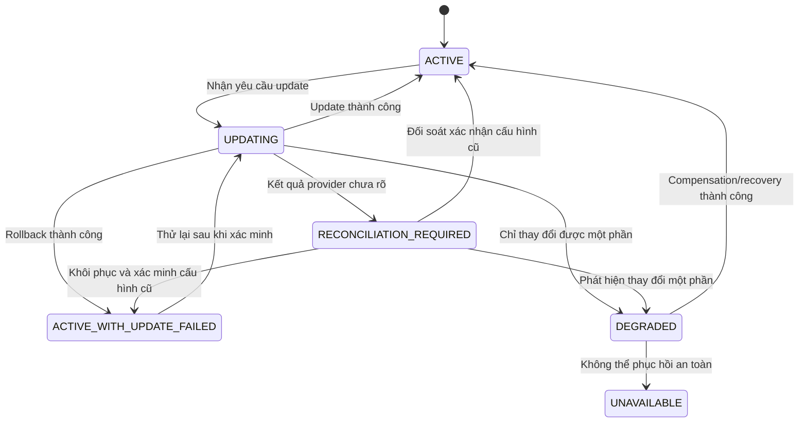
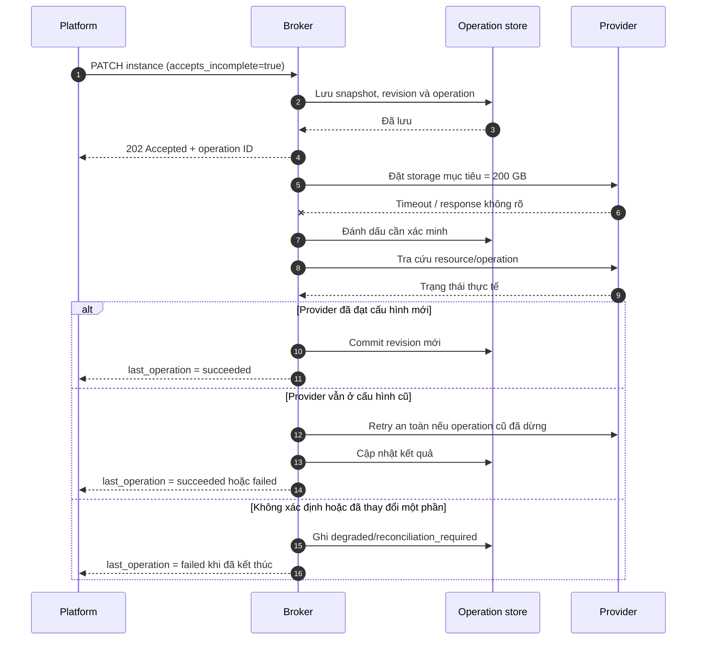

# Thất bại khi cập nhật: khả năng tiếp tục sử dụng và thử lại

Update cho phép nền tảng yêu cầu service broker thay đổi cấu hình hoặc plan của một service instance đang tồn tại. Ví dụ, một ứng dụng cần tăng dung lượng PostgreSQL, nâng plan để có thêm kết nối, hoặc thay đổi chính sách backup. Tuy nhiên, thao tác cập nhật có thể thất bại giữa chừng vì provider timeout, hết capacity, lỗi xác thực, xung đột phiên bản hoặc một bước chuyển đổi không hoàn tất.

Khi update thất bại, broker cần trả lời được hai câu hỏi quan trọng: **instance hiện tại còn sử dụng được không, và request có thể được thử lại an toàn không?** Không thể mặc định rằng một response lỗi đồng nghĩa tài nguyên đã quay về nguyên trạng. Một thao tác có thể đã thay đổi một phần cấu hình ở provider trước khi phát sinh lỗi. Vì vậy, broker phải quản lý riêng trạng thái instance và trạng thái operation, xác định mức độ ảnh hưởng tới dịch vụ, lưu lại trạng thái mong muốn, rồi chọn retry, rollback, compensation hoặc reconciliation phù hợp.

Trong module `SPRING_CLOUD_SERVICE_BROKER`, các nguyên tắc này áp dụng cho handler update theo Open Service Broker API (OSB API) được triển khai bằng Spring Cloud Open Service Broker. Mục tiêu là giữ hành vi của broker nhất quán khi platform retry, khi thao tác chạy bất đồng bộ và khi backing service chỉ hoàn tất được một phần công việc.

## Mục tiêu học tập

Sau bài này, bạn có thể:

- Giải thích luồng update instance và dữ liệu mà broker cần kiểm tra trước khi thay đổi.
- Phân biệt trạng thái của instance với trạng thái của operation update.
- Đánh giá liệu instance có thể tiếp tục phục vụ sau khi update thất bại hay cần chuyển sang trạng thái degraded.
- Thiết kế cập nhật có khả năng rollback hoặc compensation khi provider thực hiện một phần.
- Phân loại lỗi có thể retry, lỗi cần người vận hành xử lý và kết quả chưa xác định do timeout.
- Thực hiện retry có giới hạn, có backoff và idempotency.
- Dùng operation tracking và reconciliation để khôi phục trạng thái thực tế.

## 1. Update instance và nơi lỗi có thể xuất hiện

Theo OSB API, nền tảng yêu cầu cập nhật một instance bằng `PATCH /v2/service_instances/{instance_id}`. Request body có thể chứa `service_id`, `plan_id`, `parameters`, `context` và `previous_values` theo hợp đồng API. `previous_values` giúp broker biết một số giá trị trước khi thay đổi; broker vẫn cần đối chiếu với trạng thái đã lưu của chính mình.

Ví dụ, ứng dụng đang sử dụng plan `small` và muốn chuyển lên `standard`:

```http
PATCH /v2/service_instances/instance-123?accepts_incomplete=true HTTP/1.1
X-Broker-API-Version: 2.17
Content-Type: application/json
Authorization: Basic <credentials>

{
  "service_id": "postgres-service",
  "plan_id": "standard-plan",
  "context": {
    "platform": "cloudfoundry",
    "organization_guid": "org-42",
    "space_guid": "space-prod"
  },
  "parameters": {
    "storage_gb": 200,
    "backup_enabled": true
  },
  "previous_values": {
    "service_id": "postgres-service",
    "plan_id": "small-plan"
  }
}
```

Đây là request minh họa; các field cụ thể phải tuân theo phiên bản OSB API và platform mà broker hỗ trợ. Broker cần xác minh instance tồn tại, plan mới thuộc service, thao tác update được hỗ trợ, caller có quyền và các parameters hợp lệ trước khi thay đổi tài nguyên.

### 1.1. Các giai đoạn có thể thất bại

| Giai đoạn | Ví dụ lỗi | Rủi ro |
|---|---|---|
| Nhận và xác minh request | Plan không tồn tại, parameters sai kiểu, caller không có quyền | Chưa có side effect; instance hiện tại thường không bị ảnh hưởng. |
| Kiểm tra điều kiện cập nhật | Provider không hỗ trợ nâng cấp trực tiếp, thiếu capacity | Có thể từ chối trước khi thay đổi tài nguyên. |
| Chuẩn bị thay đổi | Không tạo được snapshot, không cấp được quota bổ sung | Cần giải phóng reservation nếu đã giữ chỗ. |
| Gọi provider | Timeout, mất kết nối hoặc provider trả lỗi | Kết quả có thể chưa xác định; provider có thể đã áp dụng một phần. |
| Chuyển đổi dữ liệu/cấu hình | Migration lỗi, đổi schema không hoàn tất | Ứng dụng có thể bị ảnh hưởng dù instance vẫn đang chạy. |
| Commit trạng thái broker | Provider thành công nhưng database broker không lưu được kết quả | Trạng thái broker và provider không đồng nhất. |
| Hoàn tất operation | Worker bị dừng hoặc mất lease | Operation có thể bị treo hoặc chạy lại. |

Điểm quan trọng là xác định lỗi xảy ra trước hay sau side effect. Nếu validation thất bại trước khi gọi provider, broker có thể giữ nguyên instance một cách đơn giản. Nếu provider đã nhận lệnh, broker cần xác minh trạng thái thực tế trước khi quyết định retry hoặc trả lời rằng instance vẫn an toàn để sử dụng.

## 2. Phân biệt trạng thái instance và trạng thái operation

Một instance có thể vẫn phục vụ ứng dụng dù operation update mới nhất đã thất bại. Ngược lại, operation có thể đã kết thúc với trạng thái `failed` nhưng instance đã bị thay đổi một phần và không còn an toàn để tiếp tục sử dụng. Vì vậy, không dùng một field trạng thái duy nhất để biểu diễn cả hai khái niệm.

### 2.1. Trạng thái operation theo OSB API

Với thao tác bất đồng bộ, broker trả `202 Accepted` và có thể kèm `operation`. Platform gọi `last_operation` để nhận trạng thái. Các trạng thái giao thức phổ biến là:

| Trạng thái | Ý nghĩa |
|---|---|
| `in progress` | Broker vẫn đang xử lý update hoặc đang xác minh kết quả. |
| `succeeded` | Update đã hoàn tất theo cam kết của broker. |
| `failed` | Operation đã kết thúc nhưng không hoàn thành thành công. |

`failed` mô tả kết quả operation. Nó không tự khẳng định instance đã bị dừng, đã rollback hoặc không còn dùng được. Platform có thể hiển thị lỗi update, còn broker cần cung cấp một trạng thái nội bộ riêng để biết tài nguyên có an toàn hay không.

### 2.2. Trạng thái nội bộ của instance

Một mô hình nội bộ có thể gồm:

| Trạng thái | Ý nghĩa vận hành |
|---|---|
| `ACTIVE` | Instance đang ở cấu hình đã xác nhận và có thể phục vụ. |
| `UPDATING` | Một operation đang thay đổi instance; khả năng sử dụng phụ thuộc chiến lược update. |
| `ACTIVE_WITH_UPDATE_FAILED` | Update thất bại nhưng cấu hình cũ đã được xác minh vẫn hoạt động. |
| `DEGRADED` | Một phần tài nguyên hoặc cấu hình đã thay đổi; dịch vụ có thể vẫn chạy nhưng không đáp ứng đầy đủ cam kết. |
| `RECONCILIATION_REQUIRED` | Broker chưa xác định chắc trạng thái provider hoặc cần đối soát trước thao tác tiếp theo. |
| `UNAVAILABLE` | Instance không thể phục vụ an toàn hoặc đã mất khả năng truy cập. |

Đây là các trạng thái nội bộ minh họa, không phải giá trị `state` mà broker trả trực tiếp trong `last_operation`. Broker ánh xạ trạng thái operation sang OSB API, đồng thời giữ trạng thái instance trong kho dữ liệu để quyết định có cho phép bind, update tiếp, deprovision hoặc thực hiện recovery hay không.

### 2.3. Luồng trạng thái tham khảo



Không nhất thiết phải dùng đúng tên trạng thái trên. Điều cần giữ là broker không được đánh dấu instance `ACTIVE` chỉ vì operation đã kết thúc; phải có bằng chứng cấu hình thực tế đáp ứng điều kiện sử dụng.

## 3. Instance có thể tiếp tục sử dụng sau khi update thất bại không?

Khả năng tiếp tục sử dụng phụ thuộc loại thay đổi, cách provider thực hiện và mức độ hoàn thành của operation. Broker cần đánh giá dựa trên trạng thái thực tế, không chỉ dựa vào exception hoặc HTTP status.

### 3.1. Thất bại trước khi có side effect

Ví dụ plan mới không tồn tại, tham số vượt giới hạn hoặc caller không có quyền. Provider chưa được gọi nên cấu hình hiện tại không bị thay đổi. Broker có thể giữ instance ở `ACTIVE`, trả lỗi đồng bộ và cho phép người dùng sửa request rồi gửi lại.

### 3.2. Thất bại khi chuẩn bị thay đổi

Ví dụ broker giữ chỗ quota mới nhưng không tạo được snapshot. Nếu chưa thay đổi tài nguyên, broker cần giải phóng reservation và xác nhận instance vẫn ở cấu hình cũ. Sau khi kiểm tra hoàn tất, instance có thể tiếp tục ở trạng thái `ACTIVE`.

### 3.3. Thất bại giữa lúc provider đang cập nhật

Ví dụ provider đã tăng dung lượng volume nhưng bước đổi cấu hình database thất bại. Instance có thể vẫn truy cập được, nhưng tài nguyên thực tế đã khác cấu hình broker lưu. Broker cần tra cứu provider và xác định các bước đã hoàn tất. Nếu có thể bù trừ an toàn, broker thực hiện compensation rồi xác minh cấu hình cũ. Nếu không thể khôi phục, instance phải được đánh dấu `DEGRADED` hoặc `RECONCILIATION_REQUIRED`.

### 3.4. Thất bại sau khi provider thành công

Ví dụ provider đã chuyển plan nhưng broker bị dừng trước khi ghi `plan_id` mới vào database. Nếu platform retry và broker dựa trên bản ghi cũ, nó có thể thực hiện chuyển đổi lần nữa. Broker cần tra cứu provider hoặc operation ledger để xác nhận plan thực tế, sau đó đồng bộ bản ghi nội bộ. Không gửi lại lệnh thay đổi chỉ vì transaction lưu trạng thái broker bị lỗi.

### 3.5. Khi nào phải tạm ngừng sử dụng?

Broker nên hạn chế thao tác tiếp theo nếu chưa xác định được trạng thái tài nguyên, nếu schema/data migration đang ở trạng thái không tương thích, nếu credentials hoặc endpoint đã thay đổi nhưng chưa đồng bộ, hoặc nếu provider báo instance không còn sẵn sàng. Có thể vẫn cho phép các thao tác đọc/truy xuất trạng thái để chẩn đoán, nhưng cần chặn update tiếp theo hoặc các thao tác có thể làm tình hình phức tạp hơn cho đến khi reconciliation hoàn tất.

## 4. Thiết kế update để giảm downtime và giữ cấu hình cũ

Khả năng tiếp tục sử dụng nên được xem xét từ lúc thiết kế quy trình update, thay vì chỉ xử lý sau khi có lỗi.

### 4.1. Validate trước, thay đổi sau

Trước khi gọi provider, broker cần kiểm tra service/plan, khả năng update, parameters, quota bổ sung, quyền tenant, maintenance window và trạng thái instance. Những lỗi có thể phát hiện sớm nên được trả về trước side effect.

Broker cũng cần lưu snapshot cấu hình hiện tại hoặc ít nhất các thông tin đủ để xác định trạng thái trước update: plan, parameters đã chuẩn hóa, provider resource ID, phiên bản cấu hình và operation gần nhất. `previous_values` trong request giúp hiểu ý định chuyển đổi, nhưng không thay thế bản ghi trạng thái đáng tin cậy của broker.

### 4.2. Ưu tiên thay đổi tương thích ngược

Khi thay đổi cấu hình, nên ưu tiên trình tự mở rộng rồi mới thu hẹp (expand-and-contract):

1. Thêm cấu trúc hoặc capacity mới mà phiên bản ứng dụng hiện tại vẫn tương thích.
2. Chuyển ứng dụng hoặc workload sang sử dụng phần mới.
3. Xác minh hoạt động ổn định.
4. Chỉ sau đó mới loại bỏ cấu trúc cũ nếu không còn consumer phụ thuộc.

Ví dụ migration database có thể thêm cột mới, ghi đồng thời vào cấu trúc cũ và mới trong giai đoạn chuyển tiếp, rồi mới xóa cột cũ ở một lần cập nhật riêng. Cách làm này giảm rủi ro một migration thất bại khiến ứng dụng cũ không đọc được dữ liệu.

### 4.3. Blue-green hoặc thay thế song song

Với thay đổi lớn, broker có thể tạo tài nguyên mới song song với tài nguyên cũ, đồng bộ dữ liệu, kiểm tra health rồi chuyển endpoint hoặc route. Nếu kiểm tra thất bại trước khi chuyển traffic, ứng dụng tiếp tục dùng tài nguyên cũ. Nếu chuyển traffic thất bại, broker có thể đưa route về endpoint cũ nếu điều đó an toàn.

Chiến lược này tăng chi phí tạm thời và không phù hợp với mọi loại backing service. Cần đánh giá khả năng replication, consistency, thời gian đồng bộ và cách xử lý ghi đồng thời. Không nên tuyên bố update zero-downtime nếu provider hoặc loại dữ liệu không hỗ trợ.

### 4.4. Maintenance window và thông báo downtime

Một số update bắt buộc restart, failover hoặc khóa tài nguyên. Catalog/plan và tài liệu broker nên mô tả các giới hạn này. Broker cần phối hợp maintenance window nếu platform và API hỗ trợ, cung cấp trạng thái operation rõ ràng và chỉ báo `succeeded` sau khi health check xác nhận instance hoạt động trở lại.

## 5. Rollback và compensation khi update chỉ thành công một phần

Rollback thường có nghĩa đưa hệ thống trở lại trạng thái trước đó. Với tài nguyên bên ngoài, không phải thao tác nào cũng có thể đảo ngược. Compensation là một hành động mới nhằm giảm hoặc bù tác động của bước đã hoàn thành, ví dụ xóa resource mới, chuyển traffic về resource cũ hoặc khôi phục cấu hình đã lưu.

### 5.1. Lập kế hoạch các bước update

Giả sử nâng cấp một service gồm các bước:

| Bước | Hành động | Compensation có thể có |
|---|---|---|
| 1 | Giữ chỗ quota mới | Giải phóng reservation. |
| 2 | Tăng storage volume | Giữ nguyên dung lượng tăng thêm nếu giảm lại không an toàn; ghi nhận cấu hình thực tế. |
| 3 | Cập nhật cấu hình database | Khôi phục cấu hình trước nếu provider hỗ trợ. |
| 4 | Cập nhật endpoint/credentials | Chuyển lại endpoint cũ hoặc duy trì cả hai trong giai đoạn chuyển tiếp. |
| 5 | Ghi plan mới vào broker | Chỉ commit sau khi provider và health check đạt yêu cầu. |

Không phải compensation nào cũng là thao tác ngược chính xác. Giảm dung lượng storage sau khi đã ghi dữ liệu có thể không khả thi. Trong trường hợp đó, broker có thể giữ phần capacity tăng thêm, đánh dấu instance degraded và yêu cầu một quy trình khắc phục riêng.

### 5.2. Ghi nhận từng bước bền vững

Mỗi bước update nên có trạng thái lưu bền vững, ví dụ `PENDING`, `RUNNING`, `SUCCEEDED`, `FAILED` hoặc `COMPENSATED`. Ghi nhận thời điểm, provider request ID, kết quả cần thiết và lỗi đã được làm sạch. Nếu worker khởi động lại, nó có thể xác định bước nào đã hoàn thành và bước nào cần tiếp tục.

Không lưu secret hoặc toàn bộ response nhạy cảm của provider vào operation ledger. Lưu resource ID và metadata tối thiểu cần thiết để truy vấn lại trạng thái.

### 5.3. Không rollback mù quáng

Nếu timeout khiến broker không biết provider đã thực hiện bước nào, gửi lệnh rollback ngay có thể làm hỏng một thao tác vẫn đang chạy. Trước tiên cần truy vấn operation hoặc tài nguyên ở provider bằng request ID/resource ID ổn định. Chỉ compensation sau khi đã xác định trạng thái đủ chắc chắn.

## 6. Phân loại lỗi và quyết định retry

Không phải lỗi nào cũng nên retry. Một retry phù hợp phải xét nguyên nhân, thời điểm lỗi, side effect đã xảy ra hay chưa và khả năng provider xử lý idempotent.

| Nhóm lỗi | Ví dụ | Hành động phù hợp |
|---|---|---|
| Lỗi request hoặc chính sách | Parameters sai, plan không hỗ trợ update, quota không đủ | Không retry tự động; yêu cầu sửa request hoặc chính sách. |
| Lỗi xác thực/phân quyền | Credential provider hết hạn, caller không có quyền | Dừng retry liên tục; sửa credential hoặc quyền trước khi chạy lại. |
| Lỗi tạm thời có thể xác định | HTTP 429, provider tạm quá tải, lỗi mạng có thể phục hồi | Retry có backoff, jitter và giới hạn; tôn trọng `Retry-After` nếu có. |
| Timeout/kết quả chưa xác định | Request provider timeout sau khi gửi | Tra cứu trạng thái trước; không gửi lại lệnh không idempotent một cách mù quáng. |
| Xung đột đồng thời | Một update khác đang chạy trên cùng instance | Tuần tự hóa hoặc từ chối để client thử lại sau khi operation hiện tại kết thúc. |
| Lỗi không thể đảo ngược | Migration dữ liệu đã áp dụng một phần | Dừng retry tự động, đánh giá compensation và có thể cần can thiệp vận hành. |
| Lỗi lập trình hoặc cấu hình | Mapping sai, thiếu credential cấu hình | Ghi nhận, cảnh báo và sửa nguyên nhân; retry tự động không giải quyết được. |

### 6.1. Retry với backoff và jitter

Khi lỗi được xác định là tạm thời và thao tác có thể retry an toàn, nên dùng exponential backoff với jitter. Ví dụ khoảng chờ tăng dần 1 giây, 2 giây, 4 giây, 8 giây, có thêm độ lệch ngẫu nhiên và giới hạn số lần thử. Các giá trị cụ thể phải theo timeout, SLA và giới hạn rate của provider.

Jitter giúp nhiều worker không cùng retry vào một thời điểm sau khi provider phục hồi. Cần đặt tổng thời gian retry tối đa, giới hạn số lần thử và cơ chế dead-letter/đưa operation vào trạng thái cần xử lý thủ công khi đã hết ngân sách retry.

### 6.2. Tôn trọng Retry-After và rate limit

Nếu provider trả `429 Too Many Requests` hoặc `503 Service Unavailable` kèm `Retry-After`, client nên tôn trọng khoảng thời gian đó. Broker cũng có thể trả `Retry-After` trong response polling OSB để platform không hỏi trạng thái quá dày. Đây là hai hướng giao tiếp khác nhau: một hướng từ provider tới broker, hướng còn lại từ broker tới platform.

### 6.3. Retry cùng operation hay tạo operation mới?

Một request update được platform gửi lại có thể là retry của cùng ý định hoặc một yêu cầu mới. Broker cần phân biệt dựa trên `instance_id`, operation đang chạy, plan/parameters đã chuẩn hóa và trạng thái hiện tại. Nếu cùng yêu cầu đang được xử lý, trả phản hồi nhất quán với operation hiện có. Nếu operation cũ đã thất bại nhưng provider state chưa được đối soát, không bắt đầu operation mới cho đến khi trạng thái đã rõ.

Khi người dùng thay đổi parameters sau một lần thất bại, đó là một ý định cập nhật mới. Broker nên tạo operation mới sau khi kiểm tra lại cấu hình thực tế và bảo đảm không có operation cũ còn chạy.

## 7. Idempotency và chống cập nhật trùng lặp

Update thường có side effect khó đảo ngược. Vì vậy, retry phải có khả năng nhận diện cùng một ý định và tránh áp dụng thay đổi nhiều lần ngoài dự kiến.

### 7.1. Khóa theo instance và phiên bản cấu hình

Broker nên lưu phiên bản cấu hình hoặc revision của instance. Khi bắt đầu update, request được kiểm tra trên revision hiện tại. Nếu một update khác đã thay đổi revision, request cũ không được ghi đè dữ liệu mới một cách âm thầm.

Có thể dùng optimistic locking (`version`), transaction và unique constraint cho operation đang hoạt động theo instance. Mỗi instance chỉ nên có một thao tác update xung đột đang chạy tại một thời điểm, trừ khi hệ thống có thiết kế rõ ràng cho các thay đổi độc lập.

### 7.2. Fingerprint của yêu cầu

Broker có thể tạo fingerprint từ instance ID, service ID, plan ID, parameters đã chuẩn hóa và revision trước update. Fingerprint giúp phát hiện request lặp tương đương. Không đưa secret thô vào fingerprint được ghi log; với dữ liệu nhạy cảm, dùng cơ chế hash/HMAC phù hợp và kiểm soát nơi lưu.

### 7.3. Idempotency ở provider adapter

Nếu provider hỗ trợ idempotency key hoặc operation ID, broker nên truyền khóa ổn định gắn với operation. Nếu provider không hỗ trợ, adapter cần tra cứu tài nguyên trước khi lặp lệnh và thiết kế các bước có thể kiểm tra kết quả sau timeout.

Ví dụ, “đặt storage thành 200 GB” thường có thể được thực hiện idempotent hơn “tăng storage thêm 20 GB”. Lệnh đặt giá trị đích rõ ràng giúp retry không cộng dồn nhiều lần. Khi provider chỉ hỗ trợ thao tác tăng tương đối, broker phải lưu kết quả từng bước và xác minh giá trị thực tế trước khi gọi lại.

## 8. Reconciliation: đối soát trạng thái sau lỗi

Reconciliation là quá trình so sánh trạng thái broker mong muốn với trạng thái thực tế của provider, sau đó đưa chúng về một trạng thái nhất quán. Đây là bước quan trọng khi timeout, worker bị dừng hoặc provider chỉ thực hiện một phần update.

### 8.1. Những gì cần đối chiếu

- Provider resource ID và trạng thái hoạt động.
- Plan/cấu hình thực tế, dung lượng, endpoint và các capability liên quan.
- Operation ID hoặc request ID ở phía provider.
- Revision/cấu hình trước update và cấu hình mong muốn.
- Trạng thái binding/credentials nếu update có ảnh hưởng tới quyền truy cập.
- Reservation quota và các tài nguyên phụ đã tạo.

### 8.2. Kết quả reconciliation

| Kết quả đối soát | Hành động |
|---|---|
| Provider vẫn ở cấu hình cũ | Giữ instance có thể sử dụng; đánh dấu update failed và cho phép retry sau khi kiểm tra điều kiện. |
| Provider đã ở cấu hình mới và health check đạt | Đồng bộ database broker, đánh dấu instance active và operation succeeded nếu đúng ý định ban đầu. |
| Provider ở trạng thái trung gian có thể tiếp tục | Tiếp tục các bước còn thiếu bằng operation idempotent. |
| Provider ở trạng thái trung gian có thể compensation | Thực hiện compensation rồi xác minh lại. |
| Không xác định được hoặc tài nguyên không an toàn | Đánh dấu reconciliation required/degraded, cảnh báo vận hành và hạn chế thao tác xung đột. |

Reconciliation có thể chạy ngay sau lỗi hoặc qua worker định kỳ. Không nên chỉ dựa vào một lần kiểm tra vì trạng thái provider có thể thay đổi trong lúc thao tác còn đang chạy. Cần timeout, lease hoặc cơ chế xác định operation đã dừng trước khi quyết định phục hồi.

## 9. Tích hợp luồng update trong Spring Cloud

Spring Cloud Open Service Broker cung cấp model và extension point cho request update, thường gắn với `UpdateServiceInstanceRequest` và response tương ứng. Tên accessor và cách tạo response phụ thuộc phiên bản thư viện. Phần nghiệp vụ nên được tổ chức thành các bước có thể quan sát và kiểm thử.

Một cấu trúc minh họa:

```java
public Mono<UpdateResult> update(UpdateCommand command) {
    return repository.load(command.instanceId())
            .switchIfEmpty(Mono.error(new InstanceNotFoundException()))
            .flatMap(current -> validator.validate(command, current)
                    .then(operationService.startOrFind(command, current)))
            .flatMap(operation -> updateCoordinator.execute(operation));
}
```

Đây là skeleton minh họa, không phải chữ ký API bắt buộc. Các thành phần có trách nhiệm:

- `repository`: đọc instance, revision và cấu hình đã lưu.
- `validator`: xác minh service/plan, parameters, quyền và điều kiện update.
- `operationService`: tạo operation bền vững hoặc tìm operation tương đương đang chạy.
- `updateCoordinator`: gọi provider, quản lý các bước, compensation và cập nhật kết quả.
- `providerAdapter`: ánh xạ command nghiệp vụ sang API cụ thể của nhà cung cấp.

### 9.1. Ghi trạng thái trước khi trả 202

Nếu update cần chạy nền và request cho phép async, broker phải lưu operation cùng trạng thái ban đầu trước khi trả `202 Accepted`. Sau đó worker mới thực hiện các bước update. Endpoint `last_operation` đọc dữ liệu bền vững và trả `in progress` cho đến khi kết thúc.

Nếu worker gặp lỗi, nó ghi trạng thái operation `failed` cùng kết quả reconciliation. Trạng thái instance có thể trở về `ACTIVE` nếu cấu hình cũ được xác minh, hoặc chuyển sang `DEGRADED`/`RECONCILIATION_REQUIRED` nếu không thể bảo đảm khả năng sử dụng.

### 9.2. Không dùng block để chờ provider

Trong reactive handler, tránh gọi `block()` trên request path. Dùng `Mono`/`Flux` để nối các bước I/O và áp dụng timeout phù hợp. Nếu tích hợp thư viện provider blocking, cô lập nó trên scheduler thích hợp và giới hạn concurrency. Reactive giúp điều phối I/O; nó không tự cung cấp transaction phân tán, rollback hoặc idempotency.

### 9.3. Không để mất operation khi broker restart

Không lưu operation chỉ trong bộ nhớ của JVM. Dùng database hoặc kho lưu trữ bền vững; worker cần lease/claim để tránh nhiều replica cùng thực hiện một operation. Khi process khởi động lại, worker có thể tiếp tục operation còn hiệu lực hoặc đánh dấu cần reconciliation nếu kết quả provider chưa rõ.

## 10. Ví dụ: nâng PostgreSQL plan nhưng provider timeout

Một instance đang chạy plan `small` với 100 GB storage. Người dùng yêu cầu plan `standard` và 200 GB. Broker kiểm tra request hợp lệ, giữ chỗ quota và tạo operation `update-901`. Provider nhận lệnh tăng storage nhưng response bị timeout.

Broker không lập tức gửi lại lệnh tăng thêm 100 GB. Nó thực hiện:

1. Giữ operation ở trạng thái `in progress` trong khoảng thời gian chờ xác minh.
2. Dùng provider operation ID hoặc resource ID để truy vấn trạng thái thực tế.
3. Nếu provider đã tăng lên 200 GB và health check đạt, cập nhật plan/cấu hình trong broker và kết thúc operation `succeeded`.
4. Nếu provider vẫn ở 100 GB và xác nhận thao tác trước đã kết thúc, có thể retry lệnh đặt dung lượng đích 200 GB theo chính sách.
5. Nếu provider ở trạng thái trung gian, đánh dấu `RECONCILIATION_REQUIRED`, tiếp tục kiểm tra hoặc thực hiện compensation phù hợp.
6. Nếu không thể xác minh instance có còn phục vụ hay không, không tuyên bố instance vẫn `ACTIVE`; phát cảnh báo và hạn chế update mới cho đến khi có kết quả.



Sơ đồ cho thấy operation có thể kết thúc `failed` trong khi instance vẫn tiếp tục phục vụ ở cấu hình cũ, miễn là broker đã xác minh điều đó. Nếu kết quả chưa rõ, broker cần tiếp tục reconciliation trước khi khẳng định khả năng sử dụng.

## 11. Quan sát, cảnh báo và thông tin trả về

Khi update thất bại, log và metric cần giúp người vận hành xác định nguyên nhân mà không làm lộ secret.

Nên ghi nhận:

- Instance ID, operation ID, service ID và plan ID.
- Revision trước update và revision mong muốn.
- Bước đang thực hiện, số lần retry và thời gian chờ provider.
- Mã lỗi đã chuẩn hóa, trạng thái provider và kết quả reconciliation.
- Thời gian instance ở trạng thái `UPDATING`, `DEGRADED` hoặc `RECONCILIATION_REQUIRED`.

Không ghi password, token, private key, toàn bộ parameters nếu chúng có thể chứa secret hoặc response provider nguyên vẹn. Dùng correlation ID để nối log giữa broker, worker và provider adapter.

Các metric hữu ích gồm tỷ lệ update thành công/thất bại, số operation đang chạy, thời gian update p50/p95, số lần retry, số instance degraded và tuổi của operation cần reconciliation. Cảnh báo nên kích hoạt khi operation vượt timeout, retry vượt ngân sách hoặc instance ở trạng thái degraded quá lâu.

Thông tin trả qua `last_operation.description` nên ngắn gọn và an toàn, ví dụ “Không thể hoàn tất nâng cấp; instance cũ đã được xác minh vẫn hoạt động” hoặc “Update thất bại; cần kiểm tra trạng thái provider trước khi tiếp tục”. Chỉ dùng thông báo thứ nhất khi broker có bằng chứng cấu hình cũ thực sự hoạt động.

## 12. Kiểm thử các tình huống update thất bại

Không chỉ kiểm thử đường thành công. Cần mô phỏng lỗi ở từng ranh giới để xác minh instance và operation luôn có trạng thái có thể giải thích.

| Tình huống kiểm thử | Kết quả mong đợi |
|---|---|
| Parameters không hợp lệ | Từ chối trước provider call; instance giữ cấu hình cũ. |
| Quota không đủ | Không giữ reservation vĩnh viễn; không thay đổi provider. |
| Provider trả 429/503 | Retry theo backoff và giới hạn; không tạo update đồng thời. |
| Provider timeout sau khi đã nhận lệnh | Tra cứu trạng thái trước khi gửi lại. |
| Provider thay đổi một phần rồi lỗi | Compensation hoặc đánh dấu degraded/reconciliation required. |
| Broker restart sau provider success nhưng trước khi commit | Khôi phục operation, tra cứu provider và đồng bộ trạng thái; không áp dụng lại mù quáng. |
| Hai request update cùng instance đến đồng thời | Một operation được điều phối; request còn lại bị tuần tự hóa hoặc nhận conflict. |
| Platform retry cùng request | Trả kết quả/operation tương đương; không nhân đôi side effect. |
| Rollback thành công | Xác minh cấu hình cũ và health trước khi đánh dấu instance có thể sử dụng. |
| Rollback thất bại | Instance không được đánh dấu active; cảnh báo và reconciliation được kích hoạt. |

Nên kiểm thử cả status code/response OSB API lẫn trạng thái thực tế của instance trong kho dữ liệu và provider giả lập. Với xử lý bất đồng bộ, cần xác minh `last_operation` trả đúng trạng thái cuối và không thay đổi sau khi operation đã kết thúc.

## 13. Checklist quyết định có thể tiếp tục sử dụng và retry hay không

Trước khi cho phép update mới hoặc retry, broker cần trả lời:

- [ ] Operation cũ đã kết thúc hay vẫn có khả năng chạy ở provider?
- [ ] Provider đang ở cấu hình cũ, cấu hình mới hay trạng thái trung gian?
- [ ] Instance có vượt qua health check và còn đáp ứng yêu cầu phục vụ không?
- [ ] Credentials, endpoint, binding và quota có còn nhất quán không?
- [ ] Có thể rollback hoặc compensation an toàn không?
- [ ] Request retry có cùng ý định, cùng revision và có idempotent không?
- [ ] Retry có nằm trong ngân sách, backoff và rate limit không?
- [ ] Trạng thái operation và instance đã được lưu bền vững chưa?
- [ ] Nếu không xác định được trạng thái, instance đã được đánh dấu cần reconciliation và phát cảnh báo chưa?
- [ ] Platform nhận được mô tả lỗi đúng với mức độ chắc chắn về khả năng sử dụng của instance chưa?

## Kết luận

Thất bại khi update không đồng nghĩa instance chắc chắn ngừng hoạt động, cũng không bảo đảm cấu hình cũ tự động được phục hồi. Broker phải phân biệt kết quả operation với trạng thái instance, xác minh provider sau lỗi, và chỉ cho phép tiếp tục sử dụng khi có bằng chứng tài nguyên vẫn đáp ứng điều kiện vận hành. Retry cần có giới hạn và idempotency; rollback/compensation phải dựa trên các bước đã ghi nhận; reconciliation xử lý những trường hợp timeout hoặc thay đổi một phần. Khi kết hợp các cơ chế này trong Spring Cloud Service Broker, platform có thể nhận kết quả update đáng tin cậy và ứng dụng tránh bị gián đoạn ngoài dự kiến.
