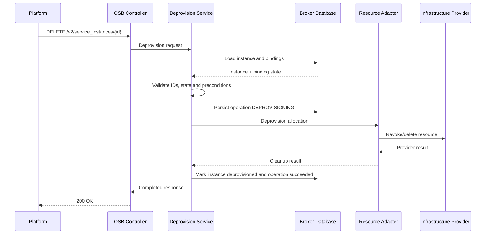
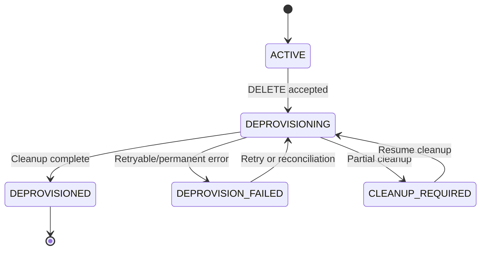
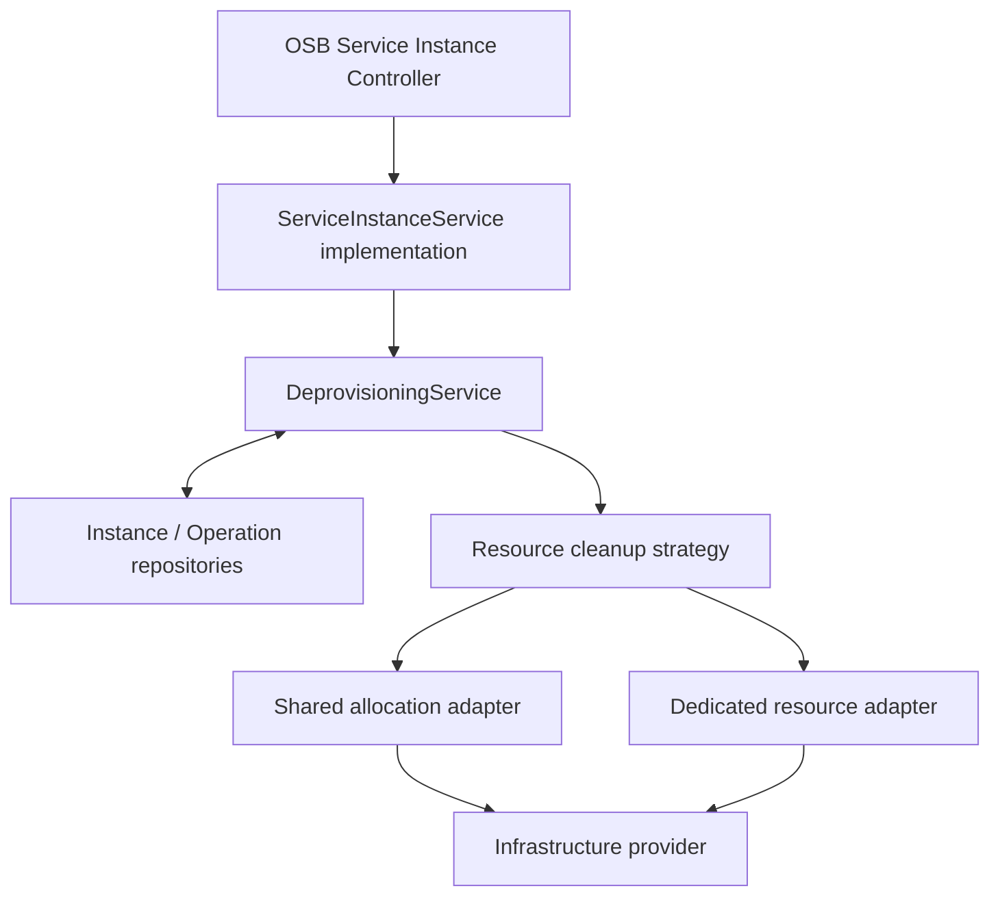

# DELETE /v2/service_instances/{instance_id} và hợp đồng thu hồi

## 1. Vai trò của deprovisioning

Deprovisioning là thao tác yêu cầu service broker thu hồi một service instance đã được cấp phát trước đó. Nền tảng gọi endpoint `DELETE /v2/service_instances/{instance_id}` khi người dùng xóa service, ứng dụng không còn cần tài nguyên hoặc một quy trình quản trị yêu cầu giải phóng instance.

Trong module `SPRING_CLOUD_SERVICE_BROKER`, Spring Cloud Open Service Broker cung cấp các thành phần để triển khai hợp đồng Open Service Broker API (OSB API). Endpoint HTTP tiếp nhận yêu cầu thu hồi; tầng nghiệp vụ của broker phải xác định đúng instance, kiểm tra điều kiện vòng đời, thu hồi tài nguyên ở hệ thống đích và ghi nhận kết quả để nền tảng có thể tiếp tục quản lý trạng thái.

Deprovisioning có ý nghĩa lớn hơn việc xóa một dòng dữ liệu trong database broker. Một instance có thể sở hữu database, schema, bucket, queue, namespace, credential, địa chỉ mạng, snapshot hoặc tài nguyên cloud riêng. Broker phải xử lý đúng những thành phần thuộc instance đó, bảo toàn tài nguyên dùng chung và tuân thủ chính sách dữ liệu đã công bố.

Hợp đồng OSB API chuẩn hóa cách nền tảng yêu cầu thu hồi và cách broker phản hồi. Cách xóa tài nguyên vật lý hoặc logic vẫn là trách nhiệm của broker và adapter kết nối provider.

## 2. Định dạng endpoint và query parameter

Endpoint chuẩn:

```http
DELETE /v2/service_instances/{instance_id}?service_id={service_id}&plan_id={plan_id} HTTP/1.1
Host: broker.example.com
Authorization: Basic <broker-credentials>
X-Broker-API-Version: 2.17
Accept: application/json
```

Trong đó:

| Thành phần | Ý nghĩa |
|---|---|
| `DELETE` | Yêu cầu broker thu hồi service instance. |
| `{instance_id}` | Định danh instance do nền tảng cung cấp khi provisioning và được dùng xuyên suốt vòng đời. |
| `service_id` | ID của service definition mà instance được tạo từ đó. |
| `plan_id` | ID của plan đã được chọn khi tạo instance hoặc plan hiện tại theo trạng thái broker quản lý. |
| `accepts_incomplete` | Query parameter tùy chọn cho biết client có chấp nhận xử lý bất đồng bộ hay không. |
| `operation` | Không phải tham số của DELETE request; broker có thể trả mã operation trong response bất đồng bộ để dùng khi polling last operation. |

`service_id` và `plan_id` được truyền qua query string vì broker cần biết ngữ cảnh service/plan của thao tác. Broker nên đối chiếu chúng với bản ghi instance đã lưu, không dùng chúng để thay thế dữ liệu nội bộ. Nếu request cung cấp ID không khớp, broker phải xử lý như một xung đột hoặc request không hợp lệ theo error model của API.

`accepts_incomplete` mặc định là `false` nếu client không gửi. Khi giá trị là `true`, nền tảng chấp nhận broker xử lý deprovisioning bất đồng bộ. Khi không được chấp nhận bất đồng bộ, broker phải hoàn tất trong request hoặc trả lỗi phù hợp nếu thao tác chỉ có thể thực hiện nền.

Ví dụ request có chấp nhận bất đồng bộ:

```http
DELETE /v2/service_instances/inst-1001?service_id=managed-database&plan_id=standard&accepts_incomplete=true HTTP/1.1
Host: broker.example.com
Authorization: Basic <broker-credentials>
X-Broker-API-Version: 2.17
Accept: application/json
```

Broker phải xác thực client, kiểm tra phiên bản API và áp dụng chính sách truy cập trước khi thực hiện tác động lên tài nguyên. Không ghi `Authorization`, password, token hoặc nội dung nhạy cảm vào log.

## 3. Hợp đồng response của DELETE

Response cho biết broker đã thu hồi xong, đã tiếp nhận thao tác bất đồng bộ hay không thể thực hiện yêu cầu.

| HTTP status | Ý nghĩa | Khi sử dụng |
|---|---|---|
| `200 OK` | Deprovisioning hoàn tất đồng bộ. | Tài nguyên đã được thu hồi hoặc broker đã hoàn thành chính sách thu hồi được yêu cầu. |
| `202 Accepted` | Broker đã nhận thao tác và sẽ hoàn tất bất đồng bộ. | Provider hoặc quy trình cleanup cần thêm thời gian, client đã gửi `accepts_incomplete=true`. |
| `401 Unauthorized` | Request không được xác thực. | Thiếu hoặc sai thông tin xác thực broker client. |
| `404 Not Found` | Endpoint hoặc route không tồn tại. | Đường dẫn không thuộc API được broker cung cấp. |
| `410 Gone` | Instance không còn tồn tại hoặc đã được thu hồi. | Broker không còn instance tương ứng; đây thường là kết quả có thể chấp nhận khi client retry thao tác xóa đã hoàn tất. |
| `422 Unprocessable Entity` | Broker không thể thực hiện deprovisioning theo trạng thái hoặc điều kiện hiện tại. | Ví dụ instance còn binding, request không hợp lệ về nghiệp vụ hoặc cần async nhưng client không chấp nhận. |
| `500 Internal Server Error` | Lỗi không mong đợi trong broker. | Lỗi nội bộ chưa được ánh xạ thành lỗi nghiệp vụ cụ thể. |
| `502` / `503` / `504` | Dependency hoặc gateway gặp lỗi. | Provider không khả dụng, gateway lỗi hoặc request tới hạ tầng bị timeout. |

### 3.1. Deprovisioning đồng bộ

Nếu broker thu hồi hoàn tất trong thời gian xử lý request, broker trả `200 OK`. Response thành công không cần chứa thông tin instance đã xóa. Nền tảng có thể xem thao tác đã hoàn tất và tiếp tục cập nhật trạng thái phía mình.

```http
HTTP/1.1 200 OK
Content-Length: 0
```

Broker chỉ nên trả thành công sau khi đã hoàn tất những bước thu hồi bắt buộc theo hợp đồng dịch vụ. Ví dụ, nếu deprovisioning bao gồm thu hồi database và credential, không được trả `200` chỉ vì đã xóa bản ghi nội bộ trong khi credential vẫn còn hiệu lực.

### 3.2. Deprovisioning bất đồng bộ

Nếu thao tác cần thời gian và request chấp nhận bất đồng bộ, broker trả `202 Accepted`. Response có thể chứa `operation` để xác định thao tác đang chạy.

```http
HTTP/1.1 202 Accepted
Content-Type: application/json

{
  "operation": "deprovision-inst-1001"
}
```

Sau response này, broker chịu trách nhiệm tiếp tục thu hồi tài nguyên. Nền tảng sẽ truy vấn endpoint `last_operation` để biết thao tác đang chạy, thành công hay thất bại. Broker không được coi `202` là dấu hiệu tài nguyên đã bị xóa; đó chỉ là xác nhận đã tiếp nhận công việc.

### 3.3. Khi thao tác bắt buộc bất đồng bộ nhưng client không chấp nhận

Nếu provider chỉ hỗ trợ thao tác xóa dài hoặc broker phải chạy quy trình cleanup nền, nhưng request không có `accepts_incomplete=true`, broker không được tự ý trả `202`. Broker cần trả lỗi `422 Unprocessable Entity` với mã lỗi `AsyncRequired` theo hợp đồng OSB API.

Ví dụ:

```http
HTTP/1.1 422 Unprocessable Entity
Content-Type: application/json

{
  "error": "AsyncRequired",
  "description": "Deprovisioning requires asynchronous processing"
}
```

Thông báo lỗi cần ngắn gọn và không chứa stack trace, provider credential hoặc chi tiết hạ tầng nhạy cảm.

## 4. Điều kiện trước khi thu hồi: binding phải được xử lý

Service instance có thể đang được nhiều ứng dụng hoặc consumer sử dụng thông qua service binding. Binding thường chứa credential, endpoint hoặc quyền truy cập riêng. Theo vòng đời OSB API, nền tảng phải xóa các binding trước khi deprovision instance. Broker cũng cần kiểm tra điều kiện này ở server để bảo vệ dữ liệu khi request đến sai thứ tự.

Luồng vòng đời điển hình:

```mermaid
flowchart TD
    Active[Service instance ACTIVE]
    Bindings{Còn binding hoạt động?}
    Unbind[DELETE service_bindings/{binding_id}]
    Revoke[Thu hồi credential và quyền truy cập]
    Deprovision[DELETE service_instances/{instance_id}]
    Cleanup[Thu hồi tài nguyên instance]
    Deleted[Instance đã thu hồi]
    Active --> Bindings
    Bindings -->|Có| Unbind
    Unbind --> Revoke
    Revoke --> Bindings
    Bindings -->|Không| Deprovision
    Deprovision --> Cleanup --> Deleted
```

Nếu vẫn còn binding, broker nên từ chối deprovisioning với lỗi phù hợp, thường là `422 Unprocessable Entity`, và mô tả rằng instance còn binding cần được gỡ bỏ. Không nên xóa instance rồi để credential của binding tiếp tục truy cập tài nguyên mồ côi.

Khi unbind, broker cần thu hồi credential hoặc quyền truy cập ở hệ thống đích, cập nhật trạng thái binding và chỉ sau đó mới cho phép deprovisioning tiếp tục. Nếu unbind cũng bất đồng bộ, nền tảng phải chờ thao tác unbind hoàn tất trước khi gửi DELETE instance.

## 5. Luồng xử lý deprovisioning trong broker

Một request DELETE cần được xử lý qua các bước nghiệp vụ có thứ tự. Có thể tổ chức luồng như sau:

1. **Xác thực request:** kiểm tra broker client, phiên bản OSB API, `instance_id` và query parameter.
2. **Tải instance:** tìm bản ghi theo `instance_id`; nếu đã thu hồi hoặc không tồn tại, xử lý theo ngữ nghĩa `410 Gone`.
3. **Đối chiếu service và plan:** xác minh `service_id` và `plan_id` phù hợp với bản ghi instance.
4. **Kiểm tra binding:** bảo đảm các binding đã được unbind và credential tương ứng đã bị thu hồi.
5. **Kiểm tra trạng thái:** xác định instance có đang provisioning, updating, deprovisioning hoặc ở trạng thái lỗi cần phục hồi hay không.
6. **Ghi nhận operation:** tạo hoặc tái sử dụng operation deprovision có định danh ổn định và lưu trạng thái trước khi gọi provider.
7. **Thu hồi tài nguyên:** gọi adapter tương ứng để xóa allocation shared hoặc tài nguyên dedicated.
8. **Dọn dữ liệu liên quan:** thu hồi secret, IAM, network rule, metadata, reservation và dependency thuộc instance theo chính sách.
9. **Cập nhật trạng thái:** đánh dấu instance đã thu hồi và operation thành công; giữ lại bản ghi cần thiết để audit hoặc polling.
10. **Trả response:** `200 OK` nếu hoàn tất đồng bộ, `202 Accepted` nếu tiếp tục xử lý nền hoặc lỗi phù hợp nếu không thể thực hiện.



Với xử lý bất đồng bộ, controller trả `202` sau khi operation đã được lưu bền vững và worker tiếp tục các bước gọi adapter. Việc lưu operation trước khi phản hồi giúp broker không mất dấu công việc khi process restart.

## 6. Quản lý trạng thái instance trong quá trình thu hồi

Broker nên có state machine nội bộ để ngăn các thao tác xung đột và giúp khôi phục khi lỗi. Một tập trạng thái minh họa:

| Trạng thái | Ý nghĩa |
|---|---|
| `ACTIVE` | Instance đang được cung cấp và có thể sử dụng. |
| `DEPROVISIONING` | Broker đã tiếp nhận yêu cầu thu hồi và đang dọn tài nguyên. |
| `DEPROVISION_FAILED` | Một hoặc nhiều bước thu hồi thất bại và cần retry hoặc can thiệp. |
| `DEPROVISIONED` | Tài nguyên thuộc instance đã được thu hồi theo chính sách. |
| `CLEANUP_REQUIRED` | Còn tài nguyên phụ hoặc trạng thái chưa đối soát được sau lỗi một phần. |



Không nhất thiết phải trả các trạng thái nội bộ này qua API. Endpoint last operation phải ánh xạ trạng thái về các giá trị OSB API như `in progress`, `succeeded` hoặc `failed`. Ví dụ `DEPROVISIONING` ánh xạ thành `in progress`; `DEPROVISIONED` ánh xạ thành `succeeded`; `DEPROVISION_FAILED` ánh xạ thành `failed` nếu operation đã kết thúc ở trạng thái lỗi.

Không nên chuyển instance sang `DEPROVISIONED` trước khi biết tài nguyên nào đã được thu hồi. Nếu xóa metadata instance quá sớm, broker có thể mất provider resource ID cần thiết để tiếp tục cleanup.

## 7. Xử lý bất đồng bộ và endpoint last_operation

Các thao tác deprovisioning có thể kéo dài vì provider cần xóa database, giải phóng volume, chờ snapshot hoàn tất, thu hồi cluster hoặc cập nhật network. OSB API hỗ trợ mô hình bất đồng bộ qua `accepts_incomplete=true` và endpoint:

```http
GET /v2/service_instances/{instance_id}/last_operation?service_id={service_id}&plan_id={plan_id}&operation={operation} HTTP/1.1
```

Nền tảng dùng `operation` mà broker đã trả trong response `202` để truy vấn đúng thao tác. Response last operation có trường `state`:

```json
{
  "state": "in progress",
  "description": "Đang thu hồi database instance"
}
```

Khi hoàn tất:

```json
{
  "state": "succeeded",
  "description": "Tài nguyên đã được thu hồi"
}
```

Nếu thất bại:

```json
{
  "state": "failed",
  "description": "Provider từ chối thao tác xóa; cần thử lại"
}
```

Một điểm quan trọng là instance có thể đã bị xóa khỏi bảng nghiệp vụ trong khi nền tảng vẫn đang polling last operation. Vì vậy, không nên phụ thuộc hoàn toàn vào bản ghi instance để trả trạng thái operation. Hãy lưu operation độc lập hoặc giữ một tombstone đủ thông tin cho đến khi polling và thời gian lưu trữ theo chính sách hoàn tất.

Operation record nên chứa operation ID, instance ID, loại thao tác, trạng thái, thời điểm bắt đầu/kết thúc, số lần retry và mô tả lỗi đã được làm sạch. Bản ghi này cần được chia sẻ giữa các replica để request polling đến bất kỳ replica nào cũng nhận cùng trạng thái.

## 8. Idempotency khi nền tảng retry DELETE

Nền tảng có thể gửi lại DELETE nếu response bị mất, client timeout hoặc kết nối bị ngắt. Provider cũng có thể đã xóa xong tài nguyên trước khi broker nhận được response. Do đó, deprovisioning phải có tính idempotent.

Các nguyên tắc:

- Cùng một `instance_id` không được tạo ra nhiều operation xóa độc lập gây tác dụng phụ.
- Nếu instance đang `DEPROVISIONING`, request lặp nên tham chiếu hoặc trả kết quả nhất quán với operation hiện tại.
- Nếu instance đã `DEPROVISIONED`, broker xử lý theo ngữ nghĩa tài nguyên đã gone; không gọi provider xóa một tài nguyên mới chỉ vì ID được retry.
- Nếu provider trả “resource not found” cho một tài nguyên đã được broker xác định thuộc instance và trạng thái đó đồng nghĩa đã xóa, có thể coi bước xóa là hoàn tất.
- Nếu cùng `instance_id` nhưng `service_id` hoặc `plan_id` mâu thuẫn, không được bỏ qua kiểm tra và xóa tài nguyên theo ID không đáng tin cậy.
- Ghi operation và ý định thu hồi bền vững trước khi gọi provider.
- Dùng idempotency key hoặc provider resource tag để tra cứu kết quả của lần gọi trước khi thử lại.

`410 Gone` có ý nghĩa hữu ích trong retry: nó cho biết instance không còn tồn tại. Client có thể coi mục tiêu xóa đã đạt được, nhưng broker vẫn phải bảo đảm không còn tài nguyên hoặc credential bị bỏ sót do một lần cleanup dở dang. Nếu broker còn cleanup pending, trạng thái đó phải được theo dõi nội bộ và không bị xóa khỏi hệ thống vận hành chỉ vì API đã phản hồi gone.

## 9. Thu hồi tài nguyên theo mô hình shared và dedicated

Deprovisioning phải dựa trên loại allocation mà broker đã lưu khi provisioning. Không nên suy đoán strategy từ tên instance hoặc tham số DELETE.

### 9.1. Shared resource

Với shared resource, mỗi instance thường sở hữu một allocation logic trong pool dùng chung. Khi deprovision, broker thu hồi allocation đó:

- Xóa database/schema, role, bucket, queue, topic hoặc namespace riêng của instance.
- Thu hồi credential, ACL, policy và network rule gắn với allocation.
- Giải phóng quota hoặc reservation của instance.
- Cập nhật allocation thành `RELEASED` và lưu dấu vết audit.
- Giữ nguyên shared pool nếu còn instance khác đang sử dụng.

Ví dụ, nếu ba service instance dùng chung một PostgreSQL cluster nhưng mỗi instance có database và role riêng, deprovision instance A chỉ xóa database A và role A. Không được xóa cluster hoặc thu hồi role quản trị được các instance khác phụ thuộc.

### 9.2. Dedicated resource

Với dedicated resource, broker thu hồi tài nguyên riêng được ánh xạ tới instance:

- Tra cứu provider resource ID từ allocation record.
- Kiểm tra tag hoặc quan hệ sở hữu để chắc chắn tài nguyên thuộc instance đang xóa.
- Thu hồi endpoint, credential, IAM, network attachment và tài nguyên phụ.
- Gọi provider delete API và theo dõi trạng thái cho đến khi tài nguyên thực sự được giải phóng.
- Xử lý snapshot, backup hoặc retention theo chính sách đã cam kết.

Nếu provider timeout, broker phải tra cứu lại trạng thái tài nguyên trước khi gửi lệnh xóa tiếp. Timeout không chứng minh provider chưa thực hiện thao tác; retry thiếu kiểm soát có thể xóa nhầm tài nguyên được tạo sau đó hoặc gây xung đột operation.

## 10. Chính sách dữ liệu, backup và retention

Thu hồi service instance có thể làm mất dữ liệu người dùng. Broker cần xác định và công bố rõ chính sách dữ liệu cho từng service/plan, bao gồm:

- Dữ liệu chính có bị xóa ngay khi deprovision hay được giữ trong thời gian ân hạn.
- Snapshot và backup có được giữ lại hay bị xóa cùng instance.
- Có hỗ trợ export dữ liệu trước khi xóa hay không.
- Thời hạn retention, quy trình xóa cuối cùng và điều kiện khôi phục.
- Ai có quyền yêu cầu giữ lại dữ liệu hoặc thực hiện thao tác xóa khẩn cấp.

OSB API không tự định nghĩa chính sách backup/retention của từng dịch vụ. Đây là cam kết sản phẩm mà broker phải thực hiện nhất quán với mô tả service, plan, điều khoản vận hành và yêu cầu tuân thủ.

Nếu dữ liệu được giữ lại sau khi instance bị deprovision, broker phải quản lý snapshot hoặc archive như một tài nguyên có vòng đời riêng. Không nên để bản backup không có owner, không có thời hạn hoặc không có cơ chế xóa cuối cùng. Nếu chính sách yêu cầu xóa hoàn toàn, cần xử lý cả replica, snapshot, backup, cache, encryption key và bản sao do provider quản lý trong phạm vi broker kiểm soát.

## 11. Xử lý lỗi một phần và reconciliation

Một thao tác deprovision có thể gồm nhiều bước: thu hồi binding, xóa database, xóa credential, xóa network rule và giải phóng quota. Nếu một bước thất bại, broker cần lưu chính xác bước đã hoàn tất và bước còn lại.

Ví dụ:

| Bước | Kết quả | Cách tiếp tục |
|---|---|---|
| Thu hồi credential | Thành công | Đánh dấu credential revoked. |
| Xóa database | Thành công | Lưu provider resource state. |
| Xóa network rule | Thất bại do timeout | Tra cứu rule trước khi retry. |
| Giải phóng quota | Chưa chạy | Chỉ thực hiện khi xác nhận allocation đã được thu hồi. |

Không nên rollback bằng cách tạo lại tài nguyên đã xóa chỉ vì một bước cleanup phụ thất bại. Với deprovisioning, chiến lược phù hợp thường là tiếp tục cleanup theo từng bước có thể retry, đồng thời giữ trạng thái `CLEANUP_REQUIRED` hoặc `DEPROVISION_FAILED`.

Một tiến trình reconciliation định kỳ có thể:

1. Tìm operation `IN_PROGRESS` quá thời hạn.
2. Tra cứu trạng thái tài nguyên tại provider bằng resource ID hoặc tag.
3. So sánh trạng thái provider với allocation record.
4. Tiếp tục bước cleanup còn thiếu hoặc đánh dấu operation đã hoàn tất nếu provider xác nhận tài nguyên đã gone.
5. Phát cảnh báo và giữ audit record nếu cần can thiệp thủ công.

Reconciliation đặc biệt quan trọng khi broker restart, worker bị dừng, mạng mất kết nối hoặc provider trả kết quả không xác định.

## 12. Tổ chức deprovisioning trong Spring Cloud

Trong Spring Cloud Open Service Broker, framework cung cấp endpoint HTTP và chuyển request tới service interface nghiệp vụ. Với service instance, ứng dụng triển khai `ServiceInstanceService` và xử lý phương thức deprovision tương ứng. Tên kiểu request/response và chữ ký cụ thể cần khớp phiên bản thư viện mà ứng dụng sử dụng.

Một cách tổ chức phù hợp:



Service interface nên giữ nhiệm vụ nhận request OSB và điều phối sang domain/application service. `DeprovisioningService` kiểm tra trạng thái, binding, operation và chọn adapter dựa trên allocation đã lưu. Adapter shared chỉ xóa allocation logic; adapter dedicated gọi API thu hồi tài nguyên riêng.

Ví dụ mã minh họa cho tầng ứng dụng:

```java
public Mono<DeprovisionResult> deprovision(
        DeprovisionCommand command) {
    return instanceRepository.findById(command.instanceId())
            .switchIfEmpty(Mono.error(new InstanceGoneException()))
            .flatMap(instance -> validateDeleteRequest(instance, command)
                    .then(bindingRepository.existsActiveByInstanceId(
                            instance.id()))
                    .flatMap(hasBindings -> {
                        if (hasBindings) {
                            return Mono.error(
                                    new ActiveBindingsException());
                        }
                        return operationService.startOrResumeDeprovision(
                                instance);
                    }));
}
```

Đây là ví dụ domain service với các kiểu `DeprovisionCommand`, `DeprovisionResult` và repository giả định do ứng dụng định nghĩa. Nó minh họa thứ tự kiểm tra, không phải chữ ký trực tiếp của OSB API. Implementation thực tế cần ánh xạ `InstanceGoneException`, `ActiveBindingsException` và operation result sang response OSB tương ứng.

Không nên gọi provider API hoặc thực hiện nhiều câu lệnh xóa trực tiếp trong controller. Tách adapter giúp kiểm thử shared/dedicated độc lập và cho phép thay đổi provider mà không thay đổi hợp đồng HTTP.

## 13. Bảo mật và audit

Deprovisioning là thao tác phá hủy tài nguyên, vì vậy broker cần xác thực caller và kiểm tra quyền sở hữu/quan hệ instance trước khi thực hiện. Một số nguyên tắc:

- Chỉ nền tảng hoặc broker client được xác thực mới được gọi endpoint.
- Đối chiếu `instance_id`, `service_id`, `plan_id` với bản ghi do broker quản lý.
- Không dùng tham số client gửi để ghép lệnh xóa tùy ý hoặc xác định provider resource ID mà không kiểm tra quyền sở hữu.
- Dùng provider credential có quyền tối thiểu, giới hạn trong phạm vi resource mà broker quản lý.
- Xóa hoặc vô hiệu hóa credential binding theo thứ tự an toàn.
- Ghi audit event gồm actor/request identity, instance ID, operation ID, thời gian, kết quả và mã lỗi; không ghi secret.
- Bảo vệ log và audit record vì chúng có thể chứa định danh tenant hoặc thông tin vận hành nhạy cảm.

Nếu broker chạy sau reverse proxy, chỉ tin header identity do proxy tin cậy thiết lập. Không cho client ngoài giả mạo header rồi dùng nó để vượt qua kiểm tra quyền.

## 14. Kiểm thử hợp đồng DELETE

Kiểm thử cần bao phủ cả HTTP contract, trạng thái và kết quả tại provider.

| Trường hợp | Kết quả cần xác minh |
|---|---|
| Instance tồn tại, không còn binding, xóa đồng bộ | Trả `200 OK`; allocation và tài nguyên được thu hồi. |
| Instance tồn tại, provider cần thời gian, client chấp nhận async | Trả `202 Accepted` và operation ID; last operation cập nhật đến trạng thái cuối. |
| Cần async nhưng client không chấp nhận | Trả `422` với `AsyncRequired`; không giả vờ đã xóa. |
| Instance còn binding | Từ chối deprovision; không xóa tài nguyên đang được binding sử dụng. |
| Instance đã gone | Trả kết quả theo ngữ nghĩa `410 Gone`; không xóa nhầm tài nguyên khác. |
| Service ID hoặc plan ID không khớp | Từ chối request; không gọi provider. |
| Request DELETE bị retry | Không tạo cleanup trùng gây tác dụng phụ; kết quả nhất quán. |
| Provider timeout sau khi có thể đã xóa | Tra cứu provider state trước khi retry. |
| Một bước cleanup thất bại | Lưu trạng thái partial cleanup và có thể resume. |
| Broker restart trong lúc cleanup | Worker khác tiếp tục từ operation bền vững. |
| Shared allocation | Chỉ xóa allocation của instance; giữ pool và tenant khác. |
| Dedicated resource | Xóa đúng provider resource ID thuộc instance. |
| Retention policy | Backup/snapshot được giữ hoặc xóa đúng chính sách đã công bố. |
| Security | Request không xác thực hoặc không đúng quyền không thể xóa tài nguyên. |

Integration test nên kiểm tra HTTP status, query parameter, header phiên bản, response body và ánh xạ lỗi. Test adapter nên mô phỏng provider trả thành công, not found, timeout, lỗi tạm thời và lỗi cuối cùng. Test idempotency cần gửi lặp cùng request và xác minh provider không nhận thao tác tạo/xóa sai phạm vi.

## 15. Checklist trước khi đưa deprovisioning vào production

1. Endpoint dùng đúng `DELETE /v2/service_instances/{instance_id}` và kiểm tra `service_id`, `plan_id`.
2. `accepts_incomplete` được xử lý đúng; chỉ trả `202` khi client cho phép bất đồng bộ.
3. Trả `200` sau khi hoàn tất; trả `202` khi đã lưu operation bền vững; ánh xạ lỗi phù hợp.
4. Không deprovision khi còn binding chưa được gỡ bỏ.
5. Idempotency xử lý request lặp và kết quả provider không xác định.
6. Shared cleanup chỉ giải phóng allocation; dedicated cleanup thu hồi đúng tài nguyên riêng.
7. Operation được giữ đủ lâu để nền tảng polling last operation ngay cả sau khi instance record được dọn.
8. Có compensation/reconciliation cho cleanup một phần và operation bị kẹt.
9. Chính sách backup, retention và xóa dữ liệu được thực thi đúng.
10. Credential, IAM, network rule và secret liên quan được thu hồi an toàn.
11. Audit và metric đủ để truy vết, nhưng không làm lộ bí mật.

## 16. Nguyên tắc cần ghi nhớ

- DELETE là yêu cầu thu hồi service instance theo ID nền tảng cung cấp; broker chịu trách nhiệm dọn tài nguyên thật.
- `service_id` và `plan_id` trong query string phải được đối chiếu với instance đã lưu.
- `200 OK` nghĩa là thu hồi đồng bộ đã hoàn tất; `202 Accepted` chỉ xác nhận đã nhận thao tác bất đồng bộ.
- Nếu thao tác bắt buộc async nhưng client không chấp nhận, trả `422 AsyncRequired`.
- Nền tảng cần unbind trước; broker vẫn phải kiểm tra không còn binding ở phía server.
- Last operation cần tồn tại độc lập đủ lâu để nền tảng polling sau khi instance đã được thu hồi.
- Retry DELETE phải idempotent; timeout của provider không đồng nghĩa thao tác chưa chạy.
- Shared resource chỉ giải phóng allocation; dedicated resource cần được thu hồi theo provider resource ID.
- Backup, retention, credential, IAM và audit đều thuộc chính sách deprovisioning.

Khi triển khai đúng hợp đồng DELETE, service broker có thể thu hồi tài nguyên an toàn, phản hồi chính xác cho nền tảng và phục hồi được khi provider timeout hoặc một phần quy trình cleanup thất bại.
