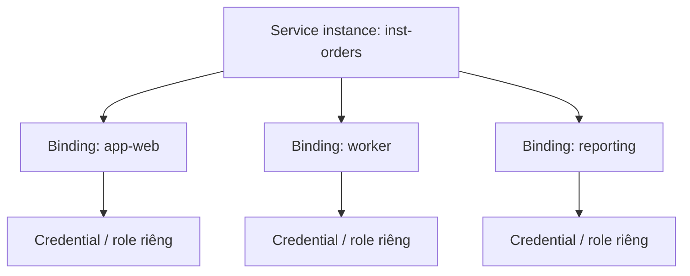
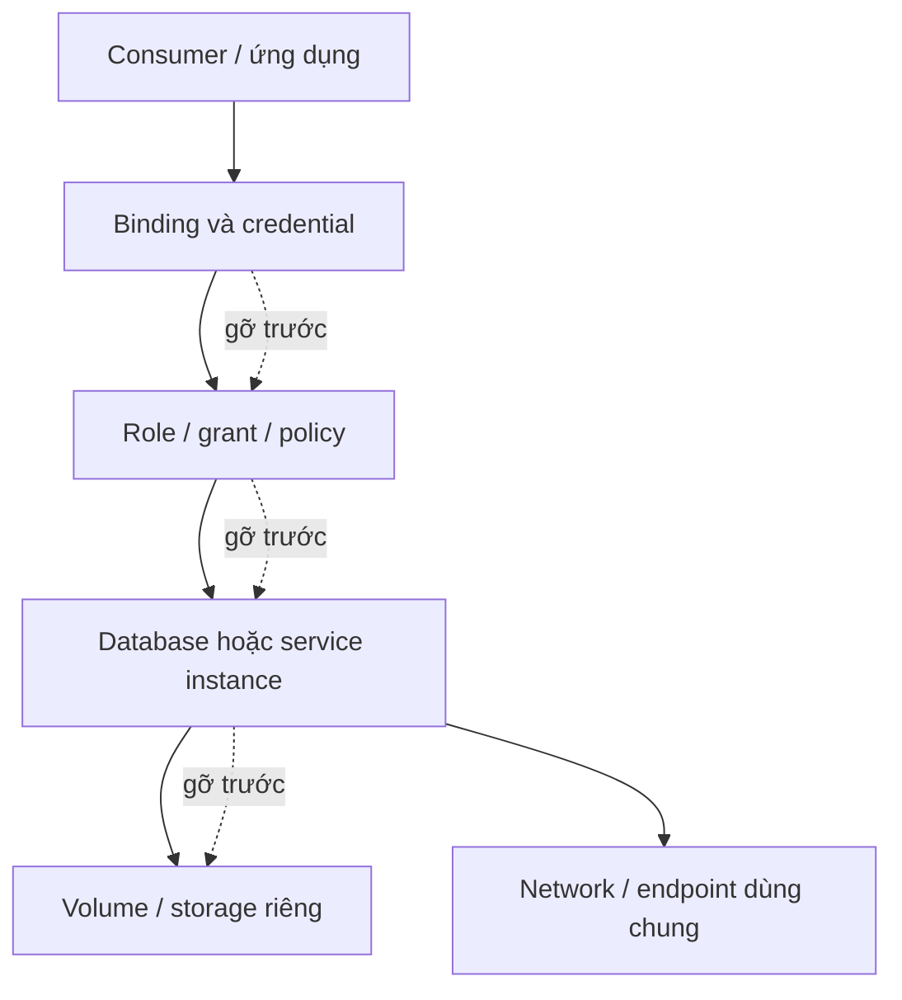
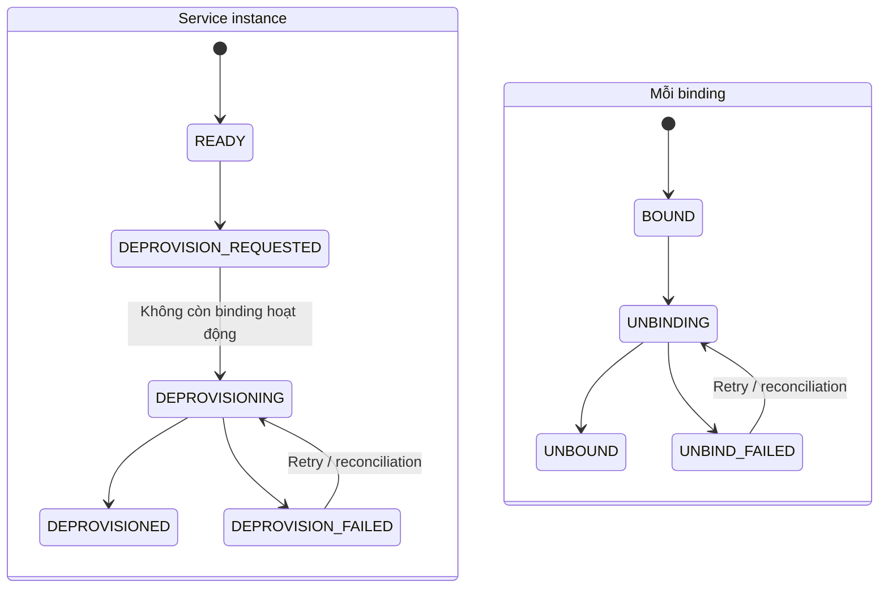
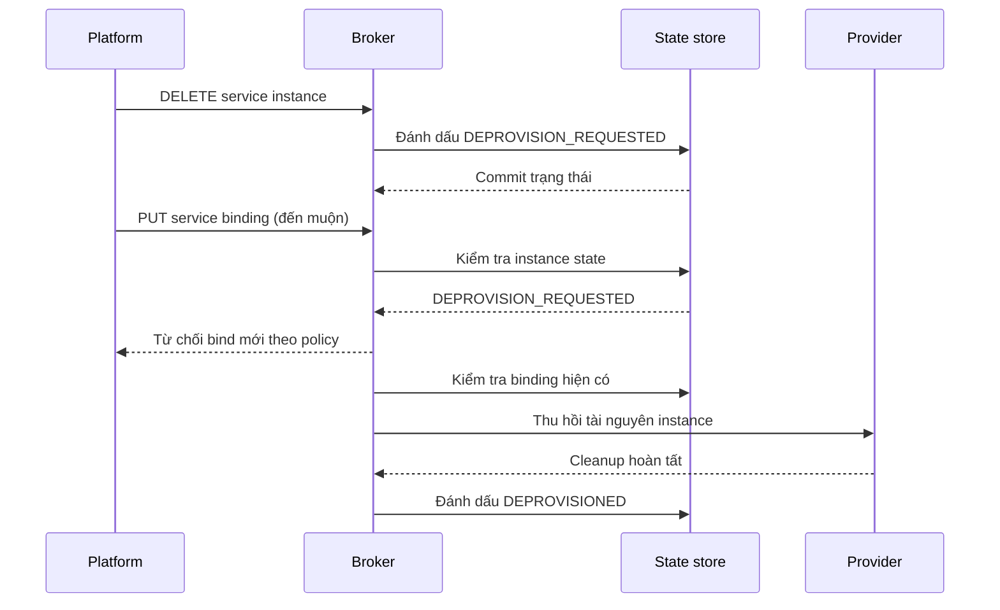

# Xử lý binding còn tồn tại và thứ tự giải phóng tài nguyên

## Vì sao phải xử lý binding trước khi thu hồi instance?

Trong Open Service Broker API (OSB API), một service instance có thể được nhiều ứng dụng hoặc thành phần sử dụng thông qua các service binding. Mỗi binding thường đại diện cho một lần cấp quyền truy cập, một bộ thông tin xác thực hoặc một cấu hình kết nối riêng. Khi nền tảng yêu cầu thu hồi service instance, broker cần bảo đảm những liên kết đang phụ thuộc vào instance đã được gỡ đúng cách trước khi xóa tài nguyên cha.

Ví dụ, một service instance PostgreSQL có thể phục vụ ứng dụng web, worker xử lý nền và một tác vụ báo cáo. Mỗi consumer có một binding riêng, có thể tương ứng với một database role hoặc credential riêng. Nếu broker xóa database trước khi thu hồi các role và credential đó, các bước unbind sau có thể không còn đủ thông tin hoặc quyền để hoàn tất. Nếu broker xóa một role dùng chung trong lúc consumer khác vẫn hoạt động, các ứng dụng còn lại sẽ mất kết nối.

Module `SPRING_CLOUD_SERVICE_BROKER` xây dựng broker theo OSB API bằng Spring Cloud Open Service Broker. Trong luồng thu hồi, cần phân biệt rõ **unbind** (gỡ quyền truy cập của một consumer) và **deprovision** (giải phóng service instance cùng tài nguyên cấp instance). Hai thao tác có quan hệ phụ thuộc và cần được thực hiện theo thứ tự phù hợp.

## Quan hệ giữa service instance và binding

Một service instance là tài nguyên dịch vụ được provision theo một service và plan. Binding là một liên kết con cho phép một consumer sử dụng instance đó. Quan hệ thường có dạng một-nhiều:



| Đối tượng | Phạm vi | Ví dụ tài nguyên | Khi giải phóng |
|---|---|---|---|
| Service instance | Dùng chung cho các consumer của instance. | Database, cluster, bucket, queue hoặc volume. | Deprovision sau khi các binding phụ thuộc đã được gỡ. |
| Binding | Gắn với một consumer trên một instance. | Database role, password, access key, policy hoặc route riêng. | Unbind consumer tương ứng; không xóa tài nguyên instance dùng chung. |
| Tài nguyên dùng chung giữa nhiều instance | Có phạm vi rộng hơn một instance. | Network, subnet, shared cluster hoặc secret namespace. | Chỉ giải phóng khi không còn instance nào tham chiếu. |

Không phải binding nào cũng tạo một database user riêng; một số broker có thể cấp chung endpoint nhưng tạo credential riêng, gắn policy hoặc chỉ trả thông tin kết nối. Thiết kế cần xác định chính xác những tài nguyên nào thuộc binding và những tài nguyên nào thuộc instance.

## Hai thao tác trong OSB API

### Unbind một consumer

Nền tảng yêu cầu gỡ binding bằng endpoint:

```http
DELETE /v2/service_instances/{instance_id}/service_bindings/{binding_id}
```

Request nhận diện cả service instance và binding. Broker tra cứu binding theo cặp ID, xác minh binding thuộc instance được chỉ định, rồi thu hồi quyền hoặc thông tin truy cập đã tạo trong lần bind. Ví dụ, broker có thể xóa database role `orders_reader`, thu hồi access key hoặc gỡ policy chỉ dành cho ứng dụng `reporting`.

Unbind cần giữ service instance hoạt động nếu vẫn còn consumer khác sử dụng. Sau khi một binding được gỡ, các binding còn lại phải tiếp tục kết nối bình thường.

### Deprovision service instance

Nền tảng yêu cầu giải phóng instance bằng endpoint:

```http
DELETE /v2/service_instances/{instance_id}
```

Request còn mang `service_id` và `plan_id` trong query string theo hợp đồng OSB API. Broker tra cứu instance, xác minh trạng thái và thực hiện giải phóng tài nguyên cấp instance như database, cluster, bucket hoặc queue.

Theo vòng đời thông thường, nền tảng gỡ các binding của instance trước khi gửi deprovision. Broker vẫn nên kiểm tra trạng thái binding của chính mình để phát hiện binding còn hoạt động, bản ghi bị sót hoặc request đến sai thứ tự. Cách phản hồi khi còn binding phải tuân theo phiên bản OSB API và chính sách broker; không nên âm thầm xóa tài nguyên cha trong khi quyền truy cập con vẫn còn hiệu lực.

## Thứ tự giải phóng tài nguyên

Nguyên tắc chung là gỡ các phụ thuộc ở cấp consumer trước, sau đó mới giải phóng tài nguyên cấp instance. Nếu có nhiều lớp phụ thuộc, nên giải phóng theo thứ tự ngược với thứ tự tạo (reverse dependency order).

Ví dụ với một broker PostgreSQL:

1. Ngừng nhận binding mới cho instance đang được thu hồi.
2. Liệt kê binding đang hoạt động và xác nhận nền tảng đã gửi yêu cầu unbind tương ứng.
3. Với từng binding, thu hồi credential, role, grant và policy riêng của consumer.
4. Xóa hoặc vô hiệu hóa secret chứa thông tin kết nối của binding.
5. Xác nhận không còn binding hoạt động hoặc quyền truy cập còn hiệu lực.
6. Thu hồi tài nguyên cấp instance: database, storage, endpoint hoặc cluster riêng nếu thuộc instance.
7. Giải phóng các tài nguyên dùng chung chỉ khi không còn instance nào tham chiếu.
8. Ghi trạng thái cuối cùng và lưu dấu vết phục vụ kiểm toán.

Sơ đồ phụ thuộc:



Sơ đồ chỉ minh họa một kiểu triển khai. Với một số nhà cung cấp, role cần được thu hồi trước secret; với hệ thống khác, secret có thể bị vô hiệu hóa trước rồi mới xóa role. Hãy xác định quan hệ phụ thuộc thực tế của provider và giải phóng theo thứ tự bảo đảm không để lại quyền truy cập ngoài ý muốn.

## Xử lý khi deprovision nhưng vẫn còn binding

Có thể xảy ra trường hợp nền tảng gửi deprovision trong khi broker vẫn ghi nhận binding đang hoạt động. Nguyên nhân thường gặp gồm:

- Nền tảng chưa hoàn tất vòng lặp unbind cho mọi consumer.
- Một request unbind thất bại hoặc đang chạy bất đồng bộ.
- Broker đã thu hồi credential ở provider nhưng chưa cập nhật bản ghi binding.
- Dữ liệu binding bị sót sau sự cố hoặc do thao tác thủ công ngoài broker.
- Một request bind mới chạy đồng thời với deprovision.

Broker nên thực hiện các bước kiểm tra:

1. Chuyển instance sang trạng thái chặn thao tác mới như `DEPROVISION_REQUESTED` hoặc `DEPROVISIONING`.
2. Ngăn request bind mới được tạo cho instance đang thu hồi.
3. Đọc danh sách binding và phân biệt binding đang hoạt động, đang unbind, đã thu hồi và bản ghi không còn tồn tại ở provider.
4. Nếu còn binding hợp lệ, giữ instance lại và yêu cầu hoàn tất unbind theo quy tắc giao thức.
5. Nếu bản ghi binding chỉ còn sót trong broker nhưng quyền đã bị thu hồi, đối soát với provider rồi đánh dấu hoàn tất cleanup.
6. Chỉ tiếp tục giải phóng instance sau khi các phụ thuộc đã được xử lý an toàn.

Không nên tự động xóa tất cả binding trong một lệnh deprovision mà không có chính sách rõ ràng. Nền tảng thường quản lý vòng đời binding và gửi unbind riêng; nếu broker tự thu hồi binding ngoài luồng, nền tảng có thể vẫn tin rằng ứng dụng đang sở hữu credential hợp lệ. Nếu cần cơ chế dọn binding mồ côi, phải có quy trình reconciliation, ghi nhận kết quả và đồng bộ lại trạng thái với nền tảng.

## Mô hình trạng thái cho binding và instance

Broker nên quản lý trạng thái binding độc lập với trạng thái instance. Ví dụ:

| Binding state | Ý nghĩa |
|---|---|
| `BOUND` | Credential và quyền truy cập đang có hiệu lực. |
| `UNBINDING` | Broker đã nhận yêu cầu thu hồi và đang xử lý provider. |
| `UNBOUND` | Quyền truy cập của binding đã được thu hồi. |
| `UNBIND_FAILED` | Một phần cleanup thất bại hoặc chưa xác định được kết quả. |

| Instance state | Ý nghĩa |
|---|---|
| `READY` | Instance sẵn sàng phục vụ consumer. |
| `DEPROVISION_REQUESTED` | Broker đã nhận yêu cầu deprovision. |
| `DEPROVISIONING` | Đang giải phóng tài nguyên cấp instance. |
| `DEPROVISIONED` | Tài nguyên cấp instance đã được giải phóng. |
| `DEPROVISION_FAILED` | Cleanup thất bại hoặc cần reconciliation. |

Luồng trạng thái tổng quát:



Các tên trạng thái trên là mô hình nội bộ. Khi trả response hoặc `last_operation`, broker phải ánh xạ sang các giá trị và quy tắc được OSB API phiên bản đang hỗ trợ quy định.

## Ví dụ dữ liệu lưu trữ

Một mô hình dữ liệu có thể tách instance và binding thành hai nhóm bản ghi:

```text
service_instance
----------------
instance_id
service_id
plan_id
provider_resource_id
state
deprovision_operation_id
revision
created_at
updated_at

service_binding
---------------
instance_id
binding_id
consumer_id
provider_credential_id
state
unbind_operation_id
created_at
updated_at
```

Khóa của binding nên bao gồm `(instance_id, binding_id)` hoặc có ràng buộc duy nhất tương đương. Bản ghi binding cần liên kết tới ID credential trong secret store thay vì lưu password hoặc token dạng rõ trong bảng thông thường.

Khi bắt đầu deprovision, broker có thể truy vấn số binding còn hiệu lực. Tuy nhiên, chỉ kiểm tra số lượng một lần rồi xóa tài nguyên vẫn chưa đủ nếu request bind có thể chạy đồng thời. Cần khóa theo instance, optimistic locking hoặc một cờ trạng thái khiến handler bind từ chối yêu cầu mới khi instance đang `DEPROVISION_REQUESTED`.

## Ngăn bind và deprovision chạy đua

Một race condition có thể xảy ra như sau: request deprovision đọc thấy không còn binding, nhưng ngay sau đó một request bind mới được xử lý trước khi tài nguyên instance bị xóa. Broker có thể thu hồi database trong khi vừa phát hành credential mới.

Để ngăn tình huống này, việc chuyển trạng thái instance và kiểm tra quyền tạo binding phải được đồng bộ:



Thực tế nền tảng có thể đã hoàn tất unbind trước khi gửi deprovision, nhưng broker vẫn cần bảo vệ trước request đến trễ, retry và nhiều replica cùng xử lý. Có thể dùng transaction để chuyển trạng thái và kiểm tra binding, khóa theo `instance_id`, hoặc compare-and-set trên revision. Không giữ transaction database mở trong lúc chờ một API provider kéo dài; hãy lưu trạng thái/operation trước, gọi provider bên ngoài transaction rồi cập nhật kết quả bằng một bước có kiểm soát.

## Unbind có thể cần nhiều bước

Một thao tác unbind không nhất thiết chỉ xóa một dòng dữ liệu. Ví dụ, binding PostgreSQL có thể bao gồm:

1. Chặn cấp mới kết nối bằng credential hiện tại nếu provider hỗ trợ.
2. Thu hồi session đang tồn tại theo chính sách của dịch vụ.
3. Thu hồi role hoặc quyền truy cập được tạo riêng cho binding.
4. Xóa secret chứa username/password hoặc đánh dấu secret hết hiệu lực.
5. Xóa các rule mạng, policy hoặc mapping riêng của consumer nếu có.
6. Đánh dấu binding là `UNBOUND` sau khi xác nhận cleanup.

Nếu một bước thất bại, broker cần lưu tiến độ để lần retry biết phần nào đã xong. Không nên tạo credential mới hoặc xóa tài nguyên khác chỉ vì handler được gọi lại. Với provider hỗ trợ idempotency key, hãy dùng khóa ổn định dựa trên instance và binding. Nếu không, cần kiểm tra sự tồn tại của role/secret trước khi tạo hoặc xóa.

## Deprovision đồng bộ và bất đồng bộ

Nếu giải phóng tài nguyên hoàn tất nhanh, broker có thể xử lý đồng bộ và trả response thành công sau khi provider xác nhận. Với database lớn, cluster hoặc volume có thời gian xóa dài, broker có thể sử dụng cơ chế bất đồng bộ khi nền tảng gửi `accepts_incomplete=true` và phiên bản OSB API/khả năng broker cho phép.

Luồng bất đồng bộ khái quát:

1. Nhận `DELETE` và xác thực `instance_id`, `service_id`, `plan_id`.
2. Đánh dấu instance đang thu hồi để ngăn bind mới.
3. Xác minh không còn binding hoạt động; các binding chưa gỡ phải được xử lý theo hợp đồng.
4. Ghi operation và job bền vững.
5. Trả `202 Accepted` khi broker đã tiếp nhận công việc.
6. Worker giải phóng tài nguyên theo thứ tự phụ thuộc.
7. Cập nhật operation và instance state.
8. Nền tảng polling `last_operation` cho tới khi thao tác kết thúc.

```http
DELETE /v2/service_instances/inst-orders-001?service_id=svc-postgresql&plan_id=plan-ha&accepts_incomplete=true HTTP/1.1
```

```http
HTTP/1.1 202 Accepted
Content-Type: application/json
```

```json
{
  "operation": "deprovision-op-009"
}
```

Job và operation phải được lưu bền vững trước khi trả `202`. Nếu worker khởi động lại, nó phải có thể tiếp tục hoặc reconciliation với provider để xác định tài nguyên đã xóa hay chưa. Không đánh dấu `DEPROVISIONED` chỉ vì đã gửi lệnh xóa; cần xác nhận trạng thái cuối theo khả năng của provider.

## Tài nguyên dùng chung và reference counting

Một service instance có thể sử dụng hạ tầng dùng chung với instance khác. Ví dụ nhiều database cùng nằm trong một PostgreSQL cluster, nhiều queue cùng nằm trong một Kafka cluster hoặc nhiều instance dùng chung một network.

Trong trường hợp đó, deprovision một instance chỉ được xóa tài nguyên thuộc instance. Cluster hoặc network dùng chung chỉ được giải phóng khi không còn instance nào tham chiếu. Broker có thể dùng bảng tham chiếu, foreign key, reference count hoặc một service quản lý tài nguyên dùng chung.

Ví dụ:

| Tài nguyên | Instance tham chiếu | Hành động khi xóa một instance |
|---|---|---|
| Database `orders` | `inst-orders-001` | Xóa database nếu không còn consumer/binding và chính sách cho phép. |
| PostgreSQL cluster `pg-prod-a` | Nhiều instance | Giữ cluster nếu instance khác còn sử dụng. |
| Role `orders_reader` | Một binding | Thu hồi khi unbind binding tương ứng. |
| Network `net-prod` | Nhiều instance | Chỉ giải phóng khi mọi tham chiếu đã được gỡ. |

Reference count cần cập nhật nguyên tử để tránh hai thao tác deprovision cùng lúc cùng kết luận tài nguyên dùng chung không còn ai sử dụng. Nếu có thể, ưu tiên ràng buộc quan hệ rõ ràng trong kho trạng thái và quy trình cleanup có thể retry.

## Phục hồi lỗi và dọn tài nguyên mồ côi

Không có transaction phân tán chung giữa database trạng thái broker và API provider trong phần lớn triển khai. Vì vậy, một số tình huống không thể tránh khỏi:

- Provider xóa tài nguyên thành công nhưng broker timeout trước khi ghi trạng thái.
- Broker đánh dấu binding đã gỡ nhưng provider vẫn còn role hoặc credential.
- Một phần tài nguyên instance đã bị xóa, phần còn lại thất bại.
- Worker bị dừng giữa hai bước cleanup.

Broker nên dùng workflow có checkpoint hoặc operation log để biết bước cuối cùng đã hoàn thành. Khi retry, mỗi bước phải an toàn khi chạy lại. Một reconciliation job có thể định kỳ so sánh bản ghi broker với tài nguyên thực tế ở provider, phát hiện orphan và tạo công việc cleanup có kiểm soát.

Không nên tự động xóa một tài nguyên chỉ vì không tìm thấy bản ghi broker tương ứng. Tài nguyên có thể được một broker khác hoặc hệ thống ngoài quản lý. Cần có ownership marker, tag hoặc mapping tin cậy để xác định tài nguyên thuộc phạm vi broker trước khi xóa.

## Tích hợp trong ứng dụng Spring Cloud Open Service Broker

Spring Cloud Open Service Broker cung cấp abstraction để triển khai thao tác deprovision và unbind. Tên interface, request model và khả năng bất đồng bộ phụ thuộc phiên bản thư viện. Có thể tổ chức domain logic thành các thành phần riêng:

- `ServiceBindingService` hoặc handler tương ứng: nhận yêu cầu unbind.
- `ServiceInstanceService` hoặc handler tương ứng: nhận yêu cầu deprovision.
- `BindingCleanupService`: thu hồi credential, role, policy và secret theo binding.
- `DeprovisionCoordinator`: kiểm tra binding, điều phối thứ tự giải phóng tài nguyên instance.
- `InfrastructureAdapter`: gọi API database/cloud/Kubernetes để cleanup.
- `OperationRepository`: lưu tiến độ và kết quả bất đồng bộ.
- `ReconciliationService`: đối soát bản ghi broker với provider sau timeout hoặc lỗi.

Pseudocode cho coordinator:

```java
public Mono<DeprovisionResult> deprovision(String instanceId) {
    return instanceRepository.markDeprovisionRequested(instanceId)
            .then(bindingRepository.findActiveByInstanceId(instanceId))
            .flatMap(bindings -> {
                if (!bindings.isEmpty()) {
                    return Mono.error(new ActiveBindingsRemainException());
                }

                return operationRepository.create(instanceId, "DEPROVISION")
                        .flatMap(operation ->
                                infrastructure.releaseInstanceResources(instanceId)
                                        .then(instanceRepository.markDeprovisioned(instanceId))
                                        .thenReturn(DeprovisionResult.completed(operation)));
            });
}
```

Đây là pseudocode minh họa thứ tự xử lý, không phải đoạn mã production hoàn chỉnh. Trong thực tế, cần transaction/locking khi đổi trạng thái, lưu operation và ngăn bind mới; không giữ transaction mở trong lúc gọi provider. Với thao tác bất đồng bộ, cần enqueue job bền vững rồi trả accepted theo hợp đồng framework. Xử lý lỗi phải giữ trạng thái có thể phục hồi thay vì đánh dấu hoàn tất khi một bước cleanup chưa được xác nhận.

## Checklist kiểm tra thứ tự cleanup

1. Một instance có nhiều binding được nhận diện đầy đủ theo `(instance_id, binding_id)`.
2. Unbind một binding chỉ thu hồi quyền của consumer đó, không xóa tài nguyên instance dùng chung.
3. Deprovision kiểm tra binding còn hoạt động trước khi giải phóng instance.
4. Instance đang thu hồi không nhận binding mới.
5. Các dependency được giải phóng theo thứ tự ngược với quá trình tạo.
6. Credential, role, grant, secret và policy riêng của binding được thu hồi.
7. Tài nguyên dùng chung chỉ được xóa khi không còn instance tham chiếu.
8. Request unbind/deprovision lặp không gây xóa nhầm hoặc tạo tác dụng phụ mới.
9. Timeout và worker restart có thể phục hồi từ operation/checkpoint đã lưu.
10. Trạng thái broker được đối chiếu với trạng thái provider trước khi kết luận cleanup thành công.
11. Binding mồ côi và tài nguyên mồ côi được phát hiện bằng reconciliation có kiểm soát.
12. Log và operation record không chứa credential hoặc secret dạng rõ.

## Kết luận

Binding là phụ thuộc của service instance. Broker cần gỡ quyền và tài nguyên riêng của từng binding trước khi giải phóng database, cluster hoặc tài nguyên cấp instance. Bằng cách kiểm tra binding còn tồn tại, chặn bind mới trong lúc thu hồi, giải phóng theo thứ tự ngược dependency, lưu trạng thái và operation bền vững, broker có thể tránh xóa nhầm tài nguyên đang được sử dụng và phục hồi an toàn sau lỗi. Spring Cloud Open Service Broker cung cấp lớp tích hợp OSB API; trình tự cleanup cụ thể vẫn phải được thiết kế theo dependency và khả năng của provider.
