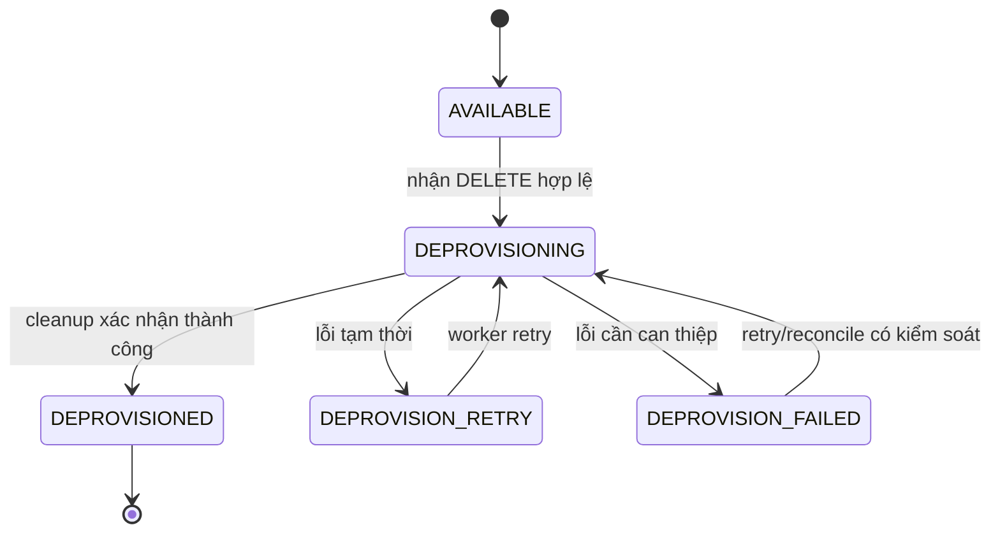
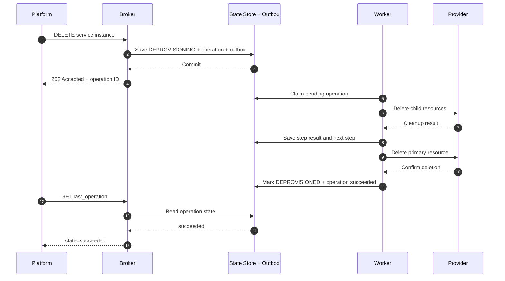

# Thu hồi đồng bộ hoặc bất đồng bộ và xác nhận kết quả cuối

Trong Open Service Broker API (OSB API), deprovision là thao tác yêu cầu broker thu hồi một service instance đã cấp phát. Platform gửi `DELETE /v2/service_instances/{instance_id}`; broker xác minh định danh, thực hiện cleanup trên provider và phản hồi khi biết kết quả. Nếu việc xóa hoàn tất nhanh, broker có thể trả kết quả đồng bộ. Nếu cần nhiều bước hoặc phải chờ hạ tầng, broker trả `202 Accepted` cùng mã operation để platform theo dõi qua endpoint `last_operation`.

Với `SPRING_CLOUD_SERVICE_BROKER`, deprovision không chỉ là xóa một dòng dữ liệu. Một instance PostgreSQL có thể bao gồm database, user, backup, network rule, secret, replica, DNS record và tài nguyên giám sát. Broker phải điều phối việc thu hồi các thành phần này, lưu trạng thái bền vững, xử lý retry an toàn và chỉ xác nhận hoàn tất khi đã đạt trạng thái cuối theo chính sách của dịch vụ.

## 1. Deprovision nằm ở đâu trong vòng đời OSB API?

Một vòng đời điển hình bắt đầu khi platform đọc catalog, người dùng chọn service/plan, platform gửi provision, sau đó tạo binding cho ứng dụng. Khi ứng dụng không còn sử dụng dịch vụ, platform yêu cầu unbind từng binding trước khi deprovision instance.

| Thao tác | Mục đích | Đối tượng bị tác động |
|---|---|---|
| Unbind | Thu hồi quyền truy cập của một consumer | Một service binding và credential tương ứng |
| Deprovision | Thu hồi tài nguyên nền của instance | Service instance và các tài nguyên con thuộc instance |

Deprovision có phạm vi lớn hơn unbind. Unbind một ứng dụng không được xóa database mà các ứng dụng khác còn sử dụng. Ngược lại, deprovision xóa hoặc thu hồi tài nguyên nền, vì vậy platform thường hoàn tất các binding trước khi gửi DELETE instance.

Broker nên kiểm tra các binding còn hoạt động theo mô hình dữ liệu của mình. Nếu còn binding, broker có thể từ chối thao tác theo chính sách và trả lỗi xung đột phù hợp với hợp đồng OSB API. Không tự động xóa credential của consumer khác mà không có quy trình thu hồi rõ ràng.

## 2. Request deprovision theo OSB API

Endpoint có dạng:

```http
DELETE /v2/service_instances/{instance_id}?service_id={service_id}&plan_id={plan_id}&accepts_incomplete=true HTTP/1.1
Host: broker.example.internal
X-Broker-API-Version: 2.14
Authorization: Basic <broker-credentials>
```

Các thành phần chính:

- `instance_id`: ID service instance do platform cấp trong request provision ban đầu.
- `service_id`: ID service mà instance thuộc về.
- `plan_id`: ID plan được dùng cho instance theo thông tin platform gửi.
- `accepts_incomplete`: cho biết platform chấp nhận xử lý bất đồng bộ hay không.
- `X-Broker-API-Version`: phiên bản OSB API mà platform đang sử dụng.

Broker phải xác thực platform, kiểm tra phiên bản API và đối chiếu `instance_id`, `service_id`, `plan_id` với bản ghi đã lưu. Không lấy các query parameter làm bằng chứng xác thực; chúng chỉ là định danh để broker kiểm tra tính nhất quán của yêu cầu.

Ví dụ request cụ thể:

```http
DELETE /v2/service_instances/instance-123?service_id=postgres-service&plan_id=postgres-small&accepts_incomplete=true HTTP/1.1
Host: broker.example.internal
X-Broker-API-Version: 2.14
Authorization: Basic <broker-credentials>
```

Broker cần tra cứu instance và xác định tài nguyên ngoài tương ứng, ví dụ database ID `db-9a82`. Không suy ra tên tài nguyên từ chuỗi `instance_id` rồi xóa trực tiếp nếu chưa xác minh bản ghi và tenant sở hữu tài nguyên đó.

## 3. Thu hồi đồng bộ

Thu hồi đồng bộ phù hợp khi toàn bộ công việc có thể hoàn tất trong thời gian request HTTP hợp lý và broker có thể xác định kết quả cuối ngay trong lần gọi hiện tại.

Luồng xử lý thường gồm:

1. Xác thực platform và kiểm tra các ID trong request.
2. Tìm instance, xác minh service/plan và trạng thái hiện tại.
3. Kiểm tra điều kiện deprovision, chẳng hạn không còn binding hoạt động theo chính sách.
4. Đánh dấu instance đang được thu hồi để ngăn thao tác mới xung đột.
5. Gọi provider thu hồi tài nguyên và credential thuộc instance.
6. Xác minh kết quả cleanup theo khả năng của provider.
7. Ghi trạng thái cuối và giữ lại tombstone/audit record cần thiết.
8. Trả phản hồi thành công đồng bộ.

Khi thành công đồng bộ, broker trả `200 OK`. Theo hợp đồng OSB API, phản hồi deprovision đồng bộ không cần body:

```http
HTTP/1.1 200 OK
```

Không trả `200 OK` ngay sau khi mới đưa một lệnh xóa vào queue. Nếu tài nguyên chưa được thu hồi và broker chưa biết kết quả cuối, phải dùng luồng bất đồng bộ khi platform cho phép.

Thu hồi đồng bộ có thể phù hợp với một tài nguyên đơn giản như xóa một queue nhỏ hoặc thu hồi một credential. Nó thường không phù hợp với database lớn, storage nhiều object, backup retention hoặc một quy trình cần chờ nhiều provider API.

## 4. Thu hồi bất đồng bộ

Deprovision thường cần bất đồng bộ khi có một hoặc nhiều đặc điểm:

- Provider cần nhiều phút để xóa database, volume hoặc cluster.
- Có nhiều tài nguyên con cần thu hồi theo thứ tự.
- API provider trả job ID và chỉ hoàn tất sau khi một tác vụ nền chạy xong.
- Việc xóa có thể cần retry do rate limit, timeout hoặc lỗi hạ tầng tạm thời.
- Broker cần chờ xác nhận rằng tài nguyên đã biến mất hoặc đã được vô hiệu hóa.

Nếu platform gửi `accepts_incomplete=true`, broker có thể ghi nhận operation, đưa công việc vào worker và trả `202 Accepted` cùng mã operation:

```http
HTTP/1.1 202 Accepted
Content-Type: application/json

{
  "operation": "deprovision-2026-000123"
}
```

Mã operation phải ổn định và liên kết với instance. Broker cần lưu operation trước khi xác nhận đã nhận yêu cầu để worker có thể tiếp tục sau khi process restart.

Nếu deprovision bắt buộc phải chạy bất đồng bộ nhưng request không cho phép async, broker không được giả vờ hoàn tất. Theo OSB API, broker trả `422 Unprocessable Entity` với mã lỗi `AsyncRequired`:

```http
HTTP/1.1 422 Unprocessable Entity
Content-Type: application/json

{
  "error": "AsyncRequired",
  "description": "Thao tác thu hồi cần xử lý bất đồng bộ."
}
```

Thông báo chỉ nêu điều kiện cần thiết để platform hiểu và xử lý. Không đưa chi tiết provider, URL nội bộ hoặc dữ liệu nhạy cảm vào `description`.

## 5. Xác nhận kết quả qua last_operation

Sau khi nhận `202 Accepted`, platform dùng `instance_id` và các định danh liên quan để truy vấn trạng thái operation:

```http
GET /v2/service_instances/instance-123/last_operation?service_id=postgres-service&plan_id=postgres-small&operation=deprovision-2026-000123 HTTP/1.1
Host: broker.example.internal
X-Broker-API-Version: 2.14
Authorization: Basic <broker-credentials>
```

Broker đọc trạng thái đã lưu và trả một trong các trạng thái OSB API:

```json
{
  "state": "in progress",
  "description": "Đang thu hồi database và các tài nguyên liên quan."
}
```

Khi cleanup hoàn tất:

```json
{
  "state": "succeeded",
  "description": "Đã thu hồi service instance."
}
```

Nếu cleanup thất bại và không thể tiếp tục tự động:

```json
{
  "state": "failed",
  "description": "Không thể hoàn tất thao tác thu hồi. Mã tham chiếu: op-123."
}
```

`last_operation` phải phản ánh kết quả thực tế được lưu, không tự khởi chạy lại toàn bộ cleanup mỗi lần platform polling. Broker có thể trả header `Retry-After` để gợi ý khoảng thời gian platform chờ trước lần polling tiếp theo. Mô tả trạng thái cần đủ hữu ích cho platform nhưng không để lộ thông tin nội bộ.

Khi trạng thái là `succeeded`, platform có thể kết thúc operation và coi instance đã được thu hồi theo hợp đồng. Khi trạng thái là `failed`, platform biết rằng thao tác chưa đạt kết quả mong muốn; broker cần giữ thông tin lỗi và trạng thái còn lại để có thể retry, reconcile hoặc chuyển cho vận hành.

## 6. State machine cho deprovision

Broker nên biểu diễn trạng thái instance và trạng thái operation một cách tường minh. Ví dụ state machine nội bộ:



Trạng thái nội bộ có thể chi tiết hơn ba giá trị mà OSB API trả cho `last_operation`. Ví dụ, `DEPROVISION_RETRY` vẫn ánh xạ thành `in progress` khi broker còn chủ động retry; chỉ chuyển thành `failed` khi operation đã được kết luận thất bại theo chính sách.

Một số quy tắc chuyển trạng thái:

- Chỉ bắt đầu deprovision khi instance ở trạng thái cho phép thu hồi.
- Ghi nhận operation và chuyển sang `DEPROVISIONING` một cách nguyên tử hoặc bằng cơ chế outbox đáng tin cậy.
- Không cho phép provision/update/bind mới tạo xung đột với instance đang thu hồi.
- Chỉ chuyển `DEPROVISIONED` sau khi các bước bắt buộc đã hoàn tất hoặc provider xác nhận tài nguyên không còn tồn tại.
- Giữ bản ghi tombstone tối thiểu để nhận diện retry, audit và ngăn tạo nhầm tài nguyên.

## 7. Trình tự cleanup tài nguyên

Một service instance có thể gồm nhiều thành phần. Broker cần xác định dependency để thu hồi theo thứ tự an toàn. Với ví dụ PostgreSQL:

1. Đánh dấu instance đang deprovision để ngăn request mới.
2. Xác minh các binding đã được unbind; nếu cần, thu hồi credential theo chính sách được phép.
3. Ngăn worker hoặc job khác tiếp tục tạo tài nguyên mới cho instance.
4. Thu hồi secret tạm, user, role hoặc quyền truy cập thuộc instance.
5. Thu hồi replica, endpoint, network rule hoặc tài nguyên con theo dependency.
6. Xóa database hoặc cluster chính bằng provider API.
7. Xử lý backup, snapshot, DNS, monitoring và tài nguyên phụ theo chính sách retention.
8. Xác minh kết quả cuối qua provider hoặc trạng thái job.
9. Ghi nhận `DEPROVISIONED`, thời điểm hoàn tất và audit event; xóa secret reference không còn cần.

Trình tự thực tế phụ thuộc dịch vụ. Ví dụ, một số provider yêu cầu xóa replica trước primary; provider khác xóa cluster sẽ tự động thu hồi replica và network. Broker phải mô hình hóa dependency của adapter thay vì dùng một thứ tự cố định cho mọi loại service.

### Không xóa dữ liệu ngoài phạm vi instance

Provider có thể dùng chung cluster, subnet, storage account hoặc project cho nhiều service instance. Deprovision một instance chỉ được xóa tài nguyên mà instance đó sở hữu. Nếu có tài nguyên dùng chung, cần reference count, ownership tag hoặc cơ chế quản lý vòng đời riêng. Không xóa cluster hoặc subnet chỉ vì một instance đã được thu hồi.

Backup và snapshot cũng cần chính sách rõ ràng. Có thể xóa ngay, giữ trong thời gian retention hoặc chuyển sang kho lưu trữ riêng theo yêu cầu sản phẩm/pháp lý. Nếu dữ liệu được giữ lại, broker phải phân biệt tài nguyên đã deprovision với bản sao được giữ theo retention; không tuyên bố xóa sạch nếu chính sách vẫn giữ bản sao.

## 8. Thiết kế operation bền vững và worker nền

Khi nhận request async, broker cần lưu tối thiểu:

| Dữ liệu | Mục đích |
|---|---|
| `operation_id` | Mã để platform polling và worker tham chiếu. |
| `instance_id` | Liên kết operation với service instance. |
| `service_id`, `plan_id` | Xác minh request và biết ngữ cảnh tài nguyên. |
| `operation_type` | Phân biệt `PROVISION`, `UPDATE`, `DEPROVISION`. |
| `state` | Trạng thái hiện tại của operation. |
| `step` | Bước cleanup hiện tại. |
| `external_resource_id` | Định danh tài nguyên trên provider. |
| `attempt_count`, `next_retry_at` | Lập lịch retry có giới hạn. |
| `started_at`, `updated_at`, `finished_at` | Theo dõi thời gian xử lý. |
| `safe_description`, `error_code` | Dữ liệu có thể dùng cho `last_operation` và vận hành. |

Không lưu password, token hoặc raw provider response vào bản ghi operation. Nếu worker cần secret để gọi provider, lưu secret trong secret manager và chỉ lưu reference có scope và TTL phù hợp.

Một luồng async có thể dùng transactional outbox:



Outbox giúp tránh tình huống broker ghi trạng thái `DEPROVISIONING` nhưng process dừng trước khi gửi job vào queue. Worker cần claim operation có lease hoặc cơ chế khóa để nhiều replica không cùng thực hiện một bước cleanup đồng thời.

## 9. Idempotency và retry an toàn

Platform có thể gửi lại DELETE vì timeout hoặc mất kết nối. Worker cũng có thể chạy lại sau khi process restart. Mỗi bước cleanup vì thế phải có tính idempotent hoặc có thể xác minh trước khi thực hiện.

- Dùng `instance_id` làm khóa vòng đời và `operation_id` làm định danh công việc đã ghi nhận.
- Đặt ràng buộc duy nhất để request lặp không tạo nhiều operation cleanup cạnh tranh cho cùng instance.
- Trước khi xóa, tra cứu external resource ID đã lưu; không tìm tài nguyên bằng cách đoán tên.
- Nếu provider trả “not found” cho một tài nguyên đã được yêu cầu xóa, coi đó là trạng thái đã đạt được khi danh tính tài nguyên được xác minh.
- Lưu kết quả từng bước để retry tiếp từ bước chưa hoàn tất, không chạy lại mọi bước một cách mù quáng.
- Nếu request cùng instance ID nhưng service/plan không khớp bản ghi, xử lý như request không hợp lệ hoặc xung đột theo hợp đồng; không xóa tài nguyên.
- Dùng exponential backoff, jitter và giới hạn retry để tránh gây quá tải provider.
- Sau số lần retry vượt ngưỡng, chuyển operation sang trạng thái cần can thiệp và phát cảnh báo có correlation ID.

Không được đánh dấu hoàn tất chỉ vì worker đã gửi lệnh DELETE tới provider. Timeout có thể xảy ra sau khi provider đã xóa tài nguyên nhưng phản hồi bị mất. Worker cần truy vấn trạng thái job hoặc kiểm tra sự tồn tại của tài nguyên bằng external ID trước khi kết luận. Nếu không xác định được kết quả, giữ trạng thái chưa hoàn tất và reconcile thay vì báo thành công giả.

## 10. Xử lý đồng thời với các thao tác khác

Deprovision có thể đến khi instance đang được update, có binding đang tạo hoặc một operation trước đó chưa hoàn tất. Broker cần một quy tắc điều phối rõ ràng:

- Nếu instance đang `PROVISIONING`, không được xóa một phần tài nguyên mà worker provision vẫn đang tạo. Có thể từ chối, yêu cầu chờ hoặc chuyển sang quy trình hủy/compensation đã thiết kế.
- Nếu instance đang `UPDATING`, cần khóa theo instance hoặc cơ chế version để tránh update và delete chạy đồng thời.
- Khi đã `DEPROVISIONING`, từ chối bind/update mới và không khởi tạo operation provision khác cho cùng instance.
- Nếu nhận DELETE trùng khi cùng operation đang chạy, trả lại thông tin operation đã ghi nhận theo quy tắc idempotency.
- Khi operation đã hoàn tất và instance không còn tồn tại, xử lý request lặp theo semantics của OSB API; không tạo lại resource hoặc nhắm sang instance khác.

Có thể dùng optimistic locking với `version` hoặc row-level lock trong database để bảo đảm chỉ một chuyển trạng thái hợp lệ được commit. Lock không nên giữ trong suốt một tác vụ provider kéo dài; hãy dùng operation record, lease và compare-and-set để điều phối worker.

## 11. Xác nhận kết quả cuối

Kết quả cuối cần được xác định bằng trạng thái provider và dữ liệu broker, không chỉ bằng việc HTTP request đã được gửi đi.

Broker có thể xác nhận deprovision thành công khi:

- Provider đã xác nhận xóa tài nguyên chính hoặc xác nhận tài nguyên không còn tồn tại.
- Các tài nguyên con bắt buộc đã được thu hồi theo chính sách.
- Credential, binding và secret liên quan đã được xử lý theo thứ tự.
- Các tài nguyên dùng chung không bị xóa nhầm.
- Bản ghi instance được chuyển sang trạng thái cuối và không còn được coi là tài nguyên đang hoạt động.
- Operation được lưu `succeeded`, thời điểm kết thúc và mô tả an toàn.

Nếu một bản sao backup được giữ theo retention, trạng thái cuối cần phản ánh đúng chính sách đó. Ví dụ, broker có thể đánh dấu instance đã deprovision nhưng audit record cho biết backup còn được giữ đến một thời điểm xác định. Không đưa nội dung nhạy cảm vào mô tả operation.

### Tombstone và retention dữ liệu broker

Xóa vật lý toàn bộ bản ghi ngay sau khi provider xóa tài nguyên có thể làm mất khả năng nhận diện retry. Thay vào đó, broker có thể giữ tombstone tối thiểu gồm instance ID, service/plan ID, trạng thái cuối, operation ID và thời điểm deprovision. Tombstone không cần giữ secret hoặc toàn bộ parameters.

Thời gian lưu tombstone, audit event và dữ liệu vận hành cần theo chính sách retention. Khi hết thời hạn, broker có thể xóa dữ liệu nhận diện theo quy trình riêng. Việc lưu tombstone không có nghĩa instance vẫn còn hoạt động; endpoint và nghiệp vụ phải phân biệt rõ trạng thái đã thu hồi.

## 12. Tích hợp với Spring Cloud Open Service Broker

Trong ứng dụng Spring Cloud Open Service Broker, tầng service instance xử lý request deprovision do framework chuyển đổi từ OSB API. Tên interface, request/response model và builder phụ thuộc phiên bản thư viện; ví dụ dưới đây mô tả cấu trúc xử lý reactive.

```java
public Mono<DeleteServiceInstanceResponse> deleteServiceInstance(
        DeleteServiceInstanceRequest request
) {
    return instanceRepository.findById(request.getServiceInstanceId())
            .switchIfEmpty(Mono.error(new ServiceInstanceNotFoundException()))
            .flatMap(instance -> validateDeleteRequest(instance, request))
            .flatMap(instance -> {
                if (deprovisionCanCompleteSynchronously(instance)) {
                    return deprovisionService.deleteNow(instance)
                            .then(instanceRepository.markDeprovisioned(instance.getId()))
                            .thenReturn(DeleteServiceInstanceResponse.builder().build());
                }

                return operationService.startDeprovision(instance)
                        .map(operationId -> DeleteServiceInstanceResponse.builder()
                                .async(true)
                                .operation(operationId)
                                .build());
            });
}
```

Đây là pseudocode định hướng, cần điều chỉnh method, kiểu response, cách biểu diễn async và cách đăng ký service theo phiên bản Spring Cloud Open Service Broker của dự án. Không dùng `.block()` trong WebFlux request path. Nếu repository hoặc provider SDK là blocking, hãy cô lập chúng trên scheduler phù hợp hoặc chuyển sang client reactive.

Service bắt đầu async operation cần ghi operation và outbox bền vững trước khi trả response. Worker riêng thực hiện cleanup; `last_operation` đọc trạng thái từ repository. Không để `deleteServiceInstance` trả async khi job mới chỉ tồn tại trong memory của process.

## 13. Xử lý lỗi và tình huống tài nguyên không còn tồn tại

| Tình huống | Hướng xử lý |
|---|---|
| Instance không tồn tại | Trả mã theo hợp đồng OSB API; deprovision thường dùng `410 Gone` để biểu thị instance đã không còn tồn tại. |
| Service/plan ID không khớp | Từ chối request; không thực hiện cleanup. |
| Platform không chấp nhận async nhưng cleanup bắt buộc async | Trả `422 Unprocessable Entity` với `AsyncRequired`. |
| Provider timeout, chưa rõ đã xóa hay chưa | Giữ trạng thái chưa kết luận, truy vấn job/resource và reconcile. |
| Provider tạm lỗi hoặc rate limited | Retry có backoff, jitter và giới hạn. |
| Tài nguyên đã bị xóa ngoài broker | Xác minh đúng external ID; xử lý như đã đạt trạng thái xóa nếu phù hợp. |
| Còn binding hoạt động | Từ chối theo chính sách hoặc yêu cầu hoàn tất unbind; không xóa dữ liệu đang được consumer dùng. |
| Lỗi vĩnh viễn hoặc quyền provider bị thu hồi | Đánh dấu operation failed, lưu mã lỗi an toàn và yêu cầu can thiệp. |

Mã HTTP và error code cuối cùng phải tuân thủ phiên bản OSB API cùng mapping của framework. Không biến lỗi kết nối database nội bộ thành `410 Gone`, vì điều đó có thể khiến platform tin rằng instance đã biến mất. Không trả stack trace hoặc raw provider response trong `description`.

## 14. Bảo mật và audit khi thu hồi

Deprovision là thao tác có tác động phá hủy dữ liệu. Broker phải kiểm soát chặt chẽ danh tính và phạm vi tài nguyên:

- Chỉ platform đã xác thực mới được yêu cầu deprovision.
- Xác minh instance, service, plan và tenant context trước khi gọi provider.
- Dùng external resource ID đã lưu và ownership tag để tránh xóa nhầm tài nguyên của tenant khác.
- Credential provider phải có quyền xóa đúng loại tài nguyên và phạm vi instance; không dùng quyền quản trị toàn hệ thống nếu không cần.
- Không ghi password, token, connection string hoặc request body vào log.
- Audit event nên ghi actor/platform, instance ID, operation ID, thời điểm, kết quả và mã lỗi đã chuẩn hóa.
- Bảo vệ endpoint `last_operation`; chỉ trả mô tả an toàn, không trả thông tin hạ tầng nội bộ.
- Áp dụng chính sách retention và xóa dữ liệu theo cam kết sản phẩm, hợp đồng và quy định áp dụng.

Audit record phải giúp truy vết ai yêu cầu thu hồi và tài nguyên nào đã được xử lý mà không trở thành nơi lưu bí mật. Nếu cần điều tra sâu, lưu chi tiết kỹ thuật trong hệ thống có kiểm soát quyền truy cập và retention riêng.

## 15. Kiểm thử deprovision đồng bộ và bất đồng bộ

Kiểm thử nên bao phủ cả phản hồi HTTP và trạng thái tài nguyên cuối cùng:

1. Instance hợp lệ, provider xóa nhanh: broker trả `200 OK` sau khi cleanup hoàn tất.
2. Instance cần cleanup lâu và platform chấp nhận async: broker trả `202` cùng operation ID.
3. Platform polling `last_operation`: trạng thái chuyển từ `in progress` sang `succeeded` khi provider xác nhận xóa.
4. Async bắt buộc nhưng `accepts_incomplete` không được bật: broker trả `422 AsyncRequired`.
5. Provider timeout sau khi đã xóa tài nguyên: worker reconcile và không tạo lỗi xóa nhầm hoặc báo thành công khi chưa xác minh.
6. Retry cùng instance ID: không tạo nhiều operation cleanup cạnh tranh và không xóa tài nguyên khác.
7. Còn binding hoạt động: broker áp dụng đúng chính sách và không xóa database đang được consumer sử dụng.
8. Service ID hoặc plan ID sai: broker không gọi provider.
9. Instance đã deprovision: request lặp được xử lý theo semantics OSB API và không tái tạo resource.
10. Worker restart giữa các bước: operation được tiếp tục từ trạng thái đã lưu.
11. Một tài nguyên con bị lỗi: trạng thái operation phản ánh đúng bước còn lại và retry không lặp side effect không an toàn.
12. Response, log và audit không chứa secret hoặc raw provider error.

Test tích hợp nên dùng provider giả lập có thể tạo các kịch bản: xóa thành công, trả not found, timeout trước/sau side effect, rate limit và lỗi quyền truy cập. Với async flow, cần kiểm tra persistence sau khi khởi động lại worker hoặc broker để chứng minh operation không phụ thuộc memory của một process.

## 16. Tích hợp luồng thu hồi với Cloud Foundry và Kubernetes

Với **Cloud Foundry**, platform quản lý service instance và binding thông qua service broker đã đăng ký. Khi người dùng xóa service instance, platform gửi request deprovision tới broker sau khi xử lý các binding theo vòng đời của ứng dụng. Broker phải trả kết quả đồng bộ hoặc async đúng hợp đồng để platform biết khi nào có thể kết thúc thao tác. Nếu broker trả `202`, platform dùng `last_operation` để polling; broker không nên phụ thuộc vào việc người dùng giữ một phiên CLI mở trong suốt thời gian cleanup.

Với **Kubernetes**, hành vi này phụ thuộc thành phần tích hợp OSB API đang chạy trong cluster, chẳng hạn service catalog/controller hoặc controller riêng. Controller chuyển yêu cầu xóa resource tương ứng thành request deprovision tới broker và cần tiếp tục theo dõi operation bất đồng bộ. Nếu controller có cơ chế reconcile theo vòng lặp, broker càng cần idempotency: cùng một yêu cầu xóa có thể được gửi lại sau khi controller restart hoặc mất kết nối.

Trong cả hai môi trường, broker cần lưu operation ở kho dữ liệu dùng chung và worker có thể phục hồi sau restart. Không coi việc xóa một Kubernetes custom resource hoặc một Cloud Foundry application là bằng chứng rằng tài nguyên bên ngoài đã được thu hồi; phải theo dõi kết quả từ broker/provider theo đúng vòng đời OSB API.

## 17. Checklist trước khi đưa deprovision vào production

- Request DELETE xác minh `instance_id`, `service_id`, `plan_id` và caller.
- Binding được xử lý trước deprovision theo đúng mô hình service.
- Broker phân biệt rõ cleanup đồng bộ và bất đồng bộ.
- Nếu trả `202`, operation đã được lưu bền vững và worker có thể phục hồi.
- `last_operation` trả trạng thái thật và không thực hiện side effect.
- Mọi bước cleanup có thứ tự, timeout, retry và quy tắc idempotency.
- Provider “not found” chỉ được coi là đã xóa sau khi xác minh đúng tài nguyên.
- Tài nguyên dùng chung và backup retention được bảo vệ theo ownership/policy.
- Chỉ đánh dấu hoàn tất sau khi đã xác nhận kết quả cuối.
- Tombstone và audit được lưu tối thiểu, không chứa secret.
- Có test cho timeout, retry, worker restart, binding còn tồn tại và lỗi provider.
- Log, response và metric không để lộ credential hoặc dữ liệu tenant nhạy cảm.

Deprovision đáng tin cậy cần kết hợp hợp đồng OSB API, state machine bền vững, cleanup theo dependency và xác nhận từ provider. Khi broker chỉ trả thành công sau khi đạt trạng thái cuối, dùng `202` cho công việc kéo dài, cung cấp `last_operation` nhất quán và thiết kế retry an toàn, platform có thể điều phối việc thu hồi dịch vụ mà không để lại tài nguyên mồ côi hoặc xóa nhầm dữ liệu đang được sử dụng.
