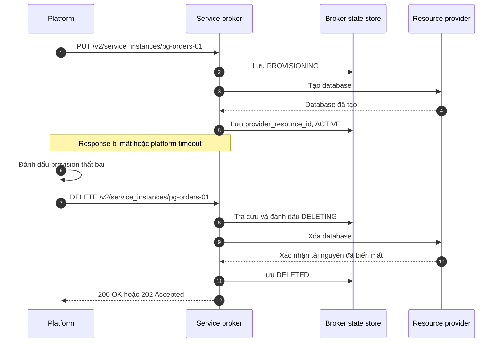
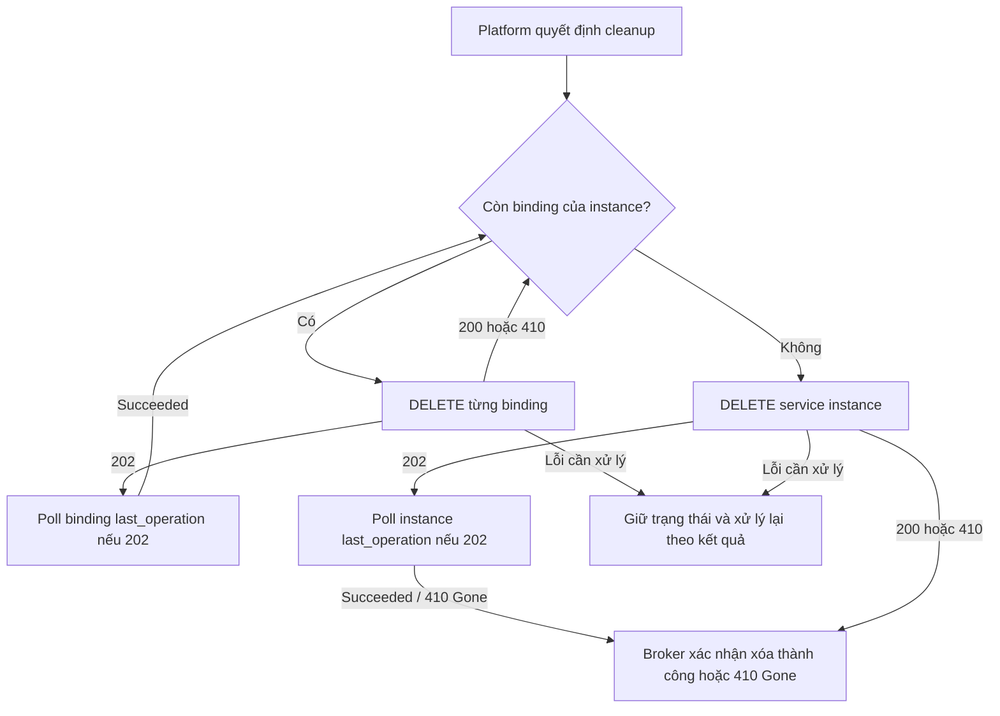
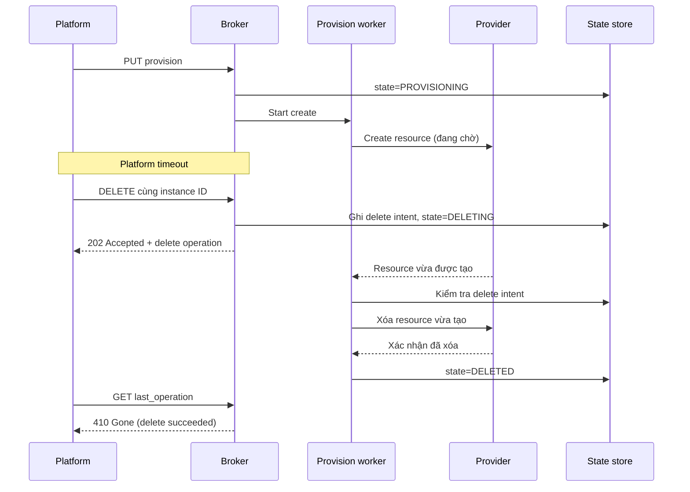

# Dọn tài nguyên mồ côi theo cơ chế orphan mitigation

Trong Open Service Broker API (OSB API), platform là nguồn dữ liệu chuẩn về những service instance và service binding đang được quản lý. Service broker phải bảo đảm các tài nguyên mà platform ghi nhận đã được tạo đúng, đồng thời không để lại tài nguyên mà platform không còn biết hoặc không thể xác nhận đã tạo thành công. Khi một request provision hoặc binding có kết quả không chắc chắn, tài nguyên phía provider có thể đã được tạo dù platform xem request là thất bại. Những tài nguyên như vậy được gọi là **orphaned resources**.

OSB gọi quá trình xử lý tình huống này là **orphan mitigation**. Platform gửi yêu cầu xóa bù để broker thu hồi service instance hoặc binding có thể đã được tạo dở dang. Broker cần xử lý các yêu cầu xóa theo cách an toàn khi request được gửi lặp, khi tài nguyên đã biến mất hoặc khi thao tác tạo vẫn đang chạy.

Ví dụ: platform gửi `PUT /v2/service_instances/pg-orders-01`. Broker đã tạo database PostgreSQL nhưng response bị mất do timeout. Platform không biết database đã tồn tại và đánh dấu provision thất bại. Nếu không có orphan mitigation, database có thể tiếp tục tiêu thụ dung lượng và chi phí dù platform không quản lý được nó. Platform sẽ gửi `DELETE` cho cùng instance ID để broker dọn database đó.

## 1. Orphaned resource hình thành như thế nào?

Orphan không nhất thiết là tài nguyên không có bản ghi trong database của broker. Nó là tài nguyên mà platform không thể xác nhận đã được tạo thành công hoặc không còn có thể quản lý nhất quán. Nguyên nhân thường xuất phát từ việc hai hệ thống không thể hoàn tất cùng một giao dịch phân tán.

OSB mô tả một số tình huống chính:

1. Broker không trả response trước khi request timeout ở platform (thường khoảng 60 giây). Broker có thể tiếp tục tạo tài nguyên thành công sau khi platform đã xem request là thất bại.
2. Request provision đồng bộ thất bại sau khi broker đã tạo một phần hoặc toàn bộ tài nguyên ở provider.
3. Provision bất đồng bộ kết thúc với `state: failed` khi platform polling `last_operation`.
4. Request tạo binding đồng bộ thất bại sau khi broker có thể đã tạo credentials hoặc quyền truy cập.
5. Binding bất đồng bộ kết thúc với `state: failed` khi platform polling trạng thái operation.
6. Platform gặp lỗi nội bộ khi tạo instance hoặc binding, ví dụ broker đã provision thành công nhưng platform không ghi được bản ghi tương ứng vào database của nó.



Điểm quan trọng là broker có thể đã hoàn tất side effect trong khi platform không nhận được response. Do đó, chỉ ghi log lỗi HTTP hoặc đánh dấu request timeout không đủ để kết luận tài nguyên chưa được tạo. Broker phải lưu trạng thái operation và có cách thu hồi tài nguyên theo ID mà platform đã cấp.

## 2. Ai chịu trách nhiệm orphan mitigation?

OSB xác định platform là nguồn dữ liệu chuẩn cho service instance và service binding. Platform biết tài nguyên nào được ghi nhận trong marketplace của nó. Vì vậy, platform **SHOULD** gửi yêu cầu xóa đối với những tài nguyên mà nó không thể chắc chắn đã được tạo thành công, và **SHOULD** tiếp tục thử xóa cho đến khi broker trả về kết quả thành công.

Service broker cũng **MAY** tự động xóa những tài nguyên mà nó có đủ căn cứ để xác định là orphan. Đây là cơ chế bổ sung phía broker, ví dụ dọn tài nguyên được tạo dở dang sau khi operation kết thúc thất bại. Việc tự động dọn phải dựa trên trạng thái operation và bằng chứng về quyền sở hữu tài nguyên; không nên xóa chỉ vì một instance lâu ngày không có request.

| Thành phần | Trách nhiệm |
|---|---|
| Platform | Quyết định tài nguyên nào cần orphan mitigation; gửi unbind hoặc deprovision; tiếp tục theo dõi cho đến khi broker xác nhận thành công |
| Service broker | Thực hiện yêu cầu xóa đúng tài nguyên; hỗ trợ request lặp; trả trạng thái đồng bộ hoặc bất đồng bộ chính xác |
| Resource provider | Xóa database, user, cluster, volume, namespace hoặc tài nguyên thật mà broker đã tạo |
| Broker state store | Lưu liên kết ID, trạng thái và operation để có thể tiếp tục cleanup sau timeout hoặc restart |

Platform có thể cho phép người dùng quyết định thời điểm chạy orphan mitigation để họ điều tra nguyên nhân trước khi tài nguyên bị thu hồi. Khi thiết kế tính năng này, cần thể hiện rõ tài nguyên đang ở trạng thái chưa xác định và khả năng vẫn phát sinh chi phí.

## 3. Khi nào platform nên thực hiện orphan mitigation?

Không phải mọi response lỗi đều có nghĩa tài nguyên có thể đã được tạo. OSB v2.17 đưa ra ma trận quyết định dựa trên loại request và response của broker. Bảng sau tóm tắt hành vi được khuyến nghị trong đặc tả.

| Request / kết quả | Platform hiểu response như thế nào? | Dọn service instance? | Dọn service binding? |
|---|---|---:|---:|
| Bất kỳ request nào trả `200 OK` hợp lệ | Thành công đồng bộ | Không | Không |
| `200 OK` nhưng response body sai định dạng | Thất bại | Không | Không |
| Poll `last_operation` của provision/deprovision trả `state: failed` | Operation instance thất bại | Có | Không |
| Poll `last_operation` của bind/unbind trả `state: failed` | Operation binding thất bại | Không | Có |
| Bất kỳ request nào trả `201 Created` hợp lệ | Thành công | Không | Không |
| Provision trả `201` nhưng response sai định dạng | Thất bại | Có | Không |
| Binding trả `201` nhưng response sai định dạng | Thất bại | Không | Có |
| Bất kỳ request nào trả `202 Accepted` hợp lệ | Đã tiếp nhận operation bất đồng bộ | Không ngay lập tức | Không ngay lập tức |
| Provision trả `202` nhưng response sai định dạng | Thất bại | Có | Không |
| Binding trả `202` nhưng response sai định dạng | Thất bại | Không | Có |
| Provision/deprovision trả mã `2xx` khác được định nghĩa | Thất bại | Có | Không |
| Binding/unbinding trả mã `2xx` khác được định nghĩa | Thất bại | Không | Có |
| Update instance trả mã `2xx` khác được định nghĩa | Thất bại | Không | Không |
| Bất kỳ request nào trả `408 Request Timeout` | Server báo request chưa được nhận | Không | Không |
| Bất kỳ request nào trả `4xx` khác | Request bị từ chối | Không | Không |
| Provision/deprovision trả `5xx` | Lỗi broker; kết quả có thể không chắc chắn | Có | Không |
| Binding/unbinding trả `5xx` | Lỗi broker; kết quả có thể không chắc chắn | Không | Có |
| Update instance trả `5xx` | Lỗi update | Không | Không |
| Platform timeout khi chờ response provision | Không biết broker đã tạo tài nguyên hay chưa | Có | Không |
| Platform timeout khi chờ response binding | Không biết broker đã tạo binding hay chưa | Không | Có |
| Platform timeout với request khác | Không thuộc các trường hợp cleanup provision/binding | Không | Không |

Một số điểm cần phân biệt:

- `202 Accepted` hợp lệ chỉ cho biết broker đã nhận operation. Platform phải polling `last_operation`; nếu operation kết thúc với `failed`, khi đó mới thực hiện cleanup tương ứng.
- `408 Request Timeout` trong bảng là response cho biết request chưa được nhận ở server. Nó khác với việc client tự timeout và không nhận được response. Với timeout phía client trong lúc provision hoặc binding, platform không thể biết broker đã xử lý đến đâu nên cần orphan mitigation.
- Các lỗi `4xx` khác thường cho biết broker đã từ chối request. Platform không nên suy luận rằng tài nguyên mới đã được tạo từ một request bị từ chối.
- Lỗi `ConcurrencyError` là trường hợp đặc biệt được OSB nêu rõ: khi broker từ chối do operation khác đang sửa cùng tài nguyên, platform **MUST NOT** thực hiện orphan mitigation dựa trên response này.
- `200 OK` với response sai định dạng được bảng OSB xử lý khác `201` hoặc `202` sai định dạng. Cần tuân thủ ma trận thay vì gom mọi malformed response thành cùng một quy tắc.

Ma trận này áp dụng cho quyết định của platform. Broker nên thiết kế các endpoint xóa sao cho có thể nhận và xử lý an toàn những yêu cầu bù mà platform gửi đến.

## 4. Hai endpoint dùng để dọn tài nguyên

Orphan mitigation sử dụng chính các thao tác xóa trong OSB API. Không có endpoint riêng tên `/orphan_mitigation`.

### 4.1. Xóa binding: unbind

Nếu request tạo binding thất bại hoặc platform không chắc binding đã được tạo hay chưa, platform gửi:

```http
DELETE /v2/service_instances/pg-orders-01/service_bindings/bind-orders-api?service_id=postgresql&plan_id=standard&accepts_incomplete=true
X-Broker-API-Version: 2.17
```

Query `service_id` và `plan_id` là bắt buộc cho endpoint unbind. `accepts_incomplete=true` cho phép broker thực hiện thao tác bất đồng bộ nếu platform hỗ trợ. Request không cần JSON body.

Broker phải thu hồi các tài nguyên được tạo cho binding, chẳng hạn database user, token, ACL hoặc quyền truy cập. Nếu credentials đã được cấp, sau khi unbind hoàn tất, các credentials đó không còn được sử dụng để xác thực thành công.

Response quan trọng:

| HTTP status | Ý nghĩa |
|---|---|
| `200 OK` | Binding đã được xóa đồng bộ |
| `202 Accepted` | Unbind đang chạy; platform polling binding `last_operation` |
| `410 Gone` | Binding không còn tồn tại; platform có thể xem mục tiêu xóa đã đạt |
| `422 Unprocessable Entity` + `AsyncRequired` | Broker chỉ hỗ trợ async nhưng request không cho phép async |
| `422 Unprocessable Entity` + `ConcurrencyError` | Binding đang được operation khác xử lý |

Khi binding không tồn tại, broker phải trả `410 Gone`. Đây là phản hồi xác nhận trạng thái mong muốn đã đạt: không còn binding để thu hồi. Không trả `404 Not Found` cho trường hợp này vì `404` được dùng cho fetch binding không tồn tại, còn delete binding không tồn tại có mã `410`.

### 4.2. Xóa service instance: deprovision

Sau khi các binding liên quan đã được xóa, platform có thể dọn instance:

```http
DELETE /v2/service_instances/pg-orders-01?service_id=postgresql&plan_id=standard&accepts_incomplete=true
X-Broker-API-Version: 2.17
```

`service_id` và `plan_id` là query parameter bắt buộc. `instance_id` nằm trong path. Request không có JSON body.

Broker phải xóa các tài nguyên đã tạo trong quá trình provision, ví dụ database, cluster, volume, namespace hoặc tài khoản SaaS. Nếu broker nhận deprovision trong lúc provision đang chạy và chấp nhận xử lý request đó, kết quả cuối cùng phải dừng quá trình tạo và xóa các tài nguyên đã được tạo cho instance.

Response quan trọng:

| HTTP status | Ý nghĩa |
|---|---|
| `200 OK` | Instance đã được xóa đồng bộ |
| `202 Accepted` | Deprovision đang chạy; platform polling instance `last_operation` |
| `410 Gone` | Instance không còn tồn tại; platform có thể xem mục tiêu xóa đã đạt |
| `422 Unprocessable Entity` + `AsyncRequired` | Broker chỉ hỗ trợ async nhưng request không cho phép async |
| `422 Unprocessable Entity` + `ConcurrencyError` | Instance đang được operation khác xử lý |

Nếu broker không còn biết instance ID đó, phải trả `410 Gone`. Khi platform nhận được phản hồi này, nó có thể xóa bản ghi tài nguyên tương ứng khỏi trạng thái quản lý của mình.

### 4.3. Thứ tự xóa binding và instance

Platform **MUST** xóa tất cả service binding của một instance trước khi deprovision instance. Thứ tự này ngăn database hoặc cluster bị xóa trong khi ứng dụng vẫn giữ credentials hoặc quyền truy cập.



Nếu chỉ binding bị orphan trong khi instance đã được platform ghi nhận bình thường, platform chỉ cần unbind binding đó. Không deprovision instance đang được các consumer khác sử dụng.

## 5. Xử lý thao tác xóa bất đồng bộ

Tài nguyên lớn hoặc provider có API eventual consistency có thể cần thời gian để thu hồi. Khi request có `accepts_incomplete=true`, broker có thể trả `202 Accepted` và một operation ID.

Platform polling:

- Instance: `GET /v2/service_instances/{instance_id}/last_operation`.
- Binding: `GET /v2/service_instances/{instance_id}/service_bindings/{binding_id}/last_operation`.

Response polling sử dụng các trạng thái `in progress`, `succeeded` hoặc `failed`. Khi xóa bất đồng bộ thành công, OSB cho phép endpoint last operation trả `410 Gone`; platform phải xem đây là thành công và xóa tài nguyên khỏi database của nó. `410 Gone` trong polling chỉ phù hợp với asynchronous delete operation.

Trong Spring Cloud Open Service Broker 4.4.1, builder response có cờ `deleteOperation(true)`. Khi operation state là `SUCCEEDED` và cờ này là `true`, framework ánh xạ response polling thành HTTP `410 Gone`.

Ví dụ cho last operation của instance:

```java
return Mono.just(GetLastServiceOperationResponse.builder()
        .operationState(OperationState.SUCCEEDED)
        .description("Đã thu hồi toàn bộ tài nguyên của service instance")
        .deleteOperation(true)
        .build());
```

Ví dụ cho last operation của binding:

```java
return Mono.just(GetLastServiceBindingOperationResponse.builder()
        .operationState(OperationState.SUCCEEDED)
        .description("Đã thu hồi credentials của binding")
        .deleteOperation(true)
        .build());
```

Nếu operation vẫn chạy, trả `OperationState.IN_PROGRESS` và `deleteOperation(true)`; framework vẫn trả `200 OK` với body state `in progress`. Chỉ khi operation đã thành công, response mới trở thành `410 Gone`.

Nếu operation thất bại, trả `OperationState.FAILED` và mô tả rõ tình trạng. Với deprovision thất bại, broker nên cung cấp `instance_usable` phù hợp nếu có thể xác định instance còn sử dụng được hay không. Nếu instance đã không còn usable, platform **SHOULD NOT** tạo binding mới cho instance đó.

## 6. Broker cần làm gì để xử lý orphan an toàn?

Broker không thể dựa vào việc request chỉ đến một lần. Platform có thể gửi lại cùng DELETE sau timeout, sau khi worker xử lý xong nhưng response bị mất hoặc khi người vận hành chạy cleanup lại. Vì vậy, deprovision và unbind cần có hiệu ứng idempotent.

### 6.1. Ghi nhận trạng thái và định danh tài nguyên

Khi provision hoặc bind, broker nên lưu mối liên hệ giữa ID OSB và tài nguyên provider:

| Bản ghi | Dữ liệu nên lưu |
|---|---|
| Service instance | `platform_instance_id`, `service_instance_id`, `service_id`, `plan_id`, provider resource ID, trạng thái, operation ID |
| Service binding | `platform_instance_id`, `service_instance_id`, `binding_id`, consumer, provider credential/user ID hoặc secret reference, trạng thái, operation ID |
| Operation | Operation ID, loại operation, ID instance/binding, trạng thái, thời điểm bắt đầu/kết thúc và lỗi cuối cùng |

Nếu broker phục vụ nhiều platform, phạm vi khóa định danh cần bao gồm `platform_instance_id` hoặc một định danh tenant tương đương. Không được để một DELETE từ platform này xóa nhầm tài nguyên thuộc platform khác.

Nên lưu cả provider resource ID và trạng thái nội bộ. Nếu broker chỉ lưu instance ID nhưng không lưu ID database/cluster/user do provider tạo, việc thu hồi sau restart hoặc sau timeout sẽ khó xác định đúng tài nguyên.

### 6.2. Thiết kế DELETE có tính idempotent

Một luồng deprovision có thể thực hiện như sau:

1. Xác thực platform, API version, `service_id`, `plan_id` và instance ID.
2. Tra cứu bản ghi theo platform scope và instance ID.
3. Nếu instance không tồn tại, trả `ServiceInstanceDoesNotExistException`; Spring Cloud Open Service Broker ánh xạ exception này thành `410 Gone` khi xử lý delete instance.
4. Nếu instance đang được xóa, trả `202 Accepted` với cùng operation ID cho đến khi thao tác hoàn tất.
5. Nếu provision vẫn đang chạy, dừng hoặc hủy bước tạo còn lại và xóa các tài nguyên đã tạo. Nếu broker không thể xử lý request đồng thời, trả `ServiceBrokerConcurrencyException` với error code `ConcurrencyError` theo contract.
6. Xóa tài nguyên provider theo thứ tự phụ thuộc, cập nhật trạng thái bền vững và chỉ trả thành công khi đã đạt trạng thái không còn tài nguyên.

Tương tự, khi binding không tồn tại, `ServiceInstanceBindingDoesNotExistException` được Spring ánh xạ thành `410 Gone` trong thao tác delete binding. Nếu binding đang được xóa bất đồng bộ, request lặp phải nhận lại `202 Accepted` và operation ID tương ứng cho đến khi hoàn tất.

Không xóa bản ghi operation ngay khi provider trả thành công. Giữ tombstone hoặc thông tin operation trong một khoảng thời gian phù hợp giúp broker nhận diện request lặp, trả kết quả nhất quán và hỗ trợ điều tra.

### 6.3. Xử lý race giữa provision và deprovision

Một trường hợp khó là platform timeout trong khi provider vẫn đang tạo tài nguyên. Sau đó platform gửi DELETE, nhưng lệnh tạo đã được gửi đến provider và có thể hoàn tất muộn.

Broker nên ghi nhận delete intent bền vững và dùng một cơ chế đồng bộ theo instance ID. Nếu create worker nhận kết quả provider sau khi instance đã chuyển sang `DELETING`, worker không được đánh dấu instance `ACTIVE`; nó phải chuyển tài nguyên vừa tạo vào nhánh cleanup. Nếu không, tài nguyên có thể xuất hiện sau khi deprovision đã trả thành công.



Không nên chỉ dựa vào một cờ trong bộ nhớ của một replica. Khi broker chạy nhiều instance, delete intent và trạng thái operation phải được lưu trong kho dùng chung hoặc cơ chế điều phối có tính bền vững.

## 7. Triển khai trong Spring Cloud Open Service Broker

Spring Cloud Open Service Broker cung cấp controller OSB và ánh xạ request HTTP vào các service interface. Phần nghiệp vụ cần triển khai nằm ở:

| Operation | Interface method | Request/response model |
|---|---|---|
| Deprovision instance | `ServiceInstanceService.deleteServiceInstance()` | `DeleteServiceInstanceRequest`, `DeleteServiceInstanceResponse` |
| Poll deprovision | `ServiceInstanceService.getLastOperation()` | `GetLastServiceOperationRequest`, `GetLastServiceOperationResponse` |
| Unbind | `ServiceInstanceBindingService.deleteServiceInstanceBinding()` | `DeleteServiceInstanceBindingRequest`, `DeleteServiceInstanceBindingResponse` |
| Poll unbind | `ServiceInstanceBindingService.getLastOperation()` | `GetLastServiceBindingOperationRequest`, `GetLastServiceBindingOperationResponse` |

Ví dụ skeleton cho deprovision:

```java
@Service
public class ExampleServiceInstanceService implements ServiceInstanceService {

    private final InstanceCleanupUseCase cleanup;

    public ExampleServiceInstanceService(InstanceCleanupUseCase cleanup) {
        this.cleanup = cleanup;
    }

    @Override
    public Mono<DeleteServiceInstanceResponse> deleteServiceInstance(
            DeleteServiceInstanceRequest request) {

        return cleanup.delete(
                        request.getPlatformInstanceId(),
                        request.getServiceInstanceId(),
                        request.getServiceDefinitionId(),
                        request.getPlanId())
                .map(result -> {
                    if (result.inProgress()) {
                        return DeleteServiceInstanceResponse.builder()
                                .async(true)
                                .operation(result.operationId())
                                .build();
                    }

                    return DeleteServiceInstanceResponse.builder().build();
                })
                .switchIfEmpty(Mono.error(
                        new ServiceInstanceDoesNotExistException(
                                request.getServiceInstanceId())));
    }
}
```

`InstanceCleanupUseCase` và kiểu `CleanupResult` là abstraction do ứng dụng định nghĩa. Trong ví dụ, kết quả rỗng có nghĩa broker không tìm thấy instance và framework ánh xạ exception thành `410 Gone`; kết quả đồng bộ thành công trả `200 OK`; kết quả đang chạy trả `202 Accepted` cùng operation ID.

Ví dụ skeleton cho unbind:

```java
@Service
public class ExampleServiceInstanceBindingService
        implements ServiceInstanceBindingService {

    private final BindingCleanupUseCase cleanup;

    public ExampleServiceInstanceBindingService(BindingCleanupUseCase cleanup) {
        this.cleanup = cleanup;
    }

    @Override
    public Mono<DeleteServiceInstanceBindingResponse> deleteServiceInstanceBinding(
            DeleteServiceInstanceBindingRequest request) {

        return cleanup.delete(
                        request.getPlatformInstanceId(),
                        request.getServiceInstanceId(),
                        request.getBindingId())
                .map(result -> {
                    if (result.inProgress()) {
                        return DeleteServiceInstanceBindingResponse.builder()
                                .async(true)
                                .operation(result.operationId())
                                .build();
                    }

                    return DeleteServiceInstanceBindingResponse.builder().build();
                })
                .switchIfEmpty(Mono.error(
                        new ServiceInstanceBindingDoesNotExistException(
                                request.getBindingId())));
    }
}
```

Hai ví dụ là skeleton tập trung vào luồng xóa; class triển khai thực tế còn phải cung cấp các phương thức bắt buộc khác của interface. Nếu repository đã có bản ghi nhưng provider báo tài nguyên không tồn tại, use case nên coi trạng thái đích đã đạt, cập nhật broker state và trả thành công đồng bộ. Nếu broker không có bản ghi hoặc không thể xác định tài nguyên tương ứng, dùng exception theo đúng ngữ nghĩa endpoint.

### 7.1. Phân biệt 410 Gone với 404 Not Found

Trong Spring Cloud Open Service Broker 4.4.1, cùng một exception có thể được ánh xạ thành status khác nhau tùy endpoint:

| Exception | Fetch | Delete |
|---|---:|---:|
| `ServiceInstanceDoesNotExistException` | `404 Not Found` khi fetch instance | `410 Gone` khi deprovision instance |
| `ServiceInstanceBindingDoesNotExistException` | `404 Not Found` khi fetch binding | `410 Gone` khi unbind |

Điều này giúp cùng exception thể hiện đúng ý nghĩa của request. Với GET, tài nguyên không tồn tại là not found. Với DELETE, tài nguyên đã không còn là trạng thái thành công của yêu cầu thu hồi.

### 7.2. Theo dõi trạng thái delete operation

Nếu deprovision hoặc unbind bất đồng bộ, broker phải triển khai last operation tương ứng. Lưu operation ID, loại operation, trạng thái và kết quả cuối cùng trong repository. Khi platform gửi lại DELETE trong lúc operation còn chạy, trả cùng operation ID và trạng thái `202 Accepted`.

Khi operation hoàn tất:

```java
GetLastServiceOperationResponse response = GetLastServiceOperationResponse.builder()
        .operationState(OperationState.SUCCEEDED)
        .deleteOperation(true)
        .description("Service instance đã được thu hồi")
        .build();
```

Với binding, dùng `GetLastServiceBindingOperationResponse.builder()` và cũng đặt `deleteOperation(true)`. Trong cả hai trường hợp, `deleteOperation(true)` kết hợp với `OperationState.SUCCEEDED` khiến framework trả `410 Gone` cho platform.

## 8. Broker tự động phát hiện và dọn orphan

OSB cho phép broker tự động dọn tài nguyên mà broker tin là orphan. Một số nguồn tín hiệu có thể dùng:

- Operation provision/binding đã kết thúc `FAILED` nhưng provider resource ID đã được ghi nhận.
- Bản ghi cleanup đã chuyển sang `CLEANUP_PENDING` do provider tạm thời không phản hồi.
- Một tiến trình tạo bị hủy nhưng provider trả kết quả tạo tài nguyên muộn.
- Tài nguyên provider có tag/label do broker gắn, trỏ về instance hoặc binding ID đã được đánh dấu xóa.

Một reconciliation worker có thể chạy theo lịch:

1. Đọc các operation đã kết thúc thất bại hoặc cleanup đang chờ.
2. Xác minh tài nguyên thuộc đúng platform, tenant, instance hoặc binding.
3. Kiểm tra trạng thái hiện tại để tránh xóa tài nguyên đã được một operation mới nhận quyền sở hữu.
4. Gửi lệnh xóa idempotent đến provider.
5. Ghi nhận kết quả; nếu provider lỗi tạm thời, giữ `CLEANUP_PENDING` và retry với backoff.
6. Ghi tombstone và audit record sau khi xác nhận tài nguyên đã biến mất.

Không nên xem một instance là orphan chỉ vì nó không có traffic, không có binding hoặc đã lâu không được truy cập. Một database có thể được provision trước và chỉ bind vào một thời điểm sau. Tuổi của tài nguyên không chứng minh platform đã bỏ quản lý nó.

Broker cũng không nên xóa tài nguyên chỉ vì nhận timeout từ platform. Timeout không cho biết platform đã lưu instance hay chưa. Khi platform gửi DELETE có định danh rõ ràng, đó là tín hiệu cleanup có thẩm quyền; nếu broker tự động dọn trước thời điểm đó, cần có bằng chứng đủ mạnh và cơ chế bảo đảm không xóa nhầm tài nguyên hợp lệ.

## 9. Vận hành, retry và quan sát

Orphan mitigation là một phần của vòng đời tài nguyên và có thể kéo dài khi provider gặp sự cố. Broker nên:

- Lưu trạng thái `DELETING` hoặc `CLEANUP_PENDING` cùng operation ID để tiến trình khác có thể tiếp tục sau restart.
- Dùng retry có backoff và giới hạn tốc độ để không làm quá tải provider.
- Giữ request identity, platform ID, instance ID, binding ID và provider resource ID trong audit log.
- Không ghi credentials, token hoặc secret vào log; chỉ log secret reference nếu cần.
- Phân biệt lỗi tạm thời của provider với lỗi vĩnh viễn như tài nguyên không tồn tại.
- Có dashboard hoặc metric cho số cleanup đang chờ, số lần retry, tuổi cleanup lâu nhất và số operation thất bại.
- Giữ operation history đủ lâu để platform polling lại sau khi nhận `succeeded` hoặc `failed`.

Các trạng thái nội bộ có thể dùng:

```text
PROVISIONING -> ACTIVE -> DELETING -> DELETED
      |                       |
      v                       v
PROVISION_FAILED       CLEANUP_PENDING
                              |
                              v
                         DELETING

BINDING -> BOUND -> UNBINDING -> UNBOUND
    |                    |
    v                    v
BIND_FAILED        CLEANUP_PENDING
```

Đây là mô hình gợi ý của ứng dụng, không phải danh sách state bắt buộc của OSB. API chỉ yêu cầu broker phản ánh đúng trạng thái operation qua `last_operation`.

## 10. Kiểm thử orphan mitigation

Nên kiểm thử cả response đồng bộ, bất đồng bộ và những race condition có thể xảy ra giữa platform, broker và provider.

| Tình huống kiểm thử | Kết quả mong đợi |
|---|---|
| Provider đã tạo database nhưng platform timeout | DELETE cùng instance ID thu hồi database |
| Provision trả `5xx` sau khi tạo tài nguyên | Platform có thể gửi deprovision; broker xóa tài nguyên |
| Provision async trả `state: failed` | Platform thực hiện cleanup instance |
| Binding async trả `state: failed` | Platform thực hiện cleanup binding |
| Platform gửi DELETE hai lần sau khi xóa xong | Lần sau trả `410 Gone`, không tạo side effect mới |
| DELETE lặp trong khi cleanup đang chạy | Trả `202 Accepted` cùng operation ID |
| DELETE đến trong khi provision đang chạy | Nếu nhận xử lý, dừng create và dọn tài nguyên đã tạo; nếu không thể xử lý đồng thời, trả `ConcurrencyError` đúng contract |
| Provider đã xóa tài nguyên nhưng broker mất response | Retry xác minh tài nguyên đã mất và hoàn tất trạng thái cleanup |
| Unbind hoàn tất nhưng deprovision chưa chạy | Binding đã bị thu hồi; instance vẫn còn cho đến khi có DELETE riêng |
| Instance có nhiều binding | Xóa tất cả binding trước khi deprovision instance |
| Request trả `422 ConcurrencyError` | Không xem đây là tín hiệu orphan mitigation |
| Client timeout khi provision, so với HTTP 408 | Client timeout cần cleanup; 408 báo request chưa tới server thì không |
| Broker restart khi operation đang xóa | Worker/replica khác tiếp tục từ operation record bền vững |

Ngoài unit test cho use case, nên có integration test với controller để xác minh:

- `DELETE` đúng path/query và `X-Broker-API-Version`.
- Mã `200`, `202`, `410`, `422` và error body đúng với từng tình huống.
- Polling delete operation trả `410 Gone` khi trạng thái đã `SUCCEEDED` và `deleteOperation=true`.
- Provider mock nhận đúng resource ID và lệnh xóa không bị gọi lặp theo cách tạo side effect nguy hiểm.

## 11. Lỗi thiết kế thường gặp

| Lỗi | Hệ quả | Cách xử lý |
|---|---|---|
| Xem mọi HTTP 4xx/5xx là cùng một loại lỗi | Có thể xóa nhầm tài nguyên hợp lệ hoặc bỏ sót orphan | Áp dụng decision matrix OSB theo status và operation |
| Chỉ dọn orphan instance mà quên binding | Credentials hoặc quyền truy cập vẫn tồn tại | Dùng DELETE binding cho orphan binding và xóa binding trước instance |
| Trả `404` khi DELETE tài nguyên đã biến mất | Platform có thể không nhận được tín hiệu xóa thành công chuẩn OSB | Trả `410 Gone` |
| Trả `200` ngay khi mới gửi lệnh xóa đến provider | Platform xóa bản ghi dù tài nguyên vẫn còn | Chỉ trả đồng bộ khi provider đã hoàn tất; nếu đang chạy trả `202` |
| Mỗi DELETE tạo operation ID mới | Platform polling không theo dõi cùng operation | Dùng lại operation ID khi request lặp trong lúc đang chạy |
| Không ghi delete intent khi provision đang chạy | Worker có thể tạo tài nguyên sau khi cleanup đã hoàn tất | Lưu delete intent và kiểm tra trước khi đánh dấu ACTIVE |
| Xóa theo tuổi tài nguyên | Có thể xóa instance hợp lệ nhưng ít được sử dụng | Dựa trên operation state và bằng chứng sở hữu |
| Không lưu provider resource ID | Không biết cần xóa tài nguyên nào sau timeout/restart | Lưu mapping ID và tag/label resource |
| Trả `ConcurrencyError` nhưng platform hiểu là orphan | Có thể khởi động cleanup xung đột với operation đang chạy | Tuân thủ quy tắc không orphan mitigation khi nhận `ConcurrencyError` |

## 12. Checklist triển khai

- [ ] Xác định rõ các tình huống provision/binding có thể tạo orphan theo OSB.
- [ ] Áp dụng ma trận response để quyết định khi nào cleanup instance hoặc binding.
- [ ] Hỗ trợ DELETE deprovision và DELETE unbind theo đúng path/query OSB.
- [ ] Xóa tất cả binding trước khi deprovision instance.
- [ ] Trả `410 Gone` nếu instance hoặc binding đã không còn tồn tại.
- [ ] Xử lý request DELETE lặp theo cách idempotent.
- [ ] Khi delete bất đồng bộ, lưu operation ID và triển khai polling status.
- [ ] Dùng `deleteOperation(true)` khi trả last operation đã xóa thành công.
- [ ] Nếu nhận DELETE trong lúc provision đang chạy, dừng create và dọn các tài nguyên đã tạo nếu broker nhận xử lý.
- [ ] Lưu trạng thái operation và provider resource ID bền vững.
- [ ] Giới hạn cleanup theo đúng platform/tenant và xác thực request.
- [ ] Chỉ chạy broker-side orphan sweeper khi có bằng chứng đáng tin cậy.
- [ ] Kiểm thử timeout, 5xx, malformed response, concurrency, retry và provider lỗi.

## 13. Tài liệu tham khảo

- [Open Service Broker API v2.17 Specification — Orphan Mitigation](https://github.com/cloudfoundry/servicebroker/blob/v2.17/spec.md#orphan-mitigation)
- [Open Service Broker API v2.17 Specification — Unbinding](https://github.com/cloudfoundry/servicebroker/blob/v2.17/spec.md#unbinding)
- [Open Service Broker API v2.17 Specification — Deprovisioning](https://github.com/cloudfoundry/servicebroker/blob/v2.17/spec.md#deprovisioning)
- [Spring Cloud Open Service Broker 4.4.1 — Reference Guide](https://docs.spring.io/spring-cloud-open-service-broker/docs/4.4.1/reference/)
- [ServiceInstanceDoesNotExistException API](https://docs.spring.io/spring-cloud-open-service-broker/docs/4.4.1/apidocs/org/springframework/cloud/servicebroker/exception/ServiceInstanceDoesNotExistException.html)
- [ServiceInstanceBindingDoesNotExistException API](https://docs.spring.io/spring-cloud-open-service-broker/docs/4.4.1/apidocs/org/springframework/cloud/servicebroker/exception/ServiceInstanceBindingDoesNotExistException.html)
- [GetLastServiceOperationResponse Builder API](https://docs.spring.io/spring-cloud-open-service-broker/docs/4.4.1/apidocs/org/springframework/cloud/servicebroker/model/instance/GetLastServiceOperationResponse.GetLastServiceOperationResponseBuilder.html)
- [GetLastServiceBindingOperationResponse Builder API](https://docs.spring.io/spring-cloud-open-service-broker/docs/4.4.1/apidocs/org/springframework/cloud/servicebroker/model/binding/GetLastServiceBindingOperationResponse.GetLastServiceBindingOperationResponseBuilder.html)

Ma trận response và các từ khóa MUST/SHOULD/MAY trong bài dựa trên OSB API v2.17. Ví dụ Java dựa trên Spring Cloud Open Service Broker 4.4.1; cần đối chiếu phiên bản framework mà ứng dụng đang dùng khi triển khai.
