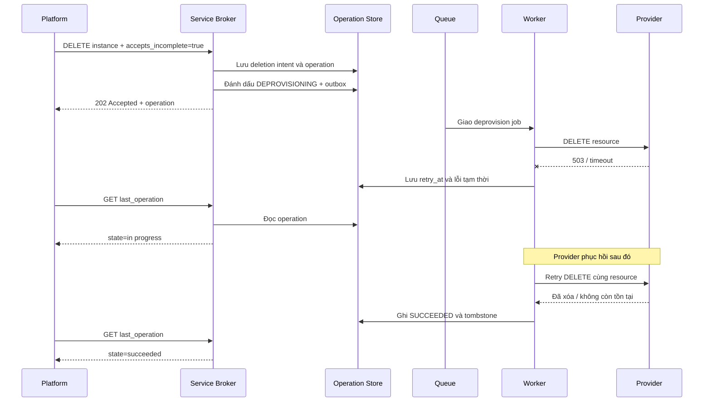
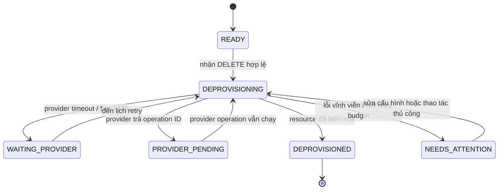

# Khôi phục khả năng thu hồi khi nhà cung cấp tạm thời không đáp ứng

Khi platform yêu cầu thu hồi một service instance, service broker phải xóa hoặc giải phóng tài nguyên đã cấp phát ở hệ thống phía sau. Tuy nhiên, API của nhà cung cấp có thể tạm thời không truy cập được, trả về lỗi quá tải hoặc timeout trong lúc xử lý. Nếu broker coi lần gọi thất bại đầu tiên là kết thúc, tài nguyên có thể bị bỏ lại và platform không thể biết liệu việc thu hồi đã hoàn tất hay chưa.

Với Spring Cloud Service Broker, cần thiết kế deprovision như một quy trình có thể phục hồi: ghi nhận ý định thu hồi bền vững, phân loại lỗi, retry có kiểm soát, giữ trạng thái instance chính xác và đối soát với nhà cung cấp. Open Service Broker API (OSB API) hỗ trợ xử lý bất đồng bộ qua `accepts_incomplete` và `last_operation`, nhờ đó broker có thể tiếp tục thu hồi ở nền trong thời gian provider gặp sự cố.

## 1. Deprovision và tình huống provider tạm thời không đáp ứng

OSB API dùng endpoint Deprovision Service Instance với phương thức `DELETE`:

```http
DELETE /v2/service_instances/db-prod-17?service_id=postgresql-service-v1&plan_id=postgresql-standard-v1&accepts_incomplete=true HTTP/1.1
X-Broker-API-Version: 2.17
Authorization: Basic <broker-credentials>
```

Request không cần body. Các query parameter `service_id` và `plan_id` cho biết service và plan gắn với instance. `accepts_incomplete=true` cho phép broker trả về một thao tác deprovision đang chạy bất đồng bộ.

Provider tạm thời không đáp ứng có thể xuất hiện dưới nhiều dạng:

- API nhà cung cấp timeout hoặc kết nối bị reset.
- DNS, network, proxy hoặc control plane tạm thời không truy cập được.
- Provider trả `429 Too Many Requests` do rate limit.
- Provider trả `502`, `503` hoặc `504` khi hệ thống phụ thuộc gặp sự cố.
- Provider nhận lệnh xóa nhưng trả về operation ID riêng để theo dõi việc xóa bất đồng bộ.
- Broker gửi lệnh thành công nhưng mất kết nối trước khi nhận response, khiến kết quả thực tế chưa rõ.

Điểm khó nhất là timeout không chứng minh thao tác xóa đã thất bại. Provider có thể đã nhận và thực hiện lệnh, trong khi broker không nhận được phản hồi. Vì vậy, broker phải kiểm tra trạng thái tài nguyên hoặc gửi lại lệnh xóa theo cơ chế idempotent trước khi quyết định kết quả cuối cùng.

## 2. Nguyên tắc khôi phục deprovision

Một quy trình thu hồi có khả năng phục hồi nên giữ các nguyên tắc sau:

1. **Ghi nhận ý định trước khi trả response:** lưu trạng thái deprovision và operation vào kho dữ liệu bền vững.
2. **Không đánh dấu đã xóa quá sớm:** chỉ chuyển instance sang trạng thái đã thu hồi sau khi provider xác nhận tài nguyên đã được xóa hoặc đối soát xác nhận tài nguyên không còn tồn tại.
3. **Phân loại lỗi:** lỗi tạm thời được retry; lỗi vĩnh viễn hoặc lỗi cấu hình cần được xử lý riêng.
4. **Retry an toàn:** lệnh xóa phải idempotent hoặc được bảo vệ bằng khóa idempotency và kiểm tra trạng thái tài nguyên.
5. **Không mất dấu operation:** lưu operation, lịch retry, provider resource ID và kết quả từng lần thử.
6. **Giữ đường xử lý cho instance cũ:** deprovision vẫn phải hoạt động ngay cả khi plan đã bị retire hoặc không còn xuất hiện trong catalog.
7. **Đối soát khi kết quả không rõ:** kiểm tra trạng thái ở provider thay vì suy luận chỉ từ HTTP response của lần gọi trước.

Khi broker đã nhận trách nhiệm thu hồi, không được xóa ngay bản ghi service instance hoặc thông tin cần thiết để gọi provider. Có thể chặn binding mới và các thao tác thay đổi khác bằng trạng thái `DEPROVISIONING`, nhưng vẫn cần giữ resource reference, credential reference và dữ liệu vận hành cho đến khi hoàn tất cleanup.

## 3. Phân loại lỗi từ provider

Không nên retry mọi lỗi theo cùng một cách. Broker cần phân loại response và exception của provider trước khi lên lịch lần thử tiếp theo.

| Tình huống | Phân loại gợi ý | Cách xử lý |
|---|---|---|
| Connect timeout, read timeout, connection reset | Tạm thời hoặc kết quả chưa xác định | Kiểm tra trạng thái tài nguyên; sau đó retry idempotent |
| HTTP `429` | Tạm thời, bị giới hạn tốc độ | Tôn trọng `Retry-After`, giảm tốc độ gọi |
| HTTP `502`, `503`, `504` | Tạm thời | Retry với backoff và jitter; dùng circuit breaker khi provider lỗi kéo dài |
| HTTP `500` | Thường là lỗi tạm thời nhưng cần xem mã lỗi provider | Retry có giới hạn và ghi nhận response |
| HTTP `401`, `403` | Lỗi xác thực hoặc quyền | Kiểm tra credential, quyền và quy trình xoay secret; tránh retry liên tục với credential sai |
| HTTP `400`, request không hợp lệ | Thường là lỗi không thể tự khắc phục bằng retry | Đánh dấu lỗi cần can thiệp và lưu chi tiết an toàn |
| HTTP `404` cho resource | Có thể tài nguyên đã bị xóa | Chỉ coi là thành công khi xác minh đúng account, tenant và resource identity theo hợp đồng provider |
| HTTP `409` hoặc provider báo đang xóa | Có thể đang có thao tác khác | Truy vấn trạng thái operation/resource rồi tiếp tục polling hoặc retry |
| Provider trả operation ID | Đã tiếp nhận, chưa chắc đã xóa xong | Lưu provider operation ID và truy vấn trạng thái đến khi hoàn tất |

Phân loại này là chính sách tích hợp; mỗi provider có thể định nghĩa mã lỗi và ngữ nghĩa riêng. Ví dụ, `404` do sai endpoint hoặc sai tenant không chứng minh tài nguyên đã biến mất. Broker phải kiểm tra đúng tài khoản và định danh resource trước khi coi `not found` là kết quả xóa thành công.

### 3.1. Phân biệt `AsyncRequired` và lỗi provider tạm thời

Hai tình huống này không giống nhau:

- `422 Unprocessable Entity` với mã lỗi `AsyncRequired` là phản hồi OSB khi broker cần xử lý bất đồng bộ nhưng platform không chấp nhận incomplete operation.
- `503 Service Unavailable` là ví dụ phản hồi HTTP retryable khi broker không thể hoàn tất request do dependency tạm thời không khả dụng và chưa tiếp nhận một operation bất đồng bộ.

Nếu broker xác định phải xử lý nền và platform không gửi `accepts_incomplete=true`, broker có thể trả `422 AsyncRequired` theo hợp đồng OSB API. Nếu broker đã thử xử lý đồng bộ nhưng provider tạm thời lỗi, chưa có operation nào được chấp nhận, broker có thể trả lỗi 5xx phù hợp, chẳng hạn `503`, để platform retry sau. Không được trả `202 Accepted` nếu broker chưa lưu bền vững ý định thu hồi và chưa có cơ chế đảm bảo công việc sẽ được tiếp tục.

## 4. Xử lý đồng bộ và bất đồng bộ khi provider ngừng đáp ứng

### 4.1. Khi platform không chấp nhận async

Nếu request không có `accepts_incomplete=true`, broker không được trả `202` cho một deprovision vẫn đang chạy. Broker có thể thực hiện một số lần gọi ngắn, có giới hạn thời gian và an toàn để hoàn tất đồng bộ. Nếu provider vẫn không đáp ứng, broker trả lỗi tạm thời phù hợp để platform có thể retry.

Không nên giữ HTTP request mở trong thời gian dài để chờ provider hồi phục. Cần đặt timeout tổng thể cho request thấp hơn timeout của gateway và HTTP client. Khi broker biết thao tác chỉ có thể hoàn tất bằng xử lý nền, trả `422 AsyncRequired` để platform gửi lại với `accepts_incomplete=true`.

### 4.2. Khi platform chấp nhận async

Nếu request có `accepts_incomplete=true`, broker có thể ghi operation, đánh dấu instance đang thu hồi và đưa công việc vào queue. Broker trả `202 Accepted` sau khi transaction lưu operation và outbox đã commit.

```http
HTTP/1.1 202 Accepted
Content-Type: application/json
Retry-After: 10

{
  "operation": "deprovision-2026-000317"
}
```

Worker tiếp tục gọi provider. Khi provider đang outage, operation vẫn ở trạng thái nội bộ chờ retry. Platform polling `last_operation` sẽ nhận `in progress` trong khi broker còn tự động khôi phục.

Luồng tổng quát:



## 5. Lưu deletion intent và operation bền vững

Trước khi trả `202`, broker cần lưu đủ thông tin để worker tiếp tục ngay cả khi ứng dụng restart hoặc queue tạm thời lỗi.

Một operation deprovision có thể lưu các trường:

| Trường | Mục đích |
|---|---|
| `operation_id` | ID operation mà platform dùng khi polling |
| `platform_instance_id` | Phạm vi platform sở hữu instance |
| `service_instance_id` | ID service instance từ platform |
| `service_id`, `plan_id` | Định danh service và plan đã provision |
| `provider_resource_id` | ID resource ở hệ thống provider |
| `provider_account_ref` | Tham chiếu account/tenant của provider |
| `operation_type` | `DEPROVISION` |
| `state` | Trạng thái nội bộ của operation |
| `attempt_count` | Số lần đã gọi provider |
| `next_retry_at` | Thời điểm được phép thử lại |
| `provider_operation_id` | ID thao tác xóa do provider trả về, nếu có |
| `last_error_code` | Mã lỗi đã chuẩn hóa |
| `last_error_at` | Thời điểm lỗi gần nhất |
| `created_at`, `updated_at` | Mốc thời gian phục vụ audit và phục hồi |

Không lưu access token hoặc secret dạng rõ trong operation. Chỉ lưu tham chiếu đến secret manager hoặc credential store. Worker lấy credential hiện hành theo account reference khi thực thi.

### 5.1. Transactional Outbox

Một lỗi thường gặp là broker commit operation trong database rồi gửi message sang queue bằng một thao tác riêng. Nếu ứng dụng dừng giữa hai bước, operation có thể bị kẹt và không có worker nhận việc.

Có thể dùng Transactional Outbox:

1. Trong cùng transaction, ghi deletion intent, operation, trạng thái `DEPROVISIONING` và outbox event.
2. Commit transaction.
3. Publisher đọc outbox chưa gửi và phát message đến queue.
4. Đánh dấu outbox event đã publish sau khi broker queue xác nhận.
5. Worker nhận message, claim operation và thực hiện deprovision.

Publisher có thể gửi trùng message; queue cũng có thể giao lại. Vì vậy, worker phải idempotent và kiểm tra trạng thái operation trước khi gọi provider.

### 5.2. Giữ tombstone sau khi thu hồi

Sau khi provider xác nhận resource đã được xóa, broker có thể đánh dấu instance là `DEPROVISIONED` và giữ một tombstone tối thiểu trong thời gian cần thiết. Tombstone giúp nhận diện request DELETE lặp, đối chiếu audit và tránh nhầm một ID cũ với tài nguyên mới.

Không nên xóa toàn bộ bản ghi ngay khi provider trả thành công. Giữ lại thông tin định danh, thời điểm hoàn tất, operation cuối cùng và kết quả đối soát theo chính sách lưu trữ. Dữ liệu nhạy cảm cần được xóa hoặc hủy theo quy trình quản lý secret và dữ liệu của hệ thống.

## 6. Retry có kiểm soát

Retry giúp broker phục hồi sau lỗi tạm thời, nhưng retry quá nhanh có thể làm provider quá tải hơn và khiến sự cố kéo dài. Nên dùng exponential backoff kết hợp jitter, đồng thời tôn trọng `Retry-After` nếu provider trả header này.

Ví dụ lịch retry minh họa:

| Lần thử | Khoảng chờ cơ sở | Khoảng chờ thực tế |
|---:|---:|---|
| 1 | 5 giây | Có jitter |
| 2 | 10 giây | Có jitter |
| 3 | 20 giây | Có jitter |
| 4 | 40 giây | Có jitter |
| 5 | 80 giây | Có jitter, không vượt giới hạn tối đa |

Các con số chỉ là ví dụ. Broker cần cấu hình `initial delay`, `multiplier`, `max delay`, `max attempts` và tổng thời gian operation dựa trên SLA provider, mức độ quan trọng của tài nguyên và chính sách platform.

Các nguyên tắc retry:

- Không retry lỗi validation hoặc request không hợp lệ theo vòng lặp vô hạn.
- Tôn trọng `Retry-After` của provider, nhưng vẫn áp dụng giới hạn tối đa do broker cấu hình.
- Dùng jitter để tránh nhiều worker cùng gọi provider vào một thời điểm.
- Dùng circuit breaker khi provider lỗi diện rộng; khi circuit mở, lên lịch thử lại sau thay vì liên tục gọi API.
- Dùng rate limiter để giới hạn tổng số request đến provider.
- Giữ một deadline hoặc retry budget cho operation.
- Không xóa operation khi hết số lần retry; chuyển sang trạng thái cần can thiệp hoặc đối soát thủ công.
- Ghi lại từng lần thử để biết provider đã nhận request hay chưa và lỗi xảy ra ở bước nào.

Khi provider phục hồi, worker có thể xử lý backlog theo giới hạn concurrency. Không nên giải phóng toàn bộ job cùng lúc vì có thể tạo một đợt tải đột biến mới.

## 7. Idempotency và kết quả không xác định

DELETE thường có thể thiết kế theo ngữ nghĩa idempotent: gửi lại cùng lệnh xóa không tạo thêm tác dụng phụ ngoài việc bảo đảm resource không còn tồn tại. Tuy nhiên, không phải provider nào cũng triển khai giống nhau. Broker cần kiểm tra hợp đồng API và bổ sung logic đối soát.

Một khóa idempotency nội bộ có thể được tạo từ phạm vi platform, service instance và loại thao tác, hoặc dùng một operation ID ổn định cho toàn bộ lần retry của cùng một deletion intent. Nếu provider hỗ trợ idempotency key, hãy gửi cùng một khóa cho mọi lần thử của operation đó. Không tạo một idempotency key mới ở mỗi retry.

### 7.1. Timeout sau khi provider đã nhận lệnh

Giả sử broker gửi `DELETE` đến provider. Provider xóa resource nhưng response bị mất trên đường truyền. Broker nhận timeout và không biết kết quả. Nếu gửi lại lệnh xóa một cách an toàn, provider có thể trả success hoặc not found. Nếu API provider không đảm bảo idempotency, broker nên truy vấn resource theo external ID trước khi gửi lại.

Quy trình xử lý:

1. Ghi lỗi timeout là `OUTCOME_UNKNOWN`, không đánh dấu resource còn tồn tại hay đã xóa.
2. Tra cứu trạng thái resource bằng account và external resource ID đã lưu.
3. Nếu resource không còn tồn tại và provider xác nhận đúng phạm vi, hoàn tất operation.
4. Nếu resource còn tồn tại, gửi lại DELETE bằng idempotency key cũ nếu được hỗ trợ.
5. Nếu trạng thái vẫn không xác định, giữ operation ở trạng thái chờ retry hoặc đối soát.

### 7.2. Provider trả về resource not found

Nếu provider trả `404 Not Found`, broker chỉ được coi là deprovision thành công khi chắc chắn resource đã biến mất trong đúng provider account, region và tenant. Một lỗi sai account hoặc sai endpoint cũng có thể trả `404`. Khi đã xác minh resource không tồn tại, đánh dấu operation `SUCCEEDED` là phù hợp với mục tiêu thu hồi.

Tương tự, nếu provider trả `409 Conflict` vì một thao tác xóa khác đang diễn ra, broker nên đọc provider operation/status thay vì lập tức đánh dấu thất bại. Nếu provider trả operation ID, broker lưu ID đó và tiếp tục polling provider cho đến khi xác nhận hoàn tất.

## 8. Trạng thái deprovision và phục hồi sau retry

Broker nên có trạng thái nội bộ rõ ràng để biểu diễn vòng đời thu hồi. Ví dụ:



Đây là trạng thái nội bộ của broker. OSB `last_operation` chỉ trả một trong các state `in progress`, `succeeded` hoặc `failed`:

| Trạng thái nội bộ | OSB `last_operation` | Ý nghĩa |
|---|---|---|
| `DEPROVISIONING` | `in progress` | Worker đang gọi provider |
| `WAITING_PROVIDER` | `in progress` | Đang chờ thời điểm retry |
| `PROVIDER_PENDING` | `in progress` | Provider đang xử lý lệnh xóa riêng |
| `DEPROVISIONED` | `succeeded` | Resource đã được xác nhận không còn tồn tại |
| `NEEDS_ATTENTION` | `failed` | Không thể tự phục hồi; cần can thiệp hoặc đối soát |

Nếu operation đã chuyển `failed`, broker vẫn phải giữ deletion intent và dữ liệu cần thiết để người vận hành tiếp tục xử lý. Một request DELETE mới có thể được tiếp nhận theo chính sách retry của broker, tiếp tục operation còn dang dở hoặc tạo một operation mới liên kết với lịch sử cũ. Không được trả thành công chỉ vì bản ghi service instance đã bị ẩn khỏi catalog.

## 9. Đối soát và can thiệp thủ công

Retry tự động không thể giải quyết mọi sự cố. Provider có thể thay đổi credential, xóa nhầm account, mất resource mapping hoặc giữ một resource ở trạng thái không rõ ràng. Broker cần có quy trình reconciliation để phát hiện và xử lý các operation bị kẹt.

Một quy trình đối soát có thể thực hiện:

1. Tìm operation `WAITING_PROVIDER`, `NEEDS_ATTENTION` hoặc `PROVIDER_PENDING` đã vượt ngưỡng thời gian.
2. Kiểm tra provider health, credential, account, region và quyền xóa.
3. Tra cứu resource bằng external resource ID và xác minh đúng tenant.
4. Nếu resource đã bị xóa, hoàn tất operation và ghi nhận bằng chứng đối soát.
5. Nếu resource còn tồn tại, retry DELETE hoặc yêu cầu người vận hành xử lý nguyên nhân cấu hình/quyền.
6. Nếu provider không thể xác định resource, giữ tombstone và trạng thái cần can thiệp; không giả định tài nguyên đã biến mất.
7. Ghi audit người thực hiện, thời điểm, hành động và kết quả.

Dashboard vận hành nên cho phép lọc theo provider, platform instance, service instance, operation ID, tuổi operation, số lần retry và mã lỗi gần nhất. Quyền thao tác thủ công cần được giới hạn và audit. Không đưa secret vào màn hình hoặc log; chỉ hiển thị tham chiếu và trạng thái credential.

## 10. Triển khai trong Spring Cloud Service Broker

Trong ứng dụng Spring, nên tách controller OSB khỏi phần gọi provider và cơ chế retry. Adapter tiếp nhận request deprovision, kiểm tra `accepts_incomplete`, sau đó gọi coordinator. Coordinator tạo deletion intent và operation. Worker xử lý provider API; OperationService lưu trạng thái và cung cấp dữ liệu cho `last_operation`.

Một abstraction cho kết quả provider có thể mô hình hóa như sau:

```java
public sealed interface ProviderDeleteResult {
    record Deleted() implements ProviderDeleteResult {}
    record Accepted(String providerOperationId) implements ProviderDeleteResult {}
    record RetryableFailure(String code, Duration retryAfter)
            implements ProviderDeleteResult {}
    record PermanentFailure(String code, String safeDescription)
            implements ProviderDeleteResult {}
}
```

Coordinator chỉ tiếp nhận operation khi platform cho phép async:

```java
@Service
public class DeprovisionCoordinator {

    private final DeletionIntentRepository intents;
    private final OperationRepository operations;
    private final OutboxRepository outbox;

    public DeprovisionCoordinator(
            DeletionIntentRepository intents,
            OperationRepository operations,
            OutboxRepository outbox) {
        this.intents = intents;
        this.operations = operations;
        this.outbox = outbox;
    }

    @Transactional
    public String acceptAsync(DeprovisionCommand command) {
        DeletionIntent intent = intents.findOrCreate(command);
        Operation operation = operations.findActiveOrCreate(intent);
        intents.markDeprovisioning(intent.getId());
        outbox.addDeprovisionRequested(operation.getId());
        return operation.getId();
    }
}
```

Đây là ví dụ domain code, không phải chữ ký controller bắt buộc của Spring Cloud Open Service Broker. Adapter phải chuyển operation ID thành response `202` theo model của phiên bản framework đang dùng. Transaction phải commit deletion intent, operation, trạng thái instance và outbox trước khi response được gửi.

### 10.1. Worker retry provider

Worker không nên giữ transaction database mở trong lúc gọi network. Worker claim operation trong transaction ngắn, thực hiện lời gọi provider bên ngoài transaction, rồi ghi kết quả trong transaction khác.

```java
@Component
public class DeprovisionWorker {

    private final OperationService operations;
    private final ProviderClient providerClient;

    public DeprovisionWorker(
            OperationService operations,
            ProviderClient providerClient) {
        this.operations = operations;
        this.providerClient = providerClient;
    }

    public void handle(String operationId) {
        DeprovisionOperation operation = operations.claim(operationId);
        if (operation == null) {
            return; // đã hoàn tất hoặc worker khác đang giữ lease
        }

        try {
            ProviderDeleteResult result = providerClient.delete(
                    operation.providerResourceId(),
                    operation.idempotencyKey());

            switch (result) {
                case ProviderDeleteResult.Deleted ignored ->
                        operations.markSucceeded(operationId);
                case ProviderDeleteResult.Accepted accepted ->
                        operations.trackProviderOperation(
                                operationId, accepted.providerOperationId());
                case ProviderDeleteResult.RetryableFailure failure ->
                        operations.scheduleRetry(
                                operationId, failure.code(), failure.retryAfter());
                case ProviderDeleteResult.PermanentFailure failure ->
                        operations.markNeedsAttention(
                                operationId, failure.code(), failure.safeDescription());
            }
        } catch (ProviderOutcomeUnknownException ex) {
            operations.scheduleReconciliation(operationId, ex.getCode());
        }
    }
}
```

Đoạn code minh họa các nhánh xử lý, cần điều chỉnh cú pháp pattern matching theo phiên bản Java mà dự án sử dụng. `operations.markSucceeded` chỉ được gọi sau khi provider xác nhận xóa hoặc một lần đối soát đáng tin cậy xác nhận resource không còn tồn tại. Worker phải xử lý lease hết hạn, message trùng và crash giữa lời gọi provider với lúc ghi database.

### 10.2. Ánh xạ `last_operation`

Service xử lý `last_operation` ánh xạ trạng thái nội bộ sang OSB:

```java
LastOperationResponse toOsbResponse(DeprovisionOperation operation) {
    return switch (operation.state()) {
        case DEPROVISIONING, WAITING_PROVIDER, PROVIDER_PENDING ->
                new LastOperationResponse("in progress", operation.safeMessage());
        case DEPROVISIONED ->
                new LastOperationResponse("succeeded", "Tài nguyên đã được thu hồi");
        case NEEDS_ATTENTION ->
                new LastOperationResponse("failed", operation.safeMessage());
    };
}
```

Đây là mapping minh họa. Response không được chứa stack trace, token, địa chỉ nội bộ hoặc thông tin xác thực. Broker phải kiểm tra operation thuộc đúng platform và service instance đang được truy vấn.

## 11. Bảo mật và thứ tự cleanup

Deprovision thường là thao tác phá hủy tài nguyên. Khi provider tạm thời không đáp ứng, broker cần giữ đủ quyền và thông tin để hoàn tất thu hồi sau này. Không nên xóa credential điều khiển provider trước khi lệnh xóa hoàn tất, trừ khi provider có cơ chế thu hồi riêng không phụ thuộc credential đó.

Một thứ tự cleanup tham khảo:

1. Đánh dấu instance `DEPROVISIONING` và chặn binding hoặc update mới.
2. Thu hồi quyền truy cập của ứng dụng theo chính sách bảo mật, nếu việc này độc lập với API xóa resource.
3. Gọi provider để xóa database, volume, workload hoặc resource chính.
4. Xác nhận resource không còn tồn tại và xử lý các resource phụ thuộc như DNS, IP, firewall rule hoặc snapshot theo hợp đồng dịch vụ.
5. Hủy credential của instance, cập nhật tombstone và hoàn tất operation.

Thứ tự cụ thể tùy provider. Nếu API xóa cần credential của instance hoặc resource chính, không được thu hồi thông tin đó quá sớm. Backup và snapshot có thể có chính sách retention riêng; deprovision không mặc nhiên đồng nghĩa xóa mọi bản sao lưu nếu hợp đồng dịch vụ quy định thời gian lưu trữ.

Các thông tin cần bảo vệ:

- Provider credential và secret manager reference.
- External resource ID nếu có thể tiết lộ topology hoặc tenant.
- Parameters và connection details của instance.
- Error response từ provider có thể chứa endpoint, account hoặc thông tin nội bộ.

Log nên có operation ID, provider name, resource reference đã mask, attempt count, error category và thời gian. Không log Authorization header hoặc secret. Chỉ người vận hành được cấp quyền mới có thể chạy retry thủ công hoặc force reconciliation.

## 12. Kiểm thử khôi phục deprovision

Các kiểm thử tích hợp cần mô phỏng cả outage và trường hợp kết quả không xác định:

1. Provider trả `503`; operation được giữ ở trạng thái chờ retry và `last_operation` trả `in progress`.
2. Provider trả `429` cùng `Retry-After`; worker không thử lại sớm hơn chính sách cho phép.
3. Provider timeout sau khi đã xóa resource; lần đối soát tiếp theo xác nhận resource không còn và hoàn tất operation.
4. Provider trả `404` cho đúng resource đã xóa; broker xác minh account/tenant và coi mục tiêu thu hồi đã đạt.
5. Provider trả `404` do sai tenant hoặc endpoint; broker không đánh dấu thành công khi chưa xác minh resource.
6. Provider trả operation ID; broker lưu ID và polling provider đến khi xóa hoàn tất.
7. Broker restart sau khi commit deletion intent nhưng trước khi publish queue; outbox publisher vẫn phát job.
8. Queue giao cùng message nhiều lần; worker không tạo side effect trùng và không gọi xóa theo cách gây lỗi trạng thái.
9. Worker dừng sau khi provider xóa resource nhưng trước khi ghi `SUCCEEDED`; worker mới đối soát và hoàn tất an toàn.
10. Retry budget cạn; operation chuyển sang `NEEDS_ATTENTION`/`failed`, tombstone và deletion intent vẫn được giữ.
11. Provider phục hồi; worker xử lý backlog theo rate limit và hoàn tất các operation đang chờ.
12. Platform không gửi `accepts_incomplete=true`; broker không trả `202` cho công việc chưa hoàn tất.
13. Request DELETE lặp không tạo nhiều operation xung đột hoặc làm mất lịch sử thu hồi.
14. Caller không có quyền không thể truy vấn hoặc kích hoạt deprovision của platform instance khác.
15. Secret không xuất hiện trong log, message queue, `last_operation` hoặc error response.

## 13. Lỗi thường gặp và cách khắc phục

| Lỗi | Hậu quả | Cách khắc phục |
|---|---|---|
| Coi timeout là provider chắc chắn chưa xóa | Gửi lệnh lặp thiếu kiểm soát hoặc đánh dấu sai trạng thái | Dùng `OUTCOME_UNKNOWN`, đối soát resource và retry idempotent |
| Trả `202` trước khi lưu operation | Platform polling nhưng broker không có job | Commit deletion intent, operation và outbox trước response |
| Xóa bản ghi instance ngay khi nhận DELETE | Mất provider resource ID và thông tin để retry | Giữ trạng thái `DEPROVISIONING` và tombstone đến khi hoàn tất |
| Retry mọi lỗi liên tục | Provider càng quá tải, credential sai bị gọi lặp | Phân loại lỗi, backoff, jitter, circuit breaker và retry budget |
| Coi mọi `404` là đã xóa | Có thể bỏ sót resource ở sai tenant/account | Xác minh provider account, region và external ID |
| Dùng operation ID mới cho mỗi lần retry | Khó nhận diện cùng một ý định xóa | Giữ operation/idempotency key ổn định qua retry |
| Đánh dấu `succeeded` khi provider chỉ mới nhận lệnh | Platform tưởng resource đã bị xóa | Theo dõi provider operation đến khi hoàn tất |
| Xóa credential điều khiển provider quá sớm | Không thể tiếp tục cleanup | Giữ credential reference cho đến khi thu hồi hoàn tất |
| Hết retry thì xóa job | Resource có thể bị bỏ lại vĩnh viễn | Chuyển sang `NEEDS_ATTENTION`, giữ hồ sơ và reconciliation |

## 14. Kết luận

Khi provider tạm thời không đáp ứng, broker cần giữ deprovision như một ý định bền vững cho đến khi tài nguyên thực sự được thu hồi. Nếu platform chấp nhận async, hãy lưu operation và outbox trước khi trả `202`, retry lỗi tạm thời bằng backoff/jitter, theo dõi provider operation và phản ánh `in progress` qua `last_operation`. Nếu không thể tiếp nhận async, xử lý đồng bộ trong giới hạn rõ ràng rồi trả lỗi retryable hoặc `422 AsyncRequired` đúng trường hợp. Dùng idempotency, tombstone, reconciliation và kiểm soát credential để worker có thể tiếp tục an toàn sau timeout, restart hoặc provider outage. Với Spring Cloud Service Broker, cách tổ chức này giúp thao tác DELETE có thể phục hồi và ngăn tài nguyên bị bỏ lại khi hệ thống nhà cung cấp gặp sự cố.
