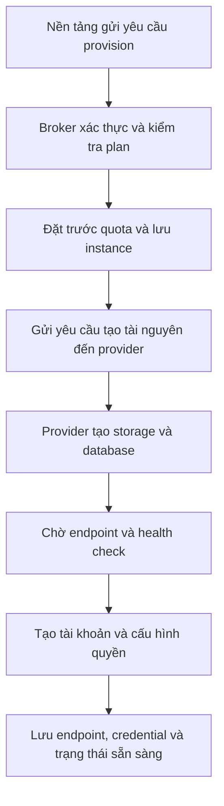
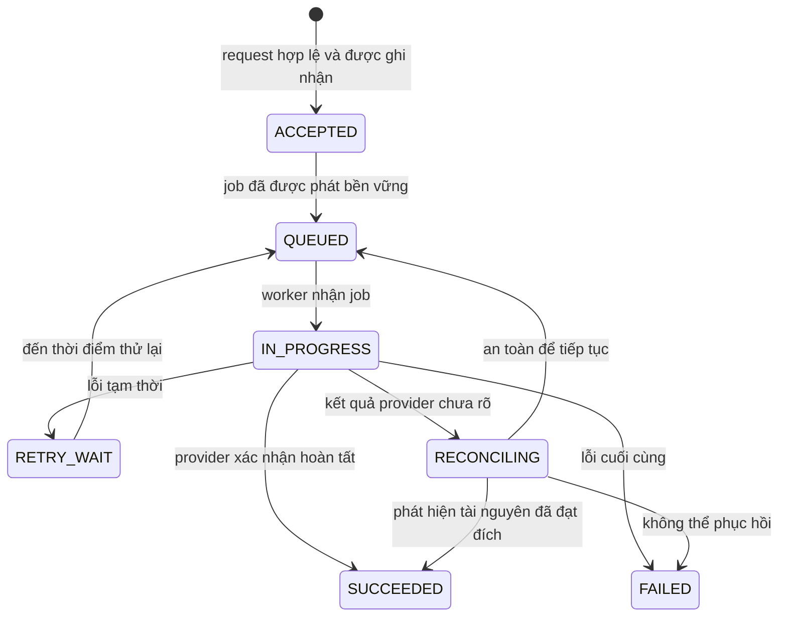
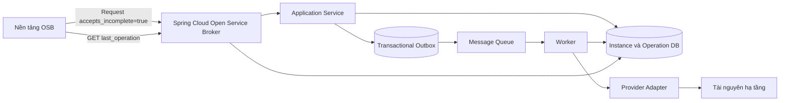

# Vì sao tác vụ hạ tầng kéo dài cần giao thức bất đồng bộ

Một service broker thường phải điều khiển những hệ thống bên ngoài để tạo, thay đổi hoặc thu hồi tài nguyên. Một database có thể cần vài phút để khởi tạo; volume có thể phải chờ storage controller; cụm Kubernetes có thể cần tải image, lên lịch pod và kiểm tra readiness; thao tác resize hoặc di chuyển dữ liệu có thể kéo dài hơn nữa. Nếu broker giữ một HTTP request mở cho đến khi tất cả công việc kết thúc, request có thể vượt timeout của nền tảng, proxy hoặc load balancer. Nền tảng khi đó không biết tài nguyên đã được tạo hay chưa và có thể gửi lại yêu cầu.

Open Service Broker API (OSB API) định nghĩa cơ chế bất đồng bộ cho các thao tác vòng đời có thể kéo dài. Nền tảng báo trước rằng nó chấp nhận xử lý bất đồng bộ bằng `accepts_incomplete=true`. Broker ghi nhận operation, trả `202 Accepted` cùng thông tin operation khi cần, thực hiện công việc ở worker và cung cấp endpoint `last_operation` để nền tảng truy vấn trạng thái. Cơ chế này giúp request HTTP kết thúc sớm trong khi công việc hạ tầng vẫn tiếp tục có kiểm soát.

Với `SPRING_CLOUD_SERVICE_BROKER`, bất đồng bộ là một phần của hợp đồng giữa nền tảng và broker. Nó cần trạng thái bền vững, operation ID, xử lý retry, idempotency và khả năng phục hồi sau khi tiến trình dừng. Chỉ đưa công việc vào một thread nền rồi trả `202` là chưa đủ.

## 1. Vì sao thao tác hạ tầng không hoàn tất nhanh?

Một thao tác broker thường là chuỗi nhiều bước, mỗi bước có thể phụ thuộc vào một hệ thống khác:

- **Cấp phát database:** tạo instance, gắn storage, cấu hình mạng, khởi động database engine, tạo user và đợi health check.
- **Cấp phát volume:** gọi API storage, đợi controller tạo volume, attach volume vào node rồi xác nhận thiết bị sẵn sàng.
- **Tạo cụm dịch vụ:** tạo tài nguyên điều khiển, đợi scheduler phân bổ node, tải image, khởi động workload và chờ readiness.
- **Thay đổi cấu hình:** tăng dung lượng, tạo replica, chuyển dữ liệu hoặc áp dụng cấu hình có thể yêu cầu restart.
- **Thu hồi tài nguyên:** xóa workload, tháo volume, giải phóng IP, xóa database và xác nhận tài nguyên không còn tồn tại.

Thời gian hoàn tất phụ thuộc vào tải hệ thống, hàng đợi của nhà cung cấp, quota, vùng triển khai và trạng thái mạng. Broker không thể giả định một thao tác luôn hoàn tất trong vài giây chỉ vì lần thử ở môi trường phát triển đã nhanh.

Một luồng cấp phát database minh họa:



Nếu broker chờ toàn bộ chuỗi này trong một HTTP request, thời gian phản hồi sẽ bị chi phối bởi bước chậm nhất và mọi lần retry của client có thể làm trùng lặp công việc.

## 2. Giới hạn của mô hình HTTP đồng bộ

Trong mô hình đồng bộ, nền tảng gửi request và chờ broker trả kết quả cuối cùng trong cùng kết nối HTTP. Cách này phù hợp khi thao tác nhanh, có thời gian thực thi dự đoán được và provider có thể xác nhận kết quả ngay.

Với tác vụ kéo dài, có một số rủi ro:

1. **Timeout ở nhiều lớp:** HTTP client, API gateway, reverse proxy, load balancer hoặc nền tảng có thể đóng kết nối trước khi provider hoàn tất.
2. **Kết quả không xác định:** broker có thể đã gửi lệnh tạo tài nguyên nhưng kết nối bị ngắt trước khi phản hồi đến nền tảng.
3. **Retry gây tác dụng phụ trùng:** nền tảng không biết lần gọi trước đã thành công hay chưa nên gửi lại request; nếu broker không idempotent, có thể tạo hai database hoặc hai volume.
4. **Tài nguyên xử lý bị chiếm dụng:** request dài giữ connection, request context và tài nguyên xử lý trong thời gian chờ I/O.
5. **Khó phục hồi sau sự cố:** nếu tiến trình broker dừng giữa chừng, kết nối HTTP mất đi và trạng thái công việc có thể không còn nơi lưu đáng tin cậy.

Tăng timeout có thể giúp một số thao tác hoàn tất, nhưng không giải quyết được thời gian thực thi không giới hạn, sự cố tiến trình hay việc nền tảng gửi lại request. Vì vậy, đồng bộ nên dành cho các thao tác có thể hoàn thành nhanh và có kết quả xác định trong giới hạn thời gian hợp lý.

| Tiêu chí | Đồng bộ | Bất đồng bộ theo OSB API |
|---|---|---|
| HTTP request | Mở đến khi có kết quả cuối cùng | Kết thúc sau khi broker chấp nhận operation |
| Kết quả ban đầu | Thành công hoặc lỗi cuối cùng | `202 Accepted` khi công việc được xử lý nền |
| Theo dõi tiến độ | Không cần operation polling nếu đã hoàn tất | Nền tảng gọi `last_operation` |
| Phù hợp với | Thao tác ngắn, dễ dự đoán | Tạo, cập nhật hoặc thu hồi tài nguyên kéo dài |
| Yêu cầu vận hành | Xử lý request và lỗi trong một lượt | Lưu operation bền vững, worker, retry và đối soát |

## 3. Bất đồng bộ là hợp đồng giao thức, không chỉ là chạy nền

OSB API quy định cách nền tảng và broker thương lượng việc xử lý bất đồng bộ. Với các thao tác provision, update và deprovision, nền tảng có thể gửi query parameter `accepts_incomplete=true` để cho biết nó chấp nhận operation hoàn tất sau response HTTP ban đầu.

Ví dụ yêu cầu tạo instance:

```http
PUT /v2/service_instances/db-100?service_id=postgres-service&plan_id=standard&accepts_incomplete=true HTTP/1.1
Host: broker.example.com
Content-Type: application/json
X-Broker-API-Version: 2.17
```

Ví dụ yêu cầu cập nhật instance:

```http
PUT /v2/service_instances/db-100?service_id=postgres-service&plan_id=production&accepts_incomplete=true HTTP/1.1
Host: broker.example.com
Content-Type: application/json
X-Broker-API-Version: 2.17
```

`accepts_incomplete` là query parameter của request. Nó không phải header và cũng không phải một trường trong JSON body. Giá trị này thể hiện khả năng tiếp nhận operation bất đồng bộ của nền tảng cho lần gọi đó.

Broker chỉ nên trả response bất đồng bộ khi cả hai bên đã thống nhất: request cho phép async và broker thực sự hỗ trợ quy trình operation tương ứng. Nếu thao tác bắt buộc phải chạy bất đồng bộ nhưng request không chấp nhận async, OSB API quy định broker trả lỗi `422 Unprocessable Entity` với mã lỗi `AsyncRequired`. Nếu nền tảng yêu cầu async nhưng broker không hỗ trợ, broker trả lỗi `422 Unprocessable Entity` với mã `AsyncNotSupported` theo hợp đồng API.

Các thao tác bind và unbind thường được xử lý theo hợp đồng đồng bộ của OSB API; không được mặc định rằng mọi endpoint broker đều có thể dùng `accepts_incomplete`. Hãy kiểm tra đúng quy định cho từng thao tác trong phiên bản API được triển khai.

## 4. `202 Accepted` có ý nghĩa gì?

HTTP `202 Accepted` cho biết broker đã chấp nhận yêu cầu để xử lý, nhưng công việc chưa nhất thiết hoàn tất. Nó không có nghĩa database đã sẵn sàng, volume đã attach hoặc cấu hình mới đã có hiệu lực.

Khi trả `202`, broker cần bảo đảm:

- Request đã vượt qua những kiểm tra đầu vào và chính sách có thể thực hiện trước khi chấp nhận.
- Instance và operation được ghi vào nơi lưu trữ bền vững.
- Operation có định danh để nền tảng truy vấn nếu cần.
- Công việc được chuyển đến cơ chế xử lý có thể khôi phục, chẳng hạn queue hoặc transactional outbox.
- Worker có đủ dữ liệu để tiếp tục mà không phụ thuộc vào HTTP request đã kết thúc.

Ví dụ response bất đồng bộ:

```http
HTTP/1.1 202 Accepted
Content-Type: application/json
```

```json
{
  "operation": "provision-2026-000184"
}
```

Trường `operation` là mã định danh operation do broker quản lý. Đây là giá trị opaque đối với nền tảng: nền tảng lưu và gửi lại khi truy vấn, không cần hiểu cấu trúc bên trong. OSB API cho phép trường này được lược bỏ trong những trường hợp phù hợp, nhưng khi broker có thể có nhiều operation cần phân biệt trên cùng instance, việc trả operation ID là cần thiết để truy vấn đúng công việc.

Broker không được trả `202` rồi mới cố gắng lưu operation. Nếu queue không khả dụng hoặc database không thể ghi nhận operation, broker chưa thể bảo đảm đã nhận công việc và phải trả lỗi thích hợp.

## 5. Endpoint `last_operation` và cơ chế polling

Sau response `202`, nền tảng cần biết operation đang chạy, đã thành công hay thất bại. OSB API cung cấp endpoint `last_operation` để truy vấn trạng thái của thao tác trên service instance.

Ví dụ:

```http
GET /v2/service_instances/db-100/last_operation?service_id=postgres-service&plan_id=standard&operation=provision-2026-000184 HTTP/1.1
Host: broker.example.com
X-Broker-API-Version: 2.17
```

Broker trả về trạng thái operation:

```json
{
  "state": "in progress",
  "description": "Đang tạo database và chờ health check"
}
```

Khi hoàn tất thành công:

```json
{
  "state": "succeeded",
  "description": "Database đã sẵn sàng"
}
```

Khi thất bại:

```json
{
  "state": "failed",
  "description": "Provider từ chối cấp phát do quota vùng đã hết"
}
```

Các trạng thái chuẩn thường dùng là `in progress`, `succeeded` và `failed`. `description` là thông tin bổ sung giúp nền tảng hoặc người vận hành hiểu tiến độ; không nên chứa token, password, endpoint nội bộ nhạy cảm hoặc stack trace.

Nền tảng chủ động polling endpoint theo lịch của nó. Broker nên trả trạng thái nhanh từ dữ liệu đã lưu, không khởi chạy lại tác vụ mỗi lần nhận GET. Polling chỉ đọc trạng thái; nó không phải tín hiệu yêu cầu worker chạy lại.

## 6. Vì sao cần operation ID và trạng thái bền vững?

Operation ID liên kết response ban đầu với các lần truy vấn sau. Nó giúp phân biệt hai lần update liên tiếp trên cùng instance và hỗ trợ xử lý trường hợp nền tảng gửi lại request.

Một operation record có thể lưu các thông tin:

| Trường | Mục đích |
|---|---|
| `operationId` | Định danh duy nhất của operation |
| `instanceId` | Service instance đang được thay đổi |
| `operationType` | `PROVISION`, `UPDATE` hoặc `DEPROVISION` |
| `status` | Trạng thái xử lý hiện tại |
| `requestFingerprint` | Nhận diện request lặp hoặc xung đột |
| `targetConfiguration` | Snapshot cấu hình đích đã chuẩn hóa |
| `providerOperationId` | Định danh tác vụ ở nhà cung cấp nếu có |
| `attemptCount` | Số lần worker thử xử lý |
| `createdAt`, `updatedAt` | Thời điểm tạo và cập nhật |
| `lastErrorCode`, `lastErrorSummary` | Thông tin lỗi đã được lọc để chẩn đoán |

Nếu trạng thái chỉ nằm trong bộ nhớ của một JVM, broker sẽ mất thông tin khi pod bị restart hoặc node bị thay thế. Nền tảng vẫn giữ operation ID và tiếp tục polling nhưng broker không thể trả lời. Vì vậy, operation state phải được lưu bền vững trong database hoặc kho dữ liệu phù hợp.

## 7. Vòng đời operation bất đồng bộ

Một operation có thể đi qua các trạng thái như sau:



Đây là state machine nội bộ minh họa. Khi trả `last_operation`, broker ánh xạ trạng thái nội bộ sang các giá trị OSB API quy định. Ví dụ `ACCEPTED`, `QUEUED`, `IN_PROGRESS`, `RETRY_WAIT` và `RECONCILING` có thể được trình bày là `in progress`; trạng thái cuối là `succeeded` hoặc `failed`.

Không nên chuyển operation thành `succeeded` chỉ vì worker đã gửi request đến provider. Cần có xác nhận rằng tài nguyên đã đạt trạng thái mong muốn. Nếu provider trả về một ID tác vụ riêng và xử lý eventual consistency, broker cần lưu ID đó rồi kiểm tra tiến độ đến khi kết quả cuối cùng được xác nhận.

## 8. Kiến trúc xử lý bất đồng bộ trong Spring service broker

Một kiến trúc phổ biến chia thành lớp HTTP/OSB, application service, operation store, outbox/queue, worker và provider adapter:



Trách nhiệm từng phần:

- **Spring Cloud Open Service Broker:** tiếp nhận request OSB API, chuyển request đến `ServiceInstanceService` và serialize response theo giao thức.
- **Application service:** xác thực instance/plan, chuẩn hóa parameters, kiểm tra quota và quyết định đồng bộ hay bất đồng bộ.
- **Operation store:** lưu operation ID, trạng thái, snapshot request và thông tin phục hồi.
- **Outbox/queue:** bảo đảm công việc được chuyển đến worker sau khi trạng thái đã được ghi nhận.
- **Worker:** thực thi hoặc theo dõi tác vụ provider, retry có giới hạn và cập nhật operation state.
- **Provider adapter:** giao tiếp với Cloud API, Kubernetes API, database service hoặc storage system.

Các thành phần có thể nằm trong một ứng dụng Spring Boot ở giai đoạn đầu. Điều quan trọng là ranh giới trách nhiệm và dữ liệu được thiết kế rõ, để có thể tăng số worker hoặc tách queue khi tải tăng.

## 9. Vì sao không thể chỉ dùng `Mono` hoặc `@Async` rồi trả response?

Spring Cloud Open Service Broker có thể dùng API reactive, ví dụ handler trả `Mono<Response>`. Reactor giúp xử lý I/O bất đồng bộ ở cấp lập trình và tránh chặn thread trong một số luồng. Tuy nhiên, điều đó không tự tạo ra operation bất đồng bộ theo OSB API.

Nếu một `Mono` chỉ hoàn tất sau khi provider tạo xong database, HTTP request vẫn chờ kết quả của operation đó. Kết nối có thể timeout giống mô hình đồng bộ. Tương tự, `@Async` chỉ chuyển công việc sang executor; nếu broker không lưu operation state và không có endpoint polling, nền tảng không có cách biết công việc đã thành công hay thất bại.

| Khái niệm | Nó giải quyết điều gì? | Có thay thế async OSB không? |
|---|---|---|
| Reactor `Mono`/`Flux` | Xử lý luồng dữ liệu và I/O theo kiểu reactive | Không |
| `@Async` hoặc executor | Chạy phương thức trên thread khác | Không |
| Message queue | Chuyển giao công việc giữa các tiến trình | Chưa đủ nếu thiếu operation state và polling |
| Async OSB API | Hợp đồng chấp nhận operation, trả `202` và truy vấn `last_operation` | Là cơ chế giao thức cần triển khai |

Có thể dùng Reactor, executor hoặc queue bên trong broker, nhưng phải kết hợp chúng với operation record bền vững và giao thức polling của OSB API.

## 10. Transactional outbox giúp tránh mất công việc

Một lỗi thường gặp là ghi operation vào database rồi gửi message vào queue bằng hai thao tác độc lập:

1. Database commit operation thành công.
2. Tiến trình dừng trước khi gửi message.

Khi đó operation ở trạng thái `ACCEPTED` nhưng không có worker nào biết để xử lý. Trường hợp ngược lại, message đã được gửi nhưng transaction lưu operation rollback có thể khiến worker nhận job không có bản ghi tương ứng.

Transactional outbox giải quyết khoảng trống này bằng cách ghi operation và outbox event trong cùng một transaction database. Một publisher đọc outbox chưa gửi, phát message đến queue rồi đánh dấu đã gửi. Nếu publisher dừng sau khi gửi nhưng trước khi đánh dấu, message có thể được gửi lại; worker vẫn phải idempotent.

Luồng ghi nhận:

```java
@Transactional
public AcceptedOperation accept(UpdateCommand command) {
    Operation operation = operationRepository.save(
            Operation.accepted(command.operationId(), command.instanceId()));

    outboxRepository.save(OutboxEvent.forOperation(operation.getId()));

    return AcceptedOperation.from(operation);
}
```

Đây là mã minh họa ở tầng ứng dụng. Transaction phải bao trùm cả hai bản ghi trong cùng database. Publisher và worker là các thành phần riêng, xử lý giao nhận có thể lặp và cập nhật trạng thái theo operation ID.

## 11. Retry, idempotency và kết quả không xác định

Một tác vụ provider có thể timeout sau khi provider đã thực hiện thay đổi nhưng trước khi broker nhận response. Broker không thể kết luận lệnh thất bại chỉ dựa trên timeout. Nếu gửi lại một lệnh tạo tài nguyên mà provider không hỗ trợ idempotency, có thể sinh tài nguyên trùng.

Các nguyên tắc cần áp dụng:

- Tạo operation ID ổn định và lưu request fingerprint.
- Dùng idempotency key của provider nếu API hỗ trợ.
- Nếu không có idempotency key, đọc trạng thái provider trước khi gửi lại lệnh chưa rõ kết quả.
- Retry lỗi tạm thời với giới hạn số lần, backoff và jitter.
- Không retry vô hạn lỗi nghiệp vụ như quota đã hết hoặc plan không được hỗ trợ.
- Lưu attempt count và lỗi gần nhất để vận hành có thể chẩn đoán.
- Đảm bảo nhiều worker không cùng thực hiện một operation đồng thời.

Ví dụ phân loại lỗi:

| Lỗi | Hướng xử lý |
|---|---|
| Timeout hoặc lỗi kết nối tạm thời | Đối soát trạng thái provider, sau đó retry có giới hạn |
| HTTP 429 từ provider | Tôn trọng hướng dẫn retry, backoff và giới hạn tốc độ |
| Provider 5xx | Retry có kiểm soát sau khi đánh giá khả năng lệnh đã được thực hiện |
| Quota hoặc policy bị từ chối | Đánh dấu failed, không retry tự động nếu điều kiện không đổi |
| Tham số không hợp lệ | Đánh dấu lỗi request trước khi chấp nhận operation |
| Kết quả không xác định | Chuyển sang `RECONCILING`, truy vấn provider trước khi quyết định |

## 12. Polling cần hiệu quả và có giới hạn

Nền tảng có thể polling `last_operation` nhiều lần trong khi operation chạy. Endpoint này nên đọc từ operation store hoặc read model đã cập nhật, không gọi provider và không thực hiện tác vụ nặng mỗi lần polling.

Broker cần:

- Trả kết quả nhanh và ổn định cho cùng một operation ID.
- Chỉ trả trạng thái cuối sau khi kết quả được xác nhận.
- Bảo đảm operation ID gắn với đúng instance và đúng service.
- Không tiết lộ operation của tenant khác khi biết hoặc đoán được ID.
- Lưu trạng thái đủ lâu để nền tảng có thể nhận kết quả cuối sau gián đoạn.
- Có chính sách retention/cleanup cho operation cũ nhưng không xóa trước thời gian cần thiết.

Nền tảng quyết định nhịp polling. Broker nên cung cấp endpoint nhẹ, hỗ trợ tải đồng thời và có rate limiting hợp lý để polling không làm ảnh hưởng worker. Nếu nền tảng hoặc hạ tầng có cơ chế backoff, broker cần tôn trọng các hướng dẫn được giao thức và nền tảng hỗ trợ.

## 13. Trải nghiệm nền tảng và người dùng

Bất đồng bộ thay đổi cách người dùng nhìn thấy thao tác. Thay vì chờ một màn hình quay liên tục đến khi timeout, nền tảng có thể hiển thị trạng thái đang tạo, đang cập nhật hoặc đang thu hồi; sau đó cập nhật khi polling nhận được trạng thái cuối.

Một luồng trải nghiệm:

1. Người dùng chọn plan và gửi yêu cầu tạo database.
2. Nền tảng gửi request với `accepts_incomplete=true`.
3. Broker trả `202 Accepted` và operation ID.
4. Nền tảng thông báo yêu cầu đã được tiếp nhận và hiển thị `in progress`.
5. Nền tảng polling `last_operation` theo lịch.
6. Khi nhận `succeeded`, nền tảng hiển thị instance đã sẵn sàng; khi nhận `failed`, hiển thị thông báo có thể hành động.

`202 Accepted` cần được diễn giải là “đã tiếp nhận để xử lý”, không phải “dịch vụ đã sẵn sàng”. Nếu nền tảng hiển thị thành công ngay khi nhận `202`, người dùng có thể cố kết nối đến endpoint chưa tồn tại.

## 14. Tích hợp Cloud Foundry và Kubernetes

Cloud Foundry và các nền tảng tương thích OSB API có thể gửi `accepts_incomplete=true` khi thực hiện các thao tác hỗ trợ async. Broker cần tuân theo hợp đồng giao thức thay vì phụ thuộc vào chi tiết nội bộ của nền tảng.

Với Kubernetes, một service broker có thể được triển khai trong cluster và gọi Kubernetes API để tạo custom resource, StatefulSet, Service, PVC hoặc tài nguyên khác. Việc tạo object Kubernetes có thể trả nhanh, nhưng controller cần thời gian để reconcile và workload cần thời gian để sẵn sàng. Broker có thể xem trạng thái resource/controller là một phần của operation và chỉ đánh dấu `succeeded` khi điều kiện sẵn sàng theo chính sách đã đạt.

Với Cloud Foundry, broker có thể gọi dịch vụ quản lý bên ngoài hoặc control plane để cấp phát tài nguyên. Dù provider là Kubernetes, database cloud hay hệ thống nội bộ, broker vẫn cần operation ID và endpoint `last_operation` nhất quán theo OSB API.

Không nên để operation state chỉ tồn tại trong pod broker. Kubernetes có thể thay pod khi rollout hoặc reschedule; worker mới phải tiếp tục được operation từ database/queue. Tương tự, việc scale nhiều replica yêu cầu khóa hoặc cơ chế claim job để tránh xử lý trùng.

## 15. Bảo mật trong luồng bất đồng bộ

HTTP request ban đầu có thể đã được xác thực, nhưng worker chạy sau đó trong một tiến trình khác. Vì vậy, dữ liệu được lưu để worker sử dụng phải có nguồn gốc và quyền truy cập rõ ràng.

- Lưu tenant, instance và actor theo nguồn đã xác thực; không lấy danh tính từ tham số không đáng tin cậy.
- Chỉ worker/service account có quyền cần thiết mới được đọc operation và gọi provider.
- Mã hóa hoặc bảo vệ credential/provider token trong kho lưu trữ; không đưa secret vào message body nếu không cần thiết.
- Xác minh quyền sở hữu instance khi nền tảng truy vấn `last_operation`.
- Không để operation ID có thể đoán được trở thành cơ chế cấp quyền duy nhất.
- Ghi audit event cho việc tiếp nhận, retry, chuyển trạng thái và thao tác quản trị.
- Che dữ liệu nhạy cảm trong log và `description` của operation.

Queue và database operation cũng là bề mặt bảo mật. Cần phân quyền, mã hóa đường truyền, quản lý retention và kiểm soát truy cập theo tenant nếu nhiều broker hoặc nhiều tổ chức dùng chung hạ tầng.

## 16. Kiểm thử và quan sát operation

Kiểm thử bất đồng bộ phải kiểm tra toàn bộ vòng đời, không chỉ response `202`.

| Nhóm kiểm thử | Điều cần xác minh |
|---|---|
| Thương lượng async | `accepts_incomplete` được đọc đúng; xử lý `AsyncRequired` và `AsyncNotSupported` đúng hợp đồng |
| Tiếp nhận | Operation và job được ghi bền vững trước response `202` |
| Polling | `last_operation` trả đúng `in progress`, `succeeded`, `failed` |
| Restart | Worker/pod dừng giữa chừng nhưng operation có thể tiếp tục |
| Retry | Giao message nhiều lần không tạo side effect trùng |
| Provider timeout | Broker đối soát trước khi gửi lại lệnh chưa rõ kết quả |
| Concurrency | Hai worker không xử lý cùng operation hoặc cùng instance trái chính sách |
| Lỗi cuối | Failure được lưu và trả về nền tảng, không bị kẹt mãi ở `in progress` |
| Bảo mật | Tenant khác không thể đọc operation hoặc dữ liệu nhạy cảm |

Các metric vận hành hữu ích:

- Số operation theo loại và trạng thái.
- Thời gian từ `ACCEPTED` đến trạng thái cuối.
- Số operation đang `IN_PROGRESS` quá ngưỡng thời gian.
- Số lần retry, timeout và lỗi provider theo mã lỗi.
- Độ trễ outbox publisher và queue consumer.
- Số operation cần reconciliation hoặc bị kẹt.
- Tỷ lệ thành công/thất bại theo plan và provider.

Log nên chứa `operationId`, `instanceId`, `providerOperationId` và correlation ID để truy vết giữa HTTP request, worker và provider. Không log token hoặc credential. Cần cảnh báo cho operation quá hạn, queue backlog và lỗi provider tăng đột biến.

## 17. Trình tự triển khai bất đồng bộ cho service broker

Khi xây dựng async operation trong Spring Cloud Open Service Broker, có thể triển khai theo trình tự:

1. Xác định thao tác nào có thể kéo dài và thao tác nào phải hoàn tất đồng bộ theo OSB API.
2. Công bố rõ khả năng async và kiểm tra query parameter `accepts_incomplete`.
3. Thiết kế operation ID, state machine và schema lưu operation bền vững.
4. Xây dựng application service để validate request, lưu desired state và tạo operation.
5. Dùng transactional outbox hoặc cơ chế giao nhận bền vững để phát job.
6. Xây dựng worker và provider adapter có timeout, idempotency, retry và reconciliation.
7. Triển khai `last_operation` để đọc trạng thái operation theo hợp đồng OSB API.
8. Bảo đảm operation và job có thể tiếp tục sau restart, rollout hoặc scale replica.
9. Kiểm thử timeout, duplicate delivery, provider outage, conflict và failure cuối.
10. Thiết lập metric, log, alert và retention cho operation đã hoàn tất.

Giao thức bất đồng bộ giúp nền tảng nhận được phản hồi sớm và theo dõi công việc hạ tầng qua operation state. Giá trị của nó nằm ở toàn bộ vòng đời có thể phục hồi: broker xác nhận đã nhận việc, worker thực hiện có kiểm soát, trạng thái được lưu bền vững và nền tảng có thể truy vấn kết quả cuối cùng mà không cần giữ kết nối HTTP trong suốt thời gian cấp phát tài nguyên.
