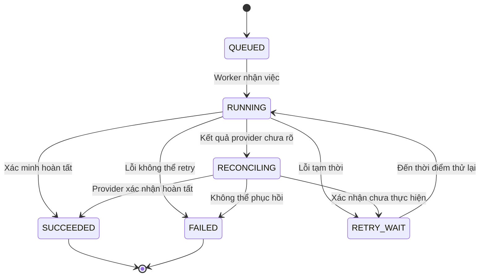
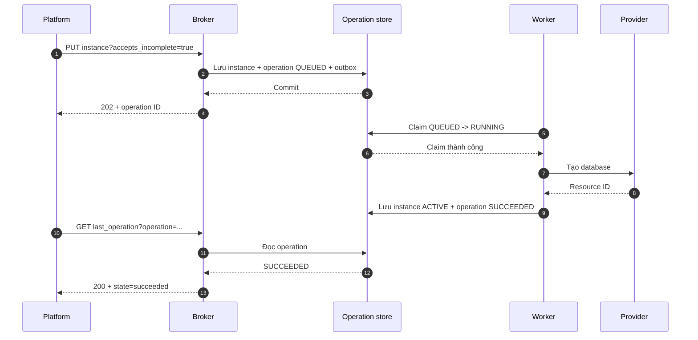

# Mô hình trạng thái in progress, succeeded và failed

Một thao tác cấp phát hoặc cập nhật tài nguyên có thể mất nhiều thời gian hơn thời hạn chờ của một request HTTP. Khi nền tảng cho phép xử lý bất đồng bộ, service broker tiếp nhận yêu cầu, trả `202 Accepted` và cung cấp mã `operation` để nền tảng theo dõi. Trong những lần gọi tiếp theo, nền tảng truy vấn endpoint `last_operation` để biết công việc còn chạy, đã thành công hay đã thất bại.

Open Service Broker API (OSB API) chuẩn hóa ba trạng thái operation mà platform cần hiểu: `in progress`, `succeeded` và `failed`. Đây là trạng thái của một lần thực hiện thao tác. Broker thường cần một state machine nội bộ chi tiết hơn để quản lý hàng đợi, worker, retry, lỗi chưa xác định và reconciliation, rồi ánh xạ state nội bộ sang ba giá trị chuẩn của giao thức.

Trong module `SPRING_CLOUD_SERVICE_BROKER`, việc thiết kế state model đúng giúp Spring Cloud Open Service Broker trả lời nhất quán cho Cloud Foundry hoặc platform tương thích OSB API, kể cả khi broker có nhiều replica, worker khởi động lại hoặc backing service phản hồi chậm. Bài học này tập trung vào ý nghĩa trạng thái, vòng đời operation, lưu trạng thái bền vững, polling và cách xử lý chuyển trạng thái an toàn.

## Mục tiêu học tập

Sau bài này, bạn có thể:

- Giải thích ý nghĩa của `in progress`, `succeeded` và `failed` theo OSB API.
- Mô tả state machine nội bộ cho một operation bất đồng bộ.
- Phân biệt trạng thái operation với trạng thái service instance.
- Thiết kế operation ID ổn định và lưu trạng thái bền vững.
- Xử lý polling, `Retry-After`, retry và các trường hợp worker bị dừng.
- Ngăn chuyển trạng thái sai thứ tự hoặc chạy trùng operation khi có nhiều replica.
- Ánh xạ state nội bộ sang response `last_operation` một cách nhất quán.

## 1. Vì sao cần mô hình trạng thái operation?

Giả sử platform yêu cầu provision một PostgreSQL instance. Broker cần gọi API của nhà cung cấp để tạo database, cấp tài khoản, thiết lập quyền và ghi nhận thông tin kết nối. Các bước này có thể mất vài phút. Nếu broker giữ request HTTP mở cho đến khi hoàn tất, kết nối có thể timeout dù công việc ở phía provider vẫn tiếp tục.

OSB API cho phép platform thông báo rằng nó chấp nhận xử lý bất đồng bộ bằng query parameter `accepts_incomplete=true`. Khi broker tiếp nhận công việc, broker trả `202 Accepted` và có thể kèm `operation` trong response body. Platform giữ mã này rồi gọi `last_operation` để truy vấn tiến độ.

Ví dụ request:

```http
PUT /v2/service_instances/instance-123?accepts_incomplete=true HTTP/1.1
X-Broker-API-Version: 2.17
Content-Type: application/json

{
  "service_id": "postgres-service",
  "plan_id": "standard-plan",
  "parameters": {
    "database_name": "orders"
  }
}
```

Response khi broker tiếp nhận:

```http
HTTP/1.1 202 Accepted
Content-Type: application/json
Retry-After: 5

{
  "operation": "provision-2026-000123"
}
```

`202 Accepted` có nghĩa broker đã nhận trách nhiệm xử lý request; nó không có nghĩa database đã sẵn sàng. `operation` là mã theo dõi do broker cấp. Nếu broker trả operation ID, platform gửi lại mã đó khi truy vấn trạng thái. Mã này nên được xem là opaque: platform không diễn giải cấu trúc hoặc tự tạo giá trị thay thế.

State model giúp broker trả lời được các câu hỏi: công việc đã được lưu chưa, worker nào đang thực hiện, bước nào đã hoàn tất, có thể retry không, và kết quả cuối cùng là gì. Nếu không lưu trạng thái một cách có hệ thống, broker có thể mất dấu công việc khi process restart hoặc trả kết quả khác nhau giữa các replica.

## 2. Ba trạng thái chuẩn của OSB API

Khi platform gọi endpoint `last_operation`, broker trả `200 OK` với JSON body chứa `state`. Ba giá trị chuẩn cần được hiểu như sau:

| `state` | Ý nghĩa | Platform nên làm gì? |
|---|---|---|
| `in progress` | Operation vẫn đang được xử lý hoặc broker chưa xác nhận được kết quả cuối. | Tiếp tục chờ và polling theo chính sách hoặc `Retry-After`. |
| `succeeded` | Operation đã hoàn tất thành công theo cam kết của broker. | Dừng polling và tiếp tục quy trình vòng đời dịch vụ. |
| `failed` | Operation đã kết thúc nhưng không thể hoàn thành thành công. | Dừng polling; hiển thị hoặc xử lý lỗi theo kết quả cuối. |

Ví dụ response đang chạy:

```http
HTTP/1.1 200 OK
Content-Type: application/json
Retry-After: 5

{
  "state": "in progress",
  "description": "Đang tạo database và cấu hình quyền truy cập"
}
```

Ví dụ response thành công:

```json
{
  "state": "succeeded",
  "description": "Database đã sẵn sàng"
}
```

Ví dụ response thất bại:

```json
{
  "state": "failed",
  "description": "Không thể cấp phát tài nguyên theo cấu hình yêu cầu"
}
```

`description` là thông tin mô tả tùy chọn, hữu ích cho người vận hành hoặc giao diện platform. Không đưa password, token, stack trace, thông tin hạ tầng nội bộ hoặc nội dung exception thô vào trường này.

Điểm quan trọng: `last_operation` thường trả HTTP `200 OK` khi truy vấn trạng thái thành công, kể cả khi giá trị `state` là `failed`. HTTP status ở đây mô tả việc đọc trạng thái; field `state` mô tả kết quả nghiệp vụ của operation đã chạy.

## 3. State machine nội bộ

Ba giá trị OSB API là giao diện đơn giản cho platform. Bên trong broker, state machine thường cần nhiều trạng thái hơn để mô tả quá trình xử lý.

Một mô hình nội bộ tham khảo:

| Trạng thái nội bộ | Ý nghĩa | Ánh xạ OSB API |
|---|---|---|
| `QUEUED` | Operation đã được lưu và chờ worker nhận. | `in progress` |
| `RUNNING` | Worker đang thực hiện các bước. | `in progress` |
| `RETRY_WAIT` | Đang chờ đến thời điểm retry một lỗi tạm thời. | `in progress` |
| `RECONCILING` | Đang xác minh trạng thái provider sau timeout hoặc lỗi không rõ kết quả. | `in progress` |
| `SUCCEEDED` | Tất cả điều kiện hoàn tất đã được xác minh. | `succeeded` |
| `FAILED` | Operation kết thúc thất bại và không còn retry tự động. | `failed` |
| `CANCELLED` | Operation được hủy theo chính sách nội bộ trước khi hoàn tất. | Thường ánh xạ `failed` nếu hợp đồng không định nghĩa trạng thái hủy riêng. |

Các tên trên là trạng thái nội bộ do broker định nghĩa, không phải giá trị `state` được phép trả tùy ý cho platform. Ví dụ, không trả `QUEUED`, `RETRY_WAIT` hoặc `RECONCILING` trong response OSB API; các trạng thái này được ánh xạ thành `in progress`.

### 3.1. Sơ đồ chuyển trạng thái



State machine này mô tả một operation. Khi đã chuyển sang `SUCCEEDED` hoặc `FAILED`, operation được xem là terminal. Không đổi một operation terminal trở lại `RUNNING`. Nếu người dùng gửi yêu cầu mới sau khi sửa nguyên nhân lỗi, broker tạo operation mới có ID khác và liên kết nó với instance cùng lịch sử trước đó.

### 3.2. Điều kiện chuyển trạng thái

Mỗi transition phải có điều kiện rõ ràng:

- `QUEUED -> RUNNING`: worker đã claim operation thành công và có lease hoặc cơ chế khóa phù hợp.
- `RUNNING -> SUCCEEDED`: mọi bước bắt buộc đã hoàn tất, provider state đã được xác nhận và dữ liệu broker đã commit.
- `RUNNING -> RETRY_WAIT`: lỗi được phân loại là tạm thời, thao tác có thể retry an toàn và còn ngân sách retry.
- `RUNNING -> RECONCILING`: request provider timeout hoặc kết quả không rõ; chưa thể kết luận thành công hay thất bại.
- `RECONCILING -> SUCCEEDED`: tra cứu xác nhận provider đã đạt trạng thái mong muốn và broker đã lưu kết quả.
- `RECONCILING -> RETRY_WAIT`: xác nhận thao tác trước chưa tạo side effect và có thể thử lại an toàn.
- `RUNNING/RECONCILING -> FAILED`: đã hết chính sách phục hồi hoặc lỗi không thể tiếp tục.

Không chuyển sang `SUCCEEDED` chỉ vì worker nhận HTTP 2xx từ một bước trung gian. Phải xác định toàn bộ operation đã đáp ứng mục tiêu và trạng thái broker đã được lưu bền vững.

## 4. Operation state khác instance state

Một service instance có vòng đời riêng với operation đang tác động lên nó. Hai trạng thái có liên quan nhưng không đồng nhất.

Ví dụ, provision operation có thể `FAILED` nhưng instance record vẫn cần được giữ ở trạng thái `PROVISION_FAILED` hoặc `CLEANUP_REQUIRED` để broker xử lý tài nguyên tạo dở. Với update, operation `FAILED` có thể đi cùng instance vẫn `ACTIVE` nếu cấu hình cũ được xác minh; cũng có thể đi cùng instance `DEGRADED` nếu provider đã thay đổi một phần.

| Operation | Instance | Diễn giải |
|---|---|---|
| `in progress` | `PROVISIONING` | Đang tạo instance. |
| `succeeded` | `ACTIVE` | Provision đã hoàn tất và instance sẵn sàng. |
| `failed` | `PROVISION_FAILED` | Provision thất bại; có thể cần cleanup. |
| `in progress` | `UPDATING` | Đang cập nhật instance hiện có. |
| `failed` | `ACTIVE` | Update thất bại nhưng cấu hình cũ đã được xác minh còn dùng được. |
| `failed` | `DEGRADED` | Update thất bại và tài nguyên đang ở trạng thái một phần. |
| `succeeded` | `DEPROVISIONED` | Deprovision đã hoàn tất. |

Các trạng thái instance trong bảng là ví dụ nội bộ. Không nên dùng `last_operation` để thay thế API truy xuất instance hoặc để biểu diễn mọi chi tiết health của tài nguyên. Platform hỏi operation để biết kết quả một lần thực hiện; broker dùng instance record để quản lý vòng đời và quyền thao tác tiếp theo.

## 5. Operation ID và cấu trúc dữ liệu cần lưu

Operation ID giúp liên kết response `202`, worker, provider request và những lần polling. Một operation record tối thiểu có thể chứa:

| Field | Mục đích |
|---|---|
| `operation_id` | ID duy nhất, ổn định và opaque cho platform. |
| `instance_id` | Instance mà operation tác động. |
| `type` | `provision`, `update` hoặc `deprovision`. |
| `state` | Trạng thái nội bộ hiện tại. |
| `attempt` | Số lần worker thực hiện hoặc retry. |
| `created_at`, `updated_at` | Thời điểm tạo và cập nhật. |
| `next_attempt_at` | Thời điểm được phép retry nếu đang chờ. |
| `provider_operation_id` | ID theo dõi ở provider nếu có. |
| `last_error_code` | Mã lỗi đã chuẩn hóa, không chứa secret. |
| `description` | Mô tả an toàn có thể trả về platform. |
| `version` | Phiên bản bản ghi để optimistic locking. |

Ví dụ JSON nội bộ:

```json
{
  "operation_id": "provision-2026-000123",
  "instance_id": "instance-123",
  "type": "provision",
  "state": "RUNNING",
  "attempt": 1,
  "provider_operation_id": "provider-task-9081",
  "created_at": "2026-11-27T09:30:00Z",
  "updated_at": "2026-11-27T09:30:08Z",
  "version": 4
}
```

Đây là cấu trúc minh họa trong kho dữ liệu broker, không phải response `last_operation` gửi cho platform. Response giao thức chỉ công bố các trường mà OSB API quy định, chẳng hạn `state` và `description`.

### 5.1. Lưu operation bền vững

Không chỉ giữ operation trong `Map` hoặc biến trong bộ nhớ của JVM. Nếu process restart, broker sẽ mất trạng thái và không thể trả lời polling. Hãy lưu operation vào database hoặc một kho lưu trữ bền vững, đồng thời liên kết operation với instance.

Khi nhận request async, thứ tự cơ bản nên là:

1. Xác minh request và kiểm tra idempotency.
2. Ghi instance/operation ở trạng thái ban đầu trong transaction.
3. Ghi sự kiện cần phát tới worker bằng transactional outbox hoặc cơ chế bền vững tương đương.
4. Commit transaction.
5. Phát công việc cho worker và trả `202 Accepted` cùng operation ID.

Nếu broker trả `202` trước khi lưu operation thành công, platform có thể polling một ID không tồn tại. Nếu lưu operation nhưng mất sự kiện đưa vào queue, công việc có thể bị treo; outbox hoặc một cơ chế quét các operation `QUEUED` giúp khôi phục tình huống đó.

### 5.2. Một operation đang hoạt động trên một instance

Với các thao tác có thể xung đột, broker nên tuần tự hóa operation theo instance. Ví dụ, không nên đồng thời chạy update plan và deprovision trên cùng một instance nếu chưa có quy tắc điều phối rõ ràng.

Có thể dùng unique constraint hoặc khóa logic cho operation chưa terminal, kết hợp transaction và version. Khi worker claim một operation, nó cần ghi nhận lease/owner và thời hạn lease. Nếu worker chết, lease hết hạn để worker khác có thể tiếp quản sau khi kiểm tra trạng thái provider.

## 6. Endpoint `last_operation` và polling

Sau khi nhận `202 Accepted`, platform gọi:

```http
GET /v2/service_instances/instance-123/last_operation?service_id=postgres-service&plan_id=standard-plan&operation=provision-2026-000123 HTTP/1.1
X-Broker-API-Version: 2.17
Authorization: Basic <credentials>
```

Broker cần xác định đúng operation bằng instance ID cùng các query parameter theo hợp đồng. `service_id` và `plan_id` phải được kiểm tra theo thông tin instance/operation đã lưu; `operation` phải trỏ tới operation tương ứng nếu broker đã trả ID đó.

Nếu operation đang chạy, response có thể gồm:

```http
HTTP/1.1 200 OK
Content-Type: application/json
Retry-After: 5

{
  "state": "in progress",
  "description": "Đang chờ nhà cung cấp hoàn tất cấp phát"
}
```

Nếu operation đã kết thúc, broker trả `succeeded` hoặc `failed`. Các lần polling lặp sau khi terminal nên nhận cùng kết quả cuối cho operation đó. Không trả kết quả của operation mới nhất nếu platform đang hỏi một operation ID cũ.

### 6.1. Retry-After và tần suất polling

`Retry-After` gợi ý khoảng thời gian platform nên chờ trước lần polling kế tiếp. Broker có thể điều chỉnh giá trị theo loại thao tác, tải hệ thống hoặc thời gian dự kiến hoàn tất. Platform vẫn có thể áp dụng chính sách polling riêng; broker nên trả giá trị thực tế và tránh khuyến khích polling liên tục.

Polling quá dày gây tải lên broker và database nhưng không làm provider hoàn tất nhanh hơn. Có thể dùng khoảng chờ tăng dần, có giới hạn và jitter ở phía client. Ở phía broker, endpoint `last_operation` nên đọc dữ liệu trạng thái nhanh, không gọi provider đồng bộ trong mỗi lần polling nếu worker đã chịu trách nhiệm cập nhật state.

### 6.2. Operation ID tùy chọn và giới hạn một operation

OSB API cho phép response async có thể không chứa `operation` trong một số cách triển khai. Nếu broker không trả operation ID, broker phải bảo đảm có thể xác định duy nhất operation cần theo dõi cho instance theo hợp đồng, thường bằng cách chỉ cho phép một operation đang hoạt động tại một thời điểm. Nếu trả ID, hãy dùng ID đó để tra cứu chính xác, đặc biệt khi lịch sử instance có nhiều operation.

Không dùng `operation` làm secret thay thế xác thực. Endpoint `last_operation` vẫn phải được bảo vệ bằng cơ chế xác thực broker và kiểm tra quyền phù hợp.

## 7. Retry, timeout và kết quả chưa xác định

Một lỗi mạng không nhất thiết đồng nghĩa operation thất bại. Ví dụ, provider đã tạo database nhưng response bị mất. Nếu broker đánh dấu `FAILED` ngay khi timeout, platform có thể tin rằng tài nguyên không tồn tại trong khi tài nguyên thực tế đã được tạo.

### 7.1. Phân loại lỗi

| Loại lỗi | Ví dụ | Hành động state |
|---|---|---|
| Lỗi vĩnh viễn | Plan không hỗ trợ, parameters sai, quyền bị từ chối | Chuyển `FAILED` sau khi xác định không có side effect cần xử lý. |
| Lỗi tạm thời có thể retry | Provider trả 429/503, kết nối bị từ chối trước khi gửi request | Chuyển `RETRY_WAIT`, sau đó quay lại `RUNNING` khi đủ điều kiện. |
| Kết quả không xác định | Timeout sau khi gửi lệnh, mất response | Chuyển `RECONCILING`; tra cứu provider trước khi retry. |
| Lỗi một phần | Tạo database thành công nhưng tạo user thất bại | Tiếp tục bước có thể retry, compensation hoặc kết thúc `FAILED` sau khi cleanup/đối soát. |

### 7.2. Backoff và giới hạn retry

Với lỗi tạm thời, broker có thể dùng exponential backoff, ví dụ 1, 2, 4, 8 giây, kết hợp jitter và giới hạn số lần thử. Cần tôn trọng `Retry-After` của provider nếu có. Mỗi lần retry phải dùng idempotency key hoặc thao tác có thể xác định trạng thái trước khi thực hiện.

Khi hết ngân sách retry, broker không nên để operation ở `in progress` vô thời hạn. Nó cần xác định kết quả cuối, ghi lỗi và chuyển `FAILED`, hoặc giữ `RECONCILING` nếu vẫn chưa thể khẳng định trạng thái và có quy trình vận hành rõ ràng. Một operation không thể ở trạng thái trung gian mãi mà không có timeout, cảnh báo hoặc cơ chế xử lý.

### 7.3. Terminal state không được hồi sinh

Sau khi operation chuyển `SUCCEEDED` hoặc `FAILED`, không sửa lại cùng operation thành `RUNNING` để thực hiện một lần thử mới. Hãy tạo operation mới cho một lần thử mới, giữ liên kết tới operation trước để audit và tránh làm thay đổi lịch sử platform đã quan sát.

## 8. Đồng bộ state giữa worker và nhiều replica

Trong môi trường triển khai thực tế, broker có thể chạy nhiều replica và worker. Hai worker có thể cùng nhận một thông điệp do queue giao lại, hoặc một worker cũ tiếp tục chạy sau khi lease đã được worker mới tiếp quản.

Các kỹ thuật thường dùng:

- **Atomic claim:** cập nhật `QUEUED -> RUNNING` có điều kiện trong transaction để chỉ một worker claim thành công.
- **Lease:** lưu owner và thời điểm hết hạn; worker gia hạn lease khi còn thực hiện.
- **Optimistic locking:** tăng `version` mỗi lần cập nhật và từ chối ghi nếu version đã thay đổi.
- **Unique constraint:** ngăn tạo nhiều operation đang hoạt động xung đột cho cùng instance.
- **Fencing token:** cấp số phiên bản tăng dần cho worker claim; provider adapter hoặc kho dữ liệu có thể từ chối tác vụ từ worker cũ khi hệ thống hỗ trợ.
- **Idempotent step:** mỗi bước provider có key ổn định để queue redelivery không tạo side effect lặp.

Không dựa vào `synchronized` trong Java để điều phối giữa nhiều JVM. Khóa trong bộ nhớ chỉ có hiệu lực trong một process.

### 8.1. Kiểm soát chuyển trạng thái có điều kiện

Ví dụ SQL minh họa claim một operation:

```sql
UPDATE broker_operation
SET state = 'RUNNING',
    worker_id = :workerId,
    lease_until = :leaseUntil,
    version = version + 1,
    updated_at = CURRENT_TIMESTAMP
WHERE operation_id = :operationId
  AND state = 'QUEUED'
  AND version = :expectedVersion;
```

Worker chỉ được thực hiện khi số dòng cập nhật là một. Nếu không có dòng nào thay đổi, operation đã được worker khác claim hoặc trạng thái đã đổi; worker hiện tại phải đọc lại thay vì tiếp tục.

Khi ghi kết quả, cũng cần kiểm tra operation chưa terminal và version/lease còn hợp lệ. Điều này ngăn một worker cũ ghi đè kết quả của worker mới.

## 9. Ánh xạ state nội bộ sang OSB response trong Spring

Trong Spring Cloud Open Service Broker, handler hoặc thành phần service tương ứng cung cấp kết quả cho endpoint `last_operation`. Cách khai báo model và response phụ thuộc phiên bản thư viện; state mapping nên được gom trong một thành phần riêng để tránh mỗi handler trả một cách khác nhau.

Ví dụ model nội bộ:

```java
public enum OperationStatus {
    QUEUED,
    RUNNING,
    RETRY_WAIT,
    RECONCILING,
    SUCCEEDED,
    FAILED
}

public record OperationRecord(
        String operationId,
        String instanceId,
        OperationStatus status,
        String description,
        int attempt
) {}
```

Ví dụ hàm ánh xạ khái niệm:

```java
public String toOsbState(OperationStatus status) {
    return switch (status) {
        case QUEUED, RUNNING, RETRY_WAIT, RECONCILING -> "in progress";
        case SUCCEEDED -> "succeeded";
        case FAILED -> "failed";
    };
}
```

Đây là ví dụ domain mapping, không phải lớp response chính thức của Spring Cloud Open Service Broker. Khi triển khai, dùng kiểu trạng thái và builder/constructor mà phiên bản thư viện đang sử dụng cung cấp. Không để logic mapping rải rác trong repository, worker và controller.

### 9.1. Đọc trạng thái nhanh, không thực thi lại công việc

Handler `last_operation` nên đọc operation đã lưu và tạo response. Nó không nên khởi động lại provision/update chỉ vì platform polling. Công việc được thực hiện bởi worker hoặc coordinator; endpoint polling chỉ phản ánh state hiện tại.

Nếu không tìm thấy operation ID hoặc operation không thuộc instance/service/plan trong request, broker phải trả lỗi phù hợp với hợp đồng endpoint. Không trả trạng thái của một operation khác chỉ để tránh lỗi `404` hoặc xung đột.

### 9.2. Bảo vệ description và log

Description nên được chuẩn hóa từ mã lỗi hoặc trạng thái nghiệp vụ. Log có thể chứa correlation ID, operation ID, loại thao tác, attempt và provider request ID, nhưng phải loại bỏ credentials, token và secret trong parameters hoặc response provider.

## 10. Ví dụ hoàn chỉnh: provision từ QUEUED đến SUCCEEDED

Giả sử platform yêu cầu tạo PostgreSQL instance và cho phép async:

1. Broker xác thực request, kiểm tra service/plan/parameters và idempotency.
2. Broker ghi instance `PROVISIONING` và operation `QUEUED` vào database trong transaction.
3. Broker ghi sự kiện outbox để worker nhận việc, commit transaction rồi trả `202 Accepted` cùng operation ID.
4. Worker claim operation bằng atomic update, chuyển state sang `RUNNING` và gọi provider.
5. Provider tạo database. Worker lưu provider resource ID, credentials reference an toàn và cập nhật instance `ACTIVE` cùng operation `SUCCEEDED`.
6. Platform gọi `last_operation`; broker trả `200 OK` với `state: succeeded`.



Nếu provider trả lỗi tạm thời, worker có thể chuyển operation sang `RETRY_WAIT` và ghi `next_attempt_at`. Nếu provider timeout sau khi nhận lệnh, worker chuyển `RECONCILING`, tra cứu resource trước khi thử lại. Nếu lỗi vĩnh viễn và không còn side effect cần xử lý, operation chuyển `FAILED`; instance được giữ ở trạng thái nội bộ phản ánh đúng kết quả cấp phát.

## 11. Những lỗi thiết kế thường gặp

- **Trả `202` trước khi lưu operation:** platform nhận mã theo dõi nhưng broker không có dữ liệu để polling sau restart.
- **Chỉ lưu state trong bộ nhớ:** replica khác không đọc được trạng thái và process restart làm mất operation.
- **Trả state nội bộ ra giao thức:** platform nhận `QUEUED` hoặc `RETRY_WAIT` thay vì một trong ba giá trị OSB API.
- **Đánh dấu `succeeded` quá sớm:** một bước trung gian thành công nhưng provider hoặc broker chưa commit toàn bộ kết quả.
- **Đánh dấu `failed` ngay khi timeout:** provider có thể đã hoàn thành thao tác; cần reconciliation trước.
- **Cho terminal operation chạy lại:** lịch sử platform quan sát thay đổi và side effect có thể bị nhân đôi.
- **Polling kích hoạt lại worker:** mỗi lần platform hỏi trạng thái lại tạo một tác vụ mới.
- **Không khóa theo instance:** update và deprovision có thể chạy đồng thời, làm trạng thái và tài nguyên không nhất quán.
- **Không có timeout hoặc cảnh báo cho operation treo:** platform polling mãi nhưng broker không bao giờ kết thúc công việc.
- **Đưa secret vào description:** thông tin xác thực bị lộ qua response hoặc log.

## 12. Checklist triển khai state model

- [ ] `202 Accepted` chỉ được trả sau khi operation được lưu bền vững.
- [ ] Operation ID ổn định, opaque và liên kết đúng instance.
- [ ] State nội bộ có transition và điều kiện chuyển rõ ràng.
- [ ] Chỉ `in progress`, `succeeded`, `failed` được trả trong field `state` của OSB API.
- [ ] Terminal state không bị hồi sinh; retry mới dùng operation mới.
- [ ] `last_operation` đọc state, không thực thi lại công việc.
- [ ] `Retry-After` và chính sách polling phù hợp với thời gian xử lý.
- [ ] Worker claim operation nguyên tử và có lease/locking khi chạy nhiều replica.
- [ ] Operation và trạng thái instance được lưu trong kho bền vững.
- [ ] Timeout không bị đánh đồng với thất bại chắc chắn; có reconciliation.
- [ ] Retry có giới hạn, backoff, jitter và idempotency.
- [ ] Instance state được quản lý riêng với operation state.
- [ ] Description và log không chứa secret hoặc dữ liệu nhạy cảm.
- [ ] Có kiểm thử worker restart, queue redelivery, request lặp và race condition.

## 13. Bài tập tự luyện

### Bài tập 1: Ánh xạ trạng thái

Một operation nội bộ đang ở `RETRY_WAIT` vì provider trả `503`. Platform gọi `last_operation`. Hãy xác định giá trị `state` nào cần trả và giải thích vì sao không trả `failed` ngay.

### Bài tập 2: Timeout không rõ kết quả

Worker gọi provider để tạo database, sau đó timeout. Hãy mô tả các bước chuyển trạng thái và cách broker xác minh provider trước khi retry.

### Bài tập 3: Hai worker cùng claim

Queue giao cùng một message cho hai worker. Hãy giải thích vì sao atomic claim hoặc optimistic locking cần thiết, và điều kiện nào cho phép một worker tiếp tục thực hiện.

### Bài tập 4: Operation terminal

Một operation đã `FAILED` do quota không đủ. Người dùng tăng quota và yêu cầu provision lại. Vì sao broker nên tạo operation ID mới thay vì đổi operation cũ về `RUNNING`?

## Kết luận

`in progress`, `succeeded` và `failed` là ba trạng thái chuẩn để platform hiểu kết quả một operation bất đồng bộ. Broker cần một state machine nội bộ chi tiết hơn, lưu operation bền vững, kiểm soát worker và ánh xạ state nhất quán qua `last_operation`. Việc tách operation state khỏi instance state, xử lý timeout bằng reconciliation, giữ terminal state bất biến và thiết kế retry idempotent giúp Spring Cloud Service Broker vận hành đúng khi có nhiều replica, provider chậm hoặc worker bị gián đoạn.
