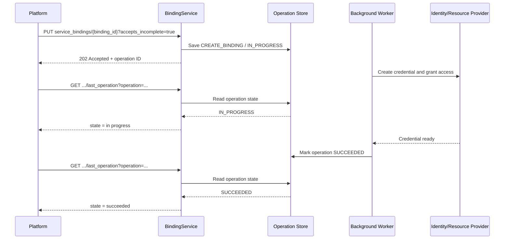

# Cài đặt getLastOperation() cho service binding

## 1. Vai trò của last operation ở cấp binding

Service binding liên kết một service instance với ứng dụng hoặc consumer cần sử dụng dịch vụ. Khi tạo binding, broker có thể phải tạo user, cấp credential, cấu hình quyền, tạo route hoặc cập nhật một hệ thống bên ngoài. Khi xóa binding, broker có thể phải thu hồi credential, xóa user và gỡ các quyền truy cập. Những thao tác này đôi khi mất nhiều thời gian để hoàn tất.

Open Service Broker API (OSB API) cho phép broker xử lý bất đồng bộ cả hai thao tác create binding và delete binding. Broker trả `202 Accepted` khi thao tác đang chạy; nền tảng sau đó gọi endpoint last operation để hỏi trạng thái. Trong Spring Cloud Open Service Broker, ứng dụng triển khai phương thức `getLastOperation()` của `ServiceInstanceBindingService` để trả trạng thái này.

Đây là endpoint dành riêng cho vòng đời binding. Nó khác với `getLastOperation()` của `ServiceInstanceService`, vốn theo dõi provisioning, update và deprovisioning của service instance. Hai interface có phương thức trùng tên nhưng sử dụng request, response và HTTP route khác nhau.

```mermaid
flowchart TD
    Platform[Nền tảng]
    Create[PUT service_bindings/{binding_id}]
    Delete[DELETE service_bindings/{binding_id}]
    Broker[Service Broker]
    Operation[(Binding operation store)]
    Poll[GET .../service_bindings/{binding_id}/last_operation]
    Result[OperationState + description]
    Platform --> Create --> Broker
    Platform --> Delete --> Broker
    Broker --> Operation
    Platform --> Poll --> Broker
    Broker --> Operation
    Operation --> Result --> Platform
```

Trong module `SPRING_CLOUD_SERVICE_BROKER`, Spring Cloud Open Service Broker cung cấp controller, request model, response model và cơ chế ánh xạ endpoint. Ứng dụng chịu trách nhiệm lưu operation, gọi adapter cấp hoặc thu hồi binding, cập nhật trạng thái và trả kết quả nhất quán cho nền tảng.

## 2. Khi nào phải cài đặt getLastOperation()?

Theo tài liệu Spring Cloud Open Service Broker, create binding và delete binding đều có thể chạy đồng bộ hoặc bất đồng bộ. Nếu tất cả thao tác luôn hoàn tất trước khi phương thức create/delete trả response, nền tảng không cần polling last operation và implementation mặc định của interface có thể được dùng.

Nếu bất kỳ thao tác create hoặc delete binding nào có thể trả về trạng thái đang xử lý, broker phải cung cấp implementation của `getLastOperation()`. Điều kiện này áp dụng cả khi chỉ một plan hoặc một loại binding cần xử lý nền.

| Tình huống | Cách xử lý |
|---|---|
| Create binding luôn đồng bộ | Trả response sau khi credential hoặc cấu hình binding đã sẵn sàng. Không cần polling. |
| Delete binding luôn đồng bộ | Trả response sau khi credential và quyền truy cập đã được thu hồi. Không cần polling. |
| Create binding có thể bất đồng bộ | Trả `202 Accepted`, lưu operation và triển khai `getLastOperation()`. |
| Delete binding có thể bất đồng bộ | Trả `202 Accepted`, lưu operation và triển khai `getLastOperation()`. |
| Chỉ một số plan cần thao tác nền | Vẫn phải triển khai `getLastOperation()` cho service binding. |

Hỗ trợ asynchronous binding được đưa vào OSB API từ phiên bản v2.14. Vì vậy, broker và nền tảng phải thống nhất phiên bản API có hỗ trợ tính năng này. Khi tích hợp với Cloud Foundry hoặc Kubernetes, cần kiểm tra phiên bản OSB API mà thành phần nền tảng thực sự gửi trong header `X-Broker-API-Version`.

## 3. Endpoint polling của service binding

Endpoint last operation cho binding có route:

```http
GET /v2/service_instances/{instance_id}/service_bindings/{binding_id}/last_operation
```

Ví dụ request:

```http
GET /v2/service_instances/inst-1001/service_bindings/bind-app-01/last_operation?service_id=managed-database&plan_id=standard&operation=bind-op-01 HTTP/1.1
Host: broker.example.com
Authorization: Basic <broker-credentials>
X-Broker-API-Version: 2.17
Accept: application/json
```

Các thành phần:

| Thành phần | Ý nghĩa |
|---|---|
| `instance_id` | ID của service instance đã được provision. |
| `binding_id` | ID của binding mà nền tảng đã yêu cầu tạo hoặc xóa. |
| `service_id` | ID service trong catalog; query parameter tùy chọn của endpoint polling. |
| `plan_id` | ID plan của instance; query parameter tùy chọn. |
| `operation` | ID thao tác do broker trả về trong response `202`, nếu có. |
| `X-Broker-API-Version` | Phiên bản OSB API do nền tảng sử dụng. |

`service_id` và `plan_id` không bắt buộc trong request polling theo đặc tả, nhưng nền tảng được khuyến nghị gửi chúng. Broker có thể dùng hai giá trị này để đối chiếu với binding và service instance đã lưu.

Nếu broker trả trường `operation` trong response bất đồng bộ ban đầu, nền tảng phải gửi lại đúng giá trị đó trong query parameter `operation`, đã URL-encode. Broker cần dùng giá trị này để tìm đúng operation, không được coi nó là một ID tùy ý có thể bỏ qua.

Nếu broker không trả `operation`, OSB API chỉ cho phép tối đa một thao tác bất đồng bộ tại một thời điểm cho binding. Vì vậy, khi một binding có thể trải qua nhiều lần create/delete hoặc retry, việc cấp operation ID riêng sẽ giúp phân biệt các lần chạy rõ ràng hơn.

## 4. Request model trong Spring Cloud

Spring Cloud Open Service Broker chuyển path variable, query parameter và header của request HTTP thành `GetLastServiceBindingOperationRequest`. Implementation không cần tự parse URL hoặc đọc query string từ servlet request.

Những thuộc tính quan trọng của request model:

| Getter | Dữ liệu |
|---|---|
| `getServiceInstanceId()` | `instance_id` từ path. |
| `getBindingId()` | `binding_id` từ path. |
| `getServiceDefinitionId()` | `service_id` từ query parameter. |
| `getPlanId()` | `plan_id` từ query parameter. |
| `getOperation()` | Giá trị `operation` đã được nền tảng gửi lại. |
| `getPlatformInstanceId()` | Định danh platform instance nếu broker dùng một endpoint cho nhiều platform. |
| `getOriginatingIdentity()` | Danh tính người khởi tạo request nếu nền tảng gửi. |
| `getRequestIdentity()` | Định danh request nếu nền tảng gửi. |

Các ID do nền tảng cấp cần được dùng để tra cứu đúng binding. Nếu broker phục vụ nhiều platform, phạm vi tra cứu nên bao gồm `platformInstanceId` cùng `instance_id` và `binding_id` để tránh nhầm tài nguyên giữa các platform.

## 5. Response model và ý nghĩa của trạng thái

Phương thức `getLastOperation()` trả về `Mono<GetLastServiceBindingOperationResponse>`. Response model của Spring có các thông tin chính:

- `operationState`: trạng thái hiện tại của thao tác.
- `description`: mô tả tiến độ hoặc kết quả có thể hiển thị cho người dùng.
- `deleteOperation`: cho biết operation đang được truy vấn là thao tác xóa binding.

Spring cung cấp enum `OperationState` với ba giá trị:

| Enum | Giá trị JSON | Hành vi của nền tảng |
|---|---|---|
| `OperationState.IN_PROGRESS` | `in progress` | Tiếp tục polling. |
| `OperationState.SUCCEEDED` | `succeeded` | Dừng polling vì thao tác đã thành công. |
| `OperationState.FAILED` | `failed` | Dừng polling vì thao tác đã thất bại. |

Ví dụ response khi tạo binding vẫn đang chạy:

```json
{
  "state": "in progress",
  "description": "Đang tạo credential cho ứng dụng"
}
```

Ví dụ khi tạo binding hoàn tất:

```json
{
  "state": "succeeded",
  "description": "Binding đã sẵn sàng"
}
```

Ví dụ khi thu hồi binding thất bại:

```json
{
  "state": "failed",
  "description": "Provider chưa thể thu hồi credential"
}
```

`state` chỉ nhận ba giá trị chuẩn. Không trả các trạng thái nội bộ như `CREATING_USER`, `WAITING_FOR_IAM` hoặc `REVOKE_RETRY` trực tiếp vào trường `state`; hãy ánh xạ chúng về `in progress`, `succeeded` hoặc `failed`. Trường `description` có thể giải thích chi tiết hơn nhưng không nên chứa credential, token hoặc thông tin hạ tầng nhạy cảm.

## 6. Điểm đặc biệt: deleteOperation và HTTP 410 Gone

Response model có thuộc tính `deleteOperation` để framework phân biệt polling cho create binding và delete binding. Đây là chi tiết quan trọng khi triển khai.

Trong Spring Cloud Open Service Broker 4.4.1:

- Khi trạng thái là `SUCCEEDED` và `deleteOperation(false)`, framework trả `200 OK`.
- Khi trạng thái là `SUCCEEDED` và `deleteOperation(true)`, framework trả `410 Gone`.
- Khi trạng thái là `IN_PROGRESS` hoặc `FAILED`, framework trả `200 OK` cùng trạng thái trong response body.

OSB API quy định `410 Gone` là response phù hợp khi một thao tác unbind bất đồng bộ đã hoàn tất. Nền tảng coi binding đã được xóa và loại bỏ binding khỏi cơ sở dữ liệu của nó. Không trả `410 Gone` khi đang polling create binding; với create thành công, trả `200 OK` và `state: succeeded`.

| Loại operation | Trạng thái | `deleteOperation` | HTTP status | Kết quả |
|---|---|---:|---|---|
| Create binding | `IN_PROGRESS` | `false` | `200` | Nền tảng tiếp tục polling. |
| Create binding | `SUCCEEDED` | `false` | `200` | Binding đã sẵn sàng. |
| Create binding | `FAILED` | `false` | `200` | Nền tảng dừng polling và xử lý lỗi/orphan mitigation. |
| Delete binding | `IN_PROGRESS` | `true` | `200` | Nền tảng tiếp tục polling. |
| Delete binding | `SUCCEEDED` | `true` | `410` | Binding đã bị xóa. |
| Delete binding | `FAILED` | `true` | `200` | Nền tảng dừng polling và xử lý lỗi. |

Không nhầm `410` của last operation với `410` của request DELETE binding ban đầu. DELETE ban đầu có thể trả `410` nếu binding không tồn tại; last operation trả `410` khi thao tác xóa bất đồng bộ đã hoàn tất thành công.

## 7. Cài đặt ServiceInstanceBindingService

Trong Spring Cloud Open Service Broker, ứng dụng triển khai `ServiceInstanceBindingService`. Nếu create/delete binding có thể bất đồng bộ, override `getLastOperation()` để đọc operation đã lưu và chuyển trạng thái nội bộ sang response model.

Ví dụ dưới đây minh họa cách cài đặt bằng repository reactive:

```java
import org.springframework.cloud.servicebroker.exception.ServiceInstanceBindingDoesNotExistException;
import org.springframework.cloud.servicebroker.model.binding.GetLastServiceBindingOperationRequest;
import org.springframework.cloud.servicebroker.model.binding.GetLastServiceBindingOperationResponse;
import org.springframework.cloud.servicebroker.model.instance.OperationState;
import org.springframework.cloud.servicebroker.service.ServiceInstanceBindingService;
import org.springframework.stereotype.Service;
import reactor.core.publisher.Mono;

@Service
public class BrokerBindingService implements ServiceInstanceBindingService {

    private final BindingOperationRepository operationRepository;

    public BrokerBindingService(BindingOperationRepository operationRepository) {
        this.operationRepository = operationRepository;
    }

    @Override
    public Mono<GetLastServiceBindingOperationResponse> getLastOperation(
            GetLastServiceBindingOperationRequest request) {

        return operationRepository.findLatest(
                        request.getPlatformInstanceId(),
                        request.getServiceInstanceId(),
                        request.getBindingId(),
                        request.getOperation())
                .switchIfEmpty(Mono.error(
                        new ServiceInstanceBindingDoesNotExistException(
                                request.getBindingId())))
                .map(operation -> GetLastServiceBindingOperationResponse.builder()
                        .operationState(toOperationState(operation.getState()))
                        .description(operation.getDescription())
                        .deleteOperation(operation.isDeleteOperation())
                        .build());
    }

    private OperationState toOperationState(BindingOperationState state) {
        return switch (state) {
            case PENDING, RUNNING -> OperationState.IN_PROGRESS;
            case SUCCEEDED -> OperationState.SUCCEEDED;
            case FAILED -> OperationState.FAILED;
        };
    }
}
```

Các kiểu `BindingOperationRepository`, `BindingOperationState` và `BindingOperation` là mô hình nội bộ minh họa, không phải class của Spring Cloud. Trong ví dụ, repository chỉ trả `Mono.empty()` khi binding và operation record không tồn tại; trường hợp binding còn tồn tại nhưng operation bị thiếu phải được coi là lỗi nhất quán dữ liệu và xử lý riêng. `ServiceInstanceBindingDoesNotExistException` giúp framework ánh xạ trường hợp binding không tồn tại sang response phù hợp. Trong ứng dụng thực tế, cần giữ tombstone của binding và operation sau khi unbind hoàn tất để request polling đến trễ vẫn nhận đúng kết quả. Nếu service instance không tồn tại, dùng exception tương ứng của Spring Cloud. Không nên để một binding ID không hợp lệ bị biến thành response `succeeded`.

Điểm quan trọng của phương thức trên:

1. Dùng ID instance và binding từ request để tìm đúng operation.
2. Dùng `operation` nếu nền tảng đã gửi lại mã thao tác.
3. Đọc trạng thái từ nơi lưu trữ dùng chung, không dựa vào biến trong bộ nhớ của một controller.
4. Ánh xạ trạng thái nội bộ sang enum `OperationState`.
5. Đặt `deleteOperation` theo loại thao tác để framework trả đúng `200` hoặc `410` khi thành công.

Phương thức này chỉ đọc trạng thái. Nó không nên khởi chạy lại tác vụ tạo credential hoặc thu hồi credential mỗi lần nền tảng polling.

## 8. Liên kết getLastOperation với create và delete binding

`getLastOperation()` không tự tạo ra operation. Hai phương thức create/delete phải ghi operation và trả response bất đồng bộ tương ứng. Một luồng đơn giản:



Đối với delete binding, worker thu hồi credential và quyền truy cập. Khi operation thành công, response last operation phải được tạo với `deleteOperation(true)` để framework trả `410 Gone`.

### 8.1. Response bất đồng bộ khi tạo binding

Khi create binding cần chạy nền, phương thức `createServiceInstanceBinding()` trả response có `async(true)` và có thể kèm operation ID. Ví dụ minh họa:

```java
return Mono.just(CreateServiceInstanceAppBindingResponse.builder()
        .async(true)
        .operation(operationId)
        .build());
```

Response `202 Accepted` không được chứa thông tin binding như credential. Nền tảng chỉ nhận thông tin binding sau khi operation hoàn tất theo cơ chế retrieve binding được hỗ trợ. Nếu broker công bố `bindings_retrievable: true`, endpoint retrieve binding phải hoạt động ngay sau khi last operation trả `succeeded` cho create binding. Vì vậy, nếu luồng asynchronous create cần nền tảng lấy credential sau polling, hãy cung cấp `getServiceInstanceBinding()` và công bố khả năng retrieve tương ứng trong catalog.

### 8.2. Response bất đồng bộ khi xóa binding

Khi unbind cần chạy nền, `deleteServiceInstanceBinding()` trả response `async(true)` và có thể kèm operation ID:

```java
return Mono.just(DeleteServiceInstanceBindingResponse.builder()
        .async(true)
        .operation(operationId)
        .build());
```

Broker cần lưu operation trước khi trả response. Nếu nền tảng gửi lại DELETE trong khi unbind vẫn đang chạy, broker phải trả `202 Accepted` với cùng operation ID, không trả `200 OK` như thể binding đã bị xóa.

## 9. Thiết kế kho lưu trữ operation

Nền tảng có thể polling nhiều lần và các request có thể được phân phối đến nhiều replica. Vì vậy, trạng thái operation cần được lưu bền vững.

Một bảng operation minh họa:

```text
service_binding_operation
  id                    -- ID nội bộ
  platform_instance_id
  service_instance_id
  binding_id
  operation_id          -- giá trị trả về nền tảng
  operation_type        -- CREATE_BINDING hoặc DELETE_BINDING
  state                 -- PENDING, RUNNING, SUCCEEDED, FAILED
  description
  created_at
  updated_at
  completed_at
  retry_count
  error_code
```

Các nguyên tắc lưu trữ:

- Khóa truy vấn phải nhận diện đúng platform, instance, binding và operation.
- Đặt unique constraint phù hợp để cùng một operation ID không bị ghi trùng.
- Khi không dùng operation ID, chỉ cho phép một operation chưa kết thúc trên một binding tại một thời điểm.
- Giữ operation record sau khi hoàn tất đủ lâu để nền tảng polling lại nếu response trước bị mất.
- Không xóa operation ngay khi trả `succeeded` hoặc `failed` lần đầu.
- Lưu mô tả lỗi đã được làm sạch; không lưu password hoặc token vào description.
- Nếu cần giữ credential để retrieve binding, lưu secret trong kho an toàn và chỉ giữ reference trong binding record.

Ví dụ truy vấn logic:

```sql
SELECT *
FROM service_binding_operation
WHERE platform_instance_id = :platformInstanceId
  AND service_instance_id = :instanceId
  AND binding_id = :bindingId
  AND (:operationId IS NULL OR operation_id = :operationId)
ORDER BY created_at DESC
LIMIT 1;
```

Khi `operationId` là null, truy vấn phải được dùng cùng quy tắc chỉ một operation đang chạy cho binding. Không được tùy tiện lấy operation mới nhất nếu có nhiều thao tác chưa kết thúc và nền tảng không gửi mã phân biệt.

## 10. Xử lý concurrency và idempotency

Một binding có thể nhận request create, delete hoặc retry trong lúc operation trước đang chạy. Broker cần xác định rõ chính sách đồng thời.

- Nếu create cùng binding ID và cùng tham số đã tồn tại, trả kết quả theo quy tắc idempotency của OSB API.
- Nếu binding ID đã tồn tại nhưng request có tham số khác, trả `409 Conflict` theo hợp đồng create binding.
- Nếu một operation đang chạy và broker không thể xử lý request mới, trả `422 Unprocessable Entity` với `ConcurrencyError`.
- Nếu create bị gửi lại trong khi binding vẫn đang được tạo, trả `202 Accepted` với operation ID hiện tại.
- Nếu delete bị gửi lại trong khi unbind vẫn đang chạy, trả `202 Accepted` với operation ID hiện tại.
- Nếu delete hoàn tất, request last operation cho delete phải trả `410 Gone`.

Nên khóa theo cặp `instance_id`/`binding_id` hoặc dùng optimistic locking để ngăn hai worker cùng thay đổi trạng thái một binding. Không khóa toàn bộ service instance nếu broker cho phép nhiều binding độc lập chạy đồng thời và provider hỗ trợ mô hình đó.

## 11. Polling, Retry-After và thời gian lưu trạng thái

Nền tảng quyết định chu kỳ polling và thời gian tối đa chờ operation. Broker có thể giảm số lần gọi dư thừa bằng header `Retry-After` nếu phiên bản OSB API và Spring Cloud đang sử dụng hỗ trợ cấu hình header này.

Các khuyến nghị:

- Trả `in progress` khi worker còn thực hiện tác vụ hoặc đang chờ provider.
- Trả `succeeded` ngay khi toàn bộ bước cần thiết của binding đã hoàn tất.
- Trả `failed` khi thao tác đã kết thúc ở trạng thái lỗi và không còn được xem là đang chạy.
- Nếu dùng `Retry-After`, ưu tiên giá trị khoảng thời gian để nền tảng biết nên chờ bao lâu trước lần poll kế tiếp.
- Giữ operation sau trạng thái cuối để xử lý request polling lặp hoặc đến trễ.
- Có retention policy cho operation record và chỉ dọn khi đã qua thời gian an toàn.

Đừng trả `succeeded` khi credential mới chỉ được tạo trong database broker nhưng chưa được provider áp dụng hoặc chưa thể sử dụng. Với delete, đừng trả `succeeded` khi credential đã bị xóa trong broker nhưng quyền truy cập ở hệ thống đích vẫn còn hiệu lực.

## 12. Event registry cho binding last operation

Spring Cloud Open Service Broker cung cấp `AsyncOperationServiceInstanceBindingEventFlowRegistry` để mở rộng luồng xử lý last operation. Có thể đăng ký ba loại flow:

- `AsyncOperationServiceInstanceBindingInitializationFlow`: chạy trước khi xử lý yêu cầu đọc trạng thái.
- `AsyncOperationServiceInstanceBindingCompletionFlow`: chạy sau khi đã tạo response trạng thái.
- `AsyncOperationServiceInstanceBindingErrorFlow`: chạy khi quá trình đọc hoặc xử lý trạng thái gặp lỗi.

Ví dụ cấu hình registry:

```java
@Configuration
public class BindingOperationEventConfiguration {

    public BindingOperationEventConfiguration(
            AsyncOperationServiceInstanceBindingEventFlowRegistry registry) {

        registry.addInitializationFlow(request -> {
            // Ghi metric hoặc trace khi platform bắt đầu polling.
            return Mono.empty();
        });

        registry.addCompletionFlow((request, response) -> {
            // Ghi metric theo state và binding ID.
            return Mono.empty();
        });

        registry.addErrorFlow((request, error) -> {
            // Ghi nhận lỗi tra cứu operation.
            return Mono.empty();
        });
    }
}
```

Đây là ví dụ minh họa theo API event registry của Spring Cloud Open Service Broker 4.4.1. Trong code thực tế, cần kiểm tra đúng chữ ký flow của phiên bản dependency. Event flow phù hợp cho metric, trace, audit hoặc mở rộng quy trình. Logic xác định trạng thái vẫn nên nằm trong service/repository để có thể kiểm thử độc lập.

## 13. Xử lý lỗi và các trường hợp không tìm thấy

Endpoint last operation là endpoint đọc trạng thái, vì vậy nó không nên tạo lại binding hoặc xóa credential. Các lỗi cần được phân biệt:

| Tình huống | Xử lý |
|---|---|
| Request thiếu path ID hoặc sai định dạng | Trả `400 Bad Request`. |
| Instance không tồn tại | Ném exception tương ứng để framework trả lỗi phù hợp, thường là `404 Not Found`. |
| Binding không tồn tại khi polling | Trả `404 Not Found`. |
| Operation ID không khớp với binding | Không trả trạng thái của operation khác; trả lỗi phù hợp hoặc không tìm thấy operation theo chính sách broker. |
| Create binding đang chạy | Trả `state: in progress`, HTTP `200 OK`. |
| Create binding đã hoàn tất | Trả `state: succeeded`, `deleteOperation(false)`, HTTP `200 OK`. |
| Delete binding đã hoàn tất | Trả `state: succeeded`, `deleteOperation(true)`, HTTP `410 Gone`. |
| Operation thất bại | Trả `state: failed`, HTTP `200 OK`; mô tả lỗi không chứa bí mật. |
| Database operation store tạm thời không khả dụng | Trả lỗi server phù hợp; nền tảng có thể tiếp tục polling theo quy tắc API. |

OSB API quy định `410 Gone` chỉ phù hợp khi polling thao tác delete bất đồng bộ đã hoàn tất. Nếu nền tảng đang polling create mà nhận `410`, response đó được xem là không hợp lệ và nền tảng có thể tiếp tục polling đến giới hạn thời gian.

## 14. Kiểm thử getLastOperation()

Kiểm thử cần xác minh cả method Java, response model và HTTP route do framework đăng ký.

| Trường hợp | Kết quả mong đợi |
|---|---|
| Create binding đang chạy | `IN_PROGRESS`, `deleteOperation(false)`, HTTP `200`. |
| Create binding thành công | `SUCCEEDED`, `deleteOperation(false)`, HTTP `200`. |
| Create binding thất bại | `FAILED`, `deleteOperation(false)`, HTTP `200`. |
| Delete binding đang chạy | `IN_PROGRESS`, `deleteOperation(true)`, HTTP `200`. |
| Delete binding thành công | `SUCCEEDED`, `deleteOperation(true)`, HTTP `410`. |
| Delete binding thất bại | `FAILED`, `deleteOperation(true)`, HTTP `200`. |
| Có operation ID | Request query có `operation` trả đúng operation tương ứng. |
| Không có operation ID | Broker chỉ có tối đa một operation bất đồng bộ đang chạy trên binding. |
| Binding không tồn tại | Framework trả `404 Not Found`. |
| Instance không tồn tại | Framework trả lỗi tài nguyên không tồn tại. |
| Request polling lặp | Trạng thái và operation ID nhất quán, không chạy lại tác vụ. |
| Broker restart | Operation vẫn được đọc từ persistence và polling tiếp tục. |
| Nhiều replica | Bất kỳ replica nào cũng trả cùng trạng thái đã lưu. |
| Credential | Không có credential trong response last operation hoặc description. |

Ví dụ unit test cho phần ánh xạ response:

```java
@Test
void completedUnbindReturnsGoneSemantics() {
    GetLastServiceBindingOperationResponse response =
            GetLastServiceBindingOperationResponse.builder()
                    .operationState(OperationState.SUCCEEDED)
                    .description("Binding đã được thu hồi")
                    .deleteOperation(true)
                    .build();

    assertEquals(OperationState.SUCCEEDED, response.getState());
    assertTrue(response.isDeleteOperation());
}
```

Unit test này kiểm tra dữ liệu response model. Cần có thêm integration test qua endpoint HTTP để xác minh framework thực sự ánh xạ `deleteOperation(true)` cùng `SUCCEEDED` thành `410 Gone`.

## 15. Checklist triển khai

1. Xác định create binding hoặc delete binding nào có thể trả `202 Accepted`.
2. Nếu có bất kỳ thao tác binding bất đồng bộ nào, override `ServiceInstanceBindingService.getLastOperation()`.
3. Dùng đúng route `/v2/service_instances/{instance_id}/service_bindings/{binding_id}/last_operation`.
4. Đọc `instance_id`, `binding_id`, `service_id`, `plan_id` và `operation` từ `GetLastServiceBindingOperationRequest`.
5. Lưu operation bền vững trước khi trả `202`.
6. Trả một trong ba `OperationState`: `IN_PROGRESS`, `SUCCEEDED`, `FAILED`.
7. Đặt `deleteOperation(true)` cho thao tác unbind; khi thành công, framework trả `410 Gone`.
8. Không trả credential trong response `202` hoặc response last operation.
9. Xử lý idempotency, concurrency và request polling lặp.
10. Giữ operation đủ lâu sau khi kết thúc để nền tảng có thể polling lại.
11. Kiểm thử cả create và delete, đặc biệt HTTP `410` khi unbind thành công bất đồng bộ.
12. Theo dõi số operation đang chạy, thời gian hoàn tất, số lần polling, lỗi provider và operation quá hạn.

## 16. Nguyên tắc cần ghi nhớ

- `getLastOperation()` của binding thuộc `ServiceInstanceBindingService`, không phải phương thức theo dõi service instance.
- Endpoint polling có cả `instance_id` và `binding_id` trong path.
- Nếu create hoặc delete binding có thể bất đồng bộ, broker phải triển khai phương thức này.
- `GetLastServiceBindingOperationRequest` chứa ID instance, ID binding, service ID, plan ID và operation ID.
- `GetLastServiceBindingOperationResponse` dùng `OperationState`, `description` và `deleteOperation`.
- `IN_PROGRESS` khiến nền tảng tiếp tục polling; `SUCCEEDED` và `FAILED` khiến nền tảng dừng polling.
- `deleteOperation(true)` kết hợp `SUCCEEDED` tạo response `410 Gone` cho unbind hoàn tất.
- Operation state phải được lưu bền vững và không được quên ngay sau lần trả trạng thái cuối.
- Phương thức polling chỉ đọc trạng thái; worker riêng mới thực hiện tác vụ cấp hoặc thu hồi binding.

## Nguồn tham khảo

- [Spring Cloud Open Service Broker 4.4.1 – Service Binding Operation Status Retrieval](https://docs.spring.io/spring-cloud-open-service-broker/docs/4.4.1/reference/#service-binding-operation-status-retrieval): yêu cầu triển khai `getLastOperation()` và event registry cho binding.
- [Spring Cloud Open Service Broker 4.4.1 – ServiceInstanceBindingService](https://docs.spring.io/spring-cloud-open-service-broker/docs/4.4.1/apidocs/org/springframework/cloud/servicebroker/service/ServiceInstanceBindingService.html): chữ ký phương thức và các exception liên quan.
- [Spring Cloud Open Service Broker 4.4.1 – GetLastServiceBindingOperationRequest](https://docs.spring.io/spring-cloud-open-service-broker/docs/4.4.1/apidocs/org/springframework/cloud/servicebroker/model/binding/GetLastServiceBindingOperationRequest.html): các trường request và getter.
- [Spring Cloud Open Service Broker 4.4.1 – GetLastServiceBindingOperationResponse](https://docs.spring.io/spring-cloud-open-service-broker/docs/4.4.1/apidocs/org/springframework/cloud/servicebroker/model/binding/GetLastServiceBindingOperationResponse.html): response state, description và deleteOperation.
- [Open Service Broker API – Polling Last Operation for Service Bindings](https://github.com/openservicebrokerapi/servicebroker/blob/v2.17/spec.md#polling-last-operation-for-service-bindings): route, query parameter, response state và HTTP 410 khi unbind hoàn tất.
- [Open Service Broker API – Platform Compatibility](https://github.com/openservicebrokerapi/servicebroker/blob/v2.17/compatibility.md): ghi nhận Async Bindings được giới thiệu trong OSB API v2.14.
