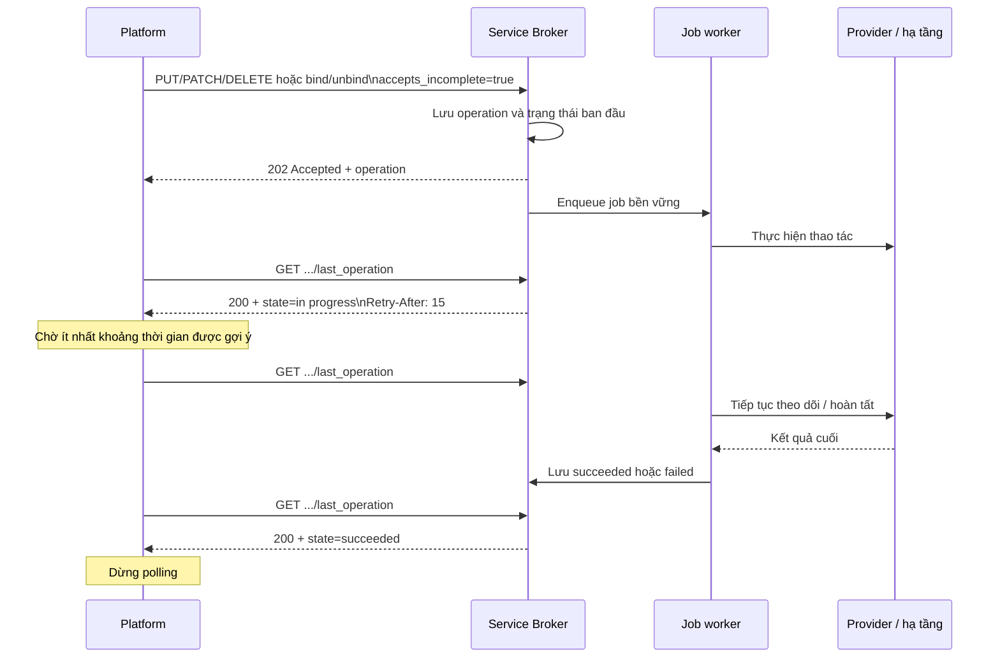

# Chu kỳ hỏi trạng thái, Retry-After và giới hạn chờ theo nền tảng

## Vì sao thao tác bất đồng bộ cần polling?

Một số thao tác của service broker hoàn tất nhanh, nhưng việc tạo database cluster, thay đổi dung lượng, cấu hình mạng, cấp credential hoặc xóa volume có thể kéo dài hơn thời gian một HTTP request nên chờ. Open Service Broker API (OSB API) cho phép broker tiếp nhận các thao tác này theo mô hình bất đồng bộ.

Khi broker trả `202 Accepted`, điều đó có nghĩa yêu cầu đã được tiếp nhận và thao tác vẫn đang chạy. Nền tảng cần gọi endpoint `last_operation` để hỏi trạng thái cho đến khi broker trả kết quả cuối cùng. Chu kỳ hỏi trạng thái phải cân bằng ba yếu tố: phản hồi kịp thời cho người dùng, tránh tạo quá nhiều request và hoàn tất trong giới hạn chờ mà nền tảng chấp nhận.

Trong module `SPRING_CLOUD_SERVICE_BROKER`, Spring Cloud Open Service Broker đảm nhiệm phần tích hợp giao thức; ứng dụng broker vẫn cần lưu operation, theo dõi tiến trình, chọn thời gian chờ hợp lý và trả `Retry-After` khi muốn hướng dẫn nền tảng lần polling tiếp theo.

## Luồng tổng quát sau `202 Accepted`

Để broker trả response bất đồng bộ, request ban đầu phải có query parameter `accepts_incomplete=true`. Nếu thao tác không thể hoàn tất đồng bộ mà request không cho phép async, broker phải từ chối với `422 Unprocessable Entity` và mã lỗi `AsyncRequired`.

Sau khi tiếp nhận thành công, broker trả `202 Accepted`. Nền tảng bắt đầu polling endpoint tương ứng:

| Thao tác ban đầu | Endpoint polling |
|---|---|
| Provision, update hoặc deprovision service instance | `GET /v2/service_instances/{instance_id}/last_operation` |
| Bind hoặc unbind service binding | `GET /v2/service_instances/{instance_id}/service_bindings/{binding_id}/last_operation` |

Chu kỳ cơ bản:

1. Nền tảng gửi request có `accepts_incomplete=true`.
2. Broker xác thực request, ghi nhận instance/binding và tạo operation.
3. Broker lưu job hoặc thông tin điều phối đủ bền vững để tiếp tục sau khi restart.
4. Broker trả `202 Accepted`, có thể kèm `operation` trong JSON body.
5. Nền tảng gọi endpoint `last_operation` để lấy trạng thái.
6. Nếu trạng thái là `in progress`, nền tảng chờ rồi hỏi lại.
7. Nếu trạng thái là `succeeded` hoặc `failed`, nền tảng dừng polling.



Không bắt đầu polling chỉ vì request ban đầu trả `200` hoặc `201`. Polling được kích hoạt bởi response bất đồng bộ `202 Accepted` theo hợp đồng OSB API.

## Endpoint và dữ liệu dùng trong polling

### Polling service instance

Với provision, update hoặc deprovision bất đồng bộ, nền tảng gọi:

```http
GET /v2/service_instances/inst-orders-001/last_operation?service_id=svc-postgresql&plan_id=plan-standard&operation=provision-op-001 HTTP/1.1
X-Broker-API-Version: 2.17
```

`instance_id` là ID của service instance. `service_id` và `plan_id` là query parameter tùy chọn nhưng nền tảng được khuyến nghị gửi trong các request polling. Nếu broker trả `operation` trong response `202`, nền tảng phải gửi lại đúng giá trị đó trong query parameter `operation`, được percent-encode khi cần.

Với polling sau update plan, `plan_id` trong request `last_operation` là ID của plan trước khi update, theo quy tắc của OSB API. Broker nên dùng operation ID và bản ghi trạng thái đã lưu để xác định chính xác thao tác đang được hỏi.

### Polling service binding

Với bind hoặc unbind bất đồng bộ, nền tảng gọi:

```http
GET /v2/service_instances/inst-orders-001/service_bindings/bind-orders-api/last_operation?service_id=svc-postgresql&plan_id=plan-standard&operation=bind-op-002 HTTP/1.1
X-Broker-API-Version: 2.17
```

Endpoint binding chứa cả `instance_id` và `binding_id`. Nếu broker trả operation ID cho bind/unbind, nền tảng phải gửi lại cùng giá trị trong query string. Khi binding hoàn tất thành công, nền tảng có thể tiếp tục lấy thông tin binding theo endpoint retrieve nếu broker công bố khả năng đó.

## Response `last_operation` và trạng thái kết thúc

Request polling được xử lý thành công thường trả `200 OK`. Body phải có trường `state` với một trong ba giá trị:

| `state` | Ý nghĩa | Hành vi của nền tảng |
|---|---|---|
| `in progress` | Thao tác vẫn đang chạy. | Tiếp tục polling sau khoảng chờ phù hợp. |
| `succeeded` | Thao tác đã hoàn tất thành công. | Dừng polling. |
| `failed` | Thao tác đã thất bại. | Dừng polling và xử lý lỗi theo loại thao tác. |

Ví dụ response đang chạy:

```http
HTTP/1.1 200 OK
Content-Type: application/json
Retry-After: 15
```

```json
{
  "state": "in progress",
  "description": "Đang tạo cụm PostgreSQL, hoàn tất bước cấu hình mạng."
}
```

Ví dụ response thành công:

```http
HTTP/1.1 200 OK
Content-Type: application/json
```

```json
{
  "state": "succeeded",
  "description": "Service instance đã sẵn sàng."
}
```

Khi `state` là `succeeded` hoặc `failed`, nền tảng phải dừng polling. Không tiếp tục gửi request chỉ vì vẫn còn thời gian trong giới hạn chờ.

Với service instance, response lỗi của update hoặc deprovision có thể có thêm `instance_usable` để cho biết instance còn sử dụng được hay không. Response lỗi của update còn có thể có `update_repeatable` để cho biết cùng yêu cầu update có thể được lặp lại hay không. Các trường này không phải trạng thái polling và không thay thế `state`; chúng bổ sung thông tin xử lý sau khi update/deprovision thất bại. Với binding, response polling có cấu trúc trạng thái riêng theo đặc tả.

### Các HTTP status đặc biệt

| Status | Ý nghĩa trong polling |
|---|---|
| `200 OK` | Broker xử lý request polling và trả trạng thái trong body. |
| `400 Bad Request` | Request polling sai cấu trúc hoặc thiếu dữ liệu bắt buộc. |
| `404 Not Found` | Instance hoặc binding đang được hỏi không tồn tại theo hợp đồng. |
| `410 Gone` | Chỉ phù hợp với thao tác delete bất đồng bộ; nền tảng phải xem đây là thành công và quên tài nguyên đã xóa. Không dùng `410` để báo provision/update/bind thất bại. |

Các status khác được xem là lỗi hoặc response không hợp lệ. Nền tảng nên tiếp tục polling cho đến khi nhận được response hợp lệ hoặc đạt giới hạn thời gian polling. Riêng `410 Gone` có ý nghĩa đặc biệt đối với deprovision/unbind bất đồng bộ, không được nhầm với timeout.

## `Retry-After` là gợi ý thời điểm hỏi lại

`Retry-After` là HTTP response header mà broker có thể gửi trong response của endpoint `last_operation`. Header này cho nền tảng biết nên chờ bao lâu trước khi polling lần tiếp theo, giúp tránh request quá sớm và giảm tải cho broker cũng như provider.

Ví dụ:

```http
HTTP/1.1 200 OK
Content-Type: application/json
Retry-After: 20
```

```json
{
  "state": "in progress",
  "description": "Nhà cung cấp đang khởi tạo storage."
}
```

Giá trị `20` trong ví dụ là khoảng thời gian tính bằng giây. OSB API khuyến nghị header dùng duration thay vì timestamp. `Retry-After` là header HTTP, không phải field trong JSON body.

Một số nguyên tắc:

- Broker có thể trả `Retry-After` khác nhau theo tiến độ hoặc tải hệ thống.
- Nền tảng nên đợi theo thời gian được gợi ý trước khi gọi lại; không polling dồn dập hơn chỉ vì muốn có kết quả sớm.
- Nếu header không có, nền tảng tự quyết định chu kỳ polling theo chính sách của mình.
- Khi trạng thái đã là `succeeded` hoặc `failed`, dừng polling ngay; không cần chờ thêm một chu kỳ.
- Nếu thời gian `Retry-After` vượt quá phần thời gian còn lại của deadline, nền tảng không nên vượt deadline chỉ để hỏi thêm một lần.

Broker không nên trả một giá trị quá nhỏ khi biết provider chưa thể hoàn tất trong khoảng đó. Ví dụ, nếu hệ thống chỉ cập nhật tiến độ mỗi 30 giây, gợi ý polling sau 1 giây sẽ tạo tải không cần thiết mà không giúp người dùng nhận kết quả sớm hơn.

## Chu kỳ polling khi không có `Retry-After`

OSB API không áp đặt một khoảng polling cố định dùng cho mọi nền tảng. Tần suất và thời lượng polling có thể khác nhau theo platform. Vì vậy, broker không nên giả định mọi client sẽ gọi lại sau 5, 10 hay 30 giây.

Khi không có `Retry-After`, nền tảng có thể sử dụng chính sách backoff. Một chính sách minh họa:

| Lần polling | Khoảng chờ ví dụ |
|---|---:|
| Sau lần kiểm tra đầu tiên | 5 giây |
| Lần tiếp theo | 10 giây |
| Tiếp theo | 20 giây |
| Các lần sau | Tăng dần đến mức trần, ví dụ 60 giây |

Các con số trên chỉ minh họa một chính sách client, không phải yêu cầu của OSB API. Có thể thêm jitter để nhiều platform hoặc nhiều instance không đồng loạt polling cùng một thời điểm. Nếu broker gửi `Retry-After`, client cần kết hợp gợi ý này với backoff và deadline, bảo đảm không gọi sớm hơn thời gian được chỉ định.

Không nên dùng vòng lặp polling liên tục không có delay. Cách làm đó tạo tải cao lên endpoint `last_operation`, làm chậm các thao tác khác và có thể khiến broker quá tải đúng lúc provider đang bận.

## Giới hạn chờ theo nền tảng và `maximum_polling_duration`

OSB API cho phép service plan công bố trường `maximum_polling_duration`, là thời lượng tối đa (tính bằng giây) mà nền tảng được khuyến nghị sử dụng để polling thao tác của plan đó. Trường này nằm trong Service Plan Object của catalog.

Hai giới hạn có thể cùng tồn tại:

- **Giới hạn của nền tảng:** thời gian tối đa platform sẵn sàng chờ một thao tác.
- **Giới hạn của service plan:** thời gian tối đa mà broker khuyến nghị platform polling cho plan.

Tần suất và thời lượng polling có thể khác nhau giữa các platform. Nếu giới hạn của platform hoặc `maximum_polling_duration` của service plan đạt tới, platform nên dừng polling và trạng thái operation phải được xem là `failed` theo OSB API.

Ví dụ:

| Cấu hình | Giá trị |
|---|---:|
| Platform maximum polling duration | 120 giây |
| Plan `maximum_polling_duration` | 300 giây |
| Giới hạn thực tế của platform | 120 giây |

Trong ví dụ, nền tảng chỉ chờ tối đa 120 giây dù plan cho phép thời lượng khuyến nghị 300 giây. Broker nên thiết kế thao tác và gợi ý `Retry-After` phù hợp với cửa sổ chờ ngắn hơn mà platform có thể áp dụng.

Ví dụ khác, nếu platform chờ tối đa 600 giây nhưng plan đặt `maximum_polling_duration` là 180 giây, platform nên dừng polling khi chạm giới hạn của plan. Không được hiểu hai giới hạn là cộng dồn thành 780 giây.

### Phân biệt timeout HTTP và maximum polling duration

Đây là hai loại thời gian khác nhau:

| Loại giới hạn | Phạm vi | Ví dụ |
|---|---|---|
| HTTP request timeout | Thời gian chờ một request HTTP cụ thể phản hồi. | Request `GET .../last_operation` timeout sau 10 giây. |
| Maximum polling duration | Tổng cửa sổ thời gian platform tiếp tục theo dõi một operation bất đồng bộ. | Platform ngừng polling sau 180 giây kể từ khi bắt đầu theo dõi. |
| Provider/job timeout | Thời gian worker của broker chờ một lệnh hoặc workflow phía sau. | API cloud không phản hồi trong 45 giây. |

Một request polling bị timeout không có nghĩa operation đã thất bại. Platform có thể thử lại trong cửa sổ polling còn lại. Ngược lại, nếu tổng thời gian polling đã hết, platform phải coi operation là thất bại theo quy tắc giới hạn polling, kể cả khi request HTTP riêng lẻ không bị timeout.

Broker nên chọn `maximum_polling_duration` dựa trên thời gian xử lý thực tế của plan, thêm khoảng dự phòng cho queue, retry và provider. Nếu nhiều thao tác thường xuyên vượt quá giới hạn, người dùng sẽ thấy thất bại dù tài nguyên có thể được tạo muộn hơn. Khi đó cần tối ưu workflow, điều chỉnh plan hoặc thống nhất giới hạn với nền tảng.

## Thiết kế lịch polling phía broker

Broker không điều khiển bộ lập lịch polling của platform, nhưng có thể giúp platform polling hiệu quả bằng cách trả trạng thái đúng và gợi ý thời gian hợp lý.

Một bản ghi operation nên lưu các thông tin như:

```text
operation_id
resource_type              # SERVICE_INSTANCE hoặc SERVICE_BINDING
instance_id
binding_id
operation_type             # PROVISION, UPDATE, DEPROVISION, BIND, UNBIND
state                      # IN_PROGRESS, SUCCEEDED, FAILED
description
started_at
updated_at
completed_at
recommended_retry_after_seconds
platform_polling_deadline
provider_job_id
last_error_code
```

Đây là mô hình nội bộ gợi ý. Không phải tất cả field đều phải lưu hoặc trả ra OSB API. Đặc biệt, `recommended_retry_after_seconds` được ánh xạ thành HTTP header `Retry-After`; không đưa vào JSON body trừ khi ứng dụng có một extension riêng được thỏa thuận.

Khi xử lý `GET .../last_operation`, broker nên:

1. Xác thực request và tra cứu đúng operation theo resource ID cùng operation ID nếu có.
2. Đọc trạng thái đã lưu; không gọi provider đồng bộ kéo dài trong request polling.
3. Nếu worker vừa cập nhật tiến độ, trả trạng thái mới nhất.
4. Nếu vẫn đang chạy, trả `state: in progress` và có thể thêm `Retry-After`.
5. Nếu đã thành công hoặc thất bại, trả trạng thái cuối và ngừng gửi gợi ý polling tiếp theo.
6. Giữ lại trạng thái operation đủ lâu để platform có thể hỏi lại sau response cuối hoặc retry do lỗi mạng.

Không nên xóa operation record ngay sau lần đầu trả `succeeded` hoặc `failed`. OSB API khuyến nghị broker giữ trạng thái sau khi trả kết quả cuối để platform có thể hỏi lại nếu cần.

## Theo dõi operation vượt quá deadline

Có thể xảy ra tình huống platform hết thời gian polling trong khi worker vẫn đang chạy. Broker cần phân biệt trạng thái mà platform đã kết luận với trạng thái thực tế của provider.

Ví dụ, platform dừng polling sau 180 giây và xem provision là thất bại, nhưng provider hoàn tất tạo cluster ở giây thứ 195. Nếu broker không có quy trình xử lý, tài nguyên mới có thể tồn tại nhưng platform không ghi nhận instance thành công. Đây là nguy cơ tạo tài nguyên mồ côi.

Broker nên thiết kế:

- Deadline nội bộ tương thích với `maximum_polling_duration` của plan và giới hạn platform đã thống nhất.
- Timeout và cancellation cho từng bước provider khi có thể.
- Reconciliation để kiểm tra tài nguyên thực tế sau khi operation vượt deadline hoặc mất kết nối.
- Cleanup có kiểm soát nếu provision hoàn tất sau khi platform đã coi operation là thất bại.
- Ghi log và metric cho operation vượt deadline, retry quá nhiều hoặc provider phản hồi muộn.

Không được giả định platform sẽ tiếp tục polling vô hạn. Khi operation không thể hoàn tất trong cửa sổ đã công bố, broker cần có chiến lược thất bại rõ ràng và xử lý hậu quả ở provider.

## Áp dụng với Spring Cloud Open Service Broker

Trong ứng dụng Spring Cloud Open Service Broker, logic nghiệp vụ dài nên chạy trong worker hoặc coordinator riêng. Handler của `last_operation` chỉ đọc trạng thái operation đã lưu và chuyển thành response model của framework.

Một cách tổ chức:

- `OperationCoordinator`: tạo operation, ghi thời điểm bắt đầu và deadline.
- `ProvisioningWorker` / `BindingWorker`: thực hiện công việc bất đồng bộ và cập nhật trạng thái.
- `OperationRepository`: lưu operation bền vững.
- `LastOperationService`: truy vấn trạng thái instance hoặc binding.
- `RetryPolicy`: tính thời gian gợi ý tiếp theo dựa trên tiến độ, tải provider và giới hạn còn lại.
- `ReconciliationService`: đối soát operation vượt deadline hoặc có kết quả không xác định.

Pseudocode cho endpoint polling:

```java
public Mono<LastOperationHttpResult> getLastOperation(
        String instanceId,
        String operationId) {

    return operationRepository.find(instanceId, operationId)
            .switchIfEmpty(Mono.error(new OperationNotFoundException()))
            .map(operation -> {
                if (operation.isTerminal()) {
                    return LastOperationHttpResult.terminal(
                            operation.state(), operation.description());
                }

                long retryAfter = retryPolicy.nextDelaySeconds(operation);
                return LastOperationHttpResult.inProgress(
                        operation.description(), retryAfter);
            });
}
```

Đây là pseudocode domain-level, không phải chữ ký API cố định của Spring Cloud Open Service Broker. `LastOperationHttpResult` là kiểu nội bộ minh họa; adapter HTTP phải chuyển `retryAfter` thành response header `Retry-After` theo khả năng của phiên bản framework đang sử dụng. Nếu thư viện có response model hỗ trợ trường retry delay, hãy dùng đúng API của phiên bản đó; nếu không, triển khai qua cơ chế response/header được framework hỗ trợ. Không thêm `Retry-After` thành field JSON tùy ý.

Nên bảo đảm response polling nhanh và không phụ thuộc vào thời gian provider phản hồi. Worker cập nhật operation riêng; endpoint polling đọc snapshot trạng thái gần nhất. Cách tổ chức này giúp polling không chiếm thread hoặc connection trong lúc đợi tác vụ hạ tầng.

## Ví dụ tính thời điểm polling tiếp theo

Giả sử operation bắt đầu tại `t0`, platform có deadline 180 giây và broker trả `Retry-After: 20` ở lần kiểm tra đầu tiên:

| Thời điểm | Sự kiện | Xử lý |
|---:|---|---|
| 0 giây | Nền tảng nhận `202 Accepted`. | Bắt đầu cửa sổ polling. |
| 5 giây | Poll lần đầu, broker trả `in progress`, `Retry-After: 20`. | Chờ tối thiểu 20 giây theo gợi ý. |
| 25 giây | Poll lần hai, broker trả `in progress`, `Retry-After: 30`. | Chờ theo gợi ý mới. |
| 55 giây | Poll lần ba, broker trả `in progress`. | Nếu không có header, dùng chính sách platform. |
| 85 giây | Poll lần bốn, broker trả `succeeded`. | Dừng polling ngay. |

Nếu lần polling cuối trả `in progress` ở giây 175 và `Retry-After: 20`, deadline 180 giây sẽ đến trước thời điểm poll tiếp theo. Platform nên dừng khi đạt deadline và xem operation là thất bại theo giới hạn polling; không kéo dài cửa sổ chỉ để tuân thủ một gợi ý vượt deadline.

Các mốc trên chỉ là ví dụ minh họa. Platform quyết định chu kỳ thực tế, còn broker cung cấp thông tin trạng thái và gợi ý qua `Retry-After`.

## Các lỗi thường gặp

| Lỗi | Hậu quả | Cách xử lý |
|---|---|---|
| Poll liên tục không delay | Tăng tải broker và provider. | Dùng `Retry-After` hoặc backoff phía platform. |
| Trả `Retry-After` quá ngắn | Platform hỏi lại trước khi có tiến độ mới. | Ước lượng thời gian xử lý thực tế và cập nhật gợi ý phù hợp. |
| Đặt `Retry-After` trong JSON body | Client không nhận được HTTP header theo hợp đồng. | Gửi nó ở response header. |
| Coi mọi HTTP error là trạng thái terminal | Có thể dừng theo dõi dù broker chỉ gặp lỗi tạm thời. | Tuân thủ quy tắc polling và deadline của OSB API. |
| Poll tiếp sau `succeeded` hoặc `failed` | Tạo request thừa và có thể đọc nhầm operation mới. | Dừng ngay khi nhận trạng thái terminal. |
| Nhầm request timeout với operation timeout | Đánh dấu thất bại quá sớm. | Quản lý timeout từng request riêng với maximum polling duration. |
| Bỏ qua `maximum_polling_duration` | Platform và broker có kỳ vọng thời gian khác nhau. | Công bố giới hạn plan hợp lý và theo dõi deadline. |
| Xóa operation ngay khi hoàn tất | Platform retry polling có thể nhận `404`. | Giữ terminal record đủ lâu theo chính sách lưu trữ. |
| Worker hoàn tất sau khi platform hết thời gian | Tạo tài nguyên mồ côi hoặc trạng thái lệch. | Có deadline nội bộ, cancellation và reconciliation. |
| Không gửi lại operation ID | Broker không phân biệt được thao tác khi có nhiều operation. | Platform phải gửi lại operation được broker trả về. |

## Checklist kiểm tra polling

1. Request bất đồng bộ chỉ được bắt đầu khi có `accepts_incomplete=true`.
2. Response `202` có operation ID nếu broker cần phân biệt nhiều operation trên cùng resource.
3. Platform gửi lại đúng operation ID đã nhận trong query parameter.
4. Endpoint instance và binding được phân biệt đúng.
5. `state` chỉ dùng `in progress`, `succeeded` hoặc `failed`.
6. Platform tiếp tục polling khi `in progress` và dừng ở trạng thái terminal.
7. `Retry-After` được gửi ở HTTP header và biểu thị duration phù hợp.
8. Khi không có `Retry-After`, platform vẫn có chính sách polling/backoff hợp lý.
9. `maximum_polling_duration` được công bố theo plan khi cần và platform áp dụng cùng giới hạn của mình.
10. Khi một trong hai giới hạn polling đạt tới, platform dừng và xem operation là failed.
11. `410 Gone` chỉ được xử lý như thành công cho thao tác delete bất đồng bộ.
12. Operation terminal được giữ đủ lâu để xử lý polling retry.
13. Worker restart, provider timeout và kết quả đến muộn được reconciliation.
14. Polling endpoint phản hồi nhanh, không chờ provider hoàn tất trong request HTTP.

## Tài liệu tham khảo

- [Open Service Broker API Specification – Polling Last Operation for Service Instances](https://github.com/cloudfoundry/servicebroker/blob/master/spec.md#polling-last-operation-for-service-instances): response state, operation ID và `Retry-After`.
- [Open Service Broker API Specification – Polling Last Operation for Service Bindings](https://github.com/cloudfoundry/servicebroker/blob/master/spec.md#polling-last-operation-for-service-bindings): polling cho bind/unbind và xử lý `410 Gone`.
- [Open Service Broker API Specification – Polling Interval and Duration](https://github.com/cloudfoundry/servicebroker/blob/master/spec.md#polling-interval-and-duration): khác biệt tần suất/thời lượng theo platform và `maximum_polling_duration`.
- [Announcing Open Service Broker API v2.15](https://www.openservicebrokerapi.org/blog/2019/06/21/announcing-open-service-broker-api-v2-15): giới thiệu giới hạn thời gian polling theo plan và gợi ý thời điểm polling tiếp theo.
