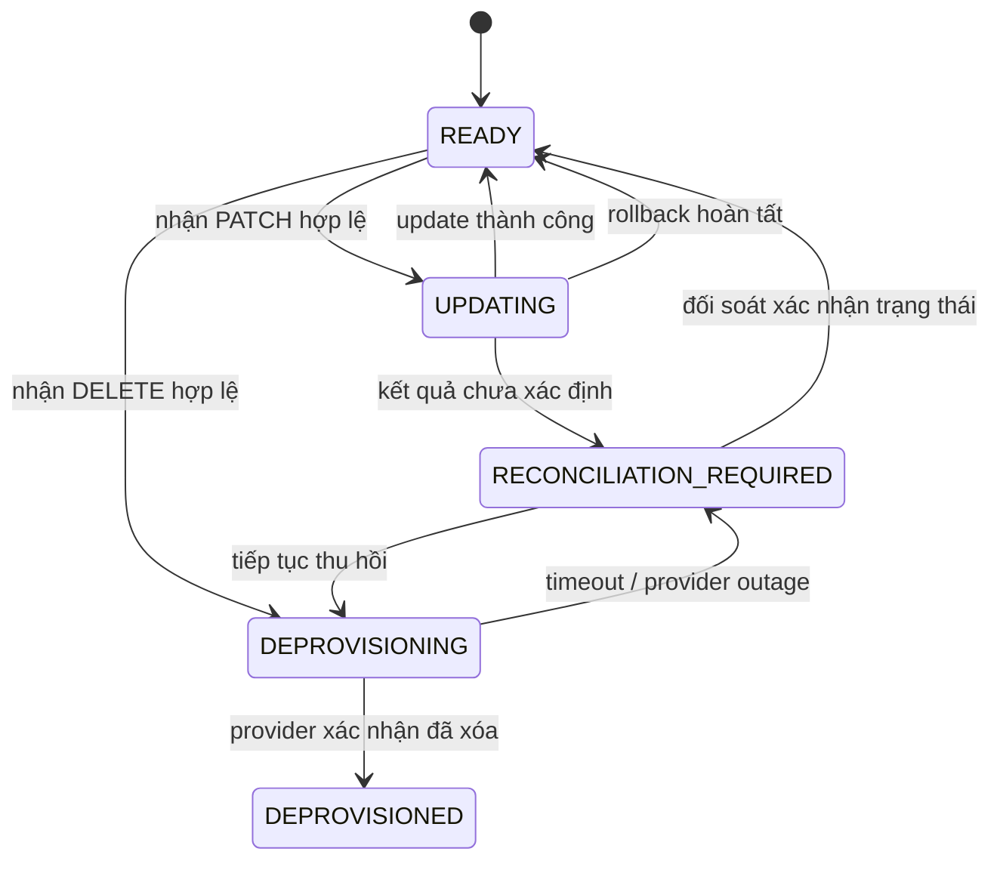

# Xung đột giữa thao tác đang chạy với yêu cầu cập nhật hoặc xóa mới

Trong Open Service Broker API (OSB API), provision, update và deprovision có thể mất nhiều thời gian. Khi platform cho phép xử lý bất đồng bộ bằng `accepts_incomplete=true`, broker tiếp nhận yêu cầu, trả `202 Accepted` và tiếp tục làm việc qua worker. Trong khoảng thời gian đó, platform hoặc người vận hành có thể gửi một yêu cầu thay đổi khác cho cùng service instance, chẳng hạn một PATCH update mới hoặc DELETE deprovision.

Nếu hai thao tác thay đổi tài nguyên chạy đồng thời, chúng có thể ghi đè cấu hình, xóa tài nguyên mà thao tác trước đang sử dụng hoặc làm trạng thái database broker lệch với hạ tầng. Vì vậy, Spring Cloud Service Broker cần có quy tắc điều phối theo từng service instance: xác định thao tác nào được phép chạy đồng thời, từ chối xung đột đúng hợp đồng OSB API, giữ operation đang chạy có thể truy vấn và bảo đảm worker cũ không commit kết quả sau khi quyền xử lý đã hết hiệu lực.

## 1. Vì sao thao tác đang chạy tạo ra xung đột?

Giả sử service instance `db-prod-17` đang được chuyển từ plan `standard` sang `high-availability`. Worker đang tăng số replica và đồng bộ dữ liệu. Trong lúc đó, platform gửi thêm một request PATCH để đổi storage hoặc gửi DELETE để thu hồi database.

Một số hậu quả có thể xảy ra nếu broker chạy cả hai thao tác:

- Update thứ hai đọc cấu hình cũ rồi ghi đè một phần thay đổi của update thứ nhất.
- Deprovision xóa database trong khi worker update vẫn đang tạo replica hoặc di chuyển dữ liệu.
- Worker update ghi `READY` sau khi worker deprovision đã đánh dấu instance `DEPROVISIONED`.
- Hai worker cùng gọi provider và tạo ra hai tài nguyên hoặc hai lần migration.
- `last_operation` trả trạng thái của một operation, trong khi platform đang theo dõi một thao tác khác.
- Broker lưu plan mới nhưng provider vẫn ở cấu hình cũ, hoặc ngược lại.

Xung đột không chỉ xảy ra khi hai request đến đúng cùng thời điểm. Một operation bất đồng bộ có thể chạy hàng phút; mọi request mới trong khoảng thời gian đó đều cần được kiểm tra với trạng thái instance và operation hiện tại.

## 2. Các thao tác nào có thể xung đột?

Broker nên phân biệt thao tác đọc với thao tác thay đổi trạng thái. `GET last_operation` cần đọc tiến độ và thường có thể thực hiện trong lúc operation chạy. Provision, update, deprovision và một số binding/unbinding có thể tác động đến cùng tài nguyên, nên cần được điều phối.

| Operation đang chạy | Request mới | Rủi ro chính | Chính sách thường phù hợp |
|---|---|---|---|
| `PROVISION` | `UPDATE` | Instance chưa sẵn sàng để thay đổi | Từ chối conflict hoặc yêu cầu chờ provision kết thúc |
| `PROVISION` | `DEPROVISION` | Xóa tài nguyên đang được tạo | Từ chối conflict; nếu hỗ trợ hủy provision thì phải có quy trình cancel/compensation riêng |
| `UPDATE` | `UPDATE` khác | Hai cấu hình đích cạnh tranh | Từ chối update mới khi operation cũ còn chạy |
| `UPDATE` | `DEPROVISION` | Xóa tài nguyên trong lúc migration/resize | Từ chối conflict; chỉ deprovision sau khi update kết thúc hoặc được xử lý theo quy trình điều phối riêng |
| `DEPROVISION` | `UPDATE` | Cập nhật tài nguyên đang bị thu hồi | Từ chối update |
| `DEPROVISION` | `DEPROVISION` lặp | Có thể là retry của cùng ý định xóa | Nhận diện cùng ý định và xử lý idempotent; request mâu thuẫn phải conflict |
| `UPDATE` | `GET last_operation` | Không làm thay đổi tài nguyên | Cho phép đọc nếu caller có quyền |
| `UPDATE` | `BIND` hoặc `UNBIND` | Có thể đổi endpoint, credential hoặc principal | Cho phép nếu độc lập; serialize nếu thay đổi ảnh hưởng binding |

Đây là chính sách điều phối gợi ý. Broker cần xác định rõ những thao tác nào ảnh hưởng cùng tài nguyên provider. Không nên khóa mọi thao tác đọc hoặc mọi binding một cách máy móc nếu chúng không xung đột với update đang chạy.

## 3. Quy tắc OSB API khi có operation chưa hoàn tất

### 3.1. `accepts_incomplete` chỉ cho phép thao tác hiện tại chạy async

Platform có thể gửi `accepts_incomplete=true` trên request provision, update hoặc deprovision để cho phép broker tiếp nhận thao tác bất đồng bộ. Query parameter này không phải quyền cho phép broker chạy nhiều thao tác thay đổi cùng một instance đồng thời.

Ví dụ request update:

```http
PATCH /v2/service_instances/db-prod-17?accepts_incomplete=true HTTP/1.1
Content-Type: application/json
X-Broker-API-Version: 2.17

{
  "service_id": "postgresql-service-v1",
  "plan_id": "postgresql-high-availability-v1",
  "parameters": {
    "storage_gb": 200
  }
}
```

Nếu broker chấp nhận xử lý nền, broker trả `202 Accepted` và có thể cung cấp `operation` để platform polling. Khi operation còn `in progress`, một PATCH hoặc DELETE mới phải được kiểm tra theo chính sách concurrency của broker trước khi được tiếp nhận.

### 3.2. Trả lỗi conflict cho yêu cầu thay đổi không tương thích

Nếu một operation đang thay đổi service instance và request mới không thể chạy an toàn cùng lúc, broker có thể từ chối bằng `409 Conflict` với mã lỗi `ConcurrencyError` theo quy ước lỗi OSB API:

```http
HTTP/1.1 409 Conflict
Content-Type: application/json

{
  "error": "ConcurrencyError",
  "description": "A service instance operation is already in progress. Retry after it completes."
}
```

Response không được làm thay đổi operation hiện tại. Broker giữ operation cũ và cho phép platform tiếp tục truy vấn `last_operation`. Mô tả lỗi nên ngắn gọn, không tiết lộ chi tiết hạ tầng hoặc dữ liệu nhạy cảm.

`409 Conflict` khác với `422 AsyncRequired`:

- `409 Conflict` cho biết trạng thái hiện tại của instance không cho phép request mới thực hiện lúc này, ví dụ một operation khác đang chạy.
- `422 Unprocessable Entity` với `AsyncRequired` cho biết broker cần xử lý request hiện tại theo cách bất đồng bộ nhưng platform chưa cho phép bằng `accepts_incomplete=true`.

Không dùng `AsyncRequired` để biểu diễn mọi trường hợp instance đang bận. Cũng không trả `202` chỉ để né xung đột nếu broker chưa có cơ chế tuần tự hóa và lưu operation mới một cách bền vững.

### 3.3. Operation ID và request identity có vai trò khác nhau

`operation` trong response async định danh công việc nghiệp vụ mà platform cần theo dõi. `X-Broker-API-Request-Identity` định danh một lượt gọi HTTP để đối chiếu log nếu platform hỗ trợ header đó. Request mới bị conflict có thể có request identity riêng, trong khi operation cũ vẫn giữ nguyên operation ID.

Không ghi đè operation ID đang chạy bằng request identity của request mới. Cũng không dùng request identity làm khóa concurrency hoặc idempotency, vì mỗi lần retry có thể mang một request identity khác.

## 4. Mô hình trạng thái và quy tắc chuyển trạng thái

Broker nên duy trì trạng thái instance riêng biệt với trạng thái operation. Trạng thái instance mô tả khả năng thao tác lên tài nguyên; trạng thái operation mô tả tiến trình của một yêu cầu cụ thể.

Ví dụ trạng thái nội bộ của instance:

| Trạng thái instance | Ý nghĩa | Mutation được phép |
|---|---|---|
| `PROVISIONING` | Đang tạo tài nguyên | Chặn update/deprovision cạnh tranh |
| `READY` | Tài nguyên sẵn sàng | Có thể nhận update hoặc deprovision nếu không có operation khác |
| `UPDATING` | Đang thay đổi cấu hình/plan | Chặn update hoặc deprovision mới |
| `DEPROVISIONING` | Đang thu hồi tài nguyên | Chặn update, bind mới và các mutation không tương thích |
| `RECONCILIATION_REQUIRED` | Kết quả hạ tầng chưa rõ hoặc cần phục hồi | Chặn mutation cho đến khi xác định trạng thái |
| `DEPROVISIONED` | Tài nguyên đã được thu hồi | Không nhận update/bind; xử lý DELETE lặp theo chính sách idempotency |

Các trạng thái này là mô hình nội bộ, không phải giá trị state mà OSB `last_operation` trả về. Operation có thể dùng các trạng thái như `ACCEPTED`, `QUEUED`, `RUNNING`, `RETRY_WAIT`, `SUCCEEDED`, `FAILED` và `CANCELLED` nếu broker có hỗ trợ hủy.

Luồng chuyển trạng thái điển hình:



Không chuyển instance về `READY` chỉ vì worker kết thúc hoặc exception đã được bắt. Chỉ chuyển trạng thái khi provider và dữ liệu broker đã nhất quán hoặc rollback đã hoàn tất.

## 5. Kiểm tra và claim quyền thay đổi instance một cách nguyên tử

Kiểm tra kiểu `if (instance.getState() == READY)` rồi sau đó tạo operation là không đủ nếu nhiều request có thể chạy trên nhiều thread hoặc nhiều replica broker. Hai request có thể cùng đọc `READY`, cùng vượt qua kiểm tra và cùng bắt đầu công việc.

Việc kiểm tra trạng thái và claim quyền thay đổi phải là một thao tác nguyên tử ở tầng lưu trữ. Một request chỉ được tạo operation nếu đồng thời thỏa mãn:

- Instance tồn tại trong đúng platform scope.
- Trạng thái instance cho phép operation mới.
- Không có operation mutation khác đang hoạt động trên instance.
- Version instance chưa thay đổi trong lúc kiểm tra.
- Request phù hợp với service, plan và chính sách hiện tại.

### 5.1. Optimistic locking với version

Có thể dùng trường `version` trên service instance. Khi request bắt đầu, broker đọc version hiện tại. Việc chuyển `READY` sang `UPDATING` chỉ thành công nếu version vẫn bằng giá trị vừa đọc:

```sql
UPDATE service_instance
SET state = 'UPDATING',
    version = version + 1,
    updated_at = CURRENT_TIMESTAMP
WHERE platform_instance_id = :platform_instance_id
  AND service_instance_id = :service_instance_id
  AND state = 'READY'
  AND version = :expected_version;
```

Nếu số dòng cập nhật bằng `1`, request đã claim được instance. Nếu bằng `0`, instance đã thay đổi hoặc request khác đã claim trước; broker phải đọc lại trạng thái và trả conflict phù hợp.

Với JPA, có thể dùng `@Version`:

```java
@Entity
public class ServiceInstanceEntity {

    @EmbeddedId
    private ServiceInstanceKey id;

    @Enumerated(EnumType.STRING)
    private InstanceState state;

    @Version
    private long version;
}
```

Optimistic locking phát hiện ghi đồng thời khi commit. Cần bắt `OptimisticLockException` hoặc lỗi tương ứng và ánh xạ thành lỗi concurrency, không để lộ stack trace cho platform.

### 5.2. Ràng buộc chỉ một operation mutation đang hoạt động

Một cách khác là dùng bảng operation và unique constraint phù hợp để chỉ cho phép một operation đang hoạt động cho mỗi service instance. Với database hỗ trợ partial/filtered index, có thể tạo unique index trên khóa instance với điều kiện state thuộc tập active. Nếu database không hỗ trợ, có thể dùng transaction với row lock trên instance trước khi kiểm tra operation và tạo operation mới.

Ví dụ logic transaction:

```text
BEGIN
  SELECT service_instance FOR UPDATE
  IF instance.state != READY: reject conflict
  IF active mutation operation exists: reject conflict
  INSERT operation(state = ACCEPTED, type = UPDATE or DEPROVISION)
  UPDATE service_instance SET state = UPDATING or DEPROVISIONING
  INSERT outbox event
COMMIT
```

Operation, trạng thái instance và outbox phải được commit cùng nhau trước khi trả `202 Accepted`. Nhờ đó, không có khoảng trống trong đó broker đã trả lời platform nhưng chưa lưu công việc cần thực hiện.

### 5.3. Không dùng khóa trong bộ nhớ làm cơ chế duy nhất

`synchronized`, `ReentrantLock` hoặc `ConcurrentHashMap` chỉ bảo vệ một JVM. Khi broker chạy nhiều replica, request update có thể vào pod A còn DELETE vào pod B; hai khóa trong bộ nhớ không chia sẻ trạng thái.

Hãy dùng database transaction, unique constraint, distributed lock có lease hoặc cơ chế điều phối bền vững. Nếu dùng distributed lock, cần có fencing token hoặc version để worker cũ không thể ghi kết quả sau khi lease đã hết hạn và worker mới đã tiếp quản.

## 6. Xử lý request mới trong từng tình huống

### 6.1. Update mới khi update cũ đang chạy

Nếu request mới khác với update đang chạy, broker nên trả `409 Conflict` và giữ nguyên operation hiện tại. Platform có thể tiếp tục polling `last_operation`, sau khi operation hoàn tất mới gửi request mới.

Ví dụ:

1. PATCH A yêu cầu tăng storage từ 50 GB lên 100 GB và được tiếp nhận async.
2. Instance chuyển sang `UPDATING`; operation A ở `RUNNING`.
3. PATCH B yêu cầu chuyển plan sang `high-availability` đến trong lúc A đang chạy.
4. Broker phát hiện active operation A và trả `409 ConcurrencyError` cho B.
5. PATCH A hoàn tất; instance trở lại `READY`.
6. Platform gửi lại PATCH B với trạng thái và version mới.

Không nên tự gộp PATCH B vào PATCH A trừ khi broker có cơ chế hợp nhất request, xác định thứ tự và đảm bảo kết quả theo hợp đồng rõ ràng. Việc âm thầm thay đổi target parameters của operation đang chạy khiến platform khó biết yêu cầu nào đã được thực hiện.

### 6.2. Delete mới khi update đang chạy

DELETE có tính phá hủy cao hơn update. Nếu update đang thực hiện migration hoặc resize, broker không nên xóa tài nguyên đồng thời. Trả `409 Conflict` giúp platform biết instance đang được thay đổi và cần chờ operation hoàn tất.

Sau khi update thành công, platform có thể gửi DELETE mới. Nếu update thất bại, broker cần xác định trạng thái tài nguyên và hoàn tất rollback hoặc reconciliation trước khi cho phép deprovision. Nếu provider đã thay đổi một phần tài nguyên, deprovision cần sử dụng resource reference thực tế chứ không dựa trên giả định cấu hình cũ vẫn còn nguyên.

### 6.3. Update mới khi deprovision đang chạy

Khi instance đã ở `DEPROVISIONING`, broker từ chối PATCH mới. Việc update không thể được xem là hợp lệ vì resource đang được thu hồi và có thể đã bị xóa một phần. Broker không được tạo lại database hoặc tự động đảo ngược deprovision chỉ vì nhận request update.

### 6.4. Delete lặp khi deprovision đang chạy

Hai DELETE giống nhau có thể là retry của cùng một ý định thu hồi, chẳng hạn platform không nhận được response `202` đầu tiên. Broker nên nhận diện cùng instance, cùng service/plan và cùng ý định deprovision. Nếu operation hiện tại chính là operation tương ứng, broker có thể áp dụng chính sách idempotent của mình để không tạo công việc xóa cạnh tranh hoặc gửi lại provider call không an toàn.

Nếu request DELETE lặp có thông tin mâu thuẫn, instance thuộc platform khác hoặc resource mapping không khớp, broker phải kiểm tra và từ chối theo hợp đồng. Không được coi mọi DELETE trên cùng instance là giống nhau chỉ vì method HTTP giống nhau.

### 6.5. Binding trong lúc update hoặc deprovision

Binding có thể độc lập với một số update, ví dụ update metadata nội bộ không làm thay đổi endpoint. Nhưng nếu update xoay credential, đổi hostname, chuyển database hoặc thay route endpoint, binding mới và GET binding có thể trả dữ liệu không nhất quán. Broker cần xác định dependency của từng operation:

- Chặn binding mới khi endpoint hoặc credential đang thay đổi.
- Cho phép GET read-only nếu dữ liệu binding vẫn nhất quán và không bị thu hồi.
- Chặn binding mới và retrieve credentials khi instance đã `DEPROVISIONING`.
- Điều phối unbind trước hoặc trong deprovision theo chính sách cleanup.

## 7. `last_operation` khi có request xung đột

Khi một operation được chấp nhận async, platform sử dụng `operation` trong response để truy vấn `last_operation`:

```http
GET /v2/service_instances/db-prod-17/last_operation?service_id=postgresql-service-v1&plan_id=postgresql-high-availability-v1&operation=update-2026-000145 HTTP/1.1
X-Broker-API-Version: 2.17
```

Broker trả một trong các state OSB:

| State | Ý nghĩa |
|---|---|
| `in progress` | Operation vẫn đang chạy, chờ retry hoặc chờ provider hoàn tất |
| `succeeded` | Operation đã hoàn tất thành công |
| `failed` | Operation đã kết thúc thất bại |

Khi request mới bị conflict:

- Không thay đổi operation ID đang chạy.
- Không ghi operation bị từ chối như một operation đã được chấp nhận.
- Giữ cho `last_operation` truy vấn operation cũ trả đúng trạng thái.
- Ghi log request bị conflict với request identity riêng nếu có, cùng ID của operation đang chiếm instance.
- Mô tả lỗi có thể hướng dẫn platform polling operation hiện tại rồi retry, nhưng không tiết lộ dữ liệu nội bộ.

Broker nên lưu lịch sử operation thay vì chỉ giữ một hàng trạng thái có thể bị ghi đè. Có thể đánh dấu một operation là active trên instance và giữ các operation hoàn tất để audit. Khi platform gửi `operation` cụ thể, broker phải trả trạng thái đúng operation đó trong phạm vi service instance.

## 8. Worker cũ, lease hết hạn và fencing token

Trong hệ thống nhiều worker, một worker có thể bị treo hoặc mất kết nối nhưng vẫn tiếp tục chạy sau khi lease đã hết hạn. Một worker khác có thể đã claim operation và bắt đầu xử lý. Nếu worker cũ vẫn được phép commit, nó có thể ghi đè kết quả mới hoặc chuyển instance từ `DEPROVISIONED` về `READY`.

Để ngăn điều này, mỗi lần claim operation có thể tăng `fencing_token` hoặc `generation`:

1. Worker A claim operation với token `41`.
2. Worker A bị treo; lease hết hạn.
3. Worker B claim lại operation với token `42`.
4. Worker B hoàn tất và commit kết quả với token `42`.
5. Worker A hoạt động trở lại nhưng mọi cập nhật của token `41` bị từ chối.

Ví dụ cập nhật có điều kiện:

```sql
UPDATE service_operation
SET state = 'SUCCEEDED', updated_at = CURRENT_TIMESTAMP
WHERE operation_id = :operation_id
  AND fencing_token = :worker_token
  AND state = 'RUNNING';
```

Nếu không có dòng nào được cập nhật, worker không còn quyền commit. Nếu provider đã nhận side effect từ worker cũ, broker cần reconciliation và idempotency ở provider để xác định trạng thái thật. Fencing token bảo vệ database broker; nó không tự ngăn một API provider bên ngoài thực hiện lệnh đã gửi.

## 9. Triển khai điều phối trong Spring

Một kiến trúc Spring có thể tách các thành phần:

- `ServiceInstanceOperationCoordinator`: điều phối mutation và quy tắc xung đột.
- `ServiceInstanceRepository`: lưu trạng thái instance, version và phạm vi platform.
- `ServiceOperationRepository`: lưu operation đang chạy và lịch sử.
- `OutboxRepository`: ghi sự kiện để worker nhận việc sau commit.
- `OperationWorker`: thực hiện provision/update/deprovision.
- `LastOperationService`: ánh xạ operation sang response OSB.

### 9.1. Claim instance trong transaction

Ví dụ domain code minh họa:

```java
@Service
public class ServiceInstanceOperationCoordinator {

    private final ServiceInstanceRepository instances;
    private final ServiceOperationRepository operations;
    private final OutboxRepository outbox;

    public ServiceInstanceOperationCoordinator(
            ServiceInstanceRepository instances,
            ServiceOperationRepository operations,
            OutboxRepository outbox) {
        this.instances = instances;
        this.operations = operations;
        this.outbox = outbox;
    }

    @Transactional
    public String acceptUpdate(UpdateCommand command) {
        ServiceInstance instance = instances.findForUpdate(
                        command.platformInstanceId(),
                        command.serviceInstanceId())
                .orElseThrow(ServiceInstanceNotFoundException::new);

        if (instance.getState() != InstanceState.READY) {
            throw new ConcurrencyErrorException(
                    "Service instance đang có thao tác thay đổi trạng thái");
        }

        if (operations.existsActiveMutation(
                command.platformInstanceId(), command.serviceInstanceId())) {
            throw new ConcurrencyErrorException(
                    "Một operation khác đang chạy trên service instance");
        }

        String operationId = UUID.randomUUID().toString();
        instance.markUpdating();
        operations.insertAccepted(operationId, command);
        outbox.insertUpdateRequested(operationId);
        return operationId;
    }
}
```

Đây là pseudocode kiến trúc. `findForUpdate` cần dùng row-level lock hoặc cơ chế tương đương. Kiểm tra active operation và chuyển trạng thái instance phải nằm trong cùng transaction. Cần có unique constraint hoặc kiểm soát version để bảo vệ cả trường hợp hai request đi qua các node khác nhau.

### 9.2. Ánh xạ conflict sang response OSB

Adapter OSB bắt `ConcurrencyErrorException` và trả `409 Conflict` với error code phù hợp. Không được để exception bị ánh xạ thành `500 Internal Server Error` nếu đây là tình huống xung đột đã được dự kiến.

```java
@RestControllerAdvice
public class BrokerExceptionHandler {

    @ExceptionHandler(ConcurrencyErrorException.class)
    public ResponseEntity<OsbErrorResponse> handleConcurrency(
            ConcurrencyErrorException exception) {

        return ResponseEntity.status(HttpStatus.CONFLICT)
                .body(new OsbErrorResponse(
                        "ConcurrencyError",
                        exception.getSafeDescription()));
    }
}
```

Đoạn code chỉ minh họa ánh xạ lỗi. Khi dùng controller và exception mapper có sẵn của Spring Cloud Open Service Broker, nên dùng cơ chế lỗi của framework để response đúng schema và không tạo handler trùng lặp.

### 9.3. Worker chỉ commit khi còn quyền xử lý

Worker cần claim operation, lấy fencing token/version, gọi provider ngoài transaction và commit kết quả bằng điều kiện token. Nếu lease đã hết hạn hoặc operation đã bị thay thế, worker không được tự ý ghi `READY` hoặc `DEPROVISIONED`. Hãy ghi nhận kết quả bên ngoài và để reconciliation cập nhật trạng thái sau khi kiểm tra operation hiện hành.

Không giữ database transaction mở trong lúc gọi API provider kéo dài. Transaction dài có thể giữ row lock, gây deadlock hoặc làm request mới chờ quá lâu. Dùng transaction ngắn để claim, transaction khác để commit kết quả và lease có thời hạn cho worker.

## 10. Idempotency và nhận diện request lặp

Concurrency control ngăn hai mutation khác nhau chạy đồng thời. Idempotency xử lý trường hợp cùng một ý định được gửi lại do timeout hoặc mất response. Hai cơ chế liên quan nhưng không thay thế nhau.

Broker nên lưu fingerprint của request nghiệp vụ sau khi chuẩn hóa, gồm các field có ảnh hưởng đến kết quả như operation type, service ID, plan ID và parameters. Khi request lặp đến:

- Nếu fingerprint khớp với operation đang chạy, broker có thể nhận diện đây là retry của cùng ý định và xử lý theo chính sách idempotency đã định nghĩa.
- Nếu fingerprint khác với operation đang chạy trên cùng instance, trả `409 Conflict`.
- Nếu operation đã hoàn tất và instance đã ở trạng thái đích, không gọi provider lại một cách không cần thiết.
- Nếu request lặp có dữ liệu mâu thuẫn, không trả lại kết quả cũ như thể request mới đã được thực hiện.

Với DELETE lặp, có thể gắn cùng một deletion intent với operation hiện tại. Với PATCH khác nhau, không nên tự coi là cùng operation chỉ vì cùng service instance. Không dùng header request identity làm fingerprint vì nó định danh transport request, không nhất thiết định danh ý định nghiệp vụ.

## 11. Retry sau khi operation hoàn tất hoặc thất bại

Khi platform nhận `409 ConcurrencyError`, platform có thể polling operation đang chạy bằng `last_operation`. Sau khi operation cũ kết thúc, platform gửi lại request mới. Broker cần kiểm tra trạng thái instance mới nhất và validate lại toàn bộ request; không sử dụng kết quả validation từ trước khi conflict.

Nếu operation cũ `succeeded`, request mới có thể hợp lệ trên cấu hình mới. Nếu operation cũ `failed`, broker phải xác định instance đã rollback hoàn toàn hay đang cần reconciliation. Khi trạng thái chưa rõ, giữ `RECONCILIATION_REQUIRED` và tiếp tục từ chối mutation mới cho đến khi provider và database nhất quán.

Nếu operation cũ bị retry tự động, request mới vẫn phải conflict trong khi operation còn active. Không tạo một operation thứ hai chỉ vì worker đang chờ `next_retry_at`; trạng thái `RETRY_WAIT` vẫn chiếm quyền thay đổi instance.

## 12. Quan sát và audit xung đột

Log và metric nên giúp đội vận hành biết operation nào đang giữ instance, request nào bị từ chối và worker nào đang xử lý. Các trường hữu ích:

- `platform_instance_id`, `service_instance_id`.
- `active_operation_id`, `active_operation_type`.
- `incoming_operation_type` và request identity nếu có.
- Instance version, worker fencing token và lease expiry.
- Thời điểm operation bắt đầu, lần cập nhật gần nhất và `next_retry_at`.
- Error code `ConcurrencyError` và số lần request bị conflict.

Không đưa credential, parameters nhạy cảm hoặc payload đầy đủ vào log. Với metric, tránh dùng service instance ID hoặc operation ID làm label có cardinality cao; dùng log/trace cho định danh chi tiết và metric tổng hợp theo operation type, platform type, kết quả và nhóm lỗi.

Một dashboard vận hành có thể hiển thị instance đang `UPDATING` hoặc `DEPROVISIONING`, operation ID hiện tại, thời gian đã chạy, lần retry tiếp theo và liên kết đến log. Người vận hành chỉ được force cancel hoặc giải phóng lock khi đã kiểm tra trạng thái provider và có quy trình audit.

## 13. Kiểm thử xung đột giữa operation và request mới

Các kiểm thử tích hợp cần mô phỏng request đồng thời, worker nhiều replica và lỗi giữa các bước:

1. PATCH thứ nhất được tiếp nhận async; PATCH thứ hai khác parameters đến trong lúc operation đầu chạy phải nhận `409 ConcurrencyError`.
2. DELETE đến trong lúc update đang chạy phải conflict và không gọi provider deprovision.
3. PATCH đến trong lúc deprovision đang chạy phải bị từ chối.
4. GET `last_operation` vẫn trả trạng thái của operation đã được chấp nhận sau khi request mới bị conflict.
5. Request lặp cùng ý định được xử lý idempotent và không tạo operation/provider side effect trùng.
6. Request mới có fingerprint khác bị conflict dù cùng service instance.
7. Hai request đồng thời đến hai replica broker chỉ có một request claim được instance.
8. Optimistic locking phát hiện version cũ và không ghi đè trạng thái mới.
9. Operation ở `RETRY_WAIT` vẫn giữ quyền mutation; request mới không chạy song song.
10. Worker A mất lease, worker B tiếp quản; worker A không thể commit bằng fencing token cũ.
11. Worker dừng sau khi provider thực hiện side effect; retry/reconciliation xác định trạng thái thật trước khi cho phép mutation tiếp theo.
12. Update thất bại nhưng rollback hoàn tất thì instance trở lại `READY`; rollback thất bại thì instance chuyển `RECONCILIATION_REQUIRED`.
13. DELETE lặp trong lúc deprovision có thể nhận diện cùng deletion intent; không tạo hai luồng xóa cạnh tranh.
14. Conflict response không làm thay đổi operation cũ và không tiết lộ thông tin nhạy cảm.
15. Khi operation hoàn tất, request mới được validate lại và có thể được chấp nhận theo trạng thái mới.

## 14. Lỗi thường gặp và cách khắc phục

| Lỗi | Hậu quả | Cách khắc phục |
|---|---|---|
| Chỉ kiểm tra state trong Java rồi mới insert operation | Hai replica có thể cùng vượt qua kiểm tra | Claim instance và tạo operation nguyên tử trong database |
| Cho PATCH và DELETE chạy đồng thời | Tài nguyên bị thay đổi và xóa cùng lúc | Một mutation active trên mỗi instance hoặc dependency lock rõ ràng |
| Trả `202` cho mọi request mới | Có nhiều operation cạnh tranh và khó xác định kết quả | Chỉ nhận operation khi instance được claim thành công |
| Dùng `accepts_incomplete` như quyền chạy song song | Hiểu sai ý nghĩa async | Dùng nó chỉ để xác định platform có chấp nhận operation chưa hoàn tất |
| Trả `500` cho conflict đã dự kiến | Platform không biết cần chờ và retry | Trả `409 Conflict`/`ConcurrencyError` theo hợp đồng |
| Ghi đè operation ID cũ bằng operation mới | Platform không theo dõi được công việc ban đầu | Giữ lịch sử operation và active operation riêng |
| Dùng khóa JVM trong hệ thống nhiều replica | Request ở node khác không thấy lock | Dùng database hoặc distributed coordination có fencing |
| Worker cũ commit sau khi lease hết hạn | Trạng thái instance bị ghi đè | Dùng fencing token/version và điều kiện commit |
| Coi `RETRY_WAIT` là không còn operation active | Request mới chạy trong lúc worker sắp retry | Giữ quyền mutation cho đến khi operation terminal |
| Mở khóa khi provider chưa rõ kết quả | Operation mới tác động lên resource không xác định | Reconciliation trước khi cho phép mutation mới |

## 15. Kết luận

Khi một service instance đang có provision, update hoặc deprovision bất đồng bộ, broker phải kiểm soát mọi request thay đổi mới theo trạng thái operation hiện tại. Một chính sách an toàn là chỉ cho phép một mutation xung đột hoạt động trên mỗi instance, từ chối request mới bằng `409 Conflict`/`ConcurrencyError`, giữ operation cũ cho `last_operation` và yêu cầu platform gửi lại sau khi trạng thái đã ổn định. Trong Spring Cloud Service Broker, hãy thực hiện claim nguyên tử bằng transaction, version hoặc unique constraint; lưu operation và outbox bền vững; dùng lease/fencing token cho worker; và phân biệt concurrency control với idempotency. Nhờ vậy, update và deprovision không ghi đè hoặc phá hủy công việc đang chạy, kể cả khi broker có nhiều replica hoặc worker phải retry sau sự cố.
