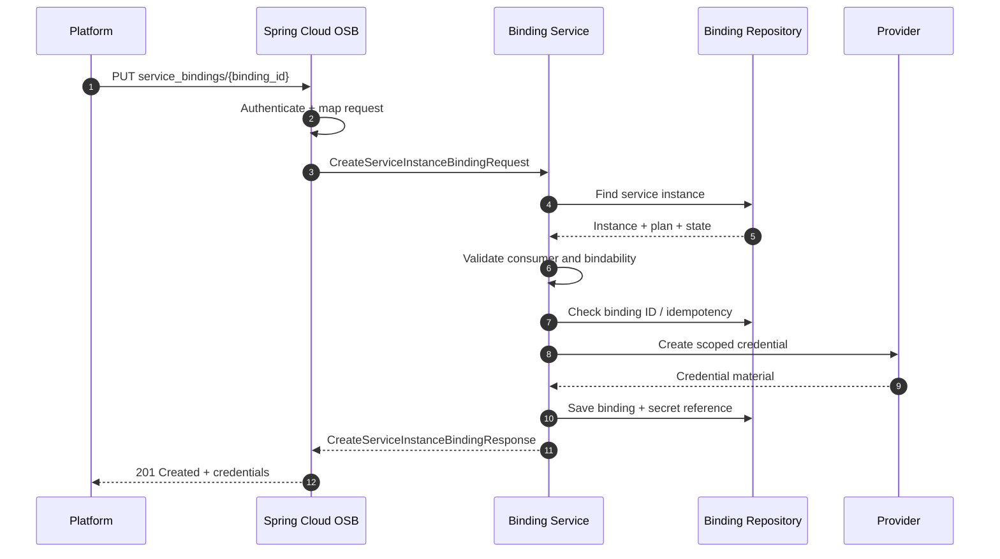

# PUT service binding và CreateServiceInstanceBindingRequest

Trong Open Service Broker API (OSB API), thao tác **bind** tạo một liên kết giữa service instance đã provision và một consumer, thường là ứng dụng. Platform gửi `PUT /v2/service_instances/{instance_id}/service_bindings/{binding_id}` để yêu cầu broker cấp quyền truy cập cho consumer đó. Broker xác minh instance, service, plan và danh tính consumer, sau đó tạo credential hoặc thông tin kết nối riêng cho binding và trả về platform.

Với module `SPRING_CLOUD_SERVICE_BROKER`, binding là bước đưa tài nguyên đã cấp phát vào sử dụng. Ví dụ, sau khi tạo PostgreSQL instance, broker có thể tạo một database user riêng cho từng ứng dụng; sau khi tạo Redis instance, broker có thể phát hành một credential giới hạn quyền truy cập. Spring Cloud Open Service Broker chuyển request OSB thành `CreateServiceInstanceBindingRequest`, để lớp nghiệp vụ xử lý việc kiểm tra và tạo binding mà không phải tự phân tích HTTP request.

## 1. Binding là gì và vì sao cần binding ID?

Service instance đại diện cho tài nguyên nền đã được provision, chẳng hạn một database, queue hoặc bucket. Binding đại diện cho mối liên kết giữa instance đó với một consumer cụ thể. Một instance có thể có nhiều binding:

- Ứng dụng A nhận database user và password riêng.
- Ứng dụng B nhận một user khác trên cùng database.
- Khi ứng dụng A ngừng sử dụng dịch vụ, broker có thể thu hồi credential của A mà không ảnh hưởng tới B.

`binding_id` do platform cấp là định danh duy nhất của một binding trong phạm vi broker. Broker cần lưu ID này cùng instance ID, service ID, plan ID và consumer identity. Binding ID được dùng lại khi unbind, vì vậy phải ổn định trong suốt vòng đời liên kết.

Không dùng `app_guid` làm binding ID. Một ứng dụng có thể có nhiều binding tới các instance khác nhau, hoặc nhiều binding khác nhau tới cùng một instance. Mỗi liên kết cần một định danh riêng.

## 2. Endpoint PUT service binding

Endpoint OSB API có dạng:

```http
PUT /v2/service_instances/{instance_id}/service_bindings/{binding_id} HTTP/1.1
Host: broker.example.internal
X-Broker-API-Version: 2.14
Authorization: Basic <broker-credentials>
Content-Type: application/json

{
  "service_id": "postgres-service-id",
  "plan_id": "postgres-standard-plan",
  "app_guid": "app-456",
  "bind_resource": {
    "app_guid": "app-456"
  },
  "parameters": {
    "database_role": "application"
  },
  "context": {
    "platform": "cloudfoundry",
    "organization_guid": "org-123",
    "space_guid": "space-456"
  }
}
```

Các thành phần quan trọng:

| Thành phần | Ý nghĩa |
|---|---|
| `instance_id` trong path | Service instance đã được provision trước đó. |
| `binding_id` trong path | Định danh của liên kết mà platform muốn tạo. |
| `service_id` | ID service trong catalog mà instance thuộc về. |
| `plan_id` | ID plan gắn với instance và request bind. |
| `app_guid` | Định danh ứng dụng kiểu cũ; trường này đã được đánh dấu deprecated trong OSB API, nên ưu tiên `bind_resource` khi platform hỗ trợ. |
| `bind_resource` | Thông tin consumer hoặc tài nguyên sẽ sử dụng binding, ví dụ app hoặc route. |
| `parameters` | Tham số bổ sung dành riêng cho thao tác bind, nếu service hỗ trợ. |
| `context` | Ngữ cảnh platform cung cấp, chẳng hạn thông tin organization/space trong Cloud Foundry. |

Không phải platform nào cũng gửi đầy đủ mọi trường. Broker cần xử lý đúng trường tùy chọn theo phiên bản OSB API và platform mục tiêu. Không suy ra consumer là ứng dụng chỉ vì request có `app_guid`; `bind_resource` có thể mô tả loại consumer khác, tùy capability và tích hợp.

## 3. bind_resource và app_guid

`bind_resource` mô tả tài nguyên sẽ tiêu thụ binding. Với application binding, object này thường chứa `app_guid`. Với các loại binding khác, nó có thể chứa thông tin route hoặc thông tin tài nguyên liên quan theo hợp đồng OSB API.

Ví dụ application binding:

```json
{
  "bind_resource": {
    "app_guid": "app-456"
  }
}
```

Ví dụ route binding:

```json
{
  "bind_resource": {
    "route": "https://orders.example.com"
  }
}
```

Trường `app_guid` ở cấp cao nhất của request là trường legacy/deprecated. Broker có thể cần hỗ trợ nó để tương thích với platform cũ, nhưng nên chuẩn hóa dữ liệu consumer vào một mô hình nội bộ thống nhất. Nếu cả `app_guid` và `bind_resource.app_guid` cùng được gửi mà không khớp, broker cần áp dụng quy tắc tương thích rõ ràng hoặc từ chối request; không âm thầm chọn một giá trị tùy ý.

Không tin `bind_resource` như bằng chứng xác thực độc lập. Broker xác thực platform ở biên HTTP, sau đó kiểm tra consumer ID và context với chính sách tenant, quyền truy cập và service instance đã lưu.

## 4. Điều kiện để tạo binding

Trước khi tạo credential, broker cần kiểm tra:

1. Request đến từ platform đã xác thực và phiên bản OSB API được hỗ trợ.
2. `instance_id` tồn tại trong kho trạng thái broker.
3. `service_id` và `plan_id` khớp với instance đã provision.
4. Service được công bố `bindable: true` trong catalog.
5. Instance đang ở trạng thái cho phép bind, thường là `AVAILABLE`.
6. Instance không đang `DEPROVISIONING`, `DEPROVISIONED` hoặc ở trạng thái lỗi không cho phép cấp quyền mới.
7. `binding_id` chưa được dùng cho một consumer hoặc request khác.
8. Consumer được phép sử dụng instance theo tenant context và chính sách của nhà cung cấp.
9. Tham số bind hợp lệ theo schema và quyền của plan.

Nếu service không hỗ trợ binding, broker không được tạo credential chỉ vì platform gọi endpoint. Capability `bindable` trong catalog phải phản ánh đúng khả năng thực tế.

## 5. CreateServiceInstanceBindingRequest trong Spring Cloud

Spring Cloud Open Service Broker chuyển HTTP request thành đối tượng `CreateServiceInstanceBindingRequest` và gọi service implementation tương ứng. Trong các phiên bản Spring Cloud Open Service Broker sử dụng reactive API, điểm mở rộng thường là `ServiceInstanceBindingService` với phương thức `createServiceInstanceBinding(...)` trả về `Mono<CreateServiceInstanceBindingResponse>`.

Request model cung cấp những thông tin cần thiết để lớp nghiệp vụ tạo binding, thường gồm:

- Service instance ID và binding ID.
- Service definition ID và plan ID.
- Consumer information như app GUID hoặc bind resource.
- Binding parameters do platform gửi.
- Context của platform.

Ví dụ cấu trúc triển khai minh họa:

```java
@Service
public class BrokerServiceInstanceBindingService
        implements ServiceInstanceBindingService {

    private final ServiceInstanceRepository instanceRepository;
    private final ServiceBindingService bindingService;

    public BrokerServiceInstanceBindingService(
            ServiceInstanceRepository instanceRepository,
            ServiceBindingService bindingService
    ) {
        this.instanceRepository = instanceRepository;
        this.bindingService = bindingService;
    }

    @Override
    public Mono<CreateServiceInstanceBindingResponse> createServiceInstanceBinding(
            CreateServiceInstanceBindingRequest request
    ) {
        return instanceRepository.findById(request.getServiceInstanceId())
                .switchIfEmpty(Mono.error(new ServiceInstanceNotFoundException()))
                .flatMap(instance -> {
                    validateBindingRequest(instance, request);
                    return bindingService.create(instance, request);
                });
    }
}
```

Đây là ví dụ về cách tổ chức service layer; repository, exception và domain service là thành phần do ứng dụng định nghĩa. Tên getter, package, kiểu dữ liệu của bind resource và chữ ký interface cần khớp với phiên bản Spring Cloud Open Service Broker mà dự án đang dùng. Không sao chép một chữ ký từ phiên bản khác mà chưa đối chiếu dependency.

### Vai trò của request object

Lớp nghiệp vụ không cần tự đọc path variable hoặc parse JSON từ `ServerHttpRequest`. Framework đã chuyển các trường OSB API vào request object. Điều này giúp:

- Tách giao thức HTTP khỏi logic tạo credential.
- Dễ kiểm thử bằng cách dựng request object trực tiếp.
- Dùng cùng logic nghiệp vụ cho nhiều platform tương thích OSB API.
- Giữ việc mapping lỗi và response ở lớp tích hợp của Spring Cloud Open Service Broker.

Tuy nhiên, request object vẫn là dữ liệu đầu vào từ bên ngoài. Broker vẫn phải validate tất cả ID, context và parameters trước khi thực hiện side effect.

## 6. Luồng xử lý tạo binding

Một luồng xử lý điển hình gồm các bước:

1. Framework nhận `PUT service_bindings` và tạo `CreateServiceInstanceBindingRequest`.
2. Broker tra cứu service instance bằng `instance_id`.
3. Xác minh service ID, plan ID, trạng thái instance và capability bindable.
4. Chuẩn hóa consumer identity từ bind resource và context.
5. Kiểm tra binding ID đã tồn tại chưa để xử lý retry/idempotency.
6. Gọi provider tạo user, role, token hoặc quyền truy cập riêng cho binding.
7. Lưu binding record và secret reference hoặc credential đã mã hóa theo chính sách.
8. Tạo `CreateServiceInstanceBindingResponse` chứa credential và các trường binding response phù hợp.
9. Framework trả response OSB API về platform.

Sơ đồ tuần tự:



## 7. Tạo credential riêng cho từng binding

Broker thường không nên trả credential quản trị của service instance cho mọi consumer. Thay vào đó, mỗi binding được cấp một credential riêng có quyền tối thiểu.

Ví dụ với PostgreSQL:

- Instance có database `orders`.
- Binding `binding-app-a` tạo user `orders_app_a` chỉ có quyền cần thiết trên database.
- Binding `binding-app-b` tạo user `orders_app_b` với quyền riêng.
- Khi unbind `binding-app-a`, broker revoke user A mà không ảnh hưởng user B hoặc database.

Ví dụ với Redis, broker có thể tạo ACL user riêng cho binding và giới hạn command/key pattern. Với object storage, broker có thể cấp access key có scope tới bucket hoặc prefix cụ thể.

Credential nên bao gồm đúng những thông tin mà ứng dụng cần kết nối, ví dụ:

```json
{
  "credentials": {
    "uri": "postgresql://db.example.internal:5432/orders",
    "hostname": "db.example.internal",
    "port": 5432,
    "database": "orders",
    "username": "orders_app_a",
    "password": "<generated-secret>",
    "sslmode": "require"
  }
}
```

Đây là ví dụ response credentials. Tên trường và định dạng cụ thể do broker thiết kế và phải phù hợp với cách platform cung cấp service binding cho ứng dụng. Không trả password quản trị hoặc token provider nếu ứng dụng không cần chúng.

## 8. CreateServiceInstanceBindingResponse

Khi tạo binding đồng bộ thành công, broker trả response model mà framework ánh xạ thành HTTP `201 Created`. Thành phần quan trọng nhất thường là `credentials`, một object chứa thông tin kết nối hoặc thông tin xác thực dành cho consumer.

OSB API còn định nghĩa một số trường response chuyên biệt tùy loại binding:

| Trường | Mục đích |
|---|---|
| `credentials` | Thông tin xác thực hoặc kết nối để ứng dụng sử dụng service. |
| `syslog_drain_url` | URL để platform cấu hình chuyển tiếp log tới service. |
| `route_service_url` | URL endpoint của route service. |
| `volume_mounts` | Mô tả mount cần thiết cho binding volume service. |

Chỉ trả các trường phù hợp với loại service và capability đã công bố. Không trả đồng thời mọi trường nếu broker không triển khai chức năng tương ứng.

Ví dụ JSON response:

```http
HTTP/1.1 201 Created
Content-Type: application/json

{
  "credentials": {
    "uri": "postgresql://db.example.internal:5432/orders",
    "username": "orders_app_a",
    "password": "<generated-secret>"
  }
}
```

Ví dụ builder ở tầng nghiệp vụ (API builder thực tế cần theo phiên bản thư viện):

```java
return CreateServiceInstanceBindingResponse.builder()
        .credentials(Map.of(
                "uri", credentials.uri(),
                "username", credentials.username(),
                "password", credentials.password()
        ))
        .build();
```

Response được platform chuyển tới consumer theo cơ chế service binding của nền tảng. Broker cần bảo đảm credential không bị log bởi controller, HTTP filter, tracing agent hoặc exception handler.

## 9. Binding parameters và bind resource không giống nhau

Hai phần này thường dễ bị nhầm:

| Trường | Câu hỏi được trả lời | Ví dụ |
|---|---|---|
| `bind_resource` | Ai hoặc tài nguyên nào sẽ sử dụng service? | `app_guid`, route hoặc thông tin consumer phù hợp. |
| `parameters` | Consumer yêu cầu cấu hình binding như thế nào? | Tên role, quyền đọc/ghi, schema hoặc tùy chọn kết nối. |

Ví dụ:

```json
{
  "bind_resource": {
    "app_guid": "app-456"
  },
  "parameters": {
    "access_mode": "read-only",
    "schema": "reporting"
  }
}
```

Broker có thể tạo database user chỉ có quyền đọc schema `reporting`. `app_guid` nhận diện consumer; `access_mode` và `schema` là tham số nghiệp vụ. Broker phải validate chúng, không đưa trực tiếp vào SQL hoặc câu lệnh provider nếu chưa kiểm tra và escape phù hợp.

Nếu binding parameters có chứa secret, áp dụng cùng quy tắc phân loại, redaction và secret storage như provision parameters. Không lưu raw request hoặc in `request.toString()` ra log.

## 10. Idempotency khi platform gửi lại PUT

Platform có thể retry request khi timeout hoặc mất kết nối, kể cả khi broker đã tạo credential nhưng response chưa tới platform. Vì vậy, cùng một `binding_id` không được tạo thêm nhiều user/token ngoài dự kiến.

Broker nên thực hiện:

- Dùng `binding_id` làm khóa duy nhất trong kho trạng thái.
- Lưu quan hệ binding với `instance_id`, `service_id`, `plan_id` và consumer identity.
- Nếu cùng binding ID được gửi lại với cùng ý nghĩa, trả lại kết quả đã tạo theo chính sách bảo mật.
- Nếu cùng binding ID nhưng gắn với instance hoặc consumer khác, trả lỗi xung đột; không ghi đè binding hiện có.
- Dùng idempotency key hoặc external identity ổn định khi gọi provider nếu provider hỗ trợ.
- Nếu provider đã tạo credential nhưng broker chưa lưu được kết quả, có cơ chế tra cứu theo binding ID để phục hồi.
- Không tạo password mới ở mỗi lần retry nếu binding đã tồn tại.

Điểm khó là credential thường chỉ được trả một lần. Nếu broker không thể lấy lại credential từ provider, cần lưu secret được mã hóa hoặc dùng secret manager với reference có thể truy xuất. Không lưu password dạng rõ trong bảng binding hoặc log chỉ để phục vụ retry.

Để tránh hai request đồng thời tạo cùng binding, cần unique constraint trên `binding_id` và cơ chế claim/lock hoặc compare-and-set. Không giữ database transaction mở trong lúc gọi provider qua mạng; hãy lưu trạng thái `CREATING`, thực hiện side effect với idempotency key, rồi cập nhật `ACTIVE` và response data sau khi có kết quả.

## 11. Trạng thái binding và phối hợp với unbind

Một mô hình nội bộ đơn giản:

```text
CREATING -> ACTIVE -> DELETING -> DELETED
    |          |          |
    v          v          v
  FAILED     FAILED     RETRY
```

Trạng thái giúp broker xử lý các tình huống request trùng, provider timeout và worker restart. Trước khi tạo binding, instance phải cho phép bind. Khi instance chuyển sang `DEPROVISIONING`, broker không nhận binding mới. Khi unbind, broker chỉ thu hồi credential thuộc binding đó và cập nhật trạng thái binding.

Không xóa toàn bộ instance hoặc database khi unbind một binding. Ngược lại, deprovision instance cần bảo đảm các binding đã được thu hồi hoặc xử lý theo chính sách rõ ràng. Quan hệ giữa binding và instance phải được lưu bền vững để kiểm tra số consumer còn hoạt động.

## 12. Bảo mật trong quá trình bind

Binding là ranh giới phát hành credential nên cần áp dụng nguyên tắc least privilege:

1. Xác thực platform và kiểm tra quyền gọi OSB endpoint.
2. Kiểm tra tenant context, instance ID và consumer identity.
3. Chỉ cấp quyền trên tài nguyên và thao tác cần thiết cho consumer.
4. Sinh credential ngẫu nhiên bằng nguồn ngẫu nhiên an toàn; không dùng ID dễ đoán làm password.
5. Truyền credential qua TLS và chỉ trả trong response binding.
6. Không ghi credentials, request parameters hoặc provider response vào log/trace/metrics.
7. Mã hóa secret khi lưu và giới hạn quyền đọc secret reference.
8. Thu hồi credential khi unbind hoặc khi binding bị vô hiệu hóa theo chính sách.
9. Ghi audit event về binding ID, instance ID, consumer, thời điểm và kết quả mà không ghi giá trị secret.

Nếu platform cung cấp `context`, broker có thể dùng nó để áp dụng quy tắc theo nền tảng, organization hoặc space. Nhưng context phải được gắn với caller đã xác thực; không tin một trường `tenant_id` tùy ý do request body gửi lên.

## 13. Lỗi thường gặp và cách xử lý

| Tình huống | Cách xử lý |
|---|---|
| Instance không tồn tại | Trả lỗi resource not found theo mapping OSB API. |
| Service/plan không khớp instance | Từ chối request, không tạo credential. |
| Service không bindable | Trả lỗi phù hợp; không gọi provider. |
| Instance đang deprovision | Từ chối binding mới để tránh cấp quyền cho tài nguyên sắp bị xóa. |
| Binding ID đã tồn tại cùng consumer | Xử lý idempotent và trả kết quả đã ghi nhận. |
| Binding ID đã tồn tại nhưng consumer khác | Trả lỗi xung đột, không ghi đè. |
| Provider timeout chưa rõ đã tạo user chưa | Tra cứu theo binding ID/idempotency key trước khi thử lại. |
| Credential store không khả dụng | Không trả thành công nếu chưa có cách lưu/khôi phục credential an toàn. |
| Tham số bind sai | Trả lỗi validation đã làm sạch, không phản chiếu secret. |

Lỗi trả về platform phải tuân theo status code và error schema OSB API của phiên bản hỗ trợ. Không đưa raw exception message, password, token hoặc provider response body vào `description`.

## 14. Kiểm thử CreateServiceInstanceBindingRequest

Nên kiểm thử cả request mapping, nghiệp vụ, provider adapter và response:

- Request có instance/service/plan hợp lệ tạo đúng binding.
- `bind_resource.app_guid` được chuẩn hóa thành consumer identity.
- Request legacy chỉ có `app_guid` được xử lý theo chính sách tương thích.
- Service không bindable hoặc instance không ở trạng thái cho phép thì provider không được gọi.
- Parameters được validate theo schema và plan.
- Response chứa đúng credentials hoặc trường binding response tương ứng.
- Credential không xuất hiện trong log hoặc exception.
- Retry cùng binding ID không tạo thêm credential.
- Cùng binding ID nhưng consumer khác bị từ chối.
- Hai request đồng thời cho cùng binding ID không tạo side effect trùng.
- Instance đang deprovision không nhận binding mới.
- Unbind thu hồi đúng credential của binding và không ảnh hưởng binding khác.

Ví dụ test service với Reactor:

```java
@Test
void createsBindingForValidConsumer() {
    CreateServiceInstanceBindingRequest request = validBindingRequest(
            "instance-123", "binding-456", "postgres-service", "postgres-small");

    StepVerifier.create(bindingService.createServiceInstanceBinding(request))
            .assertNext(response -> {
                assertEquals("orders_app_a", response.getCredentials().get("username"));
                assertTrue(response.getCredentials().containsKey("password"));
            })
            .verifyComplete();

    verify(provider).createCredential(eq("binding-456"), any());
}
```

Đây là test minh họa; fixture, response accessor và mock provider cần điều chỉnh theo API thực tế của dự án. Nên bổ sung test retry và kiểm tra log bằng một secret sentinel giả để chứng minh password không bị rò rỉ.

## 15. Tích hợp với Cloud Foundry và Kubernetes

Với **Cloud Foundry**, platform quản lý binding giữa service instance và application trong organization/space. Khi người dùng bind service vào app, platform gửi request OSB chứa định danh consumer và context tương ứng. Broker tạo credential, trả response và Cloud Foundry cung cấp thông tin binding cho ứng dụng qua cơ chế environment/service binding của platform. Khi unbind, broker thu hồi credential của binding đó.

Với **Kubernetes**, cần một thành phần tích hợp OSB API hoặc service binding controller chuyển yêu cầu binding tới broker. Sau khi nhận response, controller có thể đưa credentials vào Kubernetes Secret hoặc cơ chế workload binding phù hợp. Không mặc định mọi cluster tự hiểu response OSB hoặc tự tạo Secret; hành vi phụ thuộc controller và cấu hình được triển khai. Secret cần có RBAC, phạm vi namespace và chính sách rotation/retention rõ ràng.

Trong cả hai nền tảng, broker vẫn chịu trách nhiệm tạo và thu hồi credential phía provider. Platform chuyển credential tới workload, nhưng không thay thế logic authorization hoặc lifecycle của binding ở broker.

## 16. Checklist trước khi triển khai

- Service chỉ công bố `bindable: true` khi có implementation tạo binding.
- Endpoint PUT xác minh instance, service, plan, consumer và trạng thái.
- `CreateServiceInstanceBindingRequest` được dùng làm input đã map từ OSB API; service vẫn validate dữ liệu.
- `bind_resource` và `app_guid` được xử lý theo quy tắc tương thích rõ ràng.
- Binding ID có unique constraint và được dùng làm idempotency key.
- Credential riêng cho từng consumer, quyền tối thiểu và có thể revoke.
- Response chỉ chứa trường binding phù hợp, không chứa secret nội bộ hoặc credential quản trị.
- Retry và request đồng thời không tạo nhiều credential.
- Log, trace, metrics và error response không chứa secret.
- Unbind thu hồi đúng binding; deprovision xử lý các binding còn tồn tại theo chính sách.
- Có test cho happy path, lỗi, retry, concurrency, secret redaction và consumer mismatch.

`PUT service binding` là điểm chuyển từ một service instance đã provision sang một liên kết có thể được ứng dụng sử dụng. Khi broker xử lý `CreateServiceInstanceBindingRequest` bằng cách xác minh đầy đủ instance và consumer, tạo credential theo least privilege, lưu binding bền vững và trả response đúng hợp đồng OSB API, việc bind/unbind có thể vận hành độc lập cho từng consumer mà không làm ảnh hưởng các ứng dụng khác đang dùng cùng service instance.
